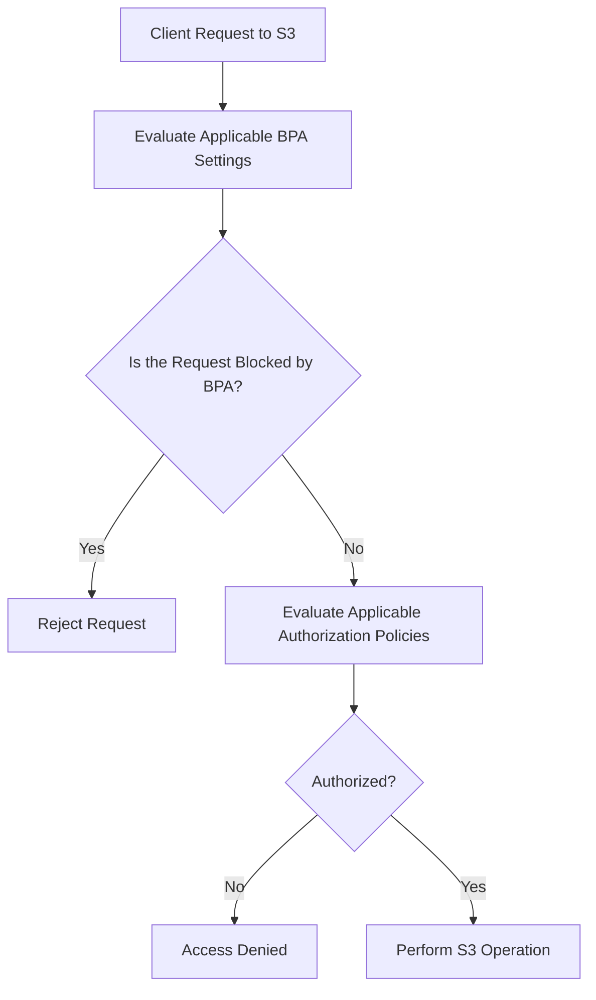
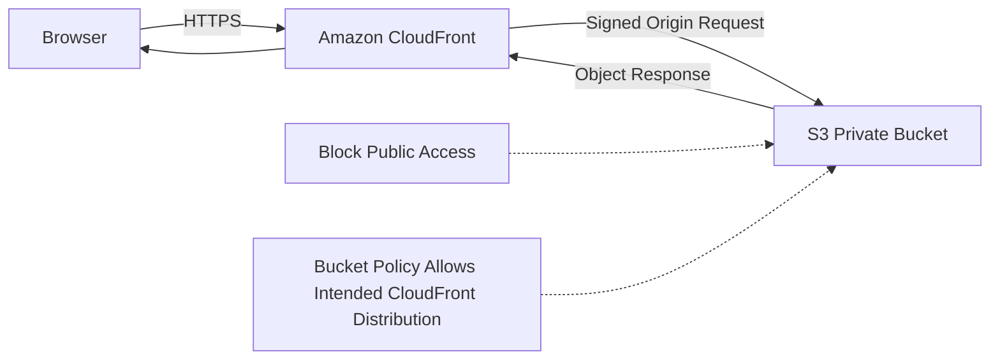

# 05- S3 Block Public Access

## Overview

Amazon S3 Block Public Access is a set of security controls that helps prevent buckets and objects from becoming publicly accessible through access control lists (ACLs) or resource-based policies.

Public exposure can occur when a developer introduces a permissive bucket policy, uploads an object using a public ACL in a legacy configuration, or changes access settings during deployment. Block Public Access provides an additional protection layer that can prevent many such configurations from granting public access.

For production workloads, enable all four Block Public Access settings at the AWS account and bucket levels. Where centralized governance is required, enforce them through AWS Organizations. Disable a setting only when an explicitly approved requirement justifies the change.

This document covers:

- The four Block Public Access settings and their behavior.
- Account-level, bucket-level, organization-level, and access point controls.
- Safe configuration using AWS CLI and Boto3.
- Private S3 origins with CloudFront.
- Public-access verification, monitoring, troubleshooting, and migration.

## Why Block Public Access Matters

S3 supports several mechanisms for granting access, including IAM policies, bucket policies, access point policies, and ACLs where enabled. A permissive configuration in any of these mechanisms can expose data if the effective authorization controls allow it.

Block Public Access adds guardrails against public access. It works alongside existing authorization controls rather than replacing them.

For example, an application might accidentally deploy this bucket policy:

```json
{
  "Version": "2012-10-17",
  "Statement": [
    {
      "Sid": "AllowPublicRead",
      "Effect": "Allow",
      "Principal": "*",
      "Action": "s3:GetObject",
      "Resource": "arn:aws:s3:::example-prod-documents/*"
    }
  ]
}
```

Without applicable public-access protections, this policy can permit anonymous users to retrieve objects. With the appropriate Block Public Access settings enabled, S3 can reject the public policy or restrict the resulting access.

### What Block Public Access protects against

- Public ACLs being created through supported API operations.
- Public ACL grants being used to authorize requests.
- New bucket or access point policies that qualify as public.
- Access to buckets or access points whose policies are public when the applicable restriction is enabled.

### What it does not replace

Block Public Access is not a complete authorization or data-protection system. It does not replace:

- Least-privilege IAM policies.
- Bucket policies that restrict access to intended principals.
- AWS KMS key policies and encryption permissions.
- Encryption in transit and at rest.
- Versioning, backup, retention, or disaster recovery.
- Monitoring, auditing, and application-level authorization.

An S3 bucket can remain private while allowing approved IAM roles to access its objects.

## The Four Block Public Access Settings

S3 provides four independent settings. Each can be configured at supported resource levels, with organization-level policies applying all four together as a unified control.

| Setting | Primary behavior | What it prevents or restricts |
|---|---|---|
| `BlockPublicAcls` | Rejects requests that attempt to establish public ACLs | New public ACL configurations through supported operations |
| `IgnorePublicAcls` | Ignores public ACL grants when evaluating access | Access granted by public ACLs, including existing public grants |
| `BlockPublicPolicy` | Rejects attempts to apply policies that S3 identifies as public | New public bucket or access point policies |
| `RestrictPublicBuckets` | Restricts access when a bucket or access point has a public policy | Public access and applicable cross-account access to resources with public policies |

These settings have different purposes. Enabling only one does not provide the same protection as enabling all four.

### BlockPublicAcls

`BlockPublicAcls` prevents supported requests from introducing public ACL grants.

It affects operations such as:

- Setting a bucket ACL.
- Setting an object ACL.
- Uploading an object with a public ACL.
- Creating a bucket with a public ACL.

It does not remove existing ACL grants and does not itself make S3 ignore public ACLs already present. `IgnorePublicAcls` addresses that behavior.

**Example:** A legacy client tries to upload an object with `public-read`. If `BlockPublicAcls` is enabled, the request is rejected when it attempts to apply that public ACL.

This setting is particularly useful for preventing accidental public exposure from older upload clients.

### IgnorePublicAcls

`IgnorePublicAcls` causes S3 to disregard public ACL grants when determining access.

Unlike `BlockPublicAcls`, it does not simply prevent new public ACLs from being submitted. It protects access evaluation against public ACL grants that already exist.

Enabling it does not delete or rewrite the ACLs. If the setting is subsequently disabled, existing public grants may become effective again, subject to other controls.

**Production use:** Enable this setting when existing buckets have legacy ACLs and the organization needs protection against public ACL-based exposure.

For modern buckets using `Bucket owner enforced`, ACLs are disabled and this setting is generally redundant for access evaluation, but it remains a useful account-level guardrail.

### BlockPublicPolicy

`BlockPublicPolicy` prevents attempts to apply bucket or access point policies that S3 identifies as public.

For example, S3 can reject a bucket policy that grants `s3:GetObject` to an unrestricted wildcard principal.

This setting does not automatically remove an already configured public policy. It primarily prevents the application of new public policies through the relevant policy APIs.

**Important distinction:** `BlockPublicPolicy` and `RestrictPublicBuckets` are not interchangeable. The former prevents applying a new public policy, while the latter restricts access when an applicable public policy is present.

### RestrictPublicBuckets

`RestrictPublicBuckets` restricts access when a bucket or access point has a policy that S3 identifies as public.

For an affected resource, access is generally limited to authorized principals in the resource owner's account and AWS service principals, subject to the applicable S3 authorization rules.

This can also block cross-account access granted by another statement in the same policy, even if that statement explicitly names a trusted external account.

**Example:** A bucket policy contains one statement granting access to a trusted external role and another statement allowing public reads. If the policy qualifies as public and `RestrictPublicBuckets` is enabled, the trusted external role can lose access because the restriction applies to the resource's public policy.

Remove the unintended public statement instead of disabling the protection merely to restore the cross-account permission.

## How the Settings Work Together

Block Public Access settings are evaluated together with other applicable authorization controls.



The diagram represents a conceptual request flow. S3 evaluates the applicable controls according to the request, resource, and configured settings.

### Example combinations

| Configuration | Expected protection |
|---|---|
| All four enabled | Strong protection against public ACLs and public policies |
| Only `BlockPublicAcls` enabled | Prevents supported public ACL changes but does not ignore existing public ACL grants or independently stop public bucket policies |
| Only `IgnorePublicAcls` enabled | Ignores public ACL grants but does not independently block public policies |
| Only `BlockPublicPolicy` enabled | Prevents applying public policies but does not independently remove existing public access |
| Only `RestrictPublicBuckets` enabled | Restricts access to resources with public policies, but does not prevent every public configuration from being created |
| All four disabled | Public exposure may be possible if the other authorization controls permit it |

Use all four settings unless a specific, documented requirement justifies a different configuration.

## Configuration Levels and Enforcement

S3 supports Block Public Access controls at different levels.

| Level | Scope | Operational behavior |
|---|---|---|
| AWS Organizations | Selected organization or organizational units/accounts through supported organization policies | Enforces centralized controls across member accounts |
| AWS account | Buckets and applicable access points owned by the account | Provides an account-wide security guardrail |
| S3 bucket | One bucket and its associated access-control boundary | Allows per-bucket configuration |
| S3 access point | One access point | Applies protection to requests through that access point |

S3 uses the most restrictive applicable settings. A permissive bucket-level configuration cannot override a more restrictive effective account-level or organization-level control.

For requests through an access point, S3 evaluates the applicable access point, bucket, and account controls. If any applicable setting blocks the request, S3 rejects it.

### Recommended enterprise configuration

For an organization managing development, staging, and production accounts:

- Enforce all four settings using AWS Organizations where organizational governance requires it.
- Keep all four settings enabled at the account level.
- Keep all four settings enabled at the bucket level.
- Use IAM and bucket policies to grant approved application access.
- Audit access points and existing buckets for deviations.
- Require security review for any proposed exception.

Organization-level Block Public Access policies apply all four settings together; they do not provide independent selection of individual settings.

Reference: [Blocking public access to Amazon S3 storage](https://docs.aws.amazon.com/AmazonS3/latest/userguide/access-control-block-public-access.html).

## Inspect Block Public Access Configuration

Use the AWS CLI to verify the actual configuration before changing bucket access controls.

### Inspect a bucket

```bash
aws s3api get-public-access-block \
  --bucket example-prod-documents \
  --region ap-south-1
```

An expected configuration has all four settings set to `true`:

```json
{
  "PublicAccessBlockConfiguration": {
    "BlockPublicAcls": true,
    "IgnorePublicAcls": true,
    "BlockPublicPolicy": true,
    "RestrictPublicBuckets": true
  }
}
```

If the bucket has no explicit Block Public Access configuration, the command can return an error indicating that no such configuration exists. Inspect the account-level settings and any organization-level controls before deciding how to proceed.

### Inspect account-level settings

```bash
aws s3control get-public-access-block \
  --account-id 123456789012 \
  --region ap-south-1
```

Replace the example account ID with the bucket owner's actual AWS account ID.

Account-level configuration can be subject to organization-level enforcement. Depending on the API and management configuration, the reported result may reflect effective organization controls.

### Inspect the effective caller identity

```bash
aws sts get-caller-identity
```

This verifies the account and principal used by the CLI session. It does not, by itself, establish whether the bucket permits public access.

### Check whether a bucket policy is public

```bash
aws s3api get-bucket-policy-status \
  --bucket example-prod-documents \
  --region ap-south-1
```

Example response:

```json
{
  "PolicyStatus": {
    "IsPublic": false
  }
}
```

`IsPublic` describes S3's assessment of the bucket policy. It does not prove that all objects are secure or that no access is granted through another mechanism.

For example, a public ACL or an access point policy must be considered separately when applicable.

## Enable All Four Settings on a Bucket

For a private application bucket, enable the complete configuration.

### Apply the configuration

```bash
aws s3api put-public-access-block \
  --bucket example-prod-documents \
  --public-access-block-configuration \
  'BlockPublicAcls=true,IgnorePublicAcls=true,BlockPublicPolicy=true,RestrictPublicBuckets=true' \
  --region ap-south-1
```

The command updates the bucket-level Block Public Access configuration.

It does not delete an existing public bucket policy or rewrite existing ACLs. The relevant settings prevent or restrict their effect according to the configured behavior.

### Verify the configuration

```bash
aws s3api get-public-access-block \
  --bucket example-prod-documents \
  --region ap-south-1
```

Confirm that all four values are `true`.

### Enable account-level protection

```bash
aws s3control put-public-access-block \
  --account-id 123456789012 \
  --public-access-block-configuration \
  'BlockPublicAcls=true,IgnorePublicAcls=true,BlockPublicPolicy=true,RestrictPublicBuckets=true' \
  --region ap-south-1
```

Account-level changes affect a much larger set of resources than bucket-level changes. Apply them through an approved account security process, particularly in accounts hosting older workloads.

If AWS Organizations enforces the settings, the API can reject attempts to change account-level configuration.

## Check for Existing Public Exposure

Enabling Block Public Access is not a substitute for auditing current access.

Use a combination of configuration inspection, automated analysis, and workload testing.

### Inspect public-access settings

```bash
aws s3api get-public-access-block \
  --bucket example-prod-documents \
  --region ap-south-1
```

### Inspect bucket policy status

```bash
aws s3api get-bucket-policy-status \
  --bucket example-prod-documents \
  --region ap-south-1
```

### Inspect the bucket policy

```bash
aws s3api get-bucket-policy \
  --bucket example-prod-documents \
  --region ap-south-1
```

A `NoSuchBucketPolicy` response indicates that no bucket policy is configured. It does not prove that the bucket is inaccessible through every other mechanism.

### Inspect legacy ACLs where enabled

```bash
aws s3api get-bucket-acl \
  --bucket example-prod-documents \
  --region ap-south-1
```

If Object Ownership is configured as `Bucket owner enforced`, ACLs are disabled for access control. For legacy buckets where ACLs are enabled, review grants for broad groups such as `AllUsers` and `AuthenticatedUsers`.

### Use IAM Access Analyzer

IAM Access Analyzer can identify supported public and cross-account access findings for S3 resources.

Use its findings to identify potential exposures, then verify whether each access path is intentional.

### Review account and organization governance

A bucket can appear correctly configured while the effective settings differ due to account-level or organization-level enforcement. Inspect both local configuration and centralized controls.

## CloudFront and Private S3 Origins

A common requirement is to serve public website content without making the S3 bucket itself public.

The recommended architecture is to keep S3 private and deliver content through CloudFront using Origin Access Control (OAC).



### Component responsibilities

| Component | Responsibility |
|---|---|
| CloudFront | Serves content, supports HTTPS, and caches responses |
| S3 | Stores the website assets in a private bucket |
| Origin Access Control | Signs supported CloudFront origin requests |
| Bucket policy | Grants the intended distribution permission to read the required objects |
| Block Public Access | Prevents unintended public access through supported ACL or policy paths |

For this architecture, leave all four Block Public Access settings enabled and grant the required CloudFront distribution access through a narrowly scoped bucket policy.

Do not grant anonymous `s3:GetObject` access merely to make a CloudFront distribution work.

S3's website endpoint and a CloudFront private REST origin are different configurations. An architecture that uses the S3 website endpoint as its origin generally requires a publicly accessible website endpoint; use a private REST origin with OAC when the requirement is to keep S3 private.

Reference: [Using an S3 bucket as a CloudFront origin](https://docs.aws.amazon.com/AmazonCloudFront/latest/DeveloperGuide/DownloadDistS3AndCustomOrigins.html).

## Public Access and Cross-Account Integrations

Block Public Access does not mean that all cross-account access is forbidden. An account can grant access to another account through appropriately scoped policies while keeping the resource non-public.

However, `RestrictPublicBuckets` can affect cross-account access if the bucket policy is identified as public.

For example, suppose a centralized bucket policy grants access to a data-processing role in another account. If an unrelated statement makes the same policy public, the restriction can block the otherwise permitted cross-account access.

### Recommended design

- Grant cross-account access to named IAM roles rather than unrestricted principals.
- Keep public statements out of private bucket policies.
- Use `aws:PrincipalOrgID` or other supported conditions where they suit the trust model.
- Confirm the resource policy and caller's identity policy.
- Keep Block Public Access enabled.
- Test cross-account operations with the real workload identity.

Do not disable `RestrictPublicBuckets` as the first response to a cross-account `AccessDenied` error. Determine whether the policy has unintentionally been classified as public and correct the underlying statement when appropriate.

Reference: [The meaning of public access in Amazon S3](https://docs.aws.amazon.com/AmazonS3/latest/userguide/access-control-block-public-access.html).

## Backend and Deployment Considerations

Block Public Access affects configuration and authorization behavior, not just console settings.

### SDK upload behavior

A modern backend should generally upload objects without specifying ACLs when the bucket uses `Bucket owner enforced`.

For example, a Boto3 upload can omit the ACL parameter:

```python
import boto3

s3 = boto3.client("s3", region_name="ap-south-1")


def upload_document(
    bucket: str,
    object_key: str,
    file_path: str,
) -> None:
    s3.upload_file(
        Filename=file_path,
        Bucket=bucket,
        Key=object_key,
        ExtraArgs={
            "ContentType": "application/pdf",
        },
    )
```

The IAM role executing the upload still requires appropriate permissions, and the bucket's other security controls remain applicable.

Do not add `ACL="public-read"` as a workaround for download or CDN problems. Diagnose the intended access path and configure the correct permissions instead.

### Infrastructure as code

Enforce the configuration through Terraform, CloudFormation, or AWS CDK so that it is reproducible and reviewable.

For Terraform, a bucket's Block Public Access configuration can be declared explicitly:

```hcl
resource "aws_s3_bucket_public_access_block" "documents" {
  bucket = aws_s3_bucket.documents.id

  block_public_acls       = true
  ignore_public_acls      = true
  block_public_policy     = true
  restrict_public_buckets = true
}
```

This assumes `aws_s3_bucket.documents` is defined elsewhere in the same Terraform configuration.

Validate infrastructure changes before applying them:

```bash
terraform fmt -check
terraform validate
terraform plan
```

Review the plan for changes that weaken public-access protection. Account-level and organization-level controls should be managed through the appropriate governance configuration rather than inferred from one bucket resource.

### CI/CD security checks

A production deployment pipeline should:

- Validate the Block Public Access configuration.
- Detect unintended public bucket policies.
- Review policy changes before deployment.
- Use short-lived AWS credentials through IAM federation where supported.
- Prevent unapproved changes that disable public-access protections.
- Verify the deployed configuration after infrastructure changes.

A successful deployment does not prove that the resulting bucket access is secure. Perform policy and access verification as part of release validation.

## Monitoring and Governance

Block Public Access is most effective when combined with continuous visibility.

| Control | Purpose |
|---|---|
| IAM Access Analyzer | Identifies supported public and cross-account access findings |
| AWS CloudTrail | Audits relevant API activity, including configuration and policy changes when recorded |
| AWS Config | Evaluates resource configuration against selected compliance rules |
| AWS Organizations | Applies centralized governance policies |
| CI/CD validation | Prevents unreviewed security regressions before deployment |
| Operational alerts | Surfaces configuration changes or new security findings |

### Recommended checks

**At deployment time:** Confirm that the bucket configuration enables all four settings and that the bucket policy matches the intended access architecture.

**During periodic audits:** Inspect the account-level settings, bucket-level deviations, access point configurations, and public-access findings.

**After a policy change:** Verify the public-policy status and test expected access paths using authorized and unauthorized identities.

**During incident response:** Identify the resource, policy change, principal, and request that caused the exposure. Correct the configuration and verify that the unintended access is no longer effective.

CloudTrail event availability depends on the event category, configured logging, and relevant service behavior. Do not assume that enabling CloudTrail automatically records every S3 object-level request; configure the required data-event selectors when object-level auditing is needed.

## Troubleshooting Block Public Access

Use the following diagnostic flow when a request fails after a security configuration change or when a bucket appears publicly exposed.

### Symptoms and likely causes

| Symptom | Likely cause | Verification |
|---|---|---|
| Applying a bucket policy fails | `BlockPublicPolicy` or a more restrictive account/organization setting rejects a public policy | Inspect the policy and applicable public-access settings |
| Public ACL upload fails | `BlockPublicAcls` is enabled or ACLs are disabled by Object Ownership | Inspect Block Public Access and ownership controls |
| Existing public ACL no longer grants access | `IgnorePublicAcls` is enabled or other controls deny access | Inspect ACLs and effective access controls |
| Cross-account access fails after a policy change | The policy qualifies as public and `RestrictPublicBuckets` restricts access | Inspect the complete bucket policy and its public status |
| CloudFront cannot retrieve an object | Incorrect OAC configuration, bucket policy, object key, or additional authorization controls | Inspect CloudFront origin settings, policy, and logs |
| Account-level settings cannot be changed | An organization-level Block Public Access policy enforces the configuration | Review the applicable AWS Organizations policy |
| Bucket configuration appears safe but an object is exposed | Other access paths or resource configurations may permit access | Inspect ACLs where enabled, policies, access points, and effective settings |

### Diagnostic procedure

1. Identify the affected bucket, object, principal, and API operation.
2. Read the bucket-level and account-level Block Public Access configuration.
3. Determine whether organization-level controls are enforced.
4. Inspect the bucket policy status and policy contents.
5. Review ACLs if the bucket's ownership configuration allows them.
6. Inspect access point policies and other applicable authorization controls.
7. Test the intended access path with the actual workload identity.
8. Correct the narrowest relevant configuration and repeat the tests.

### Avoid unsafe recovery actions

Do not disable all four settings to troubleshoot a failed read or upload.

Instead, determine which protection is rejecting the request. An application that uploads using an unnecessary ACL may only require a client change. An external role that loses access may need a corrected cross-account policy. A CloudFront failure may require an OAC or bucket-policy correction.

In all cases, preserve the existing security boundary while resolving the specific failure.

## Production Security Checklist

- [ ] All four Block Public Access settings are enabled at the account level.
- [ ] Private application buckets explicitly enable all four settings.
- [ ] Applicable organization-level guardrails enforce the approved baseline.
- [ ] Bucket policies are reviewed for public principals and unsafe conditions.
- [ ] Legacy ACLs and Object Ownership configurations are understood.
- [ ] Access points are reviewed for their own Block Public Access settings.
- [ ] Public website delivery uses CloudFront OAC and a private S3 origin where appropriate.
- [ ] Cross-account integrations use narrowly scoped policies.
- [ ] Infrastructure as code maintains the intended configuration.
- [ ] CI/CD detects changes that weaken public-access protections.
- [ ] Access Analyzer findings and relevant security events are reviewed.
- [ ] Changes are tested against both authorized and unauthorized access scenarios.

## Official References

- [Blocking public access to Amazon S3 storage](https://docs.aws.amazon.com/AmazonS3/latest/userguide/access-control-block-public-access.html)
- [Configuring Block Public Access for an AWS account](https://docs.aws.amazon.com/AmazonS3/latest/userguide/configuring-block-public-access-account.html)
- [Configuring Block Public Access for an S3 bucket](https://docs.aws.amazon.com/AmazonS3/latest/userguide/configuring-block-public-access-bucket.html)
- [Managing public access to access points](https://docs.aws.amazon.com/AmazonS3/latest/userguide/access-points-bpa-settings.html)
- [S3 Object Ownership](https://docs.aws.amazon.com/AmazonS3/latest/userguide/about-object-ownership.html)
- [Access control in Amazon S3](https://docs.aws.amazon.com/AmazonS3/latest/userguide/access-management.html)
- [Using an S3 bucket as a CloudFront origin](https://docs.aws.amazon.com/AmazonCloudFront/latest/DeveloperGuide/DownloadDistS3AndCustomOrigins.html)
- [Amazon S3 public access block configuration API](https://docs.aws.amazon.com/AmazonS3/latest/API/API_PublicAccessBlockConfiguration.html)

## Key Takeaways

- Enable all four Block Public Access settings by default at the account and bucket levels, and enforce them centrally where required.
- `BlockPublicAcls` and `BlockPublicPolicy` prevent new public configurations, while `IgnorePublicAcls` and `RestrictPublicBuckets` protect access evaluation.
- S3 applies the most restrictive applicable settings across organization, account, bucket, and access point controls.
- Keep S3 private behind CloudFront OAC when delivering public website content without exposing the bucket directly.
- Verify effective configuration, policy status, and real access behavior rather than relying on a successful infrastructure deployment alone.