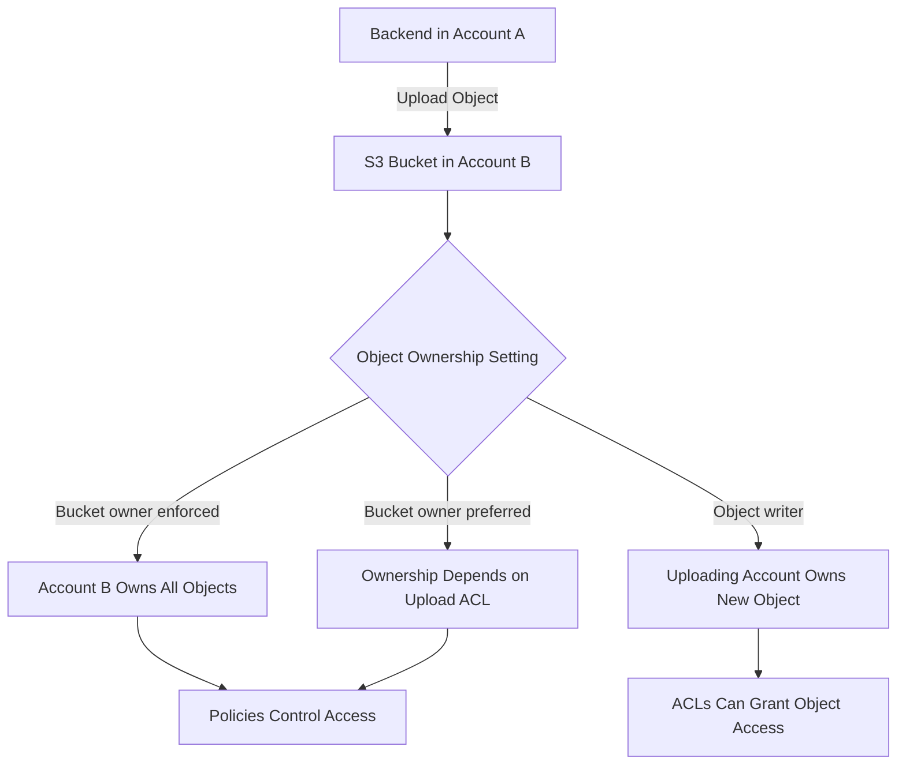
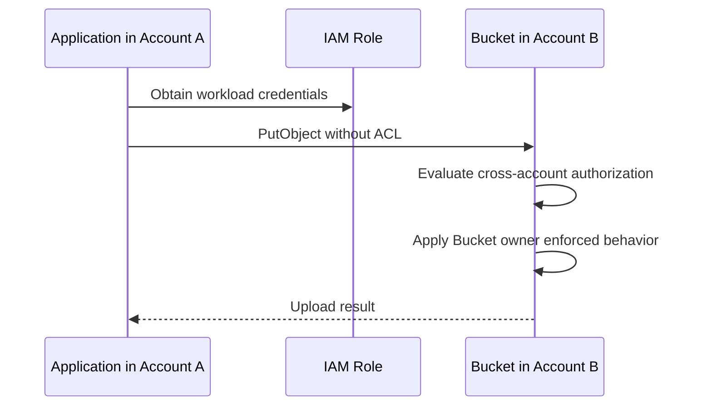
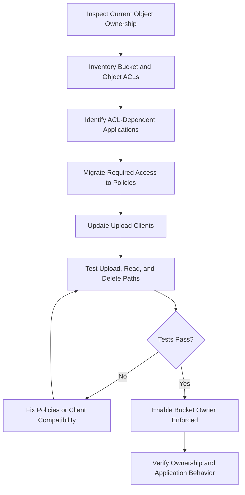

# 06- S3 Object Ownership Controls

## Overview

Amazon S3 Object Ownership is a bucket-level configuration that determines who owns objects uploaded to a bucket and whether access control lists (ACLs) participate in authorization.

Object Ownership is particularly important when applications, external AWS accounts, or third-party services upload objects into a shared bucket. Without a consistent ownership model, the bucket owner might not have full control over objects uploaded by another account.

S3 supports three Object Ownership settings:

- `Bucket owner enforced` — disables ACLs and makes the bucket owner the owner of every object.
- `Bucket owner preferred` — enables ACLs and allows the bucket owner to own new objects uploaded with the `bucket-owner-full-control` canned ACL.
- `Object writer` — enables ACLs and allows the uploading account to own newly uploaded objects.

**For most modern applications, use `Bucket owner enforced`.** It is the default for newly created general-purpose S3 buckets and allows access to be managed through IAM policies, bucket policies, and other supported authorization controls without relying on ACLs.

This document covers ownership behavior, cross-account uploads, ACL compatibility, replication, AWS CLI and Boto3 configuration, Terraform, migration, and troubleshooting.

## Why Object Ownership Matters

Consider a centralized document-storage bucket owned by Account B. Applications in Account A upload documents for processing.

With an ownership model that allows the uploading account to own individual objects, the bucket owner might encounter permission problems when reading, managing, or deleting objects uploaded by external accounts.

Object Ownership addresses this issue by allowing the bucket owner to own every object while keeping access management centralized.

### Example architecture



Object Ownership helps determine resource ownership and ACL behavior. It does not independently grant an application permission to upload, read, overwrite, or delete objects.

Those operations remain subject to the applicable authorization controls.

### Problems Object Ownership helps prevent

- Cross-account uploaders retaining ownership of objects in a centralized bucket.
- Bucket owners being unable to manage externally owned objects as expected.
- Applications depending on ACLs for permissions that could be managed through policies.
- Inconsistent ownership behavior across objects uploaded by different workloads.
- Complicated access management in shared data platforms.

## The Three Object Ownership Settings

| Setting | ACL status | Ownership of objects | Typical use |
|---|---|---|---|
| `Bucket owner enforced` | Disabled | Bucket owner owns all objects | Recommended for most modern workloads |
| `Bucket owner preferred` | Enabled | Bucket owner owns new objects uploaded with `bucket-owner-full-control`; otherwise, ownership follows the legacy writer model | Legacy cross-account workflows |
| `Object writer` | Enabled | Uploading account owns newly uploaded objects | Legacy systems requiring writer ownership |

These settings apply to general-purpose S3 buckets. Existing buckets should be inspected rather than assumed to use the default configuration.

## Bucket Owner Enforced

`Bucket owner enforced` disables ACLs and establishes the bucket owner as the owner of every object in the bucket, including existing objects.

This setting simplifies permission management because the bucket owner does not need to rely on object ownership held by individual uploading accounts.

### How it works

When a bucket uses `Bucket owner enforced`:

- The bucket owner owns all objects and versions.
- ACLs no longer affect access permissions.
- Access is managed using supported policies and other authorization controls.
- ACL read operations remain supported.
- ACL-setting operations are restricted.
- Objects can be uploaded without specifying an ACL.
- Uploads specifying the `bucket-owner-full-control` canned ACL are also accepted.
- Uploads specifying other ACLs fail with `AccessControlListNotSupported`.

Applying this setting does not create a new object version merely because the ownership configuration changed.

### Advantages

- Consistent ownership across objects.
- Centralized authorization using IAM and bucket policies.
- Simplified cross-account storage management.
- Reduced reliance on legacy ACL behavior.
- Easier automation and security auditing.

### Limitations

Applications that depend on custom ACLs may need to be modified before this setting is enabled. An upload client that sends `ACL="private"` or `ACL="public-read"` can fail because those ACLs are unsupported when ACLs are disabled.

### Inspect the configuration

```bash
aws s3api get-bucket-ownership-controls \
  --bucket example-prod-documents \
  --region ap-south-1
```

Expected configuration:

```json
{
  "OwnershipControls": {
    "Rules": [
      {
        "ObjectOwnership": "BucketOwnerEnforced"
      }
    ]
  }
}
```

If the bucket does not have an explicit ownership configuration, the command can return an error indicating that no ownership controls are configured. Inspect the bucket's history and actual behavior before changing it.

## Bucket Owner Preferred

`Bucket owner preferred` enables ACLs while supporting bucket-owner ownership for new objects uploaded with the `bucket-owner-full-control` canned ACL.

This setting exists primarily for legacy integrations where ACLs remain part of the upload contract.

### How it works

Under this setting:

- ACLs remain enabled.
- A new object uploaded with `bucket-owner-full-control` is owned by the bucket owner.
- A new object uploaded without that canned ACL is owned by the uploading account.
- The uploading account's other ACL values do not automatically transfer ownership to the bucket owner.

For example, suppose Account A uploads an object to a bucket owned by Account B.

| Upload behavior | Owner of the new object |
|---|---|
| Upload includes `bucket-owner-full-control` | Account B |
| Upload omits the ACL | Account A |
| Upload uses another ACL | Account A |

The precise access granted by ACLs depends on the configured grants and applicable authorization controls.

### Require the expected canned ACL

For a legacy bucket using this setting, a bucket policy can require uploads to specify `bucket-owner-full-control`.

```json
{
  "Version": "2012-10-17",
  "Statement": [
    {
      "Sid": "RequireBucketOwnerFullControl",
      "Effect": "Deny",
      "Principal": "*",
      "Action": "s3:PutObject",
      "Resource": "arn:aws:s3:::example-legacy-bucket/*",
      "Condition": {
        "StringNotEquals": {
          "s3:x-amz-acl": "bucket-owner-full-control"
        }
      }
    }
  ]
}
```

This policy denies matching uploads whose `s3:x-amz-acl` request condition does not equal `bucket-owner-full-control`.

The policy must be reviewed against all upload paths before deployment. Clients must send the required canned ACL, and the bucket owner must retain the permissions needed to manage the resource.

For a bucket using `Bucket owner enforced`, do not use this policy as a general upload requirement. Uploads without an ACL are the preferred modern design.

## Object Writer

`Object writer` enables ACLs and preserves the legacy ownership model in which the uploading account owns newly uploaded objects.

The writer has full control over its object and can grant supported permissions through ACLs.

### When it may be necessary

This setting may be required when a legacy application depends on object-level ACLs or when the writer must retain ownership and control of uploaded objects.

### Limitations

- Ownership can vary across objects in the same bucket.
- Bucket administrators can encounter object-access or management problems.
- External uploaders may retain control over their objects.
- ACLs add operational complexity.
- Centralized access policies become harder to manage consistently.

Avoid this setting for new shared-storage architectures unless a documented compatibility or ownership requirement justifies it.

## Object Ownership and ACL Behavior

Object Ownership and ACLs are related but distinct concepts.

Object Ownership determines the ownership model and whether ACLs are enabled. ACLs, when enabled, provide legacy resource-level grants to supported accounts or predefined groups.

| Operation | `Bucket owner enforced` | `Bucket owner preferred` | `Object writer` |
|---|---|---|---|
| Upload without an ACL | Accepted | Accepted | Accepted |
| Upload with `bucket-owner-full-control` | Accepted | Accepted | Accepted |
| Upload with another ACL | Rejected | Accepted, subject to other controls | Accepted, subject to other controls |
| Read an ACL | Supported | Supported | Supported |
| Set or update an ACL | Restricted | Supported, subject to permissions | Supported, subject to permissions |
| Bucket owner owns every object | Yes | Not necessarily | No |
| ACLs affect authorization | No | Yes | Yes |

For `Bucket owner enforced`, ACL read operations remain supported, but ACLs do not grant additional access. S3 returns an ACL representation reflecting the bucket owner's full control.

### Important distinction

Object Ownership does not replace the need for the caller to have the required permissions for an S3 API request.

For instance, an application still needs appropriate authorization for `s3:PutObject`. If the object uses SSE-KMS with a customer-managed key, the applicable KMS permissions and key policy must also allow the operation.

## Configure Object Ownership with AWS CLI

The AWS CLI supports reading and updating Object Ownership for an existing bucket.

### Apply Bucket Owner Enforced

```bash
aws s3api put-bucket-ownership-controls \
  --bucket example-prod-documents \
  --ownership-controls \
  'Rules=[{ObjectOwnership=BucketOwnerEnforced}]' \
  --region ap-south-1
```

The caller needs the appropriate permission, including `s3:PutBucketOwnershipControls`.

### Apply Bucket Owner Preferred

Use this setting only where ACL-based compatibility is intentional.

```bash
aws s3api put-bucket-ownership-controls \
  --bucket example-legacy-bucket \
  --ownership-controls \
  'Rules=[{ObjectOwnership=BucketOwnerPreferred}]' \
  --region ap-south-1
```

### Apply Object Writer

```bash
aws s3api put-bucket-ownership-controls \
  --bucket example-legacy-bucket \
  --ownership-controls \
  'Rules=[{ObjectOwnership=ObjectWriter}]' \
  --region ap-south-1
```

Enabling ACLs can change the effective access model. Do not use `ObjectWriter` as a troubleshooting shortcut without reviewing ownership and security implications.

### Verify the setting

```bash
aws s3api get-bucket-ownership-controls \
  --bucket example-prod-documents \
  --region ap-south-1
```

Always verify the returned configuration after applying a change.

## Object Ownership with Boto3

Boto3 exposes Object Ownership operations through the S3 client.

### Inspect ownership controls

```python
import boto3
from botocore.exceptions import ClientError

s3 = boto3.client("s3", region_name="ap-south-1")


def get_object_ownership(bucket: str) -> str | None:
    """Return the configured Object Ownership setting, if present."""
    try:
        response = s3.get_bucket_ownership_controls(Bucket=bucket)
    except ClientError as exc:
        error_code = exc.response.get("Error", {}).get("Code")

        if error_code == "OwnershipControlsNotFoundError":
            return None

        raise

    rules = response.get("OwnershipControls", {}).get("Rules", [])

    if len(rules) != 1:
        raise ValueError(
            f"Unexpected Object Ownership rules for bucket {bucket!r}"
        )

    return rules[0]["ObjectOwnership"]
```

The function returns `None` when no explicit ownership controls are configured. This should not be interpreted as proof that the bucket is insecure; inspect the actual resource configuration and applicable defaults.

### Enforce Bucket Owner Enforced

```python
import boto3

s3 = boto3.client("s3", region_name="ap-south-1")


def enforce_bucket_owner(bucket: str) -> None:
    """Disable ACLs and enforce bucket-owner ownership."""
    s3.put_bucket_ownership_controls(
        Bucket=bucket,
        OwnershipControls={
            "Rules": [
                {
                    "ObjectOwnership": "BucketOwnerEnforced",
                }
            ]
        },
    )
```

This function changes a security-sensitive bucket setting. Call it only through an approved infrastructure or administration workflow after validating legacy dependencies and access policies.

### Application-level recommendation

Ordinary request handlers should not modify Object Ownership. Treat it as infrastructure configuration managed through controlled deployment processes.

Application code should normally upload objects without specifying ACLs when the bucket uses `Bucket owner enforced`.

## Object Ownership in Backend Uploads

Modern backend services should generally omit ACL parameters when uploading to private S3 buckets.

For example, a FastAPI or Django service can use the following Boto3 pattern:

```python
import boto3

s3 = boto3.client("s3", region_name="ap-south-1")


def upload_document(
    bucket: str,
    object_key: str,
    file_path: str,
) -> None:
    s3.upload_file(
        Filename=file_path,
        Bucket=bucket,
        Key=object_key,
        ExtraArgs={
            "ContentType": "application/pdf",
        },
    )
```

The upload relies on the application's AWS credentials and permissions. It does not need an ACL when the bucket uses `Bucket owner enforced`.

### Presigned uploads

The same principle applies to presigned URL workflows.

- Generate presigned URLs using an appropriately restricted IAM role.
- Avoid requiring custom ACL headers unless a documented legacy requirement exists.
- Ensure client-side upload requests match the headers included in the signature.
- Validate the uploaded object and its metadata after the upload.
- Keep the bucket private and enforce application-level authorization.

An unnecessary ACL parameter in the signed request can cause the upload to fail when ACLs are disabled.

## Cross-Account Uploads and Object Ownership

Cross-account uploads are a common reason to configure Object Ownership deliberately.

Suppose Account A runs a data ingestion service and Account B owns the destination bucket.

### Recommended modern design

Use `Bucket owner enforced` on the destination bucket.

1. Account A assumes its application role or uses its approved workload credentials.
2. The role receives the required cross-account identity permissions.
3. Account B's bucket policy permits the intended role to upload to the approved prefix.
4. S3 stores the object with Account B as the owner.
5. The bucket owner manages access through policies.



The successful upload depends on the actual permissions and applicable controls. Object Ownership does not independently grant cross-account access.

### Legacy design

If the destination bucket uses `Bucket owner preferred`, clients may need to upload with `bucket-owner-full-control` to ensure the bucket owner owns new objects.

If the destination uses `Object writer`, the uploading account owns newly uploaded objects. The bucket owner must account for that ownership model when designing downstream access and operations.

Prefer migration to `Bucket owner enforced` rather than extending a legacy ACL-based design unnecessarily.

## Object Ownership and S3 Replication

Object Ownership also influences ownership behavior for cross-account replication.

When replication writes objects into a destination bucket configured with `Bucket owner enforced`, the destination bucket owner owns the replicated objects.

This can simplify centralized storage and recovery architectures because the destination account can manage its replicated objects without relying on object ACLs.

### Replication considerations

- Configure the source and destination buckets appropriately.
- Confirm that the replication role has the required permissions.
- Review encryption compatibility and KMS permissions when applicable.
- Validate replication status and access to destination objects.
- Distinguish successful replication from a complete disaster-recovery capability.

Object Ownership does not configure replication by itself and does not guarantee that a destination bucket can take over application traffic after a regional failure.

## Configure Object Ownership with Terraform

For infrastructure managed through Terraform, declare ownership controls explicitly.

```hcl
resource "aws_s3_bucket" "documents" {
  bucket = var.bucket_name
}

resource "aws_s3_bucket_ownership_controls" "documents" {
  bucket = aws_s3_bucket.documents.id

  rule {
    object_ownership = "BucketOwnerEnforced"
  }
}
```

This example uses the AWS provider's dedicated ownership-controls resource.

The bucket name should be supplied through validated environment-specific configuration. Manage Block Public Access, encryption, versioning, and bucket policies through their appropriate resources rather than assuming Object Ownership configures them automatically.

### Validate and deploy

```bash
terraform fmt -check
terraform validate
terraform plan
```

Inspect the plan before applying it. Confirm that the change is compatible with existing applications and does not inadvertently alter other bucket security controls.

After deployment, verify the ownership controls through the AWS CLI.

### Production considerations

- Keep Terraform provider versions constrained in the project configuration.
- Manage changes through version control and code review.
- Use a separate state and permissions boundary for each environment where appropriate.
- Prevent unauthorized changes to security-sensitive resources.
- Test legacy upload clients before enforcing ACLs-disabled behavior.
- Avoid competing manual and Terraform changes to the same resource.

## Migrate an Existing Bucket to Bucket Owner Enforced

Changing an existing bucket's Object Ownership can affect every workload that uploads, reads, or manages objects.

Before making the change, inventory ACL-dependent behavior and migrate the required permissions to supported policies.

### Migration workflow



### Migration steps

**Inspect existing controls.** Check the bucket's ownership configuration and ACL state. Identify cross-account writers and applications that set ACL headers.

**Inventory access requirements.** Determine which principals need to list the bucket, read objects, upload files, modify metadata, or delete objects.

**Migrate permissions to policies.** Update identity-based and bucket policies to represent the intended access model. Include KMS permissions where necessary.

**Update upload clients.** Remove ACL parameters such as `private` and `public-read`. Clients should normally upload without ACLs when the target bucket enforces ownership.

**Test with real identities.** Test representative application roles, external accounts, presigned uploads, replication, analytics, and operational tools.

**Apply Bucket Owner Enforced.** Make the change through infrastructure as code or an approved administrative workflow.

**Verify the result.** Inspect the setting and test authorized and unauthorized access paths.

### Important prerequisites

Before disabling ACLs on an existing bucket, AWS recommends migrating relevant ACL permissions to policies and resetting the bucket ACL to its default private configuration.

Review object ACL dependencies as well. Do not assume changing Object Ownership will automatically reconstruct the intended permission model from arbitrary legacy grants.

Applying `Bucket owner enforced` makes the bucket owner the owner of existing objects and disables ACL-based authorization. Plan the migration accordingly, especially when external accounts previously controlled their own objects.

Reference: [Setting Object Ownership on an existing bucket](https://docs.aws.amazon.com/AmazonS3/latest/userguide/object-ownership-existing-bucket.html).

## Common Errors and Troubleshooting

### `AccessControlListNotSupported`

**Symptom:** An upload or ACL modification fails after the bucket's ownership setting changes.

**Likely cause:** The bucket uses `Bucket owner enforced`, which disables ACLs.

**Verification:**

```bash
aws s3api get-bucket-ownership-controls \
  --bucket example-prod-documents \
  --region ap-south-1
```

**Corrective action:** Remove unsupported ACL parameters from the client. Check the bucket policy and the caller's `s3:PutObject` permission rather than re-enabling ACLs automatically.

### `AccessDenied`

**Symptom:** An upload, download, or ownership-controls operation fails.

**Possible causes:**

- The caller lacks `s3:PutObject`, `s3:GetObject`, or the relevant ownership-controls permission.
- A bucket policy or other applicable control denies the request.
- The workload uses an unexpected AWS account or IAM role.
- Cross-account identity and resource permissions are incomplete.
- An SSE-KMS object requires additional KMS permissions.

**Verification:**

```bash
aws sts get-caller-identity

aws s3api get-bucket-ownership-controls \
  --bucket example-prod-documents \
  --region ap-south-1
```

Then inspect the required action, policy scope, and actual request. Do not assume the problem is caused by object ownership alone.

### Ownership controls are missing

**Symptom:** `GetBucketOwnershipControls` indicates that the bucket has no explicit ownership-controls configuration.

**Possible cause:** The bucket predates the current defaults or has no explicit ownership setting.

**Corrective action:** Inspect the current bucket configuration and legacy behavior before deciding which setting to apply. Do not infer the full access model from a missing ownership-controls response.

### Cross-account uploads succeed, but the bucket owner cannot manage objects as expected

**Possible cause:** The bucket uses a legacy ownership model and the uploading account owns the objects.

**Corrective action:** Verify the current Object Ownership setting, determine the intended owners and permission requirements, and migrate to policy-based access with `Bucket owner enforced` where appropriate.

### Uploads fail after migration

**Symptom:** Applications begin receiving errors after ACLs are disabled.

**Likely cause:** One or more clients continue sending unsupported ACL values.

**Corrective action:** Search application code, SDK configuration, presigned URL generation, and upload headers for ACL parameters. Remove unnecessary settings, verify IAM permissions, and run regression tests.

## Production Best Practices

- Prefer `Bucket owner enforced` for new application buckets.
- Manage access with IAM policies and bucket policies instead of ACLs.
- Explicitly document any workload that requires `Bucket owner preferred` or `Object writer`.
- Audit existing ACL-dependent workflows before migration.
- Keep Block Public Access enabled for private buckets.
- Treat ownership controls as infrastructure configuration rather than mutable request-time application settings.
- Use least-privilege permissions for cross-account uploaders.
- Validate encryption and KMS permissions separately from S3 ownership behavior.
- Test uploads, reads, deletes, presigned URLs, and replication after a configuration change.
- Monitor application errors and authorization failures during migrations.

## Official References

- [Controlling ownership of objects and disabling ACLs](https://docs.aws.amazon.com/AmazonS3/latest/userguide/about-object-ownership.html)
- [Setting Object Ownership on a new bucket](https://docs.aws.amazon.com/AmazonS3/latest/userguide/object-ownership-new-bucket.html)
- [Setting Object Ownership on an existing bucket](https://docs.aws.amazon.com/AmazonS3/latest/userguide/object-ownership-existing-bucket.html)
- [Disabling ACLs and enforcing Object Ownership](https://docs.aws.amazon.com/AmazonS3/latest/userguide/ensure-object-ownership.html)
- [S3 access control](https://docs.aws.amazon.com/AmazonS3/latest/userguide/access-management.html)
- [Amazon S3 API permissions](https://docs.aws.amazon.com/AmazonS3/latest/userguide/using-with-s3-policy-actions.html)

## Key Takeaways

- `Bucket owner enforced` is the recommended default for modern S3 workloads because it disables ACLs and makes the bucket owner the owner of every object.
- `Bucket owner preferred` and `Object writer` enable ACLs and retain legacy ownership behavior for compatible workflows.
- Object Ownership controls who owns objects and whether ACLs are used; it does not independently grant upload, read, or delete permissions.
- Migrate existing buckets by inventorying ACL dependencies, moving required access to policies, updating upload clients, and testing before enforcing ownership.
- Cross-account uploads, replication, and SSE-KMS workflows require separate verification of their IAM, resource-policy, and encryption permissions.