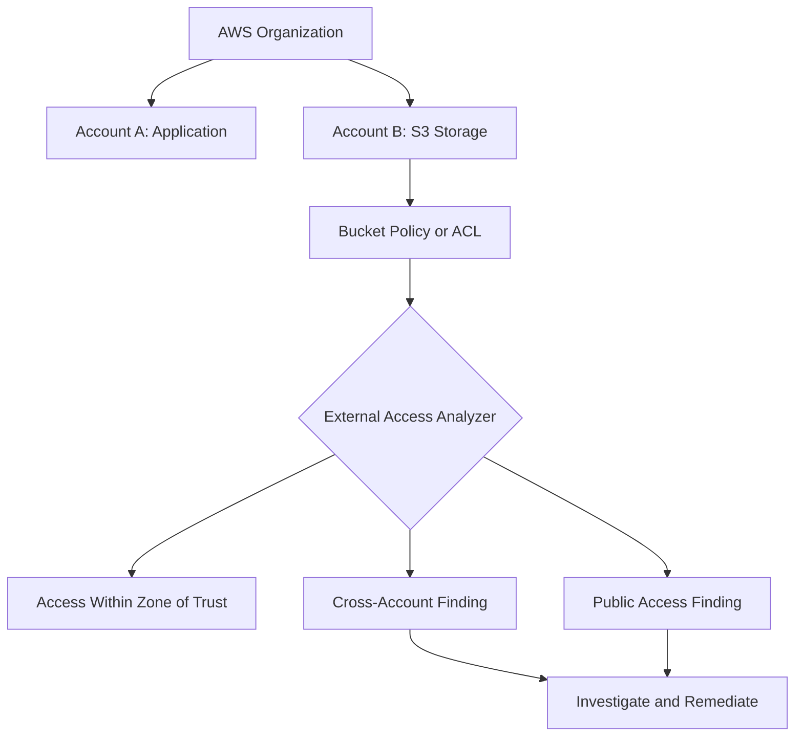
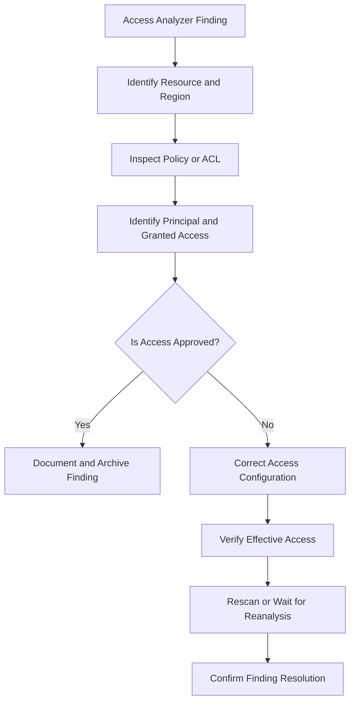
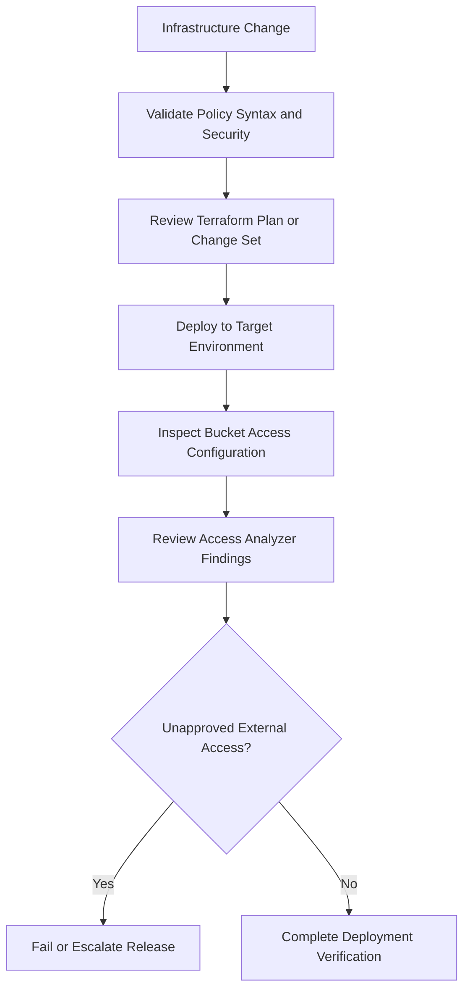

# 07- S3 Access Analyzer

## Overview

Amazon S3 Access Analyzer helps identify buckets that are configured to allow public or cross-account access. It is powered by AWS Identity and Access Management (IAM) Access Analyzer, which analyzes supported resource-based policies and reports findings when resources are shared outside a defined zone of trust.

For backend engineers and cloud security teams, Access Analyzer provides a systematic way to discover unintended data exposure, investigate permission changes, validate access configurations, and maintain visibility across multiple AWS accounts and Regions.

For Amazon S3, findings can identify access granted through:

- Bucket policies.
- Bucket ACLs where ACLs are enabled.
- S3 access point policies.
- Multi-Region Access Point policies.

Access Analyzer also supports broader IAM security capabilities, including policy validation, internal access analysis, and unused access analysis. These capabilities are related but serve different purposes.

**Important:** Access Analyzer identifies potential access based on supported policy configurations. It does not prove that an external principal has actually accessed an object. Findings must be investigated and remediated according to the intended security design.

## What Is S3 Access Analyzer?

S3 Access Analyzer is the S3-focused access-review capability exposed through the Amazon S3 console. It uses IAM Access Analyzer to identify general-purpose S3 buckets that are configured to allow public or cross-account access.

It helps answer questions such as:

- Which buckets allow access from outside my AWS account or organization?
- Which principals or groups receive external access?
- Is a bucket publicly accessible according to its access configuration?
- Which policy or ACL contributes to the finding?
- Is the access intentional, or does it represent a security risk?
- Did a recent infrastructure change introduce unintended access?

### Why it matters

In a production environment, public or cross-account access can arise from a variety of sources:

- A bucket policy grants access to a wildcard principal.
- A legacy ACL grants access to a broad predefined group.
- A bucket is shared with an external AWS account.
- An access point policy permits an unexpected principal.
- A deployment introduces an overly permissive resource policy.
- A shared data platform grants access beyond its intended organizational boundary.

Manual policy review alone becomes difficult as the number of accounts, buckets, applications, and deployment pipelines increases.

Access Analyzer provides centralized findings that help security teams prioritize investigation and validate their access-control assumptions.

## IAM Access Analyzer and S3 Access Analyzer

These names are closely related, but their scope differs.

| Capability | Purpose |
|---|---|
| IAM Access Analyzer external access analyzer | Identifies resources that permit access outside a defined zone of trust |
| S3 Access Analyzer in the S3 console | Focuses on public and cross-account access findings for S3 general-purpose buckets |
| IAM Access Analyzer internal access analyzer | Identifies supported resources accessible to principals inside the selected account or organization |
| IAM Access Analyzer unused access analyzer | Identifies unused IAM users, roles, credentials, and permissions within its supported scope |
| IAM Access Analyzer policy validation | Checks IAM policies for grammar errors, security issues, and AWS best-practice findings |
| IAM Access Analyzer custom policy checks | Evaluates policies against specified security requirements |

The S3 console's external-access summary and IAM Access Analyzer findings are not interchangeable with every capability offered by IAM Access Analyzer.

For example, a finding that a bucket permits external access is different from an unused IAM permission finding. Use the capability appropriate to the security question being investigated.

References:

- [Reviewing bucket access using IAM Access Analyzer for S3](https://docs.aws.amazon.com/AmazonS3/latest/userguide/access-analyzer.html)
- [Using IAM Access Analyzer](https://docs.aws.amazon.com/IAM/latest/UserGuide/what-is-access-analyzer.html)

## How External Access Analysis Works

An external access analyzer evaluates supported resource-based policies in a specific AWS Region.

The account or organization selected when the analyzer is created defines its **zone of trust**. Principals inside this zone are treated as trusted for external-access analysis. Access granted outside that zone can generate findings.

### Example

Suppose an organization manages the following accounts:

- Account A: application workloads.
- Account B: centralized document storage.
- Account C: an external data-processing partner.

An analyzer configured with the organization as its zone of trust treats Accounts A and B as internal to that trust boundary. Access granted to Account C can generate a cross-account finding.

Public access can also generate a finding because anonymous internet users are outside the zone of trust.



The analyzer evaluates the supported access configuration rather than waiting for a principal to make a request.

### What the analyzer evaluates

For supported S3 resources, external access analysis considers resource-based permissions that can grant access to external entities.

A finding can identify:

- The resource ARN.
- The external principal or type of access involved.
- The source of the permission.
- The access level or permission details reported by the analyzer.
- The finding status and other investigation metadata.

### What it does not prove

An external access finding does not establish that:

- The external principal actually accessed the bucket.
- Data was downloaded or exfiltrated.
- Every principal in the external account can exercise the reported permission.
- Every possible IAM identity policy or application authorization path has been fully audited.
- An S3 resource is safe merely because no active findings are present.

Access Analyzer does not use access logs to determine whether an external entity actually accessed a resource. It identifies potential access from supported policy configurations.

To investigate actual activity, correlate findings with relevant AWS CloudTrail events, S3 server access logs where configured, application logs, and other available telemetry.

Reference: [Understanding IAM Access Analyzer findings](https://docs.aws.amazon.com/IAM/latest/UserGuide/access-analyzer-concepts.html).

## Zone of Trust and Regional Coverage

An analyzer's zone of trust determines which principals are considered internal for external-access analysis.

| Analyzer configuration | Trust boundary | Typical use |
|---|---|---|
| `ACCOUNT` | The current AWS account | Single-account environments |
| `ORGANIZATION` | The AWS Organization | Multi-account enterprise environments |

An organization analyzer must be created through an appropriately authorized organization management or delegated administrator account.

### Regional coverage

External access analyzers are Regional.

To monitor supported resources throughout an AWS environment, configure an external access analyzer in every Region where those resources need to be monitored.

For example, if an organization stores S3 data in `ap-south-1`, `ap-southeast-1`, and `us-east-1`, it needs external access analysis enabled in each applicable Region.

```text
AWS Organization
    |
    +-- ap-south-1
    |     +-- External access analyzer
    |     +-- S3 buckets in scope
    |
    +-- ap-southeast-1
    |     +-- External access analyzer
    |     +-- S3 buckets in scope
    |
    +-- us-east-1
          +-- External access analyzer
          +-- S3 buckets in scope
```

A finding in one Region does not mean that every Region is covered. Maintain an explicit Region inventory and verify analyzer deployment against it.

The S3 console's external-access summary can aggregate information across Regions, but the required account-level analyzers must still be configured in each Region where the external-access analysis is required.

## Create an External Access Analyzer

You can create an analyzer through the AWS Management Console, AWS CLI, SDKs, or infrastructure as code.

### Prerequisites

Before creating an analyzer:

- Identify the AWS account and Region to monitor.
- Decide whether the trust boundary is the account or the AWS Organization.
- Ensure the caller has the required IAM Access Analyzer permissions.
- For organization-wide analysis, verify the caller's organization permissions.
- Plan the deployment across all relevant Regions.

Creating an analyzer also establishes the AWS service-linked role required by IAM Access Analyzer, where applicable.

### Create an account-level analyzer

```bash
aws accessanalyzer create-analyzer \
  --analyzer-name s3-external-access \
  --type ACCOUNT \
  --region ap-south-1
```

The `ACCOUNT` analyzer considers the current account to be the zone of trust.

### Create an organization-level analyzer

```bash
aws accessanalyzer create-analyzer \
  --analyzer-name organization-external-access \
  --type ORGANIZATION \
  --region ap-south-1
```

Use this option when the analyzer should consider the AWS Organization the zone of trust and the caller is authorized to create an organization analyzer.

Do not create duplicate analyzers blindly. IAM Access Analyzer permits only one analyzer of a given zone-of-trust type per account and Region under the applicable analyzer constraints. Organization analyzer limits also apply.

### Inspect existing analyzers

```bash
aws accessanalyzer list-analyzers \
  --region ap-south-1
```

Verify the analyzer's name, ARN, type, status, and Region before attempting to create another one.

### Verify findings

After the analyzer is created, findings may take time to appear. Do not interpret an initially empty findings list as proof that every resource is secure.

Review the analyzer status and allow time for the initial analysis to complete.

References:

- [Creating an external access analyzer](https://docs.aws.amazon.com/IAM/latest/UserGuide/access-analyzer-create-external.html)
- [Managing an external access analyzer](https://docs.aws.amazon.com/IAM/latest/UserGuide/access-analyzer-manage-external.html)

## Review S3 Access Analyzer Findings

A finding signals that a supported resource-based access configuration grants potential access outside the analyzer's zone of trust.

Each finding should be investigated to determine whether the access is intended and whether the current configuration matches the security requirements.

### Finding review workflow



### Investigation checklist

For each finding, determine:

- Which bucket, access point, or other resource is involved?
- Which principal or external entity receives access?
- Which policy or ACL provides the access?
- Which operations are permitted?
- Is the access required by a production integration?
- Does the configuration align with the intended trust boundary?
- Are Block Public Access settings enabled?
- Are encryption and KMS permissions correctly configured?
- What corrective action is required?
- How will the resolution be verified?

### Distinguish intentional and unintended sharing

Not every external-access finding is a security incident.

Examples of potentially intentional access include:

- A private S3 origin accessed through an approved CloudFront distribution.
- A designated partner account reading an approved data prefix.
- A public bucket intentionally serving approved public assets.
- A centralized data platform shared with a trusted external account.

However, a valid use case does not eliminate the need for least privilege. Confirm the scope of access and the approval before archiving a finding.

## Read Findings Using AWS CLI

The AWS CLI can retrieve findings generated by an analyzer.

### Retrieve findings for S3 buckets

```bash
aws accessanalyzer list-findings-v2 \
  --analyzer-arn arn:aws:access-analyzer:ap-south-1:123456789012:analyzer/s3-external-access \
  --filter '{"resourceType":{"eq":["AWS::S3::Bucket"]}}' \
  --region ap-south-1
```

Replace the example account ID and analyzer ARN with the actual values.

The filter restricts results to findings for general-purpose S3 buckets. The output contains finding details that can be used for investigation.

### Inspect findings in a script

For automation, use the findings API with pagination. Avoid assuming that a single response contains every finding.

```python
import boto3
from collections.abc import Iterator
from typing import Any


def iter_s3_findings(
    analyzer_arn: str,
    region_name: str,
) -> Iterator[dict[str, Any]]:
    """Yield Access Analyzer findings for general-purpose S3 buckets."""
    client = boto3.client(
        "accessanalyzer",
        region_name=region_name,
    )

    paginator = client.get_paginator("list_findings_v2")

    for page in paginator.paginate(
        analyzerArn=analyzer_arn,
        filter={
            "resourceType": {
                "eq": ["AWS::S3::Bucket"],
            }
        },
    ):
        yield from page.get("findings", [])
```

Example invocation:

```python
for finding in iter_s3_findings(
    analyzer_arn="arn:aws:access-analyzer:ap-south-1:123456789012:analyzer/s3-external-access",
    region_name="ap-south-1",
):
    print(
        finding.get("id"),
        finding.get("resource"),
        finding.get("status"),
    )
```

This example lists findings; it does not determine whether a finding is an incident or remediate access.

### Production automation

A production finding-processing service should:

- Use a least-privilege IAM role with the required Access Analyzer permissions.
- Handle API pagination.
- Record the finding ID, resource ARN, Region, status, and processing timestamp.
- Avoid logging sensitive policy details unnecessarily.
- Deduplicate repeated processing of the same finding.
- Route findings to an appropriate ticketing or security workflow.
- Preserve audit information when findings are archived or resolved.

Do not treat every finding as a confirmed breach. Use the finding as a security signal that requires contextual investigation.

## Investigate a Bucket Finding

When a bucket has an external-access finding, inspect its policy configuration and effective access controls.

### Inspect the bucket policy

```bash
aws s3api get-bucket-policy \
  --bucket example-prod-documents \
  --region ap-south-1
```

If no bucket policy exists, the command can return `NoSuchBucketPolicy`. Continue investigating other applicable access mechanisms.

### Check whether the bucket policy is public

```bash
aws s3api get-bucket-policy-status \
  --bucket example-prod-documents \
  --region ap-south-1
```

The returned `IsPublic` value reflects S3's assessment of the bucket policy. It does not replace a full review of ACLs, access points, account controls, or application-level authorization.

### Inspect Block Public Access

```bash
aws s3api get-public-access-block \
  --bucket example-prod-documents \
  --region ap-south-1
```

Also inspect the account-level settings:

```bash
aws s3control get-public-access-block \
  --account-id 123456789012 \
  --region ap-south-1
```

Block Public Access can prevent or restrict public access even when an access configuration has been reported as public. A finding and effective reachability therefore need to be interpreted separately.

### Inspect Object Ownership

```bash
aws s3api get-bucket-ownership-controls \
  --bucket example-prod-documents \
  --region ap-south-1
```

If the bucket uses `BucketOwnerEnforced`, ACLs are disabled for access control. Investigate the bucket policy, relevant access point policies, and other applicable controls instead of assuming an ACL grant is effective.

For legacy buckets where ACLs are enabled, review the ACL configuration as part of the investigation.

## Remediate Findings Safely

Remediation should correct the access configuration rather than merely clearing the finding from the active list.

### Public-access findings

For a private application bucket:

1. Identify the statement or ACL granting public access.
2. Confirm the intended principals and required operations.
3. Replace broad grants with least-privilege policies.
4. Keep all four S3 Block Public Access settings enabled where appropriate.
5. Test access with the intended application role.
6. Test that unauthorized public access is denied.
7. Verify the updated configuration and finding status.

For a website that must serve public content, consider a private S3 origin behind CloudFront with Origin Access Control rather than directly exposing the bucket.

### Cross-account findings

For a cross-account finding:

1. Identify the external AWS account or role.
2. Confirm the integration owner and business requirement.
3. Limit the bucket policy to the required principal, actions, and resources.
4. Review relevant identity-based permissions in the external account.
5. Validate KMS authorization if the data uses SSE-KMS.
6. Test the approved access path and verify that unrelated principals remain denied.

Do not remove all cross-account statements simply because Access Analyzer reports external access. Some findings represent required integrations.

### Verify resolution

After modifying the policy, allow the analyzer to re-evaluate the resource. A fresh scan can help confirm the change.

```bash
aws accessanalyzer start-resource-scan \
  --analyzer-arn arn:aws:access-analyzer:ap-south-1:123456789012:analyzer/s3-external-access \
  --resource-arn arn:aws:s3:::example-prod-documents \
  --region ap-south-1
```

This operation is supported for external access analyzers. Replace the sample identifiers with the actual analyzer ARN and resource ARN.

The command starts a scan; it does not mean the finding has been resolved. Review the resulting findings and test the intended access paths.

Reference: [StartResourceScan API](https://docs.aws.amazon.com/access-analyzer/latest/APIReference/API_StartResourceScan.html).

## Archive Findings and Create Archive Rules

Archiving is appropriate when external access is intentional and has been reviewed.

**Archiving a finding does not remove the underlying permission.** It changes the finding's status so it no longer appears among active findings.

### Archive a specific finding

```bash
aws accessanalyzer update-findings \
  --analyzer-arn arn:aws:access-analyzer:ap-south-1:123456789012:analyzer/s3-external-access \
  --ids FINDING_ID \
  --status ARCHIVED \
  --region ap-south-1
```

Use the actual finding ID returned by Access Analyzer.

To make an archived finding active again, use `--status ACTIVE` with the same analyzer and finding ID.

### Archive rules

Archive rules automatically archive new findings that match configured criteria. They are useful for known, approved sharing arrangements that repeatedly generate the same type of finding.

Example use cases include:

- A designated bucket with an approved public-content requirement.
- An approved external account with a stable access contract.
- A resource whose cross-account access has been formally reviewed.

When creating an archive rule, be precise about the matching criteria. Overly broad rules can hide new security risks.

By default, creating an archive rule automatically archives matching new findings rather than retroactively archiving all existing findings. Existing findings can be archived by applying the rule to active findings through the supported console workflow.

Maintain a reviewable record of the business justification, owner, approval, and review date for each intentional exposure.

Reference: [Archive IAM Access Analyzer findings](https://docs.aws.amazon.com/IAM/latest/UserGuide/access-analyzer-findings-archive.html).

## Integrate Access Analyzer into CI/CD

Access Analyzer can complement security validation in infrastructure deployment pipelines.

For S3, the pipeline should validate proposed bucket policies and inspect access findings after deployment.

### Recommended pipeline



### Pre-deployment checks

Review resource policies for:

- Wildcard principals.
- Unnecessary public grants.
- Overly broad cross-account access.
- Incorrect resource ARNs.
- Missing or ineffective conditions.
- Unexpected access to sensitive object prefixes.

Use IAM Access Analyzer policy validation where appropriate to catch policy grammar and security issues. Policy validation and external-access findings serve different purposes: validation examines a proposed policy, while external-access analysis identifies access from configured resource policies.

### Post-deployment checks

Verify:

- The expected Block Public Access settings are enabled.
- Object Ownership matches the intended design.
- The bucket policy matches the approved configuration.
- Public policy status is consistent with the use case.
- No unexpected external-access findings were introduced.
- Intended application and service integrations continue working.

Because finding generation is not necessarily immediate, do not make a release pipeline depend on the assumption that every finding will be available synchronously. Validate policy changes directly during deployment, then use Access Analyzer for ongoing detection and post-deployment review.

## Monitoring and Operational Governance

Access Analyzer should be part of a broader S3 security operating model rather than a one-time audit.

| Control | Operational purpose |
|---|---|
| IAM Access Analyzer | Detects supported external or internal access configurations |
| S3 Block Public Access | Provides guardrails against supported public ACL and policy access paths |
| AWS CloudTrail | Records relevant API activity for investigation and auditing |
| AWS Config | Evaluates resource configuration against selected compliance rules |
| Security Hub or a security ticketing workflow | Centralizes supported security findings and remediation workflows |
| CI/CD checks | Prevents unreviewed access-control changes |
| Periodic access review | Confirms that previously approved sharing remains necessary |

### Recommended review cadence

**At deployment:** Validate the proposed resource policy, access configuration, and security baseline.

**During routine operations:** Review active findings, investigate new external sharing, and ensure that archived findings still represent approved access.

**After a security incident:** Correlate access findings with relevant logs, determine whether unauthorized access actually occurred, remediate the configuration, and verify the effective access boundary.

**During account onboarding:** Enable the appropriate analyzers in every Region where supported resources require external-access analysis.

### Cost and operational considerations

IAM Access Analyzer has different capabilities and pricing considerations depending on the analysis type. Consult current AWS pricing for the selected capability before designing account-wide monitoring.

The S3 console's Access Analyzer for S3 capability is documented as available at no additional cost through the console, but do not generalize that statement to every IAM Access Analyzer capability.

Avoid creating unnecessary analyzers, retaining duplicate automation, or archiving findings without a documented reason.

## Common Mistakes

### Treating a finding as proof of data exfiltration

A finding means that the supported policy configuration permits potential external access. It does not establish that anyone actually used the permission.

**Prevention:** Correlate findings with CloudTrail, application telemetry, and other relevant logs.

### Treating no findings as proof that a bucket is secure

Analysis coverage depends on supported resource types, regions, access mechanisms, and analyzer configuration.

**Prevention:** Combine Access Analyzer with Block Public Access, least-privilege policies, encryption, logging, and explicit configuration validation.

### Enabling an analyzer in only one Region

External access analysis is Regional.

**Prevention:** Maintain a Region inventory and verify analyzer coverage for every relevant account and Region.

### Archiving a finding without fixing access

Archiving changes the finding status but does not revoke the permission.

**Prevention:** Correct unintended access first. Archive only when the access is approved and its rationale is documented.

### Removing every cross-account permission

External access is not necessarily unauthorized access. Shared data platforms often depend on approved external principals.

**Prevention:** Verify ownership, business intent, least privilege, and encryption permissions before changing the policy.

### Assuming Block Public Access makes every finding irrelevant

Block Public Access can restrict actual public access while the underlying policy or ACL configuration still produces a finding.

**Prevention:** Review both the finding and the effective configuration. Remove unnecessary public grants even when another control currently blocks access.

### Assuming access analysis is real-time

Findings can take time to appear or be updated after policy changes.

**Prevention:** Validate policies synchronously during deployment and use Access Analyzer for continuous review and subsequent verification.

## Production Security Checklist

- [ ] External access analyzers are enabled in each Region containing relevant resources.
- [ ] The zone of trust matches the intended account or organization boundary.
- [ ] Active public and cross-account findings are reviewed regularly.
- [ ] Each finding is classified as intended, unintended, or requiring further investigation.
- [ ] Unintended public access is corrected instead of merely archived.
- [ ] Approved external access is restricted to required principals, actions, and resources.
- [ ] Block Public Access is enabled for private buckets.
- [ ] ACLs and Object Ownership are reviewed where relevant.
- [ ] Access point and Multi-Region Access Point policies are considered.
- [ ] SSE-KMS authorization is investigated separately from S3 permissions.
- [ ] CloudTrail and other appropriate telemetry are available for incident investigation.
- [ ] Policy validation and post-deployment checks are integrated into CI/CD.
- [ ] Archive rules are narrowly scoped and periodically reviewed.
- [ ] Analyzer status, Regional coverage, and operational errors are monitored.
- [ ] Findings are verified after remediation.

## Official References

- [Reviewing bucket access using IAM Access Analyzer for S3](https://docs.aws.amazon.com/AmazonS3/latest/userguide/access-analyzer.html)
- [Using IAM Access Analyzer](https://docs.aws.amazon.com/IAM/latest/UserGuide/what-is-access-analyzer.html)
- [Creating an external access analyzer](https://docs.aws.amazon.com/IAM/latest/UserGuide/access-analyzer-create-external.html)
- [Managing an external access analyzer](https://docs.aws.amazon.com/IAM/latest/UserGuide/access-analyzer-manage-external.html)
- [Understanding IAM Access Analyzer findings](https://docs.aws.amazon.com/IAM/latest/UserGuide/access-analyzer-concepts.html)
- [Archive IAM Access Analyzer findings](https://docs.aws.amazon.com/IAM/latest/UserGuide/access-analyzer-findings-archive.html)
- [IAM Access Analyzer filter keys](https://docs.aws.amazon.com/IAM/latest/UserGuide/access-analyzer-reference-filter-keys.html)
- [StartResourceScan API](https://docs.aws.amazon.com/access-analyzer/latest/APIReference/API_StartResourceScan.html)
- [S3 Block Public Access](https://docs.aws.amazon.com/AmazonS3/latest/userguide/access-control-block-public-access.html)
- [Access control in Amazon S3](https://docs.aws.amazon.com/AmazonS3/latest/userguide/access-management.html)

## Key Takeaways

- IAM Access Analyzer identifies potential public and cross-account access by evaluating supported resource-based policy configurations, not by proving that a resource was accessed.
- External access analysis is Regional, so every relevant Region needs appropriate analyzer coverage.
- Investigate findings by checking the resource, principal, granting policy or ACL, Block Public Access settings, and intended access requirements.
- Remediation must change the underlying access configuration; archiving a finding only changes its status.
- Combine Access Analyzer with policy validation, Block Public Access, CloudTrail, and controlled deployment checks for a production-grade S3 security program.