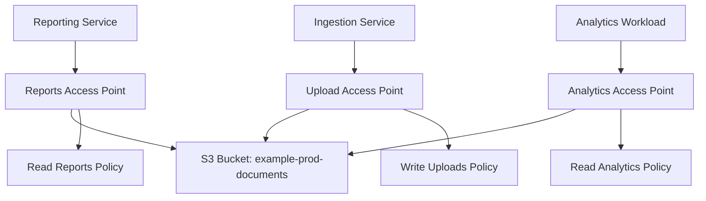
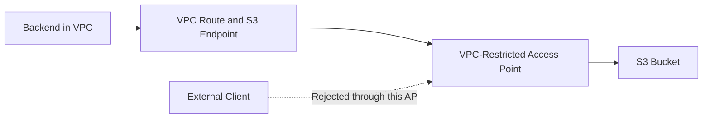
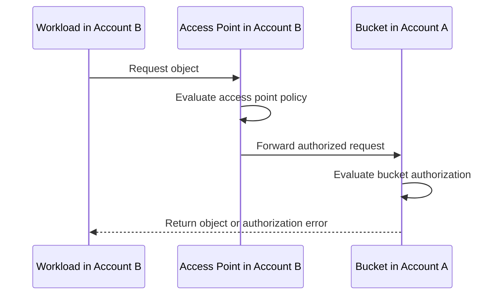

# 08- S3 Access Points and Access Policies

## Overview

Amazon S3 Access Points provide named endpoints with dedicated access policies and network controls for accessing data in an S3 bucket. They allow different applications, teams, or AWS accounts to access the same underlying dataset through separate access configurations.

Without access points, organizations often manage a large bucket policy containing permissions for multiple applications, teams, and external partners. As the number of consumers grows, the policy becomes harder to review, test, and maintain.

Access points address this problem by separating access configurations from the underlying bucket while retaining the bucket owner's control over the data.

For example, a centralized document bucket might have separate access points for:

- A reporting service that can read approved reports.
- An ingestion service that can upload documents.
- An analytics workload that can read datasets.
- A private application that accesses S3 only through a designated VPC.

Each access point can have its own policy and network origin. However, **an access point does not independently grant access to the underlying data**. The access point policy and underlying bucket authorization must both permit the request.

This document covers general-purpose S3 access points, access point policies, bucket-policy delegation, VPC-restricted access, cross-account access, AWS CLI operations, infrastructure as code, and troubleshooting.

## What Are S3 Access Points?

An S3 access point is a named endpoint associated with an underlying data source. For general-purpose S3 buckets, it provides an alternative way to perform supported object operations without requiring applications to address the bucket directly.

Each access point has:

- A unique name within the applicable account and Region.
- An underlying S3 bucket.
- An access point ARN.
- An access point policy.
- A network origin, either `Internet` or `VPC`.
- Block Public Access settings.

Access points are particularly useful when multiple consumers require different permissions for the same dataset.

### Example architecture

Suppose a company stores business documents in one bucket:

```text
example-prod-documents
    |
    +-- reports/
    +-- invoices/
    +-- analytics/
    +-- uploads/
```

Instead of maintaining all consumer permissions in one large policy, the company can define separate access points.



The access points do not create separate copies of the objects. They provide separate access paths to the same underlying bucket.

### Why access points matter

| Problem | Access point benefit |
|---|---|
| One bucket policy is difficult to maintain | Separate policies for different access paths |
| Applications require different permissions | Each access point can enforce a distinct permission boundary |
| Workloads must use private network paths | Access points can be configured with VPC-only network origins |
| Multiple teams share a dataset | Each team can use a dedicated endpoint |
| Cross-account consumers need controlled access | Access point policies can help isolate each consumer's permissions |

An access point is an authorization and access-management mechanism, not a replacement for application-level authorization or the underlying bucket's security configuration.

## Access Points Versus Bucket Policies

A bucket policy is attached directly to a bucket. An access point policy is attached to an access point.

For requests made through an access point, both the access point and the underlying bucket must permit the operation.

| Aspect | Bucket policy | Access point policy |
|---|---|---|
| Attached resource | S3 bucket | S3 access point |
| Primary scope | Access to the underlying bucket and its objects | Requests made through a particular access point |
| Resource references | Bucket and object ARNs | Access point and access point object ARNs |
| Network restrictions | Can use supported request conditions | Can combine access rules with a VPC-only network origin |
| Direct bucket requests | Can control them | Does not change their authorization behavior |
| Shared-data architecture | Central resource-level access control | Per-consumer access-control boundary |

### Important security boundary

An access point policy does not automatically restrict access made directly to the bucket.

For example, a reporting access point might allow only `s3:GetObject` on `reports/*`. An application with sufficient permissions to access the underlying bucket directly might still perform operations outside that prefix.

If all access must go through approved access points, configure and test the bucket's authorization policies to enforce that requirement.

Reference: [Configuring IAM policies for using access points](https://docs.aws.amazon.com/AmazonS3/latest/userguide/access-points-policies.html).

## Access Point ARN Structure

For a general-purpose S3 bucket, an access point ARN follows this format:

```text
arn:aws:s3:<region>:<account-id>:accesspoint/<access-point-name>
```

Example:

```text
arn:aws:s3:ap-south-1:123456789012:accesspoint/reports-ap
```

Object operations use the access point object ARN format in IAM policies:

```text
arn:aws:s3:<region>:<account-id>:accesspoint/<access-point-name>/object/<object-key>
```

For example:

```text
arn:aws:s3:ap-south-1:123456789012:accesspoint/reports-ap/object/reports/*
```

These ARNs are used in authorization policies. Applications and SDKs can also reference access points through supported access point ARNs or endpoints, depending on the operation and client.

### Bucket ARN versus access point ARN

| Operation or policy scope | Example resource |
|---|---|
| Bucket-level operation through an access point | `arn:aws:s3:ap-south-1:123456789012:accesspoint/reports-ap` |
| Object operation through an access point | `arn:aws:s3:ap-south-1:123456789012:accesspoint/reports-ap/object/reports/*` |
| Bucket-level operation in a bucket policy | `arn:aws:s3:::example-prod-documents` |
| Object operation in a bucket policy | `arn:aws:s3:::example-prod-documents/reports/*` |

The bucket ARN and access point ARN are not interchangeable. Incorrect resource ARNs are a frequent cause of authorization failures.

Reference: [Referencing access points with ARNs and endpoints](https://docs.aws.amazon.com/AmazonS3/latest/userguide/access-points-naming.html).

## Access Point Policies

An access point policy is a resource-based IAM policy attached to the access point. It specifies which principals can perform supported S3 operations through that endpoint.

The principal can be an IAM role, user, account, or another supported principal type.

A policy can restrict access by:

- Principal.
- S3 action.
- Access point resource ARN.
- Object key or prefix.
- Supported request conditions.
- Object tags, where applicable.

### Example: read and write access to a prefix

The following policy allows a specific application role to read and upload objects under `reports/` through an access point named `reports-ap`.

```json
{
  "Version": "2012-10-17",
  "Statement": [
    {
      "Sid": "AllowReportsListing",
      "Effect": "Allow",
      "Principal": {
        "AWS": "arn:aws:iam::123456789012:role/ReportsServiceRole"
      },
      "Action": "s3:ListBucket",
      "Resource": "arn:aws:s3:ap-south-1:123456789012:accesspoint/reports-ap",
      "Condition": {
        "StringLike": {
          "s3:prefix": [
            "reports/",
            "reports/*"
          ]
        }
      }
    },
    {
      "Sid": "AllowReportsObjectAccess",
      "Effect": "Allow",
      "Principal": {
        "AWS": "arn:aws:iam::123456789012:role/ReportsServiceRole"
      },
      "Action": [
        "s3:GetObject",
        "s3:PutObject"
      ],
      "Resource": "arn:aws:s3:ap-south-1:123456789012:accesspoint/reports-ap/object/reports/*"
    }
  ]
}
```

Replace the account ID, Region, bucket association, and role with the intended values.

The policy grants permission through the access point. The underlying bucket must also permit the corresponding operations, either through an appropriate bucket policy or through a deliberate delegation configuration.

The role's applicable identity-based permissions must also be considered, particularly when the principal and access point are in different accounts.

### Why listing and object access are separate

` s3:ListBucket` is a bucket-level action, while `s3:GetObject` and `s3:PutObject` are object-level actions.

The listing condition restricts which prefixes the caller can request. The object-resource ARN limits the read and write operations to keys under `reports/`.

The policy does not grant object deletion, ACL modification, bucket administration, or access outside the specified resource scope.

## Delegate Access Control to Access Points

A common design is to delegate object access to access points so their policies control which consumers can access the underlying bucket.

AWS recommends this approach for use cases that do not require direct bucket access.

### Example bucket policy for delegation

The following policy permits supported S3 data access through access points owned by the same AWS account as the bucket.

```json
{
  "Version": "2012-10-17",
  "Statement": [
    {
      "Sid": "DelegateDataAccessToOwnedAccessPoints",
      "Effect": "Allow",
      "Principal": {
        "AWS": "*"
      },
      "Action": [
        "s3:ListBucket"
      ],
      "Resource": "arn:aws:s3:::example-prod-documents",
      "Condition": {
        "StringEquals": {
          "s3:DataAccessPointAccount": "123456789012"
        }
      }
    },
    {
      "Sid": "DelegateObjectAccessToOwnedAccessPoints",
      "Effect": "Allow",
      "Principal": {
        "AWS": "*"
      },
      "Action": [
        "s3:GetObject",
        "s3:PutObject"
      ],
      "Resource": "arn:aws:s3:::example-prod-documents/*",
      "Condition": {
        "StringEquals": {
          "s3:DataAccessPointAccount": "123456789012"
        }
      }
    }
  ]
}
```

This is a delegation pattern, not a complete security policy for every bucket. The condition limits the statements to requests made through access points owned by the specified account.

The access point policies must define the intended principals and permissions, and applicable identity-based policies and other controls must still permit the requests.

### Important limitations

- The policy grants access through any matching access point owned by the specified account, not just one named access point.
- It does not, by itself, deny every form of direct bucket access.
- Other applicable allow and deny statements still affect authorization.
- Access point creation and policy management must be restricted to trusted administrators.
- Bucket-level operational features that do not support access points might require other access paths.

If the requirement is to allow access through only one specific access point, use a narrowly scoped delegation condition such as `s3:DataAccessPointArn` and validate the complete policy design.

### Alternative: duplicate the required permissions

Instead of delegating access control, the bucket policy can grant the necessary permissions to the same principal and corresponding bucket or object resources specified in the access point policy.

This can be appropriate for simple integrations, but duplicated permissions can drift over time. Choose one clear pattern and document the intended authorization model.

Reference: [Delegating access control to access points](https://docs.aws.amazon.com/AmazonS3/latest/userguide/access-points-policies.html).

## VPC-Restricted Access Points

An access point can be created with a network origin of `VPC`, requiring supported requests through that access point to originate from a specified VPC.

This is useful for workloads such as:

- Private document-processing services.
- Internal data platforms.
- Applications running on EC2, ECS, or EKS.
- Private batch-processing jobs.
- Internal services that must not access S3 through a public access path.

The network-origin setting is selected when the access point is created and cannot be changed afterward. Choose the intended network model before provisioning it.

### Example architecture



### Create a VPC-restricted access point

```bash
aws s3control create-access-point \
  --account-id 123456789012 \
  --name private-documents-ap \
  --bucket example-prod-documents \
  --vpc-configuration VpcId=vpc-0123456789abcdef0 \
  --region ap-south-1
```

This creates an access point whose network origin is the specified VPC.

### Verify the configuration

```bash
aws s3control get-access-point \
  --account-id 123456789012 \
  --name private-documents-ap \
  --region ap-south-1
```

Confirm the returned `NetworkOrigin` is `VPC` and that the VPC ID is correct.

### VPC endpoint requirements

If the application accesses S3 through a VPC endpoint, verify the endpoint policy as well.

The request must satisfy all applicable controls:

- The access point's network-origin restriction.
- The access point policy.
- The underlying bucket policy.
- The caller's identity-based permissions.
- The VPC endpoint policy.
- Other applicable organization-level or security restrictions.

For VPC-only access, ensure the intended network path and DNS configuration are correct. A VPC-restricted access point does not automatically create a VPC endpoint or configure routing.

Reference: [Creating access points restricted to a VPC](https://docs.aws.amazon.com/AmazonS3/latest/userguide/access-points-vpc.html).

## Block Public Access for Access Points

S3 access points have their own Block Public Access settings. These settings work together with applicable Block Public Access settings at the account and underlying bucket levels.

For private application data, keep all four settings enabled when creating an access point:

- `BlockPublicAcls`
- `IgnorePublicAcls`
- `BlockPublicPolicy`
- `RestrictPublicBuckets`

Example creation with explicit settings:

```bash
aws s3control create-access-point \
  --account-id 123456789012 \
  --name reports-ap \
  --bucket example-prod-documents \
  --public-access-block-configuration \
    BlockPublicAcls=true,IgnorePublicAcls=true,BlockPublicPolicy=true,RestrictPublicBuckets=true \
  --region ap-south-1
```

Access point Block Public Access settings cannot be changed after the access point is created. If a setting must differ, evaluate the access point's lifecycle and replacement procedure rather than expecting an in-place change.

### Important distinction

Block Public Access settings prevent or restrict supported public-access configurations. They do not automatically make every private access policy correct.

For example, an overly broad cross-account permission may still be undesirable even if the bucket is not classified as public.

Review public and cross-account access independently.

Reference: [Managing access points and public-access settings](https://docs.aws.amazon.com/AmazonS3/latest/userguide/access-points-details.html).

## Cross-Account Access Points

Cross-account access points allow a consumer account to create an access point for a bucket owned by another AWS account.

Creating the access point does not automatically grant access to the underlying data. The bucket owner must authorize the cross-account access point through the bucket policy.

### Example architecture

- Account A owns `example-central-data`.
- Account B owns `analytics-reader-ap`, attached to Account A's bucket.
- Account B's application role accesses objects through the access point.
- Account A's bucket policy authorizes the intended access point and operations.



### Permissions required

A cross-account request must satisfy the relevant authorization layers, including:

- The workload's identity-based policy in Account B.
- The access point policy.
- The bucket owner's bucket policy.
- Applicable SCPs, resource control policies, endpoint policies, and explicit denies.
- KMS permissions and key policy, when SSE-KMS uses a customer-managed key.

### Bucket policy for a trusted access-point account

The bucket owner can authorize access points owned by a specific external account using the `s3:DataAccessPointAccount` condition.

Example:

```json
{
  "Version": "2012-10-17",
  "Statement": [
    {
      "Sid": "AllowTrustedAccountAccessPointsToRead",
      "Effect": "Allow",
      "Principal": {
        "AWS": "*"
      },
      "Action": [
        "s3:ListBucket"
      ],
      "Resource": "arn:aws:s3:::example-central-data",
      "Condition": {
        "StringEquals": {
          "s3:DataAccessPointAccount": "444455556666"
        }
      }
    },
    {
      "Sid": "AllowTrustedAccountAccessPointsToReadObjects",
      "Effect": "Allow",
      "Principal": {
        "AWS": "*"
      },
      "Action": [
        "s3:GetObject"
      ],
      "Resource": "arn:aws:s3:::example-central-data/*",
      "Condition": {
        "StringEquals": {
          "s3:DataAccessPointAccount": "444455556666"
        }
      }
    }
  ]
}
```

This example permits supported read requests through access points owned by Account B. It does not grant general read access to every principal in Account B without the other required permissions, and it does not grant write access.

For a stricter trust boundary, consider restricting access to a specific access point ARN and prefix rather than trusting all access points owned by an external account.

Reference: [Granting permissions for cross-account access points](https://docs.aws.amazon.com/AmazonS3/latest/userguide/access-points-policies.html).

## Use Access Points with AWS CLI

The `s3control` command family manages access point resources and their policies. The `s3api` command family provides object operations and bucket configuration APIs.

### List access points

```bash
aws s3control list-access-points \
  --account-id 123456789012 \
  --region ap-south-1
```

### Inspect an access point

```bash
aws s3control get-access-point \
  --account-id 123456789012 \
  --name reports-ap \
  --region ap-south-1
```

### Save an access point policy

Create a file named `access-point-policy.json` containing the intended resource-based policy.

### Apply the access point policy

```bash
aws s3control put-access-point-policy \
  --account-id 123456789012 \
  --name reports-ap \
  --policy file://access-point-policy.json \
  --region ap-south-1
```

The caller requires the appropriate access point policy-management permission.

### Inspect the policy

```bash
aws s3control get-access-point-policy \
  --account-id 123456789012 \
  --name reports-ap \
  --region ap-south-1
```

Treat `put-access-point-policy` as a policy replacement operation. Retrieve and review the existing policy before applying changes, because an update can remove permissions that were previously required.

### Delete an access point policy

```bash
aws s3control delete-access-point-policy \
  --account-id 123456789012 \
  --name reports-ap \
  --region ap-south-1
```

Deleting the policy can remove the intended authorization path. Use this command only when the resulting access behavior is understood and approved.

### Delete an access point

```bash
aws s3control delete-access-point \
  --account-id 123456789012 \
  --name reports-ap \
  --region ap-south-1
```

Deleting an access point removes that access endpoint; it does not delete the underlying bucket or its objects.

Before deletion, identify applications, batch jobs, and integrations that use the endpoint. Migrate them to another approved access path before removing it.

## Use Access Points from Python with Boto3

Boto3 supports access point management and supported object operations.

### Create an access point

```python
import boto3

s3_control = boto3.client(
    "s3control",
    region_name="ap-south-1",
)

response = s3_control.create_access_point(
    AccountId="123456789012",
    Name="reports-ap",
    Bucket="example-prod-documents",
)

print(response["AccessPointArn"])
```

The caller needs the necessary access point creation permissions and the required authorization to associate the access point with the bucket.

### Apply an access point policy

```python
import json
import boto3

s3_control = boto3.client(
    "s3control",
    region_name="ap-south-1",
)

policy = {
    "Version": "2012-10-17",
    "Statement": [
        {
            "Sid": "AllowReportsReader",
            "Effect": "Allow",
            "Principal": {
                "AWS": "arn:aws:iam::123456789012:role/ReportsServiceRole"
            },
            "Action": "s3:GetObject",
            "Resource": (
                "arn:aws:s3:ap-south-1:123456789012:"
                "accesspoint/reports-ap/object/reports/*"
            ),
        }
    ],
}

s3_control.put_access_point_policy(
    AccountId="123456789012",
    Name="reports-ap",
    Policy=json.dumps(policy),
)
```

This policy grants object-read permission through the access point for the specified prefix. The bucket's authorization policy must also permit the request.

### Access an object through an access point

For SDK operations that support access point ARNs, an access point ARN can be used in place of a bucket name.

```python
import boto3

s3 = boto3.client(
    "s3",
    region_name="ap-south-1",
)

access_point_arn = (
    "arn:aws:s3:ap-south-1:123456789012:accesspoint/reports-ap"
)

response = s3.get_object(
    Bucket=access_point_arn,
    Key="reports/monthly.csv",
)

try:
    content = response["Body"].read()
finally:
    response["Body"].close()
```

For large objects, avoid reading the entire body into memory when a streaming response can be processed incrementally. Verify that the chosen SDK version and operation support the access point reference form used by the application.

### Production recommendations

- Use workload IAM roles instead of embedding access keys.
- Keep access point creation and policy updates in infrastructure code.
- Separate policy administration from application data access.
- Restrict permissions by principal, action, and prefix.
- Handle `ClientError` exceptions at the service boundary.
- Test the access point and bucket policies together.
- Keep KMS authorization and encryption configuration separate from S3 access point permissions.

## Infrastructure as Code

Manage access points and their policies through infrastructure as code to make access changes reviewable, repeatable, and auditable.

Terraform provides dedicated resources for general-purpose S3 access points and access point policies.

### Terraform example

```hcl
resource "aws_s3_access_point" "reports" {
  bucket = aws_s3_bucket.documents.id
  name   = "reports-ap"

  public_access_block_configuration {
    block_public_acls       = true
    ignore_public_acls      = true
    block_public_policy     = true
    restrict_public_buckets = true
  }
}

resource "aws_s3_access_point_policy" "reports" {
  access_point_arn = aws_s3_access_point.reports.arn

  policy = jsonencode({
    Version = "2012-10-17"
    Statement = [
      {
        Sid    = "AllowReportsReader"
        Effect = "Allow"

        Principal = {
          AWS = "arn:aws:iam::123456789012:role/ReportsServiceRole"
        }

        Action = [
          "s3:GetObject"
        ]

        Resource = "${aws_s3_access_point.reports.arn}/object/reports/*"
      }
    ]
  })
}
```

This example defines the access point and its access policy. It assumes `aws_s3_bucket.documents` is defined elsewhere.

It does not configure the required bucket-policy permissions. Add the appropriate bucket authorization or delegation policy as a separate resource, according to the selected access-control design.

### Validate the change

```bash
terraform fmt -check
terraform validate
terraform plan
```

Review the plan before applying it. Confirm that the bucket policy, access point policy, network origin, and public-access controls match the intended design.

### Production considerations

- Pin and review the AWS provider version.
- Use environment-specific variables for account IDs, bucket names, and role ARNs.
- Restrict the CI/CD role to the required management and deployment actions.
- Avoid hardcoding secrets in Terraform files.
- Keep access point policy changes in version control.
- Test both allowed and denied requests after deployment.
- Plan replacement carefully if the network origin or creation-time configuration must change.

## Monitoring and Auditing

Access points add separate resources and policies that must be included in security reviews.

| Control | Purpose |
|---|---|
| IAM Access Analyzer | Identifies supported public or cross-account access configurations |
| AWS CloudTrail | Audits relevant access point management and S3 API activity when the events are recorded |
| AWS Config | Evaluates supported configuration rules |
| CloudWatch | Monitors supported S3 metrics and operational signals |
| Infrastructure state and source control | Tracks intended access point and policy configuration |
| Security review | Confirms the access design remains consistent with business requirements |

### Recommended checks

**During deployment:** Validate policy syntax, resource ARNs, principals, and the underlying bucket permissions.

**During routine reviews:** Inventory access points and verify their owners, network origins, Block Public Access settings, and attached policies.

**After policy changes:** Test the real application identity and verify both allowed and denied access paths.

**During incident response:** Correlate the access point, underlying bucket policy, relevant caller identity, and applicable logs to identify the actual cause.

Do not treat the existence of an access point as evidence that all bucket access is restricted to that endpoint. Confirm the bucket policy and other applicable authorization controls.

## Troubleshooting Access Point Failures

Use a structured workflow when requests through an access point fail or when a new access point introduces unintended access.

### Symptoms and likely causes

| Symptom | Possible cause | Verification |
|---|---|---|
| `AccessDenied` through an access point | Access point policy, bucket policy, identity policy, or another applicable control denies the request | Inspect all relevant policy layers |
| Object can be read directly but not through the access point | Access point policy or bucket authorization does not permit the access path | Inspect the access point policy and bucket policy |
| Access point works from one network but not another | The access point has a VPC network origin | Inspect `NetworkOrigin` and the configured VPC |
| Requests from a VPC endpoint fail | VPC endpoint policy does not permit access to the access point or underlying bucket | Inspect the endpoint policy and network path |
| Cross-account access fails | The bucket owner has not authorized the access point or another required policy is missing | Inspect both accounts' policies |
| Access point policy changes do not restore access | The underlying bucket still denies the operation | Inspect the bucket policy and explicit denies |
| SSE-KMS object access fails | KMS permissions or key policy prevent decryption | Review S3 and KMS authorization separately |

### Diagnostic procedure

1. Confirm the access point name, account ID, Region, and underlying bucket.
2. Retrieve access point details and its policy.
3. Retrieve the bucket policy and Block Public Access settings.
4. Verify the active principal with `aws sts get-caller-identity`.
5. Confirm the correct resource ARN and action.
6. Check VPC origin and endpoint policy restrictions where relevant.
7. Inspect KMS permissions if the object uses SSE-KMS.
8. Reproduce the failed request with the intended workload identity.
9. Correct the narrowest relevant policy or configuration.
10. Verify both the intended allow path and the restrictions that must remain enforced.

### Avoid unsafe workarounds

Do not disable Block Public Access, change a VPC-only access point, or grant broad bucket access just to resolve an authorization error.

Identify the failed authorization layer and correct the specific misconfiguration. Preserve the approved access boundary while restoring the intended workflow.

## Production Best Practices

- Use access points when different consumers require independent policies for a shared dataset.
- Keep access point policies narrowly scoped to the necessary principals, actions, and object prefixes.
- Ensure the underlying bucket policy permits intended access and does not unintentionally bypass the access point design.
- Use bucket-policy delegation deliberately, restricting the trusted access point account or specific access point ARN.
- Prefer VPC-only network origins for workloads that must access S3 through an approved private network path.
- Enable Block Public Access settings for private access points and underlying buckets.
- Restrict who can create access points and modify their policies.
- Treat cross-account access points as a multi-policy authorization problem.
- Keep KMS permissions and key-policy requirements separate from S3 permissions.
- Validate access point policies through Access Analyzer and deployment checks.
- Inventory access points and remove unused endpoints through a controlled change process.
- Document supported operations and maintain alternate administrative access where needed.

## Official References

- [Managing access to shared datasets with access points](https://docs.aws.amazon.com/AmazonS3/latest/userguide/access-points.html)
- [Creating an access point](https://docs.aws.amazon.com/AmazonS3/latest/userguide/creating-access-points.html)
- [Configuring IAM policies for using access points](https://docs.aws.amazon.com/AmazonS3/latest/userguide/access-points-policies.html)
- [Referencing access points with ARNs and endpoints](https://docs.aws.amazon.com/AmazonS3/latest/userguide/access-points-naming.html)
- [Creating access points restricted to a VPC](https://docs.aws.amazon.com/AmazonS3/latest/userguide/access-points-vpc.html)
- [Viewing access point details](https://docs.aws.amazon.com/AmazonS3/latest/userguide/access-points-details.html)
- [Amazon S3 access point compatibility](https://docs.aws.amazon.com/AmazonS3/latest/userguide/access-points-compatibility.html)
- [Required permissions for Amazon S3 API operations](https://docs.aws.amazon.com/AmazonS3/latest/userguide/using-with-s3-policy-actions.html)
- [Actions, resources, and condition keys for Amazon S3](https://docs.aws.amazon.com/service-authorization/latest/reference/list_amazons3.html)

## Key Takeaways

- S3 access points provide dedicated endpoints, policies, and network controls for different consumers of shared data.
- Access through an access point requires compatible authorization from both the access point and the underlying bucket, along with other applicable controls.
- Access point policies do not automatically restrict direct bucket access; the bucket policy must enforce the intended access architecture.
- VPC-restricted access points require compatible routing and, when applicable, VPC endpoint policies that allow access to the access point and underlying bucket.
- Treat access points as part of a complete authorization design that includes IAM, bucket policies, Block Public Access, cross-account permissions, and KMS controls.