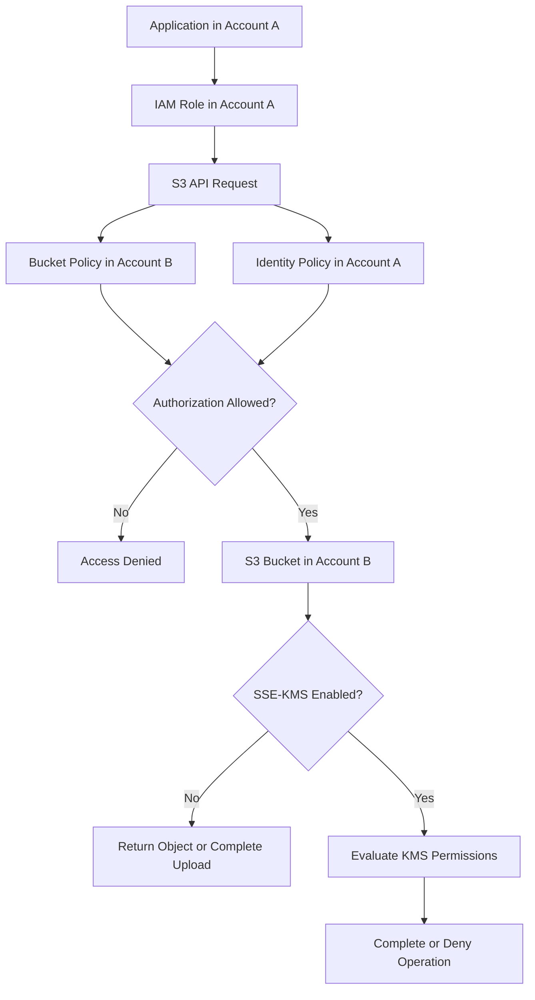
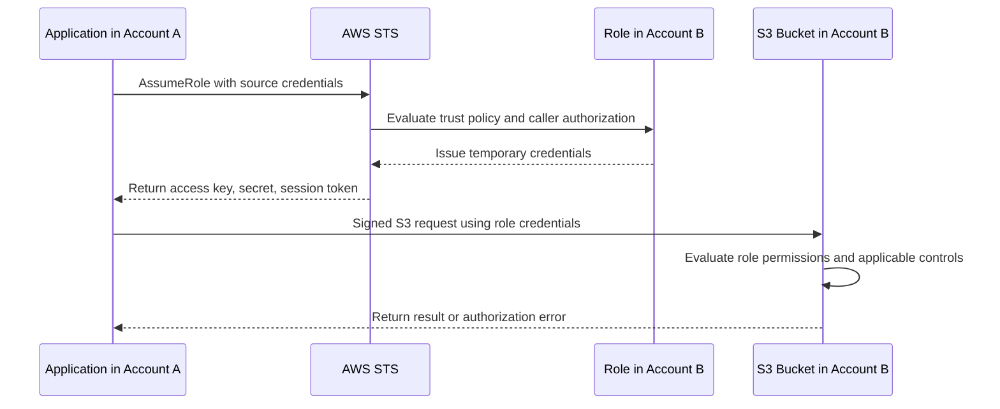

# 09- Cross-Account Access

## Overview

Amazon S3 cross-account access allows an IAM identity in one AWS account to access buckets or objects owned by another AWS account. It is commonly used in centralized data platforms, shared document repositories, analytics pipelines, backup architectures, and integrations between independently managed AWS environments.

A cross-account request must satisfy the authorization requirements of both the requesting identity and the resource owner. Granting permission in only one account is generally insufficient for direct cross-account S3 access.

For example, an application in Account A may need to upload documents to a private bucket in Account B. The application role needs the appropriate identity-based permissions, while Account B must authorize that role through the bucket policy or another supported resource-based access mechanism.

This document covers:

- Cross-account authorization and trust boundaries.
- Direct access through bucket policies and access points.
- IAM role assumption as an alternative architecture.
- SSE-KMS permissions and object ownership.
- AWS CLI and Boto3 examples.
- Security, auditing, troubleshooting, and production practices.

## Cross-Account Access Architecture

Consider an application deployed in one AWS account that needs to read reports from a bucket owned by another account.

| Component | Responsibility |
|---|---|
| Account A | Owns the application and its IAM role |
| Application role | Makes authenticated S3 requests |
| Account B | Owns the S3 bucket |
| Bucket policy | Authorizes the external principal or supported access path |
| Identity-based IAM policy | Grants the application role the required S3 operations |
| KMS key policy, when applicable | Authorizes encryption or decryption using a customer-managed key |

### Example architecture



This diagram illustrates the principal authorization layers. Other applicable controls, such as explicit denies, AWS Organizations policies, permissions boundaries, session policies, VPC endpoint policies, and Block Public Access, can also affect the result.

## Cross-Account Authorization Models

Several architectures can provide cross-account S3 access. Choose the model based on account ownership, isolation requirements, administrative boundaries, and operational complexity.

| Model | How it works | Suitable use case |
|---|---|---|
| Direct access through a bucket policy | The resource-owning account grants access to an external IAM principal | A workload accesses a centralized bucket directly |
| Cross-account access using an S3 access point | The consumer accesses data through a named endpoint with a dedicated policy | Multiple teams or accounts require separate access configurations |
| Assume a role in the resource-owning account | The application obtains temporary credentials for a role in the target account | The target account should own the operational identity and permissions |
| S3 Access Grants | A supported grant-based mechanism provides access to buckets, prefixes, or objects | Large-scale data access management across users and applications |

These models are alternatives, not permissions that should automatically be combined. Access point and S3 Access Grants configurations have their own authorization requirements.

## Direct Cross-Account Access with a Bucket Policy

Direct access is appropriate when an application can keep using its existing IAM role and the resource owner is willing to grant that role access through a bucket policy.

Assume:

- Account A: `111122223333`
- Account B: `444455556666`
- Application role: `arn:aws:iam::111122223333:role/ReportReaderRole`
- Bucket: `central-prod-reports`
- Allowed prefix: `reports/`

Account B owns the bucket and grants Account A's role read access.

### Configure the identity policy in Account A

Attach the following policy to `ReportReaderRole`:

```json
{
  "Version": "2012-10-17",
  "Statement": [
    {
      "Sid": "ReadCentralReports",
      "Effect": "Allow",
      "Action": [
        "s3:GetObject"
      ],
      "Resource": "arn:aws:s3:::central-prod-reports/reports/*"
    }
  ]
}
```

This grants the role permission to request the specified objects. It does not independently authorize access to Account B's bucket.

If the application must list report objects, grant `s3:ListBucket` separately on the bucket ARN and use a condition to restrict the requested prefixes.

### Configure the bucket policy in Account B

Account B attaches the following policy to `central-prod-reports`:

```json
{
  "Version": "2012-10-17",
  "Statement": [
    {
      "Sid": "AllowReportReaderRole",
      "Effect": "Allow",
      "Principal": {
        "AWS": "arn:aws:iam::111122223333:role/ReportReaderRole"
      },
      "Action": [
        "s3:GetObject"
      ],
      "Resource": "arn:aws:s3:::central-prod-reports/reports/*"
    }
  ]
}
```

This grants the external role object-read access to the specified prefix, subject to other applicable authorization controls.

### Why both policies matter

For direct cross-account access, Account A's identity policy grants the role the required action, while Account B's resource policy grants the external principal access to the resource.

A successful request still requires all applicable controls to permit it. An explicit deny or an applicable organization-level restriction can prevent access despite these two `Allow` statements.

Reference: [Cross-account access in IAM](https://docs.aws.amazon.com/IAM/latest/UserGuide/access_policies-cross-account-resource-access.html).

## Bucket-Level and Object-Level Permissions

S3 distinguishes bucket-level operations from object-level operations. Cross-account policies must use the correct resource ARNs for each action.

| Operation | IAM action | Resource ARN |
|---|---|---|
| List objects | `s3:ListBucket` | `arn:aws:s3:::central-prod-reports` |
| Retrieve an object | `s3:GetObject` | `arn:aws:s3:::central-prod-reports/reports/*` |
| Upload an object | `s3:PutObject` | `arn:aws:s3:::central-prod-reports/uploads/*` |
| Delete an object | `s3:DeleteObject` | `arn:aws:s3:::central-prod-reports/uploads/*` |
| Retrieve a specific version | `s3:GetObjectVersion` | `arn:aws:s3:::central-prod-reports/reports/*` |
| Delete a specific version | `s3:DeleteObjectVersion` | `arn:aws:s3:::central-prod-reports/uploads/*` |

The exact actions required depend on the API operation and configuration. For example, multipart uploads, ACL operations, tagging, and KMS encryption can introduce additional permissions.

Avoid granting `s3:*` over an entire bucket simply to make an integration work.

### Grant listing on a prefix

Add a separate statement to the identity policy and bucket policy where listing is required.

```json
{
  "Sid": "ListReportsPrefix",
  "Effect": "Allow",
  "Action": "s3:ListBucket",
  "Resource": "arn:aws:s3:::central-prod-reports",
  "Condition": {
    "StringLike": {
      "s3:prefix": [
        "reports/",
        "reports/*"
      ]
    }
  }
}
```

This statement is a component of a policy, not a complete bucket policy by itself. The corresponding principal and other required fields must be included in the containing policy document.

The listing permission does not grant `s3:GetObject`. Object retrieval must be authorized separately.

## Grant Cross-Account Access to an AWS Account

Instead of naming an individual external role, a bucket owner can authorize an AWS account principal.

For example, Account B can use the following bucket policy statement:

```json
{
  "Sid": "AllowAccountAReportAccess",
  "Effect": "Allow",
  "Principal": {
    "AWS": "arn:aws:iam::111122223333:root"
  },
  "Action": [
    "s3:GetObject"
  ],
  "Resource": "arn:aws:s3:::central-prod-reports/reports/*"
}
```

In a resource policy, this account principal delegates permissions to the specified AWS account. It does not mean only the root user can use the granted access.

Account A must still configure identity-based policies to delegate the appropriate permissions to its IAM identities.

### Account principal versus role principal

| Principal | Security implication |
|---|---|
| Specific IAM role ARN | Grants access to the named role, subject to other controls |
| Account principal ARN ending in `:root` | Allows the account to delegate the granted resource permissions to its identities |
| Wildcard principal `*` | Potentially broad access; conditions and other controls must be carefully reviewed |

Prefer a specific role principal when the intended workload identity is known and stable.

Account-level delegation can be useful when the external account owns and manages the relevant identities, but it requires disciplined IAM administration in that account.

## Cross-Account Uploads

Cross-account uploads require explicit authorization for the intended destination prefix and an ownership model that allows the bucket owner to manage uploaded objects.

Assume Account A runs a document-ingestion service and Account B owns `central-prod-documents`.

### Identity policy in Account A

```json
{
  "Version": "2012-10-17",
  "Statement": [
    {
      "Sid": "UploadTenantDocuments",
      "Effect": "Allow",
      "Action": [
        "s3:PutObject"
      ],
      "Resource": "arn:aws:s3:::central-prod-documents/uploads/tenant-123/*"
    }
  ]
}
```

### Bucket policy in Account B

```json
{
  "Version": "2012-10-17",
  "Statement": [
    {
      "Sid": "AllowTenantDocumentUploads",
      "Effect": "Allow",
      "Principal": {
        "AWS": "arn:aws:iam::111122223333:role/DocumentIngestionRole"
      },
      "Action": [
        "s3:PutObject"
      ],
      "Resource": "arn:aws:s3:::central-prod-documents/uploads/tenant-123/*"
    }
  ]
}
```

These examples allow the specified role to upload objects under the designated prefix, subject to other applicable permissions and restrictions.

If the application must retrieve uploaded objects, add the required read permission separately. If it must delete objects, add the narrowly scoped deletion permission and account for versioning behavior.

### Recommended Object Ownership

For most shared buckets, use `BucketOwnerEnforced`.

This makes the bucket owner the owner of every object and disables ACL-based authorization. New upload clients should generally omit ACL headers and parameters.

Legacy ownership modes may require the `bucket-owner-full-control` canned ACL or other ACL-compatible behavior, but should be retained only when a genuine compatibility requirement exists.

Reference: [Controlling ownership of objects and disabling ACLs](https://docs.aws.amazon.com/AmazonS3/latest/userguide/about-object-ownership.html).

## Assume a Role in the Resource-Owning Account

Assuming a role is useful when the resource-owning account should control the permissions associated with the application's temporary identity.

Under this model, the application starts with credentials in Account A and calls AWS Security Token Service (STS) to assume a role in Account B.

The resulting temporary credentials identify the role in Account B.

### Architecture



### Configure the trust policy in Account B

Create a role such as `CentralReportsReaderRole` with a trust policy allowing Account A's application role to assume it.

```json
{
  "Version": "2012-10-17",
  "Statement": [
    {
      "Sid": "TrustDocumentIngestionRole",
      "Effect": "Allow",
      "Principal": {
        "AWS": "arn:aws:iam::111122223333:role/DocumentIngestionRole"
      },
      "Action": "sts:AssumeRole"
    }
  ]
}
```

This trust policy defines who may assume the role. It does not define what S3 operations the resulting session can perform.

### Attach an S3 permission policy to the target role

```json
{
  "Version": "2012-10-17",
  "Statement": [
    {
      "Sid": "ReadCentralReports",
      "Effect": "Allow",
      "Action": [
        "s3:GetObject"
      ],
      "Resource": "arn:aws:s3:::central-prod-reports/reports/*"
    }
  ]
}
```

The role now has the intended object-read permissions, subject to applicable controls.

If the bucket and role belong to Account B, the resource-owner account's identity policy can authorize this access without requiring a separate bucket-policy allow for that same-account role. Existing bucket policies and explicit denies still apply.

### Allow the source role to assume the target role

In Account A, attach a policy to `DocumentIngestionRole` that permits the specific target role:

```json
{
  "Version": "2012-10-17",
  "Statement": [
    {
      "Sid": "AssumeCentralReportsRole",
      "Effect": "Allow",
      "Action": "sts:AssumeRole",
      "Resource": "arn:aws:iam::444455556666:role/CentralReportsReaderRole"
    }
  ]
}
```

Both the source identity's authorization and the destination role's trust policy must permit the role assumption, subject to other applicable controls.

### When role assumption is preferable

Use this design when:

- The resource owner should own the data-access role.
- A centralized permission model is desirable.
- Multiple applications need a controlled way to access resources in another account.
- Temporary credentials and a defined role session are preferred.
- The target account needs independent control over permissions and role lifecycle.

Role assumption adds an STS step and requires credential-refresh handling. Use an SDK credential provider that manages temporary credentials rather than manually embedding or persisting session credentials.

## Cross-Account Access Points

S3 access points provide separate endpoints and policies for shared data. An access point can be associated with a bucket owned by another account, subject to the supported configuration and required authorization.

Creating the access point does not automatically grant access to the bucket.

The bucket owner must authorize the external access point through the bucket policy, and the access point policy must grant the intended workload permissions.

### When to use access points

- Different AWS accounts require different permissions on a shared bucket.
- Each consumer needs a distinct endpoint.
- Network-origin restrictions are required for particular workloads.
- A centralized bucket's policy would otherwise become difficult to manage.

### Delegating access to a trusted account

A bucket owner can permit requests through access points owned by a specific external account with the `s3:DataAccessPointAccount` condition.

For example, the following statement permits read requests through access points owned by Account A:

```json
{
  "Sid": "AllowAccountAAccessPointsToReadObjects",
  "Effect": "Allow",
  "Principal": {
    "AWS": "*"
  },
  "Action": "s3:GetObject",
  "Resource": "arn:aws:s3:::central-prod-reports/*",
  "Condition": {
    "StringEquals": {
      "s3:DataAccessPointAccount": "111122223333"
    }
  }
}
```

This statement belongs in the bucket policy. Its scope covers qualifying access points owned by the specified account, not one individual access point.

For a stricter boundary, restrict access using a specific access point ARN with the supported condition keys and verify the complete policy evaluation.

### Important considerations

- Access point and bucket policies are both relevant to the access path.
- Cross-account access requires the external workload to have the necessary permissions.
- Access point policies do not automatically prevent direct bucket access.
- KMS key policies and permissions remain separate when SSE-KMS is used.
- VPC-restricted access points require compatible network paths and endpoint policies.

Reference: [Configuring IAM policies for using access points](https://docs.aws.amazon.com/AmazonS3/latest/userguide/access-points-policies.html).

## Cross-Account Access with SSE-KMS

Server-side encryption using AWS KMS introduces an additional authorization layer.

A bucket policy that grants `s3:GetObject` does not automatically grant permission to decrypt an object encrypted with a customer-managed KMS key.

For a cross-account read operation, the caller must have the appropriate S3 permission and authorization to use the KMS key.

For uploads using SSE-KMS, the caller and KMS key policy must authorize the applicable encryption operations.

### Example authorization layers

| Operation | S3 permission | KMS considerations |
|---|---|---|
| Read an SSE-KMS object | `s3:GetObject` | Generally requires `kms:Decrypt` authorization |
| Upload an SSE-KMS object | `s3:PutObject` | Requires the appropriate KMS encryption permissions, including `kms:GenerateDataKey` where applicable |
| Multipart upload with SSE-KMS | Relevant multipart and object permissions | May require additional KMS permissions depending on the operation |
| Replicate SSE-KMS objects | Replication permissions | Source and destination KMS key permissions and key policies must be configured |

The exact permission requirements depend on the operation, encryption mode, and bucket configuration.

### KMS key policy requirements

When a customer-managed key is owned by Account B and used by a principal from Account A:

- The KMS key policy in Account B must permit the intended cross-account use.
- The caller's identity policy must authorize the required KMS operations.
- Applicable conditions and other authorization controls must allow the request.
- The key must be in an appropriate state and Region for the operation.

Cross-account KMS permissions cannot be established merely by adding an S3 bucket-policy statement.

### Troubleshooting an SSE-KMS failure

When an S3 operation returns `AccessDenied`, determine whether the S3 request itself is unauthorized or whether KMS authorization failed.

Inspect the S3 policy, the KMS key policy, the caller's identity policy, and the relevant CloudTrail events. Add only the missing permissions and restrict them to the required key and operations.

References:

- [Permissions required for Amazon S3 API operations](https://docs.aws.amazon.com/AmazonS3/latest/userguide/using-with-s3-policy-actions.html)
- [Replicating SSE-KMS encrypted objects](https://docs.aws.amazon.com/AmazonS3/latest/userguide/replication-config-for-kms-objects.html)

## Use AWS CLI to Verify Cross-Account Access

Always identify the actual credentials used for a cross-account request before diagnosing policy issues.

### Check the current identity

```bash
aws sts get-caller-identity
```

Confirm the returned account ID and ARN match the expected application role or assumed role.

### Inspect the bucket policy

Run this command using an identity that has permission to retrieve the bucket policy:

```bash
aws s3api get-bucket-policy \
  --bucket central-prod-reports \
  --region ap-south-1
```

A workload role usually should not receive bucket-policy administration permissions solely for routine object access.

### Test the required operation

For a known object:

```bash
aws s3api head-object \
  --bucket central-prod-reports \
  --key reports/monthly.csv \
  --region ap-south-1
```

For an object download:

```bash
aws s3api get-object \
  --bucket central-prod-reports \
  --key reports/monthly.csv \
  ./monthly.csv \
  --region ap-south-1
```

These commands test the current identity's effective access. A successful `head-object` or `get-object` does not prove that listing, uploading, or deleting is also authorized.

### Test an assumed role

If the workload is designed to assume a role in Account B:

```bash
aws sts assume-role \
  --role-arn arn:aws:iam::444455556666:role/CentralReportsReaderRole \
  --role-session-name report-reader-test \
  --region ap-south-1
```

This requests temporary credentials. It does not prove that those credentials can read the target bucket; use the resulting session in a controlled test of the intended S3 operation.

Avoid writing temporary credentials to shared configuration files or logging them in CI/CD output.

## Boto3 Cross-Account Access

Boto3 can perform direct cross-account S3 operations when the process uses credentials for a principal authorized by the relevant resource policies.

Alternatively, the application can assume a role in the target account and use temporary session credentials.

### Assume a target role

```python
import boto3
from botocore.exceptions import ClientError


def create_assumed_s3_client(
    role_arn: str,
    region_name: str,
) -> boto3.client:
    """Create an S3 client using temporary credentials from STS."""
    sts = boto3.client("sts", region_name=region_name)

    response = sts.assume_role(
        RoleArn=role_arn,
        RoleSessionName="central-reports-reader",
    )

    credentials = response["Credentials"]

    return boto3.client(
        "s3",
        region_name=region_name,
        aws_access_key_id=credentials["AccessKeyId"],
        aws_secret_access_key=credentials["SecretAccessKey"],
        aws_session_token=credentials["SessionToken"],
    )


try:
    s3 = create_assumed_s3_client(
        role_arn=(
            "arn:aws:iam::444455556666:role/"
            "CentralReportsReaderRole"
        ),
        region_name="ap-south-1",
    )

    response = s3.get_object(
        Bucket="central-prod-reports",
        Key="reports/monthly.csv",
    )

    try:
        content = response["Body"].read()
    finally:
        response["Body"].close()

except ClientError as exc:
    error = exc.response.get("Error", {})
    print(
        "S3 operation failed:",
        error.get("Code"),
        error.get("Message"),
    )
    raise
```

This is a concise illustration of STS role assumption and a subsequent S3 request. A long-running production service should use a refreshable credential provider, such as Boto3's supported assume-role credential-provider configuration, rather than manually retaining one STS response indefinitely.

### Production recommendations

- Use workload roles and the default AWS credential provider chain.
- Avoid long-lived IAM user access keys.
- Never log access keys, secret keys, or session tokens.
- Use structured logging that records the operation and AWS error code without exposing sensitive request data.
- Handle credential expiration through the SDK's supported refresh mechanisms.
- Keep application code separate from authorization and infrastructure configuration.
- Test with the actual role and session context used in production.

## Cross-Account Access Using S3 Access Grants

S3 Access Grants provides a grant-based approach for managing access to S3 data at scale. It can grant supported access to IAM identities in the same account or other AWS accounts, as well as directory identities supported by IAM Identity Center.

This can be useful when permissions vary by user, application, bucket, or prefix and managing many individual policies becomes difficult.

A cross-account S3 Access Grants design includes:

- An S3 Access Grants instance owned by the data-owning account.
- A resource policy that allows the external account to access the relevant Access Grants instance.
- Identity-based permissions in the external account for the relevant Access Grants operations.
- Grants defining the permitted data locations and access level.
- The caller requesting temporary data-access credentials through the supported workflow.

S3 Access Grants is not a blanket authorization bypass. The resource policy, grants, IAM permissions, and underlying security controls must all be configured correctly.

Use Access Grants when its centralized grant model matches the data-access problem. For a small number of service-to-service relationships, a bucket policy or assumed role may be simpler.

Reference: [S3 Access Grants cross-account access](https://docs.aws.amazon.com/AmazonS3/latest/userguide/access-grants-cross-accounts.html).

## Security and Production Best Practices

- Prefer direct role principals in bucket policies when the intended external identity is known.
- Use role assumption when the resource-owning account should centrally manage the operational permissions.
- Keep bucket policies limited to the required actions, resources, and trusted principals.
- Separate `s3:ListBucket` permissions from object-level actions.
- Use `BucketOwnerEnforced` for most modern cross-account upload architectures.
- Keep Block Public Access enabled for private data buckets.
- Review organizational controls, explicit denies, permissions boundaries, and session policies when access fails.
- Treat KMS permissions as a separate authorization layer.
- Use CloudTrail and other appropriate telemetry to audit relevant access and configuration changes.
- Validate positive and negative access scenarios before deployment.
- Review external access periodically and remove obsolete grants.
- Avoid granting broad administrative permissions to application roles to resolve authorization errors.

## Common Cross-Account Access Mistakes

### Configuring only one account

Adding a bucket policy without granting the caller the appropriate identity-based permissions can leave a cross-account request unauthorized.

**Prevention:** Verify both the resource owner and caller authorization configurations.

### Trusting an entire account unnecessarily

Using an account principal can delegate permissions to identities in that account. It does not necessarily restrict access to a single application role.

**Prevention:** Use a specific role principal or carefully controlled role assumption when possible.

### Using the wrong resource ARN

Listing operations and object operations use different resource types. A policy may contain the right action but the wrong ARN.

**Prevention:** Verify each action against the S3 Service Authorization Reference.

### Forgetting the ownership model

Legacy Object Ownership configurations can leave objects owned by the uploading account, complicating centralized management.

**Prevention:** Prefer `BucketOwnerEnforced` unless ACL compatibility is required.

### Treating KMS as part of S3 authorization alone

An external principal may have S3 read permission but still lack permission to use the KMS key.

**Prevention:** Evaluate the bucket policy, identity policy, KMS key policy, and required KMS actions separately.

### Assuming role assumption removes every resource-policy requirement

Assuming a role changes the principal used for subsequent requests. It does not override explicit denies, organizational controls, or applicable bucket restrictions.

**Prevention:** Test the target role's actual S3 operations.

## Troubleshooting Cross-Account Access

Use the following diagnostic sequence when an external application receives `AccessDenied`.

### Symptoms and likely causes

| Symptom | Likely causes | First verification |
|---|---|---|
| `AccessDenied` on `GetObject` | Identity policy, bucket policy, explicit deny, or KMS authorization | Check the caller identity and object ARN |
| `AccessDenied` on `ListObjectsV2` | Missing `s3:ListBucket` or incorrect prefix condition | Inspect the bucket ARN and `s3:prefix` condition |
| `AssumeRole` fails | Missing source-role permission or incorrect target-role trust policy | Inspect `sts:AssumeRole` permission and trust policy |
| Upload succeeds but bucket owner cannot manage the object as expected | Legacy Object Ownership behavior | Inspect Object Ownership and object ownership |
| S3 request fails only for SSE-KMS objects | Missing KMS permission or key policy | Inspect the key policy and KMS-related audit events |
| Direct bucket access works but access point access fails | Access point policy or applicable bucket authorization | Inspect both policies and access point configuration |
| Access fails from a VPC endpoint | Endpoint policy or network-origin restriction | Inspect endpoint and access point controls |

### Diagnostic procedure

1. Run `aws sts get-caller-identity` to establish the actual caller.
2. Confirm the target bucket, Region, object key, and failing API operation.
3. Inspect the caller's identity policy and applicable permissions boundary or session policy.
4. Inspect the target bucket policy and relevant conditions.
5. Check AWS Organizations policies, VPC endpoint policies, and explicit denies.
6. Verify Object Ownership and ACL configuration when relevant.
7. If SSE-KMS is enabled, inspect the KMS key policy and required KMS permissions.
8. Reproduce the failing operation with the expected workload identity.
9. Correct the narrowest authorization problem and verify the intended access path.

### Prevention and regression testing

Maintain tests that verify both the required access and the prohibited operations.

For a read-only reporting role, for example:

- Reading an approved report should succeed.
- Reading an object outside the approved prefix should fail.
- Uploading or deleting objects should fail.
- Assuming an unrelated role should fail.
- KMS-protected access should succeed only for the intended key and permissions.

Do not use broad permissions as a diagnostic shortcut in production.

## Official References

- [Cross-account access in IAM](https://docs.aws.amazon.com/IAM/latest/UserGuide/access_policies-cross-account-resource-access.html)
- [Access control in Amazon S3](https://docs.aws.amazon.com/AmazonS3/latest/userguide/access-management.html)
- [Bucket policies for Amazon S3](https://docs.aws.amazon.com/AmazonS3/latest/userguide/bucket-policies.html)
- [Configuring IAM policies for using access points](https://docs.aws.amazon.com/AmazonS3/latest/userguide/access-points-policies.html)
- [Controlling ownership of objects and disabling ACLs](https://docs.aws.amazon.com/AmazonS3/latest/userguide/about-object-ownership.html)
- [Troubleshooting S3 Access Denied errors](https://docs.aws.amazon.com/AmazonS3/latest/userguide/troubleshoot-403-errors.html)
- [Replicating SSE-KMS encrypted objects](https://docs.aws.amazon.com/AmazonS3/latest/userguide/replication-config-for-kms-objects.html)
- [S3 Access Grants cross-account access](https://docs.aws.amazon.com/AmazonS3/latest/userguide/access-grants-cross-accounts.html)

## Key Takeaways

- Direct cross-account S3 access generally requires the caller's identity policy and the resource owner's bucket policy to permit the operation.
- Assuming a role in the resource-owning account provides an alternative model where the target account manages the permissions associated with the temporary identity.
- Use least-privilege resource ARNs and distinguish bucket-level actions from object-level actions.
- Cross-account SSE-KMS access requires the appropriate KMS key policy and permissions in addition to S3 authorization.
- Diagnose `AccessDenied` by verifying the actual caller, complete authorization path, resource configuration, and encryption requirements before changing permissions.