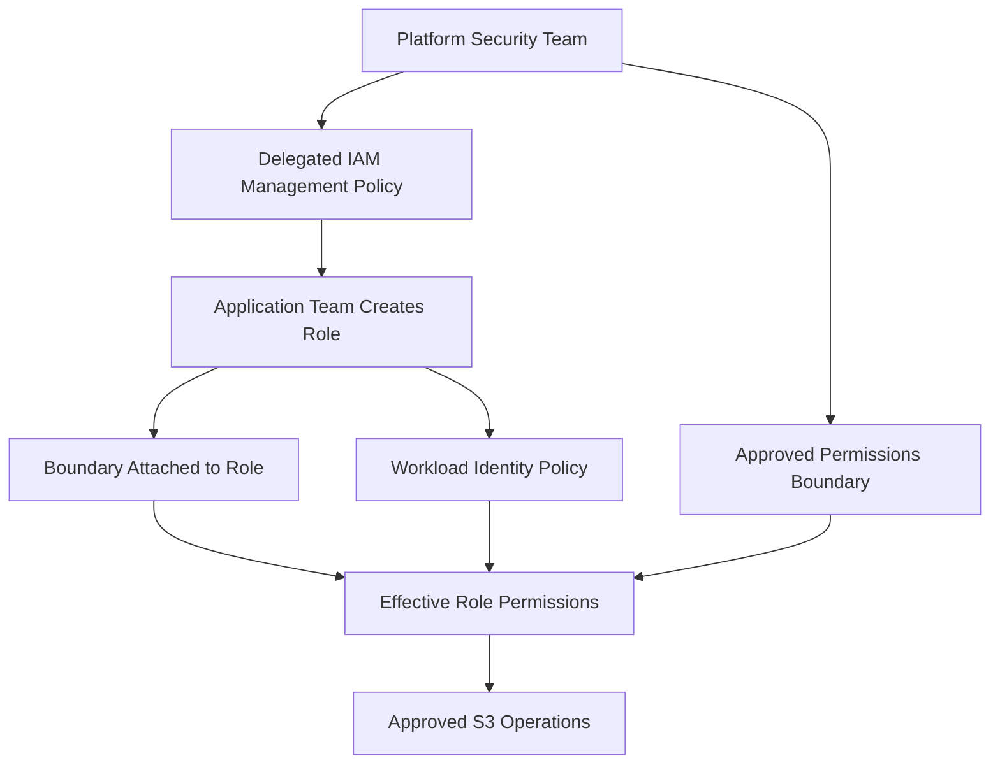

# 10- Least Privilege and Permission Boundaries

## Overview

Least privilege is the practice of granting an identity only the permissions required to perform its intended responsibilities. In Amazon S3, this means restricting application roles, developers, deployment pipelines, and AWS service integrations to the specific buckets, object prefixes, API operations, and encryption keys they need.

IAM permission boundaries complement least privilege by setting the maximum permissions an IAM user or role can receive through applicable identity-based policies. They are especially useful when platform teams allow application teams to create or manage IAM roles but must prevent those roles from receiving permissions beyond an approved security boundary.

These controls solve different problems:

- **Least-privilege policies** define the operations an identity needs.
- **Permission boundaries** limit the permissions an identity can receive through policies subject to the boundary.
- **Bucket policies** define resource-side access permissions and restrictions.
- **AWS Organizations service control policies (SCPs)** establish organization-level permission guardrails for principals.
- **S3 Block Public Access** provides additional protection against supported public-access configurations.

None of these controls should be treated as a complete replacement for the others.

This document covers S3-specific least privilege, IAM policy design, permissions boundaries, policy evaluation, practical examples, deployment controls, and troubleshooting.

## Why Least Privilege Matters for S3

S3 often contains sensitive data such as customer documents, financial reports, uploaded media, backups, and analytical datasets. Excessive permissions can increase the impact of compromised credentials, application vulnerabilities, and deployment mistakes.

For example, a document-processing service may need to upload files to `uploads/tenant-123/` but should not be able to read confidential reports, delete backups, modify bucket policies, or access unrelated buckets.

An unrestricted policy such as the following creates unnecessary risk:

```json
{
  "Version": "2012-10-17",
  "Statement": [
    {
      "Effect": "Allow",
      "Action": "s3:*",
      "Resource": "*"
    }
  ]
}
```

This grants broad S3 permissions to the identity, subject to other applicable authorization controls. It exposes far more capability than a typical application requires.

A better design separates workload responsibilities and scopes access to the necessary operations and resources.

### Example workload permissions

| Workload | Typical permissions | Permissions generally unnecessary |
|---|---|---|
| Image-processing Lambda | Read original objects and write processed images | Bucket-policy administration, unrelated bucket access |
| Reporting API | List and read approved report objects | Upload, delete, lifecycle management |
| Document-ingestion service | Upload objects to an approved prefix | Read unrelated objects, change bucket ownership |
| Backup service | Write backups and perform explicitly approved recovery operations | General access to application data |
| Deployment pipeline | Configure required infrastructure resources | Routine access to application object contents |
| Security auditing role | Inspect supported configuration and security findings | Unrestricted object downloads or deletions |

Assign permissions according to the workload's responsibility rather than attaching the same broad policy to every application.

## Identify the Required S3 Permissions

Effective policy design starts with the application's actual API operations.

S3 IAM actions often differ between bucket-level operations, object-level operations, version-specific operations, and administrative configuration.

### Common S3 permission categories

| Action | Scope | Purpose |
|---|---|---|
| `s3:ListBucket` | Bucket | List objects in a bucket |
| `s3:GetObject` | Object | Read object contents |
| `s3:PutObject` | Object | Upload or replace an object |
| `s3:DeleteObject` | Object | Delete an object or create a delete marker, depending on versioning |
| `s3:GetObjectVersion` | Object version | Retrieve a specific version |
| `s3:DeleteObjectVersion` | Object version | Permanently delete a specific version |
| `s3:AbortMultipartUpload` | Object | Abort an incomplete multipart upload |
| `s3:ListMultipartUploadParts` | Object | List parts of an ongoing multipart upload |
| `s3:ListBucketMultipartUploads` | Bucket | List ongoing multipart uploads |
| `s3:GetBucketLocation` | Bucket | Retrieve the bucket's Region information |
| `s3:GetBucketPolicy` | Bucket | Retrieve the bucket policy |
| `s3:PutBucketPolicy` | Bucket | Replace the bucket policy |

The required permissions depend on the exact API operation and configuration. For example, version-specific deletion requires additional permission beyond ordinary object deletion.

### Bucket-level versus object-level ARNs

Bucket-level actions typically use a bucket ARN:

```text
arn:aws:s3:::example-prod-documents
```

Object-level actions typically use an object ARN:

```text
arn:aws:s3:::example-prod-documents/reports/*
```

Do not use an object ARN for `s3:ListBucket` or a bucket ARN as the sole resource for `s3:GetObject`.

### Define the application access contract

Before creating a policy, document:

- The bucket and Region.
- The permitted object prefixes.
- Required read, write, listing, or deletion operations.
- Whether version-specific operations are needed.
- Whether multipart uploads are used.
- Whether objects use SSE-KMS.
- Whether the workload accesses S3 directly or through an access point.
- Whether cross-account access is required.

This contract becomes the basis for the identity policy, permission boundary, and resource policy.

## Least-Privilege Policy Design

A secure S3 identity policy should restrict permissions by action, resource, and condition wherever practical.

Consider a FastAPI document service that needs to list files and read documents under `documents/tenant-123/`.

### Example: read-only document access

```json
{
  "Version": "2012-10-17",
  "Statement": [
    {
      "Sid": "ListTenantDocuments",
      "Effect": "Allow",
      "Action": "s3:ListBucket",
      "Resource": "arn:aws:s3:::example-prod-documents",
      "Condition": {
        "StringLike": {
          "s3:prefix": [
            "documents/tenant-123/",
            "documents/tenant-123/*"
          ]
        }
      }
    },
    {
      "Sid": "ReadTenantDocuments",
      "Effect": "Allow",
      "Action": "s3:GetObject",
      "Resource": "arn:aws:s3:::example-prod-documents/documents/tenant-123/*"
    }
  ]
}
```

This policy grants the identity listing and read access for the specified prefix, subject to other applicable authorization controls.

It does not permit uploads, deletes, bucket-policy modifications, or access to unrelated object prefixes.

### Example: write-only upload access

A document-ingestion service might need to upload objects without reading existing object contents.

```json
{
  "Version": "2012-10-17",
  "Statement": [
    {
      "Sid": "UploadTenantDocuments",
      "Effect": "Allow",
      "Action": [
        "s3:PutObject"
      ],
      "Resource": "arn:aws:s3:::example-prod-documents/uploads/tenant-123/*"
    }
  ]
}
```

This is a starting point for a basic upload workflow. Multipart-upload implementations, tagging requirements, encryption settings, and other requested operations may require additional permissions.

### Avoid unsafe wildcard usage

These resource patterns have different scopes:

| Resource | Scope |
|---|---|
| `arn:aws:s3:::example-prod-documents` | The bucket resource |
| `arn:aws:s3:::example-prod-documents/*` | All objects in the bucket |
| `arn:aws:s3:::example-prod-documents/reports/*` | Objects under the reports prefix |
| `*` | All resources supported by the relevant action |

Use `*` only when the action legitimately requires a broad resource scope or resource-level scoping is not supported. Do not use it as a substitute for understanding the permission model.

## Restrict Permissions by Prefix

S3 object keys are flat identifiers. A prefix such as `documents/tenant-123/` is a naming convention, not a real directory or an automatic security boundary.

Policies can nevertheless use object ARNs and supported conditions to limit access to a prefix.

### Example: tenant-specific listing

```json
{
  "Sid": "ListTenant123Only",
  "Effect": "Allow",
  "Action": "s3:ListBucket",
  "Resource": "arn:aws:s3:::example-prod-documents",
  "Condition": {
    "StringLike": {
      "s3:prefix": [
        "documents/tenant-123/",
        "documents/tenant-123/*"
      ]
    }
  }
}
```

This is one statement intended to be included in a complete IAM policy.

### Production considerations

- Derive tenant identity from authenticated server-side context, not an untrusted client-supplied path.
- Generate object keys using trusted application identifiers.
- Prevent path and prefix manipulation in the application layer.
- Keep IAM boundaries aligned with the application's approved data domain.
- Verify that other bucket policies and resource policies do not create unintended access paths.

Prefix-based IAM restrictions help enforce infrastructure-level boundaries, but they do not replace authorization checks within a multi-tenant application.

## What Is an IAM Permission Boundary?

A permissions boundary is an IAM policy attached to an IAM user or role that defines the maximum permissions available through applicable identity-based policies.

A permission boundary is not a permission grant. It does not allow access by itself.

For a typical IAM role whose access comes from identity-based policies, effective permissions are limited by both the identity policies and the boundary.

Conceptually:

\[
\text{Effective identity permissions}
=
\text{Identity policy allows}
\cap
\text{Boundary allows}
\]

This intersection describes the identity-policy and permissions-boundary relationship. Other applicable authorization controls can restrict access further, and resource-based policy evaluation has important nuances described below.

### Why boundaries exist

Suppose a platform team allows individual application teams to create workload roles.

Without guardrails, a team with excessive IAM management permissions might attach a policy granting access to unrelated buckets, encryption keys, or administrative resources.

A boundary lets the platform team establish an approved permission ceiling independently of the identity policies attached by the application team.

### Typical use cases

- Restricting permissions of roles created by application teams.
- Limiting CI/CD roles to approved infrastructure capabilities.
- Preventing workload roles from accessing unrelated S3 buckets.
- Defining an organizational maximum for application-role permissions.
- Delegating IAM administration while constraining the resulting roles.

### Important limitation

A permission boundary does not protect every AWS identity or resource automatically. It applies to the IAM user or role to which it is attached.

It also does not universally constrain all permissions that might be granted by every form of resource-based policy. Direct grants to role-session principals have special evaluation behavior, so boundary designs must be reviewed alongside resource policies.

Reference: [Permissions boundaries for IAM entities](https://docs.aws.amazon.com/IAM/latest/UserGuide/access_policies_boundaries.html).

## Identity Policy Versus Permission Boundary

Identity policies and permission boundaries should be designed for distinct purposes.

| Aspect | Identity-based policy | Permission boundary |
|---|---|---|
| Purpose | Grants the actions required by a workload | Defines the maximum permissions allowed through applicable identity-based policies |
| Attached to | IAM user, group, or role, depending on policy type | IAM user or role |
| Grants access independently | Yes, subject to applicable controls | No |
| Can narrow permissions | Yes | Yes |
| Can contain explicit denies | Yes | Yes |
| Suitable for workload-specific permissions | Yes | Usually defines a broader approved ceiling |
| Suitable for delegated IAM administration | Can grant management actions | Can constrain the resulting role's permissions |

An application role should still have a narrowly scoped identity policy even when a boundary is attached.

Do not deliberately grant `s3:*` in every identity policy merely because a boundary limits the resulting permissions. That approach makes reviews harder and increases risk if the boundary is removed, changed, or fails to cover an authorization path.

## Example: S3 Permission Boundary

Suppose an organization permits a document-processing role to:

- List objects under `uploads/tenant-123/`.
- Read objects under `uploads/tenant-123/`.
- Upload objects under the same prefix.
- Perform no other S3 actions under its applicable identity-policy permissions.

A permission boundary can enforce this ceiling.

```json
{
  "Version": "2012-10-17",
  "Statement": [
    {
      "Sid": "AllowTenantPrefixListing",
      "Effect": "Allow",
      "Action": "s3:ListBucket",
      "Resource": "arn:aws:s3:::example-prod-documents",
      "Condition": {
        "StringLike": {
          "s3:prefix": [
            "uploads/tenant-123/",
            "uploads/tenant-123/*"
          ]
        }
      }
    },
    {
      "Sid": "AllowTenantObjectReadWrite",
      "Effect": "Allow",
      "Action": [
        "s3:GetObject",
        "s3:PutObject"
      ],
      "Resource": "arn:aws:s3:::example-prod-documents/uploads/tenant-123/*"
    }
  ]
}
```

This boundary allows the specified S3 permissions to be considered for effective identity-based authorization. It does not grant them by itself.

The role still needs an identity policy granting the required actions.

### Attach the boundary

```bash
aws iam put-role-permissions-boundary \
  --role-name DocumentProcessingRole \
  --permissions-boundary \
  arn:aws:iam::123456789012:policy/S3DocumentProcessingBoundary
```

The policy ARN in this example refers to a customer-managed IAM policy that already exists.

The caller needs permission to attach the boundary. The role's trust policy, identity policies, and other authorization controls still require separate configuration.

### Validate the resulting behavior

After the boundary and identity policy are in place, test the role using the intended workload identity.

| Operation | Expected result under this boundary |
|---|---|
| List the approved upload prefix | Potentially allowed if the identity policy and other controls permit it |
| Read an object under the approved prefix | Potentially allowed if the identity policy and other controls permit it |
| Upload an object under the approved prefix | Potentially allowed if the identity policy and other controls permit it |
| Delete an object under the approved prefix | Not allowed through these boundary permissions |
| Read an object under an unrelated prefix | Not allowed through these boundary permissions |
| Modify the bucket policy | Not allowed through these boundary permissions |

The word *potentially* matters: these expected outcomes assume no other applicable policy or control changes the authorization decision and that the tested API operation is covered by the relevant action.

## Permissions Boundaries for Delegated IAM Administration

A common enterprise design allows an application team to create roles but requires those roles to remain within a platform-approved boundary.

A secure implementation needs both:

- An IAM management policy that controls which roles the team can create or modify.
- A permissions-boundary policy that limits the permissions the created roles can receive.

### Architecture



The management policy should restrict the application's authority to attach or replace boundaries, alter protected role configurations, or create unbounded roles.

### Design requirements

- Allow role creation only within approved naming or path conventions where practical.
- Require the designated permissions boundary on newly created roles.
- Prevent the delegated administrator from removing or replacing the boundary outside the approved process.
- Limit policy attachment and modification permissions.
- Restrict trust policies to approved workload identities.
- Review inherited IAM permissions that can affect role creation and modification.

A boundary alone is insufficient if an untrusted administrator can remove it or create another role without it. The role-management permissions are part of the security boundary.

## Permissions Boundary and Policy Evaluation

AWS evaluates the applicable policies for each request. The result depends on the principal, the resource, and the policy types involved.

### Common policy interactions

| Policy type | Role in authorization |
|---|---|
| Identity-based policy | Grants actions to an IAM identity |
| Resource-based policy | Grants or denies access to a resource |
| Permission boundary | Limits permissions available through applicable identity-based policies |
| Session policy | Further restricts permissions for a supported temporary session |
| Service control policy (SCP) | Defines the maximum available permissions for principals in applicable organization accounts |
| Resource control policy (RCP) | Defines organization-level maximum permissions for supported resources |
| Explicit deny | Denies matching requests despite an otherwise applicable allow |

### Explicit deny

An explicit deny in an applicable policy overrides an allow.

For example, an identity policy may permit `s3:PutObject`, but a matching explicit deny in the bucket policy can still block the upload.

Adding another `Allow` statement does not override that deny.

### Resource-based policy nuances

For requests within the same account, the interaction between resource-based policies and permissions boundaries depends on the principal specified and how the grant is made.

A resource-based policy that grants access to an IAM role ARN is subject to the role's permissions boundary and session-policy restrictions in the relevant evaluation model.

However, a resource policy that grants permissions directly to an assumed-role session principal can behave differently: an implicit deny in a permissions boundary or session policy does not necessarily restrict permissions granted directly to that session principal in the same account.

This nuance means a permissions boundary should not be treated as a universal resource-policy perimeter.

**Production recommendation:** Avoid using direct role-session principal ARNs as a shortcut to bypass normal role authorization controls. Review bucket policies, boundary design, and resource-policy principal semantics together.

Reference: [IAM policy evaluation logic](https://docs.aws.amazon.com/IAM/latest/UserGuide/reference_policies_evaluation-logic.html).

## Separate Permission Boundaries from SCPs

Permission boundaries and service control policies can both restrict permissions, but they apply at different levels.

| Aspect | Permission boundary | Service control policy |
|---|---|---|
| Scope | Individual IAM user or role | Principals in accounts governed by the organization policy |
| Attached or managed through | IAM entity and IAM policy management | AWS Organizations |
| Primary purpose | Limit permissions a specific identity can receive | Set organizational permission guardrails |
| Grants permissions directly | No | No |
| Requires identity permissions for access | Yes, subject to applicable resource policies | Yes, subject to the complete authorization model |
| Typical owner | IAM or platform team | Organization or cloud governance team |

For example, an SCP can deny prohibited S3 administration actions across an application account. A permission boundary can further limit one application's IAM role to a particular set of S3 operations.

Neither policy grants the application permission to read or upload objects by itself.

## Include KMS Permissions Deliberately

S3 least privilege must account for encryption-related permissions when objects use SSE-KMS with a customer-managed KMS key.

A role may have `s3:GetObject` permission but still fail to read an encrypted object because it lacks the necessary KMS authorization.

For typical operations:

| Operation | Relevant S3 permission | Typical KMS requirement |
|---|---|---|
| Read an SSE-KMS object | `s3:GetObject` | `kms:Decrypt` |
| Upload an SSE-KMS object | `s3:PutObject` | `kms:GenerateDataKey` and other permissions as required by the operation |
| Multipart upload with SSE-KMS | Relevant multipart and object permissions | May require both decrypt and data-key permissions depending on the operations |

The permission boundary must allow the required KMS actions if the workload is intended to perform those operations, but it should not grant broader key access than necessary.

A complete design includes:

- The role's identity-based KMS permissions.
- The permission boundary's permitted KMS actions.
- The customer-managed key's key policy or other applicable KMS authorization configuration.
- Resource and condition restrictions where appropriate.

Do not add `kms:*` simply to resolve an S3 access error.

Reference: [Permissions required for Amazon S3 API operations](https://docs.aws.amazon.com/AmazonS3/latest/userguide/using-with-s3-policy-actions.html).

## Common Mistakes

### Treating a permission boundary as a grant

Attaching a boundary that permits `s3:GetObject` does not independently authorize the read.

**Prevention:** Ensure the identity policy grants the necessary action and that all other authorization controls permit it.

### Allowing wildcard resources in workload policies

Using `Resource: "*"` for every S3 action broadens the possible access scope unnecessarily.

**Prevention:** Scope bucket-level and object-level actions to the appropriate ARNs. Use wildcards only when required and justified.

### Granting permissions without checking API requirements

Some workflows need additional permissions for multipart transfers, versioned objects, object tagging, or KMS operations.

**Prevention:** Map the application's actual API calls to the required IAM actions and test the complete workflow.

### Allowing teams to remove their own boundaries

If delegated administrators can remove or replace a boundary without control, the boundary may not provide the intended guardrail.

**Prevention:** Restrict IAM management permissions and monitor security-sensitive changes.

### Assuming boundaries constrain every resource-policy grant

Certain resource-policy grants, particularly grants directly to role-session principals within the same account, have special policy-evaluation behavior.

**Prevention:** Review resource policy semantics and do not rely on a permission boundary alone to enforce every resource-side restriction.

### Using broad S3 permissions to fix KMS failures

An SSE-KMS authorization error is not necessarily an S3 permission problem.

**Prevention:** Inspect S3 and KMS authorization independently and add only the required actions.

## Troubleshoot Least-Privilege Access Failures

When a request returns `AccessDenied`, diagnose the actual operation instead of adding broad permissions immediately.

### Symptoms and likely causes

| Symptom | Likely cause | Verification |
|---|---|---|
| `GetObject` fails | Missing read permission, incorrect object ARN, explicit deny, or KMS denial | Inspect role policy, boundary, bucket policy, and KMS authorization |
| `ListObjectsV2` fails | Missing `s3:ListBucket` or incorrect prefix condition | Review the bucket ARN and `s3:prefix` condition |
| Upload fails only after adding a boundary | The boundary does not allow a required action | Compare identity-policy actions with boundary permissions |
| An action remains denied despite a matching allow | An explicit deny or another applicable restriction applies | Review bucket policies, SCPs, RCPs, endpoint policies, and session restrictions |
| An application role has unexpectedly broad access | Excessive identity permissions or an unintended resource-policy grant | Inspect attached policies and resource-based policies |
| A team cannot create a role | Delegated IAM permissions or required-boundary enforcement is misconfigured | Inspect the role creation policy and boundary attachment permissions |
| Removing a boundary unexpectedly increases access | Identity policies grant permissions that were previously constrained by the boundary | Review the identity's existing and resource-based policies |

### Diagnostic sequence

1. Identify the exact principal and AWS account.
2. Identify the failing API action and resource ARN.
3. Inspect the identity-based policy.
4. Inspect the role's attached permissions boundary, if any.
5. Review relevant resource policies, including the S3 bucket or access point policy.
6. Check applicable session policies and AWS Organizations controls.
7. If SSE-KMS is involved, inspect the KMS key policy and required KMS permissions.
8. Reproduce the operation using the intended workload identity.
9. Correct the smallest relevant policy or configuration issue.
10. Verify both the expected access and the prohibited operations.

Useful command:

```bash
aws sts get-caller-identity
```

This confirms the current caller's identity. It does not prove the caller has permission to perform a given S3 operation.

For policy review, use IAM Access Analyzer policy validation and relevant AWS authorization troubleshooting tools. Treat policy simulation as supporting evidence rather than proof of the final result when resource policies, organization controls, network restrictions, or service-specific behavior also apply.

## Production Security Checklist

- [ ] Each workload has a dedicated role or clearly defined identity.
- [ ] S3 policies specify only the actions required by the workload.
- [ ] Bucket-level and object-level resources use the correct ARNs.
- [ ] Listing permissions are restricted to required prefixes.
- [ ] Write and delete operations are separated where appropriate.
- [ ] Permission boundaries limit delegated roles to an approved maximum.
- [ ] Delegated IAM administrators cannot bypass mandatory boundary controls.
- [ ] Resource-based policies are reviewed alongside boundaries.
- [ ] Organization-level guardrails are applied where required.
- [ ] KMS permissions are limited to the necessary customer-managed keys and operations.
- [ ] Application roles do not receive bucket-policy or ownership administration permissions without a specific requirement.
- [ ] Policies are validated and reviewed before deployment.
- [ ] Authorized and unauthorized access scenarios are tested.
- [ ] Security-sensitive IAM changes are audited.
- [ ] Unused permissions and obsolete role policies are reviewed periodically.

## Official References

- [Permissions boundaries for IAM entities](https://docs.aws.amazon.com/IAM/latest/UserGuide/access_policies_boundaries.html)
- [IAM policy evaluation logic](https://docs.aws.amazon.com/IAM/latest/UserGuide/reference_policies_evaluation-logic.html)
- [How AWS evaluates requests](https://docs.aws.amazon.com/IAM/latest/UserGuide/reference_policies_evaluation-logic_policy-eval-denyallow.html)
- [Controlling access to AWS resources using policies](https://docs.aws.amazon.com/IAM/latest/UserGuide/access_controlling.html)
- [Policies and permissions in Amazon S3](https://docs.aws.amazon.com/AmazonS3/latest/userguide/access-policy-language-overview.html)
- [Required permissions for Amazon S3 API operations](https://docs.aws.amazon.com/AmazonS3/latest/userguide/using-with-s3-policy-actions.html)
- [Actions, resources, and condition keys for Amazon S3](https://docs.aws.amazon.com/service-authorization/latest/reference/list_amazons3.html)
- [IAM Access Analyzer policy validation](https://docs.aws.amazon.com/IAM/latest/UserGuide/access-analyzer-policy-validation.html)

## Key Takeaways

- Least privilege reduces risk by limiting application roles to required actions, resources, and conditions.
- A permission boundary sets a maximum permission set for an IAM user or role but does not grant access independently.
- Explicit denies override applicable allows, while resource-based policy evaluation can have important principal-specific nuances.
- S3 access must be designed with bucket and object ARNs, prefix restrictions, cross-account policies, and KMS authorization in mind.
- Secure delegated IAM administration requires both appropriately restricted role-management permissions and a protected permissions-boundary policy.