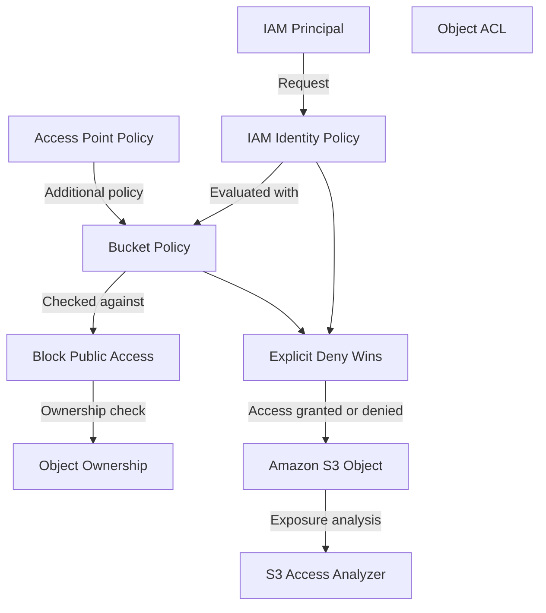

# README

## Overview

Amazon S3 access control covers the identity, policy, and configuration mechanisms required to protect S3 resources against unauthorized access, accidental public exposure, privilege escalation, and cross-account misuse. It addresses security fundamentals, IAM permissions, bucket policies, legacy ACLs, Block Public Access, object ownership controls, Access Analyzer findings, access points, cross-account access patterns, and least privilege design.

This section of the Backend Engineering Playbook provides a structured reference for backend engineers, security engineers, and platform teams who design, implement, and review access control for S3-backed applications and data pipelines.

The focus is on practical access control engineering: understanding how S3 evaluates authorization across multiple policy types, designing minimal and verifiable permission boundaries, preventing unintended public exposure, and operating securely in multi-account environments.

## Navigation

| # | File | Description |
|---|---|---|
| 01 | [01- S3 Security Fundamentals](./01-%20S3%20Security%20Fundamentals.md) | Core access control concepts, the S3 authorization model, and the interaction between IAM, bucket policies, and other controls |
| 02 | [02- IAM Permissions for Amazon S3](./02-%20IAM%20Permissions%20for%20Amazon%20S3.md) | IAM identity policies, S3-specific actions and resources, condition keys, and workload role design for S3 access |
| 03 | [03- Bucket Policies](./03-%20Bucket%20Policies.md) | Resource-based bucket policies, principal specification, condition blocks, policy evaluation, and common policy patterns |
| 04 | [04- Access Control Lists (ACLs)](./04-%20Access%20Control%20Lists%20%28ACLs%29.md) | Legacy ACL mechanism, predefined groups, current recommendations, and migration to bucket policy-based access control |
| 05 | [05- S3 Block Public Access](./05-%20S3%20Block%20Public%20Access.md) | Block Public Access settings at account and bucket level, protection against ACL and policy-based public exposure |
| 06 | [06- S3 Object Ownership Controls](./06-%20S3%20Object%20Ownership%20Controls.md) | Bucket Owner Enforced mode, object ownership behavior on cross-account writes, and ACL disablement |
| 07 | [07- S3 Access Analyzer](./07-%20S3%20Access%20Analyzer.md) | Automated detection of public and cross-account bucket exposure, findings review, and access configuration validation |
| 08 | [08- S3 Access Points and Access Policies](./08-%20S3%20Access%20Points%20and%20Access%20Policies.md) | Named access endpoints with dedicated policies, network-origin controls, and per-application access configurations |
| 09 | [09- Cross-Account Access](./09-%20Cross-Account%20Access.md) | IAM and bucket policy combinations for cross-account access, ownership considerations, and secure multi-account patterns |
| 10 | [10- Least Privilege and Permission Boundaries](./10-%20Least%20Privilege%20and%20Permission%20Boundaries.md) | Scoping permissions to specific buckets and prefixes, permission boundaries, and systematic least privilege review |

## Why S3 Access Control Matters

S3 buckets frequently store sensitive application data, user files, backups, audit logs, configuration secrets, and deployment artifacts. A single misconfiguration can expose that data publicly, grant unintended cross-account access, or allow an application to modify objects it should only read.

Common access control risks include:

- Buckets inadvertently made public through ACLs or bucket policies that grant access to `*` without a restrictive Block Public Access configuration.
- Application roles with wildcard resource permissions that grant access to every bucket in the account, not just the one the application owns.
- Cross-account writes that result in objects owned by the uploading account, preventing the bucket owner from reading or deleting them without additional configuration.
- Missing deny conditions that allow principals to bypass intended restrictions when session policies or permission boundaries are not applied.
- Over-permissive bucket policies that grant more actions than an integration requires, creating an unnecessary blast radius.
- Access Analyzer findings left unreviewed, allowing public or cross-account exposure to persist undetected.

Effective S3 access control combines IAM least privilege, bucket policy precision, Block Public Access enforcement, Object Ownership configuration, and regular Access Analyzer review rather than relying on any single control.

## Documentation Structure

This section is organized into focused documents progressing from foundational security concepts through each access control mechanism, ending with least privilege design.

| Area | Primary focus |
|---|---|
| Security fundamentals | Authorization model, policy evaluation order, and the interaction between multiple control types |
| IAM permissions | Identity policy design, S3 actions, resource ARNs, and condition keys |
| Bucket policies | Resource-based policies, principal and condition blocks, and common patterns |
| ACLs | Legacy mechanism, current status, and migration path |
| Block Public Access | Account and bucket level settings, and protection against accidental public exposure |
| Object Ownership | Ownership behavior, Bucket Owner Enforced mode, and ACL disablement |
| Access Analyzer | Automated exposure detection and findings management |
| Access Points | Per-application access endpoints with dedicated policies and network controls |
| Cross-account access | IAM and bucket policy coordination for multi-account patterns |
| Least privilege | Permission scoping, boundaries, and systematic access review |

Each document is intended to be independently maintainable while connecting to the broader S3 security model. Shared concepts should be referenced rather than duplicated across documents.

## Core Access Control Principles

### Enforce Block Public Access at the Account Level

Enable all four Block Public Access settings at the AWS account level as the default. Override at the bucket level only when public access is explicitly required and reviewed. This provides a safety net against bucket policies or ACLs that inadvertently grant public access.

### Use IAM Roles, Not Long-Lived Credentials

Applications, services, Lambda functions, ECS tasks, and EC2 instances should access S3 through IAM roles that provide temporary credentials. Avoid embedding long-lived access keys in application code, container images, or environment variables.

### Scope Permissions to Specific Buckets and Prefixes

IAM policies and bucket policies should specify the exact bucket ARN and, where applicable, the prefix ARN. Avoid `Resource: "*"` for S3 actions in application roles. An application that needs read access to one prefix does not need read access to every object in every bucket in the account.

### Enable Bucket Owner Enforced Object Ownership

Configure Bucket Owner Enforced mode on production buckets. This disables ACLs and ensures that the bucket owner controls all objects, regardless of which account uploaded them. This eliminates a class of cross-account access problems caused by objects owned by an external account.

### Review Access Analyzer Findings Regularly

S3 Access Analyzer identifies buckets with public or cross-account access configurations. Review findings promptly and resolve unintended exposure. Integrate Access Analyzer review into the deployment and periodic security review process.

## How S3 Access Controls Interact

## Recommended Access Control Workflow

Use a repeatable process when designing or reviewing S3 access control for a production workload.

1. **Enable Block Public Access.** Apply all four settings at the account level and confirm they are not overridden without justification at the bucket level.
2. **Define IAM roles.** Create dedicated IAM roles for each workload with permissions scoped to the specific buckets and prefixes that workload requires.
3. **Write bucket policies.** Add bucket policies for cross-account access, service integrations, and enforcement of encryption or TLS requirements. Keep policies minimal and well-commented.
4. **Configure Object Ownership.** Enable Bucket Owner Enforced mode on production buckets to disable ACLs and enforce bucket owner control.
5. **Review Access Analyzer findings.** Enable S3 Access Analyzer and review findings after each deployment and on a scheduled basis.
6. **Test both permitted and denied operations.** Verify that intended workflows succeed and that unauthorized access is correctly denied before promoting changes to production.
7. **Review permissions periodically.** Reassess IAM policies, bucket policies, and access points as the application evolves. Remove permissions that are no longer required.

## Operational Standards

- **Block Public Access:** Enable at the account level. Review and justify any bucket-level override.
- **IAM roles:** Use roles for all application and service identities. Scope to specific bucket and prefix ARNs.
- **Bucket policies:** Keep policies minimal. Use explicit deny statements for critical restrictions. Require TLS using `aws:SecureTransport` condition where applicable.
- **ACLs:** Disable ACLs using Bucket Owner Enforced mode on all new buckets. Migrate legacy buckets to policy-based access control.
- **Access Analyzer:** Enable and review findings on a scheduled basis. Treat unresolved public-access findings as security issues.
- **Cross-account access:** Always verify object ownership behavior. Use Bucket Owner Enforced mode to prevent the uploading account from retaining object ownership.
- **Least privilege:** Review IAM policies and bucket policies for wildcard actions and resources. Scope permissions to the minimum required for each workload.
- **Verification:** Test access control changes by verifying both permitted and denied operations before promoting to production.

## Key Takeaways

- S3 access control requires coordinating IAM identity policies, bucket policies, Block Public Access, and Object Ownership settings — no single control is sufficient alone.
- Block Public Access at the account level is the most effective safeguard against accidental public bucket exposure.
- Bucket Owner Enforced mode eliminates ACL-related access problems and ensures the bucket owner controls all stored objects.
- IAM permissions must be scoped to specific buckets and prefixes; wildcard resource permissions create an unnecessarily large blast radius.
- Access Analyzer findings must be reviewed regularly; unresolved findings represent persistent exposure that preventive controls alone do not catch.
