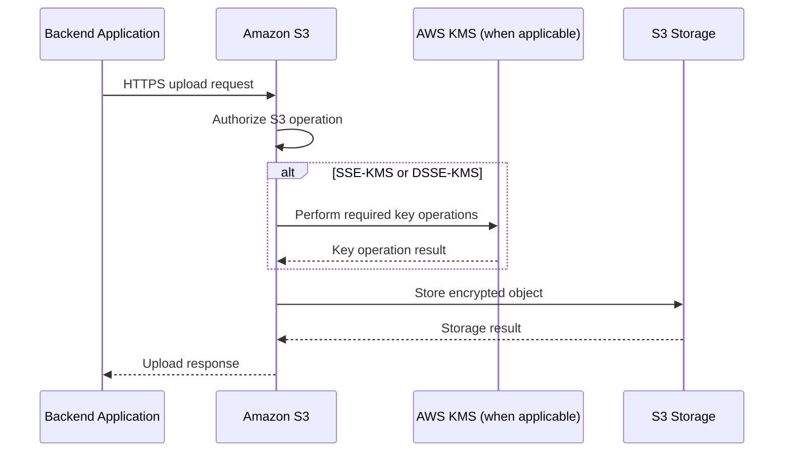
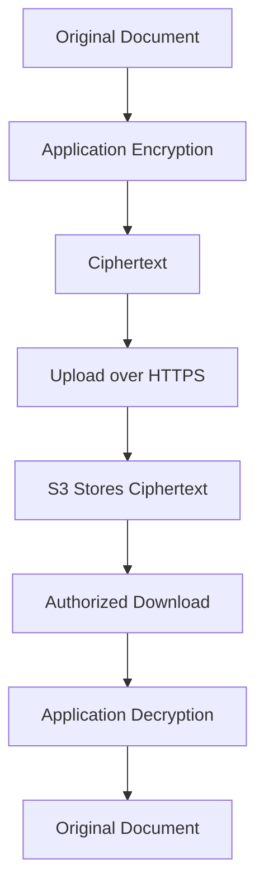

# 01- S3 Encryption Overview

## Overview

Amazon S3 encryption protects stored objects from unauthorized access to their underlying data and helps organizations meet security, privacy, and regulatory requirements. Encryption is one layer of a broader security architecture that also includes IAM policies, bucket policies, network controls, logging, and data-retention policies.

Amazon S3 supports server-side encryption, where S3 encrypts objects before storing them, and client-side encryption, where an application encrypts data before sending it to S3.

S3 automatically encrypts all new object uploads at rest using server-side encryption with Amazon S3 managed keys (SSE-S3), unless another supported encryption method is selected. SSE-S3 is enabled by default and does not require an application to manage encryption keys.

For production workloads, choose the encryption model according to data sensitivity, key-control requirements, auditing needs, compliance obligations, and operational costs.

This document covers:

- Encryption at rest and in transit.
- SSE-S3, SSE-KMS, DSSE-KMS, SSE-C, and client-side encryption.
- Default bucket encryption and per-request encryption.
- AWS KMS permissions, key management, and S3 Bucket Keys.
- Existing-object encryption, multipart uploads, and replication.
- AWS CLI, Boto3, verification, and production best practices.

## Encryption Fundamentals

Encryption transforms readable data into ciphertext using a cryptographic algorithm and key. Authorized systems can recover the original data using the required decryption key or cryptographic mechanism.

In an S3 architecture, encryption protects data at rest and in transit. These are different security requirements and must be configured and verified independently.

### Encryption at rest

Encryption at rest protects object data stored by S3.

With server-side encryption, the application uploads an object, and S3 encrypts the object before storing it. When an authorized application retrieves the object, S3 decrypts the data as part of the read operation.

The application generally receives the original object contents without implementing the underlying server-side cryptographic operations.

### Encryption in transit

Encryption in transit protects data while it travels between a client and an S3 endpoint.

Use HTTPS with supported TLS configurations for SDK, CLI, and direct HTTP requests. Where required, use resource policies to reject requests that do not meet the intended transport-security requirements.

### Request flow



The diagram is conceptual. The exact cryptographic operations depend on the selected encryption method. S3 authorization and KMS authorization are separate concerns.

## Amazon S3 Server-Side Encryption Options

S3 supports four principal server-side encryption options for general-purpose buckets.

| Encryption type | Key management | Main purpose | Important consideration |
|---|---|---|---|
| SSE-S3 | Amazon S3 manages the keys | Default encryption at rest | No customer-managed KMS key required |
| SSE-KMS | AWS KMS manages the keys | Encryption with additional key-management and authorization controls | KMS permissions, quotas, and charges apply |
| DSSE-KMS | AWS KMS supports two layers of server-side encryption | Workloads requiring dual-layer server-side encryption | Higher operational complexity; S3 Bucket Keys are not supported |
| SSE-C | Customer supplies the encryption key with requests | Specialized workloads requiring customer-provided server-side encryption keys | The customer must securely retain and supply the key for subsequent operations |

These methods are alternatives for encrypting an individual object. They cannot be applied simultaneously to the same object.

Client-side encryption is a separate approach in which the application encrypts data before uploading it.

## SSE-S3: Server-Side Encryption with S3-Managed Keys

SSE-S3 is the default server-side encryption method for new S3 object uploads.

Amazon S3 manages the encryption keys and performs the encryption and decryption operations. Object data is encrypted using AES-256.

### How SSE-S3 works

1. An application uploads an object to S3.
2. S3 applies server-side encryption using its managed encryption mechanism.
3. S3 stores the encrypted object.
4. An authorized read request causes S3 to return the decrypted object content.

The application does not need to generate or maintain encryption keys.

### Advantages

- Enabled by default for new object uploads.
- Does not require customer-managed key configuration.
- Simplifies application integration.
- Avoids separate AWS KMS request charges for SSE-S3.
- Provides encryption at rest without requiring additional upload headers.

### Limitations

SSE-S3 does not provide the same customer-managed key policies, key-level permissions, or customer-configurable KMS auditing controls as SSE-KMS.

It may be insufficient when an organization's requirements mandate specific key-management or separation-of-duties controls.

### When to use it

Use SSE-S3 when default encryption at rest satisfies the application's security and governance requirements.

Examples include:

- General application documents.
- Static assets stored in private buckets.
- Non-sensitive media files.
- Internal application exports.
- Workloads that do not require customer-managed encryption keys.

### Verify SSE-S3 on an object

```bash
aws s3api head-object \
  --bucket example-prod-documents \
  --key documents/report.pdf \
  --region ap-south-1
```

For an object encrypted with SSE-S3, the response includes a server-side encryption value such as:

```json
{
  "ServerSideEncryption": "AES256"
}
```

The output should be interpreted alongside the object's metadata and current encryption configuration.

Reference: [Using SSE-S3](https://docs.aws.amazon.com/AmazonS3/latest/userguide/specifying-s3-encryption.html).

## SSE-KMS: Server-Side Encryption with AWS KMS

SSE-KMS integrates S3 encryption with AWS Key Management Service (KMS). It provides additional control over the encryption keys used to protect objects.

SSE-KMS supports both the AWS-managed S3 KMS key and customer-managed KMS keys, subject to the applicable configuration and permissions.

### How SSE-KMS works

S3 uses envelope encryption: data is encrypted using data keys, and KMS protects the relevant key material.

At a high level:

1. The application uploads an object with SSE-KMS or the bucket applies SSE-KMS as its default encryption.
2. S3 performs the required KMS operations.
3. S3 encrypts and stores the object.
4. During an authorized read, S3 performs the operations needed to decrypt the object.
5. S3 returns the plaintext content to the authorized caller.

The application generally does not receive the plaintext data key used internally by S3.

### AWS-managed key versus customer-managed key

| Aspect | AWS-managed S3 KMS key | Customer-managed KMS key |
|---|---|---|
| Key identifier | Commonly `aws/s3` | Customer-selected KMS key ARN or ID |
| Key policy administration | Managed by AWS | Configurable by the customer |
| Fine-grained key access control | Less configurable | Supports customer-managed key policies and grants |
| Key lifecycle control | Limited customer control | Customer can manage configuration and lifecycle |
| Cross-account use | Does not provide the same cross-account key-sharing model as customer-managed keys | Can be configured for supported cross-account access |
| Typical use | KMS encryption without a custom key-management requirement | Sensitive data, centralized key management, and stricter access requirements |

For customer-managed keys, the key must be compatible with S3 in the bucket's Region and use a supported symmetric encryption key configuration.

### Advantages

- Centralized key management through KMS.
- Key-level authorization controls.
- Integration with AWS CloudTrail for relevant KMS activity.
- Support for customer-managed key policies and grants.
- Suitable for workloads requiring explicit control over key usage.

### Limitations

- KMS permissions must be correctly configured.
- AWS KMS request quotas can affect high-volume workloads.
- AWS KMS request charges apply.
- Incorrect key policies can make encrypted objects inaccessible.
- Cross-account operations require a coordinated S3 and KMS authorization design.

### Example: SSE-KMS with a customer-managed key

```bash
aws s3api put-object \
  --bucket example-prod-documents \
  --key documents/confidential.pdf \
  --body ./confidential.pdf \
  --server-side-encryption aws:kms \
  --ssekms-key-id arn:aws:kms:ap-south-1:123456789012:key/EXAMPLE-KEY-ID \
  --region ap-south-1
```

The caller needs the required S3 permissions and, where applicable, authorization to use the specified KMS key.

### When to use SSE-KMS

Use SSE-KMS when an application needs customer-managed key policies, centralized key governance, or additional control over encryption operations.

Typical use cases include:

- Financial documents.
- Regulated business records.
- Sensitive customer data.
- Centralized enterprise data platforms.
- Cross-account encrypted data sharing with customer-managed keys.

Reference: [Using SSE-KMS](https://docs.aws.amazon.com/AmazonS3/latest/userguide/specifying-kms-encryption.html).

## DSSE-KMS: Dual-Layer Server-Side Encryption

DSSE-KMS provides two layers of server-side encryption using AWS KMS-backed key management.

It is intended for workloads that require dual-layer server-side encryption, including certain security and compliance scenarios.

### How it works

S3 applies two layers of server-side encryption to the object data. AWS KMS participates in the key-management operations associated with this encryption mode.

DSSE-KMS offers an additional encryption layer compared with ordinary SSE-KMS. It should be selected because a workload requires this protection, not simply because two layers sound stronger.

### Advantages

- Provides two layers of server-side encryption.
- Supports AWS KMS key-management capabilities.
- Suitable for workloads with explicit dual-layer encryption requirements.

### Limitations

- Introduces additional encryption and key-management considerations.
- AWS KMS permissions and quotas still matter.
- Additional service charges may apply.
- S3 Bucket Keys are not supported with DSSE-KMS.
- Existing objects do not automatically become DSSE-KMS objects merely because bucket default encryption changes.

### Configuration

DSSE-KMS uses the server-side encryption algorithm identifier `aws:kms:dsse` where supported.

For example, a PUT request can specify DSSE-KMS through the relevant API or SDK parameter. Verify the requirements for the exact upload operation and SDK version before deploying the configuration.

Use DSSE-KMS only when the additional encryption layer is required by the security architecture or applicable compliance requirements.

Reference: [Using DSSE-KMS](https://docs.aws.amazon.com/AmazonS3/latest/userguide/UsingDSSEncryption.html).

## SSE-C: Server-Side Encryption with Customer-Provided Keys

SSE-C allows the customer to supply the encryption key with the request while S3 performs the server-side encryption.

S3 does not store the customer-provided key for subsequent retrieval. The application must securely retain the key and supply it again for operations that require it.

### How it works

1. The application generates or obtains the encryption key.
2. The application sends the key through the required TLS-protected request headers.
3. S3 uses the supplied key to perform the server-side encryption operation.
4. S3 stores the encrypted object without storing the customer-provided key.
5. To retrieve the object, the application must supply the correct key through the required request headers.

### Advantages

- The customer controls the encryption key.
- S3 does not store the supplied key for future requests.
- Can support specialized key-management requirements.

### Limitations

- The application must securely retain and manage the key.
- Losing the key can make the object unrecoverable.
- Clients must provide the correct encryption headers for applicable operations.
- Key rotation and recovery require careful engineering.
- It does not provide the same KMS key-policy workflow as SSE-KMS.

### Current configuration consideration

AWS updated the default SSE-C behavior for general-purpose buckets in 2026. New general-purpose buckets have SSE-C disabled for write requests by default, and existing buckets without SSE-C-encrypted objects were also subject to the new default. Applications that require SSE-C must deliberately enable it through the supported bucket-encryption configuration.

SSE-C is not supported as a bucket's default encryption algorithm. Verify the current bucket configuration and requirements before using it.

### Recommendation

Prefer SSE-KMS or client-side encryption when the requirement is customer-controlled key management and the architecture benefits from their governance capabilities.

Use SSE-C only when there is a concrete requirement for customer-provided server-side keys and the team can operate the key lifecycle safely.

Reference: [Protecting data with server-side encryption](https://docs.aws.amazon.com/AmazonS3/latest/userguide/serv-side-encryption.html).

## Client-Side Encryption

Client-side encryption occurs before data is transmitted to S3. The application encrypts the object and uploads ciphertext rather than plaintext.

The client controls the encryption workflow and must manage the keys, cryptographic operations, and decryption process.

### How it works



### Advantages

- Encryption can occur before data reaches S3.
- The application can maintain greater control over the encryption boundary.
- Data can remain encrypted in S3 even when an entity has access to the stored ciphertext but lacks the decryption capability.

### Limitations

- The application must securely manage keys and encryption metadata.
- Lost keys can make data permanently inaccessible.
- Search, indexing, and server-side processing can become more difficult.
- Application complexity increases.
- Key rotation and compatibility across application versions need explicit design.

### When to use it

Consider client-side encryption when data must be encrypted before leaving the application's trust boundary or when the security architecture requires the storage service to receive only ciphertext.

Do not implement a custom cryptographic scheme without an established library and a reviewed key-management design.

### Production considerations

Define:

- Encryption algorithms and supported implementations.
- Key generation and secure storage.
- Key rotation and versioning.
- Key recovery and disaster recovery.
- Encryption metadata and object format.
- Authorization for decryption.
- Compatibility across application versions.

Client-side encryption complements transport security and S3 access controls; it does not eliminate the need for them.

## Default Bucket Encryption

S3 applies server-side encryption to new object uploads by default using SSE-S3.

A bucket can use SSE-S3, SSE-KMS, or DSSE-KMS as its default encryption configuration.

Bucket default encryption ensures that supported uploads without explicit encryption settings use the configured default.

### Important behavior

- New uploads use the bucket's default encryption unless the request specifies another supported encryption method.
- Explicit encryption settings on an upload request can override the bucket default where supported.
- Changing default encryption does not retroactively change existing objects.
- SSE-C is not supported as the bucket's default encryption algorithm.
- SSE-KMS and DSSE-KMS have KMS authorization and quota considerations.

### Inspect default encryption

```bash
aws s3api get-bucket-encryption \
  --bucket example-prod-documents \
  --region ap-south-1
```

### Configure SSE-S3 as the default

```bash
aws s3api put-bucket-encryption \
  --bucket example-prod-documents \
  --server-side-encryption-configuration '{
    "Rules": [
      {
        "ApplyServerSideEncryptionByDefault": {
          "SSEAlgorithm": "AES256"
        }
      }
    ]
  }' \
  --region ap-south-1
```

SSE-S3 is already the default for new uploads in modern S3 buckets. Explicitly configuring it can still document and standardize an infrastructure baseline.

### Configure SSE-KMS as the default

```bash
aws s3api put-bucket-encryption \
  --bucket example-prod-documents \
  --server-side-encryption-configuration '{
    "Rules": [
      {
        "ApplyServerSideEncryptionByDefault": {
          "SSEAlgorithm": "aws:kms",
          "KMSMasterKeyID": "arn:aws:kms:ap-south-1:123456789012:key/EXAMPLE-KEY-ID"
        },
        "BucketKeyEnabled": true
      }
    ]
  }' \
  --region ap-south-1
```

The example configures SSE-KMS with a customer-managed key and enables S3 Bucket Keys.

Verify the key ARN, key state, and required permissions before applying this configuration. S3 does not validate every aspect of a KMS key's usability when default encryption is configured.

Reference: [Configuring default encryption](https://docs.aws.amazon.com/AmazonS3/latest/userguide/default-bucket-encryption.html).

## S3 Bucket Keys

S3 Bucket Keys reduce the number of requests between S3 and AWS KMS for SSE-KMS workloads.

For buckets containing large numbers of encrypted objects, KMS request volume can become a meaningful cost and operational factor.

### How Bucket Keys help

Without S3 Bucket Keys, SSE-KMS can result in more frequent KMS requests associated with object encryption and access.

When Bucket Keys are enabled, S3 can use a bucket-level key for a limited period to derive data keys for objects. This reduces KMS request traffic.

### Benefits

- Can reduce AWS KMS request costs significantly.
- Reduces request traffic between S3 and KMS.
- Requires little or no application-code change when configured as bucket default encryption.
- Can benefit workloads with large object counts.

### Limitations

- Bucket Keys are not supported with DSSE-KMS.
- They do not replace IAM or KMS authorization.
- Changes to encryption configuration do not automatically rewrite existing objects.
- They can affect the granularity of KMS CloudTrail request visibility compared with per-object KMS request patterns.

### When to use Bucket Keys

Consider Bucket Keys for high-volume SSE-KMS workloads where KMS request costs or request rates are important.

Evaluate compliance requirements, logging expectations, and the effect of the configuration before enabling them.

Reference: [Reducing the cost of SSE-KMS with S3 Bucket Keys](https://docs.aws.amazon.com/AmazonS3/latest/userguide/bucket-key.html).

## Encryption in Transit

Encryption at rest does not protect data while it travels over an unencrypted connection.

Use HTTPS for all S3 API requests and enforce secure transport where required.

### Example bucket policy to deny insecure transport

```json
{
  "Version": "2012-10-17",
  "Statement": [
    {
      "Sid": "DenyInsecureTransport",
      "Effect": "Deny",
      "Principal": "*",
      "Action": "s3:*",
      "Resource": [
        "arn:aws:s3:::example-prod-documents",
        "arn:aws:s3:::example-prod-documents/*"
      ],
      "Condition": {
        "Bool": {
          "aws:SecureTransport": "false",
          "aws:PrincipalIsAWSService": "false"
        }
      }
    }
  ]
}
```

This policy denies matching requests that do not use secure transport, excluding AWS service principals through the second condition. Review service integrations before deployment because applicable network-context keys may be unavailable or redacted in service-to-service requests.

For stricter requirements, use supported policy condition keys to enforce a minimum TLS version.

### Production recommendations

- Use HTTPS for SDK, CLI, presigned URL, and direct HTTP access.
- Do not send encryption keys through URLs or application logs.
- Verify that clients do not downgrade to unencrypted transport.
- Review reverse proxies and application gateways that terminate TLS.
- Use private network paths where they provide meaningful additional protection.

Reference: [Protecting data in transit](https://docs.aws.amazon.com/AmazonS3/latest/userguide/UsingEncryptionInTransit.html).

## SSE-KMS Permissions and Authorization

Encryption and authorization are separate concerns.

A principal may have permission to retrieve an S3 object but still be unable to decrypt it because the relevant KMS key policy or IAM permissions deny the required key operation.

### Common permission requirements

| Operation | Typical S3 permission | Typical KMS requirement |
|---|---|---|
| Read an SSE-KMS object | `s3:GetObject` | `kms:Decrypt` |
| Upload an SSE-KMS object | `s3:PutObject` | `kms:GenerateDataKey` |
| Multipart upload of an SSE-KMS object | Relevant multipart and object permissions | May require `kms:GenerateDataKey` and `kms:Decrypt`, depending on the operation |
| Copy an SSE-KMS object | Read source and write destination permissions | Appropriate decrypt and data-key permissions for source and destination encryption |
| Cross-account access | Required identity and bucket policy permissions | Key policy and identity policy must permit cross-account key usage |

These are typical requirements, not a complete permission list for every possible operation. Verify the exact API requirements and key configuration.

### Key policy considerations

For customer-managed KMS keys:

- The key must be enabled and available in the appropriate Region.
- The key policy must permit the intended usage.
- The caller's identity policy must authorize the required KMS actions where applicable.
- Cross-account use requires compatible key-policy and identity-policy configuration.
- Key deletion, disabling, or loss of key material can make encrypted data unavailable.

### Diagnose the correct layer

When an object operation fails:

1. Verify the active principal.
2. Check the S3 action and resource ARN.
3. Inspect the identity and bucket policies.
4. Review the KMS key policy and required KMS permissions.
5. Examine relevant CloudTrail events.
6. Test the specific S3 operation again.

Do not grant broad `kms:*` permissions as a workaround for an encryption authorization failure.

## Encrypt Existing Objects

Changing bucket default encryption affects new uploads. It does not automatically re-encrypt objects already stored in the bucket.

If a bucket transitions from SSE-S3 to SSE-KMS, existing objects can remain encrypted with SSE-S3 until they are rewritten or copied using the desired encryption configuration.

### Options for existing objects

| Method | Suitable use case | Considerations |
|---|---|---|
| Copy an object onto itself with new encryption settings | Small numbers of objects | Requires careful verification and appropriate permissions |
| S3 Batch Operations | Large object collections | Supports large-scale operations with a manifest and job status tracking |
| Application-driven re-upload | Controlled ingestion workflows | Requires application coordination and potentially additional data transfer |

### Re-encrypt a single object

A self-copy can be used to replace an object's encrypted representation:

```bash
aws s3api copy-object \
  --bucket example-prod-documents \
  --key documents/report.pdf \
  --copy-source example-prod-documents/documents/report.pdf \
  --server-side-encryption aws:kms \
  --ssekms-key-id arn:aws:kms:ap-south-1:123456789012:key/EXAMPLE-KEY-ID \
  --region ap-south-1
```

This example illustrates re-copying an object with SSE-KMS. In production, account for metadata and tagging directives, versioning, object-lock settings, destination permissions, and the behavior required to preserve the intended object attributes.

The operation can create a new version in a versioned bucket. Test the workflow on noncritical objects before using it at scale.

### Large-scale re-encryption

For a large dataset, use S3 Inventory to identify objects and S3 Batch Operations to apply a controlled copy or encryption job.

Monitor job completion and failures, verify the resulting encryption metadata, and retain a recovery strategy. Do not assume that changing default encryption has migrated existing data.

Reference: [Encrypting objects with S3 Batch Operations](https://docs.aws.amazon.com/AmazonS3/latest/userguide/batch-ops-examples.html).

## Multipart Upload Encryption

Multipart upload allows large objects to be uploaded in parts and assembled into one object.

Encryption settings are established as part of the multipart upload workflow. When using bucket default encryption, S3 applies the default when the upload is completed, subject to the supported request behavior.

For explicit SSE-KMS or SSE-C configurations, the upload request and relevant operations must provide the required encryption settings.

### Production considerations

- Use the required IAM permissions for initiating, uploading, completing, and aborting multipart uploads.
- For SSE-KMS, verify KMS authorization for the relevant operations.
- For SSE-C, preserve the key securely and provide the required headers where applicable.
- Configure cleanup for incomplete multipart uploads.
- Test failure and retry behavior.
- Do not assume multipart transfer success proves the final object's encryption mode is correct.

### Verify the completed object

```bash
aws s3api head-object \
  --bucket example-prod-documents \
  --key archives/large-export.zip \
  --region ap-south-1
```

Inspect the `ServerSideEncryption` and related response fields to confirm the resulting encryption configuration.

## Encryption and Replication

S3 replication copies objects between supported source and destination configurations. Encryption requirements must be considered as part of the replication design.

For replicated objects, the encryption behavior depends on the source object's encryption type, replication configuration, and destination settings.

### Important considerations

- SSE-S3 objects are encrypted at rest.
- Replicating SSE-KMS or DSSE-KMS encrypted objects requires the appropriate replication configuration and permissions.
- The replication role must have the necessary S3 permissions.
- KMS permissions and key policies must support the relevant source and destination operations.
- Destination key configuration must be compatible with the intended recovery architecture.
- Replication status should be monitored and verified independently of encryption settings.

Do not assume that enabling default encryption on the destination bucket automatically re-encrypts every existing replicated object or that encryption alone provides disaster recovery.

Reference: [Replicating objects encrypted with AWS KMS keys](https://docs.aws.amazon.com/AmazonS3/latest/userguide/replication-config-for-kms-objects.html).

## Verify Object Encryption with AWS CLI

Encryption verification should inspect both the bucket configuration and the actual object metadata.

### Check bucket default encryption

```bash
aws s3api get-bucket-encryption \
  --bucket example-prod-documents \
  --region ap-south-1
```

### Check an object's encryption metadata

```bash
aws s3api head-object \
  --bucket example-prod-documents \
  --key documents/report.pdf \
  --region ap-south-1
```

### Inspect recent upload events

Use CloudTrail to review relevant S3 API activity and encryption-related request details when those events are recorded.

### Inspect large datasets

Use S3 Inventory and its available encryption-related fields to audit object collections at scale.

### Verification checklist

Confirm that:

- The bucket default encryption matches the intended design.
- Objects uploaded before a configuration change are handled appropriately.
- SSE-KMS objects reference the intended key.
- Required KMS permissions are present.
- Replication and recovery workflows remain compatible.
- Application uploads do not accidentally specify incompatible encryption headers.

A bucket's default encryption configuration describes the behavior for new uploads. It is not a complete inventory of every stored object's encryption state.

## Boto3 Encryption Configuration

Boto3 exposes bucket-encryption and object-upload options through the S3 client.

### Configure default SSE-KMS

```python
import boto3

s3 = boto3.client("s3", region_name="ap-south-1")


def configure_default_sse_kms(
    bucket: str,
    kms_key_arn: str,
) -> None:
    """Configure SSE-KMS as the bucket's default encryption."""
    s3.put_bucket_encryption(
        Bucket=bucket,
        ServerSideEncryptionConfiguration={
            "Rules": [
                {
                    "ApplyServerSideEncryptionByDefault": {
                        "SSEAlgorithm": "aws:kms",
                        "KMSMasterKeyID": kms_key_arn,
                    },
                    "BucketKeyEnabled": True,
                }
            ]
        },
    )
```

The function changes a bucket-level security configuration. Invoke it only through an approved infrastructure or administrative workflow.

### Upload an object using SSE-KMS

```python
import boto3

s3 = boto3.client("s3", region_name="ap-south-1")


def upload_encrypted_document(
    bucket: str,
    object_key: str,
    file_path: str,
    kms_key_arn: str,
) -> None:
    """Upload an object using the specified customer-managed KMS key."""
    s3.upload_file(
        Filename=file_path,
        Bucket=bucket,
        Key=object_key,
        ExtraArgs={
            "ContentType": "application/pdf",
            "ServerSideEncryption": "aws:kms",
            "SSEKMSKeyId": kms_key_arn,
        },
    )
```

The caller must have the required S3 permissions, and the KMS key must permit the necessary encryption operations.

Avoid hardcoding credentials. Use environment-appropriate IAM roles or the default AWS credential provider chain.

## Common Encryption Mistakes

### Assuming default encryption re-encrypts existing objects

Changing bucket default encryption affects future uploads, not existing stored objects.

**Prevention:** Inventory existing data and use controlled copy or S3 Batch Operations workflows where re-encryption is required.

### Treating encryption as access control

Encryption at rest does not automatically prevent an authorized principal from retrieving plaintext through S3.

**Prevention:** Combine encryption with least-privilege IAM, bucket policies, Block Public Access, and appropriate network controls.

### Granting S3 permissions but forgetting KMS permissions

An application may have `s3:GetObject` permission and still fail to read an SSE-KMS object.

**Prevention:** Inspect the KMS key policy, identity policy, and relevant KMS authorization requirements.

### Assuming a bucket policy enforces a particular KMS key automatically

A bucket's default encryption configuration and its request-policy restrictions serve different purposes.

**Prevention:** Configure default encryption and, when required, enforce acceptable upload encryption settings through carefully tested policies.

### Using customer-provided keys without a recovery plan

SSE-C depends on the customer retaining the correct key for future operations.

**Prevention:** Define secure storage, access control, backup, rotation, and recovery procedures before adopting SSE-C.

### Ignoring KMS costs and quotas

High-volume SSE-KMS workloads can produce significant KMS request traffic.

**Prevention:** Estimate request volume, monitor KMS usage, and evaluate S3 Bucket Keys when compatible with the required encryption mode.

### Assuming all uploaded objects share the same encryption method

Requests can specify encryption settings that differ from the bucket default where supported.

**Prevention:** Verify object-level metadata and use inventory-based checks for large datasets.

## Production Security Checklist

- [ ] All new uploads are encrypted at rest using an approved encryption mode.
- [ ] Bucket default encryption matches the workload's security requirements.
- [ ] HTTPS is used for S3 API communication.
- [ ] Customer-managed KMS keys are used where required.
- [ ] KMS key policies and identity permissions follow least privilege.
- [ ] Cross-account encrypted access has been tested.
- [ ] SSE-C is used only when explicitly justified and supported by the bucket configuration.
- [ ] S3 Bucket Keys are considered for eligible SSE-KMS workloads.
- [ ] Existing objects have been inventoried where encryption migration is required.
- [ ] Multipart uploads preserve the intended encryption behavior.
- [ ] Replication roles and KMS permissions support the recovery design.
- [ ] Object-level encryption metadata is checked during audits.
- [ ] CloudTrail and other appropriate telemetry are available for investigation.
- [ ] Encryption configuration changes are reviewed and deployed through infrastructure as code.
- [ ] Authorized and unauthorized access paths are tested independently of encryption verification.

## Official References

- [Protecting data with server-side encryption](https://docs.aws.amazon.com/AmazonS3/latest/userguide/serv-side-encryption.html)
- [Configuring default bucket encryption](https://docs.aws.amazon.com/AmazonS3/latest/userguide/default-bucket-encryption.html)
- [Using SSE-S3](https://docs.aws.amazon.com/AmazonS3/latest/userguide/specifying-s3-encryption.html)
- [Using SSE-KMS](https://docs.aws.amazon.com/AmazonS3/latest/userguide/specifying-kms-encryption.html)
- [Using DSSE-KMS](https://docs.aws.amazon.com/AmazonS3/latest/userguide/UsingDSSEncryption.html)
- [S3 Bucket Keys](https://docs.aws.amazon.com/AmazonS3/latest/userguide/bucket-key.html)
- [Protecting data in transit](https://docs.aws.amazon.com/AmazonS3/latest/userguide/UsingEncryptionInTransit.html)
- [Replicating SSE-KMS encrypted objects](https://docs.aws.amazon.com/AmazonS3/latest/userguide/replication-config-for-kms-objects.html)
- [Encrypting objects with S3 Batch Operations](https://docs.aws.amazon.com/AmazonS3/latest/userguide/batch-ops-examples.html)

## Key Takeaways

- S3 automatically encrypts new object uploads at rest using SSE-S3 by default, but changing bucket encryption does not re-encrypt existing objects.
- Choose SSE-KMS or DSSE-KMS when the security requirements justify their additional key-management controls and operational considerations.
- S3 authorization and KMS authorization are separate; encrypted-object access requires the relevant permissions at each applicable layer.
- Use HTTPS for data in transit and combine encryption with IAM, bucket policies, Block Public Access, and monitoring.
- Verify both bucket defaults and object-level encryption metadata, especially after migrations, replication changes, or encryption-policy updates.