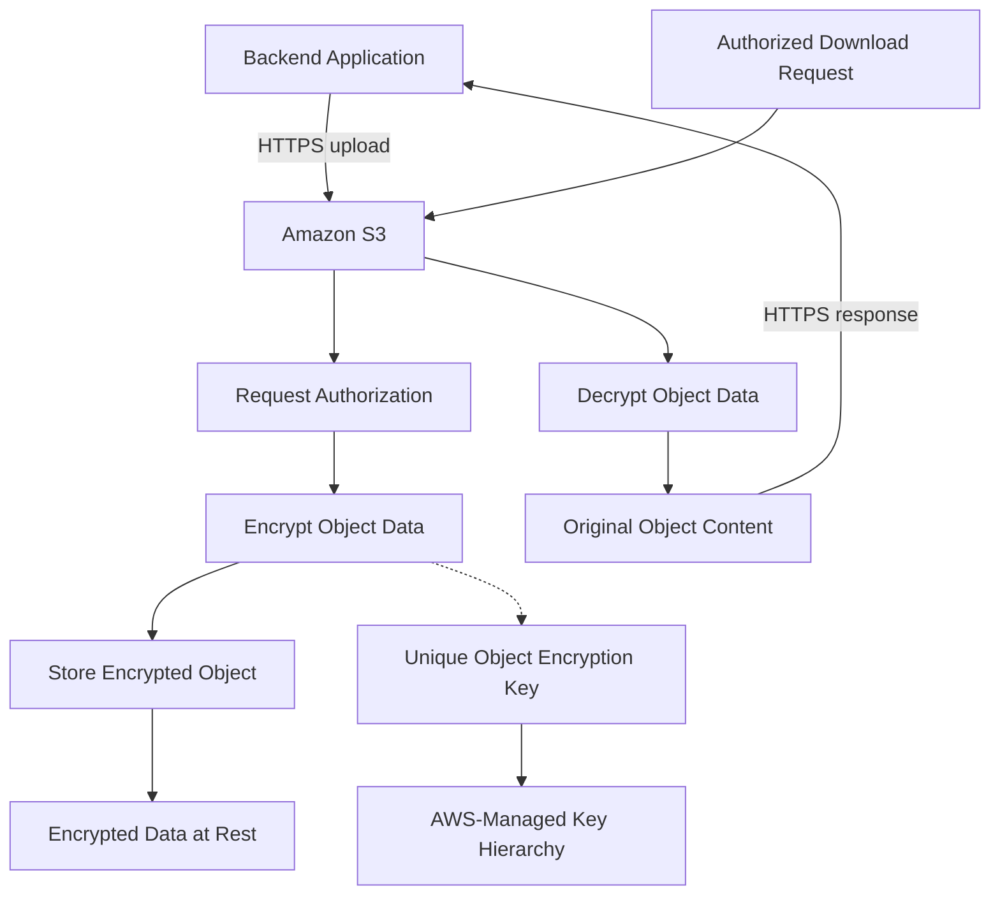

# 02- Server-Side Encryption with S3-Managed Keys (SSE-S3)

## Overview

Server-side encryption with Amazon S3-managed keys (SSE-S3) is Amazon S3's default encryption mechanism for protecting object data at rest. Amazon S3 encrypts newly uploaded objects before storing them and transparently decrypts them when authorized clients retrieve them.

SSE-S3 uses the AES-256 encryption algorithm. Amazon S3 manages the encryption keys, their protection, and the associated encryption and decryption operations. Applications do not need to generate, store, rotate, or transmit encryption keys.

Since January 5, 2023, Amazon S3 has automatically encrypted all new object uploads by default using SSE-S3, unless another supported server-side encryption method is configured. SSE-S3 introduces no additional encryption charge and has no impact on performance according to AWS.

SSE-S3 is appropriate for many workloads that require encryption at rest without customer-managed encryption keys. Workloads that require customer-controlled key policies, KMS auditing controls, or other advanced key-management capabilities may need SSE-KMS instead.

This document covers SSE-S3's encryption model, configuration, AWS CLI and Boto3 usage, verification, limitations, and production considerations.

## What Is SSE-S3?

SSE-S3 is a server-side encryption mechanism in which Amazon S3 encrypts an object's data using keys managed entirely by AWS.

Server-side encryption means that encryption occurs within the receiving service rather than requiring the application to encrypt the object before transmission.

For an ordinary upload, the application sends the object to S3 over HTTPS. S3 authorizes the request, encrypts the object data, and stores the encrypted representation. During a subsequent authorized read, S3 decrypts the data and returns the original content.

The encryption process is transparent to normal S3 consumers. An application can upload, download, copy, or otherwise manage an SSE-S3 object through supported S3 APIs without implementing its own encryption or decryption logic.

### Why SSE-S3 exists

SSE-S3 provides a managed baseline for protecting stored data without imposing customer-side key-management responsibilities.

Its primary benefits are:

- Encryption at rest enabled by default for new object uploads.
- No customer-managed key lifecycle.
- Transparent integration with S3 APIs, SDKs, and the AWS CLI.
- No additional SSE-S3 encryption charge.
- Minimal application-code changes.
- A consistent encryption baseline across S3 workloads.

### When to use SSE-S3

SSE-S3 is suitable when encryption at rest is required but the application does not need customer-managed KMS keys.

Typical use cases include:

- Application documents and generated reports.
- Private image and media storage.
- Static assets stored in private buckets.
- Non-sensitive exports and archives.
- General-purpose application data.
- Workloads whose governance requirements accept AWS-managed encryption keys.

Use a different encryption approach when the workload requires additional key-control capabilities or a compliance requirement explicitly mandates them.

## How SSE-S3 Works

SSE-S3 uses a hierarchy of encryption keys.

Amazon S3 encrypts each object using a unique key and further protects that key using a root key that AWS regularly rotates. AWS manages the underlying key operations and protects the encryption infrastructure.

The application does not receive the underlying encryption key as part of ordinary S3 upload or download operations.

### Encryption architecture



The diagram is a conceptual representation of S3-managed encryption, not a complete description of AWS's internal cryptographic implementation.

### Upload lifecycle

The typical upload lifecycle is:

1. The client sends an S3 upload request over HTTPS.
2. Amazon S3 evaluates the applicable authentication and authorization controls.
3. S3 applies the configured server-side encryption method.
4. S3 encrypts the object data using the SSE-S3 mechanism.
5. S3 stores the encrypted object and returns the operation result.

### Download lifecycle

For an authorized download:

1. The client sends a read request.
2. S3 evaluates the applicable authorization controls.
3. S3 retrieves the encrypted object data.
4. S3 decrypts the object using its managed key infrastructure.
5. S3 returns the original data to the client.

Applications do not need a separate decryption request or a locally stored SSE-S3 key.

## SSE-S3 Encryption Properties

| Property | SSE-S3 behavior |
|---|---|
| Encryption algorithm | AES-256 |
| Encryption location | Amazon S3 |
| Key management | Managed by AWS |
| Object encryption | Each object is encrypted using a unique key |
| Key protection | Object keys are protected within an AWS-managed key hierarchy |
| Key rotation | Managed by AWS |
| Application key management | Not required |
| KMS permissions | Not required for SSE-S3 itself |
| Additional encryption charge | None for SSE-S3 |
| Existing object migration | Not automatic when bucket encryption settings change |
| Object metadata | Not encrypted by SSE-S3 |
| Object authorization | Still governed by IAM, resource policies, and other applicable controls |
| Encryption in transit | Requires separate transport-security controls |

SSE-S3 protects object data at rest. It does not replace access control, network security, auditing, or data-retention controls.

## SSE-S3 and Other Encryption Methods

SSE-S3 is one of several encryption approaches available for S3 workloads.

| Capability | SSE-S3 | SSE-KMS | DSSE-KMS | Client-side encryption |
|---|---|---|---|---|
| Encryption performed by | Amazon S3 | Amazon S3, integrated with KMS | Amazon S3 with dual-layer KMS-backed encryption | Application or client |
| Key management | AWS-managed | AWS KMS | AWS KMS | Customer or application-managed |
| Customer-configurable KMS key policy | No | Yes, with a customer-managed key | Yes, with a customer-managed key | Depends on the selected key-management system |
| Separate KMS permissions for object encryption | No | Applicable operations require them | Applicable operations require them | Depends on client-side key-management design |
| Additional S3 encryption charge | No | KMS charges may apply | KMS charges may apply | Depends on the implementation and supporting services |
| Application complexity | Low | Low to moderate | Moderate | Higher |
| Typical use | General encryption at rest | Workloads needing additional key control | Workloads requiring dual-layer server-side encryption | Workloads requiring client-side encryption |

Choose the encryption mode according to security requirements rather than assuming that the most complex option is always the best.

Reference: [Protecting data with server-side encryption](https://docs.aws.amazon.com/AmazonS3/latest/userguide/serv-side-encryption.html).

## Default SSE-S3 Configuration

Amazon S3 automatically encrypts new object uploads using SSE-S3 unless another supported encryption method is configured for the bucket or explicitly selected for the upload.

For most workloads, no application change is necessary to obtain default SSE-S3 encryption.

### Inspect bucket encryption settings

Use the AWS CLI to inspect the bucket's default encryption configuration:

```bash
aws s3api get-bucket-encryption \
  --bucket example-prod-documents \
  --region ap-south-1
```

A bucket using SSE-S3 as its default encryption can return a configuration similar to:

```json
{
  "ServerSideEncryptionConfiguration": {
    "Rules": [
      {
        "ApplyServerSideEncryptionByDefault": {
          "SSEAlgorithm": "AES256"
        },
        "BucketKeyEnabled": false
      }
    ]
  }
}
```

The exact response can vary. The important value for SSE-S3 is `SSEAlgorithm: AES256`.

Modern S3 buckets receive default encryption automatically, so explicitly configuring SSE-S3 is not generally necessary merely to enable encryption.

### Configure SSE-S3 explicitly

An organization may still choose to configure default encryption explicitly to make its intended configuration visible in infrastructure code.

```bash
aws s3api put-bucket-encryption \
  --bucket example-prod-documents \
  --server-side-encryption-configuration '{
    "Rules": [
      {
        "ApplyServerSideEncryptionByDefault": {
          "SSEAlgorithm": "AES256"
        }
      }
    ]
  }' \
  --region ap-south-1
```

This operation changes the bucket's default encryption configuration. It does not rewrite previously stored objects.

**Production caution:** Treat encryption-configuration changes as infrastructure changes. Review their effect on existing workloads and ensure they do not conflict with policies or application-specific encryption requirements.

Reference: [Configuring default bucket encryption](https://docs.aws.amazon.com/AmazonS3/latest/userguide/default-bucket-encryption.html).

## Upload Objects with SSE-S3

SSE-S3 is automatically applied to new object uploads by default. An upload generally does not need to specify an encryption header.

Explicitly selecting SSE-S3 can still be useful when an application needs to make its upload behavior unambiguous or when a policy requires the upload request to specify an encryption algorithm.

### Upload using the AWS CLI

```bash
aws s3api put-object \
  --bucket example-prod-documents \
  --key documents/report.pdf \
  --body ./report.pdf \
  --server-side-encryption AES256 \
  --region ap-south-1
```

The `--server-side-encryption AES256` parameter explicitly requests SSE-S3 for the upload.

For routine uploads relying on the bucket default, the encryption parameter can be omitted.

### Upload using the high-level S3 command

```bash
aws s3 cp ./report.pdf \
  s3://example-prod-documents/documents/report.pdf \
  --region ap-south-1
```

This command uploads the file using the bucket's applicable default encryption configuration.

### Upload using Boto3

```python
import boto3
from botocore.config import Config

s3 = boto3.client(
    "s3",
    region_name="ap-south-1",
    config=Config(
        retries={
            "mode": "standard",
            "max_attempts": 5,
        }
    ),
)


def upload_document(
    bucket: str,
    object_key: str,
    file_path: str,
) -> None:
    """Upload a document using explicitly requested SSE-S3 encryption."""
    s3.upload_file(
        Filename=file_path,
        Bucket=bucket,
        Key=object_key,
        ExtraArgs={
            "ServerSideEncryption": "AES256",
            "ContentType": "application/pdf",
        },
    )
```

This example uses the standard AWS credential provider chain. Production applications should use environment-appropriate IAM roles or other short-lived credentials instead of hardcoded AWS access keys.

The configured retry policy helps handle eligible transient failures, but callers should still define application-level behavior for persistent errors, validation failures, and ambiguous outcomes.

For the most common use case, omitting `ServerSideEncryption` and relying on the bucket default is also valid.

## Verify Object-Level Encryption

A bucket's encryption configuration describes the default applied to new uploads. It does not prove that every existing object uses SSE-S3.

For object-level verification, inspect the object's metadata.

### Using the AWS CLI

```bash
aws s3api head-object \
  --bucket example-prod-documents \
  --key documents/report.pdf \
  --region ap-south-1
```

An SSE-S3-encrypted object typically includes:

```json
{
  "ServerSideEncryption": "AES256"
}
```

The full response contains additional object metadata. Do not assume that every field shown in an illustrative response will be present for every object.

### Using Boto3

```python
import boto3

s3 = boto3.client("s3", region_name="ap-south-1")


def get_object_encryption(
    bucket: str,
    object_key: str,
) -> str | None:
    """Return the server-side encryption algorithm reported for an object."""
    response = s3.head_object(
        Bucket=bucket,
        Key=object_key,
    )
    return response.get("ServerSideEncryption")
```

Usage:

```python
encryption = get_object_encryption(
    "example-prod-documents",
    "documents/report.pdf",
)

if encryption != "AES256":
    raise RuntimeError(
        f"Expected SSE-S3 encryption, received: {encryption!r}"
    )
```

Apply this kind of check when a workflow specifically requires SSE-S3. If a workload permits multiple approved encryption modes, validate against the allowed set instead of hardcoding `AES256`.

The function requires permission to inspect the object, commonly through `s3:GetObject` authorization for the relevant object resource.

### Verify an object collection

For large buckets, use S3 Inventory and its available encryption-status fields to audit objects in batches. This is more scalable than issuing a `HeadObject` request for every object from a single administrative script.

CloudTrail, S3 Storage Lens, and S3 Inventory can also help establish and audit encryption behavior at different operational levels.

## SSE-S3 and IAM Permissions

SSE-S3 does not require `kms:Encrypt`, `kms:Decrypt`, or `kms:GenerateDataKey` permissions for its own encryption operations.

The application must still have the required S3 permissions.

| Operation | Typical S3 permission | SSE-S3-specific KMS permission |
|---|---|---|
| Upload an object | `s3:PutObject` | None |
| Download an object | `s3:GetObject` | None |
| Inspect object metadata | Commonly `s3:GetObject` | None |
| List object keys | `s3:ListBucket` | None |
| Delete an object | `s3:DeleteObject` | None |

The exact authorization requirements depend on the API operation, resource type, and surrounding configuration.

### Example least-privilege policy

The following identity policy allows an application to list a specific bucket and read or upload objects under the `documents/` prefix.

```json
{
  "Version": "2012-10-17",
  "Statement": [
    {
      "Sid": "ListDocumentsPrefix",
      "Effect": "Allow",
      "Action": "s3:ListBucket",
      "Resource": "arn:aws:s3:::example-prod-documents",
      "Condition": {
        "StringLike": {
          "s3:prefix": [
            "documents",
            "documents/*"
          ]
        }
      }
    },
    {
      "Sid": "ReadAndUploadDocuments",
      "Effect": "Allow",
      "Action": [
        "s3:GetObject",
        "s3:PutObject"
      ],
      "Resource": "arn:aws:s3:::example-prod-documents/documents/*"
    }
  ]
}
```

This policy does not grant deletion or access to objects outside the specified prefix. Additional permissions may be required for particular workflows, such as tagging, multipart-upload management, or object-version operations.

The policy illustrates S3 authorization rather than an encryption-specific permission model. SSE-S3 does not add a separate KMS authorization layer.

## SSE-S3 and Bucket Policies

Bucket policies can enforce security requirements surrounding object uploads. However, distinguish between the encryption that S3 applies by default and the encryption header included in an individual request.

An object can receive SSE-S3 by default even if the upload request does not explicitly include the `x-amz-server-side-encryption` header.

A policy that requires the header can therefore reject uploads that rely on bucket default encryption.

### Example policy requiring explicit SSE-S3 requests

The following example denies matching uploads if the request explicitly specifies an encryption algorithm other than `AES256`, or if it omits the encryption header.

```json
{
  "Version": "2012-10-17",
  "Statement": [
    {
      "Sid": "DenyIncorrectEncryptionHeader",
      "Effect": "Deny",
      "Principal": "*",
      "Action": "s3:PutObject",
      "Resource": "arn:aws:s3:::example-prod-documents/*",
      "Condition": {
        "StringNotEquals": {
          "s3:x-amz-server-side-encryption": "AES256"
        }
      }
    }
  ]
}
```

Because the condition also matches requests without the header, this policy requires callers to explicitly request SSE-S3. It is not necessary simply to obtain default SSE-S3 encryption.

Before deploying such a policy, evaluate integrations that write to the bucket, including AWS service delivery mechanisms. A request-header restriction can unintentionally break legitimate uploads.

For most applications, default encryption plus a carefully scoped security baseline is preferable to enforcing a redundant request-header requirement.

## Encryption and Object Metadata

SSE-S3 encrypts the object data at rest. It does not encrypt object metadata.

Metadata can include information such as:

- Object key names.
- Content type.
- User-defined metadata.
- Object tags.
- Other object attributes exposed through S3 APIs.

Object names and metadata can reveal sensitive information even when object contents are encrypted.

For example, an object key such as `customer-12345/medical-records.pdf` exposes information through its name even if the object's contents are protected.

### Production recommendations

- Avoid putting secrets, personal data, or confidential business details in object keys.
- Treat custom metadata and tags as potentially visible to principals with relevant S3 permissions.
- Restrict object listing and metadata inspection where required.
- Use opaque identifiers in object keys when they reduce unnecessary information exposure.
- Use application-level encryption when the metadata or object contents must remain encrypted before reaching S3.

Encryption at rest does not eliminate the need to classify and protect metadata.

Reference: [Using SSE-S3](https://docs.aws.amazon.com/AmazonS3/latest/userguide/UsingServerSideEncryption.html).

## SSE-S3 and Existing Objects

Changing a bucket's default encryption setting affects new object uploads. It does not automatically re-encrypt previously stored objects.

Since S3 now applies default encryption to new uploads, the main operational concern is legacy objects that were stored before automatic encryption or objects whose encryption requirements have changed.

### Inspect existing objects

For an individual object, use `head-object` to inspect its encryption metadata.

For large object collections, use S3 Inventory to identify objects and plan any required migration.

### Re-encrypt an existing object

If an existing object requires an encryption change, copying the object to itself with the desired destination encryption settings is one possible approach.

```bash
aws s3api copy-object \
  --bucket example-prod-documents \
  --key documents/legacy-report.pdf \
  --copy-source example-prod-documents/documents/legacy-report.pdf \
  --server-side-encryption AES256 \
  --region ap-south-1
```

This example illustrates an SSE-S3 self-copy. A production migration must account for metadata directives, object tags, versioning, object-lock configuration, checksums, and appropriate permissions.

In a versioned bucket, the copy can create a new object version rather than physically eliminating previous versions. A new encryption configuration does not mean that every older version has been rewritten.

For large migrations, consider S3 Batch Operations and S3 Inventory, then verify the resulting object metadata and review failures before declaring the migration complete.

Reference: [Protecting data with server-side encryption](https://docs.aws.amazon.com/AmazonS3/latest/userguide/serv-side-encryption.html).

## SSE-S3 and Encryption in Transit

SSE-S3 protects data at rest. It does not independently guarantee that client-to-S3 communication uses HTTPS.

Production applications should use HTTPS for S3 API operations and apply bucket policies where transport enforcement is required.

For example, a bucket policy can deny requests made over insecure transport, with suitable treatment for AWS service-to-service requests and their request context.

Transport security and server-side encryption address different risks:

| Security control | Protects against |
|---|---|
| SSE-S3 | Exposure of stored object data without the relevant decryption capabilities |
| HTTPS and TLS | Exposure or tampering of data while traveling between endpoints |
| IAM and bucket policies | Unauthorized S3 API operations |
| Block Public Access | Many forms of unintended public exposure |
| CloudTrail | Investigation and auditing of supported API activity |

No single control replaces the others. An encrypted object can still be exposed if an authorized principal shares it with an unintended party or a resource policy permits inappropriate access.

## Performance and Cost Considerations

SSE-S3 is designed to be transparent to normal S3 application workflows.

AWS states that the automatic SSE-S3 encryption applied to new uploads has no impact on performance and incurs no additional encryption charge. Ordinary S3 storage, requests, and data-transfer charges still apply.

### Performance

For typical backend systems, applications do not need to implement encryption-specific performance tuning for SSE-S3.

Continue to optimize the aspects that materially affect S3 workloads:

- Appropriate multipart upload behavior for large objects.
- Sensible concurrency and retry policies.
- Efficient object-key design.
- Avoiding unnecessary object rewrites.
- Monitoring application latency and S3 request failures.

### Cost

SSE-S3 does not introduce separate KMS request charges because SSE-S3 does not use AWS KMS for its key-management operations.

This is one reason it can be a practical choice for general object-storage workloads with high request volumes.

However, an application may still incur charges from storage, requests, data transfer, replication, lifecycle transitions, and other S3 features.

## Common Mistakes and Failure Scenarios

### Assuming encryption must be enabled manually

**Why it happens:** Older designs often treat encryption as an optional bucket setting that must always be manually enabled.

**Correct approach:** New S3 object uploads receive SSE-S3 by default unless another supported method is selected. Verify the configuration rather than assuming the bucket is unencrypted.

### Assuming the bucket configuration proves every object is encrypted with SSE-S3

**Why it happens:** Engineers inspect default encryption and infer that all historical objects use the same encryption mode.

**Correct approach:** Inspect object-level metadata and use S3 Inventory when auditing large datasets.

### Adding unnecessary KMS permissions

**Why it happens:** SSE-S3 is confused with SSE-KMS.

**Correct approach:** SSE-S3 does not require application-level KMS permissions for its encryption operations. Investigate KMS only if another part of the workload actually uses KMS.

### Requiring the SSE-S3 header without understanding defaults

**Why it happens:** A policy checks the request header instead of considering the bucket's default encryption behavior.

**Correct approach:** Understand that default encryption can apply without an explicit encryption header. Enforce a request-header requirement only when it is an intentional and tested requirement.

### Treating encryption as authorization

**Why it happens:** Encryption is incorrectly assumed to prevent every form of unauthorized access.

**Correct approach:** Apply least-privilege IAM, bucket policies, Block Public Access, and appropriate logging alongside encryption.

### Assuming metadata is encrypted

**Why it happens:** Engineers assume server-side encryption protects all information associated with an object.

**Correct approach:** SSE-S3 encrypts object data, not object metadata. Keep sensitive information out of object keys and unnecessary metadata fields.

### Assuming a copy operation removes all historical object versions

**Why it happens:** A new encrypted object version is mistaken for complete re-encryption of the object's history.

**Correct approach:** Inspect versioned objects and define a migration plan that explicitly addresses noncurrent versions and deletion requirements.

## Production Verification Checklist

- [ ] The bucket uses an approved default encryption configuration.
- [ ] New uploads receive the expected encryption algorithm.
- [ ] Object-level metadata is checked where SSE-S3 is explicitly required.
- [ ] Applications use HTTPS when accessing S3.
- [ ] IAM and bucket policies follow least-privilege principles.
- [ ] No unnecessary KMS permissions are granted for SSE-S3 workloads.
- [ ] Encryption policies do not inadvertently block legitimate service integrations.
- [ ] Object keys and metadata do not expose unnecessary sensitive information.
- [ ] Existing objects are inventoried if historical encryption requirements apply.
- [ ] Versioned objects are considered during encryption migrations.
- [ ] Upload and copy workflows are tested after encryption-policy changes.
- [ ] Monitoring and auditing support investigations into access or configuration failures.

## Official References

- [Using SSE-S3](https://docs.aws.amazon.com/AmazonS3/latest/userguide/UsingServerSideEncryption.html)
- [Specifying SSE-S3 for object uploads](https://docs.aws.amazon.com/AmazonS3/latest/userguide/specifying-s3-encryption.html)
- [Configuring default bucket encryption](https://docs.aws.amazon.com/AmazonS3/latest/userguide/default-bucket-encryption.html)
- [Default encryption FAQ](https://docs.aws.amazon.com/AmazonS3/latest/userguide/default-encryption-faq.html)
- [Protecting data with server-side encryption](https://docs.aws.amazon.com/AmazonS3/latest/userguide/serv-side-encryption.html)
- [Amazon S3 security best practices](https://docs.aws.amazon.com/AmazonS3/latest/userguide/security-best-practices.html)

## Key Takeaways

- SSE-S3 uses AES-256 and AWS-managed keys to encrypt object data at rest without requiring application-managed keys.
- Amazon S3 applies SSE-S3 by default to new uploads unless another supported server-side encryption method is configured.
- SSE-S3 does not require KMS permissions for its own encryption operations, but normal S3 authorization remains mandatory.
- Bucket encryption settings do not automatically rewrite existing objects, and SSE-S3 does not encrypt object metadata.
- Combine SSE-S3 with HTTPS, least-privilege authorization, public-access protections, and object-level verification for a production-ready security baseline.