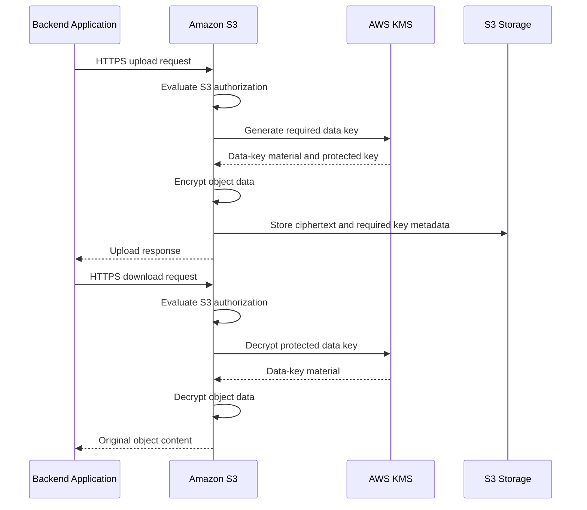
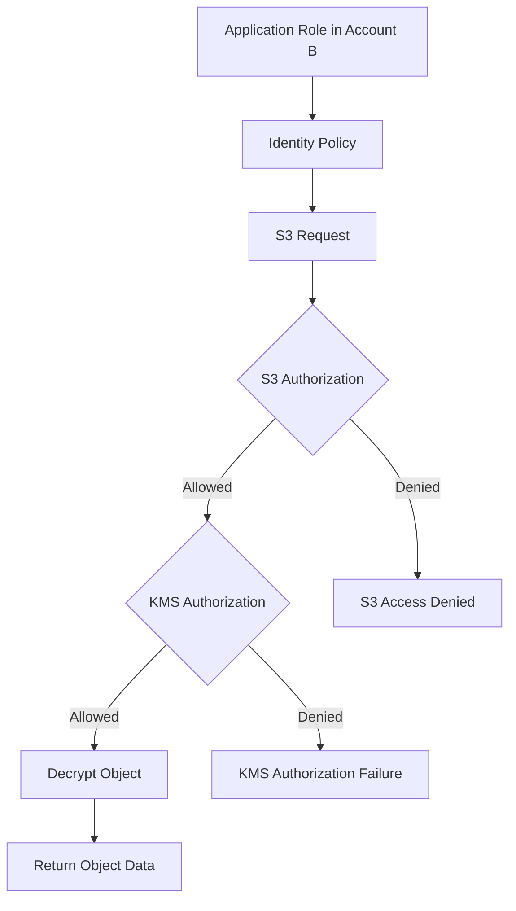
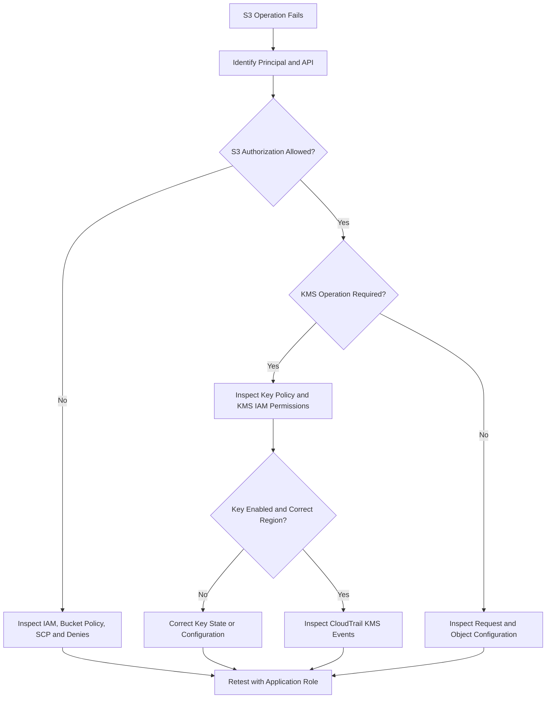

# 03- Server-Side Encryption with AWS KMS (SSE-KMS)

## Overview

Server-side encryption with AWS Key Management Service (SSE-KMS) is an Amazon S3 encryption mechanism that integrates S3 with AWS KMS to protect object data at rest. S3 performs the object encryption and decryption operations, while AWS KMS provides key-management capabilities, authorization controls, and auditing of relevant cryptographic operations.

SSE-KMS is useful when an application needs more control over encryption keys than SSE-S3 provides. Common requirements include customer-managed keys, centralized key governance, key-level access policies, cross-account encrypted data sharing, and auditing of key usage.

Unlike SSE-S3, SSE-KMS introduces additional configuration and operational dependencies. The application requires appropriate S3 permissions, and the principal or service performing the relevant operation must also be authorized to use the KMS key.

This document covers:

- SSE-KMS architecture and envelope encryption.
- AWS-managed and customer-managed KMS keys.
- Key policies, IAM permissions, and authorization.
- Bucket default encryption and request-level encryption.
- S3 Bucket Keys, encryption context, and cross-account access.
- Multipart uploads, object migration, and replication.
- AWS CLI, Boto3, troubleshooting, monitoring, and production practices.

## What Is SSE-KMS?

SSE-KMS is server-side encryption in which Amazon S3 encrypts object data using data keys protected by AWS KMS.

The application sends data to S3 over HTTPS. S3 handles the encryption process and stores the encrypted object. During an authorized read, S3 performs the required decryption operations and returns the original data.

The application does not ordinarily receive or manage the plaintext data encryption keys used by S3.

### Why SSE-KMS exists

SSE-KMS provides encryption at rest with additional key-management controls.

SSE-S3 is sufficient for many workloads, but it does not provide the same customer-managed key policies and key-level authorization capabilities as SSE-KMS with a customer-managed KMS key.

SSE-KMS supports requirements such as:

- Centralized key management and governance.
- Separate permissions for accessing objects and using encryption keys.
- Controlled cross-account access to encrypted objects.
- Auditing of relevant KMS operations through AWS CloudTrail.
- Key-level restrictions and lifecycle management.
- Encryption policies aligned with security and compliance requirements.

### When to use SSE-KMS

Use SSE-KMS when a workload requires explicit key-management controls or must use a particular KMS key.

Typical workloads include:

- Financial records and confidential business documents.
- Sensitive customer data.
- Centralized data-lake storage.
- Cross-account data-sharing systems.
- Security-sensitive application backups.
- Workloads requiring customer-managed encryption keys.

Do not choose SSE-KMS solely because it appears more secure than SSE-S3. Evaluate the actual requirements, key-management responsibilities, request volume, cost, and operational complexity.

## SSE-KMS Architecture

SSE-KMS uses envelope encryption. S3 encrypts object data with data keys, while AWS KMS protects the relevant key material.

The application interacts with S3 rather than implementing the underlying cryptographic workflow.



The diagram is conceptual. The precise operations and KMS request frequency depend on the encryption configuration, object operation, and whether S3 Bucket Keys are enabled.

### Envelope encryption

Envelope encryption separates bulk-data encryption from the protection of encryption keys.

- **Data encryption key:** Used to encrypt the object's content.
- **KMS key:** Protects the data encryption key.
- **Encrypted object:** The object data stored by S3 in encrypted form.
- **Protected key material:** Metadata required for the service to recover the data encryption key.

This design allows S3 to encrypt large objects efficiently without sending the entire object payload through AWS KMS.

### Benefits and trade-offs

| Benefits | Trade-offs |
|---|---|
| Customer-managed key policies and grants | More permissions and configuration to manage |
| Centralized key governance | Key misconfiguration can disrupt application access |
| Auditing of relevant KMS operations | KMS quotas and request costs must be considered |
| Cross-account use with supported customer-managed key configurations | Cross-account access requires coordination across IAM, S3, and KMS |
| Integration with AWS security controls | Key disabling or deletion can affect data availability |

## AWS-Managed and Customer-Managed KMS Keys

SSE-KMS supports AWS-managed KMS keys and customer-managed KMS keys.

### AWS-managed KMS key

When SSE-KMS is requested without specifying a key ID, S3 normally uses the AWS-managed KMS key for S3, identified by the alias `aws/s3`, where applicable.

AWS manages this key's policy and lifecycle. Customers have less control over its configuration.

Use this option when KMS-backed encryption is required but a customer-managed key is unnecessary.

### Customer-managed KMS key

A customer-managed key gives the organization control over the key policy and supported key-management settings.

Use a customer-managed key when you need to:

- Grant or restrict key usage for specific principals.
- Support cross-account encrypted access.
- Separate key administration from application administration.
- Manage key rotation and lifecycle decisions.
- Align key access with organizational governance.

The key must be a supported symmetric encryption KMS key in the same AWS Region as the S3 bucket for general-purpose bucket SSE-KMS operations.

### Comparison

| Property | AWS-managed S3 KMS key | Customer-managed KMS key |
|---|---|---|
| Alias | `aws/s3` | Optional customer-defined alias |
| Key policy administration | Managed by AWS | Managed by the customer |
| Fine-grained key policy control | Limited | Available |
| Cross-account key sharing | Not suitable for the usual cross-account customer-managed key design | Supported when policies and permissions allow |
| Key disablement and lifecycle control | Limited customer control | Greater customer control |
| Typical use | Standard KMS-backed encryption | Sensitive data and controlled key access |
| Operational responsibility | Lower | Higher |

### Design recommendation

Use a customer-managed key when the workload requires its additional controls. Otherwise, the AWS-managed S3 KMS key may satisfy the requirement with less operational overhead.

Avoid creating a separate KMS key for every object or application instance unless isolation or governance requirements justify that architecture. Excessive key proliferation increases policy-management and operational complexity.

## Configure SSE-KMS as Default Bucket Encryption

New S3 object uploads are encrypted at rest by default using SSE-S3 unless a different supported encryption method is configured.

A general-purpose bucket can use SSE-KMS as its default encryption configuration.

When configured, S3 applies the selected encryption behavior to new uploads that do not specify another supported encryption method.

### Inspect the existing configuration

```bash
aws s3api get-bucket-encryption \
  --bucket example-prod-documents \
  --region ap-south-1
```

### Configure a customer-managed KMS key

```bash
aws s3api put-bucket-encryption \
  --bucket example-prod-documents \
  --server-side-encryption-configuration '{
    "Rules": [
      {
        "ApplyServerSideEncryptionByDefault": {
          "SSEAlgorithm": "aws:kms",
          "KMSMasterKeyID": "arn:aws:kms:ap-south-1:123456789012:key/EXAMPLE-KEY-ID"
        },
        "BucketKeyEnabled": true
      }
    ]
  }' \
  --region ap-south-1
```

Replace the example account ID and key identifier with the actual customer-managed KMS key ARN.

This configuration enables SSE-KMS by default and enables S3 Bucket Keys for eligible objects.

### Operational considerations

- Verify that the key exists, is enabled, and is usable by the intended principals.
- Use the intended KMS key ARN in infrastructure configuration.
- S3 does not validate every aspect of a supplied key's usability when you configure default encryption.
- Changing bucket default encryption does not automatically re-encrypt existing objects.
- Uploads that explicitly select another supported encryption mode may behave differently from uploads using the bucket default.
- Test integrations that create objects on behalf of AWS services.

For reproducible environments, manage the bucket encryption configuration through infrastructure as code rather than relying on undocumented console changes.

Reference: [Configuring default bucket encryption](https://docs.aws.amazon.com/AmazonS3/latest/userguide/default-bucket-encryption.html).

## Upload Objects Using SSE-KMS

An upload can rely on bucket default encryption or explicitly request SSE-KMS.

Explicit request settings are useful when the application must select a particular customer-managed key and cannot rely solely on the destination bucket's default configuration.

### AWS CLI upload

```bash
aws s3api put-object \
  --bucket example-prod-documents \
  --key confidential/report.pdf \
  --body ./report.pdf \
  --server-side-encryption aws:kms \
  --ssekms-key-id arn:aws:kms:ap-south-1:123456789012:key/EXAMPLE-KEY-ID \
  --region ap-south-1
```

The request explicitly specifies SSE-KMS and the customer-managed key.

### Verify the uploaded object

```bash
aws s3api head-object \
  --bucket example-prod-documents \
  --key confidential/report.pdf \
  --region ap-south-1
```

An SSE-KMS-encrypted object typically reports:

```json
{
  "ServerSideEncryption": "aws:kms",
  "SSEKMSKeyId": "arn:aws:kms:ap-south-1:123456789012:key/EXAMPLE-KEY-ID",
  "BucketKeyEnabled": true
}
```

The example illustrates relevant response fields. Actual responses depend on the object and its configuration.

### Boto3 upload

```python
import boto3
from botocore.config import Config

s3 = boto3.client(
    "s3",
    region_name="ap-south-1",
    config=Config(
        retries={
            "mode": "standard",
            "max_attempts": 5,
        }
    ),
)


def upload_confidential_document(
    bucket: str,
    object_key: str,
    file_path: str,
    kms_key_arn: str,
) -> None:
    """Upload an object using SSE-KMS and a customer-managed key."""
    s3.upload_file(
        Filename=file_path,
        Bucket=bucket,
        Key=object_key,
        ExtraArgs={
            "ServerSideEncryption": "aws:kms",
            "SSEKMSKeyId": kms_key_arn,
            "ContentType": "application/pdf",
        },
    )
```

The application role must have the relevant S3 permissions and the applicable KMS authorization. Use IAM roles or other short-lived credentials supplied through the AWS credential provider chain; do not hardcode access keys.

For a high-volume application, consider using bucket default encryption and avoiding unnecessary request-level overrides. This simplifies client configuration and reduces the risk of inconsistent encryption behavior.

## KMS Permissions for S3 Operations

S3 access and KMS key usage are separate authorization layers.

An application may be authorized to retrieve an S3 object but still be denied access because its principal cannot use the KMS key required to decrypt that object.

### Typical permissions

| Operation | Typical S3 permissions | Typical KMS permissions |
|---|---|---|
| Upload an object | `s3:PutObject` | `kms:GenerateDataKey` |
| Download an SSE-KMS object | `s3:GetObject` | `kms:Decrypt` |
| Multipart upload | Relevant multipart and object permissions | Usually `kms:GenerateDataKey` and `kms:Decrypt` for the applicable workflow |
| Copy an encrypted object | Source read and destination write permissions | Required decrypt and data-key permissions for the source and destination encryption configurations |
| Read object metadata | Commonly `s3:GetObject` | Usually no KMS cryptographic operation is necessary for `HeadObject` itself |
| List objects | `s3:ListBucket` | None for listing alone |

This table describes common requirements, not an exhaustive list for every S3 API or integration. Check the permissions for the exact operation, including additional requirements for tagging, versions, replication, or service integrations.

### IAM policy for application access

The following example grants an application access to list a specific prefix and upload or download objects under that prefix.

```json
{
  "Version": "2012-10-17",
  "Statement": [
    {
      "Sid": "ListConfidentialPrefix",
      "Effect": "Allow",
      "Action": "s3:ListBucket",
      "Resource": "arn:aws:s3:::example-prod-documents",
      "Condition": {
        "StringLike": {
          "s3:prefix": [
            "confidential",
            "confidential/*"
          ]
        }
      }
    },
    {
      "Sid": "ReadAndWriteConfidentialObjects",
      "Effect": "Allow",
      "Action": [
        "s3:GetObject",
        "s3:PutObject"
      ],
      "Resource": "arn:aws:s3:::example-prod-documents/confidential/*"
    },
    {
      "Sid": "UseEncryptionKey",
      "Effect": "Allow",
      "Action": [
        "kms:GenerateDataKey",
        "kms:Decrypt"
      ],
      "Resource": "arn:aws:kms:ap-south-1:123456789012:key/EXAMPLE-KEY-ID"
    }
  ]
}
```

This is an identity-based policy example. Its KMS permissions support common upload and read workflows; they may need to be narrowed or expanded for the exact APIs in use.

The policy alone does not guarantee access. The KMS key policy or grant must also authorize the intended principal, and no applicable explicit deny may block the operation.

## KMS Key Policies

The KMS key policy is the primary resource-based control for a customer-managed KMS key.

Identity policies can grant permission to use a key when the key policy enables the account to delegate permissions through IAM. Alternatively, the key policy can directly authorize specific principals.

### Delegate key usage to IAM

A common key-policy structure permits the owning account to administer IAM permissions for the key.

```json
{
  "Version": "2012-10-17",
  "Statement": [
    {
      "Sid": "EnableAccountIAMPermissions",
      "Effect": "Allow",
      "Principal": {
        "AWS": "arn:aws:iam::123456789012:root"
      },
      "Action": "kms:*",
      "Resource": "*"
    }
  ]
}
```

In a KMS key policy, `"Resource": "*"` refers to the KMS key to which the policy is attached.

This is a delegation pattern, not a recommendation to grant every application principal unrestricted KMS permissions. Restrict application usage through narrowly scoped identity policies, key-policy statements, and grants.

### Directly authorize an application role

A more explicit key-policy statement can authorize a designated role to perform required cryptographic operations.

```json
{
  "Sid": "AllowApplicationRoleToUseKey",
  "Effect": "Allow",
  "Principal": {
    "AWS": "arn:aws:iam::123456789012:role/document-storage-api"
  },
  "Action": [
    "kms:GenerateDataKey",
    "kms:Decrypt",
    "kms:DescribeKey"
  ],
  "Resource": "*"
}
```

This statement is intended to be inserted into the policy of the relevant customer-managed KMS key. It does not replace the other statements needed for key administration or recovery.

For the application role, also configure the required identity-based permissions and the relevant S3 permissions.

### Key administration versus key usage

Separate key administration from application data access whenever possible.

| Responsibility | Example permissions |
|---|---|
| Key administration | `kms:DescribeKey`, policy and lifecycle management actions appropriate to administrators |
| Object upload | `kms:GenerateDataKey` |
| Object download | `kms:Decrypt` |
| Key usage investigation | CloudTrail and relevant KMS event access |
| Application S3 access | Required S3 data-plane actions |

Avoid granting `kms:*` to routine API workloads. A role that uploads application documents usually does not need permission to disable or schedule deletion of the encryption key.

Reference: [AWS KMS key policies](https://docs.aws.amazon.com/kms/latest/developerguide/key-policies.html).

## Encryption Context

AWS KMS supports an encryption context: additional non-secret key-value information associated with a cryptographic operation.

S3 uses encryption context with SSE-KMS. The context helps associate cryptographic operations with the relevant S3 resource and can support auditing and policy conditions.

### Why encryption context matters

Encryption context can improve visibility into the resource associated with key operations and provide additional conditions for key usage.

However, the context is not secret. Relevant values can appear in CloudTrail logs and must not contain passwords, API keys, or other sensitive values.

### Interaction with S3 Bucket Keys

Without S3 Bucket Keys, the S3 encryption context commonly identifies the object ARN. With S3 Bucket Keys, the context can instead identify the bucket ARN.

This difference can affect KMS policies or auditing logic that relies on the encryption context.

For example, a key policy designed around per-object encryption-context values may need adjustment before Bucket Keys are enabled.

### Production guidance

- Understand the encryption context used by the selected S3 configuration.
- Avoid relying on an object-level context when Bucket Keys may change the context granularity.
- Keep secrets and confidential values out of encryption-context fields.
- Test KMS policy conditions against the intended upload and download paths.
- Review CloudTrail events when investigating unexpected KMS authorization failures.

Reference: [AWS KMS encryption context](https://docs.aws.amazon.com/kms/latest/developerguide/encrypt_context.html).

## S3 Bucket Keys and SSE-KMS Cost Optimization

S3 Bucket Keys reduce the number of requests between Amazon S3 and AWS KMS.

Without Bucket Keys, an SSE-KMS workload can generate substantial KMS request traffic as the number of encrypted objects and operations increases.

With Bucket Keys enabled, S3 can reuse a bucket-level key for a limited period when protecting data keys. This can reduce KMS request traffic and, in eligible workloads, reduce KMS request costs by up to 99%.

### Enable Bucket Keys

Bucket Keys can be enabled in the default bucket encryption configuration:

```bash
aws s3api put-bucket-encryption \
  --bucket example-prod-documents \
  --server-side-encryption-configuration '{
    "Rules": [
      {
        "ApplyServerSideEncryptionByDefault": {
          "SSEAlgorithm": "aws:kms",
          "KMSMasterKeyID": "arn:aws:kms:ap-south-1:123456789012:key/EXAMPLE-KEY-ID"
        },
        "BucketKeyEnabled": true
      }
    ]
  }' \
  --region ap-south-1
```

### Benefits

- Reduces S3-to-KMS request traffic.
- Can materially lower KMS request costs.
- Requires little or no application-code modification when enabled through the bucket default.
- Benefits large workloads with many SSE-KMS-encrypted objects.

### Limitations and considerations

- Bucket Keys are not supported with DSSE-KMS.
- Enabling Bucket Keys for new uploads does not automatically update every existing object.
- The encryption context can change from object-level to bucket-level identification.
- Policy conditions and audit workflows must account for the changed context.
- Bucket Keys do not remove the need for KMS permissions or S3 authorization.

Evaluate Bucket Keys using workload volume, cost data, key-policy conditions, and auditing requirements.

Reference: [Reducing the cost of SSE-KMS with S3 Bucket Keys](https://docs.aws.amazon.com/AmazonS3/latest/userguide/bucket-key.html).

## Cross-Account SSE-KMS Access

Cross-account access to an SSE-KMS-encrypted object requires permission at both the S3 and KMS layers.

For example, an application running in Account B might read an object owned by Account A.

The target account's S3 resource policy and the caller's IAM permissions must permit the S3 operation. The customer-managed KMS key policy in the account that owns the key must also permit the relevant key usage.

### Cross-account authorization flow



### Required configuration

1. Grant the external role the required S3 data permissions.
2. Configure the S3 bucket policy to authorize the external principal where required.
3. Use a customer-managed KMS key when cross-account key access is required.
4. Add the external role or account to the key policy, or use an appropriate supported grant.
5. Ensure that the external role has the necessary KMS identity permissions.
6. Check applicable SCPs, permission boundaries, session policies, and explicit denies.
7. Verify that the KMS key and bucket are configured in compatible Regions.

An AWS-managed KMS key such as `aws/s3` is not the appropriate choice for the usual cross-account customer-managed-key sharing pattern.

Cross-account access should be tested using the actual target role and not only an administrator's credentials.

Reference: [Cross-account access to KMS keys](https://docs.aws.amazon.com/kms/latest/developerguide/key-policy-modifying-external-accounts.html).

## Multipart Uploads and SSE-KMS

Multipart upload improves the reliability and throughput of large-object uploads by splitting an object into parts.

SSE-KMS can be used with supported multipart upload workflows. The encryption configuration must be appropriate for the upload and completion process.

### Permissions

A multipart SSE-KMS workflow commonly requires:

- S3 permissions to initiate, upload, complete, and abort multipart uploads.
- `kms:GenerateDataKey` for creating the data key.
- `kms:Decrypt` for relevant multipart operations that require decryption of protected key material.

The exact requirements depend on the operation and workflow.

### Operational recommendations

- Use a supported AWS SDK transfer implementation for large uploads.
- Configure reasonable concurrency and retry limits.
- Preserve the intended SSE-KMS settings across the upload workflow.
- Ensure cleanup of incomplete multipart uploads.
- Test interrupted transfers and retry behavior.
- Verify the completed object's encryption metadata.

A successful multipart upload does not by itself prove that the intended key or encryption configuration was used. Check the final object.

Reference: [Using SSE-KMS](https://docs.aws.amazon.com/AmazonS3/latest/userguide/specifying-kms-encryption.html).

## Re-Encrypt Existing Objects

Changing a bucket's default encryption configuration affects new uploads. Existing objects retain their current encryption configuration until they are rewritten or processed through a supported migration workflow.

An object originally encrypted with SSE-S3 does not become SSE-KMS-encrypted simply because the bucket's default changes.

### Single-object re-encryption

A self-copy can be used to create a new version of an object with a selected encryption configuration.

```bash
aws s3api copy-object \
  --bucket example-prod-documents \
  --key documents/legacy-report.pdf \
  --copy-source example-prod-documents/documents/legacy-report.pdf \
  --server-side-encryption aws:kms \
  --ssekms-key-id arn:aws:kms:ap-south-1:123456789012:key/EXAMPLE-KEY-ID \
  --region ap-south-1
```

This command illustrates copying an object onto itself with SSE-KMS. In production, review metadata and tagging directives, object versioning, object-lock constraints, permissions, and the expected behavior of the copy operation.

### Large-scale migration

For large object collections:

1. Generate or use an S3 Inventory report.
2. Identify the objects requiring migration.
3. Test the migration process on a limited set of objects.
4. Use S3 Batch Operations or an appropriate controlled processing workflow.
5. Capture and inspect operation failures.
6. Verify the encryption configuration of resulting objects.
7. Account for noncurrent versions and retention requirements.
8. Retain the necessary rollback and recovery strategy.

Re-encryption can create additional object versions and incur request, storage, and KMS costs. Plan the migration before processing a large bucket.

## SSE-KMS and Replication

S3 replication can copy encrypted objects when the replication configuration and permissions support the encryption method.

SSE-KMS replication requires careful setup of the replication role, source key access, and destination encryption configuration.

### Important considerations

- Configure the required S3 replication permissions.
- Grant the replication role the required KMS permissions.
- Verify the source key policy and destination key policy.
- Use a customer-managed destination key when cross-account encrypted replication requires it.
- Configure the replication rule to handle SSE-KMS-encrypted objects where needed.
- Monitor replication status and operation failures.
- Test the availability and encryption settings of replicated objects.

Do not assume that default encryption on the destination bucket automatically guarantees correct replication of every existing SSE-KMS object.

Replication and encryption do not independently provide a complete disaster recovery strategy. Recovery objectives, access to destination keys, application failover, and restoration procedures must also be tested.

Reference: [Replicating objects encrypted with AWS KMS keys](https://docs.aws.amazon.com/AmazonS3/latest/userguide/replication-config-for-kms-objects.html).

## Monitoring and Auditing

SSE-KMS introduces a KMS authorization and operational layer that should be included in observability and incident-response procedures.

### CloudTrail

Use AWS CloudTrail to investigate relevant KMS API activity, including key usage and authorization failures. Audit event availability and detail depend on the event type and the configured CloudTrail collection.

S3 data events can also be useful for investigating relevant object-level API activity when enabled.

### Operational indicators

Monitor:

- KMS access-denied errors.
- Failed S3 uploads and downloads.
- KMS request volume and cost.
- KMS throttling or quota-related failures.
- Key state and lifecycle changes.
- Replication failures involving encrypted objects.
- Encryption metadata on important object collections.

### Recommended controls

- Keep key administration separate from routine data access.
- Restrict who can disable or schedule deletion of production keys.
- Alert on unexpected key-policy changes and key disablement.
- Document key recovery and disaster recovery dependencies.
- Periodically test access using real application roles.
- Inventory objects when encryption requirements change.

Key availability is a data-availability dependency. A disabled or unavailable key can prevent applications from reading encrypted objects even when their S3 permissions are correct.

## Troubleshooting SSE-KMS

SSE-KMS failures commonly originate in S3 authorization, KMS authorization, key state, Region configuration, or request configuration.

### Diagnostic workflow

Start with the exact failing S3 API, the principal making the request, the bucket and object identifiers, and the relevant error details.



### Common failures

| Symptom | Likely causes | Diagnostic action |
|---|---|---|
| S3 `AccessDenied` during upload | Missing `s3:PutObject`, explicit deny, or KMS data-key permission failure | Inspect S3 policy evaluation and relevant KMS events |
| S3 `AccessDenied` during download | Missing `s3:GetObject` or `kms:Decrypt` authorization | Check both the S3 resource and key permissions |
| KMS `AccessDeniedException` | Key policy, IAM permission, grant, or applicable explicit deny | Review key policy and the actual caller identity |
| Invalid or unusable KMS key | Wrong key ARN, disabled key, pending deletion, or unsuitable key | Inspect the key in the bucket's Region |
| Cross-account access fails | Missing destination bucket permission or key policy permission | Test S3 and KMS authorization independently |
| Object uses an unexpected key | Request-level setting, bucket default, or migration assumptions | Run `head-object` and inspect bucket encryption settings |
| Upload works but a later read fails | Upload and read roles have different permissions, or key access changed | Compare both principals' S3 and KMS permissions |
| Multipart upload fails | Missing multipart S3 permission, KMS permission, or interrupted transfer | Inspect the failing operation and its CloudTrail events |

### Inspect the key

```bash
aws kms describe-key \
  --key-id arn:aws:kms:ap-south-1:123456789012:key/EXAMPLE-KEY-ID \
  --region ap-south-1
```

Check the key state and confirm the key is in the expected Region.

### Verify the object

```bash
aws s3api head-object \
  --bucket example-prod-documents \
  --key confidential/report.pdf \
  --region ap-south-1
```

Inspect `ServerSideEncryption`, `SSEKMSKeyId`, and other relevant response metadata.

### Corrective action

Fix the narrowest confirmed authorization or configuration problem. Do not resolve KMS authorization errors by granting `kms:*` or broad S3 access to the entire account.

Retest using the same role and API operation that originally failed. Include a regression test where possible to prevent the policy or configuration problem from returning.

## Production Best Practices

### Key management

- Use customer-managed keys where their control capabilities are required.
- Separate key administrators from application roles.
- Restrict key disabling, policy changes, and deletion scheduling.
- Document the recovery implications of key unavailability.
- Keep keys and encrypted buckets in compatible Regions.

### Application integration

- Use IAM roles and temporary credentials.
- Centralize S3 client configuration in a reusable service layer.
- Set explicit keys on uploads when required by the workload.
- Handle S3 and KMS authorization failures separately.
- Apply bounded retries to transient errors without retrying permanent authorization failures indefinitely.
- Test using the actual runtime role rather than an administrator role.

### Cost management

- Estimate KMS request volume and cost before deploying a high-throughput workload.
- Evaluate S3 Bucket Keys when compatible with the required key and auditing model.
- Measure request traffic after enabling Bucket Keys.
- Avoid unnecessary copy operations and object rewrites.
- Include migration, replication, and recovery activities in cost estimates.

### Infrastructure and compliance

- Manage bucket encryption and KMS policies through infrastructure as code.
- Review key-policy changes through normal change-control procedures.
- Inventory objects where historical encryption requirements matter.
- Validate uploads and downloads after key or policy changes.
- Test encrypted cross-account access and disaster recovery.
- Use CloudTrail and other relevant logs for investigations.

## Production Verification Checklist

- [ ] Bucket default encryption uses the intended SSE-KMS configuration.
- [ ] The configured KMS key exists, is enabled, and is in the expected Region.
- [ ] The application role has only the required S3 permissions.
- [ ] Required KMS permissions are allowed by the key policy and identity policy.
- [ ] Upload and download operations work using the actual application role.
- [ ] Cross-account access has been tested where applicable.
- [ ] Bucket Key settings are consistent with key-policy conditions and auditing requirements.
- [ ] Multipart upload and copy workflows preserve the intended encryption configuration.
- [ ] Existing objects have been inventoried if migration is required.
- [ ] Replication configuration supports encrypted objects and destination key access.
- [ ] Key administration and application data access are appropriately separated.
- [ ] KMS costs, request volume, and authorization failures are monitored.
- [ ] Key recovery and disaster recovery procedures have been documented and tested.

## Official References

- [Specifying SSE-KMS encryption](https://docs.aws.amazon.com/AmazonS3/latest/userguide/specifying-kms-encryption.html)
- [Configuring default bucket encryption](https://docs.aws.amazon.com/AmazonS3/latest/userguide/default-bucket-encryption.html)
- [Reducing SSE-KMS costs with S3 Bucket Keys](https://docs.aws.amazon.com/AmazonS3/latest/userguide/bucket-key.html)
- [Configuring S3 Bucket Keys](https://docs.aws.amazon.com/AmazonS3/latest/userguide/configuring-bucket-key.html)
- [AWS KMS key policies](https://docs.aws.amazon.com/kms/latest/developerguide/key-policies.html)
- [AWS KMS encryption context](https://docs.aws.amazon.com/kms/latest/developerguide/encrypt_context.html)
- [Cross-account access to KMS keys](https://docs.aws.amazon.com/kms/latest/developerguide/key-policy-modifying-external-accounts.html)
- [Replicating SSE-KMS encrypted objects](https://docs.aws.amazon.com/AmazonS3/latest/userguide/replication-config-for-kms-objects.html)
- [Amazon S3 security best practices](https://docs.aws.amazon.com/AmazonS3/latest/userguide/security-best-practices.html)

## Key Takeaways

- SSE-KMS uses envelope encryption to protect S3 object data with data keys managed through AWS KMS.
- Secure access requires both the relevant S3 permissions and authorization to use the KMS key.
- Customer-managed keys enable additional key policies, governance, and cross-account controls but introduce operational dependencies.
- S3 Bucket Keys can reduce KMS request costs significantly, but policy conditions and encryption-context assumptions must be reviewed.
- Verify object encryption, key availability, application-role permissions, and recovery procedures after security or infrastructure changes.