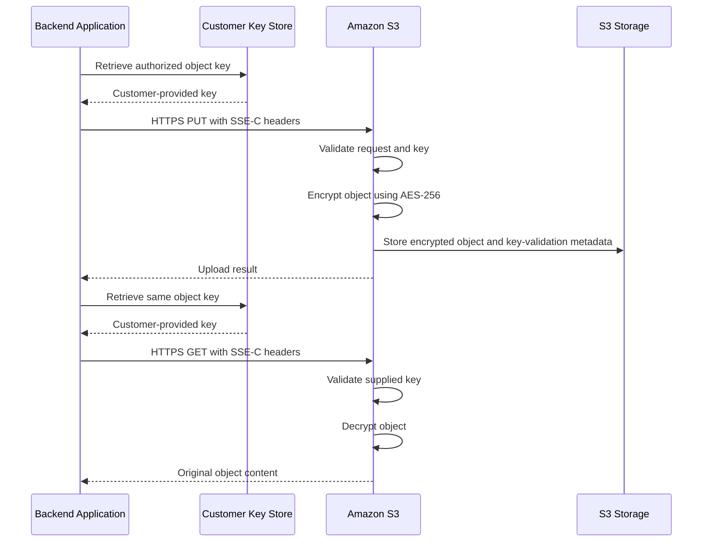

# 04- Server-Side Encryption with Customer-Provided Keys (SSE-C)

## Overview

Server-side encryption with customer-provided keys (SSE-C) allows an application to supply its own encryption key to Amazon S3 while S3 performs the encryption and decryption operations.

S3 uses the customer-provided key to encrypt object data with AES-256. It does not store the supplied encryption key. When retrieving an encrypted object, the caller must provide the same key so S3 can decrypt the data.

SSE-C separates key ownership from encryption execution: the customer manages the key, while Amazon S3 manages the data-encryption process.

**Important:** Since April 2026, SSE-C is disabled by default for new general-purpose S3 buckets. It was also disabled for existing buckets in AWS accounts that had no SSE-C-encrypted objects. Workloads that require SSE-C must explicitly enable it for the relevant bucket.

SSE-C is a specialized encryption option. For most applications, SSE-S3 or SSE-KMS offers a simpler operational model. SSE-C should be selected only when customer-provided keys are a deliberate requirement.

This document covers:

- SSE-C architecture, encryption behavior, and key requirements.
- Enabling and blocking SSE-C on general-purpose buckets.
- AWS CLI and Boto3 upload, download, metadata, and copy operations.
- Secure key storage, rotation, recovery, and presigned URLs.
- Multipart uploads, replication, troubleshooting, and production practices.

## What Is SSE-C?

SSE-C is a server-side encryption method in which the customer supplies the encryption key with each supported S3 request that requires it.

S3 performs the encryption or decryption operation and discards the supplied key from memory after the operation. S3 retains a randomly salted HMAC value associated with the key to validate future requests; this value cannot be used to derive the original key.

If the customer loses the original key, the encrypted object cannot be recovered through SSE-C.

### Why SSE-C exists

SSE-C supports use cases in which an organization needs to provide the encryption key directly to S3 instead of using an AWS-managed or AWS KMS-managed encryption key.

Potential reasons include:

- Existing systems that already manage customer-provided encryption keys.
- Specialized key-custody requirements.
- Workloads that require explicit control over key delivery.
- Integration with an established external key-management workflow.

However, SSE-C does not make object data inaccessible to S3 while S3 performs the requested operation. S3 must process the provided key to carry out encryption or decryption.

### When to use SSE-C

Use SSE-C only when a specific architectural, contractual, or security requirement justifies its operational complexity.

| Requirement | SSE-C suitability |
|---|---|
| General encryption at rest | Usually unnecessary; prefer SSE-S3 |
| Customer-managed KMS policies and grants | Prefer SSE-KMS |
| Customer must provide the key with each data request | SSE-C may be suitable |
| Broad AWS service integration | Usually a poor fit because consumers must supply the key |
| Direct browser downloads | Poor fit because required encryption headers must accompany requests |
| External key custody with an existing key-management system | Potentially suitable, subject to integration and recovery requirements |

## How SSE-C Works

SSE-C uses AES-256 to encrypt object data. The customer provides a 256-bit encryption key, and S3 handles the underlying encryption and decryption operations.

The customer-provided key is not stored by S3. The customer must securely retain it and make it available to authorized applications when required.

### Encryption lifecycle



The key store in this diagram is an application-managed component. It could be an approved external key-management system or another secure secret-storage service.

### Required encryption parameters

SSE-C requests require three encryption parameters, represented by these HTTP headers:

| HTTP header | Purpose |
|---|---|
| `x-amz-server-side-encryption-customer-algorithm` | Specifies `AES256` |
| `x-amz-server-side-encryption-customer-key` | Supplies the base64-encoded 256-bit key |
| `x-amz-server-side-encryption-customer-key-MD5` | Supplies the base64-encoded MD5 digest used for key-transmission integrity checking |

AWS SDKs and the AWS CLI support these values through their respective request parameters and can calculate the MD5 value automatically when supported.

The MD5 digest is not a substitute for secure key storage or key authentication. It is used for integrity checking of the supplied key.

### SSE-C characteristics

| Property | Behavior |
|---|---|
| Encryption algorithm | AES-256 |
| Encryption performed by | Amazon S3 |
| Key supplied by | Customer or authorized application |
| Key stored by S3 | No |
| Key required for download | Yes |
| Key required for applicable metadata requests | Yes |
| KMS permissions required for SSE-C itself | No |
| Additional SSE-C encryption charge | No separate SSE-C encryption charge; normal S3 request and storage pricing applies |
| Key recovery by S3 | Not available |
| Object metadata encrypted | No |
| General-purpose buckets | Supported when SSE-C is enabled |
| Directory buckets | SSE-C is not supported |

## SSE-C Bucket Configuration

SSE-C is not a bucket default encryption algorithm. It is an object-level encryption method selected through supported upload requests.

The bucket's encryption configuration controls whether SSE-C requests are allowed.

### Default behavior since April 2026

New general-purpose buckets have SSE-C blocked by default. AWS also disabled SSE-C for existing buckets in accounts that had no SSE-C-encrypted objects.

When SSE-C is blocked, requests attempting to write SSE-C-encrypted objects can fail with HTTP `403 AccessDenied`.

Existing SSE-C-encrypted objects are not automatically re-encrypted or deleted when SSE-C is blocked. Authorized reads and metadata requests can continue when the required SSE-C headers and original key are supplied.

### Inspect the bucket encryption configuration

```bash
aws s3api get-bucket-encryption \
  --bucket example-prod-sensitive \
  --region ap-south-1
```

Review the `BlockedEncryptionTypes` setting in the returned server-side encryption configuration.

The relevant encryption configuration permissions are:

- `s3:GetEncryptionConfiguration` to inspect the configuration.
- `s3:PutEncryptionConfiguration` to update the configuration.

### Explicitly enable SSE-C

To permit SSE-C requests, configure `BlockedEncryptionTypes` with `EncryptionType` set to `NONE`.

The following example retains SSE-S3 as the bucket's default encryption algorithm while permitting explicitly requested SSE-C uploads:

```bash
aws s3api put-bucket-encryption \
  --bucket example-prod-sensitive \
  --server-side-encryption-configuration '{
    "Rules": [
      {
        "ApplyServerSideEncryptionByDefault": {
          "SSEAlgorithm": "AES256"
        },
        "BlockedEncryptionTypes": {
          "EncryptionType": [
            "NONE"
          ]
        }
      }
    ]
  }' \
  --region ap-south-1
```

This configuration does **not** make SSE-C the bucket default. It permits SSE-C for supported requests while preserving SSE-S3 as the default for uploads that do not specify another supported encryption method.

The operation replaces the bucket's encryption configuration. Review the existing configuration and preserve any required settings before applying a change.

### Block SSE-C

If SSE-C is no longer required, block it explicitly:

```bash
aws s3api put-bucket-encryption \
  --bucket example-prod-sensitive \
  --server-side-encryption-configuration '{
    "Rules": [
      {
        "ApplyServerSideEncryptionByDefault": {
          "SSEAlgorithm": "AES256"
        },
        "BlockedEncryptionTypes": {
          "EncryptionType": [
            "SSE-C"
          ]
        }
      }
    ]
  }' \
  --region ap-south-1
```

Before blocking SSE-C, inventory objects and identify any applications that still depend on it. Blocking new SSE-C writes does not remove the need to maintain the original keys for existing objects.

Reference: [Blocking or unblocking SSE-C for a general-purpose bucket](https://docs.aws.amazon.com/AmazonS3/latest/userguide/blocking-unblocking-s3-c-encryption-gpb.html).

## Upload an Object with SSE-C

An SSE-C upload explicitly provides the customer key and the `AES256` algorithm.

The encryption key must be a valid 256-bit key. Generate it using a cryptographically secure random-number generator and store it in an approved key-management system before using it in production.

### AWS CLI upload

Assume that `customer-key.bin` contains the raw 32-byte encryption key and is protected by appropriate filesystem permissions.

```bash
aws s3api put-object \
  --bucket example-prod-sensitive \
  --key records/customer-record.bin \
  --body ./customer-record.bin \
  --sse-customer-algorithm AES256 \
  --sse-customer-key fileb://./customer-key.bin \
  --region ap-south-1
```

The CLI reads the binary key file for the request. Do not commit the key file to source control or include it in build artifacts.

Test CLI parameter handling against the installed AWS CLI version and protect the execution environment from shell tracing, command logging, and process inspection risks.

### Boto3 upload

Boto3 supports SSE-C parameters directly. It also calculates the customer-key MD5 value when the parameter is omitted.

```python
import boto3
from botocore.config import Config

s3 = boto3.client(
    "s3",
    region_name="ap-south-1",
    config=Config(
        retries={
            "mode": "standard",
            "max_attempts": 5,
        }
    ),
)


def upload_sensitive_object(
    bucket: str,
    object_key: str,
    file_path: str,
    customer_key: bytes,
) -> None:
    """Upload an object using an externally managed SSE-C key."""
    if len(customer_key) != 32:
        raise ValueError("SSE-C requires a 32-byte AES-256 key")

    with open(file_path, "rb") as file_obj:
        s3.put_object(
            Bucket=bucket,
            Key=object_key,
            Body=file_obj,
            SSECustomerAlgorithm="AES256",
            SSECustomerKey=customer_key,
            ContentType="application/octet-stream",
        )
```

The example assumes `customer_key` has already been retrieved securely from the organization's key-management system. It must not be a hardcoded production key or a key generated afresh for every upload without a durable recovery mechanism.

Use the application's IAM role for S3 authorization. SSE-C does not require KMS cryptographic permissions, although other components of the application may independently use KMS.

## Download an SSE-C Object

The original key must be supplied for every read operation that requires it. Providing the wrong key prevents S3 from successfully decrypting the object.

### AWS CLI download

```bash
aws s3api get-object \
  --bucket example-prod-sensitive \
  --key records/customer-record.bin \
  --sse-customer-algorithm AES256 \
  --sse-customer-key fileb://./customer-key.bin \
  ./downloaded-record.bin \
  --region ap-south-1
```

The output file contains the decrypted object contents when the request succeeds.

Protect the downloaded file according to its data classification, and remove temporary plaintext files through an appropriate secure-handling procedure.

### Boto3 download

```python
import boto3

s3 = boto3.client("s3", region_name="ap-south-1")


def download_sensitive_object(
    bucket: str,
    object_key: str,
    destination_path: str,
    customer_key: bytes,
) -> None:
    """Download an SSE-C object using its original customer key."""
    if len(customer_key) != 32:
        raise ValueError("SSE-C requires a 32-byte AES-256 key")

    response = s3.get_object(
        Bucket=bucket,
        Key=object_key,
        SSECustomerAlgorithm="AES256",
        SSECustomerKey=customer_key,
    )

    try:
        with open(destination_path, "wb") as destination:
            for chunk in response["Body"].iter_chunks(
                chunk_size=1024 * 1024
            ):
                if chunk:
                    destination.write(chunk)
    finally:
        response["Body"].close()
```

Streaming avoids loading the entire object into application memory. For production use, also implement appropriate destination-file cleanup and partial-download handling, so a failed download is not mistaken for a complete file.

### Verify object metadata

SSE-C-encrypted objects require the relevant customer-key headers for supported metadata operations such as `HeadObject`.

```python
response = s3.head_object(
    Bucket="example-prod-sensitive",
    Key="records/customer-record.bin",
    SSECustomerAlgorithm="AES256",
    SSECustomerKey=customer_key,
)

assert response.get("SSECustomerAlgorithm") == "AES256"
```

The response confirms the encryption algorithm. It does not expose the customer-provided key.

## Key Management and Recovery

Key management is the most important operational concern when using SSE-C.

S3 does not store the encryption key supplied by the customer. The organization must maintain a secure and durable mechanism to preserve keys for the lifetime of every object that depends on them.

### Key-generation requirements

Generate a cryptographically secure 256-bit key. Do not use a password, predictable identifier, timestamp, or ordinary pseudo-random value as the AES key.

Example of generating a key for a controlled provisioning workflow:

```python
import base64
import secrets

key = secrets.token_bytes(32)
encoded_key = base64.b64encode(key).decode("ascii")
```

This creates a valid random key and a base64 representation suitable for secure storage in a key-management workflow. Generating the key is not sufficient: the key must be durably stored and associated with the objects encrypted using it.

Never print `key` or `encoded_key` to application logs.

### Recommended key-management architecture

- Generate keys using a cryptographically secure mechanism.
- Store key material in a protected key vault or secret-management system.
- Restrict key retrieval to the application roles that require it.
- Maintain an object-to-key-version mapping in an appropriately protected metadata store.
- Keep recoverable backups of key material according to the recovery design.
- Audit key retrieval and access events.
- Test key recovery without exposing production key material.
- Define retention requirements for keys associated with retained or archived objects.

A key identifier can be stored in application metadata or a database, but the encryption key itself must not be stored in object metadata or ordinary application configuration.

### Key loss and recovery

If the SSE-C key is lost, S3 cannot recover the object plaintext for the customer.

Key loss can therefore become permanent data loss, even when the object remains present, durable, and fully accessible at the S3 storage layer.

Treat key availability as a data-availability dependency. Include key backup, key-vault availability, authorization recovery, and disaster recovery in the service's recovery objectives.

## Key Rotation

SSE-C does not offer a bucket-level key rotation mechanism that automatically re-encrypts every object.

To change the encryption key for an existing object, the application must perform a controlled object-copy or migration operation using the correct source key and a new destination key.

### Rotation workflow

1. Generate a new customer-provided key.
2. Store it securely and register its version.
3. Read or copy the existing object using the original SSE-C key.
4. Encrypt the destination object using the new SSE-C key.
5. Verify the destination object's contents and encryption metadata.
6. Update the application's object-to-key mapping.
7. Retain the old key until all dependent objects and historical versions no longer require it.

### Rotation considerations

- Use unique, generated keys according to the organization's key-management design.
- Track which key version applies to every object version.
- Preserve the original key until migration and recovery requirements are satisfied.
- Verify all migrated objects before removing old key material.
- Account for versioning, Object Lock, retention policies, request costs, and storage usage.
- Make retry operations idempotent and record migration outcomes.

Do not delete an old key simply because a new object version has been written. Noncurrent versions and retained historical data might still depend on the original key.

## Copying SSE-C Objects

Copying an SSE-C-encrypted object involves two independent encryption contexts:

- The source key required to read and decrypt the source object.
- The destination key required to encrypt the new object if SSE-C is requested for the destination.

Both keys must be managed securely.

### Copy through Boto3

```python
def copy_sse_c_object(
    bucket: str,
    source_key: str,
    destination_key: str,
    source_customer_key: bytes,
    destination_customer_key: bytes,
) -> dict:
    """Copy an SSE-C object to another SSE-C-encrypted object."""
    for key in (source_customer_key, destination_customer_key):
        if len(key) != 32:
            raise ValueError("Each SSE-C key must be exactly 32 bytes")

    return s3.copy_object(
        Bucket=bucket,
        Key=destination_key,
        CopySource={
            "Bucket": bucket,
            "Key": source_key,
        },
        CopySourceSSECustomerAlgorithm="AES256",
        CopySourceSSECustomerKey=source_customer_key,
        SSECustomerAlgorithm="AES256",
        SSECustomerKey=destination_customer_key,
        MetadataDirective="COPY",
    )
```

The source and destination keys can be the same, but a distinct destination key is useful when performing a deliberate rotation.

Review metadata and tagging behavior for the actual copy operation. Verify the copied object's contents and encryption metadata before treating a migration as complete.

The S3 console does not support copying SSE-C-encrypted objects. Use the AWS CLI, an SDK, or the S3 REST API.

Reference: [Copying, moving, and renaming objects](https://docs.aws.amazon.com/AmazonS3/latest/userguide/copy-object.html).

## Multipart Uploads

SSE-C supports multipart upload for large objects in general-purpose buckets when SSE-C is enabled.

Encryption parameters must be applied consistently throughout the multipart upload process.

The upload normally includes:

- `CreateMultipartUpload` with the required SSE-C parameters.
- `UploadPart` operations using the same encryption parameters.
- `CompleteMultipartUpload` to assemble the object.

The low-level API workflow must preserve the required customer-key settings on the operations that require them. High-level SDK transfer helpers can simplify this configuration, but their behavior should be tested for the installed SDK version.

### Production considerations

- Use a supported SDK implementation for multipart transfers.
- Securely retain the key across retries and process restarts.
- Avoid logging request headers or key material.
- Clean up incomplete multipart uploads according to the operational policy.
- Handle transient network errors without silently changing encryption configuration.
- Verify the completed object's encryption metadata and content.
- Test failure recovery and ensure failed attempts do not expose plaintext or key material.

SSE-C has no separate KMS key permissions requirement, but normal S3 multipart permissions are still required.

## Presigned URLs and Direct Client Access

SSE-C presigned URLs require special handling because the request must include the SSE-C encryption headers in addition to the signed URL.

The client must provide the required headers when using the URL. A URL alone is insufficient for retrieving SSE-C-encrypted data.

### Security implications

A presigned URL normally delegates temporary access to an S3 operation. SSE-C adds the requirement to deliver the customer key securely to the authorized client.

This creates an additional key-distribution problem:

- The URL grants temporary S3 request authority.
- The customer-provided key enables decryption of the object.
- Both the URL and key must be protected.
- The client must support the necessary custom request headers.
- Ordinary browser navigation is insufficient for SSE-C object retrieval because it does not automatically provide the required headers.

### Recommendation

Prefer SSE-KMS or SSE-S3 for ordinary client-to-S3 presigned upload and download workflows.

Use SSE-C presigned access only when the architecture explicitly requires customer-provided keys and can securely distribute those keys to authorized clients. Never include the encryption key in a query string, URL path, or ordinary access log.

Reference: [Presigned URLs and SSE-C](https://docs.aws.amazon.com/AmazonS3/latest/userguide/specifying-s3-c-encryption.html).

## SSE-C and AWS Service Integrations

SSE-C can complicate integrations because a consuming service must be able to supply the key required to decrypt the object.

| Integration | Consideration |
|---|---|
| Backend applications | Can retrieve the key from an approved key-management system and supply it through supported S3 SDK operations |
| Lambda | Can process SSE-C objects only when the function's design and supported S3 operations provide the required key securely |
| CloudFront | Standard S3 origin access does not automatically solve SSE-C key delivery; use an architecture compatible with the required request headers or select another encryption mode |
| Athena and Glue | Native analytics workflows may not provide a suitable general-purpose mechanism for consuming SSE-C-encrypted data |
| S3 Replication | Supported for SSE-C objects when the replication configuration permits it |
| Backup and recovery | Recovery procedures must preserve the original keys as well as the encrypted data |
| Cross-account consumers | Every authorized consumer requiring access must securely obtain the correct key |

Do not assume that an AWS service can decrypt an SSE-C object simply because it has permission to call S3.

Before adopting SSE-C, test every required downstream service and document its key-delivery mechanism. For architectures that depend on multiple managed services, SSE-KMS is often operationally simpler.

Reference: [Replicating encrypted objects](https://docs.aws.amazon.com/AmazonS3/latest/userguide/replication-config-for-kms-objects.html).

## SSE-C and Bucket Policies

A bucket policy can require SSE-C headers on relevant object-write requests. This can enforce a specific application contract, but it also risks breaking integrations that do not support SSE-C.

A policy that rejects requests missing the SSE-C algorithm header might look like this:

```json
{
  "Version": "2012-10-17",
  "Statement": [
    {
      "Sid": "RequireSSECForObjectUploads",
      "Effect": "Deny",
      "Principal": "*",
      "Action": "s3:PutObject",
      "Resource": "arn:aws:s3:::example-prod-sensitive/*",
      "Condition": {
        "Null": {
          "s3:x-amz-server-side-encryption-customer-algorithm": "true"
        }
      }
    }
  ]
}
```

This example checks whether the algorithm header is absent. It does not by itself validate every aspect of the request's encryption configuration, and the policy should be tested against all upload paths.

If a policy requires SSE-C, multipart upload operations must supply the required encryption information consistently. The bucket must also have SSE-C enabled through its encryption configuration.

Do not use a policy that requires SSE-C merely to enforce encryption at rest. S3 already applies default server-side encryption, and SSE-S3 or SSE-KMS is usually easier to operate.

## Security and Operational Risks

### Key exposure

SSE-C sends the key with each relevant request. Although requests should use HTTPS, key material may still be exposed through application logging, debugging tools, tracing instrumentation, proxy configuration, or process inspection.

**Prevention:** Redact sensitive headers, disable unsafe request tracing, restrict access to the key store, and avoid passing keys through command-line arguments or URLs.

### Key loss

S3 does not retain a recoverable copy of the customer-provided key.

**Prevention:** Use durable key storage and independently tested recovery procedures.

### Unsupported consumers

Some services and application paths cannot transparently use SSE-C because the key is not managed by AWS.

**Prevention:** Validate every required integration before committing to SSE-C.

### Inconsistent key mapping

Applications can lose track of which key encrypted a particular object or version.

**Prevention:** Maintain a durable mapping between object identity, version, and key identifier. Never rely on guessing which key was used.

### Misunderstanding blocked encryption

Since April 2026, SSE-C write requests are blocked by default on new general-purpose buckets.

**Prevention:** Inspect `BlockedEncryptionTypes` during deployment, and explicitly enable SSE-C only for approved workloads. A `403 AccessDenied` on an SSE-C write may indicate the encryption type is blocked rather than a missing ordinary object permission.

### Treating SSE-C as client-side encryption

With SSE-C, S3 performs encryption and decryption. The application supplies the key but generally uploads and downloads plaintext object data over TLS.

**Prevention:** If data must be encrypted before it reaches S3, evaluate client-side encryption using a reviewed cryptographic library and key-management design.

### Assuming metadata is encrypted

SSE-C encrypts object data, not object metadata or object keys.

**Prevention:** Keep confidential information out of object names, tags, and custom metadata unless it is appropriately protected by separate controls.

## Troubleshooting SSE-C

Follow a repeatable diagnostic process to distinguish encryption configuration failures from ordinary S3 permission failures.

| Symptom | Possible cause | Verification and corrective action |
|---|---|---|
| `403 AccessDenied` on upload | SSE-C is blocked for the bucket | Run `get-bucket-encryption`; explicitly enable SSE-C only if required |
| `403 AccessDenied` on upload | Missing S3 permissions or an applicable explicit deny | Inspect the application role, bucket policy, and organization-level controls |
| Read fails for an encrypted object | Missing or incorrect customer key | Retrieve the original key version and retry with the required SSE-C parameters |
| `InvalidArgument` or key-validation error | Invalid key length, incorrect algorithm, or malformed key input | Verify the key is exactly 256 bits and that `AES256` is used |
| `HeadObject` fails | Required SSE-C headers were omitted | Supply the algorithm and original key through the supported SDK parameters |
| Copy fails | Source key or destination encryption configuration is incorrect | Verify source and destination key parameters independently |
| Multipart upload fails | Encryption settings are inconsistent between operations | Confirm identical required customer-key parameters throughout the upload |
| Replication fails | The destination bucket blocks SSE-C or the replication configuration is incompatible | Inspect the destination encryption configuration and replication status |
| Historical objects become unreadable | Key material or key mapping was lost | Follow the organization's key-recovery procedure; S3 cannot reconstruct the original key |

### Inspect the bucket configuration

```bash
aws s3api get-bucket-encryption \
  --bucket example-prod-sensitive \
  --region ap-south-1
```

### Inspect object metadata using the original key

```bash
aws s3api head-object \
  --bucket example-prod-sensitive \
  --key records/customer-record.bin \
  --sse-customer-algorithm AES256 \
  --sse-customer-key fileb://./customer-key.bin \
  --region ap-south-1
```

### Diagnostic sequence

1. Identify the exact failing S3 operation and the role making the request.
2. Confirm that the bucket permits SSE-C where the request requires it.
3. Verify the key length, algorithm, and key version.
4. Check the required encryption headers for the specific API operation.
5. Inspect S3 permissions and explicit denies.
6. Review relevant logs without exposing key material.
7. Retest using the actual application identity and a controlled test object.
8. Add regression coverage for the failure condition.

Never solve an SSE-C failure by logging the supplied key or copying it into an unsecured diagnostic environment.

## Production Best Practices

### Key management

- Generate cryptographically secure 256-bit keys.
- Store keys in an approved, access-controlled key-management system.
- Maintain an object-to-key-version mapping.
- Test key recovery and disaster recovery regularly.
- Restrict key access to approved application identities.
- Keep key material out of logs, URLs, telemetry, and source control.

### Application design

- Encapsulate SSE-C handling in a dedicated service layer.
- Validate key length before sending requests.
- Use supported SDK parameters instead of manually assembling encryption headers.
- Stream large downloads rather than buffering the entire object in memory.
- Apply bounded retries and handle partial failures.
- Verify object metadata and content after migrations.
- Avoid SSE-C for workflows involving many AWS-managed consumers.

### Configuration management

- Check `BlockedEncryptionTypes` during deployment.
- Enable SSE-C only where explicitly required.
- Preserve required default encryption and other bucket settings when updating encryption configuration.
- Manage configuration through infrastructure as code.
- Test bucket-policy changes with all legitimate producers.
- Reassess existing SSE-C dependencies before blocking the encryption type.

### Cost and operations

- Account for standard S3 storage, request, replication, and data-transfer costs.
- Include key-management infrastructure costs where applicable.
- Monitor failed encryption requests and upload failures.
- Maintain explicit recovery procedures for key loss or key-store unavailability.
- Plan key rotation as a data migration rather than a simple configuration change.

## Production Verification Checklist

- [ ] The workload has a documented reason to use SSE-C rather than SSE-S3 or SSE-KMS.
- [ ] SSE-C is explicitly enabled for the intended general-purpose bucket.
- [ ] The application uses cryptographically secure 256-bit keys.
- [ ] Key material is stored securely and mapped to the correct object versions.
- [ ] Upload, download, metadata, copy, and multipart workflows provide the required key parameters.
- [ ] Encryption keys are excluded from logs, URLs, source code, and unsecured configuration.
- [ ] Key backup and recovery procedures have been tested.
- [ ] Key rotation preserves access to historical objects and versions.
- [ ] AWS service integrations support the required key-delivery model.
- [ ] Replication has been tested where encrypted objects are replicated.
- [ ] Bucket policies do not unintentionally reject valid uploads.
- [ ] The team can distinguish a blocked SSE-C request from an ordinary S3 authorization failure.

## Official References

- [Using SSE-C](https://docs.aws.amazon.com/AmazonS3/latest/userguide/ServerSideEncryptionCustomerKeys.html)
- [Specifying SSE-C in S3 requests](https://docs.aws.amazon.com/AmazonS3/latest/userguide/specifying-s3-c-encryption.html)
- [Blocking or unblocking SSE-C for a general-purpose bucket](https://docs.aws.amazon.com/AmazonS3/latest/userguide/blocking-unblocking-s3-c-encryption-gpb.html)
- [Default SSE-C setting for new buckets FAQ](https://docs.aws.amazon.com/AmazonS3/latest/userguide/default-s3-c-encryption-setting-faq.html)
- [S3 PutObject API](https://docs.aws.amazon.com/AmazonS3/latest/API/API_PutObject.html)
- [S3 GetObject API](https://docs.aws.amazon.com/AmazonS3/latest/API/API_GetObject.html)
- [S3 multipart upload](https://docs.aws.amazon.com/AmazonS3/latest/userguide/mpuoverview.html)
- [Replicating encrypted objects](https://docs.aws.amazon.com/AmazonS3/latest/userguide/replication-config-for-kms-objects.html)
- [Amazon S3 security best practices](https://docs.aws.amazon.com/AmazonS3/latest/userguide/security-best-practices.html)

## Key Takeaways

- SSE-C lets customers supply AES-256 encryption keys while Amazon S3 performs the server-side encryption and decryption operations.
- S3 does not store the supplied key; losing it can permanently prevent recovery of the encrypted object.
- Since April 2026, SSE-C is blocked by default for new general-purpose buckets and must be explicitly enabled for workloads that require it.
- Every applicable read, write, metadata, copy, or multipart request must provide the required SSE-C information.
- Use SSE-C only when its key-custody benefits justify the operational complexity, integration limitations, and recovery risks.