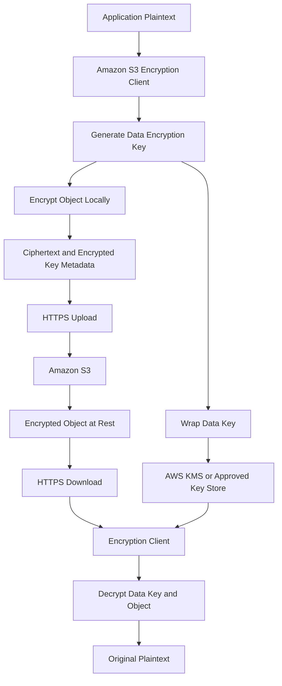
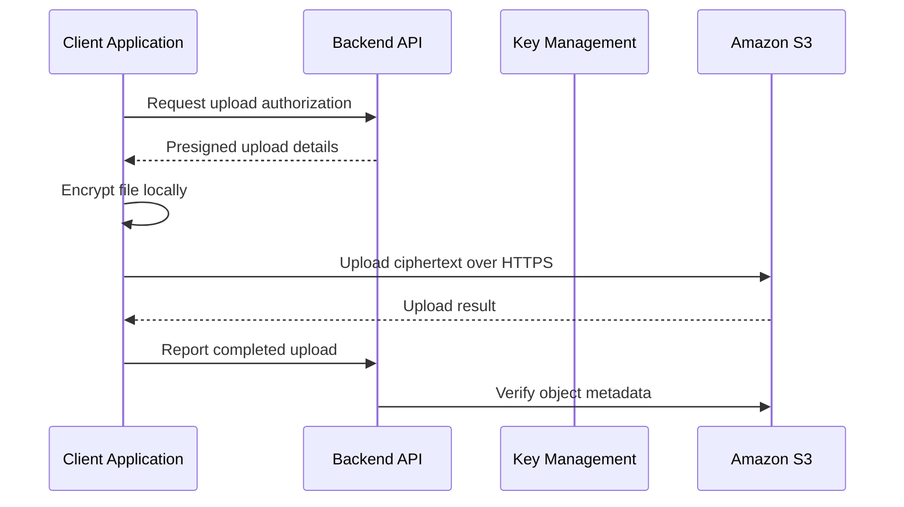

# 05- Client-Side Encryption

## Overview

Client-side encryption protects data by encrypting it inside the application or client before transmitting it to Amazon S3. S3 receives and stores ciphertext rather than the original plaintext object.

Unlike server-side encryption, where S3 performs the object encryption and decryption operations, client-side encryption makes the application responsible for using a compatible encryption client and managing access to the cryptographic keys.

Client-side encryption is useful when sensitive data must remain encrypted outside the application's trusted encryption boundary, including while stored in S3. It provides additional protection against exposure of plaintext through storage infrastructure or principals that can access the encrypted object but cannot obtain the necessary decryption keys.

For S3 workloads, AWS provides the Amazon S3 Encryption Client. For other application payloads and general encryption workflows, the AWS Encryption SDK is another option.

This document covers:

- Client-side encryption architecture and envelope encryption.
- The Amazon S3 Encryption Client and AWS Encryption SDK.
- KMS keyrings, encryption context, and key management.
- Production-oriented Python and Boto3 integration.
- Streaming, multipart uploads, metadata, and service integrations.
- Security, testing, troubleshooting, and operational best practices.

## What Is Client-Side Encryption?

Client-side encryption is the process of transforming plaintext into ciphertext before the data is sent to S3.

The application uses an encryption library and a cryptographic key-management strategy to encrypt the object locally. S3 receives the encrypted representation and stores it as an ordinary object.

The application must decrypt the object after retrieving it if the original plaintext is required.

### Why client-side encryption exists

Server-side encryption protects stored data, but S3 performs decryption as part of an authorized read operation. Consequently, an application with permission to read a server-side-encrypted object receives plaintext from S3.

Client-side encryption introduces a separate cryptographic boundary. An entity that can retrieve the stored ciphertext cannot necessarily recover its contents without access to the appropriate decryption capability.

Common use cases include:

- Highly sensitive customer records.
- Confidential business documents.
- Regulated data that must be encrypted before reaching the storage service.
- Backups requiring independent cryptographic key control.
- Encrypted data exchanged between applications or organizations.
- Objects stored in S3 but decrypted only by selected application components.

### When to use it

Use client-side encryption when the security requirements justify the additional application and key-management responsibilities.

Prefer server-side encryption when the primary requirement is encryption at rest with simpler integration and operational management.

## Client-Side Encryption Architecture

The encryption client sits between the application and the S3 SDK. It encrypts an object before upload and decrypts it after download.



The example depicts an envelope-encryption workflow using a key-wrapping service such as AWS KMS.

The object-encryption operation takes place in the client. KMS protects the data encryption key rather than receiving the complete object plaintext for encryption.

### Component responsibilities

| Component | Responsibility |
|---|---|
| Application | Validates, processes, and consumes plaintext data |
| Encryption client | Encrypts and decrypts object contents |
| Data encryption key (DEK) | Encrypts the object content |
| Wrapping key | Protects the data encryption key |
| AWS KMS or another key-management system | Controls access to wrapping keys and applicable cryptographic operations |
| Amazon S3 | Stores and serves the encrypted object |
| IAM and bucket policies | Control access to S3 resources |
| CloudTrail and application logs | Support applicable auditing and operational investigation |

The application must protect the plaintext and keys in memory, temporary files, debugging output, and other locations within its trusted environment.

## Client-Side and Server-Side Encryption

Client-side encryption and server-side encryption address different trust boundaries. They can also be used together.

| Property | Client-side encryption | Server-side encryption |
|---|---|---|
| Encryption location | Application or client | Amazon S3 |
| Data received by S3 | Ciphertext | Normally plaintext over HTTPS, then encrypted by S3 |
| Decryption location | Application or compatible client | Amazon S3 |
| Key-management responsibility | Customer or selected key-management system | AWS-managed keys or AWS KMS, depending on the method |
| S3-native content processing | Generally cannot interpret encrypted content | Can operate on plaintext after S3 decrypts it for an authorized operation |
| Application complexity | Higher | Lower |
| Protection if S3 object access is obtained without the client decryption capability | Ciphertext remains protected | Authorized reads can return plaintext |
| Integration requirements | Consumers must understand the encryption format and obtain decryption capability | Standard S3 clients generally work without special decryption code |
| Common use | Data must be encrypted before upload | Encryption at rest with simpler integration |

### Combining both approaches

The Amazon S3 Encryption Client encrypts the application data before upload. S3 can then apply its normal server-side encryption to the bytes it receives.

This creates two distinct encryption layers:

1. Client-side encryption protects the original data before transmission to S3.
2. Server-side encryption protects the stored ciphertext according to the bucket's encryption configuration.

These mechanisms are independent. S3 does not decrypt client-side ciphertext just because server-side encryption is enabled.

## Envelope Encryption

Envelope encryption is a common key-management pattern for client-side encryption.

Instead of encrypting every object directly with a long-lived master key, the encryption client generates a data encryption key and uses a wrapping key to protect it.

### Encryption workflow

1. The encryption client obtains encryption materials.
2. A unique data encryption key is generated for the object.
3. The client encrypts the object with the data encryption key.
4. The client protects the data encryption key using the configured wrapping key.
5. The ciphertext and encrypted data key are stored with the encrypted object's required encryption metadata.
6. The plaintext data key is discarded when no longer required.

### Decryption workflow

1. The application retrieves the encrypted object from S3.
2. The encryption client obtains the encrypted data key.
3. The client uses an authorized wrapping-key operation to recover the plaintext data key.
4. The client authenticates and decrypts the object.
5. The application receives the original plaintext.

The Amazon S3 Encryption Client uses a unique data key for each object it encrypts by default. Its current implementations use authenticated encryption and support key-commitment mechanisms according to their configured algorithm suite.

### Why envelope encryption is useful

| Benefit | Engineering value |
|---|---|
| Unique data keys | Avoids directly reusing a long-lived wrapping key for bulk object encryption |
| Separate key wrapping | Allows key protection to be managed independently of object data |
| Smaller KMS operations | KMS manages key material rather than the complete object payload |
| Centralized key control | A KMS key policy can restrict which principals may use the wrapping key |
| Portable encrypted objects | The encrypted object and protected key material can be retained together |

A critical dependency remains: the application must preserve access to the wrapping key for as long as the encrypted object must remain recoverable.

## AWS Encryption Libraries

AWS provides two relevant libraries for client-side encryption.

### Amazon S3 Encryption Client

The Amazon S3 Encryption Client is specifically designed for encryption and decryption of S3 objects.

It wraps the S3 SDK and performs encryption and decryption as part of object operations. This makes it appropriate for backend applications that store encrypted objects in S3.

The current Python implementation supports Python 3.10 or later and uses Boto3. Its supported keyring implementations and operational capabilities vary by language.

For the Python implementation, KMS keyrings using symmetric KMS keys are supported. Raw AES-GCM and raw RSA wrapping-key types are not supported by that implementation.

### AWS Encryption SDK

The AWS Encryption SDK provides a general-purpose client-side encryption framework for application data.

Use it when an application needs to encrypt payloads independently of S3, such as messages sent through other services or data stored in a database.

When S3 objects are encrypted with the general-purpose AWS Encryption SDK directly, the application must manage the encrypted payload format, metadata, and S3 upload/download workflow itself.

### Selection guide

| Requirement | Recommended option |
|---|---|
| Automatically encrypt and decrypt S3 object operations | Amazon S3 Encryption Client |
| Encrypt arbitrary application payloads | AWS Encryption SDK |
| Use S3's default encryption at rest | SSE-S3 |
| Use a customer-managed KMS key for S3 server-side encryption | SSE-KMS |
| Encrypt data before uploading it to S3 and also apply S3 server-side encryption | Amazon S3 Encryption Client plus server-side encryption |
| Require a keyring type not supported by the Python S3 Encryption Client | Evaluate another supported implementation or the AWS Encryption SDK |

Use current supported releases and follow the migration guidance for existing encryption-client versions. Encrypted-object compatibility can depend on the library version, algorithm suite, and configuration.

Official references:

- [Amazon S3 Encryption Client](https://docs.aws.amazon.com/amazon-s3-encryption-client/latest/developerguide/what-is-s3-encryption-client.html)
- [AWS Encryption SDK](https://docs.aws.amazon.com/encryption-sdk/latest/developer-guide/introduction.html)

## Python Setup with the Amazon S3 Encryption Client

The Amazon S3 Encryption Client for Python provides an encrypted S3 client built around Boto3.

Install the current supported package:

```bash
python -m pip install amazon-s3-encryption-client-python
```

Python 3.10 or later is required by the current Python implementation. Use a virtual environment and pin the approved dependency version in the project's dependency-management configuration.

### Prerequisites

Before using the client, configure:

- An S3 bucket in the target Region.
- A symmetric KMS key used to protect data encryption keys.
- An application IAM role with required S3 access.
- KMS permissions for applicable key operations.
- A secure and supported AWS credential provider.

The KMS key is a wrapping key. The S3 Encryption Client uses it to protect the data encryption keys, while the object contents are encrypted locally.

### Initialize the encryption client

```python
import boto3

from s3_encryption import S3EncryptionClient, S3EncryptionClientConfig
from s3_encryption.materials.kms_keyring import KmsKeyring

AWS_REGION = "ap-south-1"
KMS_KEY_ARN = (
    "arn:aws:kms:ap-south-1:123456789012:"
    "key/EXAMPLE-KEY-ID"
)

s3_client = boto3.client(
    "s3",
    region_name=AWS_REGION,
)

kms_client = boto3.client(
    "kms",
    region_name=AWS_REGION,
)

keyring = KmsKeyring(
    kms_client,
    KMS_KEY_ARN,
)

config = S3EncryptionClientConfig(
    keyring=keyring,
)

encrypted_s3 = S3EncryptionClient(
    s3_client,
    config,
)
```

Replace the example KMS key ARN with the actual approved key. The code uses Boto3's default credential provider chain rather than embedding credentials in source code.

The application principal needs appropriate S3 permissions for the bucket and applicable KMS permissions for the wrapping key. Key policy and identity policy configuration must support the intended key operations.

## Encrypt and Upload an Object

The encryption client can encrypt an object before calling S3.

### Upload a small object

```python
def upload_encrypted_text(
    bucket: str,
    object_key: str,
    plaintext: str,
) -> None:
    """Encrypt and upload an application payload."""
    encrypted_s3.put_object(
        Bucket=bucket,
        Key=object_key,
        Body=plaintext.encode("utf-8"),
    )
```

The encryption client performs client-side encryption before sending the object to S3.

Use this abstraction instead of calling the standard Boto3 S3 client directly when writing objects that require client-side encryption.

### Add an encryption context

The S3 Encryption Client supports optional encryption context values for supported configurations.

```python
def upload_document(
    bucket: str,
    object_key: str,
    plaintext: bytes,
    tenant_id: str,
) -> None:
    """Upload a document using an application encryption context."""
    encrypted_s3.put_object(
        Bucket=bucket,
        Key=object_key,
        Body=plaintext,
        EncryptionContext={
            "application": "document-service",
            "tenant_id": tenant_id,
        },
    )
```

The encryption context is associated with the encryption operation. The same context must be supplied when decrypting the object when the application used one during encryption.

Encryption context values are not secret and can appear in cryptographic metadata or audit records. Do not include passwords, access tokens, or other sensitive values.

Avoid using mutable business identifiers as decryption requirements unless their lifecycle is explicitly managed. If the tenant identifier changes, the application must still be able to reconstruct the original encryption context for decryption.

## Download and Decrypt an Object

The encryption client retrieves ciphertext from S3 and decrypts it before returning the data to the application.

```python
def download_encrypted_text(
    bucket: str,
    object_key: str,
) -> str:
    """Retrieve and decrypt an application payload."""
    response = encrypted_s3.get_object(
        Bucket=bucket,
        Key=object_key,
    )

    try:
        plaintext = response["Body"].read()
        return plaintext.decode("utf-8")
    finally:
        response["Body"].close()
```

If an encryption context was used for the object, supply the matching context:

```python
response = encrypted_s3.get_object(
    Bucket="example-prod-sensitive",
    Key="documents/report.bin",
    EncryptionContext={
        "application": "document-service",
        "tenant_id": "tenant-123",
    },
)

try:
    plaintext = response["Body"].read()
finally:
    response["Body"].close()
```

The returned body contains plaintext after successful decryption and authentication.

### Production considerations

- Ensure the caller is authorized to read the S3 object and use the KMS wrapping key.
- Handle missing objects, access-denied errors, key-access failures, and authentication failures separately.
- Avoid logging plaintext or cryptographic material.
- Validate object size before reading an entire payload into memory.
- Close response bodies reliably.
- Test encryption and decryption with the same approved configuration and metadata.

## Encrypt and Upload Large Files

Large objects require consideration of memory consumption, multipart upload behavior, transfer retries, and the encryption client's supported capabilities.

The current Python S3 Encryption Client provides high-level `upload_file` and `upload_fileobj` methods for encrypted multipart uploads.

### Upload a file from disk

```python
def upload_encrypted_file(
    file_path: str,
    bucket: str,
    object_key: str,
) -> None:
    """Encrypt and upload a file using the client transfer API."""
    encrypted_s3.upload_file(
        file_path,
        bucket,
        object_key,
        multipart_threshold=8 * 1024 * 1024,
        multipart_chunksize=8 * 1024 * 1024,
    )
```

This configuration requests an 8 MiB multipart threshold and part size. Tune the values using workload measurements, the client's requirements, memory constraints, and expected transfer concurrency.

A smaller object can be uploaded through a single-object operation instead of multipart upload.

### Upload a file-like object

```python
def upload_encrypted_stream(
    file_obj,
    bucket: str,
    object_key: str,
) -> None:
    """Encrypt and upload a readable file-like object."""
    encrypted_s3.upload_fileobj(
        file_obj,
        bucket,
        object_key,
        multipart_chunksize=8 * 1024 * 1024,
    )
```

The caller retains responsibility for closing the file object. Make sure the underlying stream supports the access pattern required by the selected transfer implementation.

### Operational trade-offs

- Multipart uploads add orchestration and cleanup requirements.
- High concurrency can increase memory use and KMS request volume.
- Retries must not change the encryption context or keyring configuration.
- Incomplete multipart uploads can incur storage costs.
- A completed upload should be verified through the encryption client, not only through the standard S3 client.

Reference: [Amazon S3 Encryption Client for Python examples](https://docs.aws.amazon.com/amazon-s3-encryption-client/latest/developerguide/python-examples.html).

## Key Management and KMS Permissions

Client-side encryption introduces a key-management dependency in the application.

When using a KMS keyring, AWS KMS protects data encryption keys. The application uses the authorized KMS operations to generate or recover these keys.

The application principal must have the required KMS permissions, and the KMS key policy must allow the operation.

### Typical KMS requirements

| Operation | Typical KMS permission |
|---|---|
| Obtain a new data key for encryption | `kms:GenerateDataKey` |
| Decrypt a protected data key | `kms:Decrypt` |
| Inspect key configuration during administration | `kms:DescribeKey` |

The exact set of required permissions depends on the encryption workflow and library implementation. Restrict application permissions to the operations the application actually needs.

### Example identity policy

```json
{
  "Version": "2012-10-17",
  "Statement": [
    {
      "Sid": "UseDocumentEncryptionKey",
      "Effect": "Allow",
      "Action": [
        "kms:GenerateDataKey",
        "kms:Decrypt"
      ],
      "Resource": "arn:aws:kms:ap-south-1:123456789012:key/EXAMPLE-KEY-ID"
    }
  ]
}
```

This policy illustrates identity-based authorization. It does not replace the KMS key policy, which must also permit the principal to use the key.

The S3 client separately needs the appropriate bucket and object permissions, such as `s3:PutObject` and `s3:GetObject`.

### Key availability

An encrypted object is recoverable only when the application has access to all necessary cryptographic materials and metadata.

A disabled KMS key, an inaccessible key policy, or the loss of an externally managed wrapping key can make encrypted objects unreadable even if the S3 objects remain intact.

Treat KMS permissions, key state, key lifecycle, and recovery procedures as application-availability dependencies.

## Encryption Context

Encryption context is additional non-secret metadata associated with an encryption operation.

Applications can use it to bind encryption operations to meaningful context, such as a data classification or application component.

### Example

```python
encryption_context = {
    "application": "document-service",
    "data_classification": "confidential",
}
```

The same context must be supplied for decryption when it was required by the original encryption configuration.

### Design considerations

- Use stable values that can be reconstructed during future decryption.
- Do not include secrets in context values.
- Validate context before encryption and decryption.
- Keep context schema changes backward-compatible with retained objects.
- Test decryption of objects created by previous application versions.

If context values are derived from database records, the application must retain the historical values necessary to decrypt existing objects.

## Streaming and Memory Management

Client-side encryption can introduce additional memory requirements because the application must encrypt or decrypt data before consuming or storing it.

The current Python Amazon S3 Encryption Client uses authenticated encryption. By default, it buffers ciphertext and verifies the authentication tag before releasing plaintext.

This behavior provides stronger safety properties because unauthenticated plaintext is not released to the caller before integrity verification completes. The trade-off is memory consumption for large objects.

### Delayed authentication

The Python client also supports delayed authentication for streaming decryption in supported configurations. It can release plaintext incrementally before the final authentication check completes.

This reduces the need to buffer the entire encrypted object but introduces a security consideration: the application may process tampered plaintext before a final authentication failure is detected.

If delayed authentication is enabled:

- Read the stream to completion.
- Treat all plaintext as provisional until final authentication succeeds.
- Do not commit database updates, publish messages, or expose the data to downstream consumers before verification completes.
- Discard and invalidate already-processed data if authentication fails.
- Test this behavior using corrupted or truncated ciphertext.

For highly sensitive workloads, prefer verified decryption before making plaintext available to business logic.

## S3 Metadata and Other Services

Client-side encryption changes the object data representation, but S3 continues to treat the encrypted payload as an ordinary S3 object.

### Metadata behavior

The encryption client manages the encryption information needed to decrypt its objects. However, S3 object keys, tags, and other ordinary object metadata are not automatically made confidential by client-side encryption.

For example, an encrypted document stored at:

`customers/customer-12345/medical-record.pdf`

still exposes its object key to principals who can inspect or list it.

Use opaque object identifiers and minimize sensitive metadata.

### Service integration considerations

| Service or capability | Client-side encryption consideration |
|---|---|
| S3 events | Event consumers generally receive object identifiers, not decrypted contents; processing services must use a compatible encryption client |
| Lambda | The function needs access to the ciphertext, compatible decryption logic, and authorized key usage |
| CloudFront | CloudFront cannot transparently decrypt arbitrary client-side encrypted objects; an authorized application layer must decrypt them |
| Athena and Glue | Native analytics workflows generally cannot query arbitrary client-side encrypted payloads without an appropriate decryption or transformation stage |
| Replication | Replication can copy ciphertext, but the destination design must preserve access to the required key materials |
| Presigned URLs | Direct access returns ciphertext unless the client independently decrypts it; encryption-client metadata and format must be preserved |
| Backups | Recovery requires both encrypted objects and usable key material |
| Multi-tenant storage | Tenant isolation must cover both object authorization and cryptographic-key access |

Do not assume that a service's ability to read an S3 object means it can interpret or decrypt the application payload.

For workflows heavily dependent on AWS-native processing, evaluate whether SSE-KMS is sufficient and simpler to operate.

## Presigned URLs and Direct Uploads

Presigned URLs delegate temporary permission to perform an S3 request. They do not automatically supply a general-purpose client-side encryption implementation.

With client-side encryption, the client encrypts the data before using the presigned URL. It then uploads the ciphertext using the required request parameters.

### Direct-upload architecture



This diagram assumes that the client has an approved encryption implementation and an appropriate key-distribution model. It is not a complete key-management protocol.

### Security considerations

- The client must have a safe way to obtain or use the encryption key.
- Do not put key material in presigned URLs.
- Do not assume S3-side content validation can inspect encrypted plaintext.
- Keep object keys unguessable where appropriate, but never treat obscurity as authorization.
- Verify that the stored object is associated with the expected upload and encryption metadata.
- Protect the presigned URL, which itself is a temporary bearer credential.

For browser-based uploads, client-side encryption may be suitable when the browser can reliably manage encryption and key access. A server-side encryption architecture is generally simpler when plaintext processing must occur in trusted backend services.

## Testing Client-Side Encryption

Encryption tests must validate both confidentiality-related behavior and data integrity.

### Unit tests

Test application-level behavior without relying on a live S3 environment:

- Reject invalid encryption configuration.
- Preserve the expected encryption context.
- Handle missing or inaccessible key material.
- Verify that decryption restores the exact uploaded plaintext.
- Ensure application logs do not expose plaintext or key material.
- Confirm that corrupted ciphertext causes decryption to fail.
- Test compatibility with the encryption formats supported by the chosen library.

### Integration tests

Use a dedicated non-production AWS environment to verify:

- The application can upload encrypted objects.
- The object stored in S3 is ciphertext rather than the original plaintext.
- The encryption client can retrieve and decrypt the object.
- The expected KMS key can be used by the intended IAM role.
- Unauthorized principals cannot use the wrapping key.
- Existing encrypted objects remain readable after controlled configuration changes.

### Example round-trip test

```python
def test_client_side_encryption_round_trip():
    bucket = "example-test-encrypted-objects"
    object_key = "integration-tests/round-trip.txt"
    original = b"confidential test payload"

    encrypted_s3.put_object(
        Bucket=bucket,
        Key=object_key,
        Body=original,
    )

    response = encrypted_s3.get_object(
        Bucket=bucket,
        Key=object_key,
    )

    try:
        recovered = response["Body"].read()
    finally:
        response["Body"].close()

    assert recovered == original
```

This is an integration test and requires a configured encryption client, appropriate AWS credentials, and a test bucket and wrapping key. It has not been executed as part of this documentation.

Do not use production data or real secret material in ordinary development test fixtures.

## Common Mistakes and Pitfalls

### Encrypting with the standard Boto3 client

**Problem:** The standard Boto3 S3 client does not automatically perform client-side encryption.

**Prevention:** Use the appropriate encryption client or an established, reviewed encryption implementation.

### Losing key material

**Problem:** The encrypted object remains stored, but the application cannot recover the wrapping key needed to decrypt its data.

**Prevention:** Maintain tested key backup, access recovery, and lifecycle procedures.

### Assuming S3 can inspect encrypted content

**Problem:** Event consumers, search systems, and analytics tools receive ciphertext and cannot perform ordinary plaintext processing.

**Prevention:** Introduce a controlled decryption and processing layer where required.

### Releasing plaintext before authentication completes

**Problem:** With delayed authentication, data may be delivered to the application before tampering is detected.

**Prevention:** Treat plaintext as provisional until the final authentication check succeeds. Prefer fully authenticated decryption for sensitive workflows.

### Logging sensitive material

**Problem:** Debug logs can expose plaintext, encrypted key metadata, encryption context, or other sensitive information.

**Prevention:** Redact payloads and security-sensitive fields from request logging, tracing, exception reporting, and diagnostic tooling.

### Rotating keys without preserving historical access

**Problem:** Old objects or versions still require key material that the application has deleted or can no longer identify.

**Prevention:** Maintain key-version mappings and migrate objects using a controlled, verified process.

### Assuming every AWS service supports the encryption format

**Problem:** S3 may successfully store a ciphertext object, while downstream services cannot interpret it.

**Prevention:** Verify every integration against the actual encryption client, format, keyring, and key-access requirements.

### Using custom cryptographic implementations unnecessarily

**Problem:** Incorrect algorithm selection, nonce handling, authentication, or key management can invalidate the security model.

**Prevention:** Prefer the Amazon S3 Encryption Client or AWS Encryption SDK and follow the supported migration guidance.

## Production Best Practices

### Security

- Encrypt sensitive objects before transmission when required by the trust model.
- Use an approved cryptographic library with authenticated encryption.
- Use a KMS keyring or other explicitly reviewed key-management design.
- Apply least-privilege S3 and key-management permissions.
- Protect key material and plaintext in memory, temporary files, and logs.
- Use HTTPS independently of client-side encryption.
- Avoid putting sensitive values in object names, tags, or encryption context.

### Reliability

- Define key backup and recovery objectives.
- Preserve key metadata for the full retention period of encrypted objects.
- Test decryption before declaring backups recoverable.
- Validate old encrypted objects when upgrading encryption libraries.
- Handle failed authentication and corrupted ciphertext explicitly.
- Avoid processing provisional plaintext before integrity verification.

### Performance and cost

- Measure encryption and decryption CPU overhead in the application.
- Consider memory use when processing large files.
- Use supported multipart upload methods for large objects.
- Measure KMS request volume when KMS is used for data-key protection.
- Avoid unnecessary encryption and re-upload cycles.
- Account for standard S3, KMS, storage, replication, and data-transfer charges as applicable.

### Application architecture

- Centralize encryption-client initialization in a reusable service layer.
- Keep encryption configuration separate from API route handlers.
- Define stable encryption-context conventions.
- Make decryption failures observable without logging sensitive values.
- Test all downstream consumers before adopting client-side encryption.
- Document which application roles can decrypt each class of stored data.

## Production Verification Checklist

- [ ] Client-side encryption is required by a documented security or compliance requirement.
- [ ] A supported encryption client and algorithm configuration are in use.
- [ ] Sensitive data is encrypted before it is sent to S3.
- [ ] Wrapping-key access is restricted to approved principals.
- [ ] S3 and key-management permissions follow least privilege.
- [ ] Plaintext, keys, and sensitive metadata are excluded from logs.
- [ ] Encryption context values are non-secret and stable across object lifecycles.
- [ ] Authenticated decryption completes before sensitive plaintext is consumed.
- [ ] Large-object and multipart workflows have been tested.
- [ ] Key backup, rotation, and recovery have documented procedures.
- [ ] Existing ciphertext remains decryptable after library or configuration upgrades.
- [ ] Presigned URL and downstream service integrations are compatible with the encrypted object format.
- [ ] Unit and integration tests cover encryption, decryption, corruption, and access denial.
- [ ] Backup recovery has been tested with actual encrypted objects and authorized key access.

## Official References

- [Protecting data by using client-side encryption](https://docs.aws.amazon.com/AmazonS3/latest/userguide/UsingClientSideEncryption.html)
- [Amazon S3 Encryption Client](https://docs.aws.amazon.com/amazon-s3-encryption-client/latest/developerguide/what-is-s3-encryption-client.html)
- [How the Amazon S3 Encryption Client works](https://docs.aws.amazon.com/amazon-s3-encryption-client/latest/developerguide/how-it-works.html)
- [Amazon S3 Encryption Client for Python](https://docs.aws.amazon.com/amazon-s3-encryption-client/latest/developerguide/python.html)
- [Amazon S3 Encryption Client for Python examples](https://docs.aws.amazon.com/amazon-s3-encryption-client/latest/developerguide/python-examples.html)
- [AWS Encryption SDK](https://docs.aws.amazon.com/encryption-sdk/latest/developer-guide/introduction.html)
- [AWS Encryption SDK for Python](https://docs.aws.amazon.com/encryption-sdk/latest/developer-guide/python.html)
- [AWS KMS key policies](https://docs.aws.amazon.com/kms/latest/developerguide/key-policies.html)

## Key Takeaways

- Client-side encryption protects object contents before they reach S3, unlike server-side encryption, where S3 encrypts and decrypts the object data.
- Envelope encryption uses a data encryption key to protect object contents and a wrapping key to protect the data key.
- The Amazon S3 Encryption Client provides an S3-focused solution, while the AWS Encryption SDK supports broader application encryption workflows.
- Key availability, authenticated decryption, and compatibility across consumers are essential to reliable recovery of client-side encrypted objects.
- Combine client-side encryption with HTTPS, least-privilege access controls, secure key management, and tested recovery procedures.