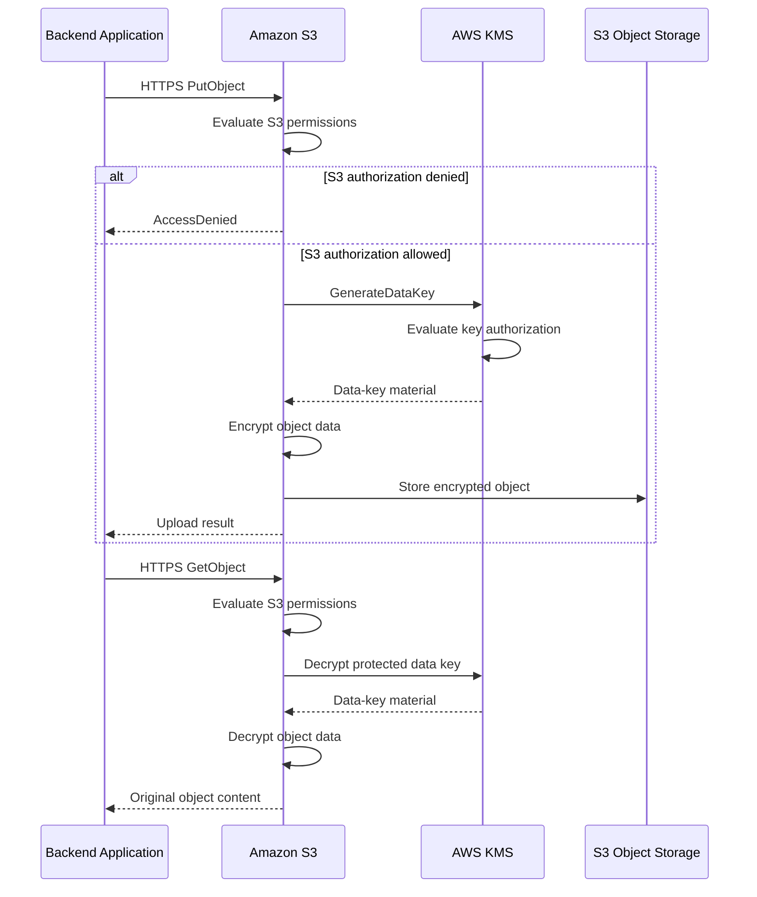
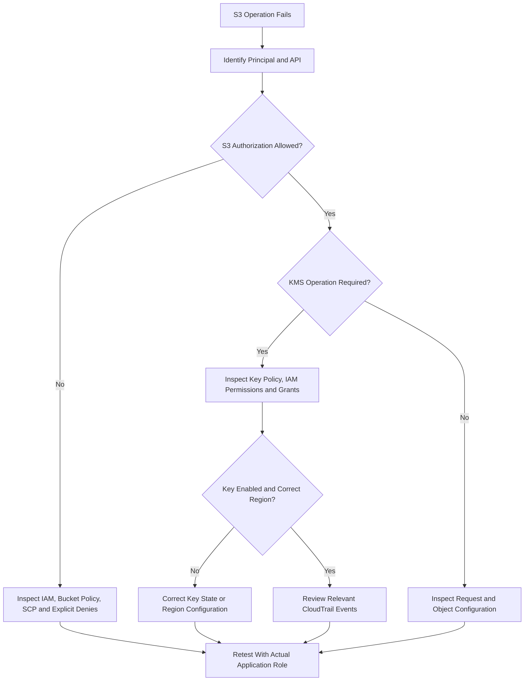

# 06- AWS KMS Integration

## Overview

AWS Key Management Service (AWS KMS) integrates with Amazon S3 to provide encryption-key management, authorization, and auditing for objects encrypted using server-side encryption with AWS KMS keys (SSE-KMS).

Amazon S3 performs object encryption and decryption. AWS KMS manages the cryptographic keys and performs the key operations required by the encryption workflow. Applications typically interact with S3 through the AWS SDK, CLI, or REST API without implementing the underlying cryptographic operations.

KMS integration introduces an additional authorization boundary. A backend service can have permission to upload or download an object but still fail because its principal is not authorized to use the associated KMS key.

A production implementation must coordinate:

- S3 bucket encryption and object-level encryption settings.
- KMS key policies, IAM policies, and grants.
- Upload, download, copy, multipart-upload, and replication permissions.
- Cross-account access and encryption context.
- S3 Bucket Keys, cost optimization, and request quotas.
- CloudTrail auditing, troubleshooting, and key recovery.

This document focuses on integrating S3 with AWS KMS. Detailed encryption-algorithm behavior is covered in the dedicated SSE-KMS documentation.

## Why S3 Needs AWS KMS

S3 can encrypt objects at rest using SSE-S3 without requiring customer-managed keys. SSE-KMS adds explicit key-management capabilities for workloads that need more control over who can use encryption keys and how that usage is governed.

### Common integration scenarios

| Requirement | Role of AWS KMS |
|---|---|
| Encrypt sensitive objects with a customer-managed key | Protects data encryption keys and controls key usage |
| Separate key administration from application access | Allows different principals to receive different key permissions |
| Share encrypted objects across AWS accounts | Supports cross-account key usage through compatible policies |
| Audit cryptographic activity | Records relevant KMS API operations through CloudTrail |
| Restrict key usage to S3-mediated requests | Supports conditions such as `kms:ViaService` |
| Reduce KMS request costs for high-volume workloads | Supports S3 Bucket Keys for eligible SSE-KMS objects |
| Support encrypted backup and recovery | Provides key-management capabilities required to recover accessible ciphertext |

SSE-KMS is not mandatory for every S3 workload. Use it when the required key-control capabilities justify its additional configuration, cost, and operational dependencies.

## Architecture and Request Flow

The application usually sends an S3 request rather than calling KMS directly. S3 performs the object operation and invokes the required KMS operations as part of its encryption workflow.



The diagram illustrates a typical SSE-KMS workflow. Exact KMS requests depend on the operation, object configuration, and whether S3 Bucket Keys are enabled.

### Component responsibilities

| Component | Responsibility |
|---|---|
| Backend application | Initiates object operations using approved AWS credentials |
| Amazon S3 | Authorizes object operations and performs server-side encryption or decryption |
| AWS KMS | Protects and releases data-key material through authorized cryptographic operations |
| KMS key policy | Defines permitted key users and administrators |
| IAM identity policy | Grants permissions to application or administrative identities where applicable |
| KMS grant | Delegates supported key operations to a principal or integrated service |
| AWS CloudTrail | Records relevant S3 and KMS API activity |
| AWS CloudWatch and billing tools | Support operational monitoring and cost analysis |

## KMS Keys and Selection

S3 SSE-KMS supports the AWS-managed KMS key for S3 and customer-managed KMS keys.

### AWS-managed KMS key

The AWS-managed key for S3 is commonly identified by the alias `aws/s3`.

AWS manages the key's policy and lifecycle. The customer has fewer key-level configuration options than with a customer-managed key.

Use this option when KMS-backed encryption is required without a need for customer-managed key policies.

### Customer-managed KMS key

A customer-managed key provides greater control over key policies, lifecycle operations, and cross-account key usage.

Choose it when the workload requires:

- Explicit restrictions on key usage.
- Cross-account encrypted data sharing.
- Separation between application access and key administration.
- Customer-controlled key governance and lifecycle procedures.
- Key policies that enforce approved usage patterns.

For ordinary SSE-KMS encryption of general-purpose S3 buckets, use a supported symmetric encryption KMS key in the same Region as the bucket.

### Key selection comparison

| Property | AWS-managed S3 KMS key | Customer-managed KMS key |
|---|---|---|
| Key alias | `aws/s3` | Optional customer-defined alias |
| Policy administration | Managed by AWS | Managed by the customer |
| Fine-grained key policy control | Limited | Available |
| Cross-account key sharing | Not suitable for the usual external-account key-sharing design | Supported with compatible policies and permissions |
| Lifecycle control | Limited customer control | Greater customer control |
| Operational responsibility | Lower | Higher |
| Suitable workloads | Standard KMS-backed encryption | Sensitive data and workloads requiring explicit key governance |

Avoid creating separate keys for every object unless the isolation requirements justify the additional administration burden.

Reference: [AWS KMS key policies](https://docs.aws.amazon.com/kms/latest/developerguide/key-policies.html).

## Configure S3 Default Encryption

S3 encrypts new object uploads at rest by default using SSE-S3. A general-purpose bucket can instead use SSE-KMS as its default encryption configuration.

### Inspect the current configuration

```bash
aws s3api get-bucket-encryption \
  --bucket example-prod-documents \
  --region ap-south-1
```

Review the configured algorithm and KMS key identifier, if present.

### Configure SSE-KMS with a customer-managed key

```bash
aws s3api put-bucket-encryption \
  --bucket example-prod-documents \
  --server-side-encryption-configuration '{
    "Rules": [
      {
        "ApplyServerSideEncryptionByDefault": {
          "SSEAlgorithm": "aws:kms",
          "KMSMasterKeyID": "arn:aws:kms:ap-south-1:123456789012:key/EXAMPLE-KEY-ID"
        },
        "BucketKeyEnabled": true
      }
    ]
  }' \
  --region ap-south-1
```

Replace the example ARN with the approved customer-managed key.

This configuration:

- Sets SSE-KMS as the bucket's default encryption.
- Selects the customer-managed KMS key.
- Enables S3 Bucket Keys for eligible SSE-KMS objects.

The command replaces the bucket's encryption configuration. Inspect the existing configuration and preserve required settings before making changes.

### Important behavior

- The bucket default applies to new uploads that rely on the default encryption configuration.
- A request can explicitly select another supported encryption mode where permitted.
- Changing default encryption does not re-encrypt existing objects.
- Configuring a key ARN does not guarantee that the key is enabled or usable by every application principal.
- SSE-KMS and DSSE-KMS have different capabilities; S3 Bucket Keys are not supported with DSSE-KMS.

Reference: [Configuring default bucket encryption](https://docs.aws.amazon.com/AmazonS3/latest/userguide/default-bucket-encryption.html).

## KMS Authorization Model

KMS authorization is separate from S3 authorization.

An application may be allowed to call `GetObject` but unable to read an SSE-KMS object because the relevant KMS key operation is not authorized.

KMS permissions can be controlled through:

- KMS key policies.
- IAM identity policies, when the key policy permits IAM-based authorization.
- KMS grants.
- Applicable organization controls, permission boundaries, and explicit denies.

Every KMS key has a key policy. The key policy is the primary resource-based mechanism controlling access to that key.

### Typical permissions

| Operation | Typical S3 permission | Typical KMS permission |
|---|---|---|
| Upload an SSE-KMS object | `s3:PutObject` | `kms:GenerateDataKey` |
| Download an SSE-KMS object | `s3:GetObject` | `kms:Decrypt` |
| Multipart upload | Relevant multipart and object actions | Typically `kms:GenerateDataKey` and `kms:Decrypt`, depending on the workflow |
| Copy an encrypted object | Source read and destination write permissions | Required decrypt and data-key permissions for source and destination encryption |
| List object keys | `s3:ListBucket` | None for listing alone |
| Inspect object metadata | Commonly `s3:GetObject` | A metadata request ordinarily does not require a cryptographic KMS operation |

These are common requirements rather than a complete permission list for all integrations. Check the exact AWS API and workload.

### Example application identity policy

This example permits a service to read and upload documents using a designated KMS key.

```json
{
  "Version": "2012-10-17",
  "Statement": [
    {
      "Sid": "ReadAndWriteDocuments",
      "Effect": "Allow",
      "Action": [
        "s3:GetObject",
        "s3:PutObject"
      ],
      "Resource": "arn:aws:s3:::example-prod-documents/documents/*"
    },
    {
      "Sid": "UseDocumentKmsKey",
      "Effect": "Allow",
      "Action": [
        "kms:GenerateDataKey",
        "kms:Decrypt"
      ],
      "Resource": "arn:aws:kms:ap-south-1:123456789012:key/EXAMPLE-KEY-ID"
    }
  ]
}
```

For listing objects, add a separately scoped `s3:ListBucket` statement on the bucket ARN if necessary. Multipart uploads, tagging, deletion, and object-version operations may require additional permissions.

This identity policy is not a substitute for the KMS key policy. The key policy must permit the principal directly or enable IAM-based authorization.

## Key Policy Design

A key policy defines who can administer a key and who can use it.

Separate key administration from application cryptographic access. An application that only uploads and downloads documents should not ordinarily be able to change the key policy, disable the key, or schedule its deletion.

### Enable IAM authorization

A common key-policy pattern enables the owning account to delegate key permissions through IAM:

```json
{
  "Sid": "EnableAccountIAMPermissions",
  "Effect": "Allow",
  "Principal": {
    "AWS": "arn:aws:iam::123456789012:root"
  },
  "Action": "kms:*",
  "Resource": "*"
}
```

This statement is intended to be part of a complete key policy. It allows the account to use IAM policies to delegate permissions; it does not mean that every application role automatically receives all KMS permissions.

### Directly authorize an application role

Alternatively, the key policy can explicitly authorize a designated application role:

```json
{
  "Sid": "AllowDocumentServiceCryptographicUse",
  "Effect": "Allow",
  "Principal": {
    "AWS": "arn:aws:iam::123456789012:role/document-storage-api"
  },
  "Action": [
    "kms:GenerateDataKey",
    "kms:Decrypt"
  ],
  "Resource": "*"
}
```

Add the statement to the policy attached to the intended KMS key. It is not a complete standalone key policy.

When a key policy directly authorizes a same-account principal, it can provide authorization without an additional allow in the principal's identity policy. An explicit deny or other applicable restriction can still block access. For consistency and governance, many environments also maintain identity policies that declare the application's intended permissions.

### Administrative safeguards

- Maintain an approved key-administrator role.
- Limit who can change key policies and grants.
- Preserve an administrative recovery path.
- Restrict key disabling and deletion scheduling.
- Review policy changes before deployment.
- Test the application role after policy changes.

Avoid granting `kms:*` to routine backend workloads.

References:

- [AWS KMS key policies](https://docs.aws.amazon.com/kms/latest/developerguide/key-policies.html)
- [Using IAM policies with AWS KMS](https://docs.aws.amazon.com/kms/latest/developerguide/iam-policies.html)

## Restrict Key Use Through S3

KMS condition keys can narrow the circumstances in which a principal is permitted to use a key.

The `kms:ViaService` condition key can restrict supported KMS key operations to requests made through a specified AWS service.

### Example policy condition

```json
{
  "Sid": "UseKeyThroughRegionalS3",
  "Effect": "Allow",
  "Action": [
    "kms:GenerateDataKey",
    "kms:Decrypt"
  ],
  "Resource": "arn:aws:kms:ap-south-1:123456789012:key/EXAMPLE-KEY-ID",
  "Condition": {
    "StringEquals": {
      "kms:ViaService": "s3.ap-south-1.amazonaws.com"
    }
  }
}
```

This example is a policy statement, not a complete policy. Add it to an applicable identity or key policy after validating the key-authorization design.

The condition restricts applicable operations to the regional S3 service path. Direct KMS calls do not satisfy this condition unless separately authorized.

### Production considerations

- Use the bucket's actual Region in the service endpoint.
- Confirm that the KMS operation supports the condition.
- Test uploads, downloads, multipart transfers, and copy workflows.
- Preserve a separate administrative path for key management.
- Avoid using the condition as a replacement for S3 authorization.

Reference: [AWS KMS condition keys](https://docs.aws.amazon.com/kms/latest/developerguide/conditions-kms.html).

## S3 Bucket Keys

S3 Bucket Keys reduce the number of requests from S3 to AWS KMS for eligible SSE-KMS workloads.

Without Bucket Keys, workloads with large numbers of encrypted objects can generate substantial KMS request traffic. Bucket Keys allow S3 to use a bucket-level key for a limited period when deriving data keys, reducing the frequency of calls to KMS.

### Benefits

- Can substantially reduce KMS request costs.
- Reduces request traffic between S3 and KMS.
- Usually requires no application-code change when enabled through bucket default encryption.
- Benefits high-volume SSE-KMS workloads.

### Enable Bucket Keys

```bash
aws s3api put-bucket-encryption \
  --bucket example-prod-documents \
  --server-side-encryption-configuration '{
    "Rules": [
      {
        "ApplyServerSideEncryptionByDefault": {
          "SSEAlgorithm": "aws:kms",
          "KMSMasterKeyID": "arn:aws:kms:ap-south-1:123456789012:key/EXAMPLE-KEY-ID"
        },
        "BucketKeyEnabled": true
      }
    ]
  }' \
  --region ap-south-1
```

### Important trade-offs

| Benefit | Consideration |
|---|---|
| Lower KMS request volume | Actual savings depend on workload and configuration |
| Lower KMS request costs | S3 storage, request, and transfer charges still apply |
| Minimal application changes | Explicit object-level encryption settings can affect individual uploads |
| Improved high-volume efficiency | Encryption-context policies may need to change |
| Suitable for many SSE-KMS workloads | Not supported with DSSE-KMS |

### Encryption-context implications

Without Bucket Keys, the S3 encryption context commonly identifies an individual object ARN. With Bucket Keys, the context can identify the bucket ARN.

If KMS policies use conditions on `kms:EncryptionContext:aws:s3:arn`, verify their behavior before enabling Bucket Keys. A policy restricted to object-level ARNs may no longer match the context used for the relevant operations.

Enabling Bucket Keys for new uploads does not automatically change every existing object's configuration.

Reference: [Reducing SSE-KMS costs with S3 Bucket Keys](https://docs.aws.amazon.com/AmazonS3/latest/userguide/bucket-key.html).

## Encryption Context

Encryption context consists of non-secret key-value pairs associated with KMS cryptographic operations.

S3 uses encryption context with SSE-KMS. The context can help associate key operations with the relevant S3 resource and can be used in applicable KMS policy conditions.

### Design considerations

- Treat encryption-context values as visible metadata, not secrets.
- Do not include passwords, API keys, or confidential payload data.
- Confirm the actual context before creating policy conditions.
- Account for the effect of S3 Bucket Keys.
- Test key-policy conditions against real application requests.
- Do not assume that every operation uses an identical context.

Encryption context can appear in relevant CloudTrail records, making it useful for investigation when designed appropriately.

Reference: [AWS KMS encryption context](https://docs.aws.amazon.com/kms/latest/developerguide/encrypt_context.html).

## Cross-Account Access

Cross-account access to an SSE-KMS-encrypted object requires both S3 and KMS authorization.

Assume Account A owns the S3 bucket and customer-managed KMS key, while Account B runs the backend application.

### Required authorization

| Layer | Requirement |
|---|---|
| Account B identity policy | Allows the application role to perform the required S3 operations and KMS operations |
| Account A bucket policy | Allows the external role or account to access the required objects |
| Account A KMS key policy | Allows the external role or account to use the customer-managed key |
| Organization controls | Must not impose an applicable explicit deny |
| Resource configuration | Bucket, key, and operation must be compatible |

A KMS key policy in Account A must permit the external account or role. The principal in Account B must also have an identity policy that delegates the permitted key usage to that principal. Neither policy alone is sufficient for cross-account KMS use.

AWS-managed KMS keys are generally unsuitable for the usual cross-account customer-managed key-sharing pattern.

### Validation sequence

1. Identify the exact external application role.
2. Verify the role's S3 and KMS identity policies.
3. Inspect the source bucket policy.
4. Inspect the customer-managed key policy and applicable grants.
5. Check permission boundaries, session policies, and SCPs.
6. Test the relevant upload, download, or copy operation using the external role.
7. Inspect relevant CloudTrail events in the caller and key-owner accounts.

Reference: [Allowing users in other accounts to use a KMS key](https://docs.aws.amazon.com/kms/latest/developerguide/key-policy-modifying-external-accounts.html).

## Boto3 Integration

Use a Boto3 S3 client configured for the bucket's Region. Allow the AWS credential provider chain to obtain credentials from the appropriate IAM role or approved credential source.

### Upload an SSE-KMS object

```python
import boto3
from botocore.config import Config

s3 = boto3.client(
    "s3",
    region_name="ap-south-1",
    config=Config(
        retries={
            "mode": "standard",
            "max_attempts": 5,
        }
    ),
)


def upload_document(
    bucket: str,
    object_key: str,
    file_path: str,
    kms_key_arn: str,
) -> None:
    """Upload a document using a specific SSE-KMS key."""
    s3.upload_file(
        Filename=file_path,
        Bucket=bucket,
        Key=object_key,
        ExtraArgs={
            "ServerSideEncryption": "aws:kms",
            "SSEKMSKeyId": kms_key_arn,
            "ContentType": "application/pdf",
        },
    )
```

### Inspect object encryption

```python
def inspect_object_encryption(
    bucket: str,
    object_key: str,
) -> dict:
    """Inspect the encryption metadata returned by S3."""
    response = s3.head_object(
        Bucket=bucket,
        Key=object_key,
    )

    return {
        "algorithm": response.get("ServerSideEncryption"),
        "kms_key_id": response.get("SSEKMSKeyId"),
        "bucket_key_enabled": response.get("BucketKeyEnabled"),
    }
```

A successful metadata inspection does not necessarily prove that the caller can decrypt the object. Test a real read operation when verifying application access.

### Application error handling

Classify failures instead of retrying every exception identically.

- Retry eligible transient failures and throttling with bounded backoff.
- Treat authorization failures as configuration or access-control problems.
- Preserve AWS request identifiers for investigation.
- Avoid exposing sensitive policy details or key identifiers in external API responses.
- Do not log credentials, plaintext documents, or encryption-sensitive request data.

## Terraform Integration

Infrastructure as code makes KMS keys and S3 encryption settings reviewable, repeatable, and easier to audit.

The following example demonstrates a customer-managed KMS key, a private general-purpose bucket configuration, and SSE-KMS with Bucket Keys. It is a focused example, not a complete production deployment.

```hcl
terraform {
  required_version = ">= 1.5.0"

  required_providers {
    aws = {
      source  = "hashicorp/aws"
      version = "~> 6.0"
    }
  }
}

provider "aws" {
  region = var.aws_region
}

variable "aws_region" {
  type    = string
  default = "ap-south-1"
}

variable "bucket_name" {
  type = string
}

resource "aws_kms_key" "s3" {
  description             = "Customer-managed key for S3 document encryption"
  enable_key_rotation     = true
  deletion_window_in_days = 30
}

resource "aws_s3_bucket" "documents" {
  bucket = var.bucket_name
}

resource "aws_s3_bucket_public_access_block" "documents" {
  bucket = aws_s3_bucket.documents.id

  block_public_acls       = true
  ignore_public_acls      = true
  block_public_policy     = true
  restrict_public_buckets = true
}

resource "aws_s3_bucket_server_side_encryption_configuration" "documents" {
  bucket = aws_s3_bucket.documents.id

  rule {
    apply_server_side_encryption_by_default {
      sse_algorithm     = "aws:kms"
      kms_master_key_id = aws_kms_key.s3.arn
    }

    bucket_key_enabled = true
  }
}

output "bucket_name" {
  value = aws_s3_bucket.documents.bucket
}

output "kms_key_arn" {
  value = aws_kms_key.s3.arn
}
```

### Production requirements

Before applying:

- Add the required KMS key policy for key administration and application usage.
- Create least-privilege IAM permissions for the application role.
- Configure versioning, lifecycle, logging, and other required S3 controls.
- Validate provider and resource behavior against the pinned provider version.
- Review the plan for destructive changes.
- Protect the state and restrict access to infrastructure outputs.
- Test encrypted uploads, downloads, and recovery before production rollout.

KMS key deletion and bucket deletion can have significant data-availability consequences. Use controlled change procedures, suitable protection settings, and tested recovery plans.

## Monitoring and Auditing

KMS is part of the data-availability path for SSE-KMS objects. A key can become unusable even while the S3 bucket and encrypted object remain present.

### CloudTrail

Use CloudTrail to investigate relevant KMS API activity and S3 object activity where the required S3 data events are enabled.

Review:

- The principal that initiated the request.
- The KMS operation and key identifier.
- The error code and available request context.
- Relevant S3 API activity.
- Key-policy, grant, and key-state changes.

S3 object data events are not enabled automatically in every CloudTrail configuration. Confirm that the auditing scope includes the required buckets and operations.

### Operational indicators

Monitor:

- KMS authorization failures.
- S3 upload and download failures.
- KMS throttling and quota-related errors.
- KMS request volume and cost.
- Key disablement or deletion scheduling.
- Unexpected policy or grant modifications.
- Replication failures involving encrypted objects.

Keep key-administration roles separate from routine application roles, and establish an alerting path for unexpected changes to critical encryption keys.

## Troubleshooting S3-KMS Integration

Use a repeatable diagnostic process to determine whether a failure originates in S3 authorization, KMS authorization, key configuration, or the request itself.

### Diagnostic flow



### Common failures

| Symptom | Likely cause | Diagnostic action |
|---|---|---|
| Upload returns `AccessDenied` | Missing `s3:PutObject`, `kms:GenerateDataKey`, or applicable key authorization | Inspect both S3 and KMS authorization |
| Download returns `AccessDenied` | Missing `s3:GetObject` or `kms:Decrypt` access | Test the read operation using the application role |
| KMS returns `AccessDeniedException` | Key policy, identity policy, grant, or explicit deny | Inspect the caller and effective key permissions |
| Key is unusable | Disabled key, pending deletion, wrong Region, or invalid key identifier | Inspect key metadata and state |
| Cross-account read fails | Incomplete bucket or key authorization | Validate policies in both accounts |
| Metadata request succeeds but read fails | Object inspection succeeds without the required KMS decryption operation | Test an actual object download |
| Enabling Bucket Keys breaks access | Encryption-context policy assumes a different resource ARN | Inspect the context and update conditions carefully |
| KMS requests are throttled | High request volume or quota pressure | Review concurrency, request patterns, quotas, and Bucket Key suitability |

### Useful diagnostic commands

Inspect bucket encryption:

```bash
aws s3api get-bucket-encryption \
  --bucket example-prod-documents \
  --region ap-south-1
```

Inspect the object:

```bash
aws s3api head-object \
  --bucket example-prod-documents \
  --key documents/report.pdf \
  --region ap-south-1
```

Inspect the key:

```bash
aws kms describe-key \
  --key-id arn:aws:kms:ap-south-1:123456789012:key/EXAMPLE-KEY-ID \
  --region ap-south-1
```

Retrieve the key policy when authorized:

```bash
aws kms get-key-policy \
  --key-id arn:aws:kms:ap-south-1:123456789012:key/EXAMPLE-KEY-ID \
  --policy-name default \
  --region ap-south-1
```

Fix the narrowest confirmed cause. Do not resolve authorization errors by granting broad `kms:*` or unrestricted S3 permissions.

## Production Best Practices

### Authorization

- Scope S3 actions to required buckets, prefixes, and object resources.
- Scope KMS usage to the intended keys.
- Keep key administrators separate from application principals.
- Use key policies, IAM policies, and grants deliberately rather than duplicating broad permissions.
- Test cross-account access using the actual target role.
- Review SCPs, permission boundaries, session policies, and explicit denies when debugging.

### Encryption configuration

- Configure bucket default encryption through infrastructure as code.
- Explicitly specify a KMS key when the workload requires a particular customer-managed key.
- Verify object-level encryption after configuration changes.
- Use S3 Bucket Keys when they suit the workload and policy model.
- Avoid changing encryption configuration without understanding the effects on existing objects.
- Preserve access to source and destination keys during encrypted migrations and replication.

### Reliability and cost

- Monitor KMS request rates, authorization failures, and cost.
- Plan for key disablement, deletion, and access-recovery scenarios.
- Estimate KMS usage before deploying high-volume workloads.
- Consider Bucket Keys for eligible SSE-KMS objects.
- Test upload, download, copy, multipart, and recovery operations.
- Document the consequences of key unavailability for application recovery objectives.

### Change management

- Review KMS key-policy changes.
- Apply infrastructure changes through controlled CI/CD workflows.
- Use least-privilege deployment credentials.
- Run pre-deployment policy validation and post-deployment access tests.
- Keep key and object recovery procedures current.

## Production Verification Checklist

- [ ] The bucket uses the intended SSE-KMS configuration.
- [ ] The selected KMS key is enabled and in the expected Region.
- [ ] Application roles have the required S3 permissions.
- [ ] KMS key policies and IAM policies permit required cryptographic operations.
- [ ] Key administration is separated from routine data access.
- [ ] Bucket Key settings are compatible with policy conditions and auditing requirements.
- [ ] Cross-account access has been tested where applicable.
- [ ] KMS request volume, cost, and authorization failures are monitored.
- [ ] CloudTrail covers the required KMS activity and S3 data events.
- [ ] Replication and disaster recovery preserve access to encryption keys.
- [ ] Infrastructure changes are reviewed and version-controlled.
- [ ] Key recovery procedures have been documented and tested.

## Official References

- [Specifying SSE-KMS encryption](https://docs.aws.amazon.com/AmazonS3/latest/userguide/specifying-kms-encryption.html)
- [Configuring default bucket encryption](https://docs.aws.amazon.com/AmazonS3/latest/userguide/default-bucket-encryption.html)
- [S3 Bucket Keys](https://docs.aws.amazon.com/AmazonS3/latest/userguide/bucket-key.html)
- [AWS KMS key policies](https://docs.aws.amazon.com/kms/latest/developerguide/key-policies.html)
- [Using IAM policies with AWS KMS](https://docs.aws.amazon.com/kms/latest/developerguide/iam-policies.html)
- [AWS KMS grants](https://docs.aws.amazon.com/kms/latest/developerguide/grants.html)
- [AWS KMS condition keys](https://docs.aws.amazon.com/kms/latest/developerguide/conditions-kms.html)
- [AWS KMS encryption context](https://docs.aws.amazon.com/kms/latest/developerguide/encrypt_context.html)
- [Cross-account access to KMS keys](https://docs.aws.amazon.com/kms/latest/developerguide/key-policy-modifying-external-accounts.html)
- [Replicating SSE-KMS encrypted objects](https://docs.aws.amazon.com/AmazonS3/latest/userguide/replication-config-for-kms-objects.html)
- [Amazon S3 security best practices](https://docs.aws.amazon.com/AmazonS3/latest/userguide/security-best-practices.html)

## Key Takeaways

- S3 integrates with AWS KMS to protect data encryption keys and provide key-level authorization for SSE-KMS objects.
- Successful access requires the appropriate S3 permissions and authorization for the required KMS operations.
- Key policies, IAM policies, and grants must be designed together, with clear separation between key administration and application access.
- S3 Bucket Keys can reduce KMS request costs, but encryption-context conditions and audit assumptions must be reviewed before enabling them.
- Treat KMS key state, permissions, monitoring, and recovery as critical dependencies of encrypted-data availability.