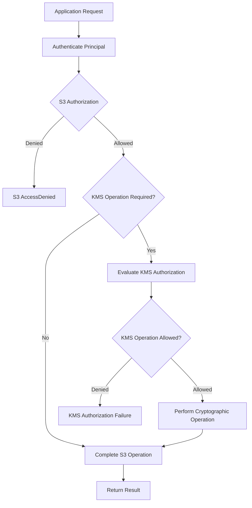

# 07- Encryption Key Permissions and Access Control

## Overview

Encryption-key permissions determine which principals can use, administer, or delegate access to the cryptographic keys protecting Amazon S3 data. For objects encrypted using server-side encryption with AWS KMS keys (SSE-KMS), effective access depends on both S3 authorization and AWS Key Management Service (AWS KMS) authorization.

An application may have permission to call `s3:GetObject` but still be unable to retrieve an encrypted object because it lacks permission to use the associated KMS key. Likewise, permission to use a KMS key does not automatically grant access to an S3 bucket or object.

A production access-control design must separate four responsibilities:

- **S3 data access:** Uploading, downloading, listing, copying, or deleting objects.
- **Cryptographic key usage:** Performing the KMS operations required by the encryption workflow.
- **Key administration:** Managing key policies, grants, configuration, and lifecycle.
- **Permission delegation:** Authorizing other principals to use a key.

This document explains how to design, implement, verify, and troubleshoot encryption-key permissions for S3 workloads using intermediate-to-senior backend engineering practices.

## The Two-Layer Authorization Model

S3 and KMS authorize different operations. An encrypted-object request succeeds only when all applicable authorization requirements are satisfied.

### Upload workflow

When a backend application uploads an SSE-KMS-encrypted object:

1. The application authenticates using its AWS credentials, typically through an IAM role.
2. S3 evaluates the requested object operation against applicable authorization controls.
3. S3 performs the KMS operations required to obtain and protect the data encryption key.
4. KMS evaluates the applicable key policies, IAM policies, grants, and other restrictions.
5. S3 encrypts and stores the object and returns the operation result.

### Download workflow

When the application downloads an SSE-KMS-encrypted object:

1. S3 evaluates the caller's permission to retrieve the object.
2. S3 determines the cryptographic operations needed to recover the data encryption key.
3. KMS evaluates whether the required key operation is authorized.
4. S3 decrypts the object data.
5. S3 returns the plaintext to the authorized caller.



The exact KMS operations depend on the S3 API, encryption mode, and configuration. For example, inspecting object metadata does not ordinarily require the same cryptographic permissions as downloading the object contents.

### Authorization components

| Component | Responsibility |
|---|---|
| IAM identity policy | Grants permissions to an IAM user or role |
| S3 bucket policy | Controls access to a bucket and its objects through a resource-based policy |
| KMS key policy | Defines which principals can use or administer a KMS key |
| KMS grant | Delegates supported key operations to a principal |
| Service control policy (SCP) | Sets permission boundaries for accounts in AWS Organizations |
| Permissions boundary | Limits the permissions that identity-based policies can grant to an IAM principal |
| Session policy | Restricts permissions for a role session |
| VPC endpoint policy | Restricts requests made through a particular VPC endpoint |

These mechanisms must be considered together. An explicit deny or another applicable restriction can prevent access despite an allow statement.

## Determine the Required KMS Permissions

Different S3 operations require different KMS operations. Start with the intended application workflow instead of granting a generic set of KMS permissions to every S3 client.

### Common permission requirements

| Operation | Typical S3 permissions | Typical KMS permissions |
|---|---|---|
| Upload an SSE-KMS object | `s3:PutObject` | `kms:GenerateDataKey` |
| Download an SSE-KMS object | `s3:GetObject` | `kms:Decrypt` |
| Initiate and complete multipart uploads | Applicable multipart and object permissions | Typically `kms:GenerateDataKey` and `kms:Decrypt`, depending on operations |
| Copy an SSE-KMS object | Source read and destination write permissions | Required source decryption and destination key operations |
| List objects | `s3:ListBucket` | No cryptographic KMS permission is normally required for listing alone |
| Inspect object metadata | Commonly `s3:GetObject` | A metadata request ordinarily does not require a cryptographic KMS operation |
| Delete an object | Relevant S3 deletion permission | No KMS cryptographic operation is normally required solely to delete the object |
| Access a particular object version | Appropriate version-specific S3 permission | Depends on whether the operation requires a cryptographic key operation |

The table describes common requirements for ordinary SSE-KMS workflows. Consult the documentation for the specific operation, particularly when using replication, multipart transfers, object versions, or additional AWS services.

### Why `kms:GenerateDataKey` is required

For SSE-KMS uploads, S3 uses data keys to encrypt object content. The KMS operation provides key material needed for that encryption workflow.

An identity that uploads SSE-KMS objects commonly requires `kms:GenerateDataKey` in addition to the required S3 write permission.

### Why `kms:Decrypt` is required

S3 needs to recover the protected data key to decrypt SSE-KMS object content. Consequently, downloading an SSE-KMS-encrypted object commonly requires `kms:Decrypt` authorization as well as `s3:GetObject`.

### Important distinctions

- SSE-S3 does not require KMS cryptographic permissions for its own encryption operations.
- SSE-C uses customer-provided keys and does not require KMS cryptographic permissions for SSE-C itself.
- Client-side encryption using a KMS key has its own key-operation requirements; do not assume it is identical to S3-managed SSE-KMS.
- Listing a bucket is not equivalent to decrypting an object.
- A successful `HeadObject` request does not prove that the caller can download and decrypt an SSE-KMS object.

Reference: [AWS KMS permissions reference](https://docs.aws.amazon.com/kms/latest/developerguide/kms-api-permissions-reference.html).

## Design Least-Privilege IAM Policies

Least privilege means granting only the permissions needed for a specific workload, on the specific resources it needs.

For S3 encryption, constrain both layers:

- S3 access should be scoped to the appropriate bucket and object resources.
- KMS access should be scoped to the intended key and necessary key operations.

### Example application identity policy

The following policy allows a backend service to upload and download objects under the `documents/` prefix and use one customer-managed KMS key.

```json
{
  "Version": "2012-10-17",
  "Statement": [
    {
      "Sid": "ReadAndWriteDocuments",
      "Effect": "Allow",
      "Action": [
        "s3:GetObject",
        "s3:PutObject"
      ],
      "Resource": "arn:aws:s3:::example-prod-documents/documents/*"
    },
    {
      "Sid": "UseDocumentKmsKey",
      "Effect": "Allow",
      "Action": [
        "kms:GenerateDataKey",
        "kms:Decrypt"
      ],
      "Resource": "arn:aws:kms:ap-south-1:123456789012:key/EXAMPLE-KEY-ID"
    }
  ]
}
```

Replace the example bucket, account, Region, and key identifiers with the actual resources.

This policy does not grant listing, deletion, key administration, or access to unrelated encryption keys. Add permissions only when the application's required API operations need them.

The KMS statement is effective only when the KMS authorization configuration permits the principal to use the key. The identity policy alone does not override a restrictive key policy.

### Restrict listing to a prefix

Listing requires a separate bucket-level permission because `s3:ListBucket` applies to the bucket ARN, not the object ARN.

```json
{
  "Sid": "ListDocumentsPrefix",
  "Effect": "Allow",
  "Action": "s3:ListBucket",
  "Resource": "arn:aws:s3:::example-prod-documents",
  "Condition": {
    "StringLike": {
      "s3:prefix": [
        "documents",
        "documents/*"
      ]
    }
  }
}
```

Add this statement only if the application needs to list objects. A service that uses database records to locate objects may not require bucket listing permission.

### Policy design recommendations

- Scope KMS permissions to the intended key ARN.
- Avoid unrestricted `kms:*` permissions for application roles.
- Separate data access from key administration.
- Add multipart, tagging, versioning, or deletion permissions only when required.
- Use IAM roles and temporary credentials rather than embedded long-lived access keys.
- Test permissions using the actual runtime role rather than an administrator identity.

Reference: [Using IAM policies with AWS KMS](https://docs.aws.amazon.com/kms/latest/developerguide/iam-policies.html).

## Configure KMS Key Policies

Every KMS key has exactly one key policy. It is the primary resource-based mechanism for controlling access to that key.

A key policy can directly authorize selected principals or enable the owning account to delegate key permissions through IAM identity policies.

### Enable IAM-based authorization

A common key-policy statement enables IAM policies in the account that owns the key:

```json
{
  "Sid": "EnableAccountIAMPermissions",
  "Effect": "Allow",
  "Principal": {
    "AWS": "arn:aws:iam::123456789012:root"
  },
  "Action": "kms:*",
  "Resource": "*"
}
```

This statement is intended to be part of the key policy, not used as an application identity policy.

It enables the owning account to delegate permissions through IAM. It does not automatically grant every application role unrestricted access to the key.

### Directly authorize an application role

A key policy can explicitly permit a particular role to perform the required cryptographic operations.

```json
{
  "Sid": "AllowDocumentServiceKeyUsage",
  "Effect": "Allow",
  "Principal": {
    "AWS": "arn:aws:iam::123456789012:role/document-storage-api"
  },
  "Action": [
    "kms:GenerateDataKey",
    "kms:Decrypt"
  ],
  "Resource": "*"
}
```

Insert this statement into the policy for the intended KMS key. In a key policy, `Resource: "*"` refers to the key to which the policy is attached.

For a same-account principal directly authorized in the key policy, an additional IAM allow for the same KMS operation is not always required. If access is intended to be controlled through IAM delegation, the key policy must enable that authorization path and the identity policy must grant the required operations.

Do not assume that the two patterns are interchangeable without reviewing the actual key policy.

### Separate key administration from key usage

| Role | Typical responsibility |
|---|---|
| Key administrator | Manage policies, configuration, rotation settings, and lifecycle |
| Application role | Perform required cryptographic operations for application workloads |
| Security auditor | Inspect authorized key configuration and audit records |
| Incident-response role | Investigate suspicious activity and execute approved containment actions |
| Infrastructure deployment role | Provision or update encryption resources under controlled permissions |

A principal that can update a key policy or create grants may be able to expand access to the key. Treat these permissions as security-sensitive.

### Administrative safeguards

- Maintain a designated key-administrator role.
- Protect the policy-update and grant-management paths.
- Preserve an approved recovery path for key administration.
- Restrict key disablement and deletion scheduling.
- Review key-policy changes through normal change control.
- Test the intended application permissions after policy updates.

References:

- [AWS KMS key policies](https://docs.aws.amazon.com/kms/latest/developerguide/key-policies.html)
- [Default KMS key policy](https://docs.aws.amazon.com/kms/latest/developerguide/key-policy-default.html)

## Use Conditions to Restrict Key Access

KMS condition keys can further restrict when a principal may use a key.

Two useful mechanisms are `kms:ViaService` and encryption-context conditions. These controls should complement, not replace, least-privilege identity and resource policies.

### Restrict operations to requests through S3

The `kms:ViaService` condition can restrict supported key operations to requests made through a specified regional AWS service endpoint.

Example identity-policy statement:

```json
{
  "Sid": "UseKeyThroughRegionalS3",
  "Effect": "Allow",
  "Action": [
    "kms:GenerateDataKey",
    "kms:Decrypt"
  ],
  "Resource": "arn:aws:kms:ap-south-1:123456789012:key/EXAMPLE-KEY-ID",
  "Condition": {
    "StringEquals": {
      "kms:ViaService": "s3.ap-south-1.amazonaws.com"
    }
  }
}
```

The statement limits the applicable key permissions to supported requests through the regional S3 endpoint. It is not a complete standalone policy.

### Trade-offs

- The endpoint must match the intended Region.
- Direct KMS calls will not satisfy the condition unless separately authorized.
- Replication and service integrations must be checked before applying restrictive conditions.
- Key administrators may require an independent administrative permission path.
- The condition does not grant access to the bucket or objects.

Test the actual application workflows before deploying this restriction.

Reference: [AWS KMS condition keys](https://docs.aws.amazon.com/kms/latest/developerguide/conditions-kms.html).

## Encryption Context and S3 Bucket Keys

Encryption context consists of non-secret key-value pairs associated with supported KMS cryptographic operations. S3 uses encryption context with SSE-KMS, and policies can use applicable context conditions to restrict key usage.

### Why encryption context matters

Context-based conditions can constrain cryptographic operations to an expected resource or application context. However, these conditions must match the context that S3 actually uses.

Without S3 Bucket Keys, the encryption context commonly identifies the individual object ARN. With S3 Bucket Keys, it can identify the bucket ARN instead.

### Example object-level condition

The following statement illustrates a condition for an object-specific encryption context:

```json
{
  "Sid": "AllowDecryptForExpectedS3Object",
  "Effect": "Allow",
  "Principal": {
    "AWS": "arn:aws:iam::123456789012:role/document-storage-api"
  },
  "Action": "kms:Decrypt",
  "Resource": "*",
  "Condition": {
    "StringEquals": {
      "kms:EncryptionContext:aws:s3:arn": "arn:aws:s3:::example-prod-documents/documents/report.pdf"
    }
  }
}
```

Use this pattern only when the condition matches the encryption context of the intended S3 operation. Add it to the appropriate key policy or authorization configuration after testing.

### Operational considerations

- Do not put secrets or sensitive payload values in encryption context.
- Confirm the actual context before writing conditions.
- Review context assumptions when enabling S3 Bucket Keys.
- Test encryption and decryption after policy changes.
- Preserve compatibility with existing objects and historical configuration.

### S3 Bucket Keys

S3 Bucket Keys reduce KMS request traffic for eligible SSE-KMS workloads. They can also reduce KMS request costs significantly, depending on the workload.

Before enabling them, inspect identity policies, key policies, and grants for encryption-context restrictions. A policy relying on object-level ARNs may need to be updated to account for bucket-level context.

Bucket Keys are not supported with DSSE-KMS.

References:

- [AWS KMS encryption context](https://docs.aws.amazon.com/kms/latest/developerguide/encrypt_context.html)
- [S3 Bucket Keys](https://docs.aws.amazon.com/AmazonS3/latest/userguide/bucket-key.html)

## KMS Grants and Delegated Access

KMS grants provide a mechanism for delegating selected key operations to a principal without requiring every authorization change to be implemented through a key-policy update.

Grants are useful for supported AWS service integrations and controlled delegation workflows. They are not required for every ordinary SSE-KMS operation.

### Grant-related permissions

| Permission | Purpose |
|---|---|
| `kms:CreateGrant` | Create a grant |
| `kms:ListGrants` | Inspect grants associated with a key |
| `kms:RevokeGrant` | Revoke a grant |
| `kms:RetireGrant` | Retire a grant when permitted |

Grant-management permissions should not be added automatically to application roles that merely upload and download objects.

Where supported, conditions such as `kms:GrantIsForAWSResource` can help restrict grant creation to intended service-integrated use cases.

Review the exact AWS service requirements and grant constraints before implementing this pattern.

Reference: [AWS KMS grants](https://docs.aws.amazon.com/kms/latest/developerguide/grants.html).

## Cross-Account Encryption-Key Permissions

Cross-account access to an SSE-KMS-encrypted object requires authorization in both the account that owns the bucket and key and the account that owns the requesting identity.

Assume Account A owns the S3 bucket and customer-managed KMS key, while Account B operates the backend application.

### Required authorization

| Layer | Requirement |
|---|---|
| Account B identity policy | Grants the caller the required S3 operations and KMS operations |
| Account A bucket policy | Permits the external principal to access the intended bucket and objects |
| Account A KMS key policy | Authorizes the external account or principal to use the key |
| Account B IAM delegation | Grants the application role the applicable key-use permissions |
| Organization and session controls | Must not impose an applicable explicit deny |
| Resource configuration | Bucket, key, and operation must be compatible |

For cross-account key usage, the key policy in the key-owning account and the identity policy in the external account must work together. Neither is sufficient alone.

AWS-managed KMS keys are generally unsuitable for the common cross-account customer-managed-key sharing design.

### Cross-account validation procedure

1. Identify the exact role making the request.
2. Verify the external role's S3 identity policy.
3. Inspect the destination bucket policy.
4. Inspect the KMS key policy in the key-owning account.
5. Verify the external role's KMS identity policy.
6. Check applicable grants, SCPs, permission boundaries, session policies, and explicit denies.
7. Test the operation using the actual external role.
8. Review relevant CloudTrail events in both accounts where available.

Avoid granting access to an entire account when the integration can be scoped to a specific application role.

Reference: [Allowing users in other accounts to use a KMS key](https://docs.aws.amazon.com/kms/latest/developerguide/key-policy-modifying-external-accounts.html).

## Key Administration and Lifecycle Permissions

Cryptographic use and key administration are different privilege categories.

An application that reads and uploads documents should not ordinarily be able to alter the key policy, disable the key, or schedule key deletion.

### Sensitive administrative actions

| Action | Security impact |
|---|---|
| `kms:PutKeyPolicy` | Changes the principals and operations authorized by the key policy |
| `kms:CreateGrant` | Delegates supported key operations |
| `kms:DisableKey` | Can prevent cryptographic use of the key |
| `kms:ScheduleKeyDeletion` | Schedules deletion and can ultimately make encrypted data unrecoverable |
| `kms:EnableKeyRotation` | Configures supported automatic rotation behavior |
| `kms:CancelKeyDeletion` | Cancels pending deletion when permitted |
| `kms:DescribeKey` | Retrieves key metadata and state |

Grant these permissions to designated administrative roles only when required.

### Rotation versus key replacement

Automatic KMS key rotation is not the same as replacing the KMS key used for S3 objects.

- Automatic rotation changes key material for a supported KMS key while preserving the logical key.
- Switching objects to a different KMS key may require rewriting or copying those objects.
- Disabling or deleting a key can affect data availability.
- Historical object versions can remain dependent on the original key.

Treat key lifecycle actions as data-availability changes, with explicit review, monitoring, and recovery procedures.

## Verify Effective Permissions

Policy review should be combined with tests performed under the actual runtime identity.

### Identify the active principal

```bash
aws sts get-caller-identity
```

Confirm that the command is using the expected application role or assumed-role session.

### Inspect S3 encryption configuration

```bash
aws s3api get-bucket-encryption \
  --bucket example-prod-documents \
  --region ap-south-1
```

### Inspect object encryption metadata

```bash
aws s3api head-object \
  --bucket example-prod-documents \
  --key documents/report.pdf \
  --region ap-south-1
```

This confirms metadata returned by S3. It does not prove that the same principal can retrieve and decrypt the object's contents.

### Inspect the KMS key state

```bash
aws kms describe-key \
  --key-id arn:aws:kms:ap-south-1:123456789012:key/EXAMPLE-KEY-ID \
  --region ap-south-1
```

### Inspect the key policy

```bash
aws kms get-key-policy \
  --key-id arn:aws:kms:ap-south-1:123456789012:key/EXAMPLE-KEY-ID \
  --policy-name default \
  --region ap-south-1
```

### Test the real workflow

In a controlled test environment, validate:

- Upload using the application role.
- Download using the application role.
- Access denial for an unauthorized prefix.
- Access denial for an unauthorized KMS key.
- Multipart upload if the application supports it.
- Cross-account access if applicable.
- Behavior after a key-policy change.
- Behavior after changes to Bucket Key configuration.

A test that succeeds under an administrator's credentials does not demonstrate that the application's least-privilege permissions are correct.

## Troubleshooting Encryption-Key Permission Failures

Diagnose the failing layer before changing permissions. Avoid granting additional access until the root cause is identified.

| Symptom | Possible cause | Diagnostic approach |
|---|---|---|
| Upload returns `AccessDenied` | Missing `s3:PutObject`, missing `kms:GenerateDataKey`, or an applicable deny | Inspect S3 and KMS authorization separately |
| Download returns `AccessDenied` | Missing `s3:GetObject` or `kms:Decrypt` access | Review the object policy path and the KMS key authorization |
| KMS returns `AccessDeniedException` | Key policy, identity policy, grant, or explicit-deny problem | Inspect the caller and key authorization |
| KMS key is unusable | Key disabled, pending deletion, wrong Region, or invalid key reference | Inspect key metadata and state |
| Cross-account read fails | Incomplete bucket policy, KMS key policy, or external identity policy | Validate each account's authorization configuration |
| Metadata inspection succeeds but download fails | Metadata access does not require the same cryptographic operation | Test a real object read |
| Access fails after enabling Bucket Keys | Encryption-context conditions no longer match the request context | Inspect context assumptions and applicable policy conditions |
| Access fails after an IAM policy change | Permissions were removed or a boundary or session policy restricts access | Compare the effective principal and policies |
| Key becomes unmanageable | Administrative permissions were removed or the key policy was overwritten | Follow the approved key-access recovery procedure |

### Diagnostic workflow

1. Record the failed API, timestamp, principal, bucket, key, and AWS request identifier.
2. Identify the active principal with `aws sts get-caller-identity`.
3. Inspect the S3 action and the resource ARN.
4. Inspect the KMS key policy and identity policy.
5. Check relevant grants and condition keys.
6. Review SCPs, permission boundaries, session policies, VPC endpoint policies, and explicit denies.
7. Inspect relevant CloudTrail events.
8. Apply the narrowest confirmed corrective change.
9. Retest using the original application role.
10. Add regression coverage for the authorization path.

KMS authorization failures can occur even when S3 authorization succeeds. Do not assume every `AccessDenied` response has the same root cause.

Reference: [Troubleshooting AWS KMS permissions](https://docs.aws.amazon.com/kms/latest/developerguide/policy-evaluation.html).

## Monitoring and Auditing

Encryption-key access should be monitored because a key-policy change, key disablement, or authorization failure can affect application availability.

### CloudTrail

Use CloudTrail to investigate relevant KMS API activity and S3 object operations where the required S3 data events are enabled.

Review:

- The principal that initiated the request.
- The KMS operation and key identifier.
- The error code and available request context.
- Relevant S3 object-level activity.
- Changes to key policies, grants, and key state.

S3 object-level data events are not enabled in every CloudTrail configuration by default. Confirm that logging covers the required buckets and operations.

### Operational indicators

Monitor:

- KMS authorization failures.
- S3 upload and download failures.
- KMS throttling and quota-related errors.
- Changes to key state, key policy, and grants.
- Unexpected KMS request volume or cost.
- Replication failures involving encrypted objects.
- Changes to S3 encryption configuration.

Use alerts and controlled response procedures for unexpected key disablement or policy modifications.

## Production Best Practices

### Least privilege

- Scope S3 permissions to required buckets, prefixes, and object resources.
- Scope KMS operations to the intended keys.
- Separate application cryptographic usage from key administration.
- Restrict policy modification, grant creation, key disablement, and deletion scheduling.
- Use the actual API workflow to determine permissions rather than copying broad policy examples.

### Policy management

- Maintain key and identity policies in version-controlled infrastructure.
- Review key-policy changes before deployment.
- Validate encryption-context conditions against the actual configuration.
- Verify both accounts' permissions for cross-account access.
- Recheck authorization after enabling S3 Bucket Keys or modifying encryption settings.

### Reliability and recovery

- Treat key state and permissions as critical data-availability dependencies.
- Document key disablement, deletion, and access-restoration procedures.
- Preserve an approved administrative recovery path.
- Test backup restoration with the real application permissions.
- Avoid changing key policies without a verified recovery plan.

### Application engineering

- Use IAM roles and temporary credentials.
- Distinguish S3 authorization failures from KMS failures in application telemetry.
- Retry only eligible transient errors with bounded backoff.
- Avoid exposing internal key details or policy structure to API consumers.
- Verify uploads and downloads after changes to IAM or KMS configuration.

## Production Verification Checklist

- [ ] The application role has only the required S3 permissions.
- [ ] The application role has only the required KMS permissions.
- [ ] The KMS key policy supports the intended authorization path.
- [ ] Key administrators and application identities have separate responsibilities.
- [ ] No applicable explicit deny, SCP, permission boundary, session policy, or endpoint policy blocks the workload unexpectedly.
- [ ] Cross-account access has been verified at both the S3 and KMS layers.
- [ ] Encryption-context conditions match the actual configuration.
- [ ] S3 Bucket Key changes have been tested against access policies and audit requirements.
- [ ] CloudTrail coverage supports investigation of relevant operations.
- [ ] Key lifecycle and recovery procedures are documented and tested.
- [ ] Upload, download, copy, and multipart workflows have been tested using the actual application role.
- [ ] Policy changes are reviewed and deployed through controlled infrastructure workflows.

## Official References

- [AWS KMS key policies](https://docs.aws.amazon.com/kms/latest/developerguide/key-policies.html)
- [KMS key access and permissions](https://docs.aws.amazon.com/kms/latest/developerguide/control-access.html)
- [Using IAM policies with AWS KMS](https://docs.aws.amazon.com/kms/latest/developerguide/iam-policies.html)
- [AWS KMS permissions reference](https://docs.aws.amazon.com/kms/latest/developerguide/kms-api-permissions-reference.html)
- [AWS KMS grants](https://docs.aws.amazon.com/kms/latest/developerguide/grants.html)
- [AWS KMS condition keys](https://docs.aws.amazon.com/kms/latest/developerguide/conditions-kms.html)
- [AWS KMS encryption context](https://docs.aws.amazon.com/kms/latest/developerguide/encrypt_context.html)
- [Cross-account KMS key access](https://docs.aws.amazon.com/kms/latest/developerguide/key-policy-modifying-external-accounts.html)
- [Troubleshooting AWS KMS permissions](https://docs.aws.amazon.com/kms/latest/developerguide/policy-evaluation.html)
- [S3 Bucket Keys](https://docs.aws.amazon.com/AmazonS3/latest/userguide/bucket-key.html)
- [Amazon S3 security best practices](https://docs.aws.amazon.com/AmazonS3/latest/userguide/security-best-practices.html)

## Key Takeaways

- SSE-KMS access requires the applicable S3 permissions and authorization for the required KMS operations.
- KMS key policies, IAM identity policies, and grants must be designed together, with clear separation between key usage and administration.
- Least privilege requires scoping both object access and cryptographic operations to the resources and workflows that need them.
- Cross-account access requires compatible permissions in the key-owning account and the caller's account.
- Test permissions using the actual application role, and treat KMS configuration and recovery as critical dependencies of encrypted-data availability.