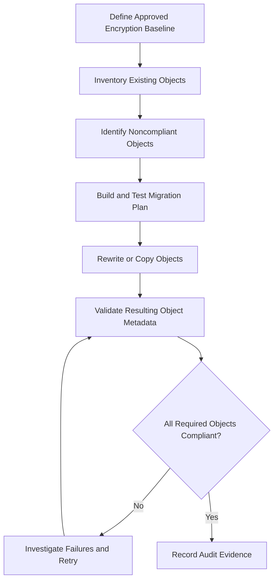

# 08- Encryption Configuration and Validation

## Overview

Amazon S3 encryption configuration determines how newly uploaded objects are encrypted at rest, which encryption keys are used, and how the resulting configuration can be verified. A production security design must validate both bucket-level defaults and the encryption metadata of individual objects.

Amazon S3 automatically encrypts new object uploads using server-side encryption with Amazon S3-managed keys (SSE-S3) by default. Workloads requiring additional key-management controls can configure SSE-KMS or dual-layer server-side encryption with AWS KMS keys (DSSE-KMS). SSE-C requires customer-provided keys and must be explicitly enabled for general-purpose buckets where it is disabled.

Configuring encryption is only part of the implementation. Backend systems must also verify the effective encryption method, enforce approved configurations where necessary, detect deviations, and handle existing objects that do not meet current requirements.

This document covers:

- Bucket default encryption and request-level overrides.
- Configuration using the AWS CLI and Boto3.
- Encryption enforcement through bucket policies.
- Object-level validation and large-scale auditing.
- CI/CD validation, automated checks, and remediation.
- Existing-object migration, troubleshooting, and production verification.

## Encryption Configuration Fundamentals

S3 encryption configuration operates at multiple levels. Each level answers a different question and requires a different validation method.

| Configuration level | Purpose | Validation method |
|---|---|---|
| Bucket default encryption | Defines the default encryption method for new uploads | `GetBucketEncryption` |
| Upload request | Can explicitly select an encryption method and KMS key | Inspect request configuration and upload response |
| Object encryption metadata | Reports the effective encryption method for an individual object | `HeadObject` |
| KMS key configuration | Determines whether the intended key exists and is usable | KMS API operations and key-policy review |
| Resource policies | Restrict which uploads or encryption configurations are accepted | Policy review and controlled integration tests |
| Object inventory | Supports auditing encryption across large object collections | S3 Inventory and applicable inventory fields |
| Audit events | Supports investigation of configuration changes and API activity | AWS CloudTrail |

A bucket's default encryption configuration does not prove that every existing object uses the same encryption method.

Likewise, a successful upload does not prove that the object was encrypted with a particular customer-managed KMS key unless the resulting object metadata has been checked.

## Supported Encryption Configurations

S3 supports several encryption approaches, each with different configuration and validation requirements.

| Encryption method | Bucket default supported | Object-level selection | Primary validation |
|---|---|---|---|
| SSE-S3 | Yes | Supported | `ServerSideEncryption = AES256` |
| SSE-KMS | Yes | Supported | `ServerSideEncryption = aws:kms` and, when applicable, `SSEKMSKeyId` |
| DSSE-KMS | Yes | Supported | `ServerSideEncryption = aws:kms:dsse` |
| SSE-C | No | Supported for compatible operations when enabled | Customer-key requirements and SSE-C-related object metadata |
| Client-side encryption | Not an S3 server-side encryption setting | Application-managed | Encryption-client verification and application metadata |

### Important distinctions

- SSE-S3 is the default server-side encryption method for new object uploads.
- SSE-KMS and DSSE-KMS introduce KMS key-management dependencies and can incur KMS request charges.
- S3 Bucket Keys can reduce KMS request volume for eligible SSE-KMS objects but are not supported with DSSE-KMS.
- SSE-C requires the customer to provide the key for applicable requests. It is not a bucket default encryption algorithm.
- Client-side encryption protects the application payload before upload and is independent of S3's server-side encryption configuration.

Reference: [Protecting data with server-side encryption](https://docs.aws.amazon.com/AmazonS3/latest/userguide/serv-side-encryption.html).

## Inspect Bucket Default Encryption

Use `GetBucketEncryption` to inspect the current bucket encryption configuration.

```bash
aws s3api get-bucket-encryption \
  --bucket example-prod-documents \
  --region ap-south-1
```

A bucket configured to use SSE-KMS might return a configuration similar to:

```json
{
  "ServerSideEncryptionConfiguration": {
    "Rules": [
      {
        "ApplyServerSideEncryptionByDefault": {
          "SSEAlgorithm": "aws:kms",
          "KMSMasterKeyID": "arn:aws:kms:ap-south-1:123456789012:key/EXAMPLE-KEY-ID"
        },
        "BucketKeyEnabled": true
      }
    ]
  }
}
```

Inspect the following fields:

- `SSEAlgorithm`: The configured default encryption algorithm.
- `KMSMasterKeyID`: The configured KMS key identifier when applicable.
- `BucketKeyEnabled`: Whether the configuration enables S3 Bucket Keys for eligible SSE-KMS objects.

The response describes the default configuration, not the encryption state of every object already stored in the bucket.

### Inspect without changing configuration

```bash
aws s3api get-bucket-encryption \
  --bucket example-prod-documents \
  --region ap-south-1 \
  --output json
```

Use this command during deployment checks, periodic security reviews, and incident investigation.

The caller needs permission to retrieve the bucket encryption configuration. If the bucket is missing or the caller lacks permission, the result may not establish whether the bucket's encryption settings are correct.

## Configure Default Encryption

### Configure SSE-S3

SSE-S3 is already the default encryption method for new object uploads in modern S3 buckets. Explicit configuration can still make the desired baseline visible in infrastructure code.

```bash
aws s3api put-bucket-encryption \
  --bucket example-prod-documents \
  --server-side-encryption-configuration '{
    "Rules": [
      {
        "ApplyServerSideEncryptionByDefault": {
          "SSEAlgorithm": "AES256"
        }
      }
    ]
  }' \
  --region ap-south-1
```

This changes the bucket's default encryption configuration. It does not rewrite previously stored objects.

### Configure SSE-KMS

```bash
aws s3api put-bucket-encryption \
  --bucket example-prod-documents \
  --server-side-encryption-configuration '{
    "Rules": [
      {
        "ApplyServerSideEncryptionByDefault": {
          "SSEAlgorithm": "aws:kms",
          "KMSMasterKeyID": "arn:aws:kms:ap-south-1:123456789012:key/EXAMPLE-KEY-ID"
        },
        "BucketKeyEnabled": true
      }
    ]
  }' \
  --region ap-south-1
```

Before applying this configuration:

1. Confirm that the key ARN belongs to the expected account and Region.
2. Verify that the key exists and is enabled.
3. Review the key policy and application permissions.
4. Check KMS quotas and expected request costs.
5. Review resource policies and upload integrations.
6. Test the configuration in a non-production environment.

S3 does not validate every aspect of the supplied KMS key's usability when the default encryption configuration is set. A successful configuration update is therefore not proof that an application can use the key.

### Verify after configuration

```bash
aws s3api get-bucket-encryption \
  --bucket example-prod-documents \
  --region ap-south-1
```

Compare the returned configuration with the intended baseline. Do not rely solely on a successful `PutBucketEncryption` response.

Reference: [Configuring default bucket encryption](https://docs.aws.amazon.com/AmazonS3/latest/userguide/default-bucket-encryption.html).

## Validate Object-Level Encryption

The most direct way to verify the encryption metadata of an individual object is `HeadObject`.

```bash
aws s3api head-object \
  --bucket example-prod-documents \
  --key documents/report.pdf \
  --region ap-south-1
```

### Expected metadata by encryption type

| Encryption method | Expected `ServerSideEncryption` value | Additional validation |
|---|---|---|
| SSE-S3 | `AES256` | Confirm the algorithm matches the approved baseline |
| SSE-KMS | `aws:kms` | Inspect `SSEKMSKeyId` and relevant Bucket Key metadata |
| DSSE-KMS | `aws:kms:dsse` | Confirm the expected dual-layer encryption configuration |
| SSE-C | SSE-C-related algorithm metadata, where returned | Use the required customer-key headers for supported metadata operations |

For SSE-KMS, the response can include:

```json
{
  "ServerSideEncryption": "aws:kms",
  "SSEKMSKeyId": "arn:aws:kms:ap-south-1:123456789012:key/EXAMPLE-KEY-ID",
  "BucketKeyEnabled": true
}
```

The response fields shown are illustrative. Actual fields depend on the object and its encryption configuration.

### Important validation rules

- Check the actual object rather than inferring its encryption method from bucket defaults.
- Compare the effective encryption method with the approved configuration.
- Validate the KMS key when the workload requires a specific customer-managed key.
- Inspect Bucket Key metadata when relevant.
- Do not assume that a matching encryption algorithm guarantees that the caller can decrypt the object.
- Do not assume that `HeadObject` proves application-level read access.

For SSE-KMS objects, do not send server-side encryption selection headers with `GET` or `HEAD` requests. Such headers are used for applicable write requests and can cause `400 BadRequest` errors when incorrectly included on reads.

For SSE-C, the required customer-provided key headers must be supplied for applicable operations. Protect the key material and never log it.

Reference: [Using SSE-KMS](https://docs.aws.amazon.com/AmazonS3/latest/userguide/specifying-kms-encryption.html).

## Validate Encryption with Boto3

A reusable validation function can inspect an object's effective encryption metadata without downloading the object contents.

```python
import boto3

s3 = boto3.client("s3", region_name="ap-south-1")


def inspect_object_encryption(
    bucket: str,
    object_key: str,
) -> dict:
    """Return encryption metadata reported by S3."""
    response = s3.head_object(
        Bucket=bucket,
        Key=object_key,
    )

    return {
        "algorithm": response.get("ServerSideEncryption"),
        "kms_key_id": response.get("SSEKMSKeyId"),
        "bucket_key_enabled": response.get("BucketKeyEnabled"),
        "last_modified": response.get("LastModified"),
        "content_length": response.get("ContentLength"),
        "version_id": response.get("VersionId"),
    }
```

### Enforce an encryption baseline in application code

The following example checks that an object uses SSE-KMS with the expected customer-managed key.

```python
def validate_sse_kms(
    bucket: str,
    object_key: str,
    expected_key_arn: str,
) -> None:
    """Raise an error when an object violates the approved encryption baseline."""
    metadata = inspect_object_encryption(
        bucket=bucket,
        object_key=object_key,
    )

    if metadata["algorithm"] != "aws:kms":
        raise ValueError(
            f"Unexpected encryption algorithm: {metadata['algorithm']!r}"
        )

    actual_key_id = metadata["kms_key_id"]

    if actual_key_id != expected_key_arn:
        raise ValueError(
            f"Unexpected KMS key: {actual_key_id!r}"
        )
```

This function is appropriate when the workload expects the returned KMS identifier to match the configured ARN exactly. Validate the behavior in the target environment, especially when working with different key identifier formats or inherited configurations.

### Application considerations

- Use IAM roles instead of hardcoded credentials.
- Catch and classify expected AWS service exceptions.
- Do not log credentials or sensitive application data.
- Distinguish a missing object from a permission failure.
- Decide whether validation failures should reject an upload, quarantine an object, or raise an operational alert.
- Keep the expected encryption baseline in environment-specific configuration.

A metadata check is useful for validation, but it does not replace an actual read test when decryptability must be proven.

## Validate Upload Requests and Responses

Default bucket encryption applies when an upload does not explicitly select another supported encryption configuration.

If an application must use a particular encryption method or KMS key, validate the configuration at the point where the upload is initiated and verify the resulting object.

### Explicit SSE-KMS upload

```python
def upload_document(
    bucket: str,
    object_key: str,
    file_path: str,
    kms_key_arn: str,
) -> None:
    """Upload a document using a specific SSE-KMS key."""
    s3.upload_file(
        Filename=file_path,
        Bucket=bucket,
        Key=object_key,
        ExtraArgs={
            "ServerSideEncryption": "aws:kms",
            "SSEKMSKeyId": kms_key_arn,
            "ContentType": "application/pdf",
        },
    )

    validate_sse_kms(
        bucket=bucket,
        object_key=object_key,
        expected_key_arn=kms_key_arn,
    )
```

This example deliberately separates the upload from the subsequent metadata check.

For critical ingestion pipelines, persist an audit record containing the object key, upload outcome, effective encryption method, KMS key identifier where applicable, and validation status. Do not treat a failed validation as a successful ingestion.

### Request-level configuration versus bucket defaults

| Request behavior | Expected encryption behavior |
|---|---|
| No encryption headers supplied | S3 applies the bucket's default encryption |
| Request explicitly selects SSE-S3 | S3 uses the supported request-level encryption setting |
| Request explicitly selects SSE-KMS | S3 uses the supported KMS configuration and applicable key authorization |
| Request selects a different supported key | The resulting object's key must be validated against the approved policy |
| Request is rejected by an applicable policy | S3 rejects the upload |
| Bucket uses default SSE-KMS but the application assumes all objects use one key | Existing objects and explicit request-level overrides must still be audited |

Do not assume that a configured default automatically enforces a single encryption key for every request.

## Enforce Encryption Through Bucket Policies

Default encryption provides a baseline for new uploads, but a bucket policy can enforce additional requirements on upload requests.

The correct policy depends on whether the requirement is:

- Reject uploads that do not explicitly request SSE-KMS.
- Require a specific KMS key.
- Permit bucket-default encryption without explicit request headers.
- Prevent unauthorized callers from selecting alternative encryption settings.

These policies are not interchangeable.

### Require SSE-KMS in the upload request

The following policy denies matching uploads if the request omits the SSE-KMS key-ID header.

```json
{
  "Version": "2012-10-17",
  "Statement": [
    {
      "Sid": "DenyUploadsWithoutKmsKeyHeader",
      "Effect": "Deny",
      "Principal": "*",
      "Action": "s3:PutObject",
      "Resource": "arn:aws:s3:::example-prod-documents/*",
      "Condition": {
        "Null": {
          "s3:x-amz-server-side-encryption-aws-kms-key-id": "true"
        }
      }
    }
  ]
}
```

This policy intentionally requires callers to provide the relevant KMS key-ID header. An upload relying only on bucket default encryption may be rejected because the request does not include that header.

Use this approach only when explicit request-level key selection is a deliberate requirement for every covered upload path.

### Require a specific KMS key

The following policy pattern denies uploads that do not specify the approved key ARN in the request.

```json
{
  "Version": "2012-10-17",
  "Statement": [
    {
      "Sid": "DenyUploadsUsingUnexpectedKmsKey",
      "Effect": "Deny",
      "Principal": "*",
      "Action": "s3:PutObject",
      "Resource": "arn:aws:s3:::example-prod-documents/*",
      "Condition": {
        "ArnNotEqualsIfExists": {
          "s3:x-amz-server-side-encryption-aws-kms-key-id": "arn:aws:kms:ap-south-1:123456789012:key/EXAMPLE-KEY-ID"
        }
      }
    }
  ]
}
```

This policy evaluates the encryption key identifier supplied in the request. If the header is absent, the condition can also cause the upload to be denied, including an upload that otherwise would have inherited the bucket default.

Before deploying either policy, review all producers that write to the bucket, including application services, multipart upload workflows, replication, and AWS service integrations. Test legitimate request paths using their actual identities.

For workflows that rely on bucket defaults rather than explicit headers, use a policy design that matches that requirement instead of blindly enforcing a request-header condition.

Reference: [S3 bucket policy examples for encryption](https://docs.aws.amazon.com/AmazonS3/latest/userguide/example-bucket-policies.html).

## Validate KMS Configuration and Permissions

When a workload uses SSE-KMS, encryption validation must include the associated KMS key.

A correctly configured bucket can still produce inaccessible objects if the key is disabled, the key is in the wrong Region, or the caller lacks the required permissions.

### Inspect the KMS key

```bash
aws kms describe-key \
  --key-id arn:aws:kms:ap-south-1:123456789012:key/EXAMPLE-KEY-ID \
  --region ap-south-1
```

Validate:

- Key state.
- Key ARN and account.
- Region.
- Key specification and supported usage.
- Key policy and intended principals.
- Rotation and lifecycle configuration where applicable.

### Inspect the key policy

```bash
aws kms get-key-policy \
  --key-id arn:aws:kms:ap-south-1:123456789012:key/EXAMPLE-KEY-ID \
  --policy-name default \
  --region ap-south-1
```

Review the policy alongside identity-based IAM policies, applicable grants, and organizational restrictions.

### Distinguish encryption metadata from decryptability

A `HeadObject` request can report that an object uses SSE-KMS without proving that the current principal can decrypt its content.

For critical validation, perform a controlled download using the actual application role. Avoid using an administrator's credentials as the only verification path.

### Relevant permissions

| Validation activity | Typical permissions |
|---|---|
| Inspect bucket encryption | `s3:GetEncryptionConfiguration` |
| Inspect object metadata | Commonly `s3:GetObject` |
| Upload a test object using SSE-KMS | `s3:PutObject`, plus applicable KMS authorization |
| Download an SSE-KMS test object | `s3:GetObject` and `kms:Decrypt` |
| Inspect KMS key metadata | `kms:DescribeKey` |
| Retrieve the key policy | `kms:GetKeyPolicy` |

A validation role should have the minimum read-only permissions necessary for its checks. If it also runs write and read integration tests, those additional permissions should be explicit and confined to designated test resources.

## Validate Encryption Across Large Buckets

Inspecting objects one at a time is insufficient for a large bucket. Use inventory-based auditing to evaluate encryption status at scale.

### S3 Inventory

S3 Inventory generates reports describing objects stored in a bucket. Depending on the report configuration, the report can include encryption-status information that is useful for finding objects outside the approved baseline.

A practical audit workflow is:

1. Configure S3 Inventory for the required bucket and scope.
2. Include the relevant encryption-status fields.
3. Store the report in an approved destination.
4. Query or process the report to identify noncompliant objects.
5. Classify findings by encryption type, key identifier where available, storage prefix, and object age.
6. Remediate findings using a controlled migration.
7. Re-run the audit and verify the results.

Inventory reports are generated asynchronously and may not reflect the most recent changes immediately. Account for report timing and refresh the report when validating a completed migration.

### CloudTrail

CloudTrail supports investigation of relevant S3 API requests and changes to encryption configuration. S3 object-level data events must be configured when object-level auditing is required.

Use CloudTrail to investigate:

- Changes to default bucket encryption.
- Uploads that explicitly select encryption settings.
- Failures related to S3 or KMS authorization.
- Changes to KMS key policies and key state.
- Unexpected administrative operations.

CloudTrail is an audit source, not a replacement for examining the effective encryption metadata of stored objects.

### Storage Lens and monitoring

S3 Storage Lens provides storage-usage and security-related insights, depending on the selected metrics and configuration. Use it alongside S3 Inventory and CloudTrail rather than treating any one source as a complete record of encryption compliance.

References:

- [S3 Inventory](https://docs.aws.amazon.com/AmazonS3/latest/userguide/storage-inventory.html)
- [CloudTrail logging for S3](https://docs.aws.amazon.com/AmazonS3/latest/userguide/cloudtrail-logging-s3-info.html)
- [Amazon S3 security best practices](https://docs.aws.amazon.com/AmazonS3/latest/userguide/security-best-practices.html)

## Validate Existing Objects and Encryption Migrations

Changing bucket default encryption affects new uploads. It does not automatically re-encrypt existing objects.

An organization might need to migrate objects when:

- A bucket changes from SSE-S3 to SSE-KMS.
- A customer-managed KMS key becomes mandatory.
- Objects use a KMS key that is no longer approved.
- Historical objects were uploaded under different encryption requirements.
- A compliance control requires a particular encryption configuration.

### Migration workflow



### Re-encrypt a single object

A self-copy can create a new object representation using the chosen encryption method.

```bash
aws s3api copy-object \
  --bucket example-prod-documents \
  --key documents/legacy-report.pdf \
  --copy-source example-prod-documents/documents/legacy-report.pdf \
  --server-side-encryption aws:kms \
  --ssekms-key-id arn:aws:kms:ap-south-1:123456789012:key/EXAMPLE-KEY-ID \
  --region ap-south-1
```

In production, account for metadata and tagging directives, versioning, Object Lock, source and destination permissions, and storage costs.

In a versioned bucket, the copy can create a new version. Older versions do not automatically acquire the new encryption configuration.

### Large-scale migration

For large object collections, use S3 Inventory to identify objects and S3 Batch Operations or a controlled application workflow to perform the migration.

A robust migration should track:

- Source object key and version.
- Expected destination encryption type.
- Expected KMS key identifier where applicable.
- Operation status and failure reason.
- Validation result.
- Retry status.
- Recovery or rollback decision.

Do not delete older versions or remove old key access until the migration and historical retention requirements have been verified.

Reference: [Encrypting objects with S3 Batch Operations](https://docs.aws.amazon.com/AmazonS3/latest/userguide/batch-ops-examples.html).

## Automated Encryption Validation in CI/CD

Encryption validation should be part of infrastructure deployment and application-release workflows.

A deployment pipeline can verify the bucket's configured default encryption and optionally run a controlled upload-and-inspection test against an isolated integration-test bucket.

### Validation stages

| Stage | Checks |
|---|---|
| Pull request | Review infrastructure diffs and encryption policy changes |
| Infrastructure validation | Run formatting, syntax, security, and policy checks |
| Deployment plan | Inspect changes to bucket encryption, KMS keys, and relevant resource policies |
| Post-deployment | Verify effective bucket encryption configuration |
| Integration test | Upload a test object and inspect object-level encryption metadata |
| Access test | Perform a controlled read using the intended application role |
| Audit | Record the deployment version and validation outcome |

### Example CI validation script

The following Bash script verifies that a bucket's default encryption algorithm is SSE-KMS and that the configured key ARN matches the expected value.

```bash
#!/usr/bin/env bash
set -euo pipefail

BUCKET="${BUCKET:?Set BUCKET}"
REGION="${AWS_REGION:-ap-south-1}"
EXPECTED_KEY_ARN="${EXPECTED_KEY_ARN:?Set EXPECTED_KEY_ARN}"

CONFIGURATION="$(
  aws s3api get-bucket-encryption \
    --bucket "$BUCKET" \
    --region "$REGION" \
    --output json
)"

ALGORITHM="$(
  jq -r '.ServerSideEncryptionConfiguration.Rules[0].ApplyServerSideEncryptionByDefault.SSEAlgorithm // empty' \
    <<< "$CONFIGURATION"
)"

KEY_ARN="$(
  jq -r '.ServerSideEncryptionConfiguration.Rules[0].ApplyServerSideEncryptionByDefault.KMSMasterKeyID // empty' \
    <<< "$CONFIGURATION"
)"

if [[ "$ALGORITHM" != "aws:kms" ]]; then
  echo "Unexpected default encryption algorithm: $ALGORITHM" >&2
  exit 1
fi

if [[ "$KEY_ARN" != "$EXPECTED_KEY_ARN" ]]; then
  echo "Unexpected default KMS key identifier: $KEY_ARN" >&2
  exit 1
fi

echo "Bucket default encryption configuration passed validation."
```

Prerequisites include the AWS CLI, `jq`, and an identity authorized to inspect bucket encryption configuration.

This script validates the first encryption rule in the returned configuration. If the environment uses multiple rules or requires validation of additional settings, extend the checks accordingly.

It verifies configuration, not every object's encryption status or the application's ability to decrypt data.

### Pipeline security

- Use GitHub Actions OIDC federation or an equivalent workload identity mechanism to obtain short-lived credentials.
- Give the validation role only the required read permissions.
- Use a separate test role for actual upload and download checks.
- Store expected key ARNs in environment-specific configuration.
- Fail the deployment gate when required checks do not pass.
- Preserve validation output without logging secrets or sensitive object contents.

## Infrastructure as Code Validation

Manage encryption configuration through infrastructure as code so that security settings are reviewable and reproducible.

A Terraform resource can define the default server-side encryption configuration explicitly:

```hcl
resource "aws_s3_bucket_server_side_encryption_configuration" "documents" {
  bucket = aws_s3_bucket.documents.id

  rule {
    apply_server_side_encryption_by_default {
      sse_algorithm     = "aws:kms"
      kms_master_key_id = aws_kms_key.documents.arn
    }

    bucket_key_enabled = true
  }
}
```

This example assumes that `aws_s3_bucket.documents` and `aws_kms_key.documents` are defined elsewhere in the configuration.

### Validate the configuration

```bash
terraform fmt -check
terraform init -backend=false
terraform validate
terraform plan
```

Review the plan before applying changes.

### Production considerations

- Pin the approved Terraform provider version.
- Review changes to KMS keys, bucket encryption, and policies.
- Protect remote state and limit access to sensitive outputs.
- Avoid accidental key replacement or deletion.
- Test the intended encryption behavior after deployment.
- Detect drift between deployed resources and source-controlled configuration.

A successful Terraform validation proves that the configuration is structurally valid for the selected provider. It does not prove that AWS permissions, encryption behavior, or application access work correctly.

Reference: [Terraform AWS provider](https://registry.terraform.io/providers/hashicorp/aws/latest/docs).

## Troubleshooting Encryption Configuration

Encryption failures can arise from incorrect bucket settings, request headers, KMS authorization, key state, or assumptions about existing objects.

Use the observed failure to select the appropriate diagnostic path.

| Symptom | Likely cause | Diagnostic action |
|---|---|---|
| Bucket configuration is incorrect | Wrong default encryption resource or failed deployment | Run `get-bucket-encryption` and inspect the deployed configuration |
| Object uses an unexpected algorithm | Upload explicitly selected another supported encryption mode | Run `head-object` and inspect the effective encryption metadata |
| Object uses an unexpected KMS key | Request-level key selection or configuration drift | Compare the returned KMS key identifier with the approved baseline |
| Upload returns `AccessDenied` | Missing S3 permission, KMS authorization, or explicit deny | Inspect the caller, bucket policy, IAM policy, and key policy |
| SSE-KMS download fails | Missing `kms:Decrypt`, inaccessible key, or key-state problem | Test the real read operation and inspect KMS configuration |
| Upload fails with `BadRequest` | Invalid request headers or incompatible operation settings | Verify the headers and API parameters for the exact operation |
| SSE-C upload is rejected | SSE-C is blocked for the bucket | Inspect the bucket's encryption configuration and explicit SSE-C setting |
| Configuration passes but old objects fail validation | Existing objects were not rewritten after a configuration change | Inventory and migrate the affected object collection |
| CI validation fails despite an existing KMS key | Expected key identifier does not match the configured default | Compare the exact identifier and intended configuration |
| Migration leaves noncompliant objects | Failed copies, unprocessed versions, or incomplete inventory | Inspect job results, object versions, and refreshed inventory |

### Diagnostic sequence

1. Identify the exact bucket, object key, version, and failing API.
2. Inspect the bucket's default encryption configuration.
3. Inspect object-level encryption metadata.
4. Verify the caller identity and required S3 permission.
5. If SSE-KMS is used, inspect the key state and applicable permissions.
6. Review relevant CloudTrail events.
7. Correct the narrowest confirmed problem.
8. Repeat the original operation using the actual application role.
9. Add regression tests for the observed failure.

Do not resolve an encryption problem by automatically granting broad S3 or KMS permissions.

## Production Best Practices

### Configuration

- Define the intended encryption baseline for each environment.
- Manage bucket defaults through infrastructure as code.
- Use customer-managed KMS keys only when their key-control capabilities are required.
- Preserve the intended encryption configuration when modifying bucket settings.
- Test changes to bucket policies and upload requirements with legitimate producers.

### Validation

- Inspect the bucket's default encryption configuration after deployment.
- Verify object-level metadata for critical uploads.
- Test actual reads when decryptability is a requirement.
- Use S3 Inventory to audit large object collections.
- Include negative tests for unauthorized encryption settings.
- Distinguish configuration checks from behavioral and access checks.

### Security and reliability

- Restrict KMS usage to the required keys and operations.
- Keep key administrators separate from application roles.
- Protect key state, policy changes, and recovery procedures.
- Avoid logging credentials, sensitive request headers, or plaintext object contents.
- Preserve access to old keys while historical objects require them.

### Operations and cost

- Monitor KMS request volume, authorization failures, and related costs.
- Track encryption-policy changes through CloudTrail and infrastructure change reviews.
- Estimate request, storage, and migration costs before large-scale re-encryption.
- Validate replication and recovery workflows after encryption changes.
- Record migration outcomes and audit evidence.

## Production Verification Checklist

- [ ] Bucket default encryption matches the approved configuration.
- [ ] The configured KMS key identifier is correct where applicable.
- [ ] KMS keys are enabled and usable by the intended principals.
- [ ] New uploads receive the expected encryption method.
- [ ] Critical objects have been checked using `HeadObject`.
- [ ] Actual download tests succeed with the intended application identity.
- [ ] Bucket policies enforce only the intended upload requirements.
- [ ] SSE-C is explicitly enabled only where required.
- [ ] S3 Bucket Key settings match the selected encryption design.
- [ ] Existing objects and historical versions have been inventoried where required.
- [ ] Migration failures are tracked and remediated.
- [ ] CI/CD validates encryption configuration after deployment.
- [ ] CloudTrail and inventory reporting support the required audit scope.
- [ ] Key access and disaster recovery procedures have been tested.

## Official References

- [Configuring default bucket encryption](https://docs.aws.amazon.com/AmazonS3/latest/userguide/default-bucket-encryption.html)
- [Protecting data with server-side encryption](https://docs.aws.amazon.com/AmazonS3/latest/userguide/serv-side-encryption.html)
- [Specifying SSE-KMS encryption](https://docs.aws.amazon.com/AmazonS3/latest/userguide/specifying-kms-encryption.html)
- [S3 bucket policy examples](https://docs.aws.amazon.com/AmazonS3/latest/userguide/example-bucket-policies.html)
- [S3 Inventory](https://docs.aws.amazon.com/AmazonS3/latest/userguide/storage-inventory.html)
- [CloudTrail logging for S3](https://docs.aws.amazon.com/AmazonS3/latest/userguide/cloudtrail-logging-s3-info.html)
- [S3 Batch Operations](https://docs.aws.amazon.com/AmazonS3/latest/userguide/batch-ops.html)
- [S3 Bucket Keys](https://docs.aws.amazon.com/AmazonS3/latest/userguide/bucket-key.html)
- [Amazon S3 security best practices](https://docs.aws.amazon.com/AmazonS3/latest/userguide/security-best-practices.html)

## Key Takeaways

- Bucket default encryption governs new uploads that rely on the default; it does not automatically re-encrypt existing objects.
- Validate effective object encryption using object metadata, and use actual read tests when decryptability must be verified.
- SSE-KMS validation must include the key identifier, key state, and applicable S3 and KMS permissions.
- Use S3 Inventory and controlled migration workflows to audit and remediate large object collections.
- Integrate encryption checks into infrastructure deployment, application testing, and recurring security audits.