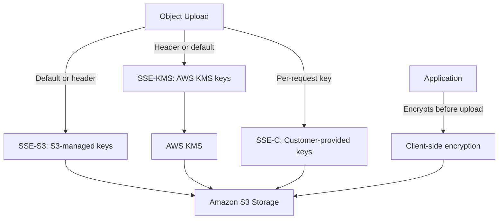

# README

## Overview

Amazon S3 encryption covers the mechanisms, key management options, permission models, and validation workflows required to protect object data at rest in production environments. It addresses the encryption options available for S3 objects, including SSE-S3, SSE-KMS, SSE-C, and client-side encryption, along with AWS KMS integration, encryption key permissions, and the configuration and validation workflows that ensure encryption is applied correctly.

This section of the Backend Engineering Playbook provides a structured reference for backend engineers, security engineers, and platform teams who design, implement, and audit encryption controls for S3-backed applications handling sensitive or regulated data.

The focus is on practical encryption engineering: selecting the right encryption mechanism for each workload, understanding how key permissions interact with S3 authorization, enforcing encryption through bucket configuration and policy, and verifying that encryption is applied as intended across an object inventory.

## Navigation

| # | File | Description |
|---|---|---|
| 01 | [01- S3 Encryption Overview](./01-%20S3%20Encryption%20Overview.md) | Encryption options, the role of encryption in the broader S3 security model, and selecting the appropriate mechanism |
| 02 | [02- Server-Side Encryption with S3-Managed Keys (SSE-S3)](./02-%20Server-Side%20Encryption%20with%20S3-Managed%20Keys%20%28SSE-S3%29.md) | Default S3 encryption, automatic key management, transparent encryption and decryption, and configuration |
| 03 | [03- Server-Side Encryption with AWS KMS (SSE-KMS)](./03-%20Server-Side%20Encryption%20with%20AWS%20KMS%20%28SSE-KMS%29.md) | KMS-managed encryption keys, authorization through KMS key policies, envelope encryption, and audit logging |
| 04 | [04- Server-Side Encryption with Customer-Provided Keys (SSE-C)](./04-%20Server-Side%20Encryption%20with%20Customer-Provided%20Keys%20%28SSE-C%29.md) | Application-supplied encryption keys, per-request key material, key management responsibilities, and operational constraints |
| 05 | [05- Client-Side Encryption](./05-%20Client-Side%20Encryption.md) | Encrypting data before upload, ciphertext storage in S3, application-managed key material, and use cases |
| 06 | [06- AWS KMS Integration](./06-%20AWS%20KMS%20Integration.md) | KMS key types, S3 integration behavior, envelope encryption, KMS API calls generated by S3 operations, and costs |
| 07 | [07- Encryption Key Permissions and Access Control](./07-%20Encryption%20Key%20Permissions%20and%20Access%20Control.md) | KMS key policies, IAM permissions for KMS operations, dual authorization requirements for SSE-KMS, and permission failures |
| 08 | [08- Encryption Configuration and Validation](./08-%20Encryption%20Configuration%20and%20Validation.md) | Bucket default encryption settings, enforcement through bucket policy, validation using inventory and CLI inspection |

## Why S3 Encryption Matters

Encryption at rest protects stored object data against unauthorized access to the underlying storage media, unintended exposure from misconfigured access controls, and certain classes of insider or supply-chain threats. For regulated workloads, encryption is often a compliance requirement with specific key management and audit evidence obligations.

Common encryption risks include:

- Objects uploaded without encryption because the bucket default was not set or a policy condition was not applied.
- SSE-KMS objects that cannot be decrypted because the application role lacks `kms:Decrypt` permission on the key, causing unexpected access failures.
- KMS key policies that are too restrictive, blocking legitimate access, or too permissive, granting unintended decryption capability to other principals.
- SSE-C operations that fail in production because the client does not retain or correctly manage the encryption key material.
- Encryption status not validated after deployment, leaving objects unprotected without detection.
- KMS request rates exceeding service quotas under high-throughput workloads, causing throttling and upload or download failures.

Effective S3 encryption combines the appropriate encryption mechanism for each workload, correct KMS key policy design, consistent bucket default configuration, policy-based enforcement, and regular validation of applied encryption status.

## Documentation Structure

This section is organized into focused documents progressing from the encryption overview through each server-side and client-side mechanism, KMS integration depth, key permission design, and configuration validation.

| Area | Primary focus |
|---|---|
| Encryption overview | Mechanism comparison, security model positioning, and selection guidance |
| SSE-S3 | Default encryption, automatic key management, and configuration |
| SSE-KMS | KMS-managed keys, key policy design, envelope encryption, and audit integration |
| SSE-C | Customer-provided key material, per-request requirements, and operational constraints |
| Client-side encryption | Application-managed encryption before upload and key management responsibilities |
| KMS integration | KMS key types, S3 integration behavior, envelope encryption, and KMS cost considerations |
| Key permissions | KMS key policies, IAM permissions, dual authorization, and access failure diagnosis |
| Configuration and validation | Default encryption settings, policy enforcement, and post-deployment validation |

Each document is intended to be independently maintainable while connecting to the broader S3 security model. Shared concepts should be referenced rather than duplicated across documents.

## Core Encryption Principles

### Set Bucket Default Encryption

Configure default encryption on every production bucket. Default encryption ensures that objects uploaded without an explicit encryption header are encrypted using the configured mechanism. SSE-S3 is the minimum baseline. Use SSE-KMS for workloads requiring key management controls, audit evidence of cryptographic operations, or compliance requirements that mandate customer-managed keys.

### Enforce Encryption Through Bucket Policy

Default encryption settings protect objects uploaded without an explicit header, but they do not prevent a caller from explicitly uploading with a weaker encryption method or no encryption. Add a bucket policy condition that denies uploads unless the request specifies the required encryption mechanism or uses the bucket default.

### Design KMS Key Policies Carefully

SSE-KMS introduces a second authorization boundary: the KMS key policy. An application role that has S3 permissions but lacks `kms:GenerateDataKey` and `kms:Decrypt` on the key will fail to upload or download objects. Design key policies and IAM policies together. Test both upload and download operations after deployment.

### Understand the Cost and Quota Implications of SSE-KMS

Each SSE-KMS upload generates a `GenerateDataKey` KMS API call, and each download generates a `Decrypt` call. At high request rates, these calls can exhaust KMS service quotas and cause throttling. Evaluate KMS request rates against the workload's upload and download throughput. Use S3 Bucket Keys to reduce the number of KMS API calls for high-throughput buckets.

### Validate Encryption Status After Deployment

Enabling default encryption or changing encryption settings does not retroactively re-encrypt existing objects. Use S3 Inventory with encryption status metadata, or the CLI with JMESPath filtering, to verify that all objects in a bucket have the expected encryption configuration after deployment.

## How Encryption Mechanisms Compare

## Recommended Encryption Setup

Apply the following process when designing or reviewing S3 encryption for a production workload.

1. **Select the encryption mechanism.** Choose SSE-S3 for straightforward encryption without key management requirements. Choose SSE-KMS for workloads requiring key audit trails, customer-managed keys, or compliance obligations. Evaluate SSE-C or client-side encryption only when the application must own key material completely.
2. **Configure bucket default encryption.** Set the default encryption mechanism on every production bucket. For SSE-KMS, specify the KMS key ARN.
3. **Enable S3 Bucket Keys for SSE-KMS.** Enable Bucket Keys to reduce KMS API calls and associated costs and quota consumption for high-throughput buckets.
4. **Add an encryption enforcement policy.** Add a bucket policy condition that denies uploads not using the required encryption mechanism.
5. **Design KMS key policies.** Grant application roles `kms:GenerateDataKey` and `kms:Decrypt`. Grant key administrators `kms:Describe*`, `kms:List*`, and key management actions. Avoid granting `kms:*` to application identities.
6. **Test upload and download operations.** Verify that the application can upload and retrieve objects successfully. Confirm that unauthorized principals cannot decrypt objects.
7. **Validate encryption status.** Use S3 Inventory or CLI inspection to confirm that all objects have the expected encryption status after deployment.
8. **Monitor KMS usage.** Configure CloudWatch alarms for KMS throttling errors. Review KMS request rates under production load.

## Operational Standards

- **Default encryption:** Enable on every production bucket. Use SSE-KMS for sensitive or regulated data.
- **Bucket Keys:** Enable S3 Bucket Keys for all SSE-KMS buckets to reduce KMS API call volume.
- **Policy enforcement:** Add a bucket policy deny condition requiring the expected encryption mechanism on all uploads.
- **KMS key policies:** Scope `kms:GenerateDataKey` and `kms:Decrypt` to the application roles that need them. Do not grant `kms:*` to application identities.
- **Key rotation:** Enable automatic KMS key rotation for customer-managed keys used with SSE-KMS.
- **Validation:** Use S3 Inventory with encryption status or CLI inspection to verify encryption status after changes to bucket configuration.
- **KMS quota monitoring:** Monitor KMS request rates for high-throughput buckets. Request quota increases proactively if approaching limits.
- **SSE-C discipline:** If SSE-C is used, implement strict key management, rotation, and backup procedures. Losing the key material makes the objects permanently unreadable.

## Key Takeaways

- S3 encryption requires explicit configuration of bucket defaults and policy enforcement — neither is active by default at bucket creation.
- SSE-KMS introduces a second authorization boundary through KMS key policies; application roles need both S3 and KMS permissions to upload and download encrypted objects.
- S3 Bucket Keys reduce KMS API call volume significantly for high-throughput workloads and should be enabled for all SSE-KMS buckets.
- Encryption configuration changes do not re-encrypt existing objects; validate encryption status using inventory or CLI inspection after deployment.
- SSE-C and client-side encryption give the application full key management responsibility; losing the key material results in permanent data loss.
