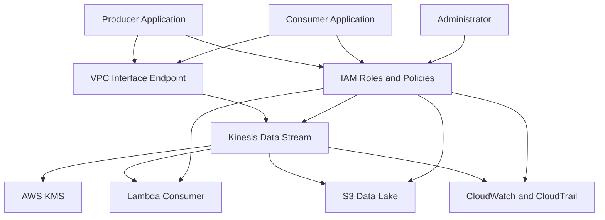
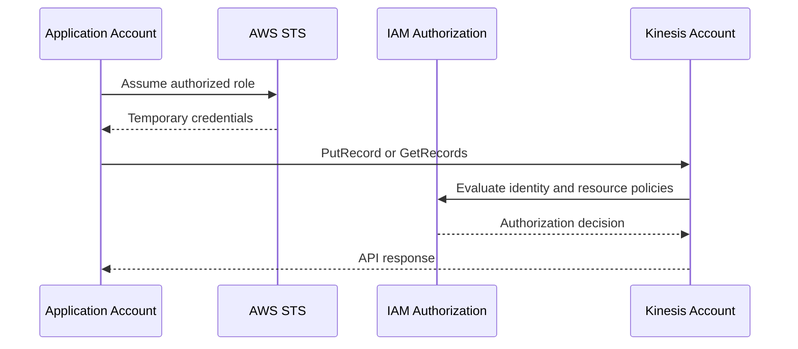
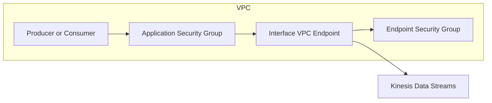

# 01- Kinesis Security Overview

## Overview

Amazon Kinesis security covers the identity, authorization, network, encryption, data protection, and operational controls used to protect streaming workloads built on AWS Kinesis services.

For backend and data engineering systems, security must protect the complete streaming lifecycle:

- Producers publishing records into streams.
- Consumers retrieving records and processing events.
- Applications managing streams, shards, consumers, and retention.
- Data delivery integrations with S3, Lambda, Redshift, and other AWS services.
- Operational access through AWS Console, CLI, SDKs, and infrastructure automation.

Kinesis security is not limited to enabling encryption. A production implementation must enforce least-privilege IAM permissions, restrict network access, protect data in transit and at rest, prevent unauthorized stream access, and maintain auditable operational controls.

## Kinesis Services and Security Boundaries

AWS provides several services under the Kinesis family. Their security responsibilities differ.

| Service | Primary responsibility | Important security concerns |
|---|---|---|
| Kinesis Data Streams | Real-time streaming ingestion and consumption | IAM authorization, encryption, VPC connectivity, data retention |
| Amazon Data Firehose | Managed delivery of streaming data to destinations | IAM roles, destination permissions, encryption, secrets |
| Managed Service for Apache Flink | Stateful stream processing | Application roles, source and sink permissions, checkpoint protection |
| Kinesis Video Streams | Ingestion and processing of video streams | IAM, encryption, endpoint access, data retention |

This document focuses primarily on Kinesis Data Streams and its integration security. Service-specific controls must also be applied to Firehose, Flink, and Video Streams.

## Security Architecture

A secure streaming architecture separates producer, consumer, administration, and integration permissions.



The architecture should enforce the following boundaries:

- Producers can publish records but cannot administer streams.
- Consumers can retrieve records but cannot modify stream configuration.
- Administrators use separate, controlled roles for infrastructure management.
- Kinesis encryption keys are managed independently through AWS KMS.
- Network access is restricted through VPC endpoints and endpoint policies where applicable.
- Delivery integrations use dedicated IAM roles.
- CloudTrail records management and supported data-plane activity.

## IAM Security

IAM is the primary authorization mechanism for Kinesis Data Streams.

Every producer, consumer, and administrative process should use a dedicated IAM role with only the permissions required for its workload.

### Producer Permissions

A producer generally requires:

- `kinesis:PutRecord`
- `kinesis:PutRecords`
- `kinesis:DescribeStreamSummary` when stream metadata discovery is required.

Avoid granting stream administration permissions to producer applications.

Example producer policy:

```json
{
  "Version": "2012-10-17",
  "Statement": [
    {
      "Sid": "PublishToOrdersStream",
      "Effect": "Allow",
      "Action": [
        "kinesis:PutRecord",
        "kinesis:PutRecords",
        "kinesis:DescribeStreamSummary"
      ],
      "Resource": "arn:aws:kinesis:ap-south-1:123456789012:stream/orders-events"
    }
  ]
}
```

Use the actual AWS account, Region, and stream ARN in deployment.

### Consumer Permissions

Consumers need read permissions appropriate to their consumption model.

Typical permissions include:

| Permission | Purpose |
|---|---|
| `kinesis:DescribeStreamSummary` | Retrieve stream metadata |
| `kinesis:ListShards` | Discover stream shards |
| `kinesis:GetShardIterator` | Obtain a shard iterator |
| `kinesis:GetRecords` | Retrieve records |
| `kinesis:SubscribeToShard` | Consume using enhanced fan-out |
| `kinesis:DescribeStreamConsumer` | Retrieve registered consumer details |

A consumer using enhanced fan-out should receive only the additional permissions required for its registered consumer.

Example consumer policy:

```json
{
  "Version": "2012-10-17",
  "Statement": [
    {
      "Sid": "ReadOrdersStream",
      "Effect": "Allow",
      "Action": [
        "kinesis:DescribeStreamSummary",
        "kinesis:ListShards",
        "kinesis:GetShardIterator",
        "kinesis:GetRecords"
      ],
      "Resource": "arn:aws:kinesis:ap-south-1:123456789012:stream/orders-events"
    }
  ]
}
```

### Enhanced Fan-Out Permissions

Enhanced fan-out consumers use registered stream consumers and the `SubscribeToShard` API.

A typical policy requires stream-consumer permissions:

```json
{
  "Version": "2012-10-17",
  "Statement": [
    {
      "Sid": "SubscribeToOrdersConsumer",
      "Effect": "Allow",
      "Action": [
        "kinesis:DescribeStreamConsumer",
        "kinesis:SubscribeToShard"
      ],
      "Resource": "arn:aws:kinesis:ap-south-1:123456789012:stream/orders-events/consumer/orders-processor:1234567890"
    }
  ]
}
```

The consumer ARN must identify the registered consumer. The application may also need stream metadata permissions depending on how it discovers the stream and consumer.

### Administrative Permissions

Stream administrators may require permissions such as:

- `kinesis:CreateStream`
- `kinesis:DeleteStream`
- `kinesis:UpdateShardCount`
- `kinesis:UpdateStreamMode`
- `kinesis:StartStreamEncryption`
- `kinesis:StopStreamEncryption`
- `kinesis:RegisterStreamConsumer`
- `kinesis:DeregisterStreamConsumer`

Separate these permissions from application runtime roles.

A production deployment should use infrastructure automation roles for stream provisioning rather than allowing application containers to create or modify streams.

### IAM Policy Design Recommendations

- Scope permissions to exact stream and consumer ARNs.
- Avoid `"Resource": "*"` unless the action requires it and the scope is justified.
- Separate producer, consumer, administrator, and delivery roles.
- Use IAM roles instead of long-lived access keys.
- Apply permissions boundaries or organizational controls where appropriate.
- Review wildcard actions regularly.
- Use IAM Access Analyzer to identify unintended access.

## Resource-Based Access and Cross-Account Security

Kinesis Data Streams supports resource-based policies for controlling access to streams and registered consumers.

These policies are useful when applications in another AWS account need access without distributing long-lived credentials.

### Cross-Account Access Flow



For cross-account access:

1. Define the permitted principal in the resource policy or trusted role configuration.
2. Restrict access to specific streams and supported operations.
3. Configure the caller's identity permissions.
4. Apply organization-level restrictions where appropriate.
5. Monitor access through CloudTrail.

Resource-based policies and identity-based policies must be evaluated together. A resource policy does not eliminate the need to understand the caller's IAM permissions and applicable explicit denies.

### Cross-Account Security Recommendations

- Avoid granting access to an entire external account when a specific role ARN is sufficient.
- Restrict access to required stream resources.
- Use external IDs when appropriate for third-party role assumption.
- Monitor role assumptions and cross-account Kinesis API calls.
- Review resource policies during account onboarding and offboarding.

## Encryption at Rest

Kinesis Data Streams encrypts stream data at rest using server-side encryption.

AWS KMS manages the encryption keys.

### Encryption Options

| Option | Description | Use case |
|---|---|---|
| AWS-owned key | Key managed by AWS | Workloads with basic encryption requirements |
| AWS-managed KMS key | AWS-managed key for Kinesis | Standard encryption with AWS-managed lifecycle |
| Customer-managed KMS key | Customer-controlled KMS key | Workloads requiring granular key policies and audit controls |

For sensitive workloads, customer-managed KMS keys provide greater control over key policies, grants, rotation, and lifecycle management.

### Enabling Encryption

Encryption can be enabled using the AWS CLI:

```bash
aws kinesis start-stream-encryption \
  --stream-name orders-events \
  --encryption-type KMS \
  --key-id alias/kinesis-orders-key \
  --region ap-south-1
```

Verify the stream configuration:

```bash
aws kinesis describe-stream-summary \
  --stream-name orders-events \
  --region ap-south-1
```

Inspect the returned encryption configuration to confirm that encryption is enabled and the expected key is configured.

### KMS Permissions

The IAM role and KMS key policy must permit the required cryptographic operations.

Depending on the operation and integration, Kinesis may require permissions such as:

- `kms:GenerateDataKey`
- `kms:Decrypt`

A key policy can restrict usage to the Kinesis service and intended account or role.

Example policy statement:

```json
{
  "Sid": "AllowKinesisKeyUsage",
  "Effect": "Allow",
  "Principal": {
    "AWS": "arn:aws:iam::123456789012:role/kinesis-producer-role"
  },
  "Action": [
    "kms:GenerateDataKey",
    "kms:Decrypt"
  ],
  "Resource": "*"
}
```

This is an illustrative statement, not a complete key policy. A production policy must also preserve key-administration permissions and account-level key management access.

### KMS Operational Considerations

- Key deletion can make encrypted stream data inaccessible.
- Disabling a key can interrupt operations that depend on it.
- Key policies must permit the required service and application access.
- Monitor KMS usage and key lifecycle events.
- Use aliases to simplify configuration management.
- Coordinate key rotation and access changes with application deployments.

Do not confuse KMS key rotation with re-encryption of all historical records. Understand the service's encryption behavior and key lifecycle before changing keys.

## Encryption in Transit

Kinesis API requests use HTTPS with TLS.

Applications should use AWS SDKs or signed API requests over secure TLS connections.

For Python applications, use the AWS SDK rather than manually constructing unsigned HTTP requests.

```python
import boto3

kinesis = boto3.client(
    "kinesis",
    region_name="ap-south-1",
)

response = kinesis.put_record(
    StreamName="orders-events",
    Data=b'{"event_id":"evt-1001","type":"order.created"}',
    PartitionKey="customer-123",
)

print(response["SequenceNumber"])
```

Production applications should obtain credentials from their execution environment, such as an ECS task role, EKS workload identity, or EC2 instance profile.

Avoid embedding access keys in source code or container images.

## Network Security

Kinesis Data Streams is a regional AWS service. Applications can access its public service endpoints or use VPC interface endpoints powered by AWS PrivateLink.

VPC endpoints allow private connectivity from supported VPC workloads without requiring traffic to traverse the public internet.

### VPC Endpoint Architecture



### Creating an Interface Endpoint

Example CLI command:

```bash
aws ec2 create-vpc-endpoint \
  --vpc-id vpc-0123456789abcdef0 \
  --vpc-endpoint-type Interface \
  --service-name com.amazonaws.ap-south-1.kinesis-streams \
  --subnet-ids subnet-11111111 subnet-22222222 \
  --security-group-ids sg-0123456789abcdef0 \
  --private-dns-enabled
```

The endpoint service name must match the AWS Region and service being used.

### Endpoint Security Groups

The endpoint security group should permit HTTPS traffic from approved application security groups.

Typical configuration:

| Direction | Protocol | Port | Source or destination |
|---|---|---:|---|
| Inbound | TCP | 443 | Application security group |
| Outbound | TCP | 443 | Required service traffic, according to the endpoint configuration |

Security groups are stateful. Keep rules narrow and avoid unrestricted inbound access.

### VPC Endpoint Policies

An endpoint policy controls which principals and resources can be accessed through that endpoint.

It does not replace IAM authorization or Kinesis resource policies.

Use endpoint policies to add another restriction layer for private workloads.

### Network Security Recommendations

- Prefer interface endpoints for private workloads where appropriate.
- Enable private DNS when the application should resolve standard service hostnames privately.
- Restrict endpoint security groups to approved application sources.
- Use endpoint policies to restrict access to intended streams and principals.
- Review route tables, DNS configuration, and network ACLs.
- Ensure applications use the intended endpoint rather than unintentionally falling back to public connectivity.

## Data Protection and Sensitive Information

Kinesis records may contain customer data, transaction details, authentication metadata, or other sensitive information.

Encryption does not remove the need for data minimization and application-level protection.

### Data Classification

Classify streaming payloads before publishing them.

| Data category | Recommended handling |
|---|---|
| Public operational events | Standard encryption and access controls |
| Internal business events | Restricted IAM access and encryption |
| Customer personal data | Data minimization, strict access, retention controls |
| Authentication secrets | Do not publish unless absolutely necessary; prefer secret references |
| Payment-sensitive data | Apply applicable regulatory and payment security controls |

### Avoid Publishing Secrets

Never include the following in streaming payloads unless a carefully reviewed design requires it:

- Passwords
- Access keys
- Session tokens
- Private keys
- Database credentials
- Unredacted authentication headers

Prefer publishing a reference to a secure record in an approved data store.

For example:

```json
{
  "event_id": "evt-1001",
  "event_type": "document.uploaded",
  "document_id": "doc-9001",
  "storage_reference": "s3://private-documents/tenant-42/doc-9001"
}
```

The consumer should retrieve the document through a separately authorized access path.

### Retention and Data Exposure

Kinesis retention determines how long records remain available for consumption.

Longer retention improves recovery options but increases the period during which retained data remains accessible.

Consider:

- Whether the retention period matches business recovery requirements.
- Whether sensitive records should be tokenized or minimized.
- Whether downstream S3 archives have separate lifecycle policies.
- Whether data deletion requirements extend to downstream copies.
- Whether replay operations can expose data to unauthorized consumers.

Kinesis retention is not a complete data deletion strategy. Downstream archives, backups, and derived datasets must be governed separately.

## Application Security

Application-level security is necessary even when AWS infrastructure controls are correctly configured.

### Producer Validation

Producers should validate event structure and reject malformed or unauthorized data before publishing.

Recommended controls:

- Schema validation.
- Maximum payload size checks.
- Tenant and ownership validation.
- Event type allowlists.
- Sensitive-field filtering.
- Stable event identifiers.
- Structured error handling.

For Python services, validate payloads before serialization and publishing.

```python
from datetime import datetime, timezone
from uuid import uuid4

from pydantic import BaseModel, ConfigDict, Field


class OrderCreatedEvent(BaseModel):
    model_config = ConfigDict(extra="forbid")

    event_id: str = Field(default_factory=lambda: str(uuid4()))
    event_type: str = "order.created"
    order_id: str
    customer_id: str
    occurred_at: datetime = Field(
        default_factory=lambda: datetime.now(timezone.utc)
    )
```

The producer should serialize validated data and publish it using its assigned IAM role.

### Consumer Security

Consumers should treat every record as untrusted input.

Apply:

- Schema validation before processing.
- Authorization checks for tenant-specific operations.
- Safe deserialization.
- Input size limits.
- Parameterized database queries.
- Restricted outbound network access.
- Idempotent processing.
- Controlled error logging without sensitive payload leakage.

A valid AWS signature confirms the caller's authorization to invoke an API. It does not prove that the business event is trustworthy or valid.

### Multi-Tenant Streams

For multi-tenant applications, decide whether tenants share streams or use separate streams.

| Design | Advantages | Limitations |
|---|---|---|
| Shared stream | Lower infrastructure overhead | Application-level tenant isolation is critical |
| Separate streams | Stronger infrastructure separation | More operational and cost complexity |
| Shared stream with separate consumer groups | Independent processing workflows | Does not isolate tenants at the stream authorization boundary |

If multiple tenants share a stream, enforce tenant authorization in the producer and consumer applications. Do not trust a tenant identifier supplied in an event without validating it.

## Integration Security

Kinesis commonly integrates with other AWS services. Each integration introduces additional IAM and data access boundaries.

### Lambda Integration

When Lambda consumes a Kinesis stream through an event source mapping:

- The Lambda execution role needs permissions for downstream resources.
- The event source mapping requires appropriate permissions to read the stream.
- Encryption key permissions must be configured when customer-managed KMS keys are used.
- The function should validate records and handle partial batch failures where supported.
- Sensitive payloads should not be written to unrestricted logs.

Keep stream-reading permissions and downstream business permissions separate where possible.

### S3 Delivery

When records are delivered to S3 through Firehose or a custom consumer:

- Use a dedicated delivery role.
- Restrict the role to the intended bucket and prefix.
- Enable destination encryption.
- Apply bucket policies and Block Public Access.
- Use separate retention and lifecycle policies.
- Prevent unintended cross-account access.

Example S3 permissions for a delivery role:

```json
{
  "Version": "2012-10-17",
  "Statement": [
    {
      "Sid": "WriteKinesisArchive",
      "Effect": "Allow",
      "Action": [
        "s3:PutObject"
      ],
      "Resource": "arn:aws:s3:::company-stream-archive/orders/*"
    },
    {
      "Sid": "CheckArchiveBucket",
      "Effect": "Allow",
      "Action": [
        "s3:GetBucketLocation"
      ],
      "Resource": "arn:aws:s3:::company-stream-archive"
    }
  ]
}
```

Additional permissions may be required for multipart uploads, KMS encryption, or other delivery configuration.

### Managed Service for Apache Flink

Flink applications access Kinesis sources and external sinks through an execution role.

Apply least privilege to:

- Source stream read operations.
- Destination write operations.
- KMS key usage.
- S3 checkpoint and savepoint locations.
- CloudWatch logging.
- Secret retrieval where required.

Protect checkpoint and savepoint storage because it can contain application state and sensitive processing information.

## Secrets Management

Streaming applications often require credentials for databases, APIs, and external systems.

Do not store these credentials in Kinesis records, source code, Docker images, or environment files committed to repositories.

Use:

- AWS Secrets Manager for managed secret storage and rotation.
- AWS Systems Manager Parameter Store for configuration and supported secure parameters.
- IAM roles for AWS service authentication.
- Workload identity mechanisms for containerized workloads.

Example Secrets Manager retrieval:

```python
import json

import boto3


def load_database_secret(secret_id: str) -> dict:
    client = boto3.client("secretsmanager")

    response = client.get_secret_value(
        SecretId=secret_id
    )

    return json.loads(response["SecretString"])
```

Grant access only to the required secret ARN. Avoid logging returned secret values.

## Logging, Monitoring, and Auditing

Security controls must be observable.

Use CloudTrail for API auditing and CloudWatch for operational monitoring.

### CloudTrail

CloudTrail can record Kinesis management activity, such as stream creation, deletion, configuration changes, and encryption updates.

Kinesis Data Streams also supports data event logging for supported data-plane operations when configured appropriately.

Data events can increase CloudTrail costs and event volume. Enable them according to audit and security requirements.

Monitor for:

- Unauthorized API calls.
- Unexpected stream creation or deletion.
- Changes to encryption settings.
- Changes to stream access policies.
- Cross-account access.
- Unexpected consumer registration or removal.
- Changes to retention or capacity configuration.

### CloudWatch Metrics

Monitor stream health and consumer behavior.

| Metric | Security or operational relevance |
|---|---|
| `IncomingRecords` | Unexpected ingestion volume |
| `IncomingBytes` | Unusual data transfer patterns |
| `GetRecords.IteratorAgeMilliseconds` | Consumer lag and delayed processing |
| `WriteProvisionedThroughputExceeded` | Producer throttling |
| `ReadProvisionedThroughputExceeded` | Consumer read throttling |
| `GetRecords.Records` | Consumer retrieval activity |
| `PutRecord.Success` | Producer publishing success |

Metrics are not a substitute for security audit logs. Use CloudTrail and application-level audit events to investigate who performed an operation and what application workflow was involved.

### Security Alerting

Create alerts for:

- Repeated authorization failures.
- Unexpected changes to stream encryption.
- Unauthorized stream deletion attempts.
- Unusual cross-account access.
- Sudden changes in ingestion volume.
- Consumer lag beyond the operational threshold.
- Unexpected changes to KMS key policies.

Route alerts through an approved incident response workflow.

## Infrastructure as Code Security

Manage streams, KMS keys, IAM roles, and VPC endpoints through reviewed infrastructure code.

Example Terraform configuration:

```hcl
resource "aws_kinesis_stream" "orders" {
  name             = "orders-events"
  retention_period = 48
  shard_count      = 2

  encryption_type = "KMS"
  kms_key_id      = aws_kms_key.kinesis.arn

  stream_mode_details {
    stream_mode = "PROVISIONED"
  }

  tags = {
    Environment = "production"
    Application = "orders"
    ManagedBy   = "terraform"
  }
}

resource "aws_kms_key" "kinesis" {
  description             = "KMS key for orders Kinesis stream"
  enable_key_rotation     = true
  deletion_window_in_days = 30

  tags = {
    Environment = "production"
    Application = "orders"
  }
}
```

This is a starting point. A complete deployment must include:

- A reviewed KMS key policy.
- Least-privilege producer and consumer roles.
- CloudTrail and CloudWatch configuration.
- VPC endpoints where required.
- Stream access policies where cross-account access is needed.
- State storage and Terraform execution security.
- Key deletion safeguards and lifecycle controls.

Never place credentials or secret values directly in Terraform configuration or state without an appropriate secrets and state-protection strategy.

## Kubernetes and Container Workloads

Applications running in ECS, EKS, or Kubernetes should authenticate through workload-specific IAM roles.

Avoid distributing shared AWS access keys across containers.

### ECS

Use ECS task roles to grant permissions to individual application tasks.

Separate the task execution role from the task role:

- The execution role allows ECS to perform operations such as pulling images and publishing logs.
- The task role provides AWS permissions to the application process.

### EKS

Use EKS Pod Identity or IAM Roles for Service Accounts, depending on the cluster configuration and supported integration.

Assign a dedicated IAM role to the producer or consumer workload.

### Container Security Recommendations

- Use minimal container images.
- Do not bake credentials into images.
- Restrict container privileges.
- Keep SDK and operating-system dependencies patched.
- Limit outbound network access.
- Rotate secrets through managed services.
- Monitor workload identity assumptions.

## High Availability and Disaster Recovery

Security and availability must be designed together.

A Kinesis stream is regional. Encryption keys, IAM policies, VPC endpoints, and downstream destinations must also be considered in a regional recovery plan.

For multi-Region recovery:

- Provision equivalent streams in the recovery Region.
- Configure regional IAM roles and resource policies.
- Provision or replicate required KMS keys according to the recovery design.
- Recreate VPC endpoints and endpoint policies.
- Configure producers to switch to the recovery stream.
- Validate consumer access and downstream destination permissions.
- Protect archived records in S3 independently.

Do not assume that stream data, KMS keys, consumer registrations, or resource policies are automatically replicated to another Region.

Test recovery procedures, including key availability and application authorization, rather than testing only whether the stream exists.

## Common Security Mistakes

| Mistake | Why it is dangerous | Recommended approach |
|---|---|---|
| Giving producers administrator permissions | A compromised producer can modify or delete infrastructure | Use a publish-only role |
| Using wildcard resource permissions | Expands the impact of compromised credentials | Scope permissions to stream and consumer ARNs |
| Storing AWS keys in containers | Credentials can leak through images or deployment artifacts | Use workload IAM roles |
| Assuming encryption replaces IAM | Encrypted data can still be accessed by unauthorized principals with valid permissions | Enforce both encryption and authorization |
| Ignoring KMS key policies | Valid IAM permissions may still be insufficient | Review IAM and key policies together |
| Exposing streams through unrestricted network paths | Increases unnecessary network exposure | Use private endpoints and restrictive policies where appropriate |
| Logging complete event payloads | Sensitive information may leak into logs | Log event identifiers and safe metadata |
| Treating tenant IDs as trusted | Malicious producers may spoof tenant identity | Validate tenant ownership and authorization |
| Ignoring downstream permissions | A secure stream can feed insecure destinations | Review every integration boundary |
| Assuming cross-Region recovery is automatic | Regional resources and configurations may be missing during an outage | Maintain and test a complete recovery plan |

## Production Security Checklist

### Identity and Authorization

- [ ] Producer and consumer roles are separate.
- [ ] IAM policies use least-privilege actions and resource ARNs.
- [ ] Administrative permissions are restricted to deployment and operations roles.
- [ ] Cross-account access is explicitly controlled.
- [ ] Workloads use temporary credentials through IAM roles.
- [ ] Resource-based policies are reviewed where configured.

### Encryption and Data Protection

- [ ] Encryption at rest is enabled.
- [ ] KMS key policies are reviewed.
- [ ] Key rotation and deletion procedures are documented.
- [ ] Applications use HTTPS for API communication.
- [ ] Sensitive fields are excluded or protected before publishing.
- [ ] Stream retention matches business and recovery requirements.
- [ ] Downstream archives have independent encryption and retention controls.

### Network and Runtime

- [ ] Private connectivity is configured where required.
- [ ] VPC endpoint security groups are restrictive.
- [ ] Endpoint policies restrict access appropriately.
- [ ] Container workloads use dedicated IAM roles.
- [ ] Application consumers validate untrusted records.
- [ ] Secrets are stored in managed secret services.
- [ ] Logs do not expose credentials or sensitive payloads.

### Monitoring and Recovery

- [ ] CloudTrail management events are enabled.
- [ ] Required data events are configured.
- [ ] CloudWatch metrics and alarms cover critical workloads.
- [ ] Authorization failures and configuration changes are monitored.
- [ ] KMS and IAM changes are auditable.
- [ ] Cross-Region recovery includes streams, keys, roles, and endpoints.
- [ ] Disaster recovery procedures are tested regularly.

## Key Takeaways

- Secure Kinesis workloads with separate least-privilege IAM roles for producers, consumers, administrators, and integrations.
- Use KMS encryption at rest, TLS in transit, and private connectivity where network isolation is required.
- Treat streaming records as untrusted input and enforce schema validation, tenant authorization, and sensitive-data minimization.
- Protect every integration boundary, including Lambda, S3, Firehose, Flink, and downstream storage.
- Use CloudTrail, CloudWatch, and tested disaster recovery procedures to maintain security visibility and operational resilience.