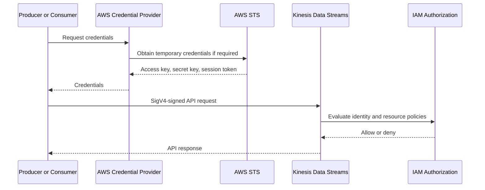
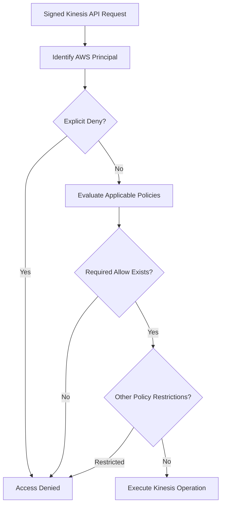
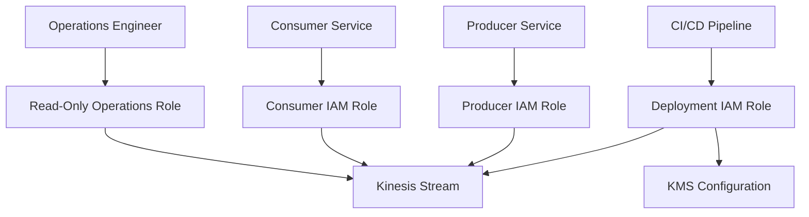
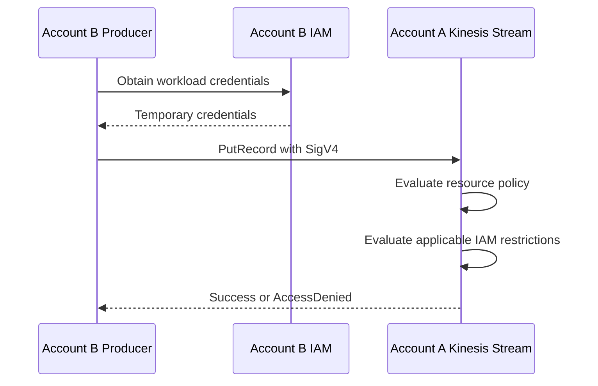

# 02- IAM Authentication and Access Control

## Overview

Amazon Kinesis Data Streams uses AWS Identity and Access Management (IAM) to authenticate API requests and authorize access to streams, registered consumers, and administrative operations.

Every interaction with Kinesis is subject to an authorization decision. This includes:

- Publishing records through `PutRecord` and `PutRecords`.
- Reading records through `GetRecords`.
- Discovering shards through `ListShards`.
- Creating shard iterators through `GetShardIterator`.
- Consuming records through enhanced fan-out.
- Creating, updating, and deleting streams.
- Registering and managing stream consumers.
- Managing stream encryption configuration.

A production Kinesis architecture should assign separate IAM roles to producers, consumers, infrastructure deployment processes, and operational administrators.

The objective is to ensure that each workload can perform only the operations required for its responsibility. A compromised producer should not be able to delete a stream, and a consumer should not be able to modify its retention or encryption configuration.

## IAM Authentication Model

Kinesis API requests are authenticated using AWS credentials and AWS Signature Version 4 (SigV4).

Applications generally obtain credentials through the AWS SDK credential provider chain. The SDK signs each request before sending it to the regional Kinesis endpoint.

### Authentication Flow



The authentication and authorization stages serve different purposes:

| Stage | Responsibility |
|---|---|
| Credential acquisition | Obtain valid AWS credentials |
| Request signing | Prove possession of the credentials using SigV4 |
| Authentication | Identify the AWS principal making the request |
| Authorization | Determine whether the principal can perform the requested action |
| API execution | Execute the operation if authorization succeeds |

Valid credentials do not automatically grant access to a stream. IAM must also authorize the requested operation.

### Credential Sources

AWS SDKs support multiple credential sources.

| Credential source | Typical use case | Production guidance |
|---|---|---|
| IAM role attached to EC2 | Applications running on EC2 | Preferred over static credentials |
| ECS task role | Containerized workloads on ECS | Use a dedicated role per application |
| EKS Pod Identity | Kubernetes workloads on EKS | Assign roles to individual workloads |
| IAM Roles for Service Accounts | Kubernetes workloads using IRSA | Restrict role trust to the intended service account |
| IAM user credentials | Local development or legacy automation | Avoid for production workloads |
| AWS IAM Identity Center | Developer access | Use for human access and local development |
| STS AssumeRole | Cross-account and delegated access | Use temporary credentials with restricted trust |

Avoid embedding access keys in Python source files, Docker images, Kubernetes manifests, CI/CD configuration, or application environment files.

## IAM Policy Evaluation

Kinesis access is controlled through IAM policy evaluation.

Depending on the request and resource configuration, AWS evaluates identity-based policies, resource-based policies, permissions boundaries, session policies, service control policies, and applicable explicit denies.

The most important authorization rules are:

- An explicit `Deny` overrides an `Allow`.
- An applicable `Allow` is required.
- Permissions boundaries and session policies can restrict effective permissions.
- Service control policies can restrict permissions available to principals in an AWS Organization.
- Resource-based policies can grant or restrict access to supported resources.

For cross-account access, the authorization configuration must permit the intended external principal and operation. Do not assume that an identity policy in the caller account alone grants access to a resource in another account.

### Example Authorization Model



For production troubleshooting, inspect the complete authorization path rather than assuming that the first policy containing an `Allow` determines the final result.

## Least-Privilege Access Design

Least privilege means granting only the actions and resources required by a workload.

A common Kinesis architecture has four distinct permission boundaries:

| Principal | Responsibility | Access level |
|---|---|---|
| Producer role | Publish application events | Write |
| Consumer role | Retrieve and process records | Read |
| Infrastructure role | Provision and configure streams | Administrative |
| Operations role | Inspect stream health and configuration | Read-only or controlled operational access |

Do not reuse one IAM role for every application component.

For example, an order service that publishes events should not receive `GetRecords`, `DeleteStream`, or `StartStreamEncryption` permissions unless it has a separate, justified requirement.

## Producer IAM Permissions

A producer publishes records using `PutRecord` or `PutRecords`.

The producer normally needs:

- `kinesis:PutRecord`
- `kinesis:PutRecords`

It may also need `kinesis:DescribeStreamSummary` or other metadata permissions depending on the SDK, application design, and stream discovery process.

### Producer Policy

```json
{
  "Version": "2012-10-17",
  "Statement": [
    {
      "Sid": "PublishOrdersEvents",
      "Effect": "Allow",
      "Action": [
        "kinesis:PutRecord",
        "kinesis:PutRecords"
      ],
      "Resource": "arn:aws:kinesis:ap-south-1:123456789012:stream/orders-events"
    },
    {
      "Sid": "DescribeOrdersStream",
      "Effect": "Allow",
      "Action": [
        "kinesis:DescribeStreamSummary"
      ],
      "Resource": "arn:aws:kinesis:ap-south-1:123456789012:stream/orders-events"
    }
  ]
}
```

The metadata permission is separated so it can be omitted if the producer does not need it.

### Python Producer

```python
import json
import os

import boto3
from botocore.exceptions import ClientError


kinesis = boto3.client(
    "kinesis",
    region_name=os.environ["AWS_REGION"],
)

STREAM_NAME = os.environ["KINESIS_STREAM_NAME"]


def publish_order_event(event: dict) -> str:
    payload = json.dumps(event).encode("utf-8")

    try:
        response = kinesis.put_record(
            StreamName=STREAM_NAME,
            Data=payload,
            PartitionKey=event["customer_id"],
        )
    except ClientError:
        # Log safe metadata and propagate the failure to the caller.
        raise

    return response["SequenceNumber"]
```

The application should obtain credentials from its execution role. No access key or secret key is embedded in the code.

### Producer Security Considerations

- Restrict publishing permissions to the intended stream.
- Validate event schemas before publishing.
- Do not grant stream administration permissions.
- Avoid logging complete payloads when they contain sensitive data.
- Use stable event identifiers to support downstream idempotency.
- Apply application-level authorization before accepting events from untrusted clients.

IAM controls whether an application can publish to a stream. It does not validate the business meaning or trustworthiness of individual records.

## Consumer IAM Permissions

A consumer retrieves records from Kinesis using the standard polling APIs or enhanced fan-out.

A polling consumer commonly needs:

- `kinesis:DescribeStreamSummary`
- `kinesis:ListShards`
- `kinesis:GetShardIterator`
- `kinesis:GetRecords`

The exact permission set depends on the SDK and consumption implementation.

### Standard Consumer Policy

```json
{
  "Version": "2012-10-17",
  "Statement": [
    {
      "Sid": "ReadOrdersEvents",
      "Effect": "Allow",
      "Action": [
        "kinesis:DescribeStreamSummary",
        "kinesis:ListShards",
        "kinesis:GetShardIterator",
        "kinesis:GetRecords"
      ],
      "Resource": "arn:aws:kinesis:ap-south-1:123456789012:stream/orders-events"
    }
  ]
}
```

The policy grants read access without allowing the consumer to publish records or modify the stream.

### Consumer Responsibilities

A consumer's AWS permissions should be separated from its business permissions.

For example, an order analytics consumer may need:

- Read access to the Kinesis stream.
- Write access to a specific S3 analytics prefix.
- Permission to publish metrics or logs through its execution environment.

It should not automatically receive access to the entire S3 data lake or unrelated streams.

Use separate policy statements for each resource boundary.

## Enhanced Fan-Out Access Control

Enhanced fan-out provides dedicated read throughput to registered stream consumers.

Unlike standard polling, an enhanced fan-out consumer uses the `SubscribeToShard` API.

Its IAM permissions must include access to the registered stream consumer.

### Enhanced Fan-Out Permissions

Typical actions include:

| Action | Purpose |
|---|---|
| `kinesis:DescribeStreamConsumer` | Retrieve registered consumer information |
| `kinesis:SubscribeToShard` | Subscribe to shard data |
| `kinesis:DescribeStreamSummary` | Retrieve stream metadata when required |
| `kinesis:ListShards` | Discover available shards when required |

Example policy:

```json
{
  "Version": "2012-10-17",
  "Statement": [
    {
      "Sid": "ReadStreamMetadata",
      "Effect": "Allow",
      "Action": [
        "kinesis:DescribeStreamSummary",
        "kinesis:ListShards"
      ],
      "Resource": "arn:aws:kinesis:ap-south-1:123456789012:stream/orders-events"
    },
    {
      "Sid": "SubscribeToOrdersConsumer",
      "Effect": "Allow",
      "Action": [
        "kinesis:DescribeStreamConsumer",
        "kinesis:SubscribeToShard"
      ],
      "Resource": "arn:aws:kinesis:ap-south-1:123456789012:stream/orders-events/consumer/orders-processor:1234567890"
    }
  ]
}
```

The registered consumer ARN identifies the stream consumer. Replace the example ARN with the actual ARN returned during consumer registration.

### Important Considerations

- Standard polling and enhanced fan-out have different API permission requirements.
- A registered consumer is a separate resource associated with a stream.
- Consumer registration and deregistration should be controlled by infrastructure or administrative roles.
- Avoid granting every consumer permission to subscribe to every registered consumer.
- Review permissions when consumer registrations are replaced or recreated.

## Administrative IAM Permissions

Administrative permissions allow a principal to create, configure, and delete Kinesis resources.

Typical operations include:

| Action | Purpose |
|---|---|
| `kinesis:CreateStream` | Create a stream |
| `kinesis:DeleteStream` | Delete a stream |
| `kinesis:DescribeStreamSummary` | Inspect stream configuration |
| `kinesis:UpdateShardCount` | Change provisioned shard capacity |
| `kinesis:UpdateStreamMode` | Change stream capacity mode |
| `kinesis:IncreaseStreamRetentionPeriod` | Increase retention |
| `kinesis:DecreaseStreamRetentionPeriod` | Decrease retention |
| `kinesis:StartStreamEncryption` | Enable or configure encryption |
| `kinesis:StopStreamEncryption` | Disable encryption |
| `kinesis:RegisterStreamConsumer` | Register an enhanced fan-out consumer |
| `kinesis:DeregisterStreamConsumer` | Remove a registered consumer |
| `kinesis:DescribeStreamConsumer` | Inspect consumer configuration |

Some administrative operations require additional permissions for related resources, such as KMS keys.

### Separate Deployment and Runtime Roles

A secure deployment model uses different roles for infrastructure provisioning and application execution.



The deployment role can manage infrastructure. The producer and consumer roles receive only their runtime permissions.

This separation reduces the impact of compromised application credentials.

## Resource-Based Policies

Kinesis Data Streams supports resource-based policies for controlling access to supported stream resources.

Resource policies are especially useful for cross-account access because they allow a stream owner to specify which external principals can access the stream.

Identity-based policies and resource-based policies serve different purposes:

| Policy type | Attached to | Primary responsibility |
|---|---|---|
| Identity-based policy | IAM user, group, or role | Defines what the principal can do |
| Resource-based policy | Supported Kinesis resource | Defines which principals can access the resource |
| Permissions boundary | IAM principal | Sets the maximum permissions available to the principal |
| Session policy | Assumed role session | Restricts permissions for a particular session |
| Service control policy | AWS Organization or organizational unit | Defines maximum available permissions for member accounts |

### Cross-Account Access

Consider two AWS accounts:

- Account A owns the Kinesis stream.
- Account B runs a producer application.
- The producer in Account B needs to publish events to the stream in Account A.

The stream owner can configure a resource policy to allow the external producer role. The caller must also have the required identity permissions.



Example stream resource policy:

```json
{
  "Version": "2012-10-17",
  "Statement": [
    {
      "Sid": "AllowExternalProducer",
      "Effect": "Allow",
      "Principal": {
        "AWS": "arn:aws:iam::210987654321:role/external-orders-producer"
      },
      "Action": [
        "kinesis:PutRecord",
        "kinesis:PutRecords"
      ],
      "Resource": "arn:aws:kinesis:ap-south-1:123456789012:stream/orders-events"
    }
  ]
}
```

The external role should also have an identity-based policy allowing the required Kinesis operations against the stream ARN.

Resource policies should identify specific trusted roles rather than granting access to an entire external account unless that broader trust is intentional.

### Resource Policy Best Practices

- Specify exact principal ARNs.
- Restrict actions to the required operations.
- Scope the resource to the intended stream.
- Review cross-account principals periodically.
- Remove access when integrations are retired.
- Consider organization-based restrictions where supported and appropriate.
- Validate the policy using IAM Access Analyzer and controlled integration tests.

## Conditional Access Controls

IAM conditions provide additional restrictions beyond principal, action, and resource matching.

They can restrict access based on request context, principal attributes, network origin, or other supported condition keys.

Commonly useful global condition keys include:

| Condition key | Purpose |
|---|---|
| `aws:PrincipalArn` | Restrict access to a specific principal ARN |
| `aws:PrincipalAccount` | Restrict access based on the principal's account |
| `aws:PrincipalOrgID` | Restrict access to principals in an AWS Organization |
| `aws:SourceVpce` | Restrict access to a specified VPC endpoint |
| `aws:RequestedRegion` | Restrict requests to specified Regions |

Condition-key availability depends on the API operation and request context. Validate that a condition is supported for the Kinesis operation before enforcing it.

### Restrict Access Through a VPC Endpoint

A resource policy can use `aws:SourceVpce` to restrict requests to an approved VPC endpoint where the request context supports the condition.

Illustrative policy statement:

```json
{
  "Sid": "DenyRequestsOutsideApprovedEndpoint",
  "Effect": "Deny",
  "Principal": "*",
  "Action": [
    "kinesis:PutRecord",
    "kinesis:PutRecords",
    "kinesis:GetRecords"
  ],
  "Resource": "arn:aws:kinesis:ap-south-1:123456789012:stream/orders-events",
  "Condition": {
    "StringNotEquals": {
      "aws:SourceVpce": "vpce-0123456789abcdef0"
    }
  }
}
```

This is an illustrative restriction. Validate the condition behavior for every intended access path before deploying it.

A restrictive endpoint policy or resource policy can unintentionally block legitimate workloads if they access the service through another endpoint.

### Restrict Access to an AWS Organization

Where supported, organization-based conditions can limit access to principals belonging to a trusted AWS Organization.

Example condition:

```json
{
  "StringEquals": {
    "aws:PrincipalOrgID": "o-exampleorgid"
  }
}
```

Do not rely on organization membership as the only authorization control. Continue to restrict principals, actions, and resources.

## IAM Roles for AWS Workloads

Production Kinesis applications should use temporary credentials obtained through workload identity.

### EC2 Instance Profiles

Applications running on EC2 can use an instance profile associated with an IAM role.

The AWS SDK retrieves temporary credentials from the instance metadata service.

Recommendations:

- Attach only the required role to the instance.
- Require IMDSv2.
- Restrict access to instance metadata from application components where possible.
- Avoid static credentials in user data or configuration files.
- Do not run unrelated workloads with unnecessarily broad shared roles.

### ECS Task Roles

ECS supports task roles that provide AWS permissions to the application running inside a task.

Use a dedicated task role for each logical workload.

Example Terraform configuration:

```hcl
resource "aws_iam_role" "orders_producer" {
  name = "orders-producer-role"

  assume_role_policy = jsonencode({
    Version = "2012-10-17"
    Statement = [
      {
        Effect = "Allow"
        Principal = {
          Service = "ecs-tasks.amazonaws.com"
        }
        Action = "sts:AssumeRole"
      }
    ]
  })
}

resource "aws_iam_role_policy" "orders_producer_kinesis" {
  name = "orders-producer-kinesis"
  role = aws_iam_role.orders_producer.id

  policy = jsonencode({
    Version = "2012-10-17"
    Statement = [
      {
        Effect = "Allow"
        Action = [
          "kinesis:PutRecord",
          "kinesis:PutRecords"
        ]
        Resource = "arn:aws:kinesis:ap-south-1:123456789012:stream/orders-events"
      }
    ]
  })
}
```

The ECS task definition should reference this role through its `task_role_arn` field.

Do not confuse the task role with the task execution role. The execution role is used by ECS for tasks such as pulling container images and publishing logs; the task role provides AWS permissions to the application.

### EKS Workload Identity

For Kubernetes workloads, use EKS Pod Identity or IAM Roles for Service Accounts.

Each workload should receive an identity appropriate to its responsibility.

For example:

- `orders-producer` receives publish permissions.
- `orders-consumer` receives read permissions.
- `stream-admin` is used only by controlled deployment automation.

Avoid assigning broad Kinesis permissions to the node IAM role when workload-level identities can provide more precise access control.

### Local Development

For local development, use AWS IAM Identity Center or an approved role-assumption workflow.

Example:

```bash
aws configure sso
aws sso login --profile development
```

Run an application using the selected profile:

```bash
AWS_PROFILE=development python producer.py
```

Do not commit local credentials or share developer access keys between team members.

## KMS Permissions and IAM Access

Kinesis stream authorization and KMS key authorization are separate security boundaries.

An application may have permission to publish to a stream but still encounter authorization failures when the stream uses a customer-managed KMS key.

The effective configuration must permit the necessary Kinesis operations and KMS key usage.

Typical KMS permissions include:

- `kms:GenerateDataKey`
- `kms:Decrypt`

The exact requirements depend on the operation, key configuration, and service integration.

### KMS Policy Considerations

- Review the KMS key policy and IAM policies together.
- Grant access only to the required principals and service paths.
- Preserve key-administration access separately from application key usage.
- Avoid granting broad KMS permissions to every producer and consumer.
- Monitor key policy changes and key disablement events.
- Test encryption-related operations using the actual workload role.

Do not assume that a Kinesis IAM policy automatically grants permission to use a customer-managed KMS key.

## Policy Management and Validation

IAM policies should be treated as application infrastructure and reviewed through the same deployment controls as application code.

Recommended workflow:

1. Define the workload's required Kinesis operations.
2. Identify the exact stream and consumer resources.
3. Create a narrowly scoped IAM policy.
4. Validate syntax and policy structure.
5. Test allowed and denied operations.
6. Deploy through CI/CD.
7. Monitor authorization failures.
8. Review permissions periodically.

### IAM Policy Simulator

The IAM Policy Simulator helps evaluate identity-based policy decisions.

It is useful for diagnosing whether a principal's policies allow a particular action.

However, simulation does not replace testing the complete runtime authorization path, especially when resource policies, endpoint policies, KMS permissions, organization policies, and service-specific conditions are involved.

### AWS CLI Identity Verification

Check the active AWS identity:

```bash
aws sts get-caller-identity
```

Inspect the stream:

```bash
aws kinesis describe-stream-summary \
  --stream-name orders-events \
  --region ap-south-1
```

Test publishing using the active credentials:

```bash
aws kinesis put-record \
  --stream-name orders-events \
  --partition-key customer-123 \
  --data '{"event_id":"evt-1001","type":"order.created"}' \
  --region ap-south-1
```

Use a controlled test environment. A successful command confirms that the active principal can perform that operation under the tested conditions; it does not prove that all other access paths are secure.

### IAM Access Analyzer

Use IAM Access Analyzer to identify:

- External access granted through resource policies.
- Unintended cross-account access.
- Broad or potentially excessive permissions.
- Policy changes that expand resource access.

Access Analyzer findings should be reviewed as part of security operations rather than treated as automatic proof of a vulnerability.

## Troubleshooting IAM Authorization Failures

Kinesis authorization failures commonly appear as `AccessDeniedException` or related authorization errors.

Troubleshoot them systematically.

| Symptom | Possible cause | Investigation |
|---|---|---|
| `PutRecord` denied | Missing producer permission | Inspect `kinesis:PutRecord` authorization |
| `PutRecords` denied | Missing batch publish permission | Inspect `kinesis:PutRecords` |
| `GetRecords` denied | Missing consumer read permission | Inspect `kinesis:GetRecords` |
| `ListShards` denied | Missing shard discovery permission | Inspect `kinesis:ListShards` |
| `SubscribeToShard` denied | Missing enhanced fan-out permission | Check the registered consumer ARN and action |
| Cross-account access denied | Missing or restrictive resource policy | Inspect both accounts' authorization configuration |
| Encryption operation denied | KMS key policy or IAM permission issue | Inspect KMS key usage permissions |
| VPC endpoint request denied | Endpoint policy or network restriction | Inspect endpoint policy, security groups, and request path |

### Troubleshooting Procedure

1. Confirm the AWS account and Region.
2. Run `aws sts get-caller-identity` to identify the active principal.
3. Confirm the target stream ARN.
4. Identify the exact API action that failed.
5. Inspect the principal's identity policies.
6. Inspect resource policies and applicable organizational restrictions.
7. Check VPC endpoint policies and network configuration.
8. Check KMS authorization if encryption is involved.
9. Review CloudTrail events for the failed request.
10. Re-test using the intended workload role.

Do not resolve authorization errors by attaching `AdministratorAccess` or granting `"Resource": "*"` without understanding the missing permission.

## Monitoring and Auditing

IAM access control requires continuous monitoring.

### CloudTrail

CloudTrail records supported Kinesis API activity and IAM-related operations.

Review events for:

- Stream creation and deletion.
- Stream configuration changes.
- Encryption configuration changes.
- Consumer registration and deregistration.
- Policy changes.
- Unauthorized API attempts.
- Cross-account access.
- Unexpected administrative activity.

Kinesis data-plane operations may require explicit data event configuration. Evaluate the audit requirement, event volume, and associated CloudTrail costs before enabling broad data event collection.

### CloudWatch and Security Alerts

Use CloudWatch metrics and alarms for operational symptoms that may indicate access or configuration problems.

Useful signals include:

- Unexpected ingestion volume.
- Sudden changes in consumer activity.
- Producer throttling.
- Consumer lag.
- Application authorization failures published as structured metrics.
- KMS or integration failures reported by applications.

CloudWatch metrics do not replace CloudTrail. Use CloudTrail for API audit evidence and application telemetry for business-level context.

### Periodic Access Reviews

Review IAM permissions periodically and after significant architecture changes.

Check:

- Unused permissions.
- Roles that are no longer attached to workloads.
- External principals with stream access.
- Wildcard resources and actions.
- Policies granting stream administration to runtime applications.
- KMS permissions that are broader than necessary.
- Roles shared across unrelated services.

## Common IAM Mistakes

| Mistake | Impact | Prevention |
|---|---|---|
| Using one role for producers and consumers | Expands the impact of compromised credentials | Create separate workload roles |
| Granting `kinesis:*` to application roles | Allows unnecessary administrative operations | Grant only required actions |
| Using wildcard stream resources | Exposes unrelated streams | Scope policies to exact stream ARNs |
| Forgetting enhanced fan-out permissions | Consumer cannot subscribe to registered shards | Add permissions for the consumer ARN |
| Assuming IAM permissions override resource policies | Cross-account or resource-level access may still be denied | Evaluate all applicable policies |
| Storing access keys in application code | Credentials can leak through repositories and images | Use temporary workload credentials |
| Confusing task and execution roles in ECS | Application receives missing or incorrect permissions | Assign permissions to the task role |
| Granting broad KMS permissions | Increases the impact of compromised credentials | Scope key usage to required keys and principals |
| Applying endpoint restrictions without testing | Legitimate access paths may be blocked | Test all producer, consumer, and administrative paths |
| Fixing every error with administrator access | Hides authorization design problems | Identify the missing action and resource precisely |

## Production Access-Control Checklist

### Identity Design

- [ ] Producers and consumers use separate IAM roles.
- [ ] Infrastructure deployment uses a dedicated administrative role.
- [ ] Operational access is separated from application runtime access.
- [ ] Production workloads use temporary credentials.
- [ ] ECS and EKS workloads use workload-specific identities.
- [ ] Human access uses approved federation or identity-management workflows.

### Policy Design

- [ ] Policies grant only required Kinesis actions.
- [ ] Stream resources use exact ARNs.
- [ ] Enhanced fan-out permissions target registered consumer ARNs.
- [ ] Administrative actions are restricted to approved roles.
- [ ] Resource policies are reviewed for external access.
- [ ] Cross-account access has explicit trust and authorization.
- [ ] Conditions are validated for the intended Kinesis API operations.

### Operational Controls

- [ ] IAM policies are managed through reviewed infrastructure code.
- [ ] Policy changes are reviewed before production deployment.
- [ ] CloudTrail captures required management and data-plane activity.
- [ ] Authorization failures are monitored.
- [ ] KMS permissions are reviewed independently.
- [ ] Unused roles and permissions are removed.
- [ ] Access-control behavior is tested during deployment and security reviews.

## Key Takeaways

- Kinesis uses AWS credentials and SigV4 to authenticate requests, while IAM policy evaluation determines whether each API operation is authorized.
- Assign separate least-privilege roles to producers, consumers, enhanced fan-out consumers, administrators, and delivery workloads.
- Cross-account access requires deliberate resource and identity authorization; a caller's identity policy alone does not establish access to another account's stream.
- Workloads should use temporary credentials through EC2 instance profiles, ECS task roles, EKS Pod Identity, IRSA, or approved federation mechanisms.
- Validate IAM, resource, endpoint, organization, and KMS policies together, and use CloudTrail and periodic access reviews to detect unintended permissions.