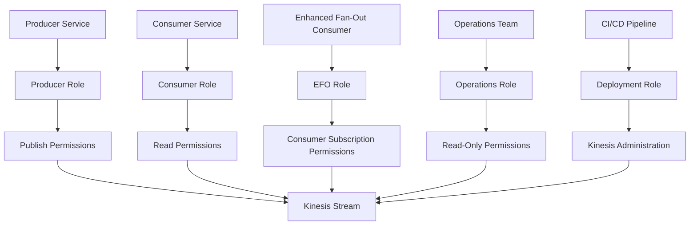
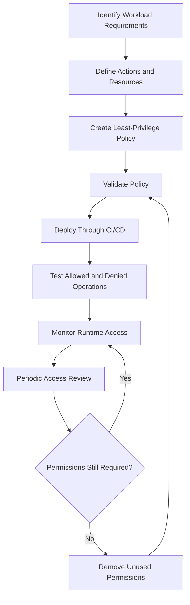

# 03- IAM Policies and Least Privilege

## Overview

IAM policies define which AWS principals can perform specific operations on Amazon Kinesis Data Streams resources. Least privilege ensures that each application, service, and operator receives only the permissions required for its responsibilities.

In a production streaming architecture, IAM policy design must account for multiple workloads:

- Producers publishing records.
- Consumers retrieving records.
- Enhanced fan-out consumers subscribing to shards.
- Infrastructure automation creating and configuring streams.
- Operations teams inspecting stream health.
- Integration services delivering records to downstream destinations.

Poorly scoped permissions increase the impact of compromised credentials, accidental configuration changes, and application vulnerabilities.

A secure Kinesis deployment separates permissions by workload, restricts access to specific stream and consumer ARNs, and manages policy changes through infrastructure as code.

## IAM Policy Fundamentals

An IAM policy is a JSON document containing statements that define access permissions.

A policy statement typically contains:

| Element | Purpose |
|---|---|
| `Version` | IAM policy language version |
| `Statement` | Collection of permission statements |
| `Sid` | Optional statement identifier |
| `Effect` | `Allow` or `Deny` |
| `Principal` | Identity receiving access in resource-based policies |
| `Action` | AWS operations being allowed or denied |
| `Resource` | Resources to which the statement applies |
| `Condition` | Optional conditions restricting access |

Identity-based policies generally contain `Effect`, `Action`, and `Resource`. Resource-based policies additionally specify the principal.

### Example Policy

```json
{
  "Version": "2012-10-17",
  "Statement": [
    {
      "Sid": "PublishOrdersEvents",
      "Effect": "Allow",
      "Action": [
        "kinesis:PutRecord",
        "kinesis:PutRecords"
      ],
      "Resource": "arn:aws:kinesis:ap-south-1:123456789012:stream/orders-events"
    }
  ]
}
```

This policy allows the attached IAM principal to publish records to one specific stream.

It does not grant permission to:

- Read records.
- Delete the stream.
- Change stream retention.
- Modify encryption configuration.
- Register stream consumers.

This is the foundation of least-privilege policy design.

## Kinesis IAM Resource Types and ARNs

IAM policies should reference the correct Kinesis resource ARN.

### Stream ARN

A Kinesis stream ARN follows this format:

```text
arn:aws:kinesis:<region>:<account-id>:stream/<stream-name>
```

Example:

```text
arn:aws:kinesis:ap-south-1:123456789012:stream/orders-events
```

### Registered Consumer ARN

Enhanced fan-out consumers have their own resource ARN:

```text
arn:aws:kinesis:<region>:<account-id>:stream/<stream-name>/consumer/<consumer-name>:<creation-timestamp>
```

Example:

```text
arn:aws:kinesis:ap-south-1:123456789012:stream/orders-events/consumer/orders-processor:1234567890
```

### Resource Scope

| Resource | Example | Typical use |
|---|---|---|
| Stream | `...:stream/orders-events` | Publishing and standard stream operations |
| Registered consumer | `...:stream/orders-events/consumer/orders-processor:1234567890` | Enhanced fan-out operations |
| All streams in an account and Region | `...:stream/*` | Controlled platform-level access |

Use exact ARNs whenever possible.

A wildcard resource may be justified for a platform service that manages dynamically created streams, but it should be restricted by actions, account, Region, and other applicable controls.

## Least-Privilege Design

Least privilege is a permission-design process, not simply a policy-writing convention.

For each workload, determine:

1. Which Kinesis operations does it perform?
2. Which stream or consumer resources does it access?
3. Does it require metadata discovery?
4. Does it require KMS permissions?
5. Does it access other AWS services?
6. Does it require cross-account access?
7. Which permissions are needed only during deployment?

The resulting policy should grant only the necessary actions against the intended resources.

### Recommended Role Separation

| IAM role | Responsibility | Typical permissions |
|---|---|---|
| `orders-producer-role` | Publish order events | `PutRecord`, `PutRecords` |
| `orders-consumer-role` | Read order events | `GetRecords`, `GetShardIterator`, `ListShards` |
| `orders-efo-consumer-role` | Enhanced fan-out consumption | `SubscribeToShard`, `DescribeStreamConsumer` |
| `kinesis-deployment-role` | Provision streams | Stream creation and configuration |
| `kinesis-operations-role` | Inspect infrastructure | Read-only stream and consumer operations |

Avoid attaching one broad Kinesis policy to every application.

### Permission Boundary Architecture



This separation limits the blast radius of compromised credentials and makes access reviews easier.

## Producer Policies

A producer sends records to a stream using `PutRecord` or `PutRecords`.

The producer should not receive read or administrative permissions unless the application has a documented requirement.

### Minimal Producer Policy

```json
{
  "Version": "2012-10-17",
  "Statement": [
    {
      "Sid": "PublishToOrdersStream",
      "Effect": "Allow",
      "Action": [
        "kinesis:PutRecord",
        "kinesis:PutRecords"
      ],
      "Resource": "arn:aws:kinesis:ap-south-1:123456789012:stream/orders-events"
    }
  ]
}
```

### Optional Metadata Permissions

Some producer implementations need stream metadata for discovery or validation.

Add only the operations actually used:

```json
{
  "Sid": "DescribeOrdersStream",
  "Effect": "Allow",
  "Action": [
    "kinesis:DescribeStreamSummary"
  ],
  "Resource": "arn:aws:kinesis:ap-south-1:123456789012:stream/orders-events"
}
```

Do not automatically grant all describe and list operations to every producer.

### Producer Policy Considerations

- Restrict publishing to the intended stream.
- Avoid `kinesis:*`.
- Avoid granting `DeleteStream` or stream configuration permissions.
- Use separate roles for different producer applications.
- Validate event schemas before publishing.
- Monitor publishing failures and unexpected access attempts.

For a multi-service architecture, each producer should have its own role or a deliberately shared role for a well-defined workload boundary.

## Consumer Policies

A standard polling consumer retrieves records through the Kinesis read APIs.

Typical permissions include:

| IAM action | Purpose |
|---|---|
| `kinesis:DescribeStreamSummary` | Retrieve stream metadata |
| `kinesis:ListShards` | Discover available shards |
| `kinesis:GetShardIterator` | Obtain a shard iterator |
| `kinesis:GetRecords` | Retrieve records |

### Minimal Consumer Policy

```json
{
  "Version": "2012-10-17",
  "Statement": [
    {
      "Sid": "ReadOrdersStream",
      "Effect": "Allow",
      "Action": [
        "kinesis:DescribeStreamSummary",
        "kinesis:ListShards",
        "kinesis:GetShardIterator",
        "kinesis:GetRecords"
      ],
      "Resource": "arn:aws:kinesis:ap-south-1:123456789012:stream/orders-events"
    }
  ]
}
```

The consumer cannot publish records or modify the stream.

### Consumer-Specific Downstream Permissions

A consumer may also need to write processed data to another AWS service.

For example, an analytics consumer might need:

- Kinesis read permissions.
- `s3:PutObject` for an approved S3 prefix.
- KMS permissions for the destination encryption key.
- CloudWatch logging permissions through its execution environment.

Keep these permissions in separate policy statements and scope each statement to the relevant resource.

Do not grant access to an entire data lake simply because one consumer writes to a single destination prefix.

## Enhanced Fan-Out Consumer Policies

Enhanced fan-out consumers use registered stream consumers and the `SubscribeToShard` API.

The registered consumer is a separate Kinesis resource. Its ARN should be used when granting consumer-specific access.

### Enhanced Fan-Out Policy

```json
{
  "Version": "2012-10-17",
  "Statement": [
    {
      "Sid": "ReadStreamMetadata",
      "Effect": "Allow",
      "Action": [
        "kinesis:DescribeStreamSummary",
        "kinesis:ListShards"
      ],
      "Resource": "arn:aws:kinesis:ap-south-1:123456789012:stream/orders-events"
    },
    {
      "Sid": "SubscribeToRegisteredConsumer",
      "Effect": "Allow",
      "Action": [
        "kinesis:DescribeStreamConsumer",
        "kinesis:SubscribeToShard"
      ],
      "Resource": "arn:aws:kinesis:ap-south-1:123456789012:stream/orders-events/consumer/orders-processor:1234567890"
    }
  ]
}
```

The exact permissions depend on how the application discovers the stream, registers consumers, and manages subscriptions.

### Operational Considerations

- Register consumers through a controlled administrative process.
- Grant runtime roles access only to their intended consumer resources.
- Avoid granting `RegisterStreamConsumer` to ordinary application roles.
- Review permissions when consumers are replaced or recreated.
- Remove obsolete consumer registrations and associated access.

## Administrative Policies

Infrastructure deployment requires permissions that runtime applications should not have.

Administrative actions include:

| Action | Purpose |
|---|---|
| `kinesis:CreateStream` | Create streams |
| `kinesis:DeleteStream` | Delete streams |
| `kinesis:UpdateShardCount` | Change provisioned shard count |
| `kinesis:UpdateStreamMode` | Change stream capacity mode |
| `kinesis:IncreaseStreamRetentionPeriod` | Increase retention |
| `kinesis:DecreaseStreamRetentionPeriod` | Decrease retention |
| `kinesis:StartStreamEncryption` | Enable or configure encryption |
| `kinesis:StopStreamEncryption` | Disable encryption |
| `kinesis:RegisterStreamConsumer` | Register enhanced fan-out consumers |
| `kinesis:DeregisterStreamConsumer` | Deregister enhanced fan-out consumers |

These actions should be assigned to a deployment or administration role.

### Deployment Role Policy

A deployment role may require a broader set of operations because it creates and configures resources.

However, its permissions should still be restricted to the intended environment and resource scope.

For example, separate development and production deployment roles rather than using one unrestricted role across all environments.

Production deployment access should be protected by:

- CI/CD identity federation.
- Approval gates for sensitive changes.
- Restricted trust policies.
- CloudTrail auditing.
- Controlled role assumption.
- Separate administrative break-glass access.

## Explicit Deny and Permission Boundaries

An explicit `Deny` can enforce restrictions that remain effective even when another applicable policy grants access.

This is useful for protecting critical streams from accidental deletion or unauthorized configuration changes.

### Deny Stream Deletion

An application role should not be able to delete a production stream.

An explicit deny can be added to a permissions boundary, identity policy, or another applicable policy:

```json
{
  "Version": "2012-10-17",
  "Statement": [
    {
      "Sid": "DenyStreamDeletion",
      "Effect": "Deny",
      "Action": [
        "kinesis:DeleteStream"
      ],
      "Resource": "arn:aws:kinesis:ap-south-1:123456789012:stream/orders-events"
    }
  ]
}
```

An explicit deny overrides an applicable allow.

### Permissions Boundaries

A permissions boundary defines the maximum permissions an IAM principal can receive through identity-based policies.

It does not grant permissions by itself.

For example, a platform team can require all application roles to use a boundary that prevents:

- Stream deletion.
- IAM policy modification.
- KMS key administration.
- Access to unrelated production streams.

The application role's identity policies must still grant the operations it needs.

### Service Control Policies

AWS Organizations service control policies (SCPs) define maximum available permissions for accounts or organizational units.

SCPs do not grant permissions. They restrict the maximum permissions available to principals in affected member accounts.

Use SCPs for organization-wide guardrails, such as restricting access to approved Regions or preventing selected high-risk operations.

Do not assume an SCP applies identically to every principal type or AWS service integration. Validate its behavior for the intended account and operation.

## IAM Conditions

IAM conditions provide additional restrictions based on request context.

Common global condition keys include:

| Condition key | Purpose |
|---|---|
| `aws:RequestedRegion` | Restrict requests to selected Regions |
| `aws:PrincipalArn` | Restrict access to selected principal ARNs |
| `aws:PrincipalAccount` | Restrict access based on account |
| `aws:PrincipalOrgID` | Restrict access to an AWS Organization |
| `aws:SourceVpce` | Restrict requests to a specified VPC endpoint |

Condition-key availability varies by API operation and request context.

### Region Restriction

An identity policy can restrict Kinesis access to an approved Region.

```json
{
  "Version": "2012-10-17",
  "Statement": [
    {
      "Sid": "AllowOrdersStreamInApprovedRegion",
      "Effect": "Allow",
      "Action": [
        "kinesis:PutRecord",
        "kinesis:PutRecords"
      ],
      "Resource": "arn:aws:kinesis:ap-south-1:123456789012:stream/orders-events",
      "Condition": {
        "StringEquals": {
          "aws:RequestedRegion": "ap-south-1"
        }
      }
    }
  ]
}
```

The resource ARN already identifies the Region. The condition provides an additional request-context restriction.

### VPC Endpoint Restriction

Where the request context supports it, a policy can restrict access to requests originating from an approved VPC endpoint.

```json
{
  "Version": "2012-10-17",
  "Statement": [
    {
      "Sid": "AllowOrdersStreamThroughApprovedEndpoint",
      "Effect": "Allow",
      "Action": [
        "kinesis:PutRecord",
        "kinesis:PutRecords"
      ],
      "Resource": "arn:aws:kinesis:ap-south-1:123456789012:stream/orders-events",
      "Condition": {
        "StringEquals": {
          "aws:SourceVpce": "vpce-0123456789abcdef0"
        }
      }
    }
  ]
}
```

This restriction should be tested with every intended access path. Applications using a different endpoint or public service endpoint may be denied.

Do not apply network-origin conditions without confirming that they are compatible with administrative, deployment, and recovery workflows.

## Cross-Account Least Privilege

Cross-account access should grant a specific external principal only the required operations.

Consider an architecture where:

- Account A owns the stream.
- Account B runs the producer.
- Account B needs to publish events to Account A.

The stream owner can grant access through a resource-based policy, while the producer role in Account B needs a corresponding identity-based policy.

### Stream Resource Policy

```json
{
  "Version": "2012-10-17",
  "Statement": [
    {
      "Sid": "AllowOrdersProducerFromExternalAccount",
      "Effect": "Allow",
      "Principal": {
        "AWS": "arn:aws:iam::210987654321:role/orders-producer-role"
      },
      "Action": [
        "kinesis:PutRecord",
        "kinesis:PutRecords"
      ],
      "Resource": "arn:aws:kinesis:ap-south-1:123456789012:stream/orders-events"
    }
  ]
}
```

The external role must also have an identity-based policy allowing the required operations against the stream ARN.

### Cross-Account Best Practices

- Trust specific role ARNs rather than entire accounts when practical.
- Restrict actions to the required producer or consumer operations.
- Avoid wildcard resource policies.
- Review access when external integrations change.
- Monitor cross-account access through CloudTrail.
- Remove access when the integration is retired.

For third-party access patterns involving role assumption, use an appropriate trust policy and external ID where required.

## KMS Permissions and Policy Separation

Kinesis stream access and KMS key access are separate authorization boundaries.

A producer may have permission to publish records but still fail if the customer-managed KMS key does not permit the required operation.

Typical KMS permissions include:

- `kms:GenerateDataKey`
- `kms:Decrypt`

The exact permissions depend on the encryption configuration and service operation.

### KMS Policy Design

Separate key administration from key usage.

| Principal | Responsibility |
|---|---|
| KMS administrator | Manage key policy, rotation, and lifecycle |
| Kinesis producer | Perform required encryption-related operations |
| Kinesis consumer | Perform required decryption-related operations |
| Deployment role | Configure the stream's encryption settings |

Do not grant `kms:*` to application roles.

Key policies and IAM policies must be reviewed together. A Kinesis policy does not automatically authorize KMS key usage.

## Policy Management with Terraform

IAM policies should be version-controlled and deployed through reviewed infrastructure automation.

Terraform can define workload roles and their permissions.

### Producer Role and Policy

```hcl
resource "aws_iam_role" "orders_producer" {
  name = "orders-producer-role"

  assume_role_policy = jsonencode({
    Version = "2012-10-17"
    Statement = [
      {
        Effect = "Allow"
        Principal = {
          Service = "ecs-tasks.amazonaws.com"
        }
        Action = "sts:AssumeRole"
      }
    ]
  })
}

resource "aws_iam_policy" "orders_producer" {
  name        = "orders-producer-kinesis-policy"
  description = "Publish events to the orders Kinesis stream"

  policy = jsonencode({
    Version = "2012-10-17"
    Statement = [
      {
        Sid    = "PublishOrdersEvents"
        Effect = "Allow"
        Action = [
          "kinesis:PutRecord",
          "kinesis:PutRecords"
        ]
        Resource = "arn:aws:kinesis:ap-south-1:123456789012:stream/orders-events"
      }
    ]
  })
}

resource "aws_iam_role_policy_attachment" "orders_producer" {
  role       = aws_iam_role.orders_producer.name
  policy_arn = aws_iam_policy.orders_producer.arn
}
```

The trust policy shown is for ECS tasks. For EC2, EKS, or other execution environments, configure the appropriate trusted principal and trust conditions.

### Policy Deployment Recommendations

- Keep IAM policies in version control.
- Use separate roles for each environment.
- Review policy diffs during pull requests.
- Validate JSON and Terraform before deployment.
- Apply policy changes through CI/CD.
- Restrict who can modify production IAM resources.
- Protect Terraform state because it may contain sensitive infrastructure metadata.
- Avoid hardcoding account IDs and resource identifiers where reusable variables are appropriate.

For larger deployments, use reusable Terraform modules with explicit inputs for account, Region, stream ARN, workload identity, and allowed actions.

## Policy Validation and Testing

IAM policy validation should be part of the deployment lifecycle.

### Validate Policy JSON

Use the AWS CLI policy validation operation:

```bash
aws accessanalyzer validate-policy \
  --policy-document file://producer-policy.json \
  --policy-type IDENTITY_POLICY
```

This helps identify policy syntax issues and selected security findings.

It does not prove that the complete runtime authorization path will succeed.

### Simulate Permissions

The IAM Policy Simulator can help evaluate identity-based permissions.

Use it to test expected operations, such as:

- `kinesis:PutRecord` against the intended stream.
- `kinesis:GetRecords` against the intended stream.
- `kinesis:DeleteStream` against a production stream.

Also test denied operations and review resource-based policies, endpoint policies, SCPs, permissions boundaries, session policies, and KMS permissions where applicable.

### Positive and Negative Tests

A least-privilege policy should be tested for both permitted and forbidden operations.

| Test | Expected result |
|---|---|
| Producer publishes to approved stream | Allowed |
| Producer publishes to unrelated stream | Denied |
| Producer reads records | Denied |
| Producer deletes stream | Denied |
| Consumer reads approved stream | Allowed |
| Consumer publishes records | Denied |
| Consumer modifies retention | Denied |
| Runtime role changes IAM policies | Denied |

A policy that permits the intended operation but also permits unrelated operations is not sufficiently restricted.

## Policy Lifecycle and Access Reviews

IAM policies evolve as applications and architectures change.

A policy that was appropriate during initial deployment may become excessive after a service migration or feature removal.

Use a defined policy lifecycle:



### Access Review Activities

Review the following regularly:

- Roles that are no longer attached to workloads.
- Permissions that are no longer used.
- Wildcard actions and resources.
- Broad cross-account trust relationships.
- Unused enhanced fan-out consumer permissions.
- Administrative permissions assigned to runtime roles.
- KMS permissions that exceed application requirements.
- Policies that allow access to retired streams.

IAM Access Analyzer and CloudTrail can support these reviews, but automated findings should be evaluated against actual application requirements.

## Common Policy Design Mistakes

| Mistake | Risk | Corrective action |
|---|---|---|
| Granting `kinesis:*` | Application can perform unnecessary administrative operations | Grant only required actions |
| Using `"Resource": "*"` everywhere | Access expands to unrelated streams | Use exact resource ARNs |
| Combining producer and consumer permissions | Compromised workload gains unnecessary capabilities | Separate runtime roles |
| Giving deployment permissions to application containers | Application compromise can affect infrastructure | Use dedicated deployment roles |
| Ignoring consumer ARNs | Enhanced fan-out access may be broader than intended or fail | Scope subscription permissions to registered consumer ARNs |
| Treating a permissions boundary as an allow policy | Required permissions remain unavailable | Add identity-based allows within the boundary |
| Ignoring explicit denies | Access may remain blocked despite an allow | Inspect all applicable policy layers |
| Granting broad KMS permissions | Increases the impact of compromised credentials | Separate key administration and usage |
| Applying restrictive conditions without testing | Legitimate requests may be denied | Test every intended request path |
| Keeping unused permissions | Increases long-term attack surface | Perform periodic access reviews |

## Production Least-Privilege Checklist

### Workload Roles

- [ ] Each producer has a dedicated or deliberately shared producer role.
- [ ] Each consumer has only the required read permissions.
- [ ] Enhanced fan-out access is scoped to registered consumer ARNs.
- [ ] Runtime roles cannot create or delete production streams.
- [ ] Deployment and administrative roles are separate from application roles.
- [ ] Workloads use temporary credentials.

### IAM Policies

- [ ] Actions are explicitly listed.
- [ ] Resources use exact ARNs where practical.
- [ ] Wildcards have documented justification.
- [ ] Explicit denies protect critical operations where appropriate.
- [ ] Permissions boundaries and SCPs are reviewed.
- [ ] Conditions are supported by the relevant API request context.
- [ ] Cross-account access is limited to trusted principals.

### Validation and Operations

- [ ] Policies are stored in version control.
- [ ] Policy documents are validated before deployment.
- [ ] Positive and negative authorization tests are executed.
- [ ] CloudTrail records required API activity.
- [ ] IAM Access Analyzer findings are reviewed.
- [ ] Unused permissions are removed periodically.
- [ ] KMS permissions are reviewed independently.
- [ ] Production policy changes follow an approval process.

## Key Takeaways

- Least privilege requires separating producer, consumer, enhanced fan-out, deployment, and operational permissions.
- Scope Kinesis IAM policies to exact stream and registered consumer ARNs, granting only the API actions each workload requires.
- Use explicit denies, permissions boundaries, SCPs, and IAM conditions as additional guardrails rather than substitutes for correct identity policies.
- Cross-account access and customer-managed KMS usage require independent authorization review across the relevant policy boundaries.
- Validate policies through automated checks, positive and negative access tests, CloudTrail monitoring, and periodic permission reviews.