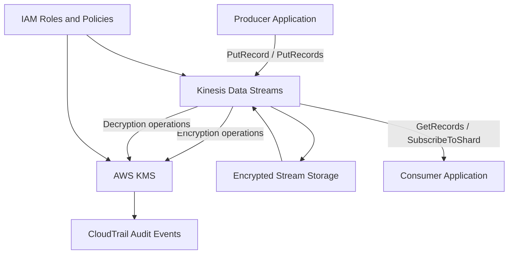
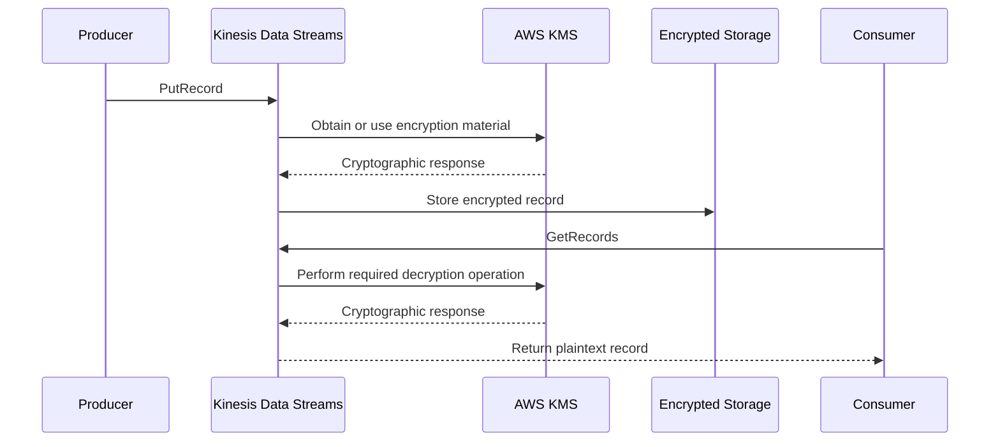

# 04- Encryption at Rest and AWS KMS

## Overview

Amazon Kinesis Data Streams supports server-side encryption at rest using AWS Key Management Service (AWS KMS). Encryption protects stream records while they are stored by Kinesis, reducing the risk of unauthorized access to persisted data.

KMS provides the cryptographic keys used by Kinesis to encrypt and decrypt stream data. Depending on the security requirements, workloads can use AWS-owned keys, AWS-managed keys, or customer-managed KMS keys.

For production systems, encryption must be considered alongside IAM authorization, key policies, application permissions, key lifecycle management, audit logging, and disaster recovery.

Encryption at rest does not replace access control. A principal with valid Kinesis permissions and the necessary KMS authorization may still access encrypted records.

## Kinesis Encryption Architecture

Kinesis Data Streams integrates with KMS to encrypt records at rest.

The application interacts with Kinesis through its APIs. Kinesis handles encryption and decryption as part of the service-managed data storage lifecycle.



The application does not need to implement record-level encryption when using Kinesis server-side encryption.

The service manages encryption operations and storage integration. Applications remain responsible for IAM permissions, data classification, payload protection, and downstream data security.

## Server-Side Encryption

Server-side encryption (SSE) encrypts data before it is stored by the service.

For Kinesis Data Streams:

- Records are encrypted at rest using a KMS key.
- Encryption and decryption are handled by Kinesis.
- Producers and consumers use normal Kinesis APIs.
- Applications do not manage encryption keys directly.
- KMS authorization and key availability affect stream operations.

### Why Server-Side Encryption Exists

Streaming workloads often contain sensitive business information:

- Customer activity events.
- Financial transactions.
- Application telemetry.
- Authentication-related events.
- Personal information.
- Operational and audit records.

Without encryption at rest, persisted data may be exposed if storage infrastructure or associated access paths are compromised.

SSE provides encryption without requiring producers and consumers to implement custom cryptographic logic.

### Encryption Options

Kinesis Data Streams supports different KMS key ownership models.

| Key type | Ownership | Control | Typical use |
|---|---|---|---|
| AWS-owned key | AWS | Managed by AWS | Standard encryption without customer key administration |
| AWS-managed KMS key | AWS service-managed | Limited customer control | Managed encryption with service-specific key management |
| Customer-managed KMS key | Customer account | Customer controls policies and lifecycle | Regulated or sensitive workloads requiring explicit key governance |

The key type determines how much control the organization has over key policies, rotation, auditing, and lifecycle operations.

## AWS KMS Fundamentals

AWS KMS is a managed service for creating and controlling cryptographic keys.

It provides:

- Centralized key management.
- Access control through key policies and IAM.
- Integration with AWS services.
- Key rotation capabilities.
- Audit events through CloudTrail.
- Key lifecycle controls.
- Cryptographic operations through AWS APIs.

Kinesis uses KMS as part of its server-side encryption implementation.

### KMS Key Concepts

| Concept | Description |
|---|---|
| KMS key | Logical representation of a cryptographic key |
| Key policy | Primary resource-based access policy controlling key usage |
| Key administrator | Principal authorized to manage key configuration |
| Key user | Principal authorized to perform permitted cryptographic operations |
| Key rotation | Replacement of key material according to the rotation configuration |
| Key alias | Friendly name referencing a KMS key |
| Key ARN | Unique identifier for a KMS key |
| Grant | Delegated permission mechanism for supported KMS integrations |

A KMS key is a regional resource. Its availability and configuration must be considered when designing multi-Region streaming architectures.

## AWS-Owned, AWS-Managed, and Customer-Managed Keys

### AWS-Owned Keys

AWS-owned keys are managed by AWS and are not managed directly in the customer's account.

Advantages:

- No customer key administration.
- No customer-managed key policy maintenance.
- Reduced operational overhead.

Limitations:

- Limited visibility and control over key configuration.
- No customer-controlled key lifecycle.
- Not suitable when explicit customer key governance is required.

Use AWS-owned keys when the workload does not require customer-managed key controls and the service supports the selected encryption configuration.

### AWS-Managed KMS Keys

AWS-managed keys are created and managed by AWS services in the customer's account.

For Kinesis Data Streams, the AWS-managed key commonly used for SSE is `alias/aws/kinesis`.

Advantages:

- AWS manages key creation and lifecycle.
- Encryption can be enabled without maintaining a custom key policy.
- Lower administrative overhead than customer-managed keys.

Limitations:

- Limited control over key policies.
- Less flexibility for organization-specific key governance.
- Customer-managed lifecycle controls are unavailable.

### Customer-Managed KMS Keys

Customer-managed keys provide direct control over key configuration and access policies.

Use them when requirements include:

- Explicit separation of key administration and application access.
- Organization-controlled key policies.
- Auditable key usage.
- Custom key lifecycle management.
- Customer-managed rotation.
- Compliance or governance requirements.

Advantages:

- Fine-grained access control.
- Explicit administrative ownership.
- Greater control over key lifecycle.
- Detailed visibility into key usage through CloudTrail.

Limitations:

- More operational responsibility.
- Incorrect key policies can interrupt stream operations.
- Disabling or deleting a key can make encrypted data inaccessible.
- KMS permissions must be coordinated with Kinesis IAM permissions.

## Enabling Encryption with AWS CLI

Kinesis encryption can be enabled or changed using the `StartStreamEncryption` API.

### Enable Encryption with the AWS-Managed Key

```bash
aws kinesis start-stream-encryption \
  --stream-name orders-events \
  --encryption-type KMS \
  --key-id alias/aws/kinesis \
  --region ap-south-1
```

This configures the stream to use the AWS-managed Kinesis key.

### Enable Encryption with a Customer-Managed Key

```bash
aws kinesis start-stream-encryption \
  --stream-name orders-events \
  --encryption-type KMS \
  --key-id arn:aws:kms:ap-south-1:123456789012:key/11111111-2222-3333-4444-555555555555 \
  --region ap-south-1
```

The IAM principal performing the operation must have the required Kinesis administrative permissions and appropriate KMS authorization.

### Verify Encryption Configuration

```bash
aws kinesis describe-stream-summary \
  --stream-name orders-events \
  --region ap-south-1
```

Inspect the returned fields:

- `EncryptionType`
- `KeyId`

The expected configuration should show KMS encryption and the intended key identifier.

### Disable Encryption

If disabling encryption is explicitly required:

```bash
aws kinesis stop-stream-encryption \
  --stream-name orders-events \
  --encryption-type KMS \
  --key-id alias/aws/kinesis \
  --region ap-south-1
```

Disabling encryption should be treated as a security-sensitive infrastructure change. Review organizational requirements and understand the service's encryption transition behavior before executing it.

## Customer-Managed KMS Key Configuration

A customer-managed key should have a deliberate separation between administration and usage.

For example:

- Security administrators manage the key.
- Infrastructure deployment roles configure stream encryption.
- Kinesis producer and consumer workloads receive only required cryptographic permissions.
- Auditing is performed through CloudTrail.

### Create a KMS Key

```bash
aws kms create-key \
  --description "KMS key for production Kinesis orders stream" \
  --key-usage ENCRYPT_DECRYPT \
  --origin AWS_KMS \
  --region ap-south-1
```

Create an alias:

```bash
aws kms create-alias \
  --alias-name alias/kinesis-orders-key \
  --target-key-id 11111111-2222-3333-4444-555555555555 \
  --region ap-south-1
```

The key ID should be taken from the actual `CreateKey` response.

### Enable Automatic Key Rotation

```bash
aws kms enable-key-rotation \
  --key-id alias/kinesis-orders-key \
  --region ap-south-1
```

Verify rotation:

```bash
aws kms get-key-rotation-status \
  --key-id alias/kinesis-orders-key \
  --region ap-south-1
```

Automatic rotation changes the backing key material according to the KMS rotation mechanism. It does not require applications to change the alias or manually re-encrypt every existing record.

Understand the supported rotation options and service-specific limitations before configuring rotation policies.

## KMS Permissions for Kinesis

Kinesis encryption introduces an additional authorization boundary.

A principal may have permission to call Kinesis APIs but still fail because it cannot use the configured customer-managed KMS key.

Typical KMS permissions relevant to Kinesis SSE include:

- `kms:GenerateDataKey`
- `kms:Decrypt`

The exact permissions depend on the operation, integration, key policy, and service behavior.

### Example IAM Policy

An application role may require permissions similar to the following when using a customer-managed key:

```json
{
  "Version": "2012-10-17",
  "Statement": [
    {
      "Sid": "UseOrdersKinesisKey",
      "Effect": "Allow",
      "Action": [
        "kms:GenerateDataKey",
        "kms:Decrypt"
      ],
      "Resource": "arn:aws:kms:ap-south-1:123456789012:key/11111111-2222-3333-4444-555555555555"
    }
  ]
}
```

This is an illustrative policy statement. Confirm the exact principal permissions required by the Kinesis encryption workflow and service integration.

Avoid granting `kms:*` to application roles.

### KMS Key Policy

KMS key policies control access to customer-managed keys.

An illustrative statement granting a workload role key usage is:

```json
{
  "Sid": "AllowOrdersProducerKeyUsage",
  "Effect": "Allow",
  "Principal": {
    "AWS": "arn:aws:iam::123456789012:role/orders-producer-role"
  },
  "Action": [
    "kms:GenerateDataKey",
    "kms:Decrypt"
  ],
  "Resource": "*"
}
```

This statement must be incorporated into a complete key policy that preserves appropriate key administration and recovery access.

The `Resource` value is `"*"` in a KMS key policy statement because the policy is attached to the key itself. This does not mean that the principal receives access to every KMS key.

### Key Policy and IAM Policy Evaluation

KMS authorization requires careful coordination between key policies and IAM policies.

| Configuration | Result |
|---|---|
| Key policy directly allows the principal | Key access may be granted according to the statement |
| Key policy enables IAM delegation and IAM policy allows the principal | Key access may be granted |
| IAM policy allows key usage but key policy does not permit the relevant authorization path | Access is denied |
| Explicit deny applies | Access is denied |
| Key is disabled or unavailable | Cryptographic operations fail |

Do not assume that an IAM policy granting KMS permissions is sufficient without checking the key policy.

## Kinesis Encryption Request Lifecycle

Kinesis performs encryption as part of its service-managed processing.



The diagram represents the logical encryption lifecycle, not a one-to-one KMS API call for every record.

Kinesis uses service-managed encryption mechanisms and can reuse encryption material according to its service implementation.

Applications should not assume that every record causes a separate KMS API request.

## Encryption Key Rotation

Key rotation replaces the cryptographic key material used for future encryption operations while preserving access to data encrypted under previous key material.

For customer-managed KMS keys, automatic rotation can be enabled where supported.

### Why Rotation Matters

Rotation reduces the long-term use of a single backing key and supports organizational key-management requirements.

However, rotation does not:

- Replace IAM authorization.
- Remove the need for key policies.
- Automatically delete old encrypted records.
- Replace data retention policies.
- Guarantee that compromised application credentials are no longer useful.

### Rotation Recommendations

- Enable automatic rotation when required by policy and supported by the selected key configuration.
- Monitor key rotation status.
- Maintain access to required historical key material.
- Do not disable or schedule deletion of a key while encrypted data still depends on it.
- Test key lifecycle changes in non-production environments.
- Document key ownership and recovery procedures.

## Key Disablement and Deletion Risks

KMS key lifecycle operations can directly affect Kinesis availability.

### Disabling a Key

Disabling a customer-managed key prevents cryptographic operations that require that key.

Consequences can include:

- Producers failing to publish records.
- Consumers failing to retrieve records.
- Service integrations failing to process encrypted data.

### Scheduling Key Deletion

KMS key deletion is a destructive operation.

If a key is deleted while retained stream data or other encrypted resources depend on it, the affected data may become permanently inaccessible.

A deletion schedule should never be treated as routine cleanup without dependency analysis.

### Safe Key Retirement Process

1. Identify every stream and integration using the key.
2. Verify that no retained data or downstream resource requires it.
3. Migrate workloads to the approved replacement key if necessary.
4. Validate producer and consumer operations.
5. Confirm historical data access requirements.
6. Review backups and disaster recovery dependencies.
7. Obtain security approval.
8. Schedule deletion only after the dependency review is complete.

KMS key deletion has a waiting period. Use that period to validate that the key is no longer required.

## Encryption with Terraform

Infrastructure as code should manage Kinesis encryption and KMS key configuration.

### Customer-Managed Key

```hcl
resource "aws_kms_key" "kinesis" {
  description             = "KMS key for production Kinesis streams"
  enable_key_rotation     = true
  deletion_window_in_days = 30

  tags = {
    Environment = "production"
    Application = "orders"
    ManagedBy   = "terraform"
  }
}

resource "aws_kms_alias" "kinesis" {
  name          = "alias/kinesis-orders-key"
  target_key_id = aws_kms_key.kinesis.key_id
}
```

### Kinesis Stream

```hcl
resource "aws_kinesis_stream" "orders" {
  name             = "orders-events"
  retention_period = 48
  shard_count      = 2

  encryption_type = "KMS"
  kms_key_id      = aws_kms_key.kinesis.arn

  stream_mode_details {
    stream_mode = "PROVISIONED"
  }

  tags = {
    Environment = "production"
    Application = "orders"
    ManagedBy   = "terraform"
  }
}
```

This configuration establishes the key and stream relationship.

A complete production implementation should also include:

- A reviewed KMS key policy.
- Separate key administrators and workload users.
- Least-privilege IAM policies.
- CloudTrail auditing.
- Monitoring and alarms.
- Protected Terraform state.
- Key deletion safeguards.
- Regional recovery configuration.

### Terraform Operational Considerations

- Avoid creating a new key on every application deployment.
- Use stable key resources and aliases.
- Restrict who can modify key policies.
- Review plans carefully before changing the key associated with a production stream.
- Protect Terraform state and CI/CD credentials.
- Avoid automatically scheduling deletion of keys used by active streams.

## Application-Level Encryption vs Server-Side Encryption

Server-side encryption and client-side encryption solve different problems.

| Characteristic | Kinesis server-side encryption | Application-level encryption |
|---|---|---|
| Encryption responsibility | AWS Kinesis | Producer application |
| Decryption responsibility | AWS Kinesis | Consumer application |
| Key management | KMS integration | Application and KMS integration |
| Payload visibility to authorized consumers | Plaintext returned by Kinesis | Depends on application decryption |
| Field-level protection | Not provided automatically | Can be implemented |
| Application complexity | Lower | Higher |
| Protection from downstream plaintext exposure | Does not provide this by itself | Can provide additional protection |

Use server-side encryption as the standard storage protection mechanism.

Consider application-level encryption when requirements include:

- Field-level encryption.
- Protection from downstream services that should not access sensitive fields.
- End-to-end encryption between specific producers and consumers.
- Additional protection for data copied into systems outside the original trust boundary.

Application-level encryption introduces key distribution, rotation, serialization, and failure-handling complexity. Implement it only when the threat model requires it.

## Performance and Cost Considerations

KMS integration introduces service-level dependencies and costs.

### Performance

Kinesis manages encryption operations internally. Applications should not implement a separate KMS request for every record unless the application explicitly requires client-side encryption.

Operational concerns include:

- KMS request quotas.
- KMS service availability.
- Encryption configuration transitions.
- Key policy evaluation.
- High-volume stream behavior.
- Integration-specific encryption requirements.

Do not assume every record causes a separate KMS API request. Kinesis may use service-managed data-key mechanisms and caching.

### Cost

KMS pricing depends on key type, Region, cryptographic requests, and applicable service pricing.

Consider:

- Customer-managed key monthly charges.
- KMS API request charges.
- Number of streams and integrations.
- Key rotation and lifecycle requirements.
- CloudTrail logging volume.
- Additional application-level encryption operations.

Review current regional pricing before estimating production costs.

### Capacity Planning

For high-throughput streaming workloads:

- Monitor KMS usage and throttling signals where available.
- Avoid unnecessary application-level cryptographic calls.
- Test stream encryption under expected peak load.
- Review service quotas and request patterns.
- Include KMS availability in incident and recovery planning.

## Monitoring and Auditing

Encryption must be observable throughout its lifecycle.

### CloudTrail

CloudTrail records KMS API activity and relevant Kinesis management operations.

Monitor events such as:

- `CreateKey`
- `CreateAlias`
- `EnableKeyRotation`
- `DisableKey`
- `ScheduleKeyDeletion`
- `CancelKeyDeletion`
- `PutKeyPolicy`
- `StartStreamEncryption`
- `StopStreamEncryption`

These events help identify unauthorized key changes and encryption configuration modifications.

### CloudWatch

Monitor operational indicators related to:

- Kinesis producer failures.
- Kinesis consumer failures.
- KMS throttling.
- KMS access-denied errors.
- Stream ingestion and retrieval behavior.
- Application-level encryption failures.

Use CloudTrail for API-level audit evidence and CloudWatch for operational monitoring and alerting.

### Security Alerts

Create alerts for:

- KMS key disablement.
- Key deletion scheduling.
- Unexpected key policy modifications.
- Encryption being disabled on production streams.
- Repeated KMS authorization failures.
- Unexpected changes to stream encryption configuration.

Key lifecycle changes should be treated as high-impact security events.

## Disaster Recovery Considerations

Kinesis streams and KMS keys are regional resources.

A multi-Region recovery strategy must account for both data and encryption dependencies.

### Multi-Region Key Strategy

For a recovery Region:

- Provision an appropriate KMS key.
- Configure the key policy for recovery workloads.
- Create the recovery stream with the intended encryption configuration.
- Configure producer and consumer IAM roles.
- Validate access from recovery workloads.
- Protect downstream archives and backups independently.

A multi-Region KMS key can support cryptographic continuity across Regions where its use is appropriate, but it does not replicate Kinesis streams, stream configuration, IAM roles, or application data automatically.

### Recovery Testing

Test the complete recovery path:

1. Confirm that the recovery key is enabled.
2. Verify producer access to the recovery stream.
3. Verify consumer access to retained or replicated records.
4. Validate downstream encryption permissions.
5. Confirm that the required application identities are available.
6. Test key policy and IAM behavior in the recovery Region.
7. Validate historical data access and retention requirements.

A recovery stream that exists but cannot use its KMS key is not a functioning recovery environment.

## Common Encryption Mistakes

| Mistake | Impact | Prevention |
|---|---|---|
| Assuming IAM permissions automatically grant KMS access | Stream operations can fail with authorization errors | Review IAM and key policies together |
| Granting `kms:*` to application roles | Excessive cryptographic and administrative access | Grant only required KMS operations |
| Disabling an active key | Producers and consumers may lose access to encrypted data | Review dependencies before key lifecycle changes |
| Scheduling deletion too early | Historical data may become permanently inaccessible | Complete dependency and recovery reviews |
| Assuming rotation re-encrypts all historical records | Incorrect assumptions about key lifecycle and data protection | Understand KMS rotation semantics |
| Creating a separate key for every deployment | Increases cost and operational complexity | Use stable keys and aliases |
| Assuming every record triggers a KMS API call | Incorrect performance and cost estimates | Understand service-managed encryption behavior |
| Relying only on SSE for field-level protection | Authorized consumers receive plaintext records | Add application-level encryption when required |
| Ignoring regional key dependencies | Recovery environment may not access encrypted data | Provision and test regional key configurations |
| Disabling encryption without approval | Weakens data protection and may violate policy | Control encryption changes through reviewed deployment processes |

## Production Encryption Checklist

### KMS Configuration

- [ ] Encryption at rest is enabled for production streams.
- [ ] The selected key type meets organizational requirements.
- [ ] Customer-managed keys have reviewed key policies.
- [ ] Key administrators and application users are separated.
- [ ] Key aliases are used where appropriate.
- [ ] Automatic rotation is configured when required and supported.
- [ ] Key deletion safeguards are in place.

### IAM and Access

- [ ] Producer and consumer roles have required KMS permissions.
- [ ] KMS permissions are scoped to intended keys.
- [ ] No application role has unnecessary `kms:*` permissions.
- [ ] Cross-account key access is explicitly configured.
- [ ] Key policies and IAM policies are validated together.

### Operations and Monitoring

- [ ] CloudTrail records relevant KMS and Kinesis activity.
- [ ] Key disablement and deletion events trigger alerts.
- [ ] Encryption configuration changes require approval.
- [ ] KMS failures are monitored.
- [ ] Key ownership and lifecycle procedures are documented.
- [ ] Historical data dependencies are reviewed before key retirement.

### Disaster Recovery

- [ ] Recovery Regions have the required KMS configuration.
- [ ] Recovery stream encryption is tested.
- [ ] Recovery workloads have the required key permissions.
- [ ] Key policies are included in recovery procedures.
- [ ] Historical data and downstream archive dependencies are tested.

## Key Takeaways

- Kinesis Data Streams supports server-side encryption at rest through AWS KMS, with AWS-owned, AWS-managed, and customer-managed key options.
- Customer-managed keys provide greater control but require deliberate key policies, IAM permissions, lifecycle management, and operational monitoring.
- Kinesis encryption authorization and KMS key authorization are separate boundaries; both must permit the required operations.
- Disabling or deleting a KMS key can interrupt producers and consumers or make encrypted historical data inaccessible.
- Production encryption requires CloudTrail auditing, controlled key lifecycle changes, cost and performance monitoring, and tested multi-Region recovery procedures.