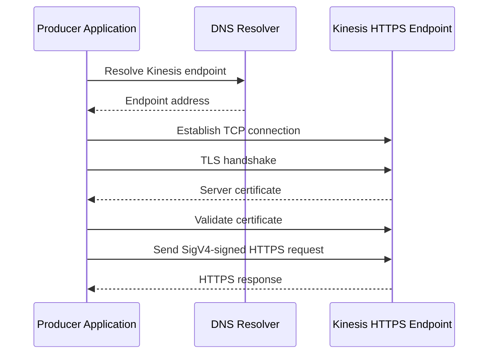
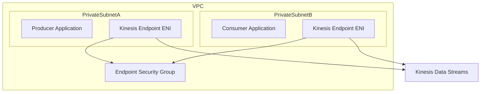
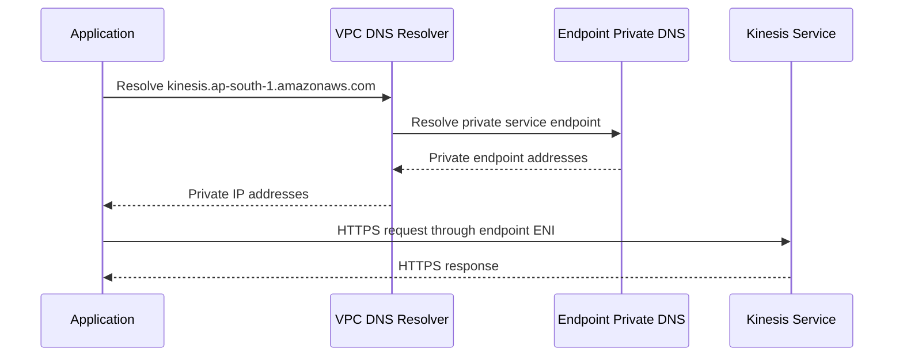
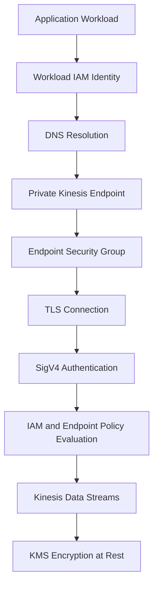

# 05- Encryption in Transit and VPC Endpoints

## Overview

Amazon Kinesis Data Streams supports secure communication through HTTPS and TLS. Applications can also use Amazon VPC interface endpoints powered by AWS PrivateLink to access Kinesis without routing traffic through public service endpoints.

Encryption in transit and network isolation address different security requirements:

- **TLS** protects data exchanged between applications and AWS services.
- **VPC endpoints** provide private connectivity to supported AWS service APIs.
- **Endpoint security groups** restrict which workloads can connect to the endpoint.
- **Endpoint policies** add authorization restrictions to requests traversing the endpoint.
- **IAM policies** determine whether the calling principal can perform the requested Kinesis operation.

A production architecture should combine these controls rather than treating private connectivity as a replacement for authentication or authorization.

## Encryption in Transit

Encryption in transit protects data while it moves between producers, consumers, and AWS service endpoints.

Kinesis Data Streams API requests use HTTPS with TLS. AWS SDKs handle HTTPS communication and request signing automatically.

### Why TLS Is Required

Streaming applications may transmit:

- Customer information.
- Financial transactions.
- Business events.
- Application telemetry.
- Operational metadata.
- Internal service data.

Without transport encryption, data transmitted over an untrusted network could be exposed or modified by an attacker with access to the communication path.

TLS provides:

- Confidentiality through encryption.
- Integrity protection against unauthorized modification.
- Server authentication through certificate validation.
- Protection against common network interception attacks.

TLS does not authorize the application to access a stream. IAM authorization remains necessary.

### Kinesis API Communication

A producer communicates with a regional Kinesis endpoint using HTTPS.



The AWS SDK performs endpoint resolution, TLS negotiation, certificate validation, and SigV4 request signing.

Applications should not disable certificate verification or downgrade communication to unencrypted HTTP.

## TLS Configuration

### Use AWS SDK Defaults

For Python applications, use Boto3 and the standard AWS credential provider chain.

```python
import os

import boto3
from botocore.config import Config


kinesis = boto3.client(
    "kinesis",
    region_name=os.environ["AWS_REGION"],
    config=Config(
        connect_timeout=5,
        read_timeout=30,
        retries={
            "mode": "standard",
            "total_max_attempts": 5,
        },
    ),
)


def publish_event(event_data: bytes, partition_key: str) -> str:
    response = kinesis.put_record(
        StreamName=os.environ["KINESIS_STREAM_NAME"],
        Data=event_data,
        PartitionKey=partition_key,
    )

    return response["SequenceNumber"]
```

The SDK uses HTTPS by default and validates the server certificate using the configured trust store.

Timeout and retry settings should be aligned with application latency objectives and the behavior of the publishing workflow.

### TLS Certificate Validation

Certificate validation confirms that the application is communicating with the intended AWS endpoint.

Avoid:

```python
import boto3

kinesis = boto3.client(
    "kinesis",
    verify=False,
)
```

Disabling verification exposes the application to man-in-the-middle attacks.

If a container has certificate authority problems, fix its CA certificate configuration rather than disabling TLS verification.

### TLS and Containerized Applications

Python containers need an appropriate CA certificate bundle.

For Debian-based Python images:

```dockerfile
FROM python:3.12-slim

RUN apt-get update \
    && apt-get install -y --no-install-recommends ca-certificates \
    && update-ca-certificates \
    && rm -rf /var/lib/apt/lists/*

WORKDIR /app

COPY requirements.txt .
RUN pip install --no-cache-dir -r requirements.txt

COPY . .

CMD ["python", "consumer.py"]
```

For production images:

- Keep CA certificates updated.
- Use maintained base images.
- Avoid custom trust stores unless required.
- Do not copy private certificate material into images unnecessarily.
- Validate TLS connectivity during deployment testing.

## VPC Endpoints for Kinesis

A VPC endpoint provides connectivity between a VPC and supported AWS services.

Kinesis Data Streams supports interface VPC endpoints through AWS PrivateLink.

An interface endpoint creates elastic network interfaces in selected VPC subnets. Applications communicate with the service through these private network interfaces.

### Why Use VPC Endpoints?

Without a VPC endpoint, an application commonly reaches the regional Kinesis public service endpoint through its configured network path.

This may involve a NAT gateway or another outbound connectivity mechanism.

With an interface endpoint:

- Traffic can remain on the AWS private network.
- Applications can access Kinesis without requiring a public IP address.
- NAT gateway dependency can be reduced for this service path.
- Security groups can restrict endpoint access.
- Endpoint policies can restrict service access.

VPC endpoints are particularly useful for private workloads running in:

- EC2 instances.
- ECS tasks.
- EKS pods.
- Private application subnets.
- Internal data-processing environments.

## Interface Endpoint Architecture



The endpoint ENIs provide private network connectivity to the Kinesis service.

For high availability, create the endpoint in multiple Availability Zones where supported and appropriate for the workload.

### Interface Endpoint Components

| Component | Responsibility |
|---|---|
| VPC | Network boundary containing the workloads |
| Private subnet | Hosts endpoint network interfaces |
| Interface endpoint | Provides PrivateLink connectivity |
| Endpoint ENI | Private network interface associated with the endpoint |
| Security group | Controls traffic to endpoint ENIs |
| Endpoint policy | Restricts permitted service API access |
| Private DNS | Resolves the standard service hostname to endpoint addresses |

## Creating a Kinesis VPC Endpoint

The Kinesis Data Streams interface endpoint service name follows this format:

```text
com.amazonaws.<region>.kinesis-streams
```

For example:

```text
com.amazonaws.ap-south-1.kinesis-streams
```

### AWS CLI

```bash
aws ec2 create-vpc-endpoint \
  --vpc-id vpc-0123456789abcdef0 \
  --vpc-endpoint-type Interface \
  --service-name com.amazonaws.ap-south-1.kinesis-streams \
  --subnet-ids subnet-11111111 subnet-22222222 \
  --security-group-ids sg-0123456789abcdef0 \
  --private-dns-enabled
```

Replace the VPC, subnet, and security group identifiers with actual resources.

### Verify the Endpoint

```bash
aws ec2 describe-vpc-endpoints \
  --filters \
    Name=vpc-id,Values=vpc-0123456789abcdef0 \
    Name=service-name,Values=com.amazonaws.ap-south-1.kinesis-streams
```

Inspect:

- `VpcEndpointId`
- `VpcEndpointType`
- `State`
- `SubnetIds`
- `Groups`
- `PrivateDnsEnabled`
- `NetworkInterfaceIds`

The endpoint should reach the `available` state before applications depend on it.

## Private DNS

Private DNS allows applications to use the standard regional Kinesis hostname while DNS resolves it to the interface endpoint addresses inside the VPC.

For example:

```text
kinesis.ap-south-1.amazonaws.com
```

When private DNS is enabled and correctly configured, applications do not need to replace the normal AWS SDK endpoint URL with a custom endpoint hostname.

### Private DNS Requirements

Private DNS requires the relevant VPC DNS capabilities.

Verify:

- VPC DNS resolution is enabled.
- VPC DNS hostnames are enabled.
- The interface endpoint supports private DNS.
- The endpoint has private DNS enabled.
- Applications use the expected regional service hostname.

Check VPC DNS attributes:

```bash
aws ec2 describe-vpc-attribute \
  --vpc-id vpc-0123456789abcdef0 \
  --attribute enableDnsSupport
```

```bash
aws ec2 describe-vpc-attribute \
  --vpc-id vpc-0123456789abcdef0 \
  --attribute enableDnsHostnames
```

### DNS Resolution Flow



Private DNS simplifies application configuration and reduces the risk of accidentally using a public service endpoint.

## Endpoint Security Groups

Security groups control network traffic to interface endpoint ENIs.

For Kinesis, applications connect to the endpoint over HTTPS.

The endpoint security group should allow inbound TCP port 443 from approved application security groups or network ranges.

### Example Security Group Rules

| Direction | Protocol | Port | Source or destination |
|---|---|---:|---|
| Inbound | TCP | 443 | Approved application security group |
| Outbound | TCP | 443 | Required service connectivity according to endpoint configuration |

Security groups are stateful. Return traffic for permitted connections is automatically allowed.

### Terraform Example

```hcl
resource "aws_security_group" "kinesis_endpoint" {
  name        = "kinesis-interface-endpoint"
  description = "Allow HTTPS from approved streaming workloads"
  vpc_id      = var.vpc_id

  ingress {
    description     = "HTTPS from producer workloads"
    protocol        = "tcp"
    from_port       = 443
    to_port         = 443
    security_groups = [aws_security_group.kinesis_producer.id]
  }

  ingress {
    description     = "HTTPS from consumer workloads"
    protocol        = "tcp"
    from_port       = 443
    to_port         = 443
    security_groups = [aws_security_group.kinesis_consumer.id]
  }

  egress {
    description = "HTTPS service traffic"
    protocol    = "tcp"
    from_port   = 443
    to_port     = 443
    cidr_blocks = ["0.0.0.0/0"]
  }

  tags = {
    Name = "kinesis-interface-endpoint"
  }
}
```

The example illustrates endpoint ingress restrictions. Review outbound rules against the actual endpoint network design and organizational security standards.

Avoid allowing unrestricted inbound traffic to endpoint ENIs.

## VPC Endpoint Policies

An endpoint policy is a resource policy attached to a VPC endpoint.

It controls which principals and resources can be accessed through that endpoint.

Endpoint policies provide an additional authorization layer, but they do not replace:

- IAM identity policies.
- Kinesis resource policies.
- KMS key policies.
- Security groups.
- Network routing controls.

A request must satisfy the applicable authorization and network controls.

### Example Endpoint Policy

The following example restricts endpoint access to publishing operations on a specific stream for a specific role.

```json
{
  "Version": "2012-10-17",
  "Statement": [
    {
      "Sid": "AllowOrdersProducer",
      "Effect": "Allow",
      "Principal": {
        "AWS": "arn:aws:iam::123456789012:role/orders-producer-role"
      },
      "Action": [
        "kinesis:PutRecord",
        "kinesis:PutRecords"
      ],
      "Resource": "arn:aws:kinesis:ap-south-1:123456789012:stream/orders-events"
    }
  ]
}
```

This policy is an additional restriction on requests traversing the endpoint. The producer role must still have the required IAM permissions.

### Endpoint Policy Best Practices

- Restrict principals to approved workload roles.
- Restrict actions to the required Kinesis APIs.
- Scope resources to intended streams.
- Avoid unrestricted wildcard policies.
- Review endpoint policies whenever workloads change.
- Test both permitted and denied access paths.

Do not assume that a restrictive endpoint policy prevents access through other network paths. Control public endpoint access and other connectivity paths separately where required.

## Terraform Configuration

Infrastructure as code should manage interface endpoints, security groups, and endpoint policies.

### Interface Endpoint

```hcl
resource "aws_vpc_endpoint" "kinesis" {
  vpc_id              = var.vpc_id
  service_name        = "com.amazonaws.${var.aws_region}.kinesis-streams"
  vpc_endpoint_type   = "Interface"
  subnet_ids          = var.private_subnet_ids
  security_group_ids  = [aws_security_group.kinesis_endpoint.id]
  private_dns_enabled = true

  policy = jsonencode({
    Version = "2012-10-17"
    Statement = [
      {
        Sid    = "AllowOrdersProducer"
        Effect = "Allow"
        Principal = {
          AWS = "arn:aws:iam::123456789012:role/orders-producer-role"
        }
        Action = [
          "kinesis:PutRecord",
          "kinesis:PutRecords"
        ]
        Resource = "arn:aws:kinesis:${var.aws_region}:123456789012:stream/orders-events"
      }
    ]
  })

  tags = {
    Name        = "kinesis-interface-endpoint"
    Environment = var.environment
    ManagedBy   = "terraform"
  }
}
```

The security group must be defined separately and should permit HTTPS only from approved application workloads.

### Terraform Variables

```hcl
variable "vpc_id" {
  description = "VPC hosting the streaming workloads"
  type        = string
}

variable "private_subnet_ids" {
  description = "Private subnets used by the Kinesis endpoint"
  type        = list(string)
}

variable "aws_region" {
  description = "AWS Region containing the Kinesis stream"
  type        = string
}

variable "environment" {
  description = "Deployment environment"
  type        = string
}
```

For reusable infrastructure modules, pass account IDs, stream ARNs, and workload role ARNs as explicit inputs instead of embedding environment-specific values.

## Network Access from ECS and EKS

Containerized workloads require network connectivity to the interface endpoint.

### ECS

For ECS tasks running in private subnets:

- Ensure the task ENIs can reach the endpoint ENIs.
- Associate the correct task security group.
- Permit outbound TCP 443 from the task to the endpoint.
- Permit inbound TCP 443 on the endpoint security group from the task security group.
- Ensure private DNS resolves the Kinesis hostname correctly.

The ECS task role must independently grant the required Kinesis API permissions.

### EKS

For EKS workloads:

- Ensure pod traffic can reach the endpoint ENIs.
- Review node and pod security groups.
- Account for the cluster's network model.
- Verify DNS resolution from inside the pod.
- Ensure network policies do not block HTTPS.
- Configure workload IAM permissions independently.

An EKS pod's ability to reach a VPC endpoint does not imply that its IAM role is authorized to access the stream.

### Container Connectivity Test

A temporary diagnostic container can verify DNS and TCP connectivity.

```bash
getent hosts kinesis.ap-south-1.amazonaws.com
```

Check HTTPS connectivity:

```bash
curl -Iv https://kinesis.ap-south-1.amazonaws.com
```

A successful TLS connection confirms network and TLS connectivity to the resolved endpoint. It does not prove that a Kinesis API request will be authorized.

Use an authenticated SDK request to validate IAM access.

## Network Architecture Considerations

### Multiple Availability Zones

For production systems, deploy interface endpoint network interfaces across multiple Availability Zones where supported.

Benefits include:

- Improved network availability.
- Reduced dependency on a single subnet.
- Better alignment with multi-AZ application workloads.

The endpoint's availability characteristics and subnet placement should match the application's resilience requirements.

### Multiple VPCs

If producers and consumers operate in different VPCs, each VPC may require its own interface endpoint.

Alternatively, centralized network designs may provide controlled service access, but routing, DNS, security group, and endpoint policy behavior must be evaluated carefully.

Do not assume that VPC peering automatically provides access to another VPC's interface endpoint.

### Hybrid Connectivity

Applications running in on-premises environments may reach AWS services through:

- AWS Site-to-Site VPN.
- AWS Direct Connect.
- A controlled network architecture that routes traffic to an approved VPC endpoint.

Hybrid connectivity requires DNS forwarding and routing configuration so clients resolve and reach the intended private endpoint.

## TLS and VPC Endpoint Security Together

TLS and VPC endpoints provide complementary protection.

| Security control | Protects against | Does not replace |
|---|---|---|
| TLS | Network interception and data modification | IAM authorization |
| PrivateLink | Public network exposure for the service path | Application identity |
| Endpoint security group | Unapproved network connections | API authorization |
| Endpoint policy | Unauthorized API access through the endpoint | Identity policy |
| IAM policy | Unauthorized principal actions | Network isolation |
| KMS encryption | Unauthorized access to stored plaintext data | Transport encryption |

A secure architecture uses multiple independent controls.

### Combined Security Flow



The application must satisfy both network and authorization requirements before the intended operation can succeed.

## Monitoring and Troubleshooting

Private connectivity introduces additional network components that must be monitored.

### VPC Endpoint Monitoring

Review:

- Endpoint state.
- Endpoint ENI availability.
- Security group rules.
- Private DNS configuration.
- VPC DNS attributes.
- Subnet placement.
- Endpoint policy changes.
- Application connectivity failures.

CloudTrail records relevant endpoint management operations, while VPC Flow Logs can help investigate network-level connectivity problems.

### Common Failure Scenarios

| Symptom | Possible cause | Investigation |
|---|---|---|
| DNS resolves to public addresses | Private DNS disabled or misconfigured | Inspect endpoint DNS settings and VPC DNS attributes |
| DNS resolution fails | VPC DNS or resolver configuration issue | Check DNS support, hostnames, and resolver rules |
| Connection timeout | Security group, NACL, or routing issue | Inspect endpoint ENIs and network controls |
| TLS handshake failure | CA certificate or TLS configuration issue | Inspect container trust store and SDK configuration |
| `AccessDeniedException` | IAM or endpoint policy restriction | Review principal permissions and endpoint policy |
| KMS authorization failure | Missing key usage permissions | Inspect KMS key policy and IAM policy |
| Works from one subnet but not another | Endpoint placement or subnet-specific network configuration | Compare subnet routing and security controls |
| Application uses public endpoint | Private DNS or custom endpoint configuration issue | Inspect DNS resolution and SDK endpoint settings |

### Troubleshooting Procedure

1. Verify the application is using the intended AWS Region.
2. Resolve the regional Kinesis hostname from the workload.
3. Confirm that DNS returns the expected private endpoint addresses.
4. Test TCP connectivity to port 443.
5. Verify TLS certificate validation.
6. Check endpoint state and subnet placement.
7. Inspect endpoint security groups and network ACLs.
8. Review endpoint policy and IAM permissions.
9. Inspect CloudTrail for authorization failures.
10. Test an authenticated Kinesis API operation.

Separate network failures from authorization failures. A successful TCP connection does not prove that the application has permission to publish or consume records.

## Performance and Cost Considerations

### Performance

Interface endpoints introduce additional network components and DNS resolution behavior.

Evaluate:

- Endpoint availability across Availability Zones.
- Application placement relative to endpoint ENIs.
- DNS resolution behavior.
- Connection reuse and HTTP connection pooling.
- SDK connection and read timeouts.
- High-throughput producer and consumer traffic.
- Cross-AZ traffic implications.

Use persistent SDK clients rather than creating a new client for every record.

### Cost

Interface endpoints incur charges based on endpoint usage, including endpoint-hours and data processing, with pricing varying by Region.

Consider:

- Number of endpoint interfaces and Availability Zones.
- Number of VPCs requiring endpoints.
- Streaming data volume.
- Cross-AZ traffic.
- NAT gateway costs avoided for this service path.
- Operational overhead of centralized network designs.

Compare the complete cost of private endpoints with the existing outbound connectivity architecture.

Do not assume interface endpoints are automatically cheaper than NAT gateways for every workload.

## Production Best Practices

- Use HTTPS and retain certificate verification.
- Use AWS SDKs with standard SigV4 signing.
- Enable private DNS for interface endpoints where appropriate.
- Deploy endpoints across multiple Availability Zones for resilient workloads.
- Restrict endpoint security groups to approved application security groups.
- Apply endpoint policies to restrict principals, actions, and stream resources.
- Use dedicated workload IAM roles.
- Avoid public endpoint access where the security architecture requires private-only connectivity, and enforce that requirement through appropriate network and authorization controls.
- Monitor VPC Flow Logs and CloudTrail.
- Test DNS, TLS, network connectivity, and IAM authorization independently.
- Include endpoint and DNS dependencies in disaster recovery procedures.

## Common Mistakes

| Mistake | Why it causes problems | Recommended approach |
|---|---|---|
| Assuming a VPC endpoint encrypts traffic | Private connectivity and encryption are different controls | Use TLS over the endpoint |
| Disabling certificate validation | Exposes clients to man-in-the-middle attacks | Maintain a valid CA trust store |
| Creating an endpoint in only one AZ | Creates an unnecessary network dependency | Use multiple AZs where appropriate |
| Allowing inbound traffic from `0.0.0.0/0` | Exposes the endpoint to unnecessary sources | Restrict ingress to application security groups |
| Treating endpoint policies as IAM replacements | Requests may still be denied by identity or resource policies | Evaluate all authorization layers |
| Enabling private DNS without testing | Applications may resolve unexpected addresses | Validate DNS from actual workloads |
| Assuming VPC peering exposes interface endpoints | Endpoint connectivity is not automatically shared | Design endpoint access and routing explicitly |
| Ignoring container CA certificates | TLS connections fail in minimal images | Install and maintain CA certificates |
| Assuming TCP connectivity means API access is authorized | IAM or endpoint policy may still deny the request | Test with authenticated SDK calls |
| Ignoring endpoint costs | Multiple endpoints and AZs increase operating costs | Model traffic and endpoint usage |

## Production Security Checklist

### TLS

- [ ] Applications use HTTPS for Kinesis API communication.
- [ ] TLS certificate validation is enabled.
- [ ] Container images include maintained CA certificates.
- [ ] AWS SDK clients use standard SigV4 signing.
- [ ] TLS verification is not disabled in production.

### VPC Endpoints

- [ ] Interface endpoints are deployed in the intended VPC.
- [ ] Endpoints span appropriate Availability Zones.
- [ ] Private DNS is configured and tested.
- [ ] VPC DNS support and hostnames are enabled.
- [ ] Endpoint security groups restrict inbound HTTPS access.
- [ ] Endpoint policies restrict approved principals, actions, and resources.
- [ ] Endpoint placement and connectivity are included in recovery planning.

### Authorization and Monitoring

- [ ] Producer and consumer roles use least-privilege IAM policies.
- [ ] Endpoint policies are reviewed independently from IAM policies.
- [ ] KMS permissions are configured where customer-managed keys are used.
- [ ] CloudTrail captures relevant management activity.
- [ ] VPC Flow Logs support network troubleshooting.
- [ ] DNS, TLS, network, and authorization failures are monitored.
- [ ] Connectivity and access are tested from actual ECS, EKS, or EC2 workloads.

## Key Takeaways

- Kinesis API communication uses HTTPS and TLS; retain certificate validation and use AWS SDKs for secure SigV4-signed requests.
- Interface VPC endpoints provide private connectivity through AWS PrivateLink and can reduce reliance on public service access paths.
- Endpoint security groups control network connectivity, while endpoint policies add authorization restrictions without replacing IAM policies.
- Production deployments should use private DNS, appropriate multi-AZ endpoint placement, restrictive network rules, and workload-specific IAM roles.
- Troubleshoot DNS, TCP connectivity, TLS, endpoint policies, IAM, and KMS authorization as separate layers.