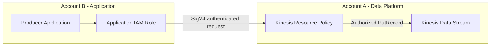
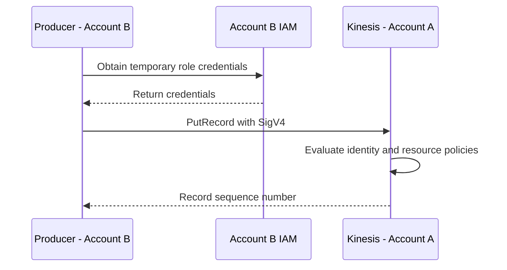
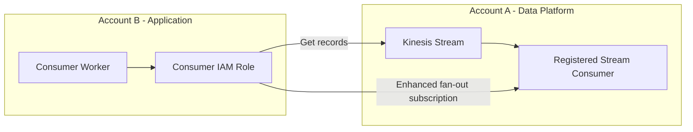
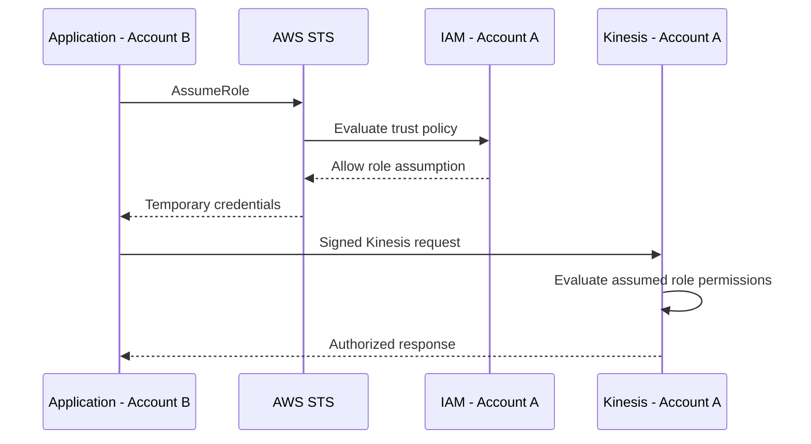
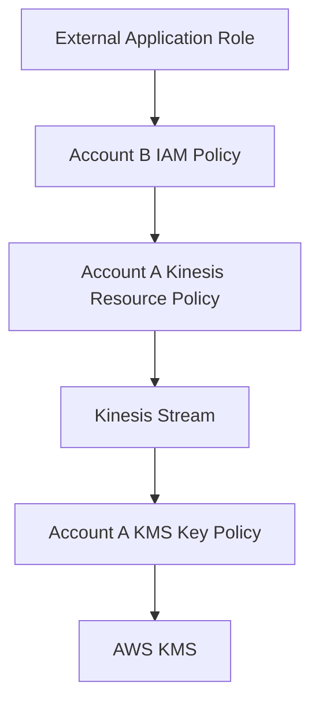

# 06- Cross-Account Access and Resource Security

## Overview

Amazon Kinesis Data Streams supports cross-account access, allowing applications and AWS services in one AWS account to interact with streams owned by another account. This is useful when multiple teams, business units, or AWS environments need to share streaming data without duplicating streams or distributing long-lived credentials.

Cross-account access introduces additional security boundaries. A successful request must satisfy the authorization requirements of the caller's identity policy, the stream owner's resource policy, applicable organizational controls, and any relevant KMS key policies.

The primary security objectives are:

- Grant access only to explicitly approved AWS accounts, roles, and operations.
- Prevent unauthorized stream discovery, reading, writing, and administration.
- Restrict access to specific streams and registered consumers.
- Protect encrypted streams through coordinated IAM and AWS KMS permissions.
- Maintain an auditable record of cross-account activity.
- Avoid broad permissions that allow unintended access to other streams.

## Cross-Account Access Fundamentals

### AWS Account Ownership

A Kinesis stream belongs to the AWS account in which it was created. The owning account controls the stream's configuration, encryption settings, retention period, capacity mode, and resource permissions.

A different account can access the stream through an explicitly configured authorization mechanism.

Consider two accounts:

| Account | Responsibility |
|---|---|
| Account A — Data Platform | Owns the Kinesis stream |
| Account B — Application | Runs producer and consumer workloads |

The application in Account B needs permission to publish records to the stream in Account A.



The application does not need access to Account A's AWS credentials. It uses its own IAM role, and the stream owner grants that role access.

### Identity-Based and Resource-Based Policies

Cross-account authorization relies on policies attached to both sides of the access relationship.

| Policy | Managed by | Purpose |
|---|---|---|
| Identity-based IAM policy | Account B | Allows the application role to perform Kinesis operations |
| Kinesis resource policy | Account A | Allows the external principal to access the stream |
| KMS key policy | Account A | Allows the external principal to use the encryption key when required |
| Permissions boundary | Account B | Limits the maximum permissions available to the application role |
| Service Control Policy | AWS Organizations | Establishes organization-level permission guardrails |

For a typical cross-account request, the caller must have an identity policy that allows the operation, and the resource owner must grant access through the resource policy.

An explicit deny in an applicable policy overrides an allow.

## Kinesis Resource Policies

### What Resource Policies Provide

Kinesis resource policies allow the stream owner to specify which external AWS principals can access a stream and which actions they can perform.

They provide a direct resource-side authorization mechanism instead of requiring the external account to assume a role in the stream-owning account.

Use resource policies when:

- External AWS accounts need direct access to a stream.
- A centralized data platform shares streams with multiple application accounts.
- Different teams need independently managed producer and consumer permissions.
- Cross-account access should be limited to specific streams and operations.

Resource policies do not replace identity-based policies in the external account. They establish the resource owner's permission boundary for the external principal.

### Resource Policy Structure

A Kinesis resource policy follows the standard IAM policy structure.

```json
{
  "Version": "2012-10-17",
  "Statement": [
    {
      "Sid": "AllowExternalProducer",
      "Effect": "Allow",
      "Principal": {
        "AWS": "arn:aws:iam::222222222222:role/orders-producer-role"
      },
      "Action": [
        "kinesis:PutRecord",
        "kinesis:PutRecords"
      ],
      "Resource": "arn:aws:kinesis:ap-south-1:111111111111:stream/orders-stream"
    }
  ]
}
```

Important fields:

| Field | Purpose |
|---|---|
| `Effect` | Allows or denies the specified operation |
| `Principal` | Identifies the external AWS principal |
| `Action` | Defines permitted Kinesis operations |
| `Resource` | Restricts access to a specific stream |
| `Condition` | Adds contextual authorization restrictions |
| `Sid` | Provides an optional statement identifier |

Prefer specific IAM role ARNs over entire AWS account principals when the set of authorized workloads is known.

### Creating a Resource Policy

The stream owner can attach a resource policy using the AWS CLI.

```bash
aws kinesis put-resource-policy \
  --resource-arn arn:aws:kinesis:ap-south-1:111111111111:stream/orders-stream \
  --policy file://orders-cross-account-policy.json
```

Retrieve the policy:

```bash
aws kinesis get-resource-policy \
  --resource-arn arn:aws:kinesis:ap-south-1:111111111111:stream/orders-stream
```

Delete the policy when access is no longer required:

```bash
aws kinesis delete-resource-policy \
  --resource-arn arn:aws:kinesis:ap-south-1:111111111111:stream/orders-stream
```

The caller executing these administrative operations must have the corresponding permissions to manage Kinesis resource policies.

### Policy Versioning and Deployment

Resource policies should be managed as infrastructure configuration rather than manually edited in production.

A deployment process should:

1. Store policies in version control.
2. Review changes through pull requests.
3. Validate principals, actions, resources, and conditions.
4. Apply policies through Terraform or an approved deployment pipeline.
5. Run positive and negative authorization tests.
6. Record the deployed policy version.

Avoid replacing a working resource policy with an unreviewed policy document. A policy deployment can immediately grant or revoke access for production workloads.

## Cross-Account Producer Access

### Architecture

A producer in Account B publishes records to a stream owned by Account A.



The producer requires:

- An IAM role in Account B.
- An identity policy allowing the required Kinesis write operation.
- A resource policy in Account A allowing the role.
- KMS permissions when the stream uses a customer-managed key and the producer requires access to it.

### Producer IAM Policy

Attach a least-privilege identity policy to the producer role in Account B.

```json
{
  "Version": "2012-10-17",
  "Statement": [
    {
      "Sid": "WriteOrdersStream",
      "Effect": "Allow",
      "Action": [
        "kinesis:PutRecord",
        "kinesis:PutRecords"
      ],
      "Resource": "arn:aws:kinesis:ap-south-1:111111111111:stream/orders-stream"
    }
  ]
}
```

Do not grant `kinesis:*` to a producer that only needs to publish records.

### Python Producer

Use Boto3 with the workload's temporary IAM credentials.

```python
import json
import boto3
from botocore.config import Config

STREAM_NAME = "orders-stream"
REGION = "ap-south-1"

kinesis = boto3.client(
    "kinesis",
    region_name=REGION,
    config=Config(
        retries={
            "mode": "standard",
            "total_max_attempts": 5,
        },
        connect_timeout=5,
        read_timeout=30,
    ),
)

def publish_order(order: dict) -> dict:
    response = kinesis.put_record(
        StreamName=STREAM_NAME,
        Data=json.dumps(order).encode("utf-8"),
        PartitionKey=str(order["customer_id"]),
    )

    return {
        "shard_id": response["ShardId"],
        "sequence_number": response["SequenceNumber"],
    }
```

The SDK automatically signs requests using the configured credential provider chain.

Production considerations:

- Use workload identity instead of static access keys.
- Use stable partition keys that distribute traffic appropriately.
- Include an application-level event ID for consumer idempotency.
- Handle throttling and transient failures with bounded retries and backoff.
- Treat ambiguous network failures carefully because a timed-out publish may have been accepted.

## Cross-Account Consumer Access

### Architecture

A consumer in Account B reads records from a stream in Account A.



Consumer permissions depend on the consumption model.

| Consumer model | Typical permissions |
|---|---|
| Shared throughput | `DescribeStreamSummary`, `GetShardIterator`, `GetRecords`, `ListShards` |
| Enhanced fan-out | `DescribeStreamSummary`, `DescribeStreamConsumer`, `SubscribeToShard` |
| Consumer registration management | `RegisterStreamConsumer`, `DeregisterStreamConsumer`, `DescribeStreamConsumer` |

A consumer that only reads records should not receive permissions to create streams, modify retention, or manage resource policies.

### Shared Throughput Consumer Policy

An example identity policy for a consumer in Account B:

```json
{
  "Version": "2012-10-17",
  "Statement": [
    {
      "Sid": "ReadOrdersStream",
      "Effect": "Allow",
      "Action": [
        "kinesis:DescribeStreamSummary",
        "kinesis:ListShards",
        "kinesis:GetShardIterator",
        "kinesis:GetRecords"
      ],
      "Resource": "arn:aws:kinesis:ap-south-1:111111111111:stream/orders-stream"
    }
  ]
}
```

The stream owner's resource policy must also allow the external consumer role to perform the required operations.

### Enhanced Fan-Out Consumer

Enhanced fan-out provides dedicated read throughput for registered consumers.

A consumer must be registered with the stream before it can subscribe.

For cross-account consumption, the stream owner can register the consumer and grant the external role access to the registered consumer resource.

Example consumer ARN:

```text
arn:aws:kinesis:ap-south-1:111111111111:stream/orders-stream/consumer/orders-analytics:1730000000
```

The consumer role needs permissions on both the stream and consumer resources where required by the operation.

Example policy:

```json
{
  "Version": "2012-10-17",
  "Statement": [
    {
      "Sid": "DescribeOrdersStream",
      "Effect": "Allow",
      "Action": [
        "kinesis:DescribeStreamSummary"
      ],
      "Resource": "arn:aws:kinesis:ap-south-1:111111111111:stream/orders-stream"
    },
    {
      "Sid": "ReadEnhancedFanOut",
      "Effect": "Allow",
      "Action": [
        "kinesis:DescribeStreamConsumer",
        "kinesis:SubscribeToShard"
      ],
      "Resource": "arn:aws:kinesis:ap-south-1:111111111111:stream/orders-stream/consumer/orders-analytics:1730000000"
    }
  ]
}
```

The stream owner should manage consumer registration and lifecycle. Avoid granting every external consumer permission to register arbitrary consumers.

### Consumer Lifecycle Considerations

Enhanced fan-out consumers have a registration lifecycle and subscription sessions that must be managed correctly.

Production consumers should:

- Verify that the registered consumer is active before subscribing.
- Reconnect when subscription sessions expire.
- Persist checkpoints independently of the subscription connection.
- Handle shard splits and merges.
- Process records idempotently.
- Monitor iterator age and processing lag.

Cross-account authorization does not provide exactly-once application processing. A consumer can receive records again after failures or checkpoint recovery.

## Cross-Account Access Using IAM Role Assumption

### Role Assumption Model

Another approach is to create an IAM role in Account A and allow a principal in Account B to assume it.

The external workload obtains temporary credentials for the role in Account A and accesses the stream using those credentials.



This model is useful when:

- The stream owner wants centralized control over access permissions.
- External workloads need access to multiple resources in Account A.
- Existing cross-account access patterns already use role assumption.
- The resource does not support the required resource-policy authorization model.

### Trust Policy in Account A

Create a role in Account A with a trust policy allowing the specific role in Account B to assume it.

```json
{
  "Version": "2012-10-17",
  "Statement": [
    {
      "Sid": "TrustApplicationAccount",
      "Effect": "Allow",
      "Principal": {
        "AWS": "arn:aws:iam::222222222222:role/orders-application-role"
      },
      "Action": "sts:AssumeRole"
    }
  ]
}
```

For production workloads, consider adding conditions such as `aws:PrincipalOrgID` where appropriate and using an external ID when required by a third-party access model.

An external ID is not a replacement for restricting the trusted principal.

### Permissions Policy in Account A

Attach a policy to the assumed role.

```json
{
  "Version": "2012-10-17",
  "Statement": [
    {
      "Sid": "WriteOrdersStream",
      "Effect": "Allow",
      "Action": [
        "kinesis:PutRecord",
        "kinesis:PutRecords"
      ],
      "Resource": "arn:aws:kinesis:ap-south-1:111111111111:stream/orders-stream"
    }
  ]
}
```

### Source Role Policy in Account B

The source role must be allowed to assume the target role.

```json
{
  "Version": "2012-10-17",
  "Statement": [
    {
      "Sid": "AssumeDataPlatformRole",
      "Effect": "Allow",
      "Action": "sts:AssumeRole",
      "Resource": "arn:aws:iam::111111111111:role/cross-account-kinesis-role"
    }
  ]
}
```

### Python Role Assumption

```python
import boto3

ROLE_ARN = (
    "arn:aws:iam::111111111111:role/"
    "cross-account-kinesis-role"
)

sts = boto3.client("sts", region_name="ap-south-1")

assumed_role = sts.assume_role(
    RoleArn=ROLE_ARN,
    RoleSessionName="orders-producer",
    DurationSeconds=3600,
)

credentials = assumed_role["Credentials"]

kinesis = boto3.client(
    "kinesis",
    region_name="ap-south-1",
    aws_access_key_id=credentials["AccessKeyId"],
    aws_secret_access_key=credentials["SecretAccessKey"],
    aws_session_token=credentials["SessionToken"],
)
```

For long-running services, use a refreshable credential provider rather than manually assuming a role once and retaining credentials indefinitely. AWS SDK credential providers and supported workload identity integrations should manage credential refresh.

## Resource Policy Conditions and Security Restrictions

### Restricting Access by Organization

When multiple accounts belong to the same AWS Organization, organization-based conditions can help restrict access.

Example:

```json
{
  "Version": "2012-10-17",
  "Statement": [
    {
      "Sid": "AllowOrganizationProducer",
      "Effect": "Allow",
      "Principal": "*",
      "Action": [
        "kinesis:PutRecord",
        "kinesis:PutRecords"
      ],
      "Resource": "arn:aws:kinesis:ap-south-1:111111111111:stream/orders-stream",
      "Condition": {
        "StringEquals": {
          "aws:PrincipalOrgID": "o-exampleorgid"
        }
      }
    }
  ]
}
```

This grants access based on organization membership, not a specific application role. Use it only when every eligible principal in the organization is an acceptable trust boundary. Prefer explicit role principals for narrower access.

### Restricting Access to a VPC Endpoint

For private workloads, a resource policy can restrict requests to an approved VPC endpoint using the `aws:SourceVpce` condition key.

```json
{
  "Version": "2012-10-17",
  "Statement": [
    {
      "Sid": "AllowProducerThroughApprovedEndpoint",
      "Effect": "Allow",
      "Principal": {
        "AWS": "arn:aws:iam::222222222222:role/orders-producer-role"
      },
      "Action": [
        "kinesis:PutRecord",
        "kinesis:PutRecords"
      ],
      "Resource": "arn:aws:kinesis:ap-south-1:111111111111:stream/orders-stream",
      "Condition": {
        "StringEquals": {
          "aws:SourceVpce": "vpce-0123456789abcdef0"
        }
      }
    }
  ]
}
```

The VPC endpoint must be configured for the appropriate Kinesis service and region.

Important considerations:

- The endpoint must be reachable from the workload's network.
- Private DNS must be configured correctly when required.
- Endpoint security groups must allow the relevant traffic.
- Endpoint policies and resource policies must be compatible.
- Requests that bypass the approved endpoint will not satisfy the condition.

Do not add endpoint restrictions without testing every legitimate access path, including administrative operations and supported service integrations.

### Restricting Access by Source Account

Where supported by the request context, source-account and source-ARN conditions can reduce confused-deputy risk for AWS service principals.

For example, when an AWS service accesses a resource on behalf of an account, validate the source account and source resource rather than trusting a service principal without context.

Do not assume that `aws:SourceArn` and `aws:SourceAccount` are available for every direct IAM principal request. Their availability depends on the calling service and authorization context.

## Cross-Account Encryption with AWS KMS

### Why KMS Permissions Matter

Kinesis encrypts records at rest using AWS KMS. When a stream uses a customer-managed KMS key, cross-account access may require permissions in both IAM and the KMS key policy.

A principal can have permission to call `PutRecord` but still fail because it cannot use the encryption key.

The authorization path is:



The exact KMS permissions depend on the Kinesis operation and the stream's encryption configuration.

### Cross-Account KMS Requirements

For a customer-managed key:

1. The key must be in the same Region as the Kinesis stream.
2. The key policy must allow the external account or role to use the key as required.
3. The external role's IAM policy must allow the required KMS actions.
4. The key must be enabled and usable.
5. Organizational controls and explicit denies must not block the request.

An illustrative key policy statement:

```json
{
  "Sid": "AllowExternalProducerKeyUsage",
  "Effect": "Allow",
  "Principal": {
    "AWS": "arn:aws:iam::222222222222:role/orders-producer-role"
  },
  "Action": [
    "kms:GenerateDataKey",
    "kms:Decrypt"
  ],
  "Resource": "*"
}
```

The exact permissions should be validated against the Kinesis encryption workflow and the operations performed by the workload. Do not blindly grant every KMS action.

For cross-account use of a customer-managed KMS key, the external principal generally needs both a key policy grant in the key-owning account and an IAM policy permission in its own account.

### KMS Security Recommendations

- Use customer-managed keys when independent key ownership and access control are required.
- Separate key administration from key usage.
- Restrict key usage to approved workload roles.
- Enable key rotation where supported and appropriate.
- Monitor key policy changes and key usage through CloudTrail.
- Avoid disabling or scheduling deletion of a key while dependent streams or workloads still require it.
- Test cross-account encryption and decryption paths before production deployment.

## Cross-Account Access with AWS Organizations

AWS Organizations provides centralized governance across multiple AWS accounts.

A common enterprise model separates workloads into accounts:

| Account | Responsibility |
|---|---|
| Shared Services | Centralized networking and shared infrastructure |
| Data Platform | Kinesis streams and data processing |
| Application | Producer and consumer workloads |
| Security | Audit, monitoring, and security controls |
| Development | Non-production workloads |

Service Control Policies establish permission guardrails across organizational units and accounts.

SCPs do not grant permissions. They define the maximum available permissions for affected principals and accounts.

For example, an SCP can deny changes to Kinesis resource policies outside approved deployment roles.

Illustrative deny statement:

```json
{
  "Version": "2012-10-17",
  "Statement": [
    {
      "Sid": "DenyUnauthorizedResourcePolicyChanges",
      "Effect": "Deny",
      "Action": [
        "kinesis:PutResourcePolicy",
        "kinesis:DeleteResourcePolicy"
      ],
      "Resource": "*",
      "Condition": {
        "ArnNotLike": {
          "aws:PrincipalArn": [
            "arn:aws:iam::*:role/platform-security-admin",
            "arn:aws:iam::*:role/infrastructure-deployment-role"
          ]
        }
      }
    }
  ]
}
```

Validate the impact of SCP conditions carefully. An overly broad deny can block legitimate deployment and recovery operations.

## Infrastructure as Code

### Terraform Resource Policy

Manage cross-account access through Terraform to make authorization changes reviewable and repeatable.

```hcl
variable "stream_arn" {
  type        = string
  description = "ARN of the Kinesis stream owned by the data platform account."
}

variable "external_producer_role_arn" {
  type        = string
  description = "IAM role allowed to publish records."
}

resource "aws_kinesis_resource_policy" "orders_producer_access" {
  resource_arn = var.stream_arn

  policy = jsonencode({
    Version = "2012-10-17"

    Statement = [
      {
        Sid    = "AllowExternalProducer"
        Effect = "Allow"

        Principal = {
          AWS = var.external_producer_role_arn
        }

        Action = [
          "kinesis:PutRecord",
          "kinesis:PutRecords"
        ]

        Resource = var.stream_arn
      }
    ]
  })
}
```

The Terraform provider and AWS service must support the resource and policy operations used by the deployment.

### Deployment Recommendations

- Keep account IDs, role ARNs, and stream ARNs in environment-specific configuration.
- Avoid hardcoding production account identifiers across reusable modules.
- Separate producer, consumer, and administrative policies.
- Review IAM and KMS policy changes together.
- Use CI/CD validation before applying authorization changes.
- Protect production policy changes with approval gates.
- Detect out-of-band policy modifications through configuration monitoring.

## Auditing and Monitoring

Cross-account access should be observable from both the caller's account and the resource-owning account.

### AWS CloudTrail

CloudTrail records supported Kinesis management and data events.

Management events are useful for tracking operations such as:

- Creating and deleting streams.
- Updating stream configuration.
- Registering consumers.
- Updating resource policies.
- Changing encryption configuration.

Kinesis record operations such as `PutRecord`, `PutRecords`, `GetRecords`, and `SubscribeToShard` are data-plane operations. Configure the appropriate CloudTrail data-event logging where supported and required.

Data-event logging can increase CloudTrail costs. Scope selectors to the streams and operations that require detailed auditing.

### CloudWatch Metrics

Monitor Kinesis metrics to detect abnormal cross-account activity and application failures.

| Metric | Operational significance |
|---|---|
| `IncomingRecords` | Producer activity |
| `IncomingBytes` | Ingestion volume |
| `WriteProvisionedThroughputExceeded` | Producer throttling |
| `ReadProvisionedThroughputExceeded` | Shared consumer read throttling |
| `GetRecords.IteratorAgeMilliseconds` | Consumer processing lag |
| `SubscribeToShard.RateExceeded` | Enhanced fan-out subscription throttling |
| `PutRecord.Success` | Successful single-record writes |

Use dimensions such as stream name and operation where available.

CloudWatch metrics do not replace CloudTrail. Metrics indicate operational behavior, while audit events provide activity records.

### Security Alerts

Create alerts for:

- Unexpected resource policy changes.
- Unauthorized cross-account access attempts.
- KMS key policy modifications.
- Unexpected stream deletion or configuration changes.
- Abnormal producer or consumer activity.
- Access from unexpected accounts or roles.

Centralize security events in the organization's audit account when possible.

## Reliability and Disaster Recovery

Cross-account access introduces dependencies on both the workload account and the stream-owning account.

Consider the following failure scenarios:

| Failure | Impact | Mitigation |
|---|---|---|
| External role permissions revoked | Producer or consumer authorization failures | Policy change monitoring and controlled rollback |
| Resource policy removed | External access denied | Version-controlled policy and recovery procedure |
| KMS key disabled | Encrypted stream operations may fail | Key-state monitoring and controlled key lifecycle |
| Account-level outage | Workload or stream access unavailable | Regional recovery architecture |
| Network endpoint failure | Private connectivity unavailable | Multi-AZ endpoint design and network monitoring |
| Consumer checkpoint loss | Records may be reprocessed | Durable checkpoints and idempotent processing |

Kinesis streams are regional resources. Cross-account access does not provide automatic cross-Region replication.

For disaster recovery:

- Define whether the recovery target is another stream, another Region, or another account.
- Replicate required data using an explicit streaming or archival pipeline.
- Recreate resource policies, IAM roles, KMS permissions, and registered consumers in the recovery environment.
- Keep infrastructure configuration and recovery procedures in version control.
- Test failover and permission restoration regularly.

Do not assume that copying a stream's configuration automatically recreates its resource policies, KMS key permissions, consumer registrations, or downstream integrations.

## Testing Cross-Account Authorization

Authorization testing should include both expected access and expected denial.

### Positive Tests

Verify that:

- The approved producer role can publish records.
- The approved consumer role can read records.
- Enhanced fan-out consumers can subscribe when configured.
- Encrypted stream access works with the intended KMS permissions.
- Access works through the approved network path.

### Negative Tests

Verify that:

- An unrelated account cannot publish records.
- An unapproved role cannot read the stream.
- A producer cannot delete or modify the stream.
- A consumer cannot modify retention or encryption settings.
- Requests through an unauthorized VPC endpoint are denied when endpoint restrictions are configured.
- An external principal cannot use the KMS key without authorization.

### CLI Verification

Check the caller identity:

```bash
aws sts get-caller-identity
```

Inspect the stream:

```bash
aws kinesis describe-stream-summary \
  --stream-arn arn:aws:kinesis:ap-south-1:111111111111:stream/orders-stream
```

Inspect its resource policy:

```bash
aws kinesis get-resource-policy \
  --resource-arn arn:aws:kinesis:ap-south-1:111111111111:stream/orders-stream
```

Attempt a controlled write using the external role:

```bash
aws kinesis put-record \
  --stream-name orders-stream \
  --partition-key test-customer-001 \
  --data "cross-account-security-test" \
  --region ap-south-1
```

Use a dedicated test stream for authorization testing whenever possible. Avoid publishing synthetic records into production business streams.

## Troubleshooting Cross-Account Access

| Error or symptom | Likely cause | Investigation |
|---|---|---|
| `AccessDeniedException` | Missing identity or resource permission | Inspect both policy sides |
| `AccessDeniedException` during encrypted operations | Missing KMS authorization | Review IAM and key policies |
| `ResourceNotFoundException` | Incorrect stream ARN, account, Region, or resource | Verify stream ownership and ARN |
| `ExpiredTokenException` | Temporary credentials expired | Verify credential refresh |
| `UnrecognizedClientException` | Invalid or incomplete credentials | Check credential provider configuration |
| VPC endpoint access failure | Endpoint policy, security group, DNS, or endpoint condition mismatch | Verify network and endpoint configuration |
| Enhanced fan-out subscription denied | Missing consumer-specific permissions or invalid registration state | Inspect consumer ARN and registration status |

A practical troubleshooting sequence:

1. Run `sts get-caller-identity` to identify the actual caller.
2. Verify the stream ARN, account ID, and Region.
3. Confirm the caller's identity policy allows the requested operation.
4. Inspect the stream's resource policy.
5. Check permissions boundaries, SCPs, session policies, and explicit denies.
6. For encrypted streams, inspect the KMS key policy and caller permissions.
7. Verify VPC endpoint policies and network configuration.
8. Review CloudTrail events for the denied request.

Do not resolve authorization failures by granting `kinesis:*` or `kms:*` without identifying the missing permission.

## Common Security Mistakes

| Mistake | Why it is dangerous | Recommended approach |
|---|---|---|
| Trusting an entire external account | Any eligible principal may become part of the trust boundary | Trust specific workload roles |
| Granting `kinesis:*` | Producers and consumers gain unnecessary administrative access | Define action-specific policies |
| Ignoring KMS permissions | Encrypted stream operations can fail despite Kinesis access | Validate the complete authorization chain |
| Using static cross-account credentials | Increases credential exposure and rotation burden | Use IAM roles and temporary credentials |
| Allowing broad organization access | Every eligible principal may receive access | Use explicit role principals where possible |
| Sharing one role across workloads | Weakens isolation and auditability | Use separate producer and consumer roles |
| Editing resource policies manually | Creates configuration drift and weak change control | Use Terraform or controlled deployment pipelines |
| Treating cross-account access as replication | Access does not create a backup or regional recovery path | Design replication and DR independently |
| Ignoring negative tests | Unintended principals may retain access | Test denied operations as part of CI/CD |

## Production Security Checklist

- [ ] Use dedicated IAM roles for producers, consumers, and administrators.
- [ ] Grant external access only to explicitly approved principals.
- [ ] Scope resource policies to exact stream and consumer ARNs.
- [ ] Grant only the Kinesis actions required by each workload.
- [ ] Validate KMS key policies and IAM permissions for encrypted streams.
- [ ] Use temporary credentials through workload identity or role assumption.
- [ ] Apply organization and network restrictions where appropriate.
- [ ] Review SCPs, permissions boundaries, and explicit denies.
- [ ] Manage resource policies through version-controlled infrastructure.
- [ ] Enable CloudTrail auditing for relevant management and data events.
- [ ] Monitor authorization failures and unexpected configuration changes.
- [ ] Test both authorized and unauthorized access paths.
- [ ] Document account ownership, access dependencies, and revocation procedures.
- [ ] Include cross-account permissions in disaster recovery tests.

## Key Takeaways

- Cross-account Kinesis access requires deliberate authorization between the external identity and the stream-owning account.
- Resource policies enable direct external access, while IAM role assumption centralizes permissions in the resource-owning account.
- Encrypted streams require coordinated Kinesis IAM permissions and AWS KMS key authorization.
- Least-privilege roles, restrictive policy conditions, and controlled infrastructure deployment reduce cross-account security risks.
- CloudTrail auditing, negative authorization tests, and explicit disaster recovery procedures are essential for production security.