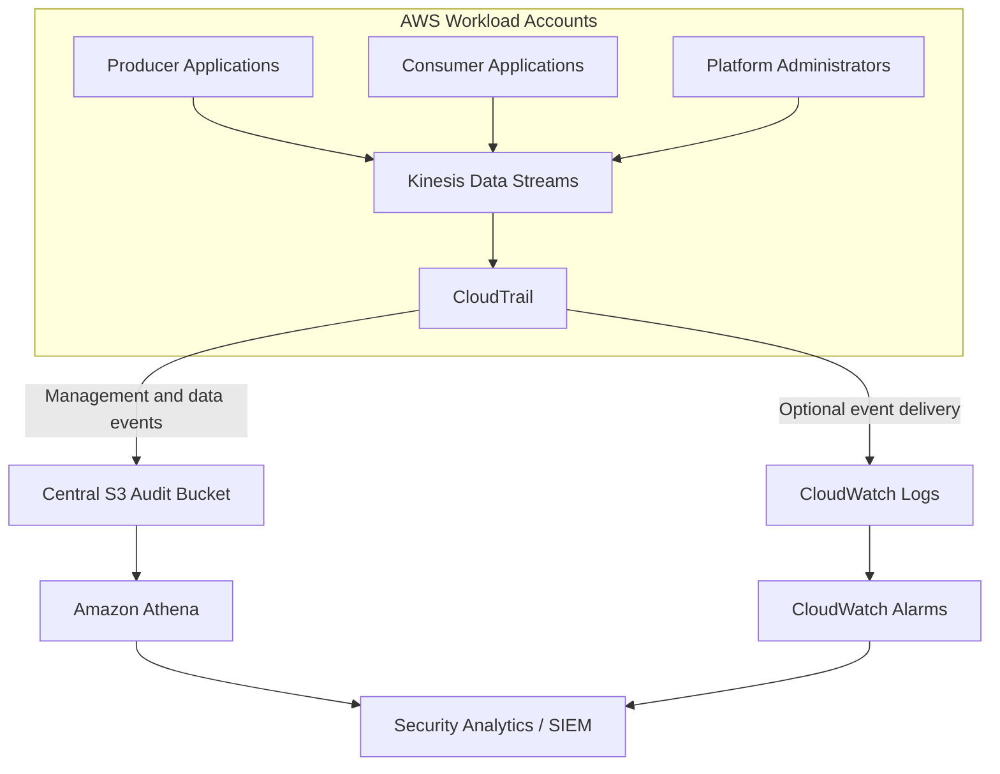
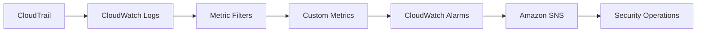
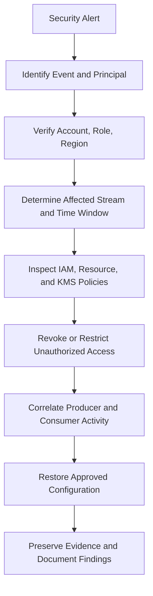

# 07- CloudTrail Auditing

## Overview

AWS CloudTrail provides an audit trail of API activity across an AWS account. For Amazon Kinesis Data Streams, it helps identify who performed an operation, when it occurred, which resources were affected, and whether the request succeeded or failed.

CloudTrail is an important security control for streaming platforms because Kinesis resources often contain sensitive business events, customer activity, financial transactions, and operational telemetry.

A production auditing strategy should cover both the Kinesis control plane and data plane:

- **Management events:** Track changes to streams, encryption settings, resource policies, registered consumers, and other administrative configurations.
- **Data events:** Track record-level API activity such as publishing and consuming records, where supported and configured.
- **Organization trails:** Centralize audit collection across multiple AWS accounts.
- **Log integrity and retention:** Protect audit records against unauthorized modification or deletion.
- **Monitoring and alerting:** Detect suspicious access, configuration changes, and unexpected activity.

CloudTrail is an audit service, not a real-time application monitoring system. Use CloudWatch metrics and application telemetry alongside CloudTrail to understand streaming performance and business processing behavior.

## CloudTrail Event Categories

### Management Events

Management events record operations that manage AWS resources and configurations.

For Kinesis, relevant operations include:

| Operation | Audit purpose |
|---|---|
| `CreateStream` | Identify stream creation |
| `DeleteStream` | Track stream deletion |
| `DescribeStreamSummary` | Track stream metadata access |
| `UpdateShardCount` | Identify capacity changes |
| `IncreaseStreamRetentionPeriod` | Track retention changes |
| `DecreaseStreamRetentionPeriod` | Identify retention reductions |
| `StartStreamEncryption` | Track encryption activation |
| `StopStreamEncryption` | Track encryption deactivation |
| `PutResourcePolicy` | Track resource policy changes |
| `DeleteResourcePolicy` | Track resource policy removal |
| `RegisterStreamConsumer` | Track enhanced fan-out consumer registration |
| `DeregisterStreamConsumer` | Track consumer deregistration |

Management events are generally enabled by default in CloudTrail event history. A trail or event data store provides longer-term collection and retention capabilities.

### Data Events

Data events capture activity performed against the data stored in or delivered through supported AWS resources.

For Kinesis Data Streams, relevant data-plane operations can include:

- `PutRecord`
- `PutRecords`
- `GetRecords`
- `GetShardIterator`
- `SubscribeToShard`

Data events are not enabled by default in a standard trail. They must be explicitly configured for the relevant resource types and operations.

This distinction is important: enabling management event logging does not automatically provide a complete audit trail of record publishing and consumption.

### Management Events vs Data Events

| Characteristic | Management events | Data events |
|---|---|---|
| Primary purpose | Resource administration | Data-plane activity |
| Examples | Create stream, update retention | Publish and consume records |
| Default collection | Available in event history | Requires explicit configuration |
| Volume | Usually lower | Can be significantly higher |
| Cost considerations | Depends on trail configuration | Additional event collection costs can be significant |
| Security value | Detect infrastructure changes | Investigate access to streaming data |

For sensitive streaming platforms, configure both categories according to the organization's audit and compliance requirements.

## CloudTrail Architecture for Kinesis

A centralized architecture collects events from multiple application and platform accounts and stores them in a dedicated audit account.



### Architecture Components

| Component | Responsibility |
|---|---|
| CloudTrail trail | Collects and delivers configured account activity |
| S3 audit bucket | Long-term audit event storage |
| CloudWatch Logs | Operational visibility and alert integration |
| AWS KMS | Encrypts audit log objects |
| S3 bucket policy | Restricts who can deliver and access audit logs |
| Athena | Queries CloudTrail events stored in S3 |
| Security account | Centralizes audit ownership and investigation |

For enterprise environments, use an organization trail or an equivalent centralized collection architecture. Keep audit storage separate from the workload accounts being monitored.

## Creating a CloudTrail Trail

### Create a Trail

A trail delivers CloudTrail events to an S3 bucket.

Create the trail:

```bash
aws cloudtrail create-trail \
  --name kinesis-security-trail \
  --s3-bucket-name central-audit-logs \
  --is-multi-region-trail \
  --enable-log-file-validation
```

Important options:

| Option | Purpose |
|---|---|
| `--name` | Trail identifier |
| `--s3-bucket-name` | Destination bucket |
| `--is-multi-region-trail` | Collects supported regional activity across Regions |
| `--enable-log-file-validation` | Enables log file integrity validation |

Start logging:

```bash
aws cloudtrail start-logging \
  --name kinesis-security-trail
```

Inspect the trail:

```bash
aws cloudtrail get-trail-status \
  --name kinesis-security-trail
```

A successful trail creation does not guarantee that every desired event category is being collected. Review event selectors separately.

### Multi-Region Trails

A multi-Region trail is generally appropriate for production security auditing because it captures supported activity across AWS Regions rather than requiring independent trails for every Region.

Benefits include:

- Centralized audit configuration.
- Reduced risk of missing activity in newly used Regions.
- Consistent security monitoring.
- Easier organization-wide investigation.

For multi-account environments, consider an organization trail managed from a designated management or delegated administrator account.

## Configuring Kinesis Data Event Logging

### Event Selectors

Event selectors determine which events CloudTrail records.

To configure Kinesis data events, use advanced event selectors with the Kinesis Data Streams resource type.

Example:

```json
[
  {
    "Name": "KinesisDataEvents",
    "FieldSelectors": [
      {
        "Field": "eventCategory",
        "Equals": ["Data"]
      },
      {
        "Field": "resources.type",
        "Equals": ["AWS::Kinesis::Stream"]
      },
      {
        "Field": "resources.ARN",
        "StartsWith": [
          "arn:aws:kinesis:ap-south-1:111111111111:stream/orders-"
        ]
      }
    ]
  }
]
```

Apply the selector:

```bash
aws cloudtrail put-event-selectors \
  --trail-name kinesis-security-trail \
  --advanced-event-selectors file://kinesis-data-event-selectors.json
```

Inspect the configured selectors:

```bash
aws cloudtrail get-event-selectors \
  --trail-name kinesis-security-trail
```

### Selecting Specific Operations

Advanced event selectors can further narrow collection to specific operations using supported fields such as `eventName`.

Example:

```json
[
  {
    "Name": "KinesisWriteEvents",
    "FieldSelectors": [
      {
        "Field": "eventCategory",
        "Equals": ["Data"]
      },
      {
        "Field": "resources.type",
        "Equals": ["AWS::Kinesis::Stream"]
      },
      {
        "Field": "resources.ARN",
        "Equals": [
          "arn:aws:kinesis:ap-south-1:111111111111:stream/orders-stream"
        ]
      },
      {
        "Field": "eventName",
        "Equals": [
          "PutRecord",
          "PutRecords"
        ]
      }
    ]
  }
]
```

This selector focuses on publishing activity. A separate selector can capture consumer operations.

Validate supported event names and selector fields against the current CloudTrail service event documentation before deploying production selectors.

### Selector Design Considerations

Avoid collecting every data event without evaluating the operational and financial impact.

A high-volume stream can produce substantial audit volume because every publishing or consuming request may generate an event.

A practical policy is:

- Enable management events broadly.
- Enable data events for sensitive streams.
- Include producer operations when investigating data injection or unauthorized publishing is important.
- Include consumer operations when auditing access to sensitive records is required.
- Use resource ARN filters to avoid collecting unrelated activity.
- Review event volume and cost after deployment.

## Understanding CloudTrail Event Records

CloudTrail records are structured JSON documents.

A representative Kinesis event contains fields similar to the following:

```json
{
  "eventVersion": "1.11",
  "eventSource": "kinesis.amazonaws.com",
  "eventName": "PutRecord",
  "awsRegion": "ap-south-1",
  "eventTime": "2026-11-20T08:30:00Z",
  "eventType": "AwsApiCall",
  "eventCategory": "Data",
  "readOnly": false,
  "userIdentity": {
    "type": "AssumedRole",
    "principalId": "EXAMPLE:orders-producer",
    "arn": "arn:aws:sts::222222222222:assumed-role/orders-producer-role/orders-producer",
    "accountId": "222222222222"
  },
  "requestParameters": {
    "streamName": "orders-stream",
    "partitionKey": "customer-001"
  },
  "responseElements": {
    "shardId": "shardId-000000000001"
  },
  "requestID": "example-request-id",
  "eventID": "example-event-id"
}
```

This is an illustrative structure. Actual fields vary by API operation and event type.

### Important Event Fields

| Field | Meaning |
|---|---|
| `eventTime` | Time the API activity occurred |
| `eventSource` | AWS service that handled the request |
| `eventName` | API operation |
| `awsRegion` | Region in which the event occurred |
| `userIdentity` | Identity associated with the request |
| `requestParameters` | Parameters recorded for the API request |
| `responseElements` | Recorded response information, when available |
| `errorCode` | Error associated with a failed request, when present |
| `errorMessage` | Error details, when present |
| `sourceIPAddress` | Request source address, when available |
| `userAgent` | Client or SDK information |
| `requestID` | AWS request identifier |
| `eventID` | Unique event identifier |

### Interpreting Caller Identity

The `userIdentity` object is particularly important for security investigations.

Common identity types include:

| Identity type | Interpretation |
|---|---|
| `IAMUser` | IAM user credentials |
| `AssumedRole` | Temporary credentials associated with an assumed role |
| `Root` | Account root identity |
| `AWSService` | AWS service identity |

For cross-account access, inspect:

- The caller account ID.
- The assumed role ARN.
- The session name.
- The principal identity.
- The source account and Region.
- The request parameters.

Do not rely only on the role name. Multiple workloads may assume the same role, so session naming and workload identity practices improve attribution.

## Monitoring Kinesis Security Activity

### Important Events to Monitor

| Event | Security significance | Suggested response |
|---|---|---|
| `CreateStream` | Unexpected stream creation | Validate owner and deployment identity |
| `DeleteStream` | Potential data loss or disruption | Investigate immediately |
| `PutResourcePolicy` | Access boundary changed | Review policy diff |
| `DeleteResourcePolicy` | External access configuration removed | Validate intended change |
| `StartStreamEncryption` | Encryption enabled | Verify approved configuration |
| `StopStreamEncryption` | Encryption disabled | Trigger security investigation |
| `RegisterStreamConsumer` | New consumer registered | Validate workload ownership |
| `DeregisterStreamConsumer` | Consumer removed | Check deployment or incident context |
| `UpdateShardCount` | Capacity changed | Validate operational approval |
| `DecreaseStreamRetentionPeriod` | Reduced replay window | Review data retention impact |
| `PutRecord` | Record published | Investigate unexpected publishing identities |
| `GetRecords` | Records consumed | Investigate unexpected consumer access |

The exact event names and availability should be verified against the operations supported by the Kinesis API and CloudTrail.

### CloudWatch Logs Integration

CloudTrail can deliver events to CloudWatch Logs through a configured trail.

This enables metric filters and alarms for selected security events.

A useful monitoring architecture is:



Example metric filter pattern for stream deletion events:

```text
{ ($.eventSource = "kinesis.amazonaws.com") && ($.eventName = "DeleteStream") }
```

Example metric filter creation:

```bash
aws logs put-metric-filter \
  --log-group-name /aws/cloudtrail/kinesis \
  --filter-name KinesisStreamDeletion \
  --filter-pattern '{ ($.eventSource = "kinesis.amazonaws.com") && ($.eventName = "DeleteStream") }' \
  --metric-transformations \
    metricName=KinesisStreamDeletion,metricNamespace=Security/Kinesis,metricValue=1
```

Create an alarm for the resulting metric:

```bash
aws cloudwatch put-metric-alarm \
  --alarm-name KinesisStreamDeletionDetected \
  --namespace Security/Kinesis \
  --metric-name KinesisStreamDeletion \
  --statistic Sum \
  --period 300 \
  --evaluation-periods 1 \
  --threshold 1 \
  --comparison-operator GreaterThanOrEqualToThreshold \
  --treat-missing-data notBreaching \
  --alarm-actions arn:aws:sns:ap-south-1:111111111111:security-alerts
```

A production alarm should have an operational owner, documented severity, and a response procedure. Avoid treating every configuration change as an incident without considering approved deployment activity.

## Querying CloudTrail Logs with Amazon Athena

### Why Athena Is Useful

CloudTrail delivers structured JSON records to S3. Athena can query these records without requiring a separate database or log-processing cluster.

Typical investigation queries include:

- Which role deleted a stream?
- Which account published records?
- When was encryption disabled?
- Which principal modified a resource policy?
- Did an external consumer access a sensitive stream?

Create an Athena table using the CloudTrail table schema appropriate to the log format and S3 partition structure. For production, prefer partition projection or a maintained partition registration process to avoid inefficient full-prefix scans.

### Example Queries

Find stream deletion activity:

```sql
SELECT
    eventtime,
    useridentity.arn AS principal,
    awsregion,
    sourceipaddress,
    requestparameters
FROM cloudtrail_logs
WHERE eventsource = 'kinesis.amazonaws.com'
  AND eventname = 'DeleteStream'
ORDER BY eventtime DESC;
```

Find resource policy changes:

```sql
SELECT
    eventtime,
    eventname,
    useridentity.arn AS principal,
    useridentity.accountid AS caller_account,
    sourceipaddress,
    requestparameters
FROM cloudtrail_logs
WHERE eventsource = 'kinesis.amazonaws.com'
  AND eventname IN (
      'PutResourcePolicy',
      'DeleteResourcePolicy'
  )
ORDER BY eventtime DESC;
```

Identify cross-account Kinesis activity:

```sql
SELECT
    eventtime,
    eventname,
    useridentity.accountid AS caller_account,
    useridentity.arn AS principal,
    awsregion,
    sourceipaddress
FROM cloudtrail_logs
WHERE eventsource = 'kinesis.amazonaws.com'
  AND useridentity.accountid <> '111111111111'
ORDER BY eventtime DESC;
```

The last query assumes `111111111111` is the stream-owning account and that the table contains the relevant Kinesis events. Validate the identity and resource fields before using the query for compliance reporting.

### Query Performance

CloudTrail logs can grow rapidly, especially when data events are enabled.

Improve Athena performance by:

- Partitioning by date and Region.
- Using partition projection where appropriate.
- Filtering on partition columns.
- Selecting only required columns.
- Restricting queries to relevant event sources and event names.
- Avoiding broad scans across multiple years of audit data.
- Considering columnar formats for derived analytical datasets.

Do not modify the original CloudTrail log objects when building analytical datasets. Keep transformed data in a separate, controlled location.

## Protecting CloudTrail Audit Logs

### S3 Bucket Security

Audit logs are security evidence. A compromised workload account should not be able to modify or delete its own audit history.

Use a dedicated audit account and restrict access to the S3 destination bucket.

Recommended controls:

- Block public access.
- Enforce TLS for bucket access.
- Restrict writes to CloudTrail delivery.
- Restrict reads to approved security and audit roles.
- Enable versioning where appropriate.
- Use lifecycle policies for retention management.
- Consider S3 Object Lock for compliance retention requirements.
- Monitor bucket policy and configuration changes.

An example bucket policy denying insecure transport:

```json
{
  "Version": "2012-10-17",
  "Statement": [
    {
      "Sid": "DenyInsecureTransport",
      "Effect": "Deny",
      "Principal": "*",
      "Action": "s3:*",
      "Resource": [
        "arn:aws:s3:::central-audit-logs",
        "arn:aws:s3:::central-audit-logs/*"
      ],
      "Condition": {
        "Bool": {
          "aws:SecureTransport": "false"
        }
      }
    }
  ]
}
```

The complete bucket policy must also include the required CloudTrail delivery permissions and any organization-specific access controls.

### Log File Integrity Validation

CloudTrail log file integrity validation uses digest files to help detect modification or deletion of delivered log files.

Enable validation when creating a trail:

```bash
aws cloudtrail create-trail \
  --name kinesis-security-trail \
  --s3-bucket-name central-audit-logs \
  --enable-log-file-validation
```

Validate log files:

```bash
aws cloudtrail validate-logs \
  --trail-arn arn:aws:cloudtrail:ap-south-1:111111111111:trail/kinesis-security-trail \
  --start-time 2026-11-19T00:00:00Z \
  --end-time 2026-11-20T00:00:00Z
```

Integrity validation helps identify changes to delivered log files. It does not prevent an authorized administrator from changing the trail configuration or deleting the destination bucket. Protect those resources independently.

### Encryption at Rest

Use server-side encryption for the audit bucket.

For stricter key ownership and access control, use a customer-managed KMS key.

Ensure that:

- CloudTrail has permission to use the configured key.
- Security administrators can access the key when needed.
- Workload administrators cannot disable or delete the audit encryption key.
- Key deletion procedures account for audit retention requirements.
- Key policy changes are independently monitored.

Do not confuse Kinesis stream encryption with CloudTrail log encryption. They protect different data stores and require separate configuration.

## Organization-Wide Auditing

### Organization Trails

An organization trail collects CloudTrail activity from member accounts in an AWS Organization.

This is useful for environments where Kinesis streams and workloads are distributed across multiple accounts.

Benefits include:

- Consistent auditing across accounts.
- Centralized storage.
- Reduced dependence on individual workload account administrators.
- Easier cross-account incident investigation.
- Centralized security governance.

Organization trails require the appropriate AWS Organizations setup and CloudTrail permissions. A delegated administrator can be used for centralized CloudTrail administration where supported.

### Recommended Account Separation

| Account | Audit responsibility |
|---|---|
| Management account | Organization governance |
| Security account | Centralized trail administration and investigation |
| Log archive account | Protected S3 audit storage |
| Data platform account | Kinesis stream ownership |
| Application accounts | Producer and consumer workloads |

Separate audit storage from workload administration. The team operating a Kinesis stream should not have unrestricted permissions to delete the audit records associated with that stream.

## Infrastructure as Code

### Terraform Trail Configuration

A Terraform-managed trail provides repeatable audit configuration.

```hcl
resource "aws_cloudtrail" "kinesis_security" {
  name                          = "kinesis-security-trail"
  s3_bucket_name                = var.audit_bucket_name
  is_multi_region_trail         = true
  enable_log_file_validation    = true
  include_global_service_events = true

  advanced_event_selector {
    name = "KinesisDataEvents"

    field_selector {
      field  = "eventCategory"
      equals = ["Data"]
    }

    field_selector {
      field  = "resources.type"
      equals = ["AWS::Kinesis::Stream"]
    }

    field_selector {
      field  = "resources.ARN"
      starts_with = [
        "arn:aws:kinesis:${var.aws_region}:${var.account_id}:stream/orders-"
      ]
    }
  }

  depends_on = [
    aws_s3_bucket_policy.audit_bucket
  ]
}
```

This example assumes the audit bucket and its delivery policy are managed separately.

### Deployment Considerations

- Create the audit bucket and delivery permissions before enabling the trail.
- Use a separate module for centralized audit infrastructure.
- Keep event selectors in version control.
- Review selector changes for unintended collection gaps.
- Protect trail deletion and modification with IAM controls and organizational guardrails.
- Validate that the trail is logging after deployment.
- Test event delivery and Athena query visibility.
- Monitor trail status and delivery errors.

Changing event selectors can alter the events collected by a trail. Treat selector changes as security-sensitive infrastructure modifications.

## Cost and Scalability Considerations

CloudTrail cost depends on event categories, delivery configuration, and the volume of activity collected.

Data events can be particularly expensive for high-throughput streams because producer and consumer requests can generate large numbers of audit records.

| Cost driver | Impact | Optimization |
|---|---|---|
| Management event collection | Baseline audit volume | Use appropriate trail configuration |
| Kinesis data events | Can grow with request volume | Scope selectors to sensitive streams and operations |
| S3 storage | Long-term retention cost | Use lifecycle transitions and retention policies |
| CloudWatch Logs ingestion | Cost increases with delivered volume | Filter and route only operationally necessary events |
| Athena queries | Cost depends on data scanned | Partition and restrict queries |
| KMS usage | Encryption and decryption requests | Review key usage and audit architecture |

Do not disable required data-event auditing simply to reduce cost. Instead, define a risk-based collection strategy and estimate event volume before enabling broad selectors.

## Incident Response Workflow

CloudTrail should support a repeatable investigation process.

Example: an unexpected external role publishes records to a sensitive stream.



A practical response procedure:

1. Identify the event using `eventID`, `requestID`, event time, and event name.
2. Determine the caller account and principal ARN.
3. Identify the affected stream and Region.
4. Inspect the resource policy and caller identity policy.
5. Review related KMS and VPC endpoint activity.
6. Determine whether the activity was successful.
7. Revoke or restrict unauthorized access through an approved process.
8. Correlate activity with application logs and downstream processing.
9. Preserve relevant audit records.
10. Document the incident, root cause, and corrective actions.

CloudTrail records API activity, not the complete business meaning of a Kinesis record. Correlate audit events with application-level event IDs and service logs when investigating business data.

## Common Mistakes and Pitfalls

| Mistake | Why it causes problems | Recommended approach |
|---|---|---|
| Assuming management events include record access | Data-plane activity is not automatically captured | Configure Kinesis data events |
| Enabling every data event without cost analysis | High-volume streams can generate substantial audit costs | Scope selectors by stream and operation |
| Storing logs in the workload account | A compromised workload administrator may affect audit evidence | Use a separate log archive account |
| Treating CloudTrail as real-time monitoring | Delivery and query workflows are not a substitute for operational metrics | Use CloudWatch metrics and application telemetry |
| Ignoring failed API calls | Denied requests can indicate attempted unauthorized access | Include failed events in security investigations |
| Relying only on Athena | Investigations may be delayed until logs are delivered and queried | Use CloudWatch alerting for time-sensitive detection |
| Leaving event selectors unreviewed | Configuration changes can silently reduce audit coverage | Version and review selector changes |
| Assuming log validation prevents deletion | Integrity validation detects tampering but does not prevent all destructive actions | Combine it with S3 protection and IAM guardrails |
| Ignoring cross-account identities | External role activity may be misattributed | Review account ID, principal ARN, and session context |
| Treating CloudTrail as a record-level business audit | API metadata does not explain application-level processing | Correlate with application event IDs and logs |

## Production Audit Checklist

- [ ] Enable a multi-Region CloudTrail trail.
- [ ] Collect required Kinesis management events.
- [ ] Configure data events for sensitive streams and operations.
- [ ] Use resource ARN filters to control collection scope.
- [ ] Centralize audit logs in a dedicated security or log archive account.
- [ ] Enable log file integrity validation.
- [ ] Encrypt audit logs using an approved encryption configuration.
- [ ] Restrict audit bucket access and enforce TLS.
- [ ] Define retention and lifecycle policies.
- [ ] Protect trail configuration and log storage with IAM and organizational guardrails.
- [ ] Monitor stream deletion, encryption changes, and resource policy modifications.
- [ ] Alert on unexpected cross-account access.
- [ ] Use Athena for historical investigation and reporting.
- [ ] Monitor CloudTrail delivery health.
- [ ] Review data-event collection costs.
- [ ] Test incident response and audit recovery procedures.

## Key Takeaways

- CloudTrail management events audit Kinesis resource administration, while data events provide visibility into configured record-level API activity.
- Data events must be explicitly selected, and their volume can materially affect auditing costs.
- Centralized S3 storage, restrictive IAM policies, encryption, and log integrity validation protect audit evidence.
- CloudWatch supports operational alerting, while Athena enables historical investigation of CloudTrail records.
- A production audit strategy must include cross-account attribution, continuous monitoring, retention controls, and tested incident response procedures.