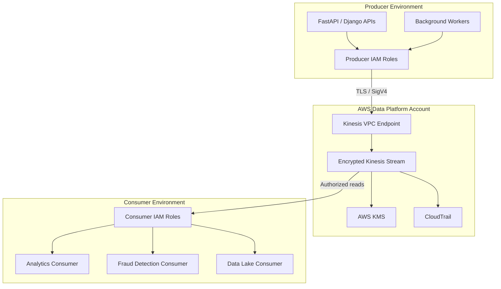
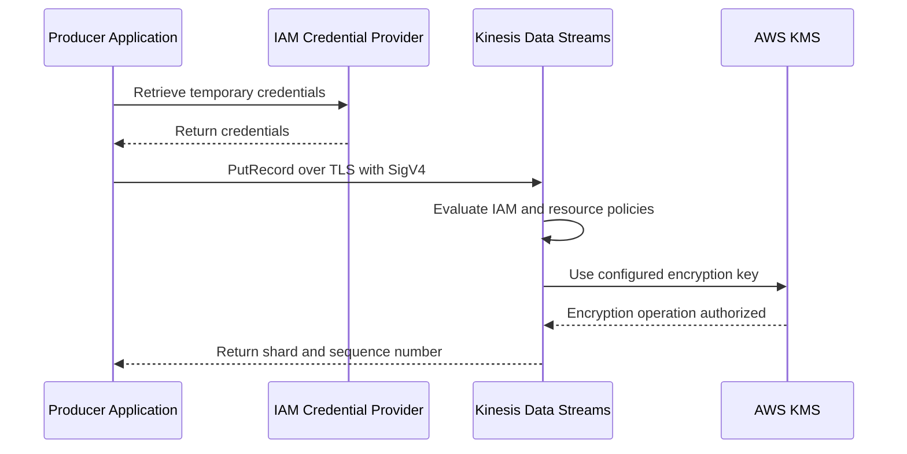
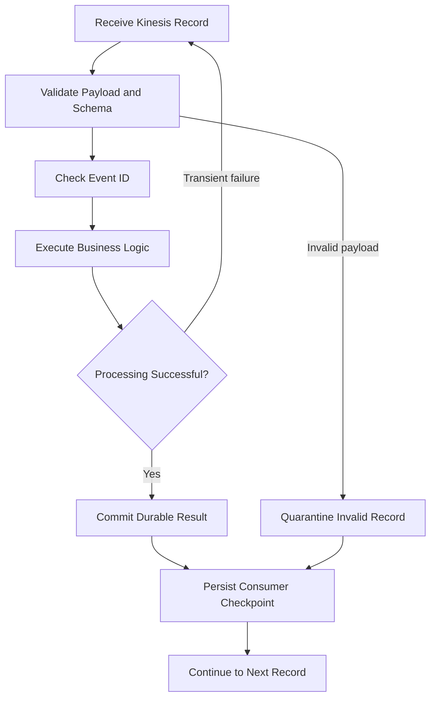
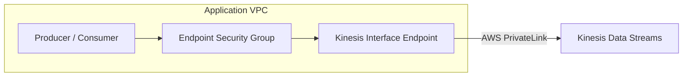

# 08- Secure Producer and Consumer Architectures

## Overview

Amazon Kinesis Data Streams connects producer applications that publish records with consumer applications that process them. Both sides operate across application identities, network boundaries, encryption controls, and distributed processing components.

Securing a production streaming architecture requires more than enabling encryption or attaching an IAM policy. The complete design must protect the publishing path, consumption path, credentials, data payloads, checkpoints, and downstream integrations.

A secure architecture should provide:

- **Identity isolation:** Separate permissions for producers, consumers, and administrators.
- **Least privilege:** Restrict each workload to the streams and operations it requires.
- **Secure connectivity:** Use TLS and private network connectivity where appropriate.
- **Data protection:** Encrypt records at rest and protect sensitive fields when necessary.
- **Reliable processing:** Handle retries, duplicate records, checkpoint recovery, and poison messages safely.
- **Auditability:** Record administrative and data-plane activity.
- **Operational resilience:** Prevent one compromised workload from affecting unrelated producers or consumers.

## Secure Streaming Architecture

### Reference Architecture

A production architecture typically separates ingestion, stream ownership, consumption, and downstream processing.



The architecture separates producer and consumer identities so that a compromised producer cannot automatically read sensitive records or administer the stream.

### Security Boundaries

| Boundary | Security responsibility |
|---|---|
| Application | Validate events and prevent sensitive data leakage |
| IAM | Authenticate workload identities and authorize API operations |
| Network | Restrict access to approved network paths |
| Kinesis | Enforce stream-level access and retention configuration |
| KMS | Protect encrypted stream data |
| Consumer | Validate, deduplicate, and process records safely |
| Downstream systems | Enforce independent access controls |
| Audit platform | Preserve evidence of administrative and data access |

Security should be enforced at multiple layers. A private network path does not replace IAM authorization, and IAM authorization does not replace application-level data validation.

## Producer Security Architecture

### Producer Responsibilities

A producer publishes records to a Kinesis stream. It may run as:

- A Django or FastAPI application.
- A background worker using Celery.
- An ECS task.
- A Kubernetes workload.
- An EC2 application.
- An AWS Lambda function.

The producer should have permission to publish only to its designated streams.

A producer should not receive consumer permissions or administrative permissions unless its responsibilities explicitly require them.

### Producer Request Lifecycle



The application uses AWS credentials supplied by its workload identity. The SDK signs requests using Signature Version 4.

Kinesis performs authorization checks before accepting the operation. When customer-managed encryption keys are involved, the relevant KMS permissions must also be configured.

### Least-Privilege Producer Policy

A producer that only publishes records requires write permissions.

```json
{
  "Version": "2012-10-17",
  "Statement": [
    {
      "Sid": "PublishOrders",
      "Effect": "Allow",
      "Action": [
        "kinesis:PutRecord",
        "kinesis:PutRecords"
      ],
      "Resource": "arn:aws:kinesis:ap-south-1:111111111111:stream/orders-stream"
    }
  ]
}
```

Avoid granting permissions such as:

- `kinesis:DeleteStream`
- `kinesis:UpdateShardCount`
- `kinesis:StartStreamEncryption`
- `kinesis:StopStreamEncryption`
- `kinesis:PutResourcePolicy`
- `kinesis:RegisterStreamConsumer`

These operations belong to infrastructure or platform administration roles.

### Secure Python Producer

Use Boto3 with temporary workload credentials rather than hardcoded access keys.

```python
import json
import logging
from typing import Any

import boto3
from botocore.config import Config

logger = logging.getLogger(__name__)

STREAM_NAME = "orders-stream"
REGION = "ap-south-1"

kinesis = boto3.client(
    "kinesis",
    region_name=REGION,
    config=Config(
        retries={
            "mode": "standard",
            "total_max_attempts": 5,
        },
        connect_timeout=5,
        read_timeout=30,
    ),
)


def publish_order(order: dict[str, Any]) -> dict[str, str]:
    required_fields = {"event_id", "customer_id", "order_id"}

    if not required_fields.issubset(order):
        raise ValueError("Order is missing required fields")

    payload = json.dumps(
        order,
        separators=(",", ":"),
    ).encode("utf-8")

    response = kinesis.put_record(
        StreamName=STREAM_NAME,
        Data=payload,
        PartitionKey=str(order["customer_id"]),
    )

    logger.info(
        "Published order event",
        extra={
            "event_id": order["event_id"],
            "shard_id": response["ShardId"],
        },
    )

    return {
        "shard_id": response["ShardId"],
        "sequence_number": response["SequenceNumber"],
    }
```

Production recommendations:

- Validate event schemas before publishing.
- Apply payload size limits before calling Kinesis.
- Avoid logging complete payloads containing sensitive information.
- Use stable event identifiers for downstream idempotency.
- Apply bounded retries with exponential backoff and jitter.
- Monitor throttling and failed publishing requests.
- Handle ambiguous network timeouts because the record may already have been accepted.

### Secure Producer Retry Strategy

Kinesis publishing is not an exactly-once operation.

A producer may experience a timeout after Kinesis accepts a record but before the response reaches the application. Retrying can publish a duplicate.

Use an application-generated event ID:

```json
{
  "event_id": "evt-01JORDERS9K3X",
  "event_type": "order.created",
  "order_id": "ORD-10025",
  "customer_id": "CUST-5001",
  "occurred_at": "2026-11-20T08:30:00Z"
}
```

Consumers can use the event ID to identify repeated delivery.

For database-backed applications, the transactional outbox pattern can prevent events from being lost between a database commit and a Kinesis publish operation.

## Consumer Security Architecture

### Consumer Responsibilities

A consumer reads records from a Kinesis stream and processes them independently.

Typical consumer responsibilities include:

- Validating record structure and schema versions.
- Checking event identifiers.
- Enforcing authorization for downstream operations.
- Preventing duplicate business processing.
- Handling malformed or unsupported records.
- Persisting checkpoints safely.
- Protecting sensitive data during processing.

A consumer should receive read permissions only for the streams it needs.

### Consumer Isolation

Different business functions should use separate consumer identities.

For example:

| Consumer | Required access |
|---|---|
| Fraud detection | Read transaction events |
| Analytics | Read approved analytical events |
| Notifications | Read notification-triggering events |
| Data lake ingestion | Read events for archival |
| Audit processing | Read security-relevant events |

Do not use one shared IAM role for every consumer. Separate roles improve access isolation, incident investigation, and permission management.

### Shared Throughput vs Enhanced Fan-Out

Kinesis supports two main consumption models.

| Feature | Shared throughput | Enhanced fan-out |
|---|---|---|
| Read throughput | Shared across consumers | Dedicated per registered consumer |
| Read API | `GetRecords` | `SubscribeToShard` |
| Isolation | Lower throughput isolation | Better consumer isolation |
| Network delivery | Polling | HTTP/2 subscription |
| IAM permissions | Stream read operations | Stream and consumer permissions |
| Operational complexity | Lower | Requires consumer registration and subscription lifecycle management |

Use enhanced fan-out when multiple consumers require predictable read throughput and should not compete for shared shard read capacity.

### Consumer IAM Policy

An example policy for a shared-throughput consumer:

```json
{
  "Version": "2012-10-17",
  "Statement": [
    {
      "Sid": "ReadOrdersStream",
      "Effect": "Allow",
      "Action": [
        "kinesis:DescribeStreamSummary",
        "kinesis:ListShards",
        "kinesis:GetShardIterator",
        "kinesis:GetRecords"
      ],
      "Resource": "arn:aws:kinesis:ap-south-1:111111111111:stream/orders-stream"
    }
  ]
}
```

For enhanced fan-out, grant the required consumer-specific actions against the registered consumer resource.

Do not grant stream administration permissions to ordinary consumer workloads.

## Secure Consumer Processing

### Processing Lifecycle



The consumer must distinguish between transient failures and permanent data errors.

A record should not be considered successfully processed until its required business effects are durable.

### Idempotent Processing

Kinesis consumers can process records more than once because of retries, worker restarts, checkpoint recovery, or shard reassignment.

Use a unique event ID and a database constraint to prevent duplicate business operations.

Example PostgreSQL table:

```sql
CREATE TABLE processed_events (
    event_id VARCHAR(100) PRIMARY KEY,
    event_type VARCHAR(100) NOT NULL,
    processed_at TIMESTAMPTZ NOT NULL DEFAULT NOW()
);
```

Example transaction:

```sql
BEGIN;

INSERT INTO processed_events (event_id, event_type)
VALUES ('evt-01JORDERS9K3X', 'order.created')
ON CONFLICT (event_id) DO NOTHING;

-- Apply the business update only when the event was newly inserted.

COMMIT;
```

In application code, check whether the insert succeeded before executing the business update. Keep the deduplication record and business changes in the same database transaction.

For external APIs and systems that cannot participate in the transaction, use provider-supported idempotency keys, an outbox, or a reconciliation process.

### Checkpoint Security

Consumer checkpoints represent processing progress. They are security-sensitive operational state because unauthorized modification can cause records to be skipped or reprocessed.

For consumers using Kinesis Client Library (KCL):

- Restrict access to the checkpoint storage, commonly DynamoDB.
- Use a dedicated IAM role for the consumer.
- Restrict table access to the required checkpoint table.
- Protect lease and checkpoint records from unauthorized modification.
- Monitor unexpected table deletion or permission changes.

A consumer should not have broad DynamoDB access simply because it uses KCL.

## Secure Networking

### TLS for Producer and Consumer Connections

Kinesis API requests should use HTTPS with TLS.

TLS protects:

- API request contents.
- Record payloads while transmitted.
- Authentication and request-signing metadata.
- Responses returned by the service.

AWS SDK clients use HTTPS by default.

Do not disable certificate validation in production.

For containerized workloads, ensure the image includes a trusted CA certificate bundle. A missing CA bundle can cause TLS verification failures.

### VPC Interface Endpoints

For private workloads, use AWS PrivateLink interface endpoints to access Kinesis without routing traffic through a public internet path.



Security recommendations:

- Enable private DNS where appropriate.
- Restrict endpoint security groups to approved application sources.
- Apply endpoint policies to limit permitted actions and resources.
- Restrict stream access through IAM and resource policies.
- Monitor endpoint configuration changes.
- Deploy endpoints across multiple Availability Zones where required.

A VPC endpoint provides private connectivity, not automatic authorization. IAM and Kinesis resource policies still determine whether a request is permitted.

## Workload Identity and Credential Management

### EC2 Applications

Use EC2 instance profiles to provide temporary credentials to applications.

Avoid:

- Embedding access keys in source code.
- Storing credentials in AMIs.
- Passing long-lived credentials through user data.
- Sharing one instance role across unrelated workloads.

### ECS Applications

Use ECS task roles for application permissions.

A task role should contain only the permissions needed by the application container. Do not confuse the task role with the task execution role, which is used by ECS for infrastructure operations such as image retrieval and log delivery.

### Kubernetes Applications

Use EKS Pod Identity or IAM Roles for Service Accounts (IRSA), depending on the cluster configuration and operational model.

Assign separate identities to producer and consumer Kubernetes service accounts.

Example Kubernetes service account:

```yaml
apiVersion: v1
kind: ServiceAccount
metadata:
  name: orders-producer
  namespace: applications
```

Configure the selected EKS identity mechanism to associate this service account with the producer IAM role.

Avoid assigning broad permissions to the worker node IAM role. A node role is shared infrastructure identity and should not become the default application authorization boundary.

### Lambda Applications

Assign an execution role to each Lambda function.

Separate producer and consumer functions when they have different responsibilities. Avoid using a shared execution role that combines publishing, reading, administration, and unrelated downstream access.

## Data Protection and Payload Security

### Encryption at Rest

Kinesis supports server-side encryption using AWS KMS.

For sensitive production streams, use a customer-managed KMS key when independent key administration, policy control, or audit requirements justify it.

Consider:

- Key ownership and separation of duties.
- IAM permissions for key usage.
- KMS key policy restrictions.
- Rotation and key lifecycle management.
- CloudTrail auditing of key operations.
- Recovery implications if a key is disabled or scheduled for deletion.

Encryption at rest protects stored records but does not automatically protect data after a consumer reads it.

### Application-Level Encryption

Some data requires protection beyond service-managed encryption.

Examples include:

- Payment identifiers.
- Personally identifiable information.
- Sensitive account references.
- Confidential business attributes.

Application-level encryption can protect selected fields before publishing them.

```python
import json
from cryptography.fernet import Fernet


def encrypt_sensitive_value(value: str, key: bytes) -> str:
    cipher = Fernet(key)
    return cipher.encrypt(value.encode("utf-8")).decode("utf-8")


def build_event(customer_id: str, email: str, encryption_key: bytes) -> bytes:
    event = {
        "event_type": "customer.updated",
        "customer_id": customer_id,
        "email_encrypted": encrypt_sensitive_value(
            email,
            encryption_key,
        ),
    }

    return json.dumps(event).encode("utf-8")
```

This example illustrates field-level encryption. Production key management should use an approved key-management system, envelope encryption, and controlled key rotation rather than distributing a shared Fernet key to every workload.

Application-level encryption introduces operational complexity:

- Consumers need appropriate decryption permissions.
- Key rotation must preserve access to historical records.
- Schema evolution must account for encrypted fields.
- Search and aggregation over encrypted values become difficult.
- Decryption failures need explicit handling.

Do not encrypt every field automatically. Identify the data classification and required access patterns first.

### Data Minimization

The safest sensitive field is one that is never published.

Before sending records to Kinesis:

- Remove unnecessary personal information.
- Avoid credentials, tokens, and secrets in event payloads.
- Replace direct identifiers with controlled references where appropriate.
- Define retention and deletion requirements.
- Validate schemas and allowed fields.
- Prevent sensitive payloads from appearing in application logs.

Kinesis retention is not a substitute for a data lifecycle and deletion strategy.

## Secure Event Contracts

### Schema Validation

Producers and consumers should agree on an event contract.

A stable contract reduces malformed records, unsafe deserialization, and unexpected downstream behavior.

Example Pydantic model:

```python
from datetime import datetime
from typing import Literal

from pydantic import BaseModel, ConfigDict, Field


class OrderCreatedEvent(BaseModel):
    model_config = ConfigDict(extra="forbid")

    event_id: str = Field(min_length=1, max_length=100)
    event_type: Literal["order.created"]
    order_id: str = Field(min_length=1, max_length=100)
    customer_id: str = Field(min_length=1, max_length=100)
    occurred_at: datetime
    schema_version: int = Field(ge=1)
```

Validate incoming records before executing business logic.

Schema validation should not replace authorization. A valid event may still be unauthorized or inconsistent with the expected business state.

### Producer Trust Boundaries

Do not assume that every record in a stream is trustworthy merely because it came through an authenticated AWS principal.

A compromised producer can publish malicious or invalid business events if its permissions allow it.

Consumers should independently validate:

- Event type.
- Schema version.
- Required identifiers.
- Field lengths and data types.
- Business invariants.
- Allowed state transitions.
- External references and ownership.

Use separate streams or carefully controlled publishing permissions when different trust domains should not share the same ingestion boundary.

## Secrets and Configuration Management

Producer and consumer applications should not store credentials or encryption keys in source code or container images.

Use:

- IAM workload credentials for AWS API access.
- AWS Secrets Manager for application secrets requiring centralized secret management.
- Systems Manager Parameter Store for configuration and supported secret use cases.
- KMS for encryption key management.

Keep non-sensitive configuration separate from secrets.

Example environment configuration:

```text
AWS_REGION=ap-south-1
KINESIS_STREAM_NAME=orders-stream
LOG_LEVEL=INFO
```

Environment variables are suitable for ordinary configuration. Do not place long-lived AWS access keys or encryption master keys in deployment manifests.

## Failure Handling and Poison Records

### Failure Categories

| Failure | Example | Recommended handling |
|---|---|---|
| Transient infrastructure failure | Database unavailable | Retry with bounded backoff |
| Throttling | Kinesis read or write throttling | Apply backoff and adjust capacity |
| Invalid schema | Missing required field | Quarantine and alert |
| Business rule violation | Invalid order state transition | Record rejection and investigate |
| External service failure | Payment provider unavailable | Retry using idempotency controls |
| Authorization failure | IAM permission revoked | Alert and investigate configuration |

### Poison Record Handling

A poison record repeatedly fails processing and prevents progress when the consumer cannot safely skip or isolate it.

A robust consumer should:

1. Identify the failed event.
2. Classify the failure.
3. Retry transient failures within a bounded policy.
4. Send permanent failures to a protected quarantine or dead-letter workflow.
5. Record the event ID and failure reason.
6. Alert operators.
7. Preserve enough information for controlled replay.

Kinesis does not provide an SQS-style built-in dead-letter queue for individual stream records. Implement quarantine storage or a separate failure stream as part of the application architecture.

Quarantine records may contain sensitive data. Apply independent IAM, encryption, retention, and access controls.

## Operational Security and Monitoring

### CloudTrail Auditing

Enable CloudTrail management event auditing for administrative operations such as:

- Stream creation and deletion.
- Retention changes.
- Encryption configuration changes.
- Resource policy updates.
- Consumer registration and deregistration.

Configure data event logging where required for publishing and consuming operations.

Data events can increase audit costs significantly for high-volume streams. Scope selectors to sensitive streams and operations based on the audit requirements.

### CloudWatch Monitoring

Monitor application and Kinesis metrics together.

| Metric or signal | Security and operational relevance |
|---|---|
| `IncomingRecords` | Detect unexpected publishing volume |
| `IncomingBytes` | Identify ingestion spikes |
| `WriteProvisionedThroughputExceeded` | Detect producer throttling |
| `ReadProvisionedThroughputExceeded` | Identify shared consumer read pressure |
| `GetRecords.IteratorAgeMilliseconds` | Detect delayed consumer processing |
| `SubscribeToShard.RateExceeded` | Identify enhanced fan-out subscription throttling |
| Authorization failures | Detect incorrect permissions or unauthorized access |
| KMS access failures | Identify encryption authorization problems |
| Consumer processing failures | Detect malformed or malicious payloads |

Metric availability and dimensions vary by operation and monitoring configuration. Combine AWS service metrics with application-level counters and structured logs.

### Structured Logging

Log operational metadata without exposing full sensitive payloads.

Example:

```python
import logging

logger = logging.getLogger(__name__)


def log_event_processed(
    event_id: str,
    event_type: str,
    stream_name: str,
) -> None:
    logger.info(
        "Kinesis event processed",
        extra={
            "event_id": event_id,
            "event_type": event_type,
            "stream_name": stream_name,
        },
    )
```

Include correlation identifiers so that producer activity, stream delivery, consumer processing, and downstream database changes can be investigated together.

## Deployment and Infrastructure Security

### Infrastructure Separation

Separate application deployment permissions from stream administration permissions.

A practical account and role structure:

| Role | Responsibility |
|---|---|
| Kinesis platform administrator | Create and configure streams |
| Producer deployment role | Deploy producer workloads |
| Producer runtime role | Publish records |
| Consumer deployment role | Deploy consumer workloads |
| Consumer runtime role | Read records and access required dependencies |
| Security auditor role | Inspect audit records and security configuration |

Deployment roles should not automatically inherit runtime permissions, and runtime roles should not be able to modify infrastructure.

### Terraform Example

A Kinesis stream with customer-managed encryption:

```hcl
resource "aws_kinesis_stream" "orders" {
  name             = "orders-stream"
  retention_period = 48
  encryption_type  = "KMS"
  kms_key_id       = aws_kms_key.kinesis.arn

  stream_mode_details {
    stream_mode = "ON_DEMAND"
  }

  tags = {
    Environment = "production"
    DataClass   = "confidential"
    ManagedBy   = "terraform"
  }
}
```

The KMS key, IAM roles, resource policies, and network endpoints should be managed through separate, appropriately scoped infrastructure components.

Do not give the application runtime role permission to modify the stream or its encryption configuration.

### CI/CD Security Controls

Include security checks in the infrastructure pipeline:

- Validate IAM policies for wildcard permissions.
- Review resource policy principal changes.
- Detect public or unintended cross-account access.
- Validate KMS key policy changes.
- Run Terraform formatting and validation.
- Review security-sensitive infrastructure plans.
- Require approval for production authorization changes.
- Run positive and negative access tests after deployment.

Policy validation tools can identify common problems, but they do not replace integration testing against the actual AWS authorization environment.

## High Availability and Disaster Recovery

A secure architecture must remain secure during failures and recovery.

Important considerations:

- Deploy producer and consumer workloads across multiple Availability Zones where applicable.
- Use durable producer-side buffering when downstream stream availability is critical.
- Configure appropriate stream retention for recovery and replay.
- Persist consumer checkpoints in durable storage.
- Make processing idempotent.
- Replicate required data to another Region when the recovery objective requires it.
- Recreate IAM roles, resource policies, KMS permissions, and VPC endpoints in the recovery environment.
- Test restoration of encryption keys and audit access.

Kinesis Data Streams does not automatically replicate records across Regions. Cross-account access is also not a disaster recovery mechanism.

A recovery environment must include the complete security configuration, not only the stream itself.

## Common Security Mistakes

| Mistake | Risk | Recommended approach |
|---|---|---|
| Sharing one IAM role across all workloads | A compromised workload gains unrelated permissions | Separate producer, consumer, and administration roles |
| Granting `kinesis:*` | Excessive control over stream resources | Use action-specific permissions |
| Storing AWS access keys in containers | Credential exposure and rotation problems | Use workload identity |
| Treating VPC endpoints as authorization | Private access can still be unauthorized | Enforce IAM and resource policies |
| Logging complete event payloads | Sensitive information may leak into logs | Log metadata and correlation IDs |
| Assuming Kinesis provides exactly-once processing | Duplicate business operations | Use durable idempotency controls |
| Sharing consumer checkpoint storage broadly | Unauthorized checkpoint modification | Restrict checkpoint table permissions |
| Ignoring malformed records | Poison messages can block processing | Implement quarantine and bounded retries |
| Giving consumers stream administration permissions | Compromised consumers can disrupt ingestion | Keep runtime and administration permissions separate |
| Assuming server-side encryption protects downstream systems | Data may be exposed after consumption | Apply independent downstream access controls |
| Ignoring cross-account KMS authorization | Encrypted stream operations can fail | Coordinate IAM and KMS key policies |
| Using one broad stream for unrelated trust domains | Compromised producers may inject events into unrelated workflows | Isolate streams and publishing permissions |

## Production Security Checklist

### Producer

- [ ] Use dedicated IAM roles for each producer workload.
- [ ] Restrict publishing permissions to required streams.
- [ ] Use temporary credentials through workload identity.
- [ ] Validate event schemas and payload sizes.
- [ ] Avoid publishing secrets and unnecessary personal data.
- [ ] Include stable event identifiers.
- [ ] Handle retries and ambiguous publishing outcomes.
- [ ] Monitor publishing errors and throttling.

### Consumer

- [ ] Use separate IAM roles for independent consumers.
- [ ] Grant only required read permissions.
- [ ] Protect KCL checkpoint and lease storage.
- [ ] Validate event schemas and business invariants.
- [ ] Implement idempotent processing.
- [ ] Use bounded retries and poison-record quarantine.
- [ ] Protect downstream databases and services independently.
- [ ] Monitor iterator age and processing failures.

### Infrastructure

- [ ] Enable TLS and use approved private connectivity where required.
- [ ] Encrypt streams with an appropriate KMS key.
- [ ] Restrict resource policies and cross-account principals.
- [ ] Separate runtime and deployment permissions.
- [ ] Enable CloudTrail auditing.
- [ ] Protect quarantine storage and audit logs.
- [ ] Monitor IAM, KMS, and network configuration changes.
- [ ] Test disaster recovery and security policy restoration.

## Key Takeaways

- Secure producer and consumer architectures require separate workload identities, least-privilege permissions, and independent trust boundaries.
- TLS, VPC endpoints, KMS encryption, and application-level data protection address different security risks and should be designed together.
- Kinesis delivery and consumer retries can produce duplicate processing, so durable idempotency and protected checkpoints are essential.
- Consumers must validate event schemas and business rules independently rather than trusting every authenticated producer.
- Production security requires centralized auditing, operational monitoring, controlled infrastructure deployment, and tested disaster recovery procedures.