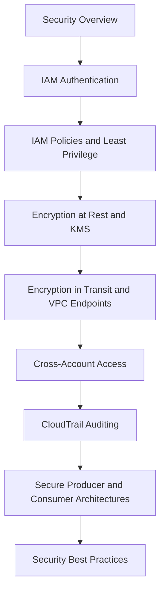

# README

## Overview

This section documents the security architecture, configuration, and operational practices required to secure Amazon Kinesis Data Streams in production environments.

It covers identity and access management, encryption, network isolation, cross-account authorization, auditing, and secure producer-consumer design.

The objective is to establish a consistent security baseline for streaming workloads while maintaining least privilege, operational reliability, and auditability.

## Documentation Structure

| File | Topic | Description |
|---|---|---|
| [01- Kinesis Security Overview.md](01-%20Kinesis%20Security%20Overview.md) | Security Overview | Introduces the Kinesis security model, trust boundaries, core security controls, and production security architecture. |
| [02- IAM Authentication and Access Control.md](02-%20IAM%20Authentication%20and%20Access%20Control.md) | IAM Authentication | Explains IAM authentication, SigV4, workload identities, authorization, and access-control mechanisms. |
| [03- IAM Policies and Least Privilege.md](03-%20IAM%20Policies%20and%20Least%20Privilege.md) | IAM Policies | Covers producer, consumer, and administrative policies, resource scoping, policy conditions, and least-privilege design. |
| [04- Encryption at Rest and AWS KMS.md](04-%20Encryption%20at%20Rest%20and%20AWS%20KMS.md) | Encryption at Rest | Explains server-side encryption, KMS key policies, key rotation, permissions, and encryption lifecycle management. |
| [05- Encryption in Transit and VPC Endpoints.md](05-%20Encryption%20in%20Transit%20and%20VPC%20Endpoints.md) | Network Encryption | Covers TLS, HTTPS, PrivateLink, VPC interface endpoints, endpoint policies, and private connectivity. |
| [06- Cross-Account Access and Resource Security.md](06-%20Cross-Account%20Access%20and%20Resource%20Security.md) | Cross-Account Security | Explains resource policies, cross-account IAM role assumption, external principals, KMS permissions, and organization-level controls. |
| [07- CloudTrail Auditing.md](07-%20CloudTrail%20Auditing.md) | CloudTrail Auditing | Covers management and data events, trail configuration, centralized logging, Athena queries, integrity validation, and incident investigation. |
| [08- Secure Producer and Consumer Architectures.md](08-%20Secure%20Producer%20and%20Consumer%20Architectures.md) | Secure Architectures | Explains secure producer and consumer designs, workload isolation, credential management, event validation, idempotency, and failure handling. |
| [09- Security Best Practices.md](09-%20Security%20Best%20Practices.md) | Security Best Practices | Consolidates production security recommendations, operational controls, common mistakes, and deployment checklists. |

## Recommended Reading Order

Follow the sequence below to build a complete understanding of Kinesis security.

The sequence moves from foundational security concepts to implementation, auditing, and production architecture.

## Core Security Areas

### Identity and Access Management

Understand how Kinesis authenticates AWS workloads and evaluates permissions.

Key areas:

- IAM roles and temporary credentials.
- Signature Version 4 request signing.
- Producer and consumer permission separation.
- Least-privilege IAM policies.
- Resource-based policies.
- Cross-account role assumption.
- AWS Organizations and Service Control Policies.

### Encryption and Data Protection

Protect streaming data during transmission and storage.

Key areas:

- Kinesis server-side encryption.
- AWS KMS customer-managed keys.
- KMS key policies and IAM permissions.
- TLS and HTTPS.
- VPC interface endpoints.
- Application-level encryption.
- Sensitive data minimization.

### Auditing and Monitoring

Establish visibility into administrative and data-plane activity.

Key areas:

- CloudTrail management events.
- Kinesis data events.
- Organization trails.
- Centralized S3 audit storage.
- CloudWatch Logs and alarms.
- Athena-based investigations.
- Log file integrity validation.

### Secure Application Architecture

Apply security controls to producer and consumer workloads.

Key areas:

- Workload identity and credential management.
- Producer validation and publishing permissions.
- Consumer isolation and read permissions.
- Idempotent processing.
- Secure checkpoint storage.
- Poison-record quarantine.
- Downstream authorization.
- Disaster recovery.

## Production Security Checklist

Use this checklist when reviewing a Kinesis deployment.

### Identity and Authorization

- [ ] Dedicated IAM roles for producers and consumers.
- [ ] Least-privilege permissions for every workload.
- [ ] No hardcoded AWS credentials.
- [ ] Restricted cross-account principals.
- [ ] Separate administrative and runtime permissions.
- [ ] Reviewed IAM trust and resource policies.

### Encryption and Networking

- [ ] Server-side encryption enabled.
- [ ] KMS key policies reviewed.
- [ ] TLS used for all service communication.
- [ ] VPC endpoints configured where private connectivity is required.
- [ ] Endpoint security groups and policies restricted.
- [ ] Sensitive payload fields protected appropriately.

### Application Security

- [ ] Producer payload validation implemented.
- [ ] Consumer schema validation implemented.
- [ ] Stable event identifiers used.
- [ ] Idempotent processing implemented.
- [ ] Consumer checkpoint storage protected.
- [ ] Retry and quarantine mechanisms configured.
- [ ] Sensitive data excluded from application logs.

### Auditing and Operations

- [ ] CloudTrail management events enabled.
- [ ] Required data events configured.
- [ ] Audit logs stored centrally.
- [ ] Audit storage protected against unauthorized modification.
- [ ] Security alerts configured.
- [ ] Recovery procedures tested.
- [ ] Security-sensitive infrastructure managed through CI/CD.

## Engineering Recommendations

- Treat IAM policies, KMS key policies, resource policies, and endpoint policies as version-controlled infrastructure.
- Keep producer, consumer, and administrative identities independent.
- Apply security controls at both AWS infrastructure and application-processing layers.
- Use CloudTrail for audit evidence and CloudWatch for operational monitoring.
- Validate security through positive and negative authorization tests.
- Include security configuration in disaster recovery exercises.

## Key Takeaways

- Kinesis security requires coordinated identity, network, encryption, and application-level controls.
- Least-privilege IAM policies and workload isolation reduce the impact of compromised producers and consumers.
- CloudTrail, centralized audit storage, and monitoring provide visibility into security-sensitive activity.
- Secure event processing requires validation, idempotency, protected checkpoints, and controlled failure handling.
- Production security controls should be managed through infrastructure as code and tested continuously.