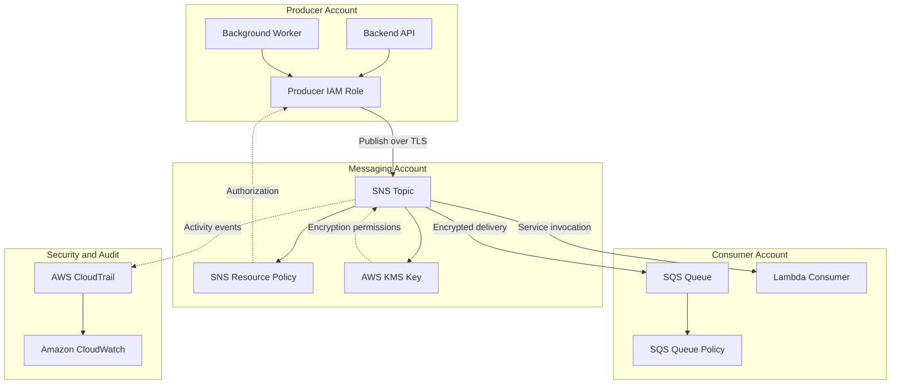
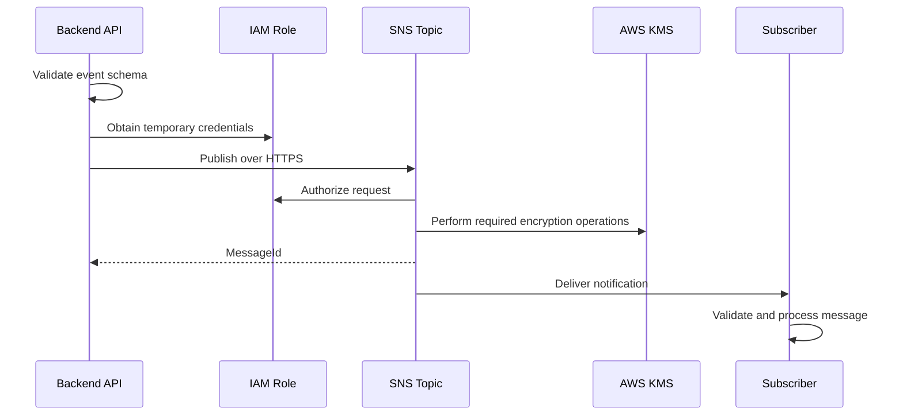

# 01- SNS Security Overview

## Overview

Amazon Simple Notification Service (Amazon SNS) is a fully managed publish-subscribe messaging service used to distribute messages from publishers to multiple subscribers. It supports event-driven architectures, application notifications, service-to-service communication, and asynchronous integration across AWS workloads.

SNS security must protect the complete message lifecycle:

- **Publishers:** Services and applications authorized to publish messages.
- **Topics:** Messaging resources that control message distribution.
- **Subscriptions:** Destinations authorized to receive topic messages.
- **Consumers:** Applications, queues, functions, and external endpoints processing messages.
- **Administrative identities:** Roles and users managing topics, subscriptions, policies, and encryption.
- **Integrated services:** SQS, Lambda, EventBridge, CloudWatch, and other AWS services participating in event flows.

A secure SNS implementation combines IAM authorization, resource policies, encryption, endpoint validation, network controls, auditing, and operational monitoring.

SNS is a regional service. Topics, subscriptions, access policies, and encryption configurations must be managed with regional boundaries in mind. Cross-account access and multi-Region architectures require explicit security and operational design.

## SNS Security Architecture

### Security Boundaries

SNS uses multiple authorization and security boundaries. A publisher's ability to publish does not automatically grant it administrative access or permission to modify subscriptions.

| Security boundary | Responsibility | Primary controls |
|---|---|---|
| Publisher identity | Controls who can publish | IAM identity policies |
| Topic resource | Controls access to a topic | SNS resource policies |
| Subscription | Controls message delivery configuration | Subscription permissions and endpoint ownership |
| Consumer identity | Controls downstream processing | IAM roles and destination policies |
| Encryption | Protects message data at rest | AWS KMS |
| Network | Protects communication paths | TLS, VPC endpoints, endpoint policies |
| Administration | Controls resource configuration | IAM least privilege, permissions boundaries, SCPs |
| Audit | Records security-relevant activity | CloudTrail, CloudWatch |

### Reference Security Architecture



The architecture separates publishing, message distribution, and consumption responsibilities. Each workload receives only the permissions required for its role.

For example, a Django API publishing order events should not have permission to delete SNS topics or modify subscriptions. A consumer should not need `sns:Publish` unless it also produces events.

## IAM Authentication and Authorization

### IAM Authentication

SNS API requests use AWS Signature Version 4 (SigV4) authentication. AWS SDKs sign requests using credentials obtained from the configured credential provider chain.

Typical credential sources include:

- IAM roles attached to EC2 instances.
- ECS task roles.
- EKS Pod Identity or IAM Roles for Service Accounts (IRSA).
- Lambda execution roles.
- Temporary credentials obtained through AWS STS.
- Developer credentials provided through AWS IAM Identity Center.

Avoid embedding long-term AWS access keys in application source code, Docker images, environment files, or deployment manifests.

### IAM Authorization

IAM authorization determines whether an identity can perform an operation against an SNS resource.

Common SNS permissions include:

| Action | Purpose | Typical identity |
|---|---|---|
| `sns:Publish` | Publish messages | Application producer |
| `sns:Subscribe` | Create subscriptions | Deployment or integration role |
| `sns:Receive` | Receive messages from supported subscription endpoints | Consumer identity where applicable |
| `sns:GetTopicAttributes` | Read topic configuration | Operations role |
| `sns:SetTopicAttributes` | Modify topic configuration | Administrative role |
| `sns:ListSubscriptionsByTopic` | Inspect topic subscriptions | Operations role |
| `sns:Unsubscribe` | Remove a subscription | Administrative or lifecycle role |
| `sns:DeleteTopic` | Delete a topic | Restricted administrative role |
| `sns:TagResource` | Apply resource tags | Deployment role |

SNS actions and resource-level authorization support vary by API operation. Verify the service authorization reference when creating policies.

### Separate Application Roles

Use different IAM roles for publishing, deployment, and operational administration.

| Role | Required permissions | Permissions to avoid |
|---|---|---|
| Producer | `sns:Publish` on specific topics | Topic deletion and policy modification |
| Subscription manager | Required subscription lifecycle actions | Unrestricted access to unrelated topics |
| Consumer | Permissions for its actual destination and processing workflow | Unnecessary SNS administration |
| Operations | Read-only inspection and monitoring | Publishing or deleting resources |
| Deployment | Provisioning and configuration actions | Unrestricted account-wide administration |

### Example Producer Policy

A backend service that publishes order events should receive access only to the required topic.

```json
{
  "Version": "2012-10-17",
  "Statement": [
    {
      "Sid": "PublishOrderEvents",
      "Effect": "Allow",
      "Action": [
        "sns:Publish"
      ],
      "Resource": "arn:aws:sns:ap-south-1:123456789012:orders-topic"
    }
  ]
}
```

The policy should be attached to the workload's IAM role rather than distributed as static credentials.

### Permission Evaluation

SNS authorization can involve several policy layers:

- Identity-based IAM policies.
- SNS topic resource policies.
- AWS Organizations service control policies.
- IAM permissions boundaries.
- Session policies for assumed roles.
- AWS KMS key policies and grants when encryption is enabled.

An explicit deny overrides an allow. An allow in one policy does not bypass an applicable explicit deny in another policy.

## SNS Resource Policies

### What Resource Policies Do

SNS topic policies are resource-based policies attached directly to topics. They control which AWS identities and services can perform operations on a topic.

They are particularly important for:

- Cross-account publishing.
- Service-to-service integrations.
- Restricting publishers to approved AWS accounts.
- Controlling administrative access to a topic.

Identity-based policies and resource policies solve different parts of the authorization problem. For cross-account access, the resource-owning account must authorize the external principal, and the external identity must have the required identity-based permissions.

### Example Topic Policy

The following policy allows a specific external account to publish to a topic.

```json
{
  "Version": "2012-10-17",
  "Statement": [
    {
      "Sid": "AllowTrustedAccountToPublish",
      "Effect": "Allow",
      "Principal": {
        "AWS": "arn:aws:iam::210987654321:root"
      },
      "Action": "sns:Publish",
      "Resource": "arn:aws:sns:ap-south-1:123456789012:orders-topic"
    }
  ]
}
```

The account principal delegates access within the trusted account according to that account's IAM policies. It does not mean every identity in that account automatically receives permission.

### Restricting AWS Service Publishers

When an AWS service publishes to SNS, use service principals and appropriate source conditions.

For example, a CloudWatch alarm notification topic can restrict publishing to the intended AWS account and alarm source.

```json
{
  "Version": "2012-10-17",
  "Statement": [
    {
      "Sid": "AllowCloudWatchAlarmNotifications",
      "Effect": "Allow",
      "Principal": {
        "Service": "cloudwatch.amazonaws.com"
      },
      "Action": "sns:Publish",
      "Resource": "arn:aws:sns:ap-south-1:123456789012:operations-alerts",
      "Condition": {
        "StringEquals": {
          "aws:SourceAccount": "123456789012"
        }
      }
    }
  ]
}
```

Where supported, add an appropriate `aws:SourceArn` condition to restrict the source to a specific alarm or resource.

Use the exact service principal and condition keys documented for the integrating AWS service. Not every service integration supports identical condition keys.

### Policy Management Risks

Topic policies are security-sensitive configuration. A policy change can expose a topic to unauthorized publishers or disrupt legitimate service integrations.

Production controls should include:

- Infrastructure-as-code ownership.
- Code review for policy changes.
- IAM Access Analyzer validation.
- Automated policy checks in CI/CD.
- CloudTrail monitoring for policy modification.
- Periodic review of trusted principals.

Avoid granting `Principal: "*"` with unrestricted publishing permissions.

## Encryption at Rest with AWS KMS

### Why Encryption Matters

SNS supports server-side encryption using AWS Key Management Service (AWS KMS). Encryption at rest protects message data stored by SNS against unauthorized access to the underlying storage.

SNS encryption should be considered when messages contain:

- Customer information.
- Financial or transaction metadata.
- Internal business events.
- Authentication-related metadata.
- Confidential operational information.

SNS server-side encryption is transparent to publishers and subscribers. Applications continue using SNS APIs without manually encrypting and decrypting every message.

### Encryption Options

SNS supports encryption using AWS-managed and customer-managed KMS keys, subject to the service's supported key configurations.

| Key type | Management responsibility | Typical use |
|---|---|---|
| AWS-managed key | AWS manages the key lifecycle and policy | Standard encryption requirements |
| Customer-managed key | Customer controls policy, rotation, and lifecycle | Strict access control and audit requirements |

Customer-managed keys provide greater control over key access and lifecycle management.

### Enabling Encryption

A topic can be configured to use a customer-managed KMS key.

```bash
aws sns set-topic-attributes \
  --topic-arn arn:aws:sns:ap-south-1:123456789012:orders-topic \
  --attribute-name KmsMasterKeyId \
  --attribute-value alias/sns-orders-key
```

Verify the configuration:

```bash
aws sns get-topic-attributes \
  --topic-arn arn:aws:sns:ap-south-1:123456789012:orders-topic
```

Inspect the `KmsMasterKeyId` attribute.

### KMS Permissions

SNS must be authorized to use the selected KMS key. The key policy and applicable IAM policies must permit the required cryptographic operations.

A typical customer-managed key policy includes a statement for SNS in the topic's Region.

```json
{
  "Sid": "AllowSNSUseOfKey",
  "Effect": "Allow",
  "Principal": {
    "Service": "sns.amazonaws.com"
  },
  "Action": [
    "kms:Decrypt",
    "kms:GenerateDataKey"
  ],
  "Resource": "*",
  "Condition": {
    "StringEquals": {
      "kms:ViaService": "sns.ap-south-1.amazonaws.com"
    }
  }
}
```

This is an illustrative statement, not a complete standalone key policy. Validate the required KMS permissions and supported encryption context for the SNS integration before deployment.

Additional permissions may be needed for publishers and subscribers depending on the encryption workflow and integration. In particular, AWS services publishing encrypted messages may require KMS permissions for the key.

### Key Lifecycle Considerations

- Enable automatic rotation where supported and appropriate.
- Restrict key administration separately from key usage.
- Monitor key policy changes through CloudTrail.
- Avoid disabling or scheduling deletion of keys while dependent topics require them.
- Test key access during deployment and recovery procedures.
- Document key ownership and cross-account dependencies.

Disabling or deleting a key can make encrypted data unavailable. Key lifecycle operations should be treated as production-impacting changes.

### Important Encryption Limitation

SNS server-side encryption protects data at rest. It does not replace application-level encryption when data must remain confidential from downstream services or authorized infrastructure operators.

For highly sensitive payloads, consider encrypting selected fields before publishing and decrypting only within explicitly trusted consumers.

## Encryption in Transit

SNS API communication should use HTTPS with TLS.

AWS SDKs use secure HTTPS endpoints by default. Avoid disabling certificate verification or configuring clients to use insecure transport.

A typical Python publisher uses Boto3:

```python
import boto3
from botocore.config import Config

sns = boto3.client(
    "sns",
    region_name="ap-south-1",
    config=Config(
        connect_timeout=3,
        read_timeout=10,
        retries={
            "mode": "standard",
            "total_max_attempts": 4,
        },
    ),
)

response = sns.publish(
    TopicArn="arn:aws:sns:ap-south-1:123456789012:orders-topic",
    Message='{"event_id":"evt-123","event_type":"order.created"}',
    Subject="Order Created",
)

print(response["MessageId"])
```

Production applications should obtain credentials from workload identity and externalize topic ARNs and other environment-specific configuration.

For HTTP/S subscriptions:

- Require HTTPS.
- Use valid certificates.
- Validate subscription confirmation requests.
- Protect the endpoint against unauthorized requests.
- Verify SNS message signatures according to AWS guidance.
- Validate the message structure and expected topic identity.
- Avoid treating an HTTP delivery as proof that the downstream business operation completed.

TLS protects transport communication. It does not authenticate the business meaning of a message or guarantee that the receiving application processes it safely.

## Subscription and Consumer Security

### Subscription Ownership

An SNS topic can deliver messages to multiple destination types, including:

- Amazon SQS.
- AWS Lambda.
- HTTP/S endpoints.
- Email and SMS endpoints.
- Amazon Data Firehose.
- Other supported AWS integrations.

Every subscription creates a delivery path that must be reviewed as part of the security boundary.

Unauthorized subscription creation can expose sensitive events to an unintended destination.

Restrict `sns:Subscribe` and subscription-management operations to trusted deployment or administrative roles.

### SQS Subscription Security

For SNS-to-SQS integration, the SQS queue policy must allow the SNS service to send messages.

Restrict that permission to the expected topic ARN.

```json
{
  "Version": "2012-10-17",
  "Statement": [
    {
      "Sid": "AllowSpecificSNSTopic",
      "Effect": "Allow",
      "Principal": {
        "Service": "sns.amazonaws.com"
      },
      "Action": "sqs:SendMessage",
      "Resource": "arn:aws:sqs:ap-south-1:123456789012:orders-queue",
      "Condition": {
        "ArnEquals": {
          "aws:SourceArn": "arn:aws:sns:ap-south-1:123456789012:orders-topic"
        }
      }
    }
  ]
}
```

This prevents unrelated SNS topics from using the queue as a delivery destination.

If the SQS queue uses a customer-managed KMS key, configure the required key permissions for the SNS delivery path as documented for the integration.

### Lambda Subscription Security

For SNS-to-Lambda integration:

- Restrict Lambda invocation permission to the expected SNS topic.
- Use a dedicated Lambda execution role.
- Grant only required downstream permissions.
- Validate message schemas before processing.
- Implement idempotent processing.
- Configure failure handling and dead-letter behavior appropriately.

The Lambda execution role controls what the function can access. It is separate from the permission that allows SNS to invoke the function.

### HTTP/S Subscription Security

HTTP/S endpoints should treat SNS delivery as an externally initiated request.

Implement:

- SNS signature verification.
- Topic ARN validation.
- Certificate validation and HTTPS.
- Strict request parsing.
- Payload size limits.
- Rate limiting and abuse protection.
- Idempotency for duplicate notifications.
- Safe handling of subscription confirmation and unsubscribe messages.

Do not trust a request merely because it contains fields that resemble an SNS notification.

### Raw Message Delivery

SNS supports raw message delivery for supported subscription protocols. With raw delivery enabled, the SNS notification envelope is removed for supported endpoints.

This changes the payload received by the consumer. Security validation must account for the selected delivery format.

For SQS raw delivery, SNS message attributes are subject to a maximum of 10 attributes. If more attributes are required, use the standard SNS notification envelope or redesign the message contract.

## Cross-Account Security

Cross-account SNS access is common in enterprise event-driven architectures.

A central messaging account may own topics while application accounts publish events or consume them through their own queues.

### Cross-Account Publishing

A secure cross-account publishing flow requires:

1. The topic owner authorizes the trusted external account or role in the topic policy.
2. The external publisher identity receives the required `sns:Publish` permission.
3. Applicable organization policies, permissions boundaries, and session policies permit the operation.
4. KMS permissions are configured when the topic uses a customer-managed key.

### Cross-Account Subscription

For an SQS queue in another account:

- The topic owner must authorize the intended subscription workflow.
- The queue owner must configure the queue policy to allow delivery from the exact topic.
- The queue's KMS key policy must support the required service access if encryption is enabled.
- Subscription ownership and confirmation must be handled correctly.

### Cross-Account Controls

| Risk | Control |
|---|---|
| Untrusted external publisher | Restrict topic policy principals |
| Unauthorized subscription | Restrict `sns:Subscribe` |
| Unintended queue delivery | Enforce exact `aws:SourceArn` |
| Excessive organizational access | Apply AWS Organizations SCPs |
| KMS authorization failure | Review key policy and IAM permissions |
| Stale external access | Periodically review and remove unused principals |

Use explicit account IDs, role ARNs, and resource ARNs rather than broad wildcard principals.

## Network Security and Private Connectivity

SNS supports secure API communication through AWS service endpoints. For private connectivity from supported VPC workloads, use an SNS interface VPC endpoint powered by AWS PrivateLink.

This can reduce dependence on public network paths for applications publishing to SNS from private subnets.

### VPC Endpoint Security

Important controls include:

- Endpoint security groups allowing HTTPS traffic from approved workloads.
- Endpoint policies restricting permitted SNS operations and resources.
- Private DNS configuration where appropriate.
- IAM policies limiting publisher identities.
- VPC routing and DNS controls.

An endpoint policy is an additional authorization boundary. It does not replace IAM identity policies or SNS topic resource policies.

### Example Endpoint Policy

A VPC endpoint policy can restrict access to publishing on a specific topic.

```json
{
  "Version": "2012-10-17",
  "Statement": [
    {
      "Effect": "Allow",
      "Principal": "*",
      "Action": "sns:Publish",
      "Resource": "arn:aws:sns:ap-south-1:123456789012:orders-topic"
    }
  ]
}
```

This example limits the operation and resource at the endpoint. Identity-based permissions and topic policies must still authorize the request.

### Network Design Considerations

Private connectivity is useful for workloads running in:

- Private EC2 subnets.
- ECS services using private networking.
- EKS workloads.
- Internal event-publishing services.

Do not assume that a VPC endpoint makes a topic private to one VPC. IAM and topic policies must still define who can access the topic.

## Message-Level Security

SNS transports messages. It does not validate application-specific business contracts or guarantee that a message is safe to process.

A production system should validate messages at both publishing and consumption boundaries.

### Payload Validation

A backend service should enforce:

- A defined event schema.
- Required event identifiers.
- Supported event types and versions.
- Payload size limits.
- Valid timestamps and identifiers.
- Allowed fields and data types.
- Rejection of unexpected or malformed content.

Example Pydantic event model:

```python
from datetime import datetime
from typing import Literal
from uuid import UUID

from pydantic import BaseModel, ConfigDict


class OrderCreatedEvent(BaseModel):
    model_config = ConfigDict(extra="forbid")

    event_id: UUID
    event_type: Literal["order.created"]
    event_version: int
    occurred_at: datetime
    order_id: UUID
```

Validate before publishing and again when consuming. Producer-side validation alone is insufficient because messages may originate from other trusted integrations or older application versions.

### Sensitive Data Minimization

Avoid publishing complete database records or entire ORM objects.

Prefer publishing only the fields required by consumers.

For example, an order event may contain:

- Event ID.
- Order ID.
- Event type.
- Event version.
- Occurrence timestamp.
- Required business attributes.

Avoid including passwords, access tokens, payment credentials, or unnecessary personally identifiable information.

### Application-Level Encryption

Use application-level encryption when selected fields must remain confidential beyond SNS's server-side encryption boundary.

A typical design is:

1. Producer obtains an approved data-encryption key.
2. Producer encrypts sensitive fields before publishing.
3. SNS transports the encrypted payload.
4. Authorized consumers retrieve decryption material.
5. Consumers decrypt only the fields they require.

Use envelope encryption through AWS KMS or an approved cryptographic library. Do not implement custom encryption algorithms.

## Secure Producer and Consumer Lifecycle

### Publishing Lifecycle



The API's successful `Publish` response means SNS accepted the publish request. It does not prove that every subscriber successfully processed the notification.

### Reliability and Security Interaction

SNS delivery and downstream processing are distributed operations. A secure design must account for:

- Duplicate deliveries.
- Delivery retries.
- Subscriber failures.
- Malformed payloads.
- Temporary downstream outages.
- Unauthorized or misconfigured destinations.

Use stable event IDs and consumer-side idempotency to prevent duplicate notifications from causing repeated business operations.

For critical business workflows, use durable processing through SQS subscriptions, appropriate retry policies, and dead-letter queues.

## CloudTrail Auditing

CloudTrail provides visibility into SNS API activity and administrative changes.

Audit events should include:

- Topic creation and deletion.
- Topic policy changes.
- Subscription creation and deletion.
- Topic attribute modifications.
- Encryption configuration changes.
- Access-denied events where recorded.
- Changes to related KMS keys and IAM policies.

SNS management API activity is generally recorded as CloudTrail management events. Do not assume CloudTrail provides a complete record of every individual message payload or every downstream business-processing outcome.

### Important Auditing Operations

| Activity | Audit objective |
|---|---|
| `CreateTopic` | Identify newly created messaging resources |
| `DeleteTopic` | Detect destructive changes |
| `SetTopicAttributes` | Detect policy and configuration changes |
| `Subscribe` | Identify new delivery destinations |
| `Unsubscribe` | Detect subscription removal |
| `Publish` | Review publishing API activity where recorded |
| KMS key changes | Detect encryption access and lifecycle changes |
| IAM policy changes | Detect privilege escalation or unauthorized access |

Use organization-wide CloudTrail where appropriate and store audit logs in a protected S3 bucket.

### CloudWatch Monitoring

Monitor operational and security-related signals such as:

- Failed notifications.
- Failed deliveries.
- Delivery retries.
- Number of messages published.
- Subscription delivery failures.
- Unexpected changes in message volume.
- Authorization failures from application logs.

SNS CloudWatch metrics vary by protocol and integration. Build alarms around the metrics relevant to each destination rather than assuming every subscription exposes identical delivery metrics.

## Secrets and Configuration Management

SNS applications usually require topic ARNs, AWS Region configuration, and workload credentials.

Use:

- IAM roles for workload authentication.
- AWS Systems Manager Parameter Store for non-secret configuration.
- AWS Secrets Manager for actual secrets required by external integrations.
- Environment-specific configuration for topic ARNs.
- CI/CD-managed infrastructure configuration.

Do not store AWS access keys or secret credentials in source code, Docker images, or committed `.env` files.

Topic ARNs are identifiers rather than credentials, but they should still be managed as deployment configuration and not confused with authorization controls.

## Infrastructure as Code and Deployment Security

Manage SNS topics, policies, subscriptions, KMS keys, and related queue permissions through Terraform, AWS CDK, or CloudFormation.

Infrastructure as code provides:

- Version-controlled security configuration.
- Reviewable policy changes.
- Repeatable deployment.
- Environment consistency.
- Drift detection.
- Easier recovery and auditability.

### Terraform Example

```hcl
resource "aws_kms_key" "sns" {
  description             = "Customer-managed key for SNS topic encryption"
  enable_key_rotation     = true
  deletion_window_in_days = 30

  tags = {
    Name        = "sns-orders-key"
    Environment = "production"
  }
}

resource "aws_sns_topic" "orders" {
  name              = "orders-topic"
  kms_master_key_id = aws_kms_key.sns.arn

  tags = {
    Environment = "production"
    Service     = "orders"
  }
}

resource "aws_sns_topic_policy" "orders" {
  arn = aws_sns_topic.orders.arn

  policy = jsonencode({
    Version = "2012-10-17"
    Statement = [
      {
        Sid       = "AllowTrustedPublisher"
        Effect    = "Allow"
        Principal = {
          AWS = "arn:aws:iam::123456789012:role/orders-publisher"
        }
        Action   = ["sns:Publish"]
        Resource = aws_sns_topic.orders.arn
      }
    ]
  })
}
```

The example illustrates topic encryption and a restricted publisher. A complete deployment must also configure the KMS key policy, required service integrations, and any destination resource policies.

### CI/CD Security Controls

Before applying messaging infrastructure changes:

- Validate Terraform formatting and syntax.
- Run static policy analysis.
- Review IAM and SNS resource policy changes.
- Detect wildcard principals and excessive permissions.
- Validate KMS key policy changes.
- Review subscription destinations.
- Require approval for production changes.
- Detect infrastructure drift.

Deployment roles should be separate from application runtime roles.

## High Availability and Disaster Recovery

SNS topics are regional resources. A regional failure or accidental deletion can disrupt notification workflows.

A multi-Region design should explicitly account for:

- Topic provisioning in each Region.
- Regional IAM policies and KMS keys.
- Subscription configuration.
- Publisher routing.
- Consumer deployment.
- Event recovery and replay requirements.
- Operational failover procedures.

SNS does not automatically replicate topics, subscriptions, or published messages across Regions.

For critical event distribution, consider retaining durable event data in an independent system such as S3 or a database-backed outbox. This provides a recovery source when notifications must be reconstructed.

### Disaster Recovery Checklist

- Provision equivalent topics and subscriptions in the recovery Region.
- Maintain separate regional KMS keys and policies.
- Keep infrastructure definitions version-controlled.
- Document publisher failover behavior.
- Ensure consumers can safely process replayed events.
- Test recovery of subscriptions and destination permissions.
- Define RTO and RPO based on business requirements.
- Perform periodic failover exercises.

## Monitoring and Incident Response

Security monitoring should cover identity changes, resource policy changes, encryption changes, and unexpected subscription activity.

| Signal | Potential risk | Response |
|---|---|---|
| Unexpected topic policy change | Unauthorized publishing access | Review CloudTrail and revert the policy |
| New unknown subscription | Data exposure | Validate ownership and remove unauthorized subscriptions |
| Unexpected publisher identity | Credential compromise or misuse | Investigate role sessions and revoke affected access |
| KMS access denied | Encryption configuration failure | Inspect key policy, IAM permissions, and service access |
| Increased delivery failures | Destination outage or misconfiguration | Inspect destination health and delivery configuration |
| Unexpected publish volume | Application bug or abuse | Trace producer identity and apply appropriate controls |
| Topic deletion | Service disruption | Investigate the principal and restore infrastructure |

For incident response, preserve CloudTrail evidence, review IAM role sessions, inspect topic and subscription configuration, and verify downstream delivery destinations.

Avoid logging full message payloads by default. Logs should contain event IDs, topic identifiers, correlation IDs, and relevant processing metadata without exposing sensitive information.

## Common Security Mistakes

| Mistake | Why it is dangerous | Recommended approach |
|---|---|---|
| Using `sns:*` for application roles | Grants unnecessary administrative capabilities | Grant only required actions |
| Allowing all principals to publish | Exposes the topic to unintended publishers | Restrict principals and source conditions |
| Allowing unrestricted subscriptions | Creates unauthorized data delivery paths | Restrict subscription management |
| Using static AWS credentials | Increases credential exposure risk | Use temporary workload credentials |
| Ignoring KMS permissions | Causes delivery or encryption failures | Validate key policies and integration requirements |
| Assuming SSE protects data everywhere | Does not protect data after authorized delivery or application access | Use application-level encryption when needed |
| Trusting HTTP/S payloads without verification | Allows forged or unauthorized requests | Verify SNS signatures and topic identity |
| Ignoring duplicate notifications | Can repeat business operations | Implement consumer idempotency |
| Treating publish success as processing success | Confuses message acceptance with business completion | Monitor delivery and consumer processing separately |
| Assuming SNS provides cross-Region replication | Creates an incomplete DR strategy | Provision and test regional recovery explicitly |
| Logging complete messages | May expose confidential data | Log identifiers and operational metadata |
| Manually changing production policies | Creates configuration drift | Manage policies through reviewed infrastructure code |

## Production Security Checklist

### Identity and Access

- [ ] Use IAM roles and temporary credentials for workloads.
- [ ] Separate producer, consumer, deployment, and administration roles.
- [ ] Restrict `sns:Publish` to required topic ARNs.
- [ ] Restrict subscription and topic-management operations.
- [ ] Review cross-account principals and trust relationships.
- [ ] Apply organization policies and permissions boundaries where appropriate.

### Resource and Network Security

- [ ] Maintain restrictive SNS topic resource policies.
- [ ] Restrict SQS queue policies to expected SNS topic ARNs.
- [ ] Validate Lambda invocation permissions.
- [ ] Use HTTPS for HTTP/S subscriptions.
- [ ] Verify SNS signatures at HTTP/S endpoints.
- [ ] Use VPC endpoints where private connectivity is required.
- [ ] Review endpoint policies and security groups.

### Encryption and Data Protection

- [ ] Enable SNS encryption at rest where required.
- [ ] Review KMS key policies and lifecycle configuration.
- [ ] Enable key rotation where appropriate.
- [ ] Use TLS for API communication.
- [ ] Minimize sensitive message content.
- [ ] Apply application-level encryption for data requiring stronger confidentiality boundaries.
- [ ] Avoid logging sensitive payloads.

### Reliability and Operations

- [ ] Validate message schemas at producer and consumer boundaries.
- [ ] Implement consumer idempotency.
- [ ] Configure appropriate retry and dead-letter handling.
- [ ] Monitor delivery failures and publishing behavior.
- [ ] Enable CloudTrail auditing.
- [ ] Protect audit logs from unauthorized modification.
- [ ] Manage infrastructure through reviewed code.
- [ ] Test regional recovery procedures.

## Key Takeaways

- SNS security requires layered controls across IAM identities, topic resource policies, subscriptions, destination permissions, and KMS.
- Separate publisher, consumer, deployment, and administrative roles; grant only the permissions each workload requires.
- Protect message delivery paths with TLS, restrictive destination policies, signature verification for HTTP/S endpoints, and private connectivity where appropriate.
- Server-side encryption protects data at rest, while sensitive payloads may require application-level encryption and data minimization.
- Treat duplicate delivery, regional recovery, CloudTrail auditing, and infrastructure-as-code policy review as essential production security responsibilities.