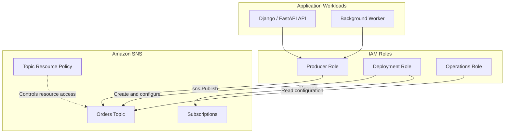
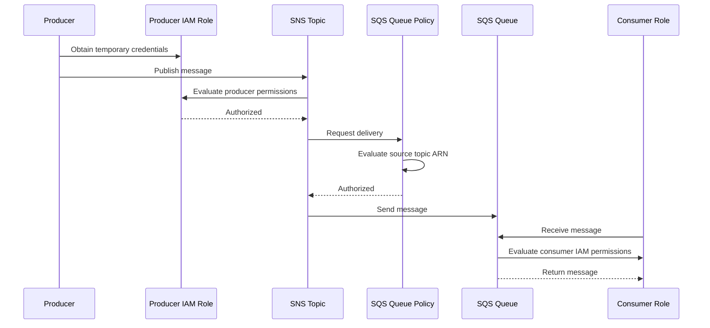

# 02- IAM Policies and Access Control

## Overview

IAM policies and access control determine which identities and AWS services can interact with Amazon Simple Notification Service (Amazon SNS) resources.

SNS uses AWS Identity and Access Management (IAM) for identity-based authorization and SNS topic resource policies for resource-based authorization. Together, these mechanisms control who can publish messages, create subscriptions, inspect topic configuration, modify policies, and manage messaging resources.

Access control is particularly important in event-driven architectures because an SNS topic can distribute messages to multiple independent consumers. An overly permissive topic policy or subscription permission can expose business events to unintended accounts or destinations.

A production SNS access-control strategy should:

- Separate publishing, subscription management, consumption, and administration permissions.
- Grant access only to required SNS actions and topic ARNs.
- Use IAM roles and temporary credentials for workloads.
- Restrict cross-account access through explicit principals and resource policies.
- Protect subscription destinations independently.
- Apply organizational controls and permissions boundaries.
- Audit policy and permission changes through CloudTrail.

## SNS Authorization Model

SNS authorization combines identity-based policies, resource-based policies, and other applicable AWS policy controls.

### Identity-Based Policies

Identity-based policies are attached to IAM users, groups, or roles.

They define which SNS operations an identity can perform.

For example, a backend service may receive permission to publish messages to one topic without being allowed to create subscriptions or delete topics.

```json
{
  "Version": "2012-10-17",
  "Statement": [
    {
      "Sid": "PublishOrderEvents",
      "Effect": "Allow",
      "Action": "sns:Publish",
      "Resource": "arn:aws:sns:ap-south-1:123456789012:orders-topic"
    }
  ]
}
```

Use identity-based policies for:

- Application producer roles.
- Deployment roles.
- Operational roles.
- Subscription management roles.
- Workload identities running on EC2, ECS, EKS, and Lambda.

### Resource-Based Policies

SNS topic policies are resource-based policies attached directly to SNS topics.

They define which principals can access a topic and which operations they can perform.

Typical use cases include:

- Allowing another AWS account to publish.
- Allowing AWS services to publish notifications.
- Restricting topic access to approved principals.
- Supporting cross-account event distribution.

Example:

```json
{
  "Version": "2012-10-17",
  "Statement": [
    {
      "Sid": "AllowTrustedPublisher",
      "Effect": "Allow",
      "Principal": {
        "AWS": "arn:aws:iam::210987654321:role/order-publisher"
      },
      "Action": "sns:Publish",
      "Resource": "arn:aws:sns:ap-south-1:123456789012:orders-topic"
    }
  ]
}
```

A topic policy does not replace the external publisher's identity-based permissions in a cross-account scenario. Both sides must authorize the intended operation.

### Authorization Layers

| Policy layer | Scope | Purpose |
|---|---|---|
| Identity-based policy | IAM principal | Grants or denies SNS operations |
| SNS topic policy | SNS topic | Controls access to the topic |
| Permissions boundary | IAM principal | Limits maximum identity permissions |
| Session policy | Assumed-role session | Restricts permissions for a session |
| Service control policy (SCP) | AWS organization or account | Sets maximum permissions available to principals |
| VPC endpoint policy | VPC endpoint | Restricts requests passing through the endpoint |
| KMS key policy | KMS key | Controls cryptographic key usage |

An explicit deny in an applicable policy overrides an allow. An allow in one policy does not bypass an explicit deny in another applicable policy.

## IAM Policy Structure

An IAM policy contains statements describing allowed or denied operations.

| Element | Purpose |
|---|---|
| `Version` | IAM policy language version |
| `Statement` | Collection of permission statements |
| `Sid` | Optional statement identifier |
| `Effect` | `Allow` or `Deny` |
| `Principal` | Identity receiving access; used in resource-based policies |
| `Action` | AWS operations being controlled |
| `Resource` | AWS resource ARNs covered by the statement |
| `Condition` | Additional authorization constraints |

### SNS Resource ARN

An SNS topic ARN follows this structure:

```text
arn:aws:sns:<region>:<account-id>:<topic-name>
```

Example:

```text
arn:aws:sns:ap-south-1:123456789012:orders-topic
```

SNS subscription resources use a different ARN structure:

```text
arn:aws:sns:<region>:<account-id>:<topic-name>:<subscription-id>
```

Not every SNS action supports resource-level authorization in the same way. Check the AWS SNS service authorization reference before assigning resource ARNs or using wildcards.

### Actions and Their Responsibilities

| Action | Purpose | Typical role |
|---|---|---|
| `sns:Publish` | Publish a message to a topic | Producer |
| `sns:Subscribe` | Create a subscription | Subscription manager |
| `sns:Unsubscribe` | Remove a subscription | Subscription manager |
| `sns:Receive` | Receive notifications where supported by the authorization model | Subscriber |
| `sns:GetTopicAttributes` | Read topic attributes | Operations |
| `sns:SetTopicAttributes` | Modify topic attributes | Administrator |
| `sns:ListSubscriptionsByTopic` | List topic subscriptions | Operations |
| `sns:DeleteTopic` | Delete a topic | Administrator |
| `sns:TagResource` | Add or update resource tags | Deployment |
| `sns:UntagResource` | Remove resource tags | Deployment |

Avoid granting administrative actions to application runtime roles.

## Least-Privilege Access Design

Least privilege means granting each identity only the permissions required to perform its responsibility.

SNS applications should use separate IAM roles for publishing, deployment, subscription management, and administration.

### Role Separation



### Producer Role

A producer should generally require only `sns:Publish` on its intended topic.

```json
{
  "Version": "2012-10-17",
  "Statement": [
    {
      "Sid": "PublishToOrdersTopic",
      "Effect": "Allow",
      "Action": [
        "sns:Publish"
      ],
      "Resource": "arn:aws:sns:ap-south-1:123456789012:orders-topic"
    }
  ]
}
```

This role should not receive permissions to:

- Delete topics.
- Modify topic policies.
- Create arbitrary subscriptions.
- Change encryption configuration.
- Modify unrelated SNS resources.

### Subscription Management Role

A deployment or integration-management role may require permissions to create and manage subscriptions.

Example policy:

```json
{
  "Version": "2012-10-17",
  "Statement": [
    {
      "Sid": "ManageApprovedTopicSubscriptions",
      "Effect": "Allow",
      "Action": [
        "sns:Subscribe",
        "sns:Unsubscribe",
        "sns:ListSubscriptionsByTopic"
      ],
      "Resource": "arn:aws:sns:ap-south-1:123456789012:orders-topic"
    }
  ]
}
```

Additional permissions may be required for related destination resources, such as SQS queue policies or Lambda invocation permissions.

Subscription creation should be restricted to trusted deployment workflows. An unauthorized subscription can expose topic messages to an unintended endpoint.

### Operations Role

An operations role should normally have read-only access to the required resources.

```json
{
  "Version": "2012-10-17",
  "Statement": [
    {
      "Sid": "InspectOrdersTopic",
      "Effect": "Allow",
      "Action": [
        "sns:GetTopicAttributes",
        "sns:ListSubscriptionsByTopic"
      ],
      "Resource": "arn:aws:sns:ap-south-1:123456789012:orders-topic"
    }
  ]
}
```

Keep diagnostic access separate from publishing and administrative permissions.

### Administrative Role

Administrative permissions should be restricted to controlled deployment and operations workflows.

Actions such as `sns:SetTopicAttributes` and `sns:DeleteTopic` can change security boundaries or disrupt production messaging.

Use approval workflows for production changes and monitor administrative activity through CloudTrail.

## Conditions and Fine-Grained Access Control

IAM conditions allow access to be restricted based on request context.

Conditions are useful for limiting principals, network paths, AWS accounts, organizations, and supported request attributes.

### Common Condition Keys

| Condition key | Purpose |
|---|---|
| `aws:SourceArn` | Restricts requests based on the source resource ARN where supported |
| `aws:SourceAccount` | Restricts requests to a specific source account where supported |
| `aws:PrincipalArn` | Restricts access based on the requesting principal ARN |
| `aws:PrincipalOrgID` | Restricts access to an AWS Organization |
| `aws:RequestedRegion` | Restricts requests to approved Regions |
| `aws:SourceVpce` | Restricts requests to a specific VPC endpoint where supported |

Condition-key availability depends on the service action and request context. Verify that the key is supported for the specific SNS operation before relying on it as a security boundary.

### Restricting Access by AWS Organization

A topic policy can authorize principals belonging to a specific AWS Organization.

```json
{
  "Version": "2012-10-17",
  "Statement": [
    {
      "Sid": "AllowOrganizationPublishing",
      "Effect": "Allow",
      "Principal": "*",
      "Action": "sns:Publish",
      "Resource": "arn:aws:sns:ap-south-1:123456789012:orders-topic",
      "Condition": {
        "StringEquals": {
          "aws:PrincipalOrgID": "o-exampleorgid"
        }
      }
    }
  ]
}
```

This policy restricts access to principals from the specified organization. It does not replace identity-based authorization for cross-account callers.

For sensitive topics, consider authorizing specific account or role principals instead of every principal in the organization.

### Restricting Access Through a VPC Endpoint

Where supported by the request context, a topic policy can restrict publishing to requests originating through a specific VPC endpoint.

```json
{
  "Version": "2012-10-17",
  "Statement": [
    {
      "Sid": "AllowPublishingThroughApprovedEndpoint",
      "Effect": "Allow",
      "Principal": {
        "AWS": "arn:aws:iam::123456789012:role/orders-publisher"
      },
      "Action": "sns:Publish",
      "Resource": "arn:aws:sns:ap-south-1:123456789012:orders-topic",
      "Condition": {
        "StringEquals": {
          "aws:SourceVpce": "vpce-0123456789abcdef0"
        }
      }
    }
  ]
}
```

Use this condition only after confirming that the SNS request path supplies the expected context key. A restrictive condition that does not match the actual request context can block legitimate workloads.

### Restricting AWS Service Sources

When AWS services publish to SNS, use the service principal and source restrictions supported by that integration.

Example for a CloudWatch alarm notification topic:

```json
{
  "Version": "2012-10-17",
  "Statement": [
    {
      "Sid": "AllowSpecificCloudWatchAccount",
      "Effect": "Allow",
      "Principal": {
        "Service": "cloudwatch.amazonaws.com"
      },
      "Action": "sns:Publish",
      "Resource": "arn:aws:sns:ap-south-1:123456789012:operations-alerts",
      "Condition": {
        "StringEquals": {
          "aws:SourceAccount": "123456789012"
        }
      }
    }
  ]
}
```

Where supported, also restrict the source ARN to the intended alarm or resource. This reduces the risk of confused-deputy access.

## Explicit Deny and Permission Boundaries

### Explicit Deny

An explicit deny blocks an operation even when another applicable policy allows it.

For example, an organization may prevent application roles from deleting SNS topics.

```json
{
  "Version": "2012-10-17",
  "Statement": [
    {
      "Sid": "DenyTopicDeletion",
      "Effect": "Deny",
      "Action": "sns:DeleteTopic",
      "Resource": "*"
    }
  ]
}
```

This can be applied through an appropriate IAM policy or organizational control.

Use explicit denies carefully. A broad deny can block deployment and recovery operations if legitimate exceptions are not designed.

### Permissions Boundaries

A permissions boundary defines the maximum permissions an IAM identity can receive through identity-based policies.

For example, a boundary can prevent application roles from receiving SNS administration permissions even if another policy attempts to grant them.

Permissions boundaries do not independently grant access. An identity still requires an applicable allow.

### Service Control Policies

SCPs define maximum available permissions for accounts and organizational units in AWS Organizations.

They can prevent classes of SNS operations across an account or organization, such as unrestricted resource administration.

SCPs do not grant permissions. They restrict what IAM identities can do.

## Cross-Account Access Control

Cross-account SNS access is common when multiple application accounts publish events to a central messaging account.

For example:

- Account A hosts the order service.
- Account B owns the central SNS topic.
- Account C hosts the notification consumer and its SQS queue.

Each account must authorize its part of the messaging workflow.

### Cross-Account Publishing

The topic owner must authorize the external publisher in the SNS topic policy.

The external publisher must also have an identity policy granting `sns:Publish` on the topic.

Topic policy in Account B:

```json
{
  "Version": "2012-10-17",
  "Statement": [
    {
      "Sid": "AllowOrderServiceAccount",
      "Effect": "Allow",
      "Principal": {
        "AWS": "arn:aws:iam::210987654321:role/order-publisher"
      },
      "Action": "sns:Publish",
      "Resource": "arn:aws:sns:ap-south-1:123456789012:orders-topic"
    }
  ]
}
```

Identity policy in Account A:

```json
{
  "Version": "2012-10-17",
  "Statement": [
    {
      "Sid": "PublishToCentralTopic",
      "Effect": "Allow",
      "Action": "sns:Publish",
      "Resource": "arn:aws:sns:ap-south-1:123456789012:orders-topic"
    }
  ]
}
```

The publisher must use credentials belonging to the authorized role and target the correct regional topic ARN.

### Cross-Account Subscription

For an SNS topic in one account and an SQS queue in another:

1. The topic owner authorizes the subscription workflow.
2. The queue owner configures the queue policy to allow the expected SNS topic.
3. The subscription is created and confirmed as required.
4. The consumer receives messages using its own SQS permissions.
5. KMS permissions are configured if the queue uses a customer-managed key.

Example queue policy:

```json
{
  "Version": "2012-10-17",
  "Statement": [
    {
      "Sid": "AllowCentralOrdersTopic",
      "Effect": "Allow",
      "Principal": {
        "Service": "sns.amazonaws.com"
      },
      "Action": "sqs:SendMessage",
      "Resource": "arn:aws:sqs:ap-south-1:345678901234:orders-queue",
      "Condition": {
        "ArnEquals": {
          "aws:SourceArn": "arn:aws:sns:ap-south-1:123456789012:orders-topic"
        }
      }
    }
  ]
}
```

Restrict the queue policy to the exact topic ARN. Avoid granting `sqs:SendMessage` to the SNS service principal without a source restriction.

## Access Control for AWS Workloads

Applications should use workload identities instead of long-lived access keys.

### EC2

Attach an IAM instance profile to the EC2 instance.

The application obtains temporary credentials from the instance metadata service through the AWS SDK credential provider chain.

Avoid embedding access keys in application configuration or user data.

### ECS

Use ECS task roles for application permissions.

A task role is separate from the task execution role:

- **Task role:** Permissions used by application code.
- **Task execution role:** Permissions used by the ECS agent for operations such as image pulls and log delivery.

Grant `sns:Publish` to the task role when the application publishes messages.

### EKS

Use EKS Pod Identity or IAM Roles for Service Accounts (IRSA) to associate IAM permissions with workloads.

Avoid granting SNS permissions to the entire worker-node role when only one application needs access.

### Lambda

Attach the required SNS permissions to the Lambda execution role when the function publishes messages.

For SNS-triggered Lambda functions, separately configure the Lambda resource-based permission that allows SNS to invoke the function.

These are different authorization directions:

- Execution role: What the Lambda function can access.
- Lambda resource policy: Who can invoke the function.

### Workload Comparison

| Runtime | Identity mechanism | Recommended permission scope |
|---|---|---|
| EC2 | Instance profile | Specific application role |
| ECS | Task role | Specific task |
| EKS | Pod Identity or IRSA | Specific Kubernetes service account |
| Lambda | Execution role | Specific function |
| Local development | IAM Identity Center or assumed role | Developer-specific permissions |

## SNS and SQS Authorization Boundaries

SNS-to-SQS fan-out introduces two independent authorization checks.

The SNS topic must authorize publishing, and the SQS queue must authorize message delivery from SNS.

The queue consumer also needs permission to receive and delete messages.

### Authorization Flow



A correctly configured SNS topic policy does not automatically authorize delivery to an SQS queue. The queue policy must explicitly allow the expected SNS source.

### Consumer Permissions

A queue consumer generally needs only the required SQS operations.

```json
{
  "Version": "2012-10-17",
  "Statement": [
    {
      "Sid": "ConsumeOrdersQueue",
      "Effect": "Allow",
      "Action": [
        "sqs:ReceiveMessage",
        "sqs:DeleteMessage",
        "sqs:ChangeMessageVisibility",
        "sqs:GetQueueAttributes"
      ],
      "Resource": "arn:aws:sqs:ap-south-1:345678901234:orders-queue"
    }
  ]
}
```

Do not grant `sqs:*` to a consumer that only processes one queue.

## SNS and Lambda Authorization Boundaries

SNS invokes Lambda through a Lambda resource-based policy.

The Lambda execution role does not grant SNS permission to invoke the function.

Example permission:

```bash
aws lambda add-permission \
  --function-name orders-consumer \
  --statement-id AllowOrdersTopic \
  --action lambda:InvokeFunction \
  --principal sns.amazonaws.com \
  --source-arn arn:aws:sns:ap-south-1:123456789012:orders-topic
```

Verify the permission:

```bash
aws lambda get-policy \
  --function-name orders-consumer
```

The source ARN restriction ensures that only the intended topic can invoke the function through this permission.

## KMS Authorization Dependencies

When SNS uses a customer-managed KMS key, SNS encryption introduces an additional authorization boundary.

The KMS key policy and applicable IAM policies must permit the required operations.

Access-control design should distinguish:

- Permission to publish to the SNS topic.
- Permission for SNS to use the encryption key.
- Permission for administrators to manage the key.
- Permission for authorized consumers or integrated services to use encrypted data where required.

Do not assume that `sns:Publish` alone guarantees successful publishing to an encrypted topic. Missing KMS permissions can cause publish operations to fail.

Separate key administration from key usage. Application roles should not receive key-management permissions such as `kms:PutKeyPolicy` or `kms:ScheduleKeyDeletion`.

## Managing Policies with AWS CLI

### Retrieve Topic Attributes

```bash
aws sns get-topic-attributes \
  --topic-arn arn:aws:sns:ap-south-1:123456789012:orders-topic
```

The response includes the topic policy and other configuration attributes.

### Set a Topic Policy

Save the intended policy in a version-controlled file:

```text
sns-topic-policy.json
```

Apply it:

```bash
aws sns set-topic-attributes \
  --topic-arn arn:aws:sns:ap-south-1:123456789012:orders-topic \
  --attribute-name Policy \
  --attribute-value file://sns-topic-policy.json
```

This operation replaces the topic's policy attribute. Retrieve and review the existing policy before updating it to avoid unintentionally removing required service or account permissions.

### List Topic Subscriptions

```bash
aws sns list-subscriptions-by-topic \
  --topic-arn arn:aws:sns:ap-south-1:123456789012:orders-topic
```

Review every subscription destination as part of access-control audits.

### Inspect IAM Policies

```bash
aws iam list-attached-role-policies \
  --role-name orders-publisher
```

Inspect an inline role policy:

```bash
aws iam list-role-policies \
  --role-name orders-publisher
```

Retrieve a specific inline policy:

```bash
aws iam get-role-policy \
  --role-name orders-publisher \
  --policy-name sns-publish-policy
```

Use these commands during troubleshooting and periodic access reviews.

## Infrastructure as Code

Manage SNS policies and IAM permissions through Terraform or another infrastructure-as-code tool.

This provides repeatable deployment, version control, policy review, and drift detection.

### Terraform Example

```hcl
data "aws_iam_policy_document" "orders_publisher" {
  statement {
    sid    = "PublishOrderEvents"
    effect = "Allow"

    actions = [
      "sns:Publish"
    ]

    resources = [
      aws_sns_topic.orders.arn
    ]
  }
}

resource "aws_iam_policy" "orders_publisher" {
  name        = "orders-sns-publisher"
  description = "Allows the order service to publish to the orders topic"
  policy      = data.aws_iam_policy_document.orders_publisher.json
}

resource "aws_iam_role_policy_attachment" "orders_publisher" {
  role       = aws_iam_role.orders_publisher.name
  policy_arn = aws_iam_policy.orders_publisher.arn
}

data "aws_iam_policy_document" "orders_topic" {
  statement {
    sid    = "AllowOrderPublisher"
    effect = "Allow"

    principals {
      type        = "AWS"
      identifiers = [aws_iam_role.orders_publisher.arn]
    }

    actions = [
      "sns:Publish"
    ]

    resources = [
      aws_sns_topic.orders.arn
    ]
  }
}

resource "aws_sns_topic_policy" "orders" {
  arn    = aws_sns_topic.orders.arn
  policy = data.aws_iam_policy_document.orders_topic.json
}
```

The example defines both an identity policy and a topic resource policy. For same-account access, review whether both are necessary for the intended authorization design. For cross-account access, the resource policy and external identity permissions must both be considered.

Avoid maintaining the same topic policy through multiple Terraform resources or deployment systems. Competing ownership can cause policy replacement and unexpected access changes.

## Policy Validation and Testing

IAM policies should be tested before production deployment.

### Static Validation

Use IAM Access Analyzer policy validation to detect policy syntax issues and security findings.

Example:

```bash
aws accessanalyzer validate-policy \
  --policy-type IDENTITY_POLICY \
  --policy-document file://sns-publisher-policy.json
```

For a resource-based policy, use the appropriate resource policy type supported by the validator.

Static validation does not prove that every runtime request will succeed. It should be combined with integration testing.

### Positive and Negative Authorization Tests

Test both permitted and prohibited operations.

| Test | Expected result |
|---|---|
| Approved producer publishes to the topic | Allowed |
| Producer publishes to an unrelated topic | Denied |
| Producer attempts to delete the topic | Denied |
| Untrusted account publishes to the topic | Denied |
| Approved deployment role creates a subscription | Allowed |
| Application producer changes the topic policy | Denied |
| Unapproved topic sends to the SQS queue | Denied |
| Approved SNS topic sends to the SQS queue | Allowed |

Negative authorization tests are essential because an overly permissive policy may pass all positive tests.

### Troubleshooting Access Denied

When an SNS operation returns `AuthorizationError` or `AccessDenied`, inspect the complete authorization path.

1. Confirm the AWS identity used by the application.
2. Verify the requested action and topic ARN.
3. Inspect attached and inline IAM policies.
4. Inspect the SNS topic resource policy.
5. Check permissions boundaries and session policies.
6. Check AWS Organizations SCPs.
7. Review VPC endpoint policies and request context where applicable.
8. Inspect KMS permissions if encryption is enabled.
9. Check destination resource policies for subscription delivery.
10. Review CloudTrail events for the denied operation.

Use:

```bash
aws sts get-caller-identity
```

This confirms the AWS account and principal associated with the active credentials.

IAM policy simulation can help evaluate identity-based policies, but it does not fully reproduce every service-specific resource policy, endpoint policy, KMS, or cross-account authorization interaction.

## Auditing and Access Reviews

Access control should be reviewed continuously rather than only during initial deployment.

### CloudTrail

Monitor security-sensitive operations such as:

- `SetTopicAttributes`
- `CreateTopic`
- `DeleteTopic`
- `Subscribe`
- `Unsubscribe`
- `Publish`, where recorded
- IAM role and policy changes
- KMS key policy and lifecycle changes

Use CloudTrail to identify which principal performed an operation and when it occurred.

### Access Review Process

Periodically review:

- IAM roles with `sns:Publish`.
- Roles with subscription-management permissions.
- Principals in SNS topic policies.
- Cross-account access relationships.
- SQS queue policies.
- Lambda resource-based permissions.
- KMS key policies.
- Unused or stale subscriptions.
- Wildcard actions and resource permissions.

Remove unused permissions and subscriptions through a controlled change process.

## Common Access-Control Mistakes

| Mistake | Risk | Prevention |
|---|---|---|
| Granting `sns:*` to application roles | Unnecessary administrative access | Grant specific actions |
| Using `Resource: "*"` for publishing | Access to unintended topics | Specify exact topic ARNs |
| Assuming topic policies replace IAM policies | Cross-account authorization failures | Configure both authorization sides |
| Allowing unrestricted `sns:Subscribe` | Unauthorized message destinations | Restrict subscription management |
| Forgetting SQS queue policies | SNS cannot deliver to the queue | Allow the exact topic ARN |
| Confusing Lambda execution roles with invocation permissions | SNS cannot invoke Lambda | Configure Lambda resource-based permissions |
| Ignoring KMS key policies | Encrypted publishing or delivery fails | Validate key authorization |
| Using broad organization-level access without conditions | Excessive internal access | Restrict trusted accounts or roles |
| Replacing topic policies without reviewing existing statements | Breaks legitimate integrations | Manage policy changes centrally |
| Relying only on positive authorization tests | Excess permissions remain undetected | Add negative tests |
| Granting SNS access to an entire EKS node role | Unnecessary workload privilege | Use Pod Identity or IRSA |
| Using long-lived credentials | Increases credential exposure | Use temporary workload credentials |

## Production Access-Control Checklist

### IAM Design

- [ ] Separate producer, consumer, deployment, and administrative roles.
- [ ] Grant only required SNS actions.
- [ ] Restrict policies to specific topic ARNs.
- [ ] Use IAM roles and temporary credentials.
- [ ] Avoid wildcard principals and unnecessary wildcard resources.
- [ ] Review permissions boundaries and SCPs.

### Resource Policies

- [ ] Maintain restrictive topic resource policies.
- [ ] Review every trusted principal.
- [ ] Restrict cross-account publishing.
- [ ] Restrict AWS service publishers using supported source conditions.
- [ ] Control subscription creation and deletion.
- [ ] Review policy changes before production deployment.

### Integrated Services

- [ ] Configure SQS queue policies for exact SNS topic ARNs.
- [ ] Configure Lambda resource-based invocation permissions.
- [ ] Review destination-specific IAM permissions.
- [ ] Configure KMS key policies for encrypted integrations.
- [ ] Test publishing and delivery independently.

### Validation and Operations

- [ ] Validate policies through IAM Access Analyzer.
- [ ] Run positive and negative authorization tests.
- [ ] Verify application identities with STS.
- [ ] Enable CloudTrail auditing.
- [ ] Review cross-account access periodically.
- [ ] Manage policies through infrastructure as code.
- [ ] Detect and remediate configuration drift.

## Key Takeaways

- SNS authorization combines IAM identity policies and topic resource policies; cross-account access requires authorization on both sides.
- Separate producer, subscription-management, deployment, and administrative roles, granting each only the required actions and resource ARNs.
- Use conditions, permissions boundaries, SCPs, and VPC endpoint policies as additional controls where supported by the request context.
- Secure SNS integrations independently: SQS requires an appropriate queue policy, Lambda requires an invocation permission, and encrypted workflows require correct KMS authorization.
- Validate policies with static analysis, positive and negative integration tests, CloudTrail auditing, and periodic access reviews.