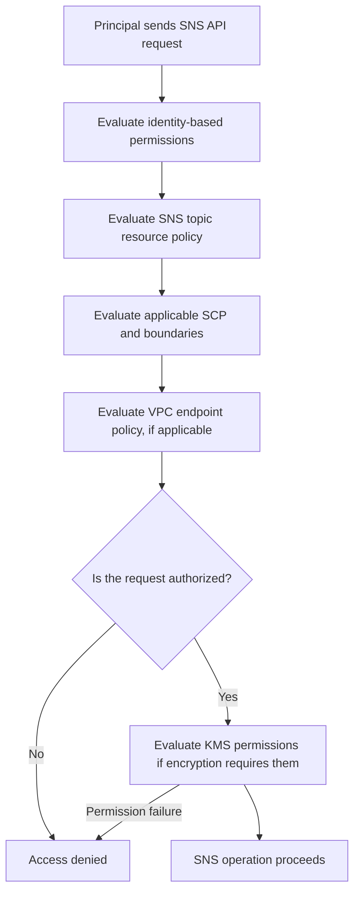
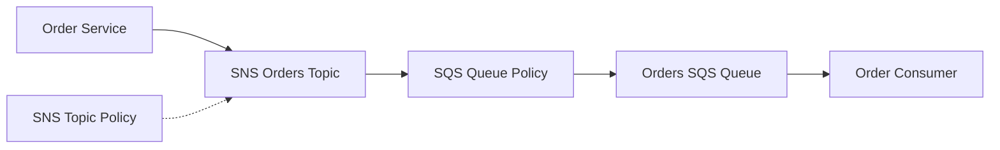
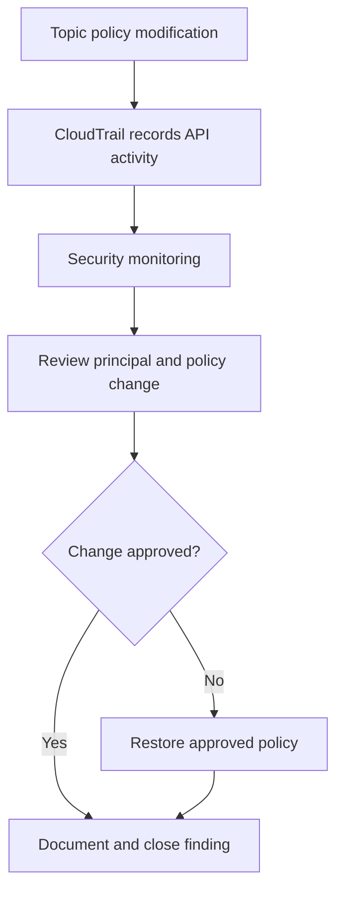

# 03- Topic Resource Policies

## Overview

Amazon Simple Notification Service (Amazon SNS) topic resource policies are resource-based IAM policies attached directly to SNS topics. They define which AWS principals can access a topic and which operations they can perform.

Unlike identity-based policies, which are attached to IAM users, groups, or roles, topic policies are attached to the SNS resource itself.

They are essential for controlling:

- Which applications can publish messages.
- Which AWS accounts can access a topic.
- Which AWS services can publish notifications.
- Which principals can manage topic attributes and subscriptions.
- How cross-account messaging is authorized.
- Whether access is restricted by organization, source account, or supported request context.

A topic policy is part of the SNS security boundary. An overly permissive policy can expose business events, while an incorrectly restrictive policy can break publishing and service integrations.

Production systems should manage topic policies through infrastructure as code, validate policy changes before deployment, and audit modifications through AWS CloudTrail.

## Resource-Based Policy Fundamentals

### What Is an SNS Topic Policy?

An SNS topic policy is a JSON policy document associated with an SNS topic.

It contains statements defining:

- The principal requesting access.
- The SNS actions being authorized.
- The topic resource being accessed.
- Conditions under which access is allowed or denied.

Example:

```json
{
  "Version": "2012-10-17",
  "Statement": [
    {
      "Sid": "AllowOrderPublisher",
      "Effect": "Allow",
      "Principal": {
        "AWS": "arn:aws:iam::123456789012:role/orders-publisher"
      },
      "Action": "sns:Publish",
      "Resource": "arn:aws:sns:ap-south-1:123456789012:orders-topic"
    }
  ]
}
```

This policy allows the specified IAM role to publish messages to the `orders-topic` topic.

It does not grant permission to delete the topic, modify its policy, or manage subscriptions.

### Why Topic Policies Exist

Identity-based policies are not sufficient for every SNS integration.

Topic policies allow resource owners to define access directly on the messaging resource.

They are particularly useful when:

- A topic is shared across AWS accounts.
- AWS services need permission to publish notifications.
- Multiple applications publish to a central messaging account.
- Access must be restricted to specific principals.
- Resource ownership and application ownership are separated.

### Identity-Based Policies vs Resource-Based Policies

| Characteristic | Identity-based policy | SNS topic policy |
|---|---|---|
| Attached to | IAM identity | SNS topic |
| Defines | What an identity can access | Who can access the topic |
| Common use | Application permissions | Resource-level access control |
| Cross-account access | Does not independently grant access to another account's resource | Can authorize external principals |
| Principal field | Not normally specified | Required for allow statements |
| Resource field | Specifies target resources | Specifies the topic resource |

For cross-account publishing, the topic policy must authorize the external principal, and the external identity must have the required identity-based permissions.

For same-account access, authorization depends on the applicable identity and resource policies. Avoid adding duplicate permissions without a clear reason.

## Policy Structure

An SNS topic policy follows the standard IAM policy language.

### Policy Elements

| Element | Description |
|---|---|
| `Version` | Policy language version |
| `Statement` | One or more permission statements |
| `Sid` | Optional statement identifier |
| `Effect` | `Allow` or `Deny` |
| `Principal` | AWS identity or service receiving access |
| `Action` | SNS operations being controlled |
| `Resource` | Topic ARN |
| `Condition` | Optional restrictions on access |

### Principal

The `Principal` identifies who can perform an operation.

Common principal types include:

| Principal type | Example | Use case |
|---|---|---|
| AWS account | `arn:aws:iam::123456789012:root` | Delegate access to an account |
| IAM role | `arn:aws:iam::123456789012:role/orders-publisher` | Grant access to a specific workload role |
| IAM user | `arn:aws:iam::123456789012:user/operator` | Specific user access where required |
| AWS service | `cloudwatch.amazonaws.com` | Allow an AWS service to publish |

Prefer specific IAM role principals for workload access.

Using an account principal delegates access to the account. It does not mean every identity in that account automatically receives permission; the external account must still authorize the identity.

Avoid wildcard principals unless the policy has carefully designed restrictions and the broader trust boundary is intentional.

### Action

The `Action` element defines which SNS operations are allowed or denied.

Common actions include:

| Action | Purpose |
|---|---|
| `sns:Publish` | Publish messages |
| `sns:Subscribe` | Create subscriptions |
| `sns:Unsubscribe` | Remove subscriptions |
| `sns:GetTopicAttributes` | Read topic configuration |
| `sns:SetTopicAttributes` | Modify topic configuration |
| `sns:ListSubscriptionsByTopic` | List topic subscriptions |
| `sns:DeleteTopic` | Delete the topic |
| `sns:TagResource` | Add or update resource tags |
| `sns:UntagResource` | Remove resource tags |

Not every action supports resource-level authorization identically. Verify the SNS service authorization reference before relying on a particular resource ARN or condition key.

### Resource

An SNS topic ARN follows this structure:

```text
arn:aws:sns:<region>:<account-id>:<topic-name>
```

Example:

```text
arn:aws:sns:ap-south-1:123456789012:orders-topic
```

Use the exact topic ARN whenever possible.

Avoid:

```json
{
  "Resource": "*"
}
```

An unrestricted resource can unintentionally expand access beyond the intended topic.

## Policy Evaluation

SNS access decisions depend on the complete authorization context.

Relevant policy layers can include:

- Identity-based IAM policies.
- SNS topic resource policies.
- AWS Organizations service control policies.
- IAM permissions boundaries.
- STS session policies.
- VPC endpoint policies.
- KMS key policies when encryption is enabled.

An explicit deny in an applicable policy overrides an allow.

An allow in a topic policy does not bypass an applicable SCP, permissions boundary, session policy, or explicit deny.

### Authorization Flow



This diagram represents the major authorization boundaries, not a strict internal evaluation sequence for every AWS request. The exact policy evaluation depends on the principal, account relationship, API operation, and service integration.

## Common Topic Policy Patterns

### Restrict Publishing to a Specific IAM Role

A backend application should receive only publishing access to its required topic.

```json
{
  "Version": "2012-10-17",
  "Statement": [
    {
      "Sid": "AllowOrdersPublisher",
      "Effect": "Allow",
      "Principal": {
        "AWS": "arn:aws:iam::123456789012:role/orders-publisher"
      },
      "Action": "sns:Publish",
      "Resource": "arn:aws:sns:ap-south-1:123456789012:orders-topic"
    }
  ]
}
```

Use this pattern when a specific application role needs resource-level authorization.

Keep the corresponding identity-based policy aligned with the same topic and action.

### Allow a Trusted AWS Account to Publish

A central messaging account may own a topic while another account runs the producer application.

Topic policy in the resource-owning account:

```json
{
  "Version": "2012-10-17",
  "Statement": [
    {
      "Sid": "AllowTrustedAccountPublishing",
      "Effect": "Allow",
      "Principal": {
        "AWS": "arn:aws:iam::210987654321:root"
      },
      "Action": "sns:Publish",
      "Resource": "arn:aws:sns:ap-south-1:123456789012:orders-topic"
    }
  ]
}
```

The external account must also grant the intended IAM role permission to publish to this topic.

For stronger principal-level restrictions, specify an individual role ARN instead of the account principal.

### Allow an AWS Service to Publish

AWS services can publish notifications to SNS topics using service principals.

For example, a CloudWatch alarm can publish notifications to an operations topic.

```json
{
  "Version": "2012-10-17",
  "Statement": [
    {
      "Sid": "AllowCloudWatchNotifications",
      "Effect": "Allow",
      "Principal": {
        "Service": "cloudwatch.amazonaws.com"
      },
      "Action": "sns:Publish",
      "Resource": "arn:aws:sns:ap-south-1:123456789012:operations-alerts",
      "Condition": {
        "StringEquals": {
          "aws:SourceAccount": "123456789012"
        }
      }
    }
  ]
}
```

Where supported, also restrict the source ARN to the expected alarm or resource.

This helps prevent confused-deputy scenarios in which a service is authorized to act on behalf of an unintended resource owner.

Service principals and supported condition keys vary by integration. Verify the requirements for the specific AWS service before deploying the policy.

### Restrict Access to an AWS Organization

An organization-level policy can authorize publishing from principals belonging to a specific AWS Organization.

```json
{
  "Version": "2012-10-17",
  "Statement": [
    {
      "Sid": "AllowOrganizationPrincipals",
      "Effect": "Allow",
      "Principal": "*",
      "Action": "sns:Publish",
      "Resource": "arn:aws:sns:ap-south-1:123456789012:shared-events",
      "Condition": {
        "StringEquals": {
          "aws:PrincipalOrgID": "o-exampleorgid"
        }
      }
    }
  ]
}
```

This pattern can simplify access management when multiple accounts in an organization publish to a shared topic.

However, organization membership alone may be too broad for sensitive topics. Consider combining organization restrictions with specific role or account controls where appropriate.

### Restrict Access Through a VPC Endpoint

For supported request contexts, a topic policy can require publishing through a specific VPC endpoint.

```json
{
  "Version": "2012-10-17",
  "Statement": [
    {
      "Sid": "AllowPublishingThroughApprovedEndpoint",
      "Effect": "Allow",
      "Principal": {
        "AWS": "arn:aws:iam::123456789012:role/orders-publisher"
      },
      "Action": "sns:Publish",
      "Resource": "arn:aws:sns:ap-south-1:123456789012:orders-topic",
      "Condition": {
        "StringEquals": {
          "aws:SourceVpce": "vpce-0123456789abcdef0"
        }
      }
    }
  ]
}
```

Use this condition only when the SNS request path supplies the expected context key.

A VPC endpoint policy is an additional control, not a replacement for IAM or SNS topic authorization.

## Conditions for Fine-Grained Access

The `Condition` element allows access to be restricted using request context.

Conditions are useful when a principal should be authorized only under specific circumstances.

### Common Condition Keys

| Condition key | Purpose |
|---|---|
| `aws:SourceArn` | Restricts requests based on the source resource ARN where supported |
| `aws:SourceAccount` | Restricts requests to a specific source account where supported |
| `aws:PrincipalArn` | Restricts access based on the requesting principal ARN |
| `aws:PrincipalOrgID` | Restricts access to principals from an AWS Organization |
| `aws:RequestedRegion` | Restricts requests to specific AWS Regions |
| `aws:SourceVpce` | Restricts requests through a specific VPC endpoint where supported |

Condition-key availability depends on the SNS action and request context. Do not assume every key is available for every API operation.

### Combining Conditions

Multiple conditions can enforce several restrictions.

Example:

```json
{
  "Version": "2012-10-17",
  "Statement": [
    {
      "Sid": "AllowApprovedPublisherContext",
      "Effect": "Allow",
      "Principal": {
        "AWS": "arn:aws:iam::123456789012:role/orders-publisher"
      },
      "Action": "sns:Publish",
      "Resource": "arn:aws:sns:ap-south-1:123456789012:orders-topic",
      "Condition": {
        "StringEquals": {
          "aws:PrincipalOrgID": "o-exampleorgid",
          "aws:SourceVpce": "vpce-0123456789abcdef0"
        }
      }
    }
  ]
}
```

The request must satisfy both condition entries.

Use condition keys only after confirming their availability for the operation. Overly restrictive conditions can block legitimate workloads when the request context differs from expectations.

## Explicit Deny Policies

An explicit deny prevents an operation even if another applicable policy grants access.

For example, a topic policy can deny publishing from an untrusted account.

```json
{
  "Version": "2012-10-17",
  "Statement": [
    {
      "Sid": "DenyUntrustedAccount",
      "Effect": "Deny",
      "Principal": "*",
      "Action": "sns:Publish",
      "Resource": "arn:aws:sns:ap-south-1:123456789012:orders-topic",
      "Condition": {
        "StringEquals": {
          "aws:PrincipalAccount": "999999999999"
        }
      }
    }
  ]
}
```

Use explicit deny when a security requirement must override otherwise applicable allows.

Be careful with wildcard principals and broad deny statements. A poorly scoped deny can block legitimate service integrations and recovery operations.

## SNS and SQS Resource Policy Relationship

SNS-to-SQS fan-out requires separate resource authorization on the topic and queue.

The SNS topic policy controls who can publish to the topic. The SQS queue policy controls whether SNS can deliver messages to the queue.

These policies protect different resources and solve different authorization problems.

### Delivery Architecture



### SQS Queue Policy

Allow only the expected SNS topic to send messages to the queue.

```json
{
  "Version": "2012-10-17",
  "Statement": [
    {
      "Sid": "AllowSpecificSNSTopic",
      "Effect": "Allow",
      "Principal": {
        "Service": "sns.amazonaws.com"
      },
      "Action": "sqs:SendMessage",
      "Resource": "arn:aws:sqs:ap-south-1:123456789012:orders-queue",
      "Condition": {
        "ArnEquals": {
          "aws:SourceArn": "arn:aws:sns:ap-south-1:123456789012:orders-topic"
        }
      }
    }
  ]
}
```

The `aws:SourceArn` condition is important because it prevents unrelated SNS topics from using the queue as a delivery destination.

If the SQS queue uses a customer-managed KMS key, configure the required KMS permissions for the delivery path.

## Managing Topic Policies with AWS CLI

Topic policies can be retrieved and updated through the AWS CLI.

### Retrieve Topic Attributes

```bash
aws sns get-topic-attributes \
  --topic-arn arn:aws:sns:ap-south-1:123456789012:orders-topic
```

The response includes the `Policy` attribute and other topic configuration.

### Extract the Existing Policy

```bash
aws sns get-topic-attributes \
  --topic-arn arn:aws:sns:ap-south-1:123456789012:orders-topic \
  --query 'Attributes.Policy' \
  --output text
```

Review the existing policy before making changes.

### Apply a Policy

Save the intended policy in:

```text
sns-topic-policy.json
```

Apply it:

```bash
aws sns set-topic-attributes \
  --topic-arn arn:aws:sns:ap-south-1:123456789012:orders-topic \
  --attribute-name Policy \
  --attribute-value file://sns-topic-policy.json
```

This operation replaces the topic's policy attribute. It is not an additive statement update.

Before applying a new policy:

- Retrieve the existing policy.
- Preserve required service permissions.
- Preserve required cross-account access.
- Validate the complete replacement policy.
- Test publishing and subscription behavior after deployment.

### Verify the Updated Policy

```bash
aws sns get-topic-attributes \
  --topic-arn arn:aws:sns:ap-south-1:123456789012:orders-topic \
  --query 'Attributes.Policy' \
  --output text
```

For automated environments, compare the deployed policy with the expected policy stored in version control.

## Managing Topic Policies with Terraform

Infrastructure as code should be the primary mechanism for managing production SNS resource policies.

Terraform provides version control, repeatable deployments, policy review, and drift detection.

### Topic and Policy Configuration

```hcl
resource "aws_sns_topic" "orders" {
  name = "orders-topic"

  tags = {
    Environment = "production"
    Service     = "orders"
  }
}

data "aws_iam_policy_document" "orders_topic" {
  statement {
    sid    = "AllowOrdersPublisher"
    effect = "Allow"

    principals {
      type        = "AWS"
      identifiers = [
        aws_iam_role.orders_publisher.arn
      ]
    }

    actions = [
      "sns:Publish"
    ]

    resources = [
      aws_sns_topic.orders.arn
    ]
  }
}

resource "aws_sns_topic_policy" "orders" {
  arn    = aws_sns_topic.orders.arn
  policy = data.aws_iam_policy_document.orders_topic.json
}
```

The topic policy grants the publisher role access to the topic. The publisher role must also have the appropriate identity-based permissions.

### Cross-Account Policy Configuration

For a publisher role in another account, specify its role ARN as the principal.

```hcl
data "aws_iam_policy_document" "central_events" {
  statement {
    sid    = "AllowExternalOrderPublisher"
    effect = "Allow"

    principals {
      type        = "AWS"
      identifiers = [
        "arn:aws:iam::210987654321:role/order-publisher"
      ]
    }

    actions = [
      "sns:Publish"
    ]

    resources = [
      aws_sns_topic.central_events.arn
    ]
  }
}

resource "aws_sns_topic_policy" "central_events" {
  arn    = aws_sns_topic.central_events.arn
  policy = data.aws_iam_policy_document.central_events.json
}
```

The external role must also have an identity-based policy allowing `sns:Publish` on the central topic.

### Terraform Management Considerations

- Maintain one authoritative Terraform resource for each topic policy.
- Avoid competing policy ownership across modules or deployment tools.
- Review policy changes in pull requests.
- Validate principals and resource ARNs.
- Avoid unrestricted wildcard access.
- Detect manual changes through drift detection.
- Test cross-account integrations after policy updates.

Multiple independent systems managing the same topic policy can overwrite each other's statements.

## Policy Validation and Testing

A syntactically valid policy is not necessarily secure or operationally correct.

Validate policies before deployment and test actual authorization behavior.

### IAM Access Analyzer

Use IAM Access Analyzer to validate policy syntax and identify policy findings.

Example:

```bash
aws accessanalyzer validate-policy \
  --policy-type RESOURCE_POLICY \
  --policy-document file://sns-topic-policy.json
```

Check the validator's supported resource policy types and findings for SNS before integrating this command into CI/CD.

Static validation can detect policy issues, but it does not fully simulate every runtime authorization dependency.

### Positive and Negative Tests

| Test case | Expected result |
|---|---|
| Approved role publishes to the topic | Allowed |
| Unapproved role publishes to the topic | Denied |
| Trusted external account publishes | Allowed when both authorization sides permit it |
| Untrusted account publishes | Denied |
| Application producer modifies topic policy | Denied |
| Approved service publishes notifications | Allowed |
| Unapproved service attempts publishing | Denied |
| Unrelated SNS topic sends to the SQS queue | Denied |

Include negative tests in integration testing. Testing only successful publishing does not reveal excessive permissions.

### Policy Review Checklist

Before deploying a topic policy, verify:

- The principal is correct.
- The action is limited to required operations.
- The resource is the intended topic ARN.
- Conditions use supported request context.
- Cross-account authorization is configured on both sides.
- Required AWS service integrations remain authorized.
- No unintended wildcard access exists.
- Explicit denies do not block legitimate operations.

## Auditing Topic Policy Changes

Topic policies are security-sensitive configuration and should be audited.

CloudTrail records SNS management API activity, including operations such as:

- `CreateTopic`
- `DeleteTopic`
- `SetTopicAttributes`
- `Subscribe`
- `Unsubscribe`

The `SetTopicAttributes` operation is particularly important because it can modify the topic policy and other security-related attributes.

### Audit Workflow



Use CloudTrail event history for investigation and centralized trails for longer-term organizational auditing.

Alert on unexpected policy changes, especially changes involving:

- Wildcard principals.
- Additional publishing permissions.
- Subscription-management permissions.
- Cross-account principals.
- Removal of required service restrictions.

Avoid storing sensitive message payloads in audit logs. Policy auditing should focus on configuration changes and principal activity.

## Production Security Considerations

### Policy Ownership

Assign a clear owner to each topic policy.

For example:

- Application team owns producer requirements.
- Platform team owns shared messaging infrastructure.
- Security team reviews cross-account and high-risk permissions.
- Deployment automation applies approved changes.

This prevents manual and automated policy changes from conflicting.

### Availability and Change Management

An incorrect policy can interrupt message publishing or subscription delivery.

For production changes:

- Use staged deployments.
- Preserve required service integration permissions.
- Validate policies before applying them.
- Test publishing and delivery after changes.
- Keep a known-good policy version.
- Define a rollback procedure.

Policy changes should be treated as application-impacting infrastructure changes.

### Disaster Recovery

Topic policies must be recreated along with SNS topics in a recovery Region.

Maintain:

- Version-controlled policy documents.
- Regional topic ARNs.
- Cross-account principal configuration.
- Service integration permissions.
- SQS queue policies.
- KMS key policies.
- Deployment and recovery procedures.

SNS topics and their policies are regional resources. Recreating a topic does not automatically restore its subscriptions or access configuration.

### Cost and Operational Impact

Topic policies do not have a separate per-policy charge. However, restrictive or incorrect policies can create operational costs through:

- Failed publishing attempts.
- Delivery failures.
- Incident investigation.
- Manual recovery.
- Deployment delays.

Keep policy statements small, explicit, and maintainable. Avoid unnecessary condition complexity that makes authorization behavior difficult to reason about.

## Common Mistakes and Pitfalls

| Mistake | Why it causes problems | Recommended approach |
|---|---|---|
| Using `Principal: "*"` without restrictions | Allows unintended principals to access the topic | Specify trusted principals or strong conditions |
| Using `Action: "sns:*"` | Grants unnecessary topic administration capabilities | Specify individual actions |
| Using `Resource: "*"` | Expands access beyond the intended topic | Use exact topic ARNs |
| Assuming topic policy alone grants cross-account access | External identity may still lack permission | Configure both authorization sides |
| Replacing the policy without preserving existing statements | Breaks AWS service integrations | Retrieve and review the complete policy |
| Allowing unrestricted subscriptions | Can expose messages to unauthorized destinations | Restrict `sns:Subscribe` |
| Forgetting SQS queue policy configuration | SNS delivery is denied by SQS | Allow the exact source topic ARN |
| Using unsupported condition keys | Legitimate requests fail authorization | Verify request context and service documentation |
| Adding broad explicit denies | Blocks legitimate publishers or services | Scope deny statements carefully |
| Managing policies in multiple Terraform resources | Policy statements can overwrite each other | Maintain one authoritative policy owner |
| Ignoring CloudTrail | Unauthorized policy changes go undetected | Audit `SetTopicAttributes` and related operations |
| Testing only successful publishing | Excessive access remains undetected | Include negative authorization tests |

## Production Checklist

### Policy Design

- [ ] Use explicit principals.
- [ ] Grant only required SNS actions.
- [ ] Restrict policies to exact topic ARNs.
- [ ] Use conditions only when supported by the request context.
- [ ] Avoid unrestricted wildcard principals.
- [ ] Review explicit deny statements carefully.

### Cross-Account Access

- [ ] Authorize the external principal in the topic policy.
- [ ] Grant the external role the required identity permissions.
- [ ] Verify account IDs and role ARNs.
- [ ] Review SCPs and permissions boundaries.
- [ ] Validate KMS permissions when encryption is enabled.

### Service Integrations

- [ ] Restrict AWS service principals.
- [ ] Use source account and source ARN conditions where supported.
- [ ] Configure SQS queue policies independently.
- [ ] Configure Lambda invocation permissions independently.
- [ ] Test every subscription destination after policy changes.

### Deployment and Auditing

- [ ] Manage policies through infrastructure as code.
- [ ] Keep one authoritative policy owner.
- [ ] Validate policies in CI/CD.
- [ ] Run positive and negative authorization tests.
- [ ] Monitor `SetTopicAttributes` through CloudTrail.
- [ ] Review cross-account principals periodically.
- [ ] Maintain rollback and regional recovery procedures.

## Key Takeaways

- SNS topic resource policies define which principals can access a topic and which operations they can perform.
- Cross-account publishing requires the topic policy to authorize the external principal and the external identity to have the required IAM permissions.
- Use explicit principals, narrow actions, exact topic ARNs, and supported conditions to enforce least privilege.
- SNS topic policies, SQS queue policies, Lambda invocation permissions, and KMS key policies protect separate authorization boundaries.
- Manage topic policies through a single infrastructure-as-code owner, validate changes, test denied access, and audit modifications through CloudTrail.