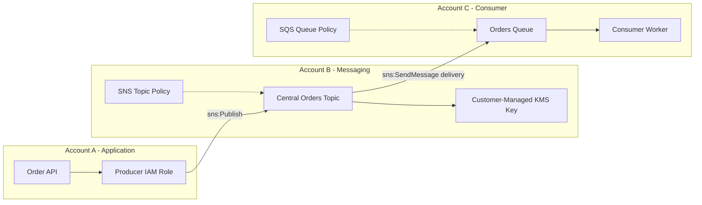
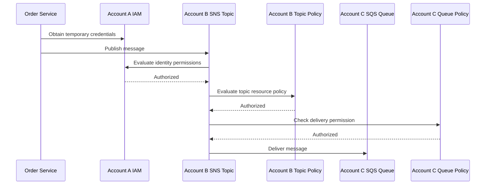
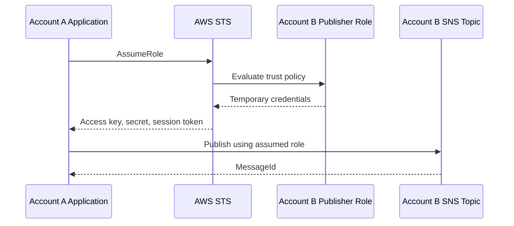

# 04- Cross-Account Topic Access

## Overview

Amazon Simple Notification Service (Amazon SNS) supports cross-account access through topic resource policies and AWS Identity and Access Management (IAM).

Cross-account access allows an AWS account to publish messages to or manage subscriptions on an SNS topic owned by another account. This is useful when organizations centralize event distribution while keeping application workloads and consumer infrastructure in separate AWS accounts.

A typical enterprise architecture may use:

- A messaging account that owns shared SNS topics.
- Application accounts that publish business events.
- Consumer accounts that own SQS queues or other subscription endpoints.
- A security or platform account responsible for centralized governance and auditing.

Cross-account access must be explicitly authorized. The topic owner controls access through the SNS topic policy, while external IAM identities require appropriate permissions in their own accounts.

A production implementation should also consider destination resource policies, KMS permissions, service principals, organization boundaries, auditability, and regional dependencies.

## Cross-Account Architecture

### Account Separation

Consider an architecture with three AWS accounts:

| Account | Responsibility | Resources |
|---|---|---|
| Account A | Application producer | ECS service, IAM producer role |
| Account B | Central messaging | SNS topic, KMS key |
| Account C | Event consumer | SQS queue, consumer application |

The order service in Account A publishes events to an SNS topic in Account B. SNS delivers those events to an SQS queue in Account C.

### Reference Architecture



Each account owns its own security boundary:

- Account A controls which application identities can publish.
- Account B controls which external principals can access the topic.
- Account C controls which services can send messages to its queue and which identities can consume them.

The SNS topic policy does not replace the SQS queue policy. Both resources must authorize their respective operations.

## Cross-Account Authorization Model

### Identity-Based Authorization

The external publisher requires an IAM identity policy granting `sns:Publish` on the target topic.

For example, the producer role in Account A needs permission to publish to the topic in Account B.

```json
{
  "Version": "2012-10-17",
  "Statement": [
    {
      "Sid": "PublishToCentralOrdersTopic",
      "Effect": "Allow",
      "Action": "sns:Publish",
      "Resource": "arn:aws:sns:ap-south-1:222222222222:central-orders-topic"
    }
  ]
}
```

This policy belongs to the producer role in Account A.

It does not independently grant access to the topic because Account B must also authorize the external principal.

### Resource-Based Authorization

The SNS topic owner must add a resource policy allowing the external publisher.

Example topic policy in Account B:

```json
{
  "Version": "2012-10-17",
  "Statement": [
    {
      "Sid": "AllowAccountAPublisher",
      "Effect": "Allow",
      "Principal": {
        "AWS": "arn:aws:iam::111111111111:role/orders-publisher"
      },
      "Action": "sns:Publish",
      "Resource": "arn:aws:sns:ap-south-1:222222222222:central-orders-topic"
    }
  ]
}
```

This grants the specified role permission at the resource-policy layer.

The external role must still have the identity-based permission, and applicable organization policies, permissions boundaries, and session policies must not deny the operation.

### Authorization Responsibilities

| Authorization component | Account owner | Responsibility |
|---|---|---|
| Producer IAM policy | Account A | Allows the producer role to call `sns:Publish` |
| SNS topic policy | Account B | Authorizes the external principal |
| SQS queue policy | Account C | Allows SNS to deliver messages |
| Consumer IAM policy | Account C | Allows the worker to consume messages |
| KMS key policy | Key-owning account | Authorizes required encryption operations |

### Authorization Flow



The authorization path contains independent checks. A successful publish request does not guarantee that every subscription destination accepts the notification.

## Cross-Account Publishing

### When to Use It

Cross-account publishing is useful when:

- Multiple application accounts publish to a central event topic.
- Platform teams own shared messaging infrastructure.
- Business domains are isolated into separate AWS accounts.
- Security teams require centralized control over event distribution.
- Applications need to communicate without directly accessing one another's resources.

### Configure the Publisher Role

Create a dedicated IAM role in Account A for the application.

Example trust policy for an ECS task role is managed through the ECS task-role configuration. The role should not be shared with unrelated workloads.

Attach the publishing policy:

```json
{
  "Version": "2012-10-17",
  "Statement": [
    {
      "Sid": "PublishCentralEvents",
      "Effect": "Allow",
      "Action": "sns:Publish",
      "Resource": "arn:aws:sns:ap-south-1:222222222222:central-orders-topic"
    }
  ]
}
```

### Configure the SNS Topic Policy

In Account B, authorize the producer role:

```json
{
  "Version": "2012-10-17",
  "Statement": [
    {
      "Sid": "AllowOrdersApplication",
      "Effect": "Allow",
      "Principal": {
        "AWS": "arn:aws:iam::111111111111:role/orders-publisher"
      },
      "Action": "sns:Publish",
      "Resource": "arn:aws:sns:ap-south-1:222222222222:central-orders-topic"
    }
  ]
}
```

Use the role ARN rather than a broad account principal when only one workload needs access.

### Publish with Python and Boto3

The application uses its normal workload credentials. It does not need to embed credentials belonging to Account B.

```python
import json
import os
from uuid import uuid4

import boto3
from botocore.config import Config

sns = boto3.client(
    "sns",
    region_name=os.environ["AWS_REGION"],
    config=Config(
        connect_timeout=3,
        read_timeout=10,
        retries={
            "mode": "standard",
            "total_max_attempts": 4,
        },
    ),
)

def publish_order_event(order_id: str) -> str:
    topic_arn = os.environ["SNS_ORDERS_TOPIC_ARN"]

    message = {
        "event_id": str(uuid4()),
        "event_type": "order.created",
        "event_version": 1,
        "order_id": order_id,
    }

    response = sns.publish(
        TopicArn=topic_arn,
        Message=json.dumps(message),
        MessageAttributes={
            "event_type": {
                "DataType": "String",
                "StringValue": "order.created",
            }
        },
    )

    return response["MessageId"]
```

The runtime obtains temporary credentials through its configured IAM workload identity.

The topic ARN should be deployment configuration, not a hardcoded credential or security mechanism.

### Verify the Active Identity

Before troubleshooting cross-account publishing, confirm which identity the application is using.

```bash
aws sts get-caller-identity
```

Expected output should identify Account A and the intended producer role.

A common cause of access failures is that the application is using a different profile, task role, or assumed-role session than expected.

## Cross-Account Subscription Management

SNS subscriptions can connect a topic to destinations in another account.

A common pattern is a central SNS topic in Account B delivering notifications to an SQS queue in Account C.

### Authorization Requirements

The integration requires:

- Account B to authorize the subscription workflow.
- Account C to configure its queue policy for the SNS topic.
- The subscription to be created and confirmed where required.
- The queue consumer to have appropriate SQS permissions.
- KMS permissions if the queue uses a customer-managed key.

Subscription creation and message delivery are separate operations with separate authorization requirements.

### SQS Queue Policy

The queue owner in Account C must allow the SNS service to send messages from the exact topic.

```json
{
  "Version": "2012-10-17",
  "Statement": [
    {
      "Sid": "AllowCentralOrdersTopic",
      "Effect": "Allow",
      "Principal": {
        "Service": "sns.amazonaws.com"
      },
      "Action": "sqs:SendMessage",
      "Resource": "arn:aws:sqs:ap-south-1:333333333333:orders-queue",
      "Condition": {
        "ArnEquals": {
          "aws:SourceArn": "arn:aws:sns:ap-south-1:222222222222:central-orders-topic"
        }
      }
    }
  ]
}
```

The source ARN condition prevents unrelated SNS topics from sending messages to the queue.

### Create the Subscription

An authorized identity can create the subscription:

```bash
aws sns subscribe \
  --topic-arn arn:aws:sns:ap-south-1:222222222222:central-orders-topic \
  --protocol sqs \
  --notification-endpoint arn:aws:sqs:ap-south-1:333333333333:orders-queue
```

Use credentials belonging to the intended subscription-management identity.

For cross-account subscriptions, the queue owner may need to confirm the subscription depending on the authorization and service configuration.

### Verify the Subscription

```bash
aws sns list-subscriptions-by-topic \
  --topic-arn arn:aws:sns:ap-south-1:222222222222:central-orders-topic
```

Inspect the subscription ARN and endpoint.

A pending confirmation state means the subscription is not yet active for delivery.

### Consumer Permissions

The consumer in Account C needs permission to read and delete messages from its queue.

```json
{
  "Version": "2012-10-17",
  "Statement": [
    {
      "Sid": "ConsumeOrdersQueue",
      "Effect": "Allow",
      "Action": [
        "sqs:ReceiveMessage",
        "sqs:DeleteMessage",
        "sqs:ChangeMessageVisibility",
        "sqs:GetQueueAttributes"
      ],
      "Resource": "arn:aws:sqs:ap-south-1:333333333333:orders-queue"
    }
  ]
}
```

The consumer role should not need access to the SNS topic merely to process messages already delivered to SQS.

## Cross-Account Access Using IAM Role Assumption

An alternative design is to allow an application in Account A to assume a role in Account B and publish using the assumed-role credentials.

This is useful when:

- The messaging account owns a dedicated publisher role.
- Access must be centrally managed in the resource-owning account.
- Multiple external accounts need controlled access.
- The application needs a consistent role-assumption workflow.

### Architecture



### Configure the Target Role Trust Policy

In Account B, create a role that trusts the intended role from Account A.

```json
{
  "Version": "2012-10-17",
  "Statement": [
    {
      "Sid": "TrustOrdersPublisher",
      "Effect": "Allow",
      "Principal": {
        "AWS": "arn:aws:iam::111111111111:role/orders-application"
      },
      "Action": "sts:AssumeRole"
    }
  ]
}
```

The trust policy determines who can assume the role.

For production, consider adding an external ID when the trust relationship involves a third-party or multi-tenant service, and use appropriate principal restrictions and session controls.

### Attach the SNS Permission to the Target Role

The assumed role in Account B receives a narrowly scoped identity policy.

```json
{
  "Version": "2012-10-17",
  "Statement": [
    {
      "Sid": "PublishCentralOrders",
      "Effect": "Allow",
      "Action": "sns:Publish",
      "Resource": "arn:aws:sns:ap-south-1:222222222222:central-orders-topic"
    }
  ]
}
```

If the topic policy does not independently authorize this role, configure the required resource policy as well. Same-account access through the assumed role still requires an applicable allow under the effective policy model.

### Allow the Application to Assume the Role

The source role in Account A needs:

```json
{
  "Version": "2012-10-17",
  "Statement": [
    {
      "Sid": "AssumeCentralPublisherRole",
      "Effect": "Allow",
      "Action": "sts:AssumeRole",
      "Resource": "arn:aws:iam::222222222222:role/central-sns-publisher"
    }
  ]
}
```

### Python Implementation

```python
import boto3
import json
import os

sts = boto3.client("sts", region_name="ap-south-1")

assumed_role = sts.assume_role(
    RoleArn=os.environ["SNS_PUBLISHER_ROLE_ARN"],
    RoleSessionName="orders-service-publisher",
)

credentials = assumed_role["Credentials"]

sns = boto3.client(
    "sns",
    region_name="ap-south-1",
    aws_access_key_id=credentials["AccessKeyId"],
    aws_secret_access_key=credentials["SecretAccessKey"],
    aws_session_token=credentials["SessionToken"],
)

response = sns.publish(
    TopicArn=os.environ["SNS_ORDERS_TOPIC_ARN"],
    Message=json.dumps({
        "event_type": "order.created",
        "order_id": "order-123",
    }),
)

print(response["MessageId"])
```

This example demonstrates role assumption and temporary credentials. Production applications should use an appropriate credential-refreshing provider or session mechanism for long-running workloads rather than retaining a single set of temporary credentials indefinitely.

### Direct Resource Policy vs Role Assumption

| Consideration | Direct cross-account topic policy | AssumeRole |
|---|---|---|
| Authorization location | Topic resource policy and external identity policy | Target role trust policy and role permissions |
| Runtime credentials | Source account workload credentials | Temporary credentials for target role |
| Centralized permission management | Topic owner manages resource access | Messaging account manages target role permissions |
| Operational complexity | Lower for simple publishing | Higher due to STS role assumption |
| Session controls | Source role session controls | Target role session controls |
| Best suited for | Direct access to a shared topic | Centralized access through a dedicated role |

Choose the model based on ownership, trust boundaries, and operational requirements. Avoid introducing role assumption when a narrowly scoped topic resource policy is sufficient.

## Cross-Account KMS Permissions

SNS server-side encryption introduces an additional authorization dependency when a customer-managed KMS key is used.

The topic owner must configure the key policy to permit the required SNS operations.

For cross-account integrations, evaluate the permissions required by:

- The SNS service.
- The publishing identity.
- The key-owning account.
- Any supported service integration involved in message delivery.

Do not assume that permission to publish to an SNS topic automatically grants permission to use its KMS key.

### Example KMS Key Policy Statement

An illustrative statement for allowing SNS to use a key in the topic's Region:

```json
{
  "Sid": "AllowSNSServiceUse",
  "Effect": "Allow",
  "Principal": {
    "Service": "sns.amazonaws.com"
  },
  "Action": [
    "kms:Decrypt",
    "kms:GenerateDataKey"
  ],
  "Resource": "*",
  "Condition": {
    "StringEquals": {
      "kms:ViaService": "sns.ap-south-1.amazonaws.com"
    }
  }
}
```

This is not a complete KMS key policy. Validate the required permissions, encryption context, service principal behavior, and cross-account requirements for the exact SNS integration.

### KMS Operational Considerations

- Use a customer-managed key when key policy control is required.
- Separate key administration from key usage.
- Review key policies and grants.
- Enable rotation where appropriate.
- Monitor key policy changes through CloudTrail.
- Avoid disabling or deleting keys while dependent topics require them.
- Test encrypted publishing and delivery before production rollout.

For an encrypted SQS destination, configure the queue's KMS key permissions independently from the SNS topic's KMS key.

## Restricting Cross-Account Access

Cross-account access should be limited to trusted accounts, roles, and operations.

### Restrict by Specific Role

Prefer:

```json
{
  "Principal": {
    "AWS": "arn:aws:iam::111111111111:role/orders-publisher"
  }
}
```

Over:

```json
{
  "Principal": "*"
}
```

Specific principals make ownership and access reviews easier.

### Restrict by AWS Organization

Where appropriate, use `aws:PrincipalOrgID` to limit access to an AWS Organization.

```json
{
  "Version": "2012-10-17",
  "Statement": [
    {
      "Sid": "AllowOrganizationPublishing",
      "Effect": "Allow",
      "Principal": "*",
      "Action": "sns:Publish",
      "Resource": "arn:aws:sns:ap-south-1:222222222222:central-events",
      "Condition": {
        "StringEquals": {
          "aws:PrincipalOrgID": "o-exampleorgid"
        }
      }
    }
  ]
}
```

Organization membership is not necessarily sufficient for sensitive workloads. Consider restricting access to specific role ARNs as well.

### Restrict AWS Service Sources

When an AWS service publishes to a topic, use its service principal and source restrictions supported by the integration.

For example, CloudWatch notification access can be restricted using the source account and, where supported, the alarm ARN.

Do not assume that all AWS service integrations support identical source condition keys.

### Apply Organization-Level Controls

Use AWS Organizations SCPs to establish maximum permissions across accounts.

Possible controls include:

- Restricting topic administration to approved roles.
- Preventing unauthorized resource deletion.
- Limiting permitted Regions.
- Requiring controlled deployment workflows.

SCPs do not grant access. They restrict the maximum permissions available to identities in affected accounts.

## Monitoring and Auditing Cross-Account Access

Cross-account access should be continuously auditable.

### CloudTrail

Use CloudTrail to monitor:

- SNS `Publish` API activity where recorded.
- `Subscribe` and `Unsubscribe`.
- `SetTopicAttributes`.
- Topic creation and deletion.
- IAM role and policy changes.
- STS `AssumeRole` operations.
- KMS key policy and lifecycle changes.

Review the caller identity, account ID, role session, source IP, request parameters, and event time where available.

### Monitoring Signals

| Signal | Potential issue | Response |
|---|---|---|
| Unexpected external publisher | Unauthorized access or compromised role | Review topic policy and caller identity |
| Repeated access-denied events | Missing permissions or incorrect trust | Inspect IAM, resource, and organization policies |
| Unexpected subscription | Unauthorized destination | Validate endpoint ownership and remove if necessary |
| STS assumption failures | Trust policy or identity policy mismatch | Inspect source role and target trust policy |
| KMS access denied | Encryption authorization failure | Review key policy and required service permissions |
| Cross-account delivery failures | Queue policy or destination configuration issue | Inspect queue policy and delivery metrics |
| Topic policy changes | Potential access expansion | Review CloudTrail and restore approved policy if needed |

### Access Review

Periodically review:

- External accounts in topic policies.
- External role ARNs.
- Assumed-role trust relationships.
- Subscription destinations.
- SQS queue resource policies.
- KMS key policies and grants.
- Unused or stale permissions.

Remove access through a controlled deployment process rather than manually editing production policies without change tracking.

## Reliability and Disaster Recovery

Cross-account SNS architectures introduce dependencies across accounts and Regions.

A failure in any account's IAM configuration, resource policy, KMS permissions, or destination infrastructure can interrupt the messaging workflow.

### Reliability Considerations

- Use separate SQS queues for independent consumers.
- Configure appropriate visibility timeouts and dead-letter queues.
- Implement consumer idempotency.
- Monitor delivery failures and authorization errors.
- Keep policy configuration under version control.
- Avoid making one administrative role a single point of operational dependency.
- Define ownership and escalation paths across account teams.

SNS delivery acceptance does not guarantee successful business processing by downstream consumers.

### Regional Recovery

SNS topics and subscriptions are regional resources. Cross-account permissions do not automatically replicate across Regions.

A recovery design should include:

- Equivalent SNS topics in the recovery Region.
- Regional topic policies.
- Regional IAM and STS configurations.
- SQS queue policies in destination accounts.
- Regional KMS keys and permissions.
- Publisher failover configuration.
- Subscription recreation and validation.
- Replay and reconciliation procedures.

Retain durable event records when business workflows require recovery or replay beyond SNS delivery guarantees.

## Troubleshooting Cross-Account Access

Use a systematic approach rather than repeatedly adding permissions.

### Verify the Active Identity

```bash
aws sts get-caller-identity
```

Confirm the account and role used by the application.

### Verify the Topic Policy

```bash
aws sns get-topic-attributes \
  --topic-arn arn:aws:sns:ap-south-1:222222222222:central-orders-topic \
  --query 'Attributes.Policy' \
  --output text
```

Confirm that the expected principal, action, resource, and conditions are present.

### Verify the Publisher IAM Policy

```bash
aws iam list-attached-role-policies \
  --role-name orders-publisher
```

For inline policies:

```bash
aws iam list-role-policies \
  --role-name orders-publisher
```

### Verify the Subscription

```bash
aws sns list-subscriptions-by-topic \
  --topic-arn arn:aws:sns:ap-south-1:222222222222:central-orders-topic
```

Confirm the endpoint and subscription status.

### Verify the SQS Queue Policy

```bash
aws sqs get-queue-attributes \
  --queue-url https://sqs.ap-south-1.amazonaws.com/333333333333/orders-queue \
  --attribute-names Policy
```

Check that the policy allows `sns.amazonaws.com` to send messages from the exact topic ARN.

### Verify the Assumed Role

If using role assumption:

```bash
aws sts assume-role \
  --role-arn arn:aws:iam::222222222222:role/central-sns-publisher \
  --role-session-name sns-access-test
```

Check:

- Source role permission for `sts:AssumeRole`.
- Target role trust policy.
- Target role SNS permissions.
- Applicable SCPs and permission boundaries.
- Session duration and credential expiration.

### Common Failure Causes

| Error or symptom | Likely cause |
|---|---|
| `AuthorizationError` during publish | Missing publisher IAM permission or topic policy authorization |
| `AccessDenied` during role assumption | Incorrect trust policy or missing `sts:AssumeRole` permission |
| Subscription remains pending | Confirmation or destination authorization issue |
| SNS publishes successfully but SQS receives nothing | Queue policy or delivery configuration issue |
| KMS access denied | Missing key policy or service permissions |
| Works in one Region but fails in another | Incorrect regional ARN or missing regional configuration |
| Application uses an unexpected account | Incorrect credential provider or workload role |

IAM policy simulation can help investigate identity-based permissions, but it does not fully reproduce every resource policy, KMS, endpoint, and cross-account authorization dependency.

## Common Mistakes and Production Pitfalls

| Mistake | Why it is problematic | Recommended approach |
|---|---|---|
| Adding only an identity policy | Topic owner has not authorized the external principal | Configure the topic resource policy |
| Adding only a topic policy | External identity may lack permission | Configure the publisher IAM policy |
| Using account-wide principals unnecessarily | Grants broader delegation than required | Prefer specific role ARNs |
| Forgetting the SQS queue policy | SNS cannot deliver to the destination | Allow the exact topic ARN |
| Confusing subscription creation with message delivery | Different authorization checks are involved | Test both operations independently |
| Ignoring KMS permissions | Encrypted publishing or delivery fails | Validate key policy and integration requirements |
| Using long-lived cross-account credentials | Increases credential exposure | Use workload identity and temporary credentials |
| Assuming role assumption is always necessary | Adds avoidable STS and operational complexity | Use direct resource policies when appropriate |
| Trusting all accounts in an organization | May grant broader access than required | Restrict sensitive topics to specific roles |
| Reusing one role for unrelated applications | Expands the impact of credential compromise | Separate workload roles |
| Assuming SNS replicates cross-Region | Creates an incomplete recovery plan | Provision regional resources and policies explicitly |
| Logging complete event payloads | Can expose sensitive information | Log event identifiers and security metadata |

## Production Checklist

### Account and Identity Design

- [ ] Assign clear ownership for topic and destination resources.
- [ ] Use dedicated producer roles.
- [ ] Use temporary credentials.
- [ ] Prefer specific role principals over broad account principals.
- [ ] Restrict `sts:AssumeRole` to required target roles.
- [ ] Review organization policies and permissions boundaries.

### Topic and Destination Policies

- [ ] Configure the SNS topic resource policy.
- [ ] Configure the external publisher identity policy.
- [ ] Restrict publishing to the intended topic ARN.
- [ ] Configure SQS queue policies independently.
- [ ] Verify subscription confirmation and endpoint ownership.
- [ ] Configure Lambda invocation permissions separately when applicable.

### Encryption and Network Security

- [ ] Review SNS KMS permissions.
- [ ] Review destination KMS permissions.
- [ ] Restrict key administration and usage.
- [ ] Use TLS for API communication.
- [ ] Apply VPC endpoint controls where required.
- [ ] Validate supported policy condition keys.

### Operations and Recovery

- [ ] Audit cross-account access through CloudTrail.
- [ ] Monitor STS role assumption and authorization failures.
- [ ] Review external principals periodically.
- [ ] Test positive and negative authorization scenarios.
- [ ] Manage policies through infrastructure as code.
- [ ] Maintain regional recovery configuration.
- [ ] Test subscription recreation and message recovery procedures.

## Key Takeaways

- Cross-account SNS access requires explicit authorization through the topic resource policy and the external identity's IAM permissions.
- SNS-to-SQS delivery requires a separate queue policy that restricts `sqs:SendMessage` to the expected SNS topic ARN.
- Direct resource-policy access and STS role assumption are different access patterns; choose based on ownership and trust requirements.
- Customer-managed KMS keys introduce additional authorization dependencies that must be configured independently for SNS and destination resources.
- Audit external principals, role assumptions, topic policies, subscriptions, and regional recovery configuration as part of ongoing security operations.