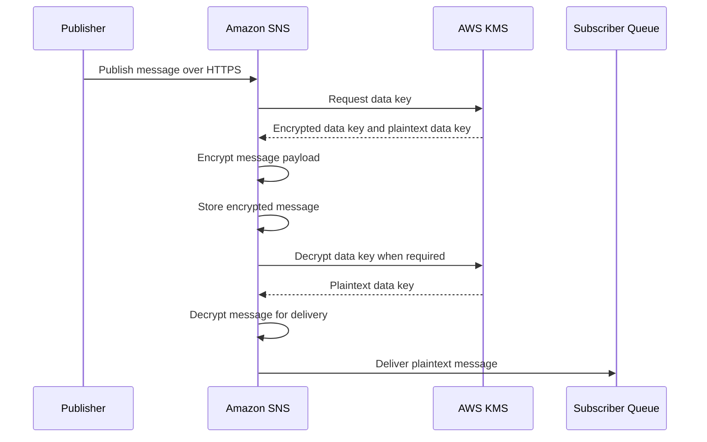
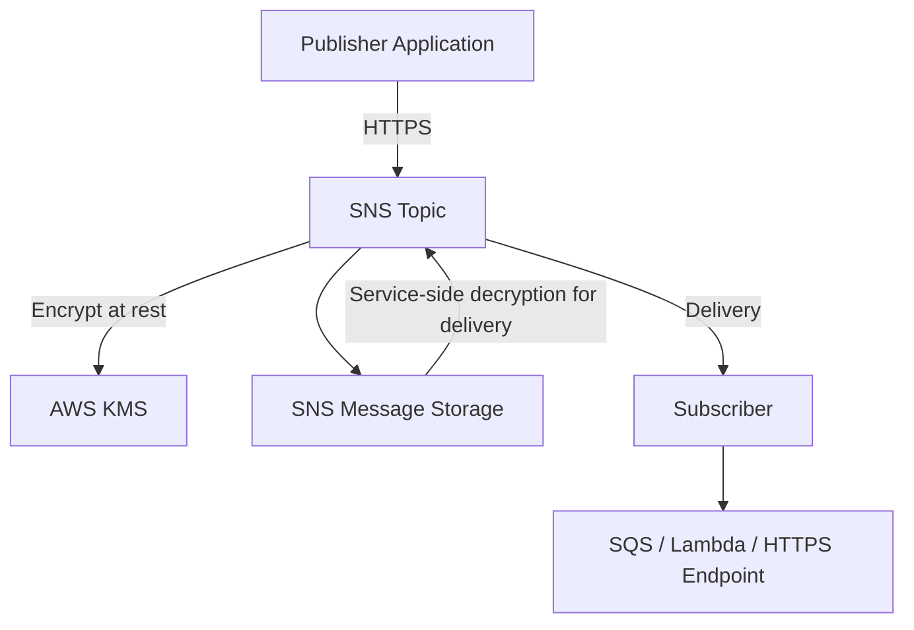

# 05- Server-Side Encryption and AWS KMS

## Overview

Amazon Simple Notification Service (Amazon SNS) supports server-side encryption (SSE) to protect message data at rest. SSE uses AWS Key Management Service (AWS KMS) to encrypt and decrypt message payloads transparently as SNS stores and delivers them.

Encryption at rest is an important security control for event-driven architectures because SNS topics often carry business events, customer-related information, operational notifications, and service integration data.

SNS server-side encryption protects message bodies stored by the service. It does not replace:

- TLS encryption for data in transit.
- IAM authorization and SNS topic access policies.
- Application-level payload protection when data must remain encrypted beyond SNS.
- Data classification, retention, and access auditing.
- Security controls on downstream subscriptions and consumers.

A production implementation should combine SSE with least-privilege IAM permissions, carefully managed KMS keys, key rotation, monitoring, and tested recovery procedures.

## How SNS Server-Side Encryption Works

SNS integrates with AWS KMS to encrypt message data before storing it.

When a publisher sends a message to an encrypted topic, SNS uses the configured KMS key to protect the message payload. When SNS needs to deliver the message to a subscriber, it decrypts the message through the configured encryption mechanism before delivering it.

The encryption and decryption operations are managed by AWS services. Publishers and subscribers generally do not need to implement encryption logic themselves.



The diagram represents the logical encryption lifecycle. AWS manages the underlying data-key operations and encryption implementation.

### Envelope Encryption

AWS KMS uses envelope encryption for many service integrations.

Envelope encryption separates data encryption from key encryption:

1. AWS KMS generates a data key.
2. The data key is returned in plaintext and encrypted form.
3. The service uses the plaintext data key to encrypt data.
4. The plaintext data key is discarded after use.
5. The encrypted data key is retained with the encrypted data.
6. When decryption is required, the service asks KMS to decrypt the encrypted data key.
7. The recovered plaintext data key is used to decrypt the data.

This approach avoids sending every message payload directly to KMS for encryption.

It also allows AWS services to use efficient symmetric encryption while relying on KMS for key protection and access control.

## AWS KMS Concepts Relevant to SNS

### AWS KMS Key

An AWS KMS key is a logical representation of a cryptographic key managed by AWS KMS.

SNS uses a symmetric encryption KMS key for server-side encryption.

The key controls cryptographic operations and provides a policy boundary for determining which principals and AWS services can use it.

KMS keys can be:

- AWS-owned keys.
- AWS-managed keys.
- Customer-managed keys.

| Key type | Management | Policy customization | Typical use |
|---|---|---|---|
| AWS-owned key | Managed entirely by AWS | Not customer-controlled | Default service encryption where supported |
| AWS-managed key | Managed by AWS for a specific service | Limited customer control | Standard service-managed encryption |
| Customer-managed key | Managed by the AWS account owner | Full key policy and lifecycle control | Compliance, audit, and explicit access requirements |

For SNS, the AWS-managed key commonly associated with SSE is `alias/aws/sns`.

A customer-managed KMS key is appropriate when the organization requires control over key policies, grants, rotation settings, or audit processes.

### Data Key

A data key is a cryptographic key used to encrypt message data.

SNS uses data-key operations through KMS rather than requiring publishers to manage data encryption keys.

Application developers should not attempt to generate or manage SNS's internal data keys.

### Key Policy

A KMS key policy is the primary resource-based authorization mechanism for a KMS key.

It determines which principals can administer or use the key.

Unlike ordinary IAM policies, a KMS key policy must explicitly enable the relevant permissions. IAM permissions alone do not automatically grant access unless the key policy allows the account to delegate permissions through IAM.

A key policy should distinguish between:

- Key administrators.
- Key users.
- AWS service principals.
- Security and audit roles.

### Key Rotation

Key rotation periodically replaces the backing key material used by a KMS key.

For supported symmetric customer-managed KMS keys, automatic rotation can be enabled.

Rotation does not change the KMS key ARN. Existing encrypted data remains decryptable because KMS retains the necessary historical key material.

Rotation does not replace key lifecycle management or access reviews.

## Enabling Server-Side Encryption for SNS

SNS encryption is configured at the topic level.

A topic can use a customer-managed KMS key by specifying its key ID or ARN in the topic's KMS master key configuration.

### Create an Encrypted SNS Topic

Using the AWS CLI:

```bash
aws sns create-topic \
    --name secure-orders-topic \
    --attributes KmsMasterKeyId=alias/aws/sns
```

This configures the topic to use the AWS-managed SNS KMS key.

For a customer-managed key:

```bash
aws sns create-topic \
    --name secure-orders-topic \
    --attributes KmsMasterKeyId=arn:aws:kms:ap-south-1:123456789012:key/11111111-2222-3333-4444-555555555555
```

Use a customer-managed key ARN belonging to the appropriate account and Region.

### Enable Encryption on an Existing Topic

```bash
aws sns set-topic-attributes \
    --topic-arn arn:aws:sns:ap-south-1:123456789012:secure-orders-topic \
    --attribute-name KmsMasterKeyId \
    --attribute-value alias/aws/sns
```

To configure a customer-managed key:

```bash
aws sns set-topic-attributes \
    --topic-arn arn:aws:sns:ap-south-1:123456789012:secure-orders-topic \
    --attribute-name KmsMasterKeyId \
    --attribute-value arn:aws:kms:ap-south-1:123456789012:key/11111111-2222-3333-4444-555555555555
```

### Verify Topic Encryption

```bash
aws sns get-topic-attributes \
    --topic-arn arn:aws:sns:ap-south-1:123456789012:secure-orders-topic
```

Inspect the `KmsMasterKeyId` attribute.

If the topic uses a customer-managed key, verify that the configured key is the intended key and that the key is enabled.

## Customer-Managed KMS Keys

Customer-managed keys provide greater control over encryption authorization and key lifecycle management.

They are useful when:

- Security teams require explicit key ownership.
- Compliance policies require customer-controlled key policies.
- Different application domains need separate encryption keys.
- Key usage must be audited independently.
- Access to encrypted data must be restricted through key policy.
- Key rotation and deletion must follow organization-specific processes.

### Create a Customer-Managed KMS Key

```bash
aws kms create-key \
    --description "Customer-managed key for SNS production topics" \
    --key-usage ENCRYPT_DECRYPT \
    --origin AWS_KMS \
    --multi-region false
```

The command returns key metadata, including the key ARN and key ID.

Create an alias:

```bash
aws kms create-alias \
    --alias-name alias/production-sns \
    --target-key-id 11111111-2222-3333-4444-555555555555
```

The alias provides a stable, readable reference to the key.

### Enable Automatic Key Rotation

```bash
aws kms enable-key-rotation \
    --key-id alias/production-sns
```

Verify rotation status:

```bash
aws kms get-key-rotation-status \
    --key-id alias/production-sns
```

Automatic rotation is supported for eligible symmetric customer-managed KMS keys.

### Inspect Key Metadata

```bash
aws kms describe-key \
    --key-id alias/production-sns
```

Review:

- Key state.
- Key usage.
- Key specification.
- Key manager.
- Key ARN.
- Multi-Region configuration.
- Key origin.

Do not assume that creating a key automatically grants SNS permission to use it.

## KMS Permissions for SNS

A correctly configured KMS key must allow SNS to use it for the required cryptographic operations.

For an encrypted SNS topic, the service needs permission to generate data keys and decrypt them as part of message processing.

Relevant KMS actions include:

- `kms:GenerateDataKey*`
- `kms:Decrypt`

The exact authorization path depends on the AWS service integration and configured key policy.

### Example KMS Key Policy

The following example illustrates a customer-managed key policy that enables account-level IAM delegation and grants SNS service access for a specific topic.

Replace account, Region, and topic identifiers with the values for the deployment.

```json
{
  "Version": "2012-10-17",
  "Statement": [
    {
      "Sid": "EnableAccountAdministration",
      "Effect": "Allow",
      "Principal": {
        "AWS": "arn:aws:iam::123456789012:root"
      },
      "Action": "kms:*",
      "Resource": "*"
    },
    {
      "Sid": "AllowSNSForSpecificTopic",
      "Effect": "Allow",
      "Principal": {
        "Service": "sns.amazonaws.com"
      },
      "Action": [
        "kms:GenerateDataKey*",
        "kms:Decrypt"
      ],
      "Resource": "*",
      "Condition": {
        "StringEquals": {
          "aws:SourceAccount": "123456789012"
        },
        "ArnEquals": {
          "aws:SourceArn": "arn:aws:sns:ap-south-1:123456789012:secure-orders-topic"
        }
      }
    }
  ]
}
```

The first statement enables the account to delegate key permissions through IAM. It should be retained or replaced with an equivalent administration model rather than accidentally removed.

The second statement restricts SNS usage to the intended topic and account.

Review AWS KMS service integration requirements before deploying a policy. Service principals, encryption context conditions, and cross-account authorization requirements can differ between integrations.

### IAM Permissions for Administrators

An administrative role may need permissions such as:

```json
{
  "Version": "2012-10-17",
  "Statement": [
    {
      "Sid": "ManageSNSKMSKey",
      "Effect": "Allow",
      "Action": [
        "kms:DescribeKey",
        "kms:GetKeyPolicy",
        "kms:PutKeyPolicy",
        "kms:EnableKeyRotation",
        "kms:GetKeyRotationStatus",
        "kms:ListAliases",
        "kms:CreateAlias",
        "kms:UpdateAlias"
      ],
      "Resource": "arn:aws:kms:ap-south-1:123456789012:key/11111111-2222-3333-4444-555555555555"
    }
  ]
}
```

Separate key administration permissions from application publishing permissions.

Application roles should not receive broad key administration access.

## SNS Publisher and Subscriber Permissions

SNS encryption does not eliminate the need for normal SNS authorization.

A publisher must still have permission to publish to the topic.

A subscriber must still have the permissions required by its subscription and delivery mechanism.

For example, an application publishing to SNS generally requires:

```json
{
  "Version": "2012-10-17",
  "Statement": [
    {
      "Sid": "PublishToOrdersTopic",
      "Effect": "Allow",
      "Action": "sns:Publish",
      "Resource": "arn:aws:sns:ap-south-1:123456789012:secure-orders-topic"
    }
  ]
}
```

Do not grant `kms:Decrypt` to every publisher or subscriber by default. SNS performs its service-side encryption and decryption operations using the configured KMS integration and applicable key policy.

For encrypted SNS-to-SQS delivery, the SQS queue has its own encryption configuration and authorization requirements. Configure the queue's KMS key and queue policy separately.

## Encryption Lifecycle and Service Boundaries

SNS server-side encryption protects messages while they are stored by SNS.

It is important to understand where encryption is applied and where plaintext may be available.



The exact encryption behavior depends on the destination service and its configuration.

Important boundaries:

| Boundary | Security responsibility |
|---|---|
| Publisher to SNS | TLS and publisher authorization |
| SNS message storage | SNS server-side encryption |
| SNS to KMS | KMS authorization and key policy |
| SNS to SQS | Subscription delivery authorization and queue encryption |
| SNS to Lambda | Lambda invocation permissions and destination data protection |
| SNS to HTTPS endpoint | TLS endpoint security and application-level authorization |
| Consumer processing | Application data protection, access control, and secure logging |

SSE does not guarantee that message data remains encrypted after delivery.

If downstream systems need encrypted payloads end to end, implement application-level encryption with a separate key-management design.

## Encryption Context and Auditability

AWS KMS supports encryption context for services that integrate with it.

Encryption context is additional authenticated data represented as key-value pairs. It can be used in authorization conditions and appears in relevant CloudTrail KMS events.

Encryption context is not secret. Do not place passwords, tokens, personal data, or confidential business information in it.

For SNS, do not assume that arbitrary application-defined encryption context can be supplied to or controlled through the SNS topic configuration. Use only the context supported by the SNS service integration.

Encryption context can help security teams understand the context of cryptographic operations and apply additional policy conditions where supported.

## Cross-Account SNS and KMS Considerations

Cross-account SNS publishing and subscription architectures require careful authorization across multiple resources.

For example:

- Account A owns the SNS topic.
- Account B owns the publisher.
- Account C owns an SQS subscriber queue.

The design must account for:

- SNS topic resource policy.
- Publisher IAM permissions.
- KMS key policy.
- SQS queue policy.
- Destination encryption configuration.
- Cross-account KMS restrictions.

A cross-account publisher does not automatically need permission to decrypt the SNS topic's stored messages. It needs permission to publish to the topic. SNS's service-side KMS usage must be authorized independently.

For cross-account subscribers using encrypted SQS queues, configure the queue's KMS key policy and SNS delivery permissions according to the destination integration requirements.

Avoid broad wildcard principals and unrestricted cross-account key usage.

## Infrastructure as Code with Terraform

Terraform provides repeatable provisioning of KMS keys, aliases, SNS topics, and their policies.

### Create a Customer-Managed KMS Key

```hcl
resource "aws_kms_key" "sns" {
  description             = "Customer-managed key for production SNS topics"
  enable_key_rotation     = true
  deletion_window_in_days = 30

  tags = {
    Environment = "production"
    Service     = "sns"
    ManagedBy   = "terraform"
  }
}

resource "aws_kms_alias" "sns" {
  name          = "alias/production-sns"
  target_key_id = aws_kms_key.sns.key_id
}
```

### Configure the KMS Key Policy

```hcl
data "aws_caller_identity" "current" {}

data "aws_region" "current" {}

data "aws_iam_policy_document" "sns_kms" {
  statement {
    sid    = "EnableAccountAdministration"
    effect = "Allow"

    principals {
      type        = "AWS"
      identifiers = ["arn:aws:iam::${data.aws_caller_identity.current.account_id}:root"]
    }

    actions   = ["kms:*"]
    resources = ["*"]
  }

  statement {
    sid    = "AllowSNSForSpecificTopic"
    effect = "Allow"

    principals {
      type        = "Service"
      identifiers = ["sns.amazonaws.com"]
    }

    actions = [
      "kms:GenerateDataKey*",
      "kms:Decrypt"
    ]

    resources = ["*"]

    condition {
      test     = "StringEquals"
      variable = "aws:SourceAccount"
      values   = [data.aws_caller_identity.current.account_id]
    }

    condition {
      test     = "ArnEquals"
      variable = "aws:SourceArn"
      values   = [aws_sns_topic.secure_orders.arn]
    }
  }
}

resource "aws_kms_key_policy" "sns" {
  key_id = aws_kms_key.sns.key_id
  policy = data.aws_iam_policy_document.sns_kms.json
}
```

### Create an Encrypted SNS Topic

```hcl
resource "aws_sns_topic" "secure_orders" {
  name              = "secure-orders-topic"
  kms_master_key_id = aws_kms_key.sns.arn

  tags = {
    Environment = "production"
    Service     = "orders"
  }

  depends_on = [
    aws_kms_key_policy.sns
  ]
}
```

The key policy references the topic ARN, while the topic references the key ARN. This creates a dependency cycle in this direct form.

For production Terraform, avoid this circular dependency by separating the initial key policy from the topic-specific service permission:

1. Create the KMS key with an administrative policy that enables account-level IAM delegation.
2. Create the SNS topic using the key.
3. Add the topic-specific SNS service permission to the key policy after the topic exists, or use a carefully designed policy structure that avoids a resource dependency cycle.

The following approach illustrates a staged configuration.

First, create the key with an administrative policy:

```hcl
data "aws_iam_policy_document" "sns_kms_admin" {
  statement {
    sid    = "EnableAccountAdministration"
    effect = "Allow"

    principals {
      type        = "AWS"
      identifiers = ["arn:aws:iam::${data.aws_caller_identity.current.account_id}:root"]
    }

    actions   = ["kms:*"]
    resources = ["*"]
  }
}

resource "aws_kms_key" "sns" {
  description             = "Customer-managed key for production SNS topics"
  enable_key_rotation     = true
  deletion_window_in_days = 30
  policy                   = data.aws_iam_policy_document.sns_kms_admin.json
}

resource "aws_sns_topic" "secure_orders" {
  name              = "secure-orders-topic"
  kms_master_key_id = aws_kms_key.sns.arn
}
```

Then add the SNS service permission using a key policy that retains the administrative statement:

```hcl
data "aws_iam_policy_document" "sns_kms_complete" {
  statement {
    sid    = "EnableAccountAdministration"
    effect = "Allow"

    principals {
      type        = "AWS"
      identifiers = ["arn:aws:iam::${data.aws_caller_identity.current.account_id}:root"]
    }

    actions   = ["kms:*"]
    resources = ["*"]
  }

  statement {
    sid    = "AllowSNSForSpecificTopic"
    effect = "Allow"

    principals {
      type        = "Service"
      identifiers = ["sns.amazonaws.com"]
    }

    actions = [
      "kms:GenerateDataKey*",
      "kms:Decrypt"
    ]

    resources = ["*"]

    condition {
      test     = "StringEquals"
      variable = "aws:SourceAccount"
      values   = [data.aws_caller_identity.current.account_id]
    }

    condition {
      test     = "ArnEquals"
      variable = "aws:SourceArn"
      values   = [aws_sns_topic.secure_orders.arn]
    }
  }
}

resource "aws_kms_key_policy" "sns" {
  key_id = aws_kms_key.sns.key_id
  policy = data.aws_iam_policy_document.sns_kms_complete.json
}
```

This staged pattern avoids the direct cycle because the topic can be created with the initial administrative key policy. The final policy then adds the SNS service permission.

Validate the exact policy and service integration requirements in a non-production environment before deployment.

## Monitoring KMS Usage

AWS CloudTrail records relevant KMS API activity.

Use CloudTrail to investigate:

- KMS access denied errors.
- Key policy changes.
- Key disablement.
- Key deletion scheduling.
- Key rotation changes.
- Unexpected key usage.
- Changes to key grants.

Useful KMS operations include:

- `GenerateDataKey`
- `Decrypt`
- `DescribeKey`
- `PutKeyPolicy`
- `DisableKey`
- `ScheduleKeyDeletion`
- `EnableKeyRotation`

KMS request metrics and CloudTrail events provide complementary operational visibility.

### CloudWatch and CloudTrail

Use CloudWatch alarms for operational metrics and CloudTrail for audit events.

Recommended controls include:

- Alert on unexpected KMS access denied events.
- Monitor SNS publish failures.
- Monitor subscription delivery failures.
- Alert on KMS key disablement or deletion scheduling.
- Detect unexpected key policy changes.
- Review key usage patterns.
- Retain audit logs according to organizational requirements.

SNS message delivery failures and KMS authorization failures should be investigated as separate failure categories.

## Key Rotation and Lifecycle Management

Key rotation is part of a broader key lifecycle strategy.

A production KMS key lifecycle should cover:

- Creation.
- Ownership.
- Policy administration.
- Usage authorization.
- Rotation.
- Monitoring.
- Disablement.
- Recovery.
- Deletion.

### Automatic Rotation

For eligible customer-managed symmetric keys, automatic rotation can be enabled through the KMS console, CLI, or Terraform.

Automatic rotation preserves the logical key identity and allows existing encrypted data to remain decryptable.

### Manual Rotation

Manual rotation generally involves creating a new KMS key and updating the SNS topic to use it.

This is different from automatic rotation.

A manual rotation process should include:

1. Create the replacement key.
2. Configure its key policy.
3. Grant SNS the required permissions.
4. Update the SNS topic's KMS key configuration.
5. Verify successful publishing and subscription delivery.
6. Monitor CloudTrail and application errors.
7. Retain the old key while any data or service dependency still requires it.

Do not disable or schedule deletion of the old key immediately after changing the topic configuration.

### Key Disablement

Disabling a KMS key prevents cryptographic operations that require the key.

If an SNS topic depends on a disabled key, message publishing or delivery operations that require KMS can fail.

Key state should therefore be monitored as part of service availability.

### Key Deletion

KMS key deletion is irreversible after the waiting period completes.

Before scheduling deletion:

- Confirm no SNS topic references the key.
- Confirm no retained encrypted data requires it.
- Review CloudTrail usage history.
- Verify recovery and retention requirements.
- Obtain the required security approval.

A key deletion mistake can make encrypted data permanently inaccessible.

## Disaster Recovery Considerations

KMS key availability is part of the SNS messaging dependency chain.

A production disaster recovery plan should consider:

- Regional key availability.
- SNS topic recreation.
- Key policy recreation.
- Alias management.
- Cross-Region key strategy.
- CloudTrail audit retention.
- Recovery of downstream subscriptions.
- Message retention and replay.

KMS keys are Regional unless configured as Multi-Region keys.

SNS topics are also Regional resources.

A Multi-Region KMS key does not automatically replicate SNS topics or messages. It only provides related key material and cryptographic capabilities across configured Regions.

For a multi-Region SNS architecture:

1. Provision a topic in each required Region.
2. Provision or replicate the appropriate KMS key configuration.
3. Apply Region-specific key policies.
4. Configure publishers and subscribers for failover.
5. Validate message routing and replay.
6. Test recovery without relying on the primary Region.

Disaster recovery must include application-level message replication or republishing. Encryption configuration alone does not provide message recovery.

## Common Security Mistakes

| Mistake | Why it is dangerous | Recommended approach |
|---|---|---|
| Assuming SSE encrypts messages end to end | SNS decrypts messages for normal delivery | Use application-level encryption when downstream plaintext exposure must be prevented |
| Granting `kms:*` to application roles | Gives applications unnecessary key administration and cryptographic permissions | Separate key administration from service usage |
| Using an unrestricted KMS key policy | Allows broader service or account access than intended | Restrict principals and use source conditions where supported |
| Forgetting SNS KMS permissions | Publishing or delivery can fail when SNS cannot use the key | Configure and test the service principal permissions |
| Disabling a key used by a topic | Can interrupt encrypted message processing | Monitor key state and use controlled lifecycle procedures |
| Scheduling key deletion too early | Can permanently prevent decryption of retained data | Verify dependencies and recovery requirements before deletion |
| Treating automatic rotation as manual key replacement | Rotation does not change the logical key identity | Understand the distinction between backing-material rotation and key migration |
| Assuming SQS encryption follows SNS encryption | Each service has its own encryption configuration | Configure and audit destination encryption independently |
| Putting secrets in encryption context | Encryption context is not secret | Use non-sensitive identifiers only |
| Ignoring CloudTrail | Unauthorized key usage and policy changes may go undetected | Audit KMS operations and alert on sensitive changes |
| Assuming IAM permissions override key policies | KMS key policies are central to authorization | Ensure the key policy enables the intended IAM delegation or grants |
| Using a key from the wrong Region | SNS and KMS integration is Region-dependent | Deploy and reference compatible Regional resources |

## Production Security Checklist

### SNS Topic

- [ ] Enable server-side encryption.
- [ ] Select the appropriate AWS-managed or customer-managed KMS key.
- [ ] Restrict topic publishing permissions.
- [ ] Review topic resource policies.
- [ ] Use TLS for application communication.
- [ ] Avoid sensitive data in logs and message attributes.

### KMS

- [ ] Use symmetric encryption keys supported by SNS.
- [ ] Apply least-privilege key policies.
- [ ] Separate key administrators from application roles.
- [ ] Enable automatic rotation where appropriate.
- [ ] Monitor key state and policy changes.
- [ ] Audit cryptographic operations through CloudTrail.
- [ ] Document key ownership and recovery procedures.
- [ ] Protect against accidental key deletion.

### Subscribers

- [ ] Configure destination encryption independently.
- [ ] Restrict subscription access.
- [ ] Validate message payloads.
- [ ] Avoid logging confidential message content.
- [ ] Implement idempotent processing.
- [ ] Monitor subscription delivery failures.

### Operations

- [ ] Test publishing with the configured KMS key.
- [ ] Test subscription delivery.
- [ ] Test KMS access-denied scenarios.
- [ ] Validate key rotation procedures.
- [ ] Test disaster recovery and topic recreation.
- [ ] Document key replacement and deletion procedures.

## Interview Questions

### What is server-side encryption in SNS?

It is a feature that uses AWS KMS to encrypt SNS message data at rest. SNS manages the encryption and decryption operations as part of message storage and delivery.

### Why does SNS integrate with AWS KMS?

KMS provides centralized key management, access control, auditability, and cryptographic operations without requiring application teams to manage encryption keys directly.

### What is envelope encryption?

Envelope encryption uses a data key to encrypt the actual data and a KMS key to protect that data key. This reduces the need to send large payloads directly to KMS for encryption.

### What is the difference between an AWS-managed key and a customer-managed key?

An AWS-managed key is managed by AWS for a service and offers limited customization. A customer-managed key gives the account owner control over key policies, lifecycle, rotation settings, and auditing requirements.

### Does SNS encryption protect messages end to end?

No. SNS server-side encryption protects message data at rest within SNS. SNS decrypts messages as needed for delivery. Use application-level encryption when downstream consumers must not receive plaintext.

### What happens if the KMS key is disabled?

SNS operations that require the key can fail, affecting publishing or delivery. Monitor key state and avoid disabling keys that are still referenced by active topics.

### Does enabling KMS automatic rotation require updating the SNS topic?

No. Automatic rotation retains the logical KMS key identity. SNS continues to reference the same key. Manual migration to a different KMS key requires updating the topic configuration.

### Does SNS encryption automatically encrypt an SQS subscription queue?

No. SNS and SQS have separate encryption configurations. Configure the destination queue's encryption independently.

### Why should KMS key policies restrict SNS using `aws:SourceArn`?

It limits service usage to the intended SNS topic and reduces the risk of confused-deputy access by unrelated resources.

### What is the difference between key rotation and key replacement?

Rotation changes backing key material while retaining the logical KMS key identity. Replacement involves creating a different KMS key and updating resources to use it.

## Key Takeaways

- SNS server-side encryption protects message data at rest using AWS KMS, while TLS and application-level encryption address separate security boundaries.
- Customer-managed KMS keys provide explicit control over key policies, rotation, auditing, and lifecycle management.
- SNS must have the required KMS permissions, and key policies should restrict service usage to the intended account and topic.
- KMS key disablement, deletion, or incorrect permissions can interrupt SNS publishing and delivery; key lifecycle operations must be controlled and monitored.
- SNS and downstream services such as SQS have independent encryption configurations, so secure messaging architectures must protect every service boundary.