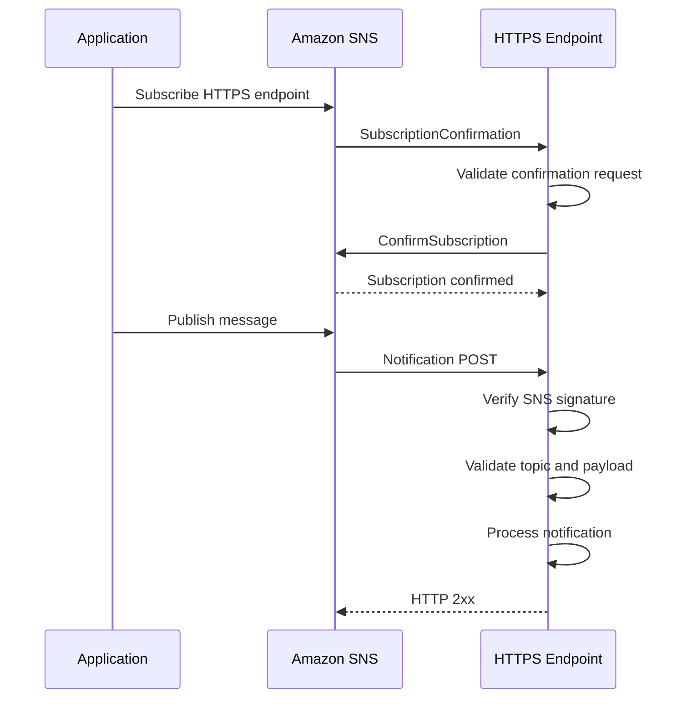
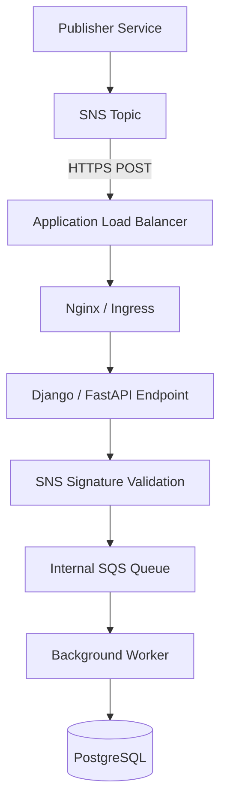
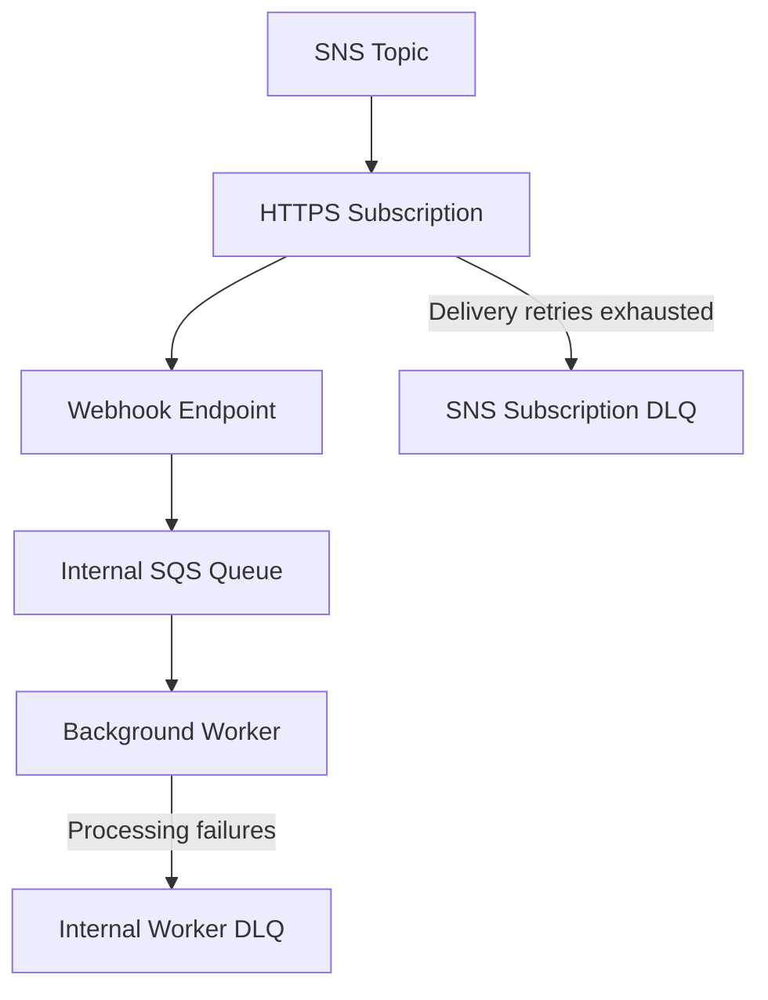

# 06- HTTPS and Secure Subscription Endpoints

## Overview

Amazon Simple Notification Service (Amazon SNS) supports HTTPS subscriptions, allowing it to deliver notifications to publicly reachable HTTPS endpoints.

An HTTPS subscription enables SNS to integrate with backend applications, microservices, and external systems without requiring those systems to poll a queue.

Typical use cases include:

- Delivering business events to REST APIs.
- Sending notifications to Django or FastAPI applications.
- Integrating external SaaS platforms.
- Triggering backend workflows.
- Delivering events to webhook endpoints.
- Connecting independently deployed microservices.

HTTPS subscriptions introduce a security boundary between SNS and the receiving application. The endpoint must be reachable, must complete SNS subscription confirmation, and must validate incoming notifications before processing them.

A production implementation should address:

- TLS certificate validation.
- Subscription confirmation.
- SNS message signature verification.
- Topic and message validation.
- Replay and duplicate delivery handling.
- Request authentication and authorization.
- Network and application availability.
- Logging and monitoring.

HTTPS provides transport encryption, but it does not independently prove that every incoming HTTP request originated from the expected SNS topic. Application-level message verification is essential.

## How SNS HTTPS Subscriptions Work

An HTTPS subscription registers an endpoint URL with an SNS topic.

SNS sends HTTP POST requests to that endpoint when messages are published to the topic.

The endpoint must first confirm the subscription before SNS starts delivering notifications.

The lifecycle consists of:

1. Create an SNS topic.
2. Subscribe an HTTPS endpoint.
3. Receive a subscription confirmation request.
4. Validate the confirmation request.
5. Confirm the subscription.
6. Receive notification requests.
7. Verify message authenticity.
8. Process the notification.
9. Return an appropriate HTTP response.



SNS uses HTTP POST requests for subscription control messages and notifications.

## HTTPS Subscription Architecture

A production architecture commonly places the subscription endpoint behind an API gateway, reverse proxy, or load balancer.



This architecture separates notification reception from business processing.

The HTTPS endpoint validates the SNS request and publishes accepted work to an internal queue. A background worker performs the actual business operation.

Advantages include:

- Short HTTP response times.
- Isolation between SNS delivery and business processing.
- Independent worker scaling.
- Better control over retries.
- Reduced risk of SNS delivery timeouts caused by long-running operations.

The internal queue should have its own idempotency and failure-handling strategy.

## Creating an HTTPS Subscription

An HTTPS subscription can be created using the AWS CLI.

```bash
aws sns subscribe \
    --topic-arn arn:aws:sns:ap-south-1:123456789012:orders-topic \
    --protocol https \
    --notification-endpoint https://api.example.com/webhooks/sns
```

SNS sends a subscription confirmation request to the endpoint.

The subscription remains pending until confirmation is completed.

Inspect subscription attributes:

```bash
aws sns list-subscriptions-by-topic \
    --topic-arn arn:aws:sns:ap-south-1:123456789012:orders-topic
```

A pending subscription may have a `PendingConfirmation` status.

After confirmation, SNS can deliver notifications to the endpoint.

## Subscription Confirmation

Subscription confirmation is a required step in the SNS HTTPS subscription lifecycle.

When an HTTPS endpoint is subscribed, SNS sends a request containing a message type of `SubscriptionConfirmation`.

A typical confirmation message contains:

```json
{
  "Type": "SubscriptionConfirmation",
  "MessageId": "11111111-2222-3333-4444-555555555555",
  "Token": "example-confirmation-token",
  "TopicArn": "arn:aws:sns:ap-south-1:123456789012:orders-topic",
  "Message": "You have chosen to subscribe...",
  "SubscribeURL": "https://sns.ap-south-1.amazonaws.com/?Action=ConfirmSubscription",
  "Timestamp": "2026-11-22T10:30:00.000Z",
  "SignatureVersion": "1",
  "Signature": "example-signature",
  "SigningCertURL": "https://sns.ap-south-1.amazonaws.com/SimpleNotificationService-example.pem"
}
```

The confirmation request contains a token and a subscription URL.

The endpoint can confirm the subscription using the AWS SNS `ConfirmSubscription` API or by following the validated confirmation URL.

### Confirming Through AWS CLI

```bash
aws sns confirm-subscription \
    --topic-arn arn:aws:sns:ap-south-1:123456789012:orders-topic \
    --token "$SUBSCRIPTION_TOKEN"
```

The token should be obtained from the validated confirmation request.

### Confirming Through Boto3

```python
import os

import boto3

sns = boto3.client(
    "sns",
    region_name=os.environ["AWS_REGION"],
)


def confirm_subscription(topic_arn: str, token: str) -> dict:
    return sns.confirm_subscription(
        TopicArn=topic_arn,
        Token=token,
    )
```

Use this approach when the application manages subscription confirmation programmatically.

### Confirmation Security

Do not automatically follow arbitrary URLs supplied in incoming requests.

An attacker could submit a crafted request containing a URL that points to an internal service or sensitive endpoint.

This can create a server-side request forgery (SSRF) vulnerability.

A secure confirmation process should:

- Verify the SNS signature first.
- Validate the expected topic ARN.
- Validate the message type.
- Use the AWS SDK with a configured Region and topic ARN.
- Avoid arbitrary URL fetching.
- Restrict confirmation to explicitly configured topics.

If using `SubscribeURL`, validate its HTTPS scheme, expected AWS SNS hostname, and expected Region before accessing it. Prefer the AWS SDK confirmation operation when practical.

## SNS HTTPS Message Types

SNS sends different message types to an HTTPS subscription.

| Message type | Purpose |
|---|---|
| `SubscriptionConfirmation` | Requests confirmation of a new subscription |
| `Notification` | Delivers a published message |
| `UnsubscribeConfirmation` | Confirms that a subscription has been removed |

The endpoint must distinguish these message types before processing the request.

A notification handler should not treat subscription confirmation as a business event.

## SNS Notification Request Structure

A notification request typically contains a JSON envelope.

Example:

```json
{
  "Type": "Notification",
  "MessageId": "aaaaaaaa-bbbb-cccc-dddd-eeeeeeeeeeee",
  "TopicArn": "arn:aws:sns:ap-south-1:123456789012:orders-topic",
  "Subject": "Order Created",
  "Message": "{\"event_id\":\"evt-123\",\"event_type\":\"order.created\",\"data\":{\"order_id\":\"order-456\"}}",
  "Timestamp": "2026-11-22T10:30:00.000Z",
  "SignatureVersion": "1",
  "Signature": "example-signature",
  "SigningCertURL": "https://sns.ap-south-1.amazonaws.com/SimpleNotificationService-example.pem",
  "UnsubscribeURL": "https://sns.ap-south-1.amazonaws.com/?Action=Unsubscribe..."
}
```

The `Message` field contains the original published message.

When the producer publishes JSON, the consumer generally needs to parse the `Message` string separately.

Example:

```python
import json

sns_envelope = json.loads(request_body)
event_payload = json.loads(sns_envelope["Message"])
```

Keep the SNS envelope and application event contract separate. They serve different purposes.

## TLS and HTTPS Security

HTTPS protects communication between SNS and the subscription endpoint.

TLS provides:

- Encryption in transit.
- Server authentication through certificate validation.
- Protection against message interception.
- Protection against transport-level modification.

SNS HTTPS delivery requires a publicly accessible endpoint with a valid TLS certificate.

### Certificate Requirements

The endpoint should use:

- A trusted certificate authority.
- A valid certificate chain.
- A certificate matching the endpoint hostname.
- A certificate that has not expired.
- Current TLS configuration.
- Proper certificate renewal automation.

Avoid self-signed certificates and invalid certificate chains for public SNS subscription endpoints.

### Certificate Renewal

Certificate expiration can interrupt SNS delivery.

Use automated certificate renewal through an approved certificate management solution.

For example, an application hosted behind an AWS Application Load Balancer can use AWS Certificate Manager certificates.

Monitor certificate expiration and validate renewal before production deployment.

### TLS Termination

TLS can terminate at:

- Application Load Balancer.
- API Gateway.
- Nginx.
- Kubernetes ingress controller.
- Application server.

If TLS terminates at a reverse proxy, ensure communication between the proxy and backend is protected according to the application's internal network security requirements.

Do not blindly trust client-supplied `X-Forwarded-Proto` or `X-Forwarded-For` headers. Configure trusted proxy handling explicitly.

## SNS Message Signature Verification

HTTPS protects the transport connection, but an application should also verify the SNS message signature.

Signature verification confirms that the notification envelope was signed by SNS and has not been modified after signing.

SNS includes signature-related fields such as:

- `SignatureVersion`
- `Signature`
- `SigningCertURL`

The receiver obtains the signing certificate, reconstructs the canonical string according to the SNS signature format, and verifies the signature using the certificate's public key.

### Why Signature Verification Matters

Without signature verification, an attacker may send a forged HTTP request directly to the endpoint.

For example, an endpoint that trusts the JSON body without verification could accept:

```json
{
  "Type": "Notification",
  "TopicArn": "arn:aws:sns:ap-south-1:123456789012:orders-topic",
  "Message": "{\"event_type\":\"payment.completed\",\"data\":{\"order_id\":\"order-456\"}}"
}
```

The JSON structure alone does not prove that SNS sent the request.

An attacker can reproduce the same structure.

### Verification Requirements

A secure verifier should:

1. Parse the SNS envelope.
2. Accept only supported signature versions.
3. Validate the signing certificate URL.
4. Download the certificate securely.
5. Verify the certificate is associated with an expected SNS endpoint.
6. Construct the canonical string using the documented field order.
7. Verify the cryptographic signature.
8. Validate the expected topic ARN.
9. Validate the message type.
10. Reject malformed or unsupported requests.

AWS documents the canonical string construction and supported signature versions. Do not construct the signed content by serializing the entire JSON object or by relying on arbitrary dictionary ordering.

### Signing Certificate URL Validation

Never download a certificate from an arbitrary URL supplied by the request.

A malicious request could use a URL such as:

```text
https://attacker.example/certificate.pem
```

A careless implementation might download the attacker's certificate and then accept a signature created with the corresponding private key.

Restrict certificate URLs to the documented SNS certificate hostname patterns and HTTPS.

Also validate:

- Expected AWS Region.
- Expected SNS service hostname.
- Certificate URL path pattern.
- Certificate content and validity.
- Network egress restrictions.

Avoid simplistic checks such as:

```python
if "amazonaws.com" in certificate_url:
    ...
```

This can accept attacker-controlled hostnames such as:

```text
amazonaws.com.attacker.example
```

Use proper URL parsing and exact hostname validation.

### Official SDK and Verification Libraries

Use an AWS-supported SDK or a maintained implementation of SNS signature verification when available.

The AWS SDK for Python (Boto3) provides SNS API operations, but it does not expose a general-purpose high-level method that automatically validates an arbitrary incoming SNS HTTP notification envelope.

If a separate verification library is used:

- Confirm that it implements the current SNS signature specification.
- Pin and update its version.
- Review its certificate URL validation.
- Test signature version handling.
- Test malformed and tampered messages.
- Avoid unmaintained packages.

Do not treat successful JSON parsing or a successful `ConfirmSubscription` API call as proof that an arbitrary notification is authentic.

## Topic ARN Validation

Signature verification should be followed by explicit topic validation.

The application should accept notifications only from configured topic ARNs.

Example:

```python
ALLOWED_TOPIC_ARNS = {
    "arn:aws:sns:ap-south-1:123456789012:orders-topic",
    "arn:aws:sns:ap-south-1:123456789012:payments-topic",
}


def validate_topic(topic_arn: str) -> None:
    if topic_arn not in ALLOWED_TOPIC_ARNS:
        raise ValueError("Unexpected SNS topic")
```

Do not accept arbitrary topic ARNs simply because a request contains a valid SNS signature.

A valid SNS message from an unrelated topic should not automatically be authorized to trigger the application's business workflow.

Use exact ARN matching rather than checking only the topic name.

## Building a Secure FastAPI Endpoint

FastAPI provides request handling and validation primitives suitable for SNS HTTPS subscriptions.

The endpoint should:

- Accept POST requests.
- Enforce a request body size limit.
- Parse the SNS envelope.
- Verify its signature.
- Validate the topic ARN.
- Route messages by type.
- Enqueue accepted notifications.
- Return a successful response only after durable acceptance.

The following example demonstrates the endpoint structure. It assumes that `verify_sns_message` is an application-provided, tested verifier implementing the AWS SNS signature specification and certificate validation described above.

```python
import json
import logging
import os
from typing import Any

from fastapi import FastAPI, HTTPException, Request, Response, status

logger = logging.getLogger(__name__)

app = FastAPI()

ALLOWED_TOPIC_ARNS = {
    os.environ["ORDERS_TOPIC_ARN"],
}


def verify_sns_message(message: dict[str, Any]) -> bool:
    """
    Delegate to a maintained SNS signature verifier.

    The implementation must validate the signing certificate URL,
    canonical string, signature version, and cryptographic signature.
    """
    raise NotImplementedError


def validate_topic(topic_arn: str) -> None:
    if topic_arn not in ALLOWED_TOPIC_ARNS:
        raise ValueError("Unexpected SNS topic")


async def enqueue_notification(message: dict[str, Any]) -> None:
    """
    Persist the validated notification to a durable internal queue.
    """
    raise NotImplementedError


@app.post("/webhooks/sns")
async def sns_webhook(request: Request) -> Response:
    body = await request.body()

    if len(body) > 256 * 1024:
        raise HTTPException(
            status_code=status.HTTP_413_REQUEST_ENTITY_TOO_LARGE,
            detail="Request body too large",
        )

    try:
        envelope = json.loads(body)
    except json.JSONDecodeError as exc:
        raise HTTPException(
            status_code=status.HTTP_400_BAD_REQUEST,
            detail="Invalid JSON",
        ) from exc

    if not isinstance(envelope, dict):
        raise HTTPException(
            status_code=status.HTTP_400_BAD_REQUEST,
            detail="Invalid SNS envelope",
        )

    try:
        if not verify_sns_message(envelope):
            raise ValueError("Invalid SNS signature")

        validate_topic(envelope["TopicArn"])

        message_type = envelope["Type"]

        if message_type == "SubscriptionConfirmation":
            raise ValueError(
                "Subscription confirmation requires the controlled confirmation workflow"
            )

        if message_type == "UnsubscribeConfirmation":
            logger.info("SNS unsubscribe confirmation received")
            return Response(status_code=status.HTTP_200_OK)

        if message_type != "Notification":
            raise ValueError("Unsupported SNS message type")

        await enqueue_notification(envelope)

    except KeyError as exc:
        raise HTTPException(
            status_code=status.HTTP_400_BAD_REQUEST,
            detail="Missing required SNS field",
        ) from exc

    except ValueError as exc:
        logger.warning("Rejected SNS request: %s", exc)
        raise HTTPException(
            status_code=status.HTTP_403_FORBIDDEN,
            detail="SNS request rejected",
        ) from exc

    except Exception:
        logger.exception("SNS notification processing failed")
        raise HTTPException(
            status_code=status.HTTP_503_SERVICE_UNAVAILABLE,
            detail="Unable to accept notification",
        )

    return Response(status_code=status.HTTP_200_OK)
```

The example deliberately does not implement cryptographic signature verification or durable queue publication. Those operations must be supplied by tested application components.

Do not deploy a verifier that simply returns `True`.

### Why Enqueue Instead of Processing Inline?

SNS expects an HTTP response from the subscription endpoint.

Long-running business processing can exceed request timeouts and cause repeated delivery.

A better pattern is:

1. Verify the SNS request.
2. Validate the topic and message type.
3. Persist the message to an internal queue.
4. Return HTTP 2xx.
5. Process the message asynchronously.

The internal queue can be SQS, another durable messaging system, or a database-backed work queue.

The enqueue operation must be durable before returning success. Otherwise, the endpoint may acknowledge a notification that it has not actually stored.

## Building a Secure Django Endpoint

Django can expose SNS subscription endpoints through function-based or class-based views.

Example structure:

```python
import json
import logging

from django.http import HttpResponse, JsonResponse
from django.views.decorators.csrf import csrf_exempt
from django.views.decorators.http import require_POST

logger = logging.getLogger(__name__)

ALLOWED_TOPIC_ARNS = {
    "arn:aws:sns:ap-south-1:123456789012:orders-topic",
}


def verify_sns_message(envelope: dict) -> bool:
    """
    Use a maintained implementation of the SNS signature specification.
    """
    raise NotImplementedError


def enqueue_notification(envelope: dict) -> None:
    """
    Persist the notification to a durable internal queue.
    """
    raise NotImplementedError


@csrf_exempt
@require_POST
def sns_webhook(request):
    if len(request.body) > 256 * 1024:
        return JsonResponse(
            {"error": "Request body too large"},
            status=413,
        )

    try:
        envelope = json.loads(request.body)
    except json.JSONDecodeError:
        return JsonResponse(
            {"error": "Invalid JSON"},
            status=400,
        )

    if not isinstance(envelope, dict):
        return JsonResponse(
            {"error": "Invalid SNS envelope"},
            status=400,
        )

    try:
        if not verify_sns_message(envelope):
            return JsonResponse(
                {"error": "Invalid SNS signature"},
                status=403,
            )

        topic_arn = envelope["TopicArn"]

        if topic_arn not in ALLOWED_TOPIC_ARNS:
            return JsonResponse(
                {"error": "Unexpected SNS topic"},
                status=403,
            )

        message_type = envelope["Type"]

        if message_type == "SubscriptionConfirmation":
            return JsonResponse(
                {"error": "Confirmation requires controlled handling"},
                status=400,
            )

        if message_type == "UnsubscribeConfirmation":
            return HttpResponse(status=200)

        if message_type != "Notification":
            return JsonResponse(
                {"error": "Unsupported message type"},
                status=400,
            )

        enqueue_notification(envelope)

    except KeyError:
        return JsonResponse(
            {"error": "Missing required SNS field"},
            status=400,
        )

    except Exception:
        logger.exception("SNS notification processing failed")
        return JsonResponse(
            {"error": "Unable to accept notification"},
            status=503,
        )

    return HttpResponse(status=200)
```

### Django CSRF Considerations

SNS does not submit a browser CSRF token.

A dedicated SNS webhook endpoint may therefore require CSRF exemption.

However, CSRF exemption does not authenticate SNS.

The endpoint must still validate:

- SNS signature.
- Expected topic ARN.
- Message type.
- Payload schema.
- Business authorization.

Keep webhook endpoints separate from browser-facing authenticated views.

## Request Validation and Payload Handling

After signature verification, validate the application message independently.

SNS authenticates the notification envelope, not the business correctness of the embedded payload.

For example:

```python
import json

from pydantic import BaseModel, Field


class OrderCreatedEvent(BaseModel):
    event_id: str
    event_type: str = Field(pattern=r"^order\.created$")
    order_id: str
    customer_id: str


def parse_order_event(sns_envelope: dict) -> OrderCreatedEvent:
    payload = json.loads(sns_envelope["Message"])
    return OrderCreatedEvent.model_validate(payload)
```

Use schema validation to reject:

- Missing required fields.
- Invalid identifiers.
- Unsupported event types.
- Invalid field formats.
- Unexpected payload structures.

Version event contracts explicitly when publishers and subscribers deploy independently.

Avoid accepting arbitrary JSON structures and passing them directly into business logic.

## Idempotency and Duplicate Notifications

SNS notification delivery is at least once.

The same notification can be delivered more than once, especially when:

- The endpoint returns an unsuccessful response.
- The endpoint times out.
- The network connection fails after processing.
- SNS cannot determine whether delivery succeeded.

A webhook endpoint should therefore support idempotent processing.

Use the SNS `MessageId` to identify a notification envelope, or use a stable application-level `event_id` when deduplication must span multiple delivery paths.

For durable processing, store the idempotency record with the business operation.

Example:

```sql
CREATE TABLE processed_sns_messages (
    message_id VARCHAR(128) PRIMARY KEY,
    topic_arn TEXT NOT NULL,
    processed_at TIMESTAMPTZ NOT NULL DEFAULT NOW()
);
```

For an asynchronous worker, insert the idempotency record and apply the business update in the same database transaction.

Do not mark a message as processed before the business operation is safely committed.

## HTTP Response Handling and Retry Behavior

SNS uses endpoint responses to determine whether delivery succeeded.

A successful HTTP response indicates that the endpoint accepted the notification.

A non-successful response or connection failure can cause SNS to retry delivery according to its delivery retry policy.

| Endpoint behavior | Typical result |
|---|---|
| HTTP 2xx | Delivery considered successful |
| HTTP 4xx | Delivery failure; retry behavior follows SNS protocol-specific retry policy |
| HTTP 5xx | Delivery failure and retry |
| Connection timeout | Delivery failure and retry |
| DNS resolution failure | Delivery failure and retry |
| TLS handshake failure | Delivery failure and retry |

Do not assume every 4xx or 5xx response has identical retry behavior across all SNS delivery protocols and configurations. Review the HTTPS delivery retry policy for the subscription.

For HTTPS subscriptions, configure delivery retry behavior and a subscription DLQ where supported.

### Return 2xx Only After Durable Acceptance

The endpoint should return a successful response only after the notification has been safely accepted.

For example:

```text
SNS POST
   |
   v
Verify signature
   |
   v
Validate topic and schema
   |
   v
Persist to internal SQS queue
   |
   v
Return HTTP 200
```

If internal queue publication fails, return an unsuccessful response so SNS can retry.

Do not return HTTP 200 before persistence simply to reduce delivery latency.

## Dead-Letter Queues for HTTPS Subscriptions

SNS supports subscription-level dead-letter queues for supported subscription protocols, including HTTPS.

A subscription DLQ captures messages that SNS cannot successfully deliver after its configured retry policy is exhausted.

This is different from a DLQ used by a downstream SQS consumer.



There are two independent failure boundaries:

| Failure boundary | Recovery mechanism |
|---|---|
| SNS cannot deliver to HTTPS endpoint | SNS subscription DLQ |
| Application cannot process an accepted notification | Internal queue DLQ or application retry mechanism |

Do not assume that a successful HTTPS delivery means the business operation completed.

### Subscription DLQ Configuration

A subscription DLQ is configured through the subscription's redrive policy.

The DLQ must be an SQS queue with a suitable access policy allowing SNS to send messages.

Example SQS queue policy:

```json
{
  "Version": "2012-10-17",
  "Statement": [
    {
      "Sid": "AllowSNSSubscriptionDLQDelivery",
      "Effect": "Allow",
      "Principal": {
        "Service": "sns.amazonaws.com"
      },
      "Action": "sqs:SendMessage",
      "Resource": "arn:aws:sqs:ap-south-1:123456789012:sns-https-dlq",
      "Condition": {
        "ArnEquals": {
          "aws:SourceArn": "arn:aws:sns:ap-south-1:123456789012:orders-topic"
        }
      }
    }
  ]
}
```

The exact source ARN should correspond to the intended topic and subscription configuration.

Monitor the DLQ and define a controlled replay procedure.

## Network and Infrastructure Security

HTTPS subscription endpoints must be reachable by SNS.

A private-only application endpoint cannot normally receive direct SNS HTTPS deliveries unless an appropriate publicly reachable integration or intermediary is provided.

### Recommended Network Architecture

For a production API:

- Use an Application Load Balancer, API Gateway, or controlled public ingress.
- Restrict exposed routes to the required webhook paths.
- Use security groups and network ACLs appropriately.
- Keep application instances in private subnets where practical.
- Terminate TLS at a trusted ingress layer.
- Protect internal communication.
- Apply rate limits carefully.
- Monitor request patterns and rejected requests.

### IP Allowlisting

Do not rely on a static SNS source IP allowlist as the sole authentication mechanism.

AWS service IP ranges can change, and SNS delivery infrastructure can operate across multiple addresses.

If network-level restrictions are required:

- Use the published AWS IP range information where appropriate.
- Automate updates.
- Avoid stale static rules.
- Keep cryptographic signature verification enabled.
- Validate the topic ARN independently.

Network filtering is defense in depth, not a replacement for message authentication.

### WAF and Rate Limiting

AWS WAF can protect public endpoints against unwanted traffic.

However, rate limiting must account for legitimate SNS delivery bursts and retry behavior.

Aggressive rate limits can reject valid notifications and increase delivery failures.

Use:

- Request body size limits.
- Appropriate rate-based rules.
- Managed threat detection rules.
- Logging for blocked requests.
- Exemptions or tuning for expected SNS traffic patterns where necessary.

Do not create a rule that trusts a request merely because it contains an SNS-looking JSON body.

## Reverse Proxy Configuration with Nginx

Nginx can terminate TLS and forward SNS webhook requests to an internal FastAPI or Django application.

Example:

```nginx
server {
    listen 443 ssl;
    server_name api.example.com;

    ssl_certificate     /etc/ssl/certs/api.example.com.crt;
    ssl_certificate_key /etc/ssl/private/api.example.com.key;

    ssl_protocols TLSv1.2 TLSv1.3;

    client_max_body_size 256k;

    location = /webhooks/sns {
        proxy_pass http://127.0.0.1:8000;

        proxy_http_version 1.1;

        proxy_set_header Host $host;
        proxy_set_header X-Forwarded-Proto https;
        proxy_set_header X-Forwarded-For $proxy_add_x_forwarded_for;
        proxy_set_header X-Real-IP $remote_addr;

        proxy_connect_timeout 5s;
        proxy_send_timeout 15s;
        proxy_read_timeout 15s;
    }
}
```

Production considerations:

- Restrict access to the webhook route.
- Configure trusted proxy handling in the application.
- Keep request size limits aligned with expected SNS payloads.
- Avoid logging full request bodies.
- Monitor TLS certificate expiration.
- Ensure proxy timeouts are compatible with endpoint processing.
- Use an internal network path between Nginx and the application.

The endpoint should normally acknowledge quickly after durable acceptance rather than performing expensive business operations inline.

## Monitoring and Observability

HTTPS subscription monitoring should cover delivery, endpoint availability, application processing, and security validation.

### SNS Metrics

Important SNS CloudWatch metrics include:

| Metric | Purpose |
|---|---|
| `NumberOfMessagesPublished` | Measures published messages |
| `NumberOfNotificationsDelivered` | Measures successful notification deliveries |
| `NumberOfNotificationsFailed` | Measures failed notification deliveries |
| `NumberOfNotificationsRedrivenToDlq` | Measures messages moved to a subscription DLQ |
| `NumberOfNotificationsFailedToRedriveToDlq` | Measures failed DLQ delivery attempts |

Metric availability and dimensions depend on the SNS resource and monitoring configuration.

### Endpoint Metrics

Track application-level metrics such as:

- HTTP request count.
- HTTP 2xx, 4xx, and 5xx rates.
- Signature verification failures.
- Unexpected topic ARN requests.
- Invalid message types.
- Payload validation failures.
- Queue publication failures.
- Request processing duration.
- Duplicate notification count.
- Internal queue backlog.

### Structured Logging

Log operational metadata rather than sensitive message contents.

Example:

```python
logger.info(
    "SNS notification accepted",
    extra={
        "message_id": envelope["MessageId"],
        "topic_arn": envelope["TopicArn"],
        "message_type": envelope["Type"],
    },
)
```

Avoid logging:

- Full notification bodies.
- Authentication tokens.
- Subscription confirmation URLs.
- Sensitive customer information.
- Secrets embedded in event payloads.

### Alerting

Recommended alerts include:

- Sustained notification delivery failures.
- Subscription DLQ messages greater than zero.
- Increased signature verification failures.
- Endpoint 5xx rate above the service threshold.
- TLS certificate approaching expiration.
- Internal queue backlog exceeding its processing objective.
- Unexpected changes in subscription state.

Use CloudTrail to audit changes to SNS subscriptions, topic policies, and related AWS resources.

## Reliability and High Availability

The HTTPS endpoint is part of the messaging delivery path.

Its availability directly affects SNS delivery success.

Recommended practices:

- Deploy multiple application instances.
- Use a load balancer with health checks.
- Deploy across multiple Availability Zones.
- Avoid single-instance webhook infrastructure.
- Use durable internal queueing.
- Implement idempotent processing.
- Configure subscription DLQs.
- Test recovery from endpoint outages.
- Use controlled deployments and graceful shutdown.
- Monitor DNS and certificate health.

### Deployment Considerations

During deployments, an endpoint may temporarily become unavailable or terminate active requests.

Use rolling deployments or blue-green deployments where appropriate.

Ensure that:

- Load balancer health checks remove unhealthy instances.
- The endpoint can handle repeated notifications.
- In-flight requests are drained gracefully.
- Failed deliveries can be retried.
- The internal queue preserves accepted work.
- Application versions remain compatible with existing message schemas.

## Testing Secure SNS Endpoints

A secure endpoint requires tests beyond ordinary API request validation.

### Unit Tests

Test:

- SNS envelope parsing.
- Topic ARN validation.
- Message type routing.
- Payload schema validation.
- Idempotency behavior.
- Error classification.
- Queue publication failures.

### Signature Verification Tests

Test the verifier against:

- Valid SNS signatures.
- Invalid signatures.
- Modified message bodies.
- Modified topic ARNs.
- Unsupported signature versions.
- Invalid signing certificate URLs.
- Expired or invalid certificates.
- Malformed canonical strings.
- Missing required fields.

Use controlled test fixtures and test certificates where appropriate.

Do not weaken production certificate validation to make tests pass.

### Integration Tests

Test the complete lifecycle in an isolated AWS environment:

1. Create a test SNS topic.
2. Subscribe a test HTTPS endpoint.
3. Complete subscription confirmation.
4. Publish a notification.
5. Verify signature validation.
6. Verify durable acceptance.
7. Verify downstream processing.
8. Simulate endpoint failures.
9. Verify retry behavior.
10. Verify subscription DLQ handling.

### Failure Scenarios

Test:

- Endpoint returns HTTP 500.
- Endpoint times out.
- DNS resolution fails.
- TLS certificate is invalid.
- Internal queue is unavailable.
- Duplicate notifications arrive.
- A valid notification comes from an unexpected topic.
- Signature verification fails.
- A worker crashes after accepting a notification.

The objective is to prove that invalid messages are rejected and valid messages are not silently lost.

## Common Mistakes and Production Pitfalls

| Mistake | Why it causes problems | Recommended approach |
|---|---|---|
| Using HTTP instead of HTTPS | Message data can be intercepted or modified in transit | Require HTTPS with a valid certificate |
| Trusting JSON structure alone | Attackers can forge SNS-looking requests | Verify the SNS signature |
| Accepting any signing certificate URL | Can introduce SSRF and forged-message vulnerabilities | Validate the exact SNS certificate hostname and path |
| Skipping topic ARN validation | Valid messages from unrelated topics may trigger business logic | Allowlist exact topic ARNs |
| Automatically following `SubscribeURL` | Untrusted URLs can create SSRF vulnerabilities | Verify the request and use controlled confirmation |
| Processing business logic before verification | Forged requests can trigger side effects | Authenticate and validate before processing |
| Returning HTTP 200 before persistence | Messages can be lost after acknowledgment | Return success only after durable acceptance |
| Performing long-running work inline | Delivery requests may time out and be retried | Enqueue work and process asynchronously |
| Ignoring duplicate notifications | Business operations can execute more than once | Implement durable idempotency |
| Disabling CSRF without authentication controls | Public endpoints become easier to abuse | Use SNS signature verification and topic validation |
| Using static SNS IP allowlists as authentication | IP ranges can change and are not cryptographic proof | Treat network filtering as defense in depth |
| Logging full message bodies | Sensitive data can leak into log storage | Log message IDs, topic ARNs, and safe metadata |
| Ignoring subscription DLQs | Failed notifications become difficult to recover | Monitor and replay DLQ messages deliberately |
| Treating endpoint delivery as business completion | HTTP acceptance does not mean downstream work succeeded | Monitor internal processing independently |
| Using broad WAF rate limits | Legitimate delivery bursts may be rejected | Tune rate limits for expected delivery patterns |

## Production Security Checklist

### HTTPS and TLS

- [ ] Use a publicly reachable HTTPS endpoint.
- [ ] Use a trusted certificate authority.
- [ ] Configure TLS 1.2 or later.
- [ ] Automate certificate renewal.
- [ ] Monitor certificate expiration.
- [ ] Configure reverse proxy and backend trust boundaries.

### SNS Authentication

- [ ] Verify SNS message signatures.
- [ ] Accept only supported signature versions.
- [ ] Validate signing certificate URLs.
- [ ] Validate the expected topic ARN.
- [ ] Handle subscription control messages separately.
- [ ] Reject malformed or unexpected requests.

### Application Security

- [ ] Enforce request size limits.
- [ ] Validate message schemas.
- [ ] Implement idempotent processing.
- [ ] Persist notifications before returning HTTP 2xx.
- [ ] Avoid logging sensitive message contents.
- [ ] Restrict accepted event types.
- [ ] Protect confirmation workflows against SSRF.

### Reliability

- [ ] Deploy multiple endpoint instances.
- [ ] Use health checks and load balancing.
- [ ] Configure subscription DLQs.
- [ ] Monitor SNS delivery metrics.
- [ ] Monitor internal queue backlog.
- [ ] Test endpoint outage and retry behavior.
- [ ] Document replay and recovery procedures.

## Interview Questions

### Why does SNS require HTTPS subscription confirmation?

Confirmation proves that the endpoint can receive requests and has completed the subscription handshake. SNS does not begin normal notification delivery until the subscription is confirmed.

### Is HTTPS sufficient to authenticate SNS notifications?

No. HTTPS protects communication in transit and authenticates the server to SNS. The receiving application must also verify the SNS message signature and expected topic ARN.

### What is an SNS signature?

It is a cryptographic signature included in the SNS message envelope. The receiver validates it using the SNS signing certificate and the documented canonical message format.

### Why should the signing certificate URL be validated?

The URL is supplied in the incoming request. Downloading certificates from arbitrary hosts can introduce SSRF vulnerabilities and allow attackers to provide their own verification keys.

### What is the difference between subscription confirmation and notification delivery?

Subscription confirmation establishes the subscription. Notification delivery carries published application messages after the subscription has been confirmed.

### What happens if an HTTPS endpoint returns HTTP 500?

SNS considers the delivery unsuccessful and retries according to the configured HTTPS delivery retry policy. If delivery attempts are exhausted, a configured subscription DLQ can capture the message.

### Why should an SNS endpoint use an internal SQS queue?

It separates notification delivery from business processing. The endpoint can acknowledge messages after durable acceptance, while workers process them independently.

### Does SNS guarantee that an HTTPS notification is delivered only once?

No. Notifications can be delivered more than once. Consumers must implement idempotency.

### Should an SNS endpoint be exempt from Django CSRF protection?

A dedicated webhook endpoint may require CSRF exemption because SNS does not send browser CSRF tokens. However, the endpoint must still authenticate requests using SNS signature verification and topic validation.

### What is the difference between an SNS subscription DLQ and an internal worker DLQ?

The SNS subscription DLQ captures messages that SNS cannot deliver to the HTTPS endpoint. An internal worker DLQ captures messages that were accepted by the endpoint but could not be processed by the application's background workers.

## Key Takeaways

- SNS HTTPS subscriptions deliver notifications through HTTP POST requests and require subscription confirmation before normal delivery begins.
- TLS protects data in transit, while SNS signature verification and exact topic ARN validation establish message authenticity and authorization.
- Signing certificate URLs must be strictly validated to prevent SSRF and forged-message attacks.
- Webhook endpoints should durably enqueue validated notifications and return HTTP 2xx only after acceptance; business processing should happen asynchronously and idempotently.
- Monitor SNS delivery failures, subscription DLQs, endpoint health, signature failures, and internal worker processing independently.