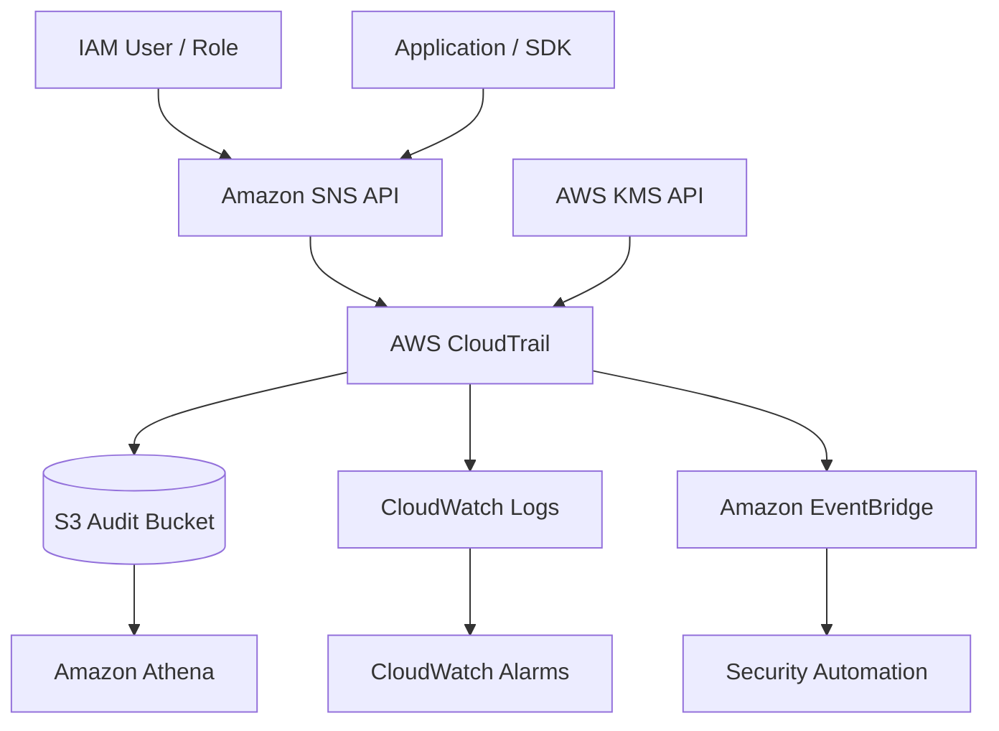
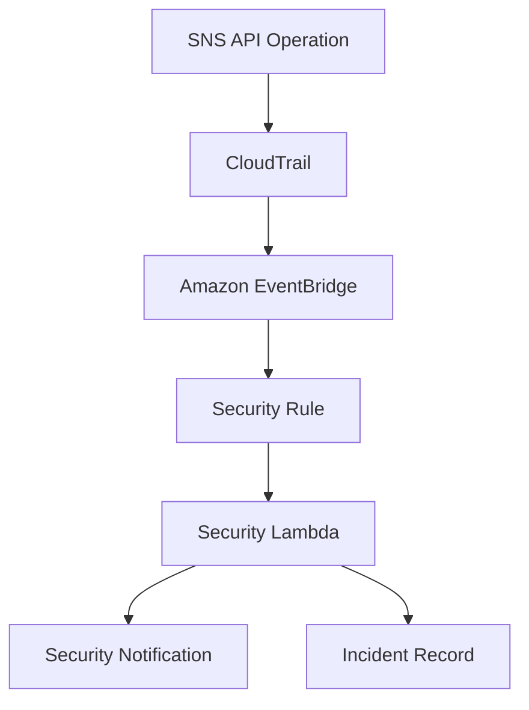
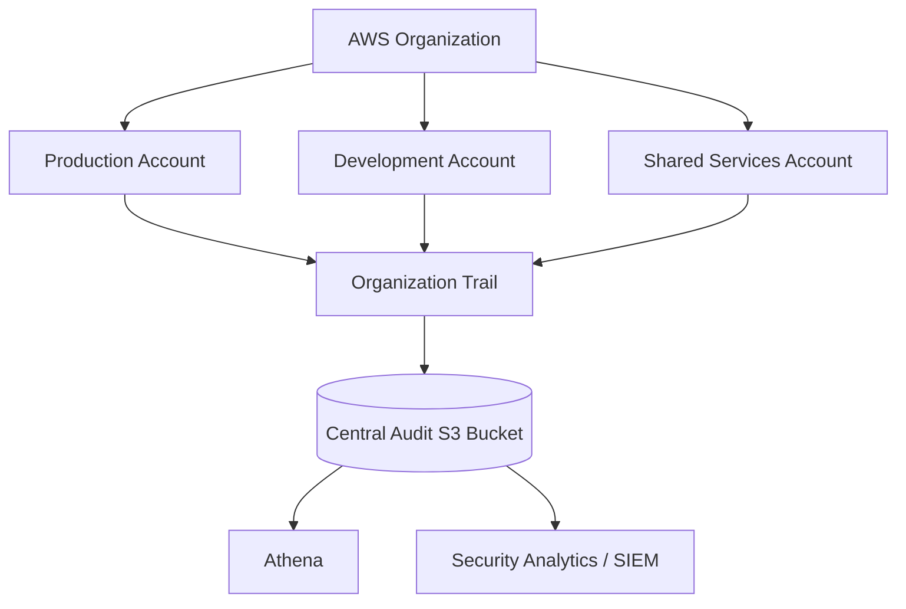

# 07- CloudTrail Auditing and Monitoring

## Overview

AWS CloudTrail provides audit logging for activity within an AWS account. It records API activity performed by users, applications, AWS services, and other supported principals.

For Amazon Simple Notification Service (Amazon SNS), CloudTrail helps security and operations teams understand who created or modified topics, changed access policies, published messages, managed subscriptions, and performed other supported API operations.

CloudTrail is an important part of SNS security because messaging infrastructure often carries business events between independently deployed services. Unauthorized configuration changes or unexpected publishing activity can affect application availability, data confidentiality, and message integrity.

CloudTrail supports several operational and security objectives:

- Auditing SNS API activity.
- Investigating unauthorized access.
- Tracking topic and subscription configuration changes.
- Identifying unexpected publishers.
- Monitoring KMS key administration and usage.
- Supporting compliance and incident response.
- Maintaining an audit trail across AWS accounts and Regions.

CloudTrail records API activity; it is not a message-processing monitoring system. It does not replace CloudWatch metrics, application logs, distributed tracing, or SNS delivery-status monitoring.

## CloudTrail Architecture

CloudTrail captures supported AWS API activity and records events in a structured format.

For SNS, management events and applicable data events provide different levels of visibility.



A typical audit architecture includes:

1. CloudTrail records supported API activity.
2. A trail delivers events to an S3 bucket.
3. CloudWatch Logs provides searchable operational visibility.
4. EventBridge routes selected events for automated response.
5. Athena queries long-term audit records stored in S3.

For centralized security monitoring, an organization can configure an organization trail and deliver logs to a dedicated security account.

## CloudTrail Event Types

CloudTrail distinguishes between management events and data events.

Understanding this distinction is important when designing SNS audit coverage.

### Management Events

Management events record control-plane operations that manage AWS resources.

Examples include:

- Creating SNS topics.
- Deleting SNS topics.
- Updating topic attributes.
- Changing topic access policies.
- Creating subscriptions.
- Confirming subscriptions.
- Removing subscriptions.
- Updating subscription attributes.
- Managing KMS keys.

Management events are generally enabled by default in CloudTrail event history for supported operations.

A trail can log read and write management events.

| Management event type | Examples |
|---|---|
| Read | `GetTopicAttributes`, `ListTopics`, `GetSubscriptionAttributes` |
| Write | `CreateTopic`, `DeleteTopic`, `SetTopicAttributes`, `Subscribe`, `Unsubscribe` |

Read events help identify configuration inspection and discovery activity. Write events help detect changes to the messaging infrastructure.

### Data Events

Data events provide visibility into supported data-plane operations.

For SNS, publishing activity can be audited through supported SNS data event selectors.

Examples include:

- Publishing messages.
- Publishing messages in batches.

Data events are not enabled automatically for all resources because they can generate significant event volume and additional CloudTrail charges.

Enable them when message-level publishing auditability is required.

### Management Events vs Data Events

| Feature | Management events | Data events |
|---|---|---|
| Purpose | Resource administration and configuration | Resource-level data operations |
| SNS examples | Create topic, update policy, subscribe | Publish message |
| Default event history | Generally available for supported management events | Requires explicit configuration |
| Volume | Usually lower | Can be significantly higher |
| Cost considerations | Included management event allowances apply | Additional charges may apply |
| Typical security use | Detect infrastructure changes | Audit publishing activity |

## Important SNS CloudTrail Events

The following API operations are useful when auditing SNS activity.

| Event name | Operation | Security relevance |
|---|---|---|
| `CreateTopic` | Creates a topic | Detect unauthorized topic creation |
| `DeleteTopic` | Deletes a topic | Detect destructive changes |
| `SetTopicAttributes` | Changes topic configuration | Detect policy or encryption changes |
| `GetTopicAttributes` | Reads topic configuration | Audit configuration discovery |
| `Subscribe` | Creates a subscription | Detect unexpected destinations |
| `ConfirmSubscription` | Confirms a subscription | Track subscription activation |
| `Unsubscribe` | Removes a subscription | Detect unexpected subscriber removal |
| `SetSubscriptionAttributes` | Changes subscription configuration | Detect delivery or redrive changes |
| `Publish` | Publishes a message | Audit publishing activity when data events are enabled |
| `PublishBatch` | Publishes multiple messages | Audit batch publishing activity when data events are enabled |
| `AddPermission` | Adds topic permissions | Detect expanded access |
| `RemovePermission` | Removes topic permissions | Detect access-policy changes |

Event availability and recorded fields depend on the operation, Region, and CloudTrail event configuration.

Do not assume that every SNS API call appears in CloudTrail Event History. Data events and management events have different collection requirements.

## Understanding CloudTrail Event Records

CloudTrail records are JSON documents containing information about an API operation.

A typical event includes:

- Event timestamp.
- AWS service name.
- API operation name.
- AWS Region.
- Request parameters.
- Response elements, when available.
- Caller identity.
- Source IP address.
- User agent.
- Error details, when applicable.

Example SNS management event:

```json
{
  "eventVersion": "1.11",
  "eventTime": "2026-11-22T10:30:00Z",
  "eventSource": "sns.amazonaws.com",
  "eventName": "SetTopicAttributes",
  "awsRegion": "ap-south-1",
  "sourceIPAddress": "203.0.113.10",
  "userAgent": "console.amazonaws.com",
  "requestParameters": {
    "attributeName": "KmsMasterKeyId",
    "topicArn": "arn:aws:sns:ap-south-1:123456789012:orders-topic"
  },
  "responseElements": null,
  "requestID": "example-request-id",
  "eventID": "example-event-id",
  "readOnly": false,
  "eventType": "AwsApiCall",
  "managementEvent": true
}
```

This example is illustrative. Actual fields vary by operation.

### Important Fields

| Field | Purpose |
|---|---|
| `eventTime` | Time at which the API operation occurred |
| `eventSource` | AWS service that received the request |
| `eventName` | API operation name |
| `awsRegion` | Region where the request was processed |
| `userIdentity` | Identity associated with the request |
| `sourceIPAddress` | Source address recorded by CloudTrail |
| `userAgent` | Client or service making the request |
| `requestParameters` | Request details recorded for the operation |
| `responseElements` | Response information, when recorded |
| `errorCode` | Error information when an operation fails |
| `errorMessage` | Error description, when available |
| `requestID` | Request identifier |
| `eventID` | Unique CloudTrail event identifier |

### Understanding Caller Identity

The `userIdentity` object helps determine who performed an operation.

Common identity types include:

- `IAMUser`
- `AssumedRole`
- `Root`
- `AWSService`
- `FederatedUser`

For application workloads, CloudTrail commonly records an assumed IAM role.

Use the identity fields and session information to correlate an API operation with a workload, deployment, or operator.

Do not rely only on the IAM role name. Multiple applications or workloads may assume the same role.

Use dedicated roles and meaningful session names where possible.

## Creating a CloudTrail Trail for SNS Auditing

A CloudTrail trail delivers events to a configured destination, such as an S3 bucket.

For production environments, use a dedicated audit bucket with restricted access and appropriate retention controls.

### Create an S3 Bucket

```bash
aws s3api create-bucket \
    --bucket company-security-cloudtrail-logs \
    --region ap-south-1 \
    --create-bucket-configuration LocationConstraint=ap-south-1
```

The `LocationConstraint` parameter is required for Regions other than `us-east-1`.

### Enable S3 Versioning

```bash
aws s3api put-bucket-versioning \
    --bucket company-security-cloudtrail-logs \
    --versioning-configuration Status=Enabled
```

Versioning helps protect against accidental object replacement and deletion.

### Create a CloudTrail Trail

```bash
aws cloudtrail create-trail \
    --name sns-security-audit \
    --s3-bucket-name company-security-cloudtrail-logs \
    --is-multi-region-trail \
    --enable-log-file-validation
```

The multi-Region option enables the trail to collect supported events across AWS Regions.

Log file validation enables CloudTrail digest files that can be used to verify the integrity of delivered log files.

### Start Logging

```bash
aws cloudtrail start-logging \
    --name sns-security-audit
```

### Verify Trail Configuration

```bash
aws cloudtrail describe-trails \
    --trail-name-list sns-security-audit
```

Check logging status:

```bash
aws cloudtrail get-trail-status \
    --name sns-security-audit
```

Verify:

- `IsLogging` is `true`.
- The S3 destination is correct.
- Multi-Region configuration is enabled where required.
- Log file validation is enabled.
- The trail is configured with the intended event selectors.

## Enabling SNS Data Events

SNS publishing activity requires data event collection when message-level API auditing is needed.

A trail can be configured to collect SNS data events using advanced event selectors.

### Configure Advanced Event Selectors

The following example enables SNS publishing events for a specific topic.

```json
[
  {
    "Name": "SNS Publish Events",
    "FieldSelectors": [
      {
        "Field": "eventCategory",
        "Equals": ["Data"]
      },
      {
        "Field": "resources.type",
        "Equals": ["AWS::SNS::Topic"]
      },
      {
        "Field": "resources.ARN",
        "Equals": [
          "arn:aws:sns:ap-south-1:123456789012:orders-topic"
        ]
      },
      {
        "Field": "eventName",
        "Equals": [
          "Publish",
          "PublishBatch"
        ]
      }
    ]
  }
]
```

Apply the selector:

```bash
aws cloudtrail put-event-selectors \
    --trail-name sns-security-audit \
    --advanced-event-selectors file://sns-data-events.json
```

Advanced event selectors allow precise control over which data events are collected.

For production environments, scope selectors to relevant topics rather than enabling high-volume data events indiscriminately.

### Verify Event Selectors

```bash
aws cloudtrail get-event-selectors \
    --trail-name sns-security-audit
```

Review the returned advanced event selectors and confirm that the intended topic ARNs and event names are included.

Changing event selectors replaces the trail's existing selector configuration. Preserve any other required selectors when updating them.

## Monitoring SNS Management Activity

Management event monitoring helps detect unauthorized or unexpected changes to SNS infrastructure.

Important changes to monitor include:

- Topic creation or deletion.
- Topic policy modifications.
- Subscription creation or deletion.
- Subscription endpoint changes.
- Delivery retry configuration changes.
- KMS key configuration changes.
- Topic encryption changes.

### Example: Detect Topic Policy Changes

An unauthorized topic policy change could allow an external AWS account or unexpected principal to publish messages.

Monitor `SetTopicAttributes` and inspect the request parameters for policy changes.

The event may contain the policy in its request parameters, depending on the operation and CloudTrail recording behavior.

A security investigation should determine:

1. Which identity performed the operation?
2. Which topic was modified?
3. What policy changed?
4. Was the change associated with an approved deployment?
5. Did the change grant access to an unexpected principal?
6. Was the change reverted?

### Example: Detect Unexpected Subscription Creation

An attacker or misconfigured deployment could add a subscription to an unauthorized endpoint.

Monitor `Subscribe` events and review:

- Topic ARN.
- Protocol.
- Endpoint.
- Caller identity.
- Account.
- Region.
- Event timestamp.

HTTPS endpoints and email subscriptions should be reviewed against approved destination inventories.

## Monitoring SNS Publishing Activity

Publishing activity can be audited through SNS data events when configured.

This helps security teams investigate:

- Unexpected publishing identities.
- Unusual publishing frequency.
- Publishing from unexpected source addresses.
- Unauthorized topic access.
- Unexpected service-to-service communication.

### Important Limitation

CloudTrail publishing events provide API audit information, but they are not a complete application-level message processing record.

They should not be treated as a guaranteed business event ledger.

Depending on the event and service integration, CloudTrail may record request parameters or resource metadata, but security teams should not assume that every message body is available or suitable for audit retention.

For business-level auditing, applications should emit structured audit events with appropriate data classification and retention controls.

### Correlating Publisher Activity

A useful investigation combines:

- CloudTrail event ID.
- SNS message ID, where available.
- Application correlation ID.
- Publisher IAM role.
- Topic ARN.
- Application logs.
- Downstream consumer logs.

The objective is to connect an AWS API operation with the application workflow that caused it.

## CloudTrail and AWS KMS Auditing

SNS server-side encryption relies on AWS KMS.

KMS activity should be monitored alongside SNS activity to detect encryption configuration problems and unauthorized key operations.

Important KMS operations include:

| Event name | Security relevance |
|---|---|
| `CreateKey` | Detect new encryption key creation |
| `PutKeyPolicy` | Detect key authorization changes |
| `DisableKey` | Detect key disablement |
| `EnableKey` | Track key reactivation |
| `ScheduleKeyDeletion` | Detect potential destructive key operations |
| `CancelKeyDeletion` | Track deletion cancellation |
| `EnableKeyRotation` | Track rotation configuration |
| `DisableKeyRotation` | Detect rotation being disabled |
| `GenerateDataKey` | Audit data-key generation |
| `Decrypt` | Audit cryptographic usage |

KMS events are generally recorded as management events in CloudTrail.

### Investigating KMS Access Failures

If SNS publishing or delivery fails because of KMS authorization:

1. Identify the affected SNS topic.
2. Inspect the topic's `KmsMasterKeyId` attribute.
3. Inspect KMS key state.
4. Review the key policy.
5. Search CloudTrail for KMS access-denied events.
6. Identify the calling service or principal.
7. Correct the authorization or key configuration.
8. Retest publishing and subscription delivery.

Do not resolve KMS failures by granting broad `kms:*` permissions to application roles.

## CloudTrail with CloudWatch Logs

CloudTrail can deliver events to CloudWatch Logs through a configured trail.

This enables near-real-time monitoring and alerting using CloudWatch metric filters and alarms.

### Create a CloudWatch Log Group

```bash
aws logs create-log-group \
    --log-group-name /aws/cloudtrail/security-audit
```

Configure an appropriate retention period:

```bash
aws logs put-retention-policy \
    --log-group-name /aws/cloudtrail/security-audit \
    --retention-in-days 365
```

Retention should align with organizational compliance and investigation requirements.

### Create an IAM Role for CloudTrail

CloudTrail requires permission to publish events to the configured CloudWatch Logs log group.

A trust policy should allow the CloudTrail service to assume the role.

Example trust policy:

```json
{
  "Version": "2012-10-17",
  "Statement": [
    {
      "Effect": "Allow",
      "Principal": {
        "Service": "cloudtrail.amazonaws.com"
      },
      "Action": "sts:AssumeRole"
    }
  ]
}
```

The role's permissions policy should allow the required CloudWatch Logs operations on the intended log group and streams.

### Update the Trail

```bash
aws cloudtrail update-trail \
    --name sns-security-audit \
    --cloud-watch-logs-log-group-arn arn:aws:logs:ap-south-1:123456789012:log-group:/aws/cloudtrail/security-audit:* \
    --cloud-watch-logs-role-arn arn:aws:iam::123456789012:role/CloudTrailCloudWatchLogsRole
```

Verify delivery using trail status and CloudWatch Logs.

## CloudWatch Metric Filters and Alarms

Metric filters convert matching log events into CloudWatch metrics.

These metrics can trigger alarms when suspicious activity occurs.

### Detect SNS Topic Deletion

Example filter pattern:

```text
{ ($.eventSource = "sns.amazonaws.com") && ($.eventName = "DeleteTopic") }
```

Create a metric filter:

```bash
aws logs put-metric-filter \
    --log-group-name /aws/cloudtrail/security-audit \
    --filter-name SNSDeleteTopicEvents \
    --filter-pattern '{ ($.eventSource = "sns.amazonaws.com") && ($.eventName = "DeleteTopic") }' \
    --metric-transformations \
        metricName=SNSDeleteTopicCount,metricNamespace=Security/SNS,metricValue=1
```

### Detect Topic Policy Changes

```text
{ ($.eventSource = "sns.amazonaws.com") && ($.eventName = "SetTopicAttributes") }
```

This detects topic attribute updates, but it does not prove that every event represents a policy change.

For higher precision, use a downstream event-processing rule that inspects `requestParameters.attributeName` and distinguishes policy updates from other attribute changes.

### Create a CloudWatch Alarm

```bash
aws cloudwatch put-metric-alarm \
    --alarm-name SNS-Topic-Deletion-Detected \
    --namespace Security/SNS \
    --metric-name SNSDeleteTopicCount \
    --statistic Sum \
    --period 300 \
    --evaluation-periods 1 \
    --threshold 1 \
    --comparison-operator GreaterThanOrEqualToThreshold \
    --alarm-actions arn:aws:sns:ap-south-1:123456789012:security-alerts-topic
```

The alarm can publish to a dedicated security notification topic.

Ensure the alerting topic has appropriate access controls and encryption.

## CloudTrail with Amazon EventBridge

EventBridge can match CloudTrail events and trigger automated responses.

This is useful for security automation because it avoids continuously querying CloudWatch Logs or S3.

Example workflow:



### Example: Detect SNS Topic Deletion

EventBridge rule pattern:

```json
{
  "source": [
    "aws.sns"
  ],
  "detail-type": [
    "AWS API Call via CloudTrail"
  ],
  "detail": {
    "eventSource": [
      "sns.amazonaws.com"
    ],
    "eventName": [
      "DeleteTopic"
    ]
  }
}
```

Create the rule:

```bash
aws events put-rule \
    --name detect-sns-topic-deletion \
    --event-pattern file://sns-delete-topic-pattern.json \
    --state ENABLED \
    --description "Detect SNS topic deletion"
```

Add a Lambda target:

```bash
aws events put-targets \
    --rule detect-sns-topic-deletion \
    --targets "Id"="security-handler","Arn"="arn:aws:lambda:ap-south-1:123456789012:function:sns-security-handler"
```

The Lambda function's resource-based policy must allow EventBridge to invoke it.

### Example: Detect SNS Policy Changes

```json
{
  "source": [
    "aws.sns"
  ],
  "detail-type": [
    "AWS API Call via CloudTrail"
  ],
  "detail": {
    "eventSource": [
      "sns.amazonaws.com"
    ],
    "eventName": [
      "SetTopicAttributes"
    ]
  }
}
```

This rule detects all topic attribute changes. A Lambda handler can inspect the event details to determine whether the `Policy` attribute was modified.

### Automated Response Considerations

Automated remediation should be conservative.

For example, automatically deleting an unexpected subscription may disrupt a legitimate integration.

A safer workflow is:

1. Detect the event.
2. Enrich it with identity and resource information.
3. Compare the change with approved configuration.
4. Create a security alert.
5. Require approval for disruptive remediation.
6. Record the investigation outcome.

Use automatic remediation only for well-understood, reversible actions.

## Querying CloudTrail Logs with Amazon Athena

CloudTrail logs stored in S3 can be queried using Athena.

Athena is useful for historical investigations, compliance reporting, and identifying patterns across multiple accounts or Regions.

Typical questions include:

- Which identity modified an SNS topic?
- Which role published to a specific topic?
- Were any subscriptions created outside approved deployment windows?
- Which KMS key policy changes occurred?
- Were there unexpected publishing operations?

### Example CloudTrail Table

A typical CloudTrail Athena table contains columns such as:

- `eventtime`
- `eventsource`
- `eventname`
- `awsregion`
- `sourceipaddress`
- `useragent`
- `useridentity`
- `requestparameters`
- `responseelements`
- `errorcode`

The exact schema depends on the table definition and CloudTrail log format.

Use an AWS Glue crawler or a maintained CloudTrail table definition to establish the schema.

### Query SNS Topic Changes

```sql
SELECT
    eventtime,
    eventname,
    awsregion,
    sourceipaddress,
    useridentity.arn AS principal_arn,
    requestparameters
FROM cloudtrail_logs
WHERE eventsource = 'sns.amazonaws.com'
  AND eventname IN (
      'CreateTopic',
      'DeleteTopic',
      'SetTopicAttributes'
  )
ORDER BY eventtime DESC;
```

### Find Subscription Changes

```sql
SELECT
    eventtime,
    eventname,
    awsregion,
    useridentity.arn AS principal_arn,
    requestparameters
FROM cloudtrail_logs
WHERE eventsource = 'sns.amazonaws.com'
  AND eventname IN (
      'Subscribe',
      'ConfirmSubscription',
      'Unsubscribe',
      'SetSubscriptionAttributes'
  )
ORDER BY eventtime DESC;
```

### Find Failed SNS API Calls

```sql
SELECT
    eventtime,
    eventname,
    awsregion,
    useridentity.arn AS principal_arn,
    errorcode,
    errormessage
FROM cloudtrail_logs
WHERE eventsource = 'sns.amazonaws.com'
  AND errorcode IS NOT NULL
ORDER BY eventtime DESC;
```

Column names and nested field access depend on the Athena table schema. Adapt queries to the actual Glue table definition.

### Query Optimization

CloudTrail data can become large over time.

Use:

- Date-based partitions.
- Region filters.
- Event source filters.
- Event name filters.
- Narrow projections.
- Appropriate S3 storage layouts.

Partition projection or Glue partition management can reduce query overhead.

Avoid scanning the entire audit history for every investigation.

## Centralized CloudTrail Auditing

Organizations operating multiple AWS accounts should centralize audit logs.

A typical architecture uses an AWS Organizations organization trail and a dedicated security account.



Benefits include:

- Centralized visibility.
- Consistent audit configuration.
- Reduced risk of account-level log gaps.
- Easier cross-account investigations.
- Centralized retention and access control.

### Organization Trail Considerations

- Use a dedicated security account for audit storage.
- Restrict bucket access to authorized audit roles.
- Enable log file validation.
- Configure multi-Region collection.
- Enable required management and data events.
- Protect trail configuration from unauthorized modification.
- Monitor trail delivery failures.
- Apply retention and lifecycle policies.
- Use organization-level governance controls where appropriate.

An organization trail does not automatically enable every possible data event. Configure data event selectors according to the required audit scope.

## CloudTrail Log Integrity and Protection

Audit logs must be protected against unauthorized modification and deletion.

### Log File Validation

CloudTrail log file validation uses digest files to help verify that delivered log files have not been modified or deleted after delivery.

Enable validation when creating the trail:

```bash
aws cloudtrail create-trail \
    --name organization-security-trail \
    --s3-bucket-name company-security-cloudtrail-logs \
    --is-multi-region-trail \
    --enable-log-file-validation
```

Validation does not prevent deletion or modification by itself. It provides evidence that can be used to detect integrity problems.

### S3 Bucket Protection

Apply appropriate controls to the audit bucket:

- Block public access.
- Enable versioning.
- Restrict bucket policies.
- Require TLS.
- Encrypt objects at rest.
- Separate audit administrators from application administrators.
- Consider S3 Object Lock for immutable retention requirements.
- Enable access logging or other appropriate audit mechanisms for the storage layer.

### S3 Object Lock

S3 Object Lock can protect CloudTrail log objects from deletion or modification during a configured retention period.

It supports:

- Governance mode.
- Compliance mode.

Compliance mode provides stronger immutability guarantees and should be used only when retention requirements and operational procedures are fully understood.

Object Lock configuration must be planned carefully because retained objects cannot be deleted before the retention period expires.

## CloudTrail and Application-Level Observability

CloudTrail records AWS API activity, but it does not provide complete application-level visibility.

A production SNS architecture should combine multiple observability layers.

| Observability source | What it provides |
|---|---|
| CloudTrail | AWS API activity and identity auditing |
| CloudWatch SNS metrics | Publishing and delivery metrics |
| CloudWatch Logs | Application and service logs |
| Distributed tracing | Request and message flow across services |
| Application audit events | Business-level operations and outcomes |
| SQS metrics | Consumer backlog and processing health |
| KMS CloudTrail events | Key administration and cryptographic API activity |

### Example: End-to-End Event Investigation

Consider an order notification that was not processed.

An investigation should follow the message through the system:

1. Confirm that the producer attempted to publish.
2. Inspect SNS publishing data events if enabled.
3. Check SNS delivery metrics.
4. Inspect subscription delivery failures.
5. Check the subscription DLQ.
6. Inspect the receiving endpoint logs.
7. Check internal queue metrics.
8. Inspect consumer logs and processing results.
9. Review KMS authorization events if encryption errors are suspected.

This separates publishing failures, delivery failures, and consumer processing failures.

### Correlation Identifiers

Include stable application identifiers in message payloads:

```json
{
  "event_id": "evt-123456",
  "correlation_id": "request-987654",
  "event_type": "order.created",
  "occurred_at": "2026-11-22T10:30:00Z",
  "data": {
    "order_id": "order-456"
  }
}
```

Use these identifiers in application logs and distributed traces.

CloudTrail event IDs and request IDs should also be retained when correlating AWS API operations.

Do not assume an SNS `MessageId` is automatically available in every CloudTrail record.

## Security Monitoring Use Cases

### Detect Unauthorized Topic Creation

Monitor `CreateTopic` events and compare new topics against approved infrastructure definitions.

Unexpected topic creation can indicate:

- Unauthorized infrastructure changes.
- Compromised credentials.
- Manual configuration drift.
- Unapproved application deployment.

### Detect Public or Cross-Account Access Changes

Monitor topic policy updates.

Inspect the resulting policy for:

- Wildcard principals.
- Unapproved AWS accounts.
- Unexpected service principals.
- Broad publishing permissions.
- Unnecessary administrative permissions.

A policy change should be compared with the approved infrastructure configuration.

### Detect Unexpected Publishing Identities

Enable SNS publishing data events for critical topics.

Investigate publishing operations performed by:

- Unexpected IAM roles.
- Human IAM identities.
- Unknown external accounts.
- Unapproved AWS services.
- Workloads outside expected Regions.

### Detect Encryption Configuration Changes

Monitor `SetTopicAttributes` events and KMS administration events.

Investigate changes to:

- `KmsMasterKeyId`.
- KMS key policies.
- Key rotation settings.
- Key state.
- Key deletion scheduling.

### Detect Subscription Endpoint Changes

Monitor `Subscribe` and `SetSubscriptionAttributes`.

Review changes to:

- HTTPS endpoints.
- SQS queue destinations.
- Lambda subscriptions.
- Delivery retry configuration.
- Redrive policies.

Unexpected endpoint changes can redirect sensitive events to unauthorized destinations.

## Infrastructure as Code with Terraform

CloudTrail auditing should be managed through infrastructure as code.

The following example creates a multi-Region trail with log file validation and SNS data event collection.

### S3 Audit Bucket

```hcl
resource "aws_s3_bucket" "cloudtrail" {
  bucket = "company-security-cloudtrail-logs"

  tags = {
    Environment = "security"
    Service     = "cloudtrail"
    ManagedBy   = "terraform"
  }
}

resource "aws_s3_bucket_versioning" "cloudtrail" {
  bucket = aws_s3_bucket.cloudtrail.id

  versioning_configuration {
    status = "Enabled"
  }
}

resource "aws_s3_bucket_public_access_block" "cloudtrail" {
  bucket = aws_s3_bucket.cloudtrail.id

  block_public_acls       = true
  block_public_policy     = true
  ignore_public_acls      = true
  restrict_public_buckets = true
}
```

### CloudTrail Bucket Policy

```hcl
data "aws_caller_identity" "current" {}

data "aws_region" "current" {}

data "aws_iam_policy_document" "cloudtrail_bucket" {
  statement {
    sid    = "AWSCloudTrailAclCheck"
    effect = "Allow"

    principals {
      type        = "Service"
      identifiers = ["cloudtrail.amazonaws.com"]
    }

    actions   = ["s3:GetBucketAcl"]
    resources = [aws_s3_bucket.cloudtrail.arn]

    condition {
      test     = "StringEquals"
      variable = "aws:SourceArn"
      values = [
        "arn:aws:cloudtrail:${data.aws_region.current.name}:${data.aws_caller_identity.current.account_id}:trail/sns-security-audit"
      ]
    }
  }

  statement {
    sid    = "AWSCloudTrailWrite"
    effect = "Allow"

    principals {
      type        = "Service"
      identifiers = ["cloudtrail.amazonaws.com"]
    }

    actions = ["s3:PutObject"]

    resources = [
      "${aws_s3_bucket.cloudtrail.arn}/AWSLogs/${data.aws_caller_identity.current.account_id}/*"
    ]

    condition {
      test     = "StringEquals"
      variable = "s3:x-amz-acl"
      values   = ["bucket-owner-full-control"]
    }

    condition {
      test     = "StringEquals"
      variable = "aws:SourceArn"
      values = [
        "arn:aws:cloudtrail:${data.aws_region.current.name}:${data.aws_caller_identity.current.account_id}:trail/sns-security-audit"
      ]
    }
  }
}

resource "aws_s3_bucket_policy" "cloudtrail" {
  bucket = aws_s3_bucket.cloudtrail.id
  policy = data.aws_iam_policy_document.cloudtrail_bucket.json
}
```

For organization trails or cross-account delivery, adapt the bucket policy to authorize the appropriate organization and account paths.

### CloudTrail SNS Data Event Selector

```hcl
resource "aws_cloudtrail" "sns_security_audit" {
  name                          = "sns-security-audit"
  s3_bucket_name                = aws_s3_bucket.cloudtrail.id
  is_multi_region_trail         = true
  enable_log_file_validation    = true
  include_global_service_events = true

  advanced_event_selector {
    name = "SNS Publish Events"

    field_selector {
      field  = "eventCategory"
      equals = ["Data"]
    }

    field_selector {
      field  = "resources.type"
      equals = ["AWS::SNS::Topic"]
    }

    field_selector {
      field = "resources.ARN"

      equals = [
        "arn:aws:sns:ap-south-1:123456789012:orders-topic"
      ]
    }

    field_selector {
      field = "eventName"

      equals = [
        "Publish",
        "PublishBatch"
      ]
    }
  }

  depends_on = [
    aws_s3_bucket_policy.cloudtrail
  ]

  tags = {
    Environment = "security"
    Service     = "sns"
    ManagedBy   = "terraform"
  }
}
```

The example scopes SNS data events to a specific topic.

For multiple topics, include the required ARNs in the selector or manage separate selectors according to the desired audit scope.

If management events are also required, configure the trail's management event selectors as part of the same selector design. Advanced event selectors replace the trail's existing event selector configuration, so preserve all required event categories when changing them.

### Terraform Production Considerations

- Use a dedicated audit account where possible.
- Protect the audit bucket with a restrictive policy.
- Enable log file validation.
- Configure retention and lifecycle policies.
- Enable required SNS data events.
- Avoid collecting unnecessary high-volume events.
- Protect CloudTrail configuration from unauthorized changes.
- Monitor delivery errors.
- Use separate deployment roles for audit infrastructure.
- Validate selector changes before applying them.

## Cost Considerations

CloudTrail cost depends on the event types, delivery destinations, and additional services used for analysis.

Important cost factors include:

- Data event volume.
- Additional trails and copies of management events.
- CloudWatch Logs ingestion and storage.
- S3 storage.
- Athena query volume.
- EventBridge event processing.
- Security automation executions.

### Cost Optimization

- Enable SNS data events only for required topics.
- Use advanced event selectors to narrow collection.
- Apply S3 lifecycle policies.
- Set appropriate CloudWatch Logs retention.
- Partition Athena data by date and Region.
- Avoid repeatedly scanning the entire audit history.
- Separate operational alerts from long-term audit retention.

Do not disable required audit coverage solely to reduce costs. Apply targeted event selection and storage lifecycle management instead.

## Disaster Recovery and Audit Retention

CloudTrail logs are important during security incidents and should remain available even when application infrastructure is unavailable.

A resilient audit architecture should include:

- Multi-Region trail configuration.
- Centralized S3 storage.
- Versioning and restrictive bucket policies.
- Log file validation.
- Appropriate retention.
- Cross-account access controls.
- Backup or replication strategy where required.
- Tested restoration and investigation procedures.

CloudTrail is not a substitute for application data backup.

Audit logs help reconstruct API activity, but they do not guarantee that all business message payloads or processing outcomes can be recovered.

For long-term compliance, define retention based on regulatory, contractual, and operational requirements.

## Common Mistakes and Production Pitfalls

| Mistake | Why it causes problems | Recommended approach |
|---|---|---|
| Assuming CloudTrail records every SNS publish by default | Publishing is a data event and requires appropriate collection configuration | Enable SNS data event selectors |
| Monitoring only management events | Publishing activity may remain invisible | Include data events for critical topics |
| Treating CloudTrail as application logging | CloudTrail does not describe every business processing outcome | Combine CloudTrail with application logs and traces |
| Enabling all data events indiscriminately | Generates unnecessary volume and cost | Use advanced event selectors |
| Ignoring failed API calls | Denied operations can reveal attacks or configuration problems | Include failed events in investigations |
| Ignoring KMS events | Encryption failures and key changes may go unnoticed | Monitor KMS activity alongside SNS |
| Assuming log file validation prevents deletion | Validation provides integrity evidence, not automatic protection | Combine validation with S3 access controls and Object Lock where required |
| Storing audit logs in an application bucket | Application roles may gain unnecessary access | Use a dedicated audit bucket or security account |
| Ignoring trail delivery status | Audit gaps can remain undetected | Monitor `get-trail-status` and delivery errors |
| Overwriting event selectors | Existing event coverage may be removed | Preserve all required selectors during updates |
| Relying only on CloudWatch alarms | Historical investigation and complex correlation become difficult | Use S3, Athena, EventBridge, and CloudWatch together |
| Automatically reverting every configuration change | Legitimate deployments can be disrupted | Enrich events and use controlled remediation |
| Ignoring retention policies | Audit records may expire before investigations or compliance reviews | Define and enforce retention requirements |

## Production Audit Checklist

### CloudTrail Configuration

- [ ] Enable a multi-Region trail.
- [ ] Enable log file validation.
- [ ] Configure a dedicated S3 audit bucket.
- [ ] Enable SNS management event coverage.
- [ ] Enable SNS data events for critical topics.
- [ ] Verify event selectors.
- [ ] Monitor trail logging status.
- [ ] Monitor log delivery failures.

### SNS Security Monitoring

- [ ] Monitor topic creation and deletion.
- [ ] Monitor topic policy modifications.
- [ ] Monitor subscription creation and removal.
- [ ] Monitor publishing identities.
- [ ] Monitor unexpected publishing activity.
- [ ] Monitor encryption configuration changes.
- [ ] Review cross-account access changes.

### KMS Auditing

- [ ] Monitor key policy changes.
- [ ] Monitor key disablement and deletion scheduling.
- [ ] Monitor key rotation configuration.
- [ ] Investigate KMS access-denied events.
- [ ] Retain KMS audit records.

### Audit Storage

- [ ] Block public S3 access.
- [ ] Enable versioning.
- [ ] Apply restrictive bucket policies.
- [ ] Enable encryption at rest.
- [ ] Define retention and lifecycle policies.
- [ ] Consider S3 Object Lock for immutable retention.
- [ ] Separate audit administration from application administration.

### Incident Response

- [ ] Define alert severity and escalation procedures.
- [ ] Correlate CloudTrail events with application logs.
- [ ] Document investigation queries.
- [ ] Test EventBridge security rules.
- [ ] Test alert delivery.
- [ ] Document remediation approval procedures.
- [ ] Periodically test audit log retrieval.

## Interview Questions

### What is AWS CloudTrail?

CloudTrail is an AWS service that records supported API activity across an AWS account. It provides audit information about identities, operations, resources, and request context.

### What is the difference between management events and data events?

Management events record resource administration operations, such as creating SNS topics or changing policies. Data events record supported resource-level operations, such as publishing messages to SNS topics.

### Are SNS Publish operations automatically recorded in CloudTrail Event History?

SNS publishing is a data event. To collect it through a trail, configure the appropriate SNS data event selectors.

### How can you detect unauthorized SNS topic policy changes?

Monitor `SetTopicAttributes` management events, inspect the caller identity and request parameters, and compare the resulting policy with approved configuration.

### How do CloudTrail and CloudWatch differ?

CloudTrail records AWS API activity for auditing. CloudWatch provides metrics, logs, alarms, and operational monitoring.

### Why should KMS events be monitored alongside SNS?

SNS server-side encryption depends on KMS. Key policy changes, key disablement, and cryptographic authorization failures can affect SNS operations.

### What is CloudTrail log file validation?

It is a mechanism that uses digest files to help verify the integrity of delivered CloudTrail log files.

### Does CloudTrail guarantee that every SNS message body is available in the audit log?

No. CloudTrail records API activity and associated fields according to the operation and event configuration. It should not be treated as a complete business message archive.

### How can SNS events trigger automated security responses?

CloudTrail events can be routed through EventBridge rules to Lambda functions, security notification systems, or incident management workflows.

### Why should CloudTrail logs be stored in a separate security account?

Centralized storage reduces the risk that application or workload administrators can modify or delete audit records and simplifies cross-account investigations.

## Key Takeaways

- CloudTrail provides audit visibility into SNS management operations, while SNS publishing activity requires explicitly configured data event collection.
- Monitor topic policies, subscriptions, publishing identities, and KMS operations to detect unauthorized changes and suspicious activity.
- Combine CloudTrail with CloudWatch, EventBridge, Athena, and application-level observability for real-time detection and historical investigation.
- Protect audit records through centralized S3 storage, restrictive access policies, log file validation, and appropriate retention controls.
- Treat CloudTrail as an AWS API audit source rather than a complete business event ledger or message-processing monitoring system.