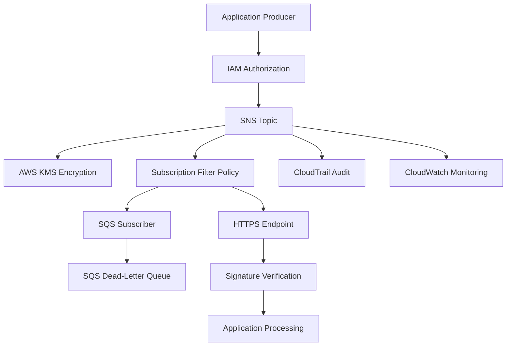

# 08- Security Best Practices

## Overview

Amazon Simple Notification Service (SNS) is a managed pub/sub messaging service used to distribute events and notifications across applications, services, and external systems. Because SNS topics can connect multiple producers and subscribers, a security weakness in one integration can expose messages, allow unauthorized publishing, or disrupt downstream processing.

SNS security must be designed across the complete messaging lifecycle:

- **Identity and access:** Control who can create topics, publish messages, manage subscriptions, and modify topic policies.
- **Resource authorization:** Restrict topic access to approved AWS accounts, services, and application identities.
- **Data protection:** Encrypt messages at rest, protect data in transit, and avoid publishing unnecessary sensitive information.
- **Subscriber security:** Validate subscription endpoints and authenticate incoming notifications.
- **Operational security:** Audit configuration changes, monitor unusual activity, and maintain reliable recovery mechanisms.

Security should be enforced through IAM, SNS resource policies, AWS KMS, HTTPS, CloudTrail, and application-level validation rather than relying on a single control.

## Security Architecture

A secure SNS architecture applies controls at each boundary between producers, topics, and subscribers.



| Boundary | Security control | Purpose |
|---|---|---|
| Producer to SNS | IAM policies | Restrict publishing permissions |
| AWS account to topic | SNS topic policy | Control cross-account and service access |
| SNS to message storage | AWS KMS | Encrypt messages at rest |
| SNS to subscriber | TLS/HTTPS | Protect delivery in transit |
| SNS to SQS | Queue resource policy | Restrict which topics can send messages |
| SNS to HTTP endpoint | Signature verification | Authenticate SNS notifications |
| Messaging operations | CloudTrail | Audit API activity |
| Runtime operations | CloudWatch | Detect abnormal behavior and delivery failures |

## Identity and Access Management

### Apply Least-Privilege IAM Policies

IAM determines which identities can perform SNS operations. Grant only the actions required by each application or operational role.

Common SNS permissions include:

| Action | Purpose | Typical access |
|---|---|---|
| `sns:Publish` | Publish messages | Application producer |
| `sns:Subscribe` | Create subscriptions | Deployment or integration role |
| `sns:Receive` | Receive messages from supported subscription workflows | Subscriber identity, where applicable |
| `sns:Unsubscribe` | Remove subscriptions | Subscription management role |
| `sns:GetTopicAttributes` | Read topic configuration | Operations or deployment role |
| `sns:SetTopicAttributes` | Modify topic configuration | Restricted administrator |
| `sns:AddPermission` | Add topic permissions | Restricted administrator |
| `sns:RemovePermission` | Remove topic permissions | Restricted administrator |
| `sns:DeleteTopic` | Delete a topic | Restricted administrator |

Avoid granting `sns:*` to application workloads. A producer that only publishes messages should not be able to change topic policies, create subscriptions, or delete the topic.

Example producer policy:

```json
{
  "Version": "2012-10-17",
  "Statement": [
    {
      "Sid": "PublishToApplicationEvents",
      "Effect": "Allow",
      "Action": "sns:Publish",
      "Resource": "arn:aws:sns:ap-south-1:123456789012:application-events"
    }
  ]
}
```

Attach this policy to the application's IAM role rather than embedding long-lived AWS credentials in source code or environment files.

### Separate Producer, Subscriber, and Administrative Roles

Use different IAM roles for different responsibilities.

| Role | Required permissions |
|---|---|
| Application producer | `sns:Publish` on approved topics |
| Subscription deployment | Required subscription and topic-read operations |
| Platform administrator | Topic configuration and policy management |
| Security auditor | Read-only audit and configuration visibility |

This separation limits the impact of compromised application credentials.

For workloads running on AWS, prefer:

- IAM roles for EC2 instances.
- IAM roles for ECS tasks.
- IAM roles for EKS service accounts or EKS Pod Identity.
- IAM roles for Lambda execution environments.

For workloads outside AWS, use an appropriate federated identity mechanism instead of distributing permanent access keys.

### Restrict Permissions with Conditions

IAM policies can use conditions to restrict how an action is performed.

For example, require publishing requests to use a specific AWS Region:

```json
{
  "Version": "2012-10-17",
  "Statement": [
    {
      "Sid": "RestrictPublishRegion",
      "Effect": "Allow",
      "Action": "sns:Publish",
      "Resource": "arn:aws:sns:ap-south-1:123456789012:application-events",
      "Condition": {
        "StringEquals": {
          "aws:RequestedRegion": "ap-south-1"
        }
      }
    }
  ]
}
```

Use conditions only when the relevant request context key is supported for the operation. Test the resulting policy with representative identities and requests before deployment.

## SNS Topic Policies

IAM policies control permissions granted to identities. SNS topic policies control access at the resource level and are particularly important for service integrations and cross-account access.

### Restrict Topic Access

A topic policy should explicitly identify trusted principals and limit the actions they can perform.

Example policy allowing a specific application role to publish:

```json
{
  "Version": "2012-10-17",
  "Statement": [
    {
      "Sid": "AllowApplicationProducer",
      "Effect": "Allow",
      "Principal": {
        "AWS": "arn:aws:iam::123456789012:role/application-producer"
      },
      "Action": "sns:Publish",
      "Resource": "arn:aws:sns:ap-south-1:123456789012:application-events"
    }
  ]
}
```

Avoid policies that grant access to:

- `"Principal": "*"` without restrictive conditions.
- Entire AWS accounts when only one role is required.
- Unnecessary administrative actions.
- Untrusted external accounts.

### Restrict AWS Service Publishing

AWS services such as S3 and EventBridge can publish events to SNS topics.

Use `aws:SourceArn` and, where appropriate, `aws:SourceAccount` to restrict service-principal access to the expected source resource and account.

Example S3 publishing policy:

```json
{
  "Version": "2012-10-17",
  "Statement": [
    {
      "Sid": "AllowSpecificS3Bucket",
      "Effect": "Allow",
      "Principal": {
        "Service": "s3.amazonaws.com"
      },
      "Action": "sns:Publish",
      "Resource": "arn:aws:sns:ap-south-1:123456789012:storage-events",
      "Condition": {
        "ArnEquals": {
          "aws:SourceArn": "arn:aws:s3:::company-document-bucket"
        },
        "StringEquals": {
          "aws:SourceAccount": "123456789012"
        }
      }
    }
  ]
}
```

This prevents an unrelated S3 bucket from using the same service-principal permission to publish to the topic.

### Enforce Secure Transport

Where supported by the SNS topic policy, use `aws:SecureTransport` to deny requests that do not use secure transport.

```json
{
  "Version": "2012-10-17",
  "Statement": [
    {
      "Sid": "DenyInsecureTransport",
      "Effect": "Deny",
      "Principal": "*",
      "Action": "sns:*",
      "Resource": "arn:aws:sns:ap-south-1:123456789012:application-events",
      "Condition": {
        "Bool": {
          "aws:SecureTransport": "false"
        }
      }
    }
  ]
}
```

Review the interaction between explicit denies, service integrations, and existing topic policies before applying this statement. Use HTTPS for all application-to-AWS API communication.

### Cross-Account Access

Cross-account publishing requires compatible authorization in the trusted account and the resource-owning account.

A typical configuration includes:

1. An IAM identity policy in the producer account allowing `sns:Publish`.
2. A topic resource policy in the SNS-owning account allowing the producer role or account.
3. Appropriate KMS permissions if the topic uses a customer-managed key.

Prefer granting access to a specific role rather than an entire external account.

For organization-wide access, evaluate `aws:PrincipalOrgID` where the integration and authorization model support it. Organization membership should not replace least-privilege role restrictions.

## Encryption and Data Protection

### Encrypt Messages at Rest

Enable SNS server-side encryption (SSE) for topics that handle sensitive or business-critical messages.

SNS SSE uses AWS KMS to protect message data at rest. Select the key type according to security, ownership, and compliance requirements.

| Key type | Characteristics | Typical use |
|---|---|---|
| AWS-owned key | Managed by AWS | Standard encryption without customer key administration |
| AWS-managed KMS key | Managed by AWS for the service | Service-managed encryption |
| Customer-managed KMS key | Customer controls key policy, rotation, and lifecycle | Workloads requiring explicit key governance |

A customer-managed KMS key provides additional control but introduces operational responsibilities. Its policy must allow the required SNS service operations and authorized producers to use the key.

Example CLI configuration:

```bash
aws sns set-topic-attributes \
  --topic-arn arn:aws:sns:ap-south-1:123456789012:application-events \
  --attribute-name KmsMasterKeyId \
  --attribute-value alias/sns-production-key
```

Validate the topic's encryption configuration:

```bash
aws sns get-topic-attributes \
  --topic-arn arn:aws:sns:ap-south-1:123456789012:application-events
```

### Protect KMS Keys

For customer-managed keys:

- Use a dedicated key or a clearly governed key-sharing strategy.
- Restrict key administration to designated security or platform roles.
- Allow only the required service and application principals to use the key.
- Enable automatic key rotation where supported and appropriate.
- Monitor key policy changes and disablement events.
- Protect the key from accidental deletion.
- Plan key lifecycle and recovery procedures before production deployment.

Publishing to an encrypted SNS topic can require KMS permissions such as `kms:GenerateDataKey*` and `kms:Decrypt`, depending on the integration and encryption configuration.

Do not assume that granting `sns:Publish` alone is sufficient for every encrypted-topic publishing workflow.

### Minimize Sensitive Message Content

Encryption does not eliminate the risk of exposing sensitive data to authorized subscribers, application logs, tracing systems, or downstream services.

Avoid publishing:

- Passwords and authentication secrets.
- Access tokens and API keys.
- Full payment card details.
- Unnecessary personal information.
- Database credentials.
- Private cryptographic material.

Prefer publishing identifiers and retrieving sensitive data through an independently authorized API.

Example:

```json
{
  "event_id": "evt_8f3a21",
  "event_type": "document.processed",
  "document_id": "doc_102938",
  "tenant_id": "tenant_42",
  "occurred_at": "2026-11-22T10:30:00Z"
}
```

The subscriber can retrieve the document through a service that performs its own authorization checks.

This approach reduces the amount of sensitive information replicated across messaging infrastructure.

### Apply Data Classification

Define message handling rules according to the data classification of each topic.

| Classification | Recommended handling |
|---|---|
| Public | Standard access controls and secure transport |
| Internal | Restrict topic access to approved workloads |
| Confidential | Enable encryption, strict IAM, audit logging, and subscriber controls |
| Restricted | Minimize message content, use customer-managed keys where required, and apply additional compliance controls |

Do not use a single broadly accessible topic for workloads with materially different data classifications.

## Secure Subscriber Integrations

### Protect SQS Subscriptions

When SNS delivers messages to SQS, the queue policy must allow the intended SNS topic to send messages.

Example SQS queue policy:

```json
{
  "Version": "2012-10-17",
  "Statement": [
    {
      "Sid": "AllowSpecificSNSTopic",
      "Effect": "Allow",
      "Principal": {
        "Service": "sns.amazonaws.com"
      },
      "Action": "sqs:SendMessage",
      "Resource": "arn:aws:sqs:ap-south-1:123456789012:application-events-queue",
      "Condition": {
        "ArnEquals": {
          "aws:SourceArn": "arn:aws:sns:ap-south-1:123456789012:application-events"
        },
        "StringEquals": {
          "aws:SourceAccount": "123456789012"
        }
      }
    }
  ]
}
```

Important controls:

- Restrict `sqs:SendMessage` to the intended SNS topic.
- Do not grant broad queue access to arbitrary AWS principals.
- Use a separate queue for each subscriber workload where isolation is required.
- Configure a queue-level dead-letter queue for messages that repeatedly fail consumer processing.
- Encrypt the SQS queue when its data classification requires it.
- Restrict consumer roles to the queues they actually process.

SNS delivery to SQS and SQS consumer processing are separate reliability boundaries. Configure monitoring and recovery for both.

### Protect HTTPS Endpoints

HTTPS subscriptions deliver SNS notifications to application endpoints. The endpoint must use a valid TLS certificate and should be operated as an authenticated message-ingestion boundary.

Recommended controls:

- Require HTTPS.
- Use a trusted certificate and maintain its renewal process.
- Verify SNS message signatures using a maintained implementation.
- Validate the signing certificate URL against the expected AWS SNS certificate host and supported Region.
- Reject malformed or unexpected notification types.
- Apply request-size limits and input validation.
- Persist accepted messages durably before returning a success response.
- Make processing idempotent.
- Avoid trusting message content merely because it arrived at an HTTPS endpoint.

HTTPS protects transport confidentiality and integrity, but it does not independently prove that a request originated from SNS.

### Verify SNS Message Signatures

SNS notifications include signature-related fields such as:

- `Signature`
- `SignatureVersion`
- `SigningCertURL`
- `Message`
- `MessageId`
- `TopicArn`
- `Timestamp`
- `Type`

The receiver should validate the signature against the expected SNS signing certificate and canonical message representation.

A secure verification flow should:

1. Parse the notification using a strict JSON parser.
2. Validate the notification type.
3. Validate the expected topic ARN.
4. Validate the signing certificate URL against an allowlist of legitimate SNS certificate hosts.
5. Retrieve the certificate over HTTPS using a controlled network client.
6. Verify the signature using a maintained SNS verification implementation.
7. Apply timestamp and replay protections appropriate to the application.
8. Reject invalid messages before business processing.

Never fetch arbitrary certificate URLs from incoming requests. Doing so can create a server-side request forgery (SSRF) vulnerability.

Do not implement signature verification by manually concatenating arbitrary JSON fields. SNS signature verification depends on the documented canonical field ordering and signature version.

### Handle Subscription Confirmation Securely

SNS sends a subscription confirmation notification when an endpoint subscribes to a topic.

The endpoint should not automatically trust every confirmation request. Validate the notification's signature and expected topic before completing the confirmation workflow.

For manually managed subscriptions, confirm the subscription through a trusted administrative workflow rather than automatically accepting arbitrary incoming confirmation messages.

Avoid exposing subscription confirmation URLs in logs or application responses.

### Implement Idempotent Notification Processing

SNS uses at-least-once delivery for supported delivery protocols. A subscriber can receive duplicate notifications, so processing must be idempotent.

A database-backed inbox pattern provides a durable way to track processed messages.

Example PostgreSQL table:

```sql
CREATE TABLE sns_inbox (
    message_id VARCHAR(256) PRIMARY KEY,
    topic_arn TEXT NOT NULL,
    message_type VARCHAR(64) NOT NULL,
    received_at TIMESTAMPTZ NOT NULL DEFAULT NOW(),
    processed_at TIMESTAMPTZ,
    status VARCHAR(32) NOT NULL DEFAULT 'received'
);
```

A simplified FastAPI endpoint can persist the notification before acknowledging it:

```python
from fastapi import FastAPI, HTTPException, Request
from sqlalchemy import text
from sqlalchemy.ext.asyncio import AsyncSession, async_sessionmaker

app = FastAPI()

EXPECTED_TOPIC_ARN = (
    "arn:aws:sns:ap-south-1:123456789012:application-events"
)


async def verify_sns_notification(payload: dict) -> bool:
    """
    Delegate to a maintained SNS signature-verification implementation.
    Validate the signing certificate URL and notification structure.
    """
    raise NotImplementedError


@app.post("/webhooks/sns")
async def receive_sns_notification(
    request: Request,
    session_factory: async_sessionmaker[AsyncSession],
):
    payload = await request.json()

    if not isinstance(payload, dict):
        raise HTTPException(status_code=400, detail="Invalid payload")

    if payload.get("TopicArn") != EXPECTED_TOPIC_ARN:
        raise HTTPException(status_code=403, detail="Unexpected topic")

    if not await verify_sns_notification(payload):
        raise HTTPException(status_code=403, detail="Invalid signature")

    message_id = payload.get("MessageId")
    message_type = payload.get("Type")

    if not message_id or not message_type:
        raise HTTPException(status_code=400, detail="Missing message fields")

    async with session_factory() as session:
        async with session.begin():
            result = await session.execute(
                text(
                    """
                    INSERT INTO sns_inbox (
                        message_id,
                        topic_arn,
                        message_type
                    )
                    VALUES (
                        :message_id,
                        :topic_arn,
                        :message_type
                    )
                    ON CONFLICT (message_id) DO NOTHING
                    RETURNING message_id
                    """
                ),
                {
                    "message_id": message_id,
                    "topic_arn": EXPECTED_TOPIC_ARN,
                    "message_type": message_type,
                },
            )

            inserted = result.scalar_one_or_none()

    return {
        "accepted": True,
        "duplicate": inserted is None,
    }
```

This example assumes that:

- `session_factory` is supplied through the application's dependency-injection layer.
- Signature verification is implemented using a maintained verifier.
- The application has a separate worker that processes persisted inbox records.
- Database failures result in a non-success response so SNS can retry delivery.

Do not perform long-running business operations inside the webhook request. Persist the message, acknowledge it, and process it asynchronously.

## Subscription and Message Filtering Security

### Restrict Subscription Creation

Unauthorized subscriptions can expose messages to external endpoints or unintended AWS resources.

Control who can create subscriptions through:

- IAM policies.
- SNS topic resource policies.
- Restricted deployment roles.
- Infrastructure-as-code review.
- CloudTrail monitoring.

Review subscription endpoints and protocols periodically. Remove subscriptions that are no longer required.

### Use Message Filtering Carefully

SNS filter policies reduce unnecessary delivery by selecting messages based on attributes or message bodies.

They are useful for reducing data exposure between subscribers, but they are not a substitute for authorization.

For example, a topic may publish events for multiple business domains:

```json
{
  "event_type": "order.created",
  "tenant_id": "tenant_42",
  "region": "ap-south-1"
}
```

A subscriber can use a filter policy to receive only the relevant event type:

```json
{
  "event_type": [
    "order.created",
    "order.cancelled"
  ]
}
```

Important considerations:

- Do not treat filtering as tenant-level access control.
- Do not assume a subscriber is authorized to access every message matching its filter.
- Validate tenant ownership and permissions in the consuming application.
- Use separate topics when strong isolation between tenants or security domains is required.
- Test filter policies with representative messages before production deployment.

## Reliability and Abuse Protection

### Configure Dead-Letter Queues

A subscription-level dead-letter queue captures messages that SNS cannot successfully deliver after its retry policy is exhausted.

Use an SQS queue as the DLQ for supported SNS subscription protocols.

Configure:

- A dedicated DLQ for each critical subscription.
- Appropriate SQS access policies.
- Encryption where required.
- Alarms for DLQ message accumulation.
- A controlled replay process.
- Retention periods that satisfy recovery and compliance requirements.

A DLQ is a recovery mechanism, not a security boundary. Restrict access to its messages because they may contain sensitive payloads.

### Apply Message Size and Input Validation Limits

SNS messages have service-defined size limits. Application endpoints should enforce their own request-size limits and validate payload structure before processing.

For backend subscribers:

- Reject malformed JSON.
- Validate event schemas.
- Enforce allowed event types.
- Limit nested object complexity.
- Reject unexpected fields where strict schemas are required.
- Avoid unbounded decompression or expensive parsing.
- Use rate limiting at the application gateway where appropriate.

Do not rely on SNS message filtering to validate business data.

### Prevent Unauthorized Publishing

An exposed or compromised producer identity can publish misleading events, flood subscribers, or trigger expensive downstream processing.

Mitigations include:

- Restricting `sns:Publish` to specific topic ARNs.
- Using separate producer roles.
- Monitoring unusual publishing volume.
- Validating event schemas in subscribers.
- Applying application-level rate limits.
- Monitoring unexpected source identities and cross-account access.
- Rotating or revoking compromised credentials through the relevant identity system.

SNS does not replace application-level abuse prevention. A valid IAM principal can still publish malicious or malformed business events if the application does not validate them.

## Network Security

### Use VPC Endpoints Where Appropriate

Applications running in private subnets can access supported SNS APIs through an interface VPC endpoint powered by AWS PrivateLink.

This can reduce reliance on public network paths for producer-to-SNS API communication.

Consider:

- Enabling private DNS where appropriate.
- Restricting endpoint security groups to trusted workloads.
- Applying endpoint policies to limit permitted SNS actions and resources.
- Ensuring DNS resolution and routing are configured correctly.
- Monitoring endpoint access and failures.

A VPC endpoint does not replace IAM authorization or SNS topic policies.

It also does not automatically make SNS subscriber delivery private. Delivery behavior depends on the subscription protocol and destination architecture.

### Protect Public HTTPS Subscribers

For public webhook endpoints:

- Place the application behind a managed ingress or reverse proxy.
- Use AWS WAF where appropriate.
- Apply request-rate limits.
- Restrict accepted HTTP methods and content types.
- Configure request and connection timeouts.
- Keep TLS configuration and certificates current.
- Avoid exposing internal administrative routes through the webhook host.
- Keep the endpoint isolated from internal management interfaces.

Do not depend exclusively on source IP allowlisting to authenticate SNS notifications. Network addresses can change, and signature verification provides the message-origin authentication mechanism.

## Monitoring and Security Auditing

### Enable CloudTrail Auditing

CloudTrail provides visibility into SNS API activity and configuration changes.

Monitor operations such as:

- `CreateTopic`
- `DeleteTopic`
- `SetTopicAttributes`
- `Subscribe`
- `Unsubscribe`
- `ConfirmSubscription`
- `SetSubscriptionAttributes`
- `AddPermission`
- `RemovePermission`
- `Publish`, where supported through configured data-event logging

Pay particular attention to:

- Unexpected topic policy modifications.
- New subscriptions to external endpoints.
- Changes to encryption configuration.
- Permission grants to unknown principals.
- Unusual publishing activity.
- Changes to subscription delivery policies.

Management events and data events have different collection behavior. Configure supported data events explicitly when publishing-level audit visibility is required.

### Monitor CloudWatch Metrics

Use CloudWatch metrics to identify delivery failures, unexpected traffic, and subscriber problems.

| Metric | Security or operational signal |
|---|---|
| `NumberOfMessagesPublished` | Unexpected publishing volume |
| `NumberOfNotificationsDelivered` | Delivery activity |
| `NumberOfNotificationsFailed` | Delivery failures or endpoint problems |
| `NumberOfNotificationsFilteredOut` | Filtering behavior changes |
| `NumberOfNotificationsRedrivenToDlq` | Repeated delivery failures |
| `NumberOfNotificationsFailedToRedriveToDlq` | DLQ delivery problems |

Metric availability and dimensions depend on the SNS protocol and integration. Validate the metrics exposed for each production subscription.

Useful alarms include:

- Sudden publishing-volume increases.
- Repeated notification failures.
- Unexpected DLQ accumulation.
- Failure to redrive messages to a DLQ.
- Unexpected changes in filtered-message volume.

### Protect Audit Data

CloudTrail logs and application security logs can contain sensitive operational information.

Apply the following controls:

- Use dedicated audit storage.
- Restrict access to authorized security and operations roles.
- Enable appropriate S3 encryption.
- Use S3 versioning and retention controls.
- Consider S3 Object Lock when immutable retention is required.
- Enable CloudTrail log file validation.
- Monitor changes to audit bucket policies and lifecycle settings.
- Centralize audit data across accounts where appropriate.

Do not log full message payloads by default. Log identifiers, event types, correlation IDs, and processing outcomes instead.

## Infrastructure as Code Security

Security controls should be managed through reviewed and repeatable infrastructure definitions.

Example Terraform configuration for a restricted SNS topic:

```hcl
resource "aws_sns_topic" "application_events" {
  name              = "application-events"
  kms_master_key_id = aws_kms_key.sns.arn

  tags = {
    Environment = "production"
    ManagedBy   = "terraform"
    DataClass   = "confidential"
  }
}

resource "aws_sns_topic_policy" "application_events" {
  arn = aws_sns_topic.application_events.arn

  policy = jsonencode({
    Version = "2012-10-17"

    Statement = [
      {
        Sid    = "AllowApplicationProducer"
        Effect = "Allow"

        Principal = {
          AWS = aws_iam_role.application_producer.arn
        }

        Action   = "sns:Publish"
        Resource = aws_sns_topic.application_events.arn
      },
      {
        Sid    = "DenyInsecureTransport"
        Effect = "Deny"

        Principal = "*"

        Action   = "sns:*"
        Resource = aws_sns_topic.application_events.arn

        Condition = {
          Bool = {
            "aws:SecureTransport" = "false"
          }
        }
      }
    ]
  })
}
```

The example assumes that `aws_kms_key.sns` and `aws_iam_role.application_producer` are defined elsewhere.

The KMS key policy must separately authorize the required SNS service and producer operations. The topic policy does not grant KMS permissions.

Before deploying:

- Validate the generated IAM and resource policies.
- Review wildcard principals and actions.
- Check for unintended cross-account access.
- Verify KMS key policy compatibility.
- Test publishing with the intended application role.
- Test that unauthorized identities are denied.
- Review Terraform plans for unexpected permission changes.

Use policy validation and infrastructure security scanning in CI/CD. Treat changes to topic policies, KMS policies, and subscription destinations as security-sensitive changes requiring review.

## Security Testing

Security controls should be tested as part of application and infrastructure delivery.

### Authorization Tests

Verify that:

- The intended producer can publish.
- Unapproved IAM roles cannot publish.
- Application roles cannot delete or reconfigure topics.
- Unauthorized accounts cannot subscribe.
- Untrusted AWS services cannot publish.
- SQS queues reject messages from unexpected SNS topics.

### Subscriber Tests

Verify that:

- Invalid SNS signatures are rejected.
- Unexpected topic ARNs are rejected.
- Malformed notification payloads are rejected.
- Duplicate messages do not duplicate business operations.
- Invalid subscription confirmation requests are rejected.
- Database failures result in retryable responses.
- Oversized or unexpected payloads are handled safely.

### Encryption Tests

Verify that:

- The topic has the expected encryption configuration.
- The configured KMS key is enabled.
- Authorized producers can publish.
- Unauthorized principals cannot use the key.
- Key policy changes are audited.
- Key disablement and deletion procedures are understood.

### Operational Tests

Exercise:

- Subscription endpoint outages.
- Repeated delivery failures.
- DLQ accumulation.
- Controlled message replay.
- Unexpected publishing-volume increases.
- Recovery after an application deployment failure.

A security test is incomplete if it verifies only that an authorized request succeeds. It should also verify that unauthorized and malformed requests fail safely.

## Common Security Mistakes

| Mistake | Risk | Recommended approach |
|---|---|---|
| Granting `sns:*` to application roles | Excessive privileges and topic compromise | Grant only required actions on specific topic ARNs |
| Using wildcard topic policies | Unauthorized publishing or subscriptions | Restrict principals and actions |
| Allowing unrestricted cross-account access | External message injection or exposure | Trust specific roles and accounts |
| Assuming HTTPS authenticates SNS | Forged webhook requests may be accepted | Verify SNS signatures and topic ARN |
| Fetching arbitrary `SigningCertURL` values | SSRF and internal network access | Validate certificate URLs against trusted SNS hosts |
| Publishing credentials in messages | Secret exposure to subscribers and logs | Publish identifiers and retrieve protected data separately |
| Treating filter policies as authorization | Unauthorized data access | Enforce authorization in subscribers |
| Ignoring duplicate delivery | Repeated business operations | Implement durable idempotency |
| Leaving subscriptions unmanaged | Unintended data destinations | Review and remove unused subscriptions |
| Ignoring DLQ messages | Failed events remain unprocessed | Monitor, investigate, and replay safely |
| Sharing one topic across unrelated security domains | Excessive data visibility | Separate topics and permissions |
| Using permanent AWS access keys | Credential leakage and persistence | Prefer workload roles and federation |
| Disabling audit logging | Reduced incident visibility | Centralize and protect CloudTrail records |
| Allowing broad KMS key administration | Loss of encryption governance | Restrict key administration and usage permissions |

## Production Security Checklist

### Identity and Authorization

- [ ] Application roles use least-privilege IAM policies.
- [ ] Producers can publish only to approved topics.
- [ ] Administrative operations use separate roles.
- [ ] Topic policies restrict principals and actions.
- [ ] Cross-account access is explicitly reviewed.
- [ ] Service-principal policies restrict expected source resources.
- [ ] Unused permissions and subscriptions are removed.

### Encryption and Data Protection

- [ ] Encryption at rest is enabled where required.
- [ ] Customer-managed KMS keys have reviewed key policies.
- [ ] Key administration is restricted.
- [ ] Key lifecycle and recovery procedures are documented.
- [ ] Sensitive message content is minimized.
- [ ] Data classification requirements are reflected in topic design.
- [ ] Application logs do not expose sensitive message payloads.

### Subscriber Security

- [ ] HTTPS is used for public webhook subscriptions.
- [ ] SNS signatures are verified.
- [ ] Expected topic ARNs are validated.
- [ ] Signing certificate URLs are strictly validated.
- [ ] Subscription confirmation is handled securely.
- [ ] Input validation and request-size limits are enforced.
- [ ] Notification processing is idempotent.
- [ ] Messages are durably persisted before acknowledgment.

### Monitoring and Operations

- [ ] CloudTrail records relevant SNS management activity.
- [ ] Supported data events are configured where needed.
- [ ] CloudWatch alarms cover delivery failures and abnormal publishing.
- [ ] DLQs are configured for critical subscriptions.
- [ ] DLQ accumulation is monitored.
- [ ] Audit logs are protected against unauthorized modification.
- [ ] Security and recovery procedures are tested.
- [ ] Infrastructure changes receive policy and security review.

## Key Takeaways

- Secure SNS through layered controls: least-privilege IAM, restrictive topic policies, KMS encryption, and authenticated subscriber integrations.
- HTTPS protects message transport but does not authenticate SNS notifications; validate signatures, certificate URLs, and expected topic ARNs.
- Treat SNS messages as potentially duplicated and untrusted input; use durable idempotency, schema validation, and application-level authorization.
- Protect the complete messaging lifecycle, including SQS queue policies, subscription management, DLQs, KMS keys, and audit logs.
- Integrate CloudTrail, CloudWatch, infrastructure-as-code validation, and security testing into routine production operations.