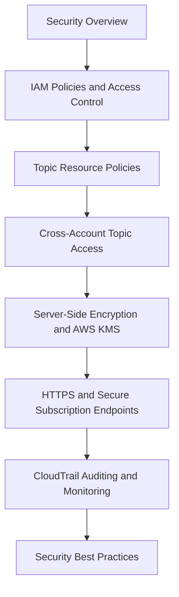

# Amazon SNS — Security

## Overview

This section documents the security architecture, configuration, and operational practices required to secure Amazon Simple Notification Service (Amazon SNS) in production environments.

It covers identity and access management, topic resource policies, cross-account authorization, server-side encryption, secure subscription endpoint configuration, auditing, and security best practices.

The objective is to establish a consistent security baseline for SNS-based messaging workloads while maintaining least privilege, operational reliability, and auditability.

## Documentation Structure

| File | Topic | Description |
|---|---|---|
| [01- SNS Security Overview.md](./01-%20SNS%20Security%20Overview.md) | Security Overview | Introduces the SNS security model, trust boundaries, core security controls, and production security architecture. |
| [02- IAM Policies and Access Control.md](./02-%20IAM%20Policies%20and%20Access%20Control.md) | IAM Access Control | Covers IAM policies that control which identities and AWS services can interact with SNS topics and perform publishing or subscription operations. |
| [03- Topic Resource Policies.md](./03-%20Topic%20Resource%20Policies.md) | Topic Resource Policies | Explains resource-based IAM policies attached to SNS topics, defining which principals can access a topic and which operations they can perform. |
| [04- Cross-Account Topic Access.md](./04-%20Cross-Account%20Topic%20Access.md) | Cross-Account Security | Covers cross-account topic access through resource policies and IAM, including permission boundaries and organization-level controls. |
| [05- Server-Side Encryption and AWS KMS.md](./05-%20Server-Side%20Encryption%20and%20AWS%20KMS.md) | Encryption at Rest | Explains SNS server-side encryption, KMS key policies, key rotation, permissions, and encryption lifecycle management. |
| [06- HTTPS and Secure Subscription Endpoints.md](./06-%20HTTPS%20and%20Secure%20Subscription%20Endpoints.md) | Secure Endpoints | Covers HTTPS subscriptions, endpoint validation, signature verification, and secure delivery configuration. |
| [07- CloudTrail Auditing and Monitoring.md](./07-%20CloudTrail%20Auditing%20and%20Monitoring.md) | CloudTrail Auditing | Covers management events, trail configuration, centralized logging, monitoring, and security investigation for SNS activity. |
| [08- Security Best Practices.md](./08-%20Security%20Best%20Practices.md) | Security Best Practices | Consolidates production security recommendations, operational controls, common mistakes, and deployment checklists for SNS. |

## Recommended Reading Order

Follow the sequence below to build a complete understanding of SNS security.

The sequence moves from foundational access control to data protection, secure delivery, auditing, and production best practices.

## Core Security Areas

### Identity and Access Management

Understand how SNS authenticates AWS workloads and evaluates permissions.

Key areas:

- IAM identity-based policies for publishers and subscribers.
- SNS topic resource policies for cross-account and service access.
- Least-privilege permission design.
- Separation between publishing, subscribing, and administrative roles.
- AWS Organizations and Service Control Policies.

### Encryption and Data Protection

Protect message data during transmission and storage.

Key areas:

- SNS server-side encryption using AWS KMS.
- Customer-managed KMS keys and key policies.
- TLS and HTTPS for in-transit protection.
- Sensitive data minimization in message payloads.
- Raw message delivery and payload exposure considerations.

### Secure Subscription Endpoints

Control and validate message delivery to subscribers.

Key areas:

- HTTPS endpoint subscription and confirmation.
- SNS message signature verification.
- Endpoint authorization policies.
- Raw delivery configuration security.
- Protocol-specific delivery controls.

### Auditing and Monitoring

Establish visibility into administrative and data-plane activity.

Key areas:

- CloudTrail management events for SNS.
- Centralized audit log storage.
- CloudWatch alarms for delivery failures and DLQ growth.
- Investigation procedures for suspicious publish activity.
- Log integrity protection.

## Production Security Checklist

### Identity and Authorization

- [ ] Dedicated IAM roles for publishers, subscribers, and administrators.
- [ ] Least-privilege IAM policies scoped to specific topic ARNs.
- [ ] No hardcoded AWS credentials in application code.
- [ ] Topic resource policies reviewed and restricted to expected principals.
- [ ] Cross-account access validated and scoped explicitly.
- [ ] Separate administrative and runtime permissions.

### Encryption and Networking

- [ ] Server-side encryption enabled on all topics containing sensitive data.
- [ ] KMS key policies reviewed and restricted to authorized services.
- [ ] TLS enforced for all HTTP-based subscription endpoints.
- [ ] Raw message delivery configured intentionally, not by default.
- [ ] Sensitive payload data minimized or excluded from messages.

### Subscription and Delivery Security

- [ ] HTTPS subscription endpoints validated and confirmed.
- [ ] SNS message signatures verified by HTTP/S subscribers.
- [ ] Subscription confirmation handled securely.
- [ ] Dead-letter queues configured for critical subscriptions.
- [ ] Subscription filter policies reviewed alongside access controls.

### Auditing and Operations

- [ ] CloudTrail management events enabled.
- [ ] Audit logs stored centrally with write protection.
- [ ] Security alerts configured for unexpected publish or subscription activity.
- [ ] DLQ monitoring and investigation procedures documented.
- [ ] Security-sensitive infrastructure managed through Infrastructure as Code.

## Key Takeaways

- SNS security requires coordinated identity, encryption, endpoint validation, and auditing controls.
- Topic resource policies and IAM identity policies work together and must both be scoped to least privilege.
- Server-side encryption protects message data at rest; TLS and HTTPS protect data in transit to subscribers.
- HTTPS subscribers must verify SNS message signatures to prevent spoofed notifications.
- CloudTrail and CloudWatch provide audit evidence and operational visibility for SNS workloads.
- Production SNS security controls should be managed through infrastructure as code and tested continuously.
