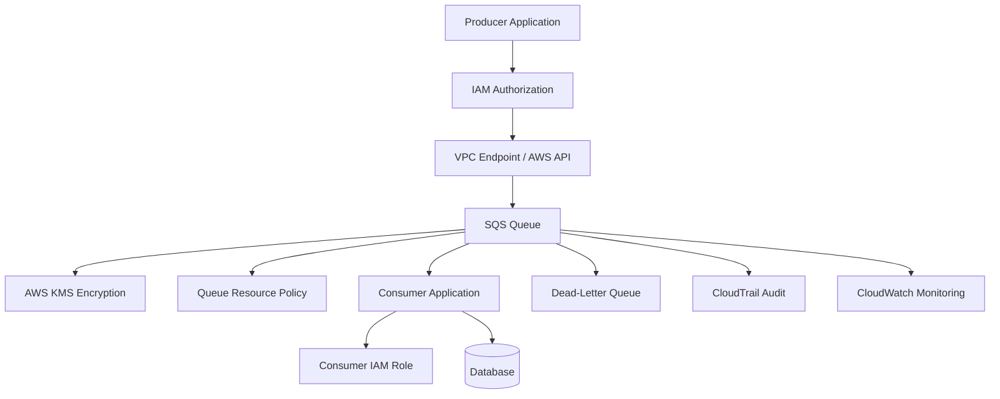
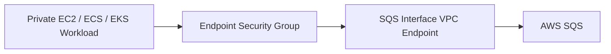
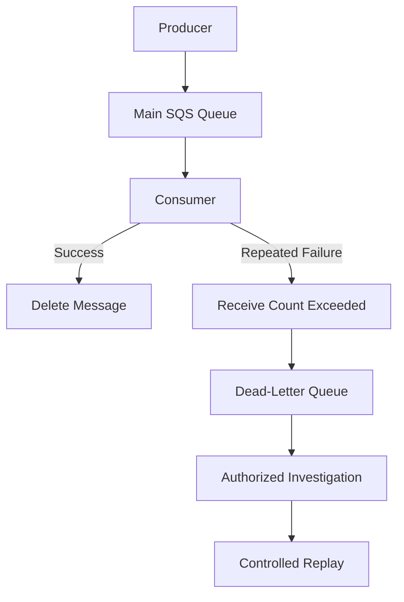

# 01- SQS Security Overview

## Overview

Amazon Simple Queue Service (SQS) is a fully managed message queuing service used to decouple application components and distribute asynchronous workloads. It allows producers to send messages to queues while consumers process them independently.

SQS is commonly used in backend architectures for:

- Asynchronous task execution.
- Event-driven microservices.
- Background processing.
- Workload buffering and traffic smoothing.
- Reliable communication between distributed services.
- Retry handling and failure isolation.

Because queues can contain business events, customer data, and operational instructions, SQS security must cover identity, authorization, encryption, network access, message handling, and monitoring.

A secure SQS architecture should protect the complete message lifecycle:

1. Producers must be authorized to send messages.
2. Consumers must be authorized to receive and delete messages.
3. Queue policies must restrict access to trusted principals and services.
4. Messages must be encrypted when required by the data classification.
5. Sensitive data must be protected during application processing.
6. Failed messages must be handled without exposing them to unauthorized systems.
7. Queue operations and configuration changes must be auditable.

Security is not provided by encryption alone. An encrypted queue can still be exposed through an overly permissive IAM policy, an insecure consumer, or an unrestricted resource policy.

## SQS Security Architecture

SQS security is implemented through multiple AWS and application-level controls.



| Security layer | AWS or application control | Purpose |
|---|---|---|
| Identity | IAM roles and policies | Authenticate workloads and authorize actions |
| Resource access | SQS queue policies | Restrict access to specific principals and services |
| Encryption at rest | AWS KMS | Protect stored message data |
| Encryption in transit | TLS | Protect API communication |
| Network | VPC endpoints and endpoint policies | Control private access to SQS |
| Message processing | Application validation and idempotency | Prevent malformed or duplicate processing |
| Failure handling | Dead-letter queues | Isolate repeatedly failing messages |
| Auditing | CloudTrail | Record supported SQS API activity |
| Monitoring | CloudWatch | Detect abnormal queue behavior and delivery failures |

## SQS Queue Types and Security Implications

SQS provides Standard and FIFO queues. Both support security controls, but their delivery semantics influence how applications should handle messages.

| Characteristic | Standard queue | FIFO queue |
|---|---|---|
| Delivery model | At-least-once | Exactly-once processing support within documented deduplication behavior |
| Message ordering | Best effort | Ordered within a message group |
| Throughput | High and scalable | Depends on FIFO throughput configuration |
| Duplicate handling | Required at application level | Still requires application-level idempotency |
| Typical workloads | Background jobs and event processing | Ordered business workflows and transactional sequences |

Do not interpret FIFO deduplication as a guarantee that business operations execute exactly once. Consumers can still encounter retries, visibility timeouts, and failures after performing an external side effect.

For both queue types, design consumers to tolerate duplicate delivery.

## Identity and Access Management

### IAM Authorization

IAM controls which AWS identities can interact with SQS.

SQS permissions are granted through IAM identity policies, queue resource policies, or both. The effective authorization decision depends on the principal, resource, applicable policy types, and any explicit denies.

Common SQS actions include:

| Action | Purpose | Typical identity |
|---|---|---|
| `sqs:SendMessage` | Send a message | Producer |
| `sqs:ReceiveMessage` | Receive messages | Consumer |
| `sqs:DeleteMessage` | Delete successfully processed messages | Consumer |
| `sqs:ChangeMessageVisibility` | Change message visibility timeout | Consumer |
| `sqs:GetQueueAttributes` | Read queue attributes | Operations or application role |
| `sqs:GetQueueUrl` | Resolve a queue URL | Application role |
| `sqs:CreateQueue` | Create a queue | Deployment role |
| `sqs:DeleteQueue` | Delete a queue | Restricted administrator |
| `sqs:SetQueueAttributes` | Modify queue configuration | Restricted administrator |
| `sqs:PurgeQueue` | Remove all messages from a queue | Highly restricted administrator |

Separate producer and consumer permissions. A producer should not automatically receive permission to consume or delete messages.

### Least-Privilege Producer Policy

A producer that only sends messages should receive only `sqs:SendMessage` on the required queue.

```json
{
  "Version": "2012-10-17",
  "Statement": [
    {
      "Sid": "SendMessagesToOrdersQueue",
      "Effect": "Allow",
      "Action": [
        "sqs:SendMessage"
      ],
      "Resource": "arn:aws:sqs:ap-south-1:123456789012:orders-queue"
    }
  ]
}
```

This policy prevents the producer from receiving messages, deleting messages, or modifying queue configuration.

### Least-Privilege Consumer Policy

A consumer generally requires permissions to receive, delete, and inspect messages.

```json
{
  "Version": "2012-10-17",
  "Statement": [
    {
      "Sid": "ConsumeOrdersQueue",
      "Effect": "Allow",
      "Action": [
        "sqs:ReceiveMessage",
        "sqs:DeleteMessage",
        "sqs:ChangeMessageVisibility",
        "sqs:GetQueueAttributes",
        "sqs:GetQueueUrl"
      ],
      "Resource": "arn:aws:sqs:ap-south-1:123456789012:orders-queue"
    }
  ]
}
```

Add other permissions only when the application requires them. For example, a consumer using long polling needs `sqs:ReceiveMessage`, but it does not need `sqs:PurgeQueue`.

### Separate Workload Roles

Use separate IAM roles for each workload.

| Workload | Recommended permissions |
|---|---|
| API producer | Send messages to approved queues |
| Background worker | Receive, delete, and change visibility |
| Deployment pipeline | Create and configure queues |
| Operations role | Read queue attributes and monitoring information |
| Security auditor | Read audit and configuration data |

For AWS-hosted applications, prefer workload identity:

- EC2 instance profiles.
- ECS task roles.
- EKS Pod Identity or IAM Roles for Service Accounts.
- Lambda execution roles.

Avoid storing long-lived AWS access keys in Docker images, source code, CI/CD variables, or application configuration files.

### Restrict Permissions by Conditions

IAM conditions can restrict access based on supported request context.

For example, restrict access to requests made through a specific VPC endpoint:

```json
{
  "Version": "2012-10-17",
  "Statement": [
    {
      "Sid": "AllowReceiveThroughApprovedEndpoint",
      "Effect": "Allow",
      "Action": [
        "sqs:ReceiveMessage",
        "sqs:DeleteMessage"
      ],
      "Resource": "arn:aws:sqs:ap-south-1:123456789012:orders-queue",
      "Condition": {
        "StringEquals": {
          "aws:SourceVpce": "vpce-0123456789abcdef0"
        }
      }
    }
  ]
}
```

This pattern is useful when the queue should be accessed only through approved private network paths.

Validate the effect of network-related conditions on all intended workloads before deployment. A restrictive condition can unintentionally block legitimate consumers running outside the specified endpoint.

## SQS Queue Resource Policies

### Purpose of Queue Policies

An SQS queue policy is a resource-based policy attached to a queue. It controls which principals can access the queue and is particularly important for service integrations and cross-account access.

Use queue policies to:

- Restrict access to trusted AWS accounts.
- Allow approved AWS services to send messages.
- Enforce network-related restrictions.
- Prevent unintended cross-account access.
- Apply explicit deny rules where appropriate.

### Restrict Access to a Specific Principal

Example policy allowing one application role to send messages:

```json
{
  "Version": "2012-10-17",
  "Statement": [
    {
      "Sid": "AllowOrderProducer",
      "Effect": "Allow",
      "Principal": {
        "AWS": "arn:aws:iam::123456789012:role/order-producer"
      },
      "Action": [
        "sqs:SendMessage"
      ],
      "Resource": "arn:aws:sqs:ap-south-1:123456789012:orders-queue"
    }
  ]
}
```

The producer also needs the appropriate identity-based permissions for the cross-account or same-account authorization model being used.

Avoid using wildcard principals unless the access is deliberately constrained by additional conditions and the security implications are understood.

### Restrict AWS Service Access

AWS services such as SNS and S3 can send messages to SQS queues.

When allowing a service principal, restrict the source resource using `aws:SourceArn` and, where appropriate, `aws:SourceAccount`.

Example policy allowing a specific SNS topic to send messages:

```json
{
  "Version": "2012-10-17",
  "Statement": [
    {
      "Sid": "AllowSpecificSNSTopic",
      "Effect": "Allow",
      "Principal": {
        "Service": "sns.amazonaws.com"
      },
      "Action": "sqs:SendMessage",
      "Resource": "arn:aws:sqs:ap-south-1:123456789012:orders-queue",
      "Condition": {
        "ArnEquals": {
          "aws:SourceArn": "arn:aws:sns:ap-south-1:123456789012:order-events"
        },
        "StringEquals": {
          "aws:SourceAccount": "123456789012"
        }
      }
    }
  ]
}
```

This prevents an unrelated SNS topic from using the same service-principal permission to send messages to the queue.

### Enforce Secure Transport

Use the `aws:SecureTransport` condition to deny requests that do not use secure transport.

```json
{
  "Version": "2012-10-17",
  "Statement": [
    {
      "Sid": "DenyInsecureTransport",
      "Effect": "Deny",
      "Principal": "*",
      "Action": "sqs:*",
      "Resource": "arn:aws:sqs:ap-south-1:123456789012:orders-queue",
      "Condition": {
        "Bool": {
          "aws:SecureTransport": "false"
        }
      }
    }
  ]
}
```

SQS API communication should use HTTPS. Review existing queue policies before adding explicit deny statements because explicit denies override applicable allows.

### Cross-Account Access

Cross-account access allows a workload in one AWS account to interact with a queue owned by another account.

For example:

- Account A owns the SQS queue.
- Account B runs the producer.
- The producer role in Account B needs permission to send messages.
- The queue policy in Account A must trust the producer role.

A secure configuration should:

1. Identify the exact external role.
2. Grant only the required SQS action.
3. Restrict the queue policy to that role.
4. Configure KMS permissions if the queue uses a customer-managed key.
5. Audit cross-account access.
6. Test both authorized and unauthorized requests.

Avoid granting access to an entire external account when a specific role is sufficient.

## Encryption and Data Protection

### Encryption at Rest

SQS supports server-side encryption (SSE) to protect message data at rest.

Depending on the queue configuration, SQS can use:

- SQS-managed encryption keys (SSE-SQS).
- AWS KMS keys (SSE-KMS), including customer-managed keys.

| Encryption option | Key management | Typical use |
|---|---|---|
| SSE-SQS | Managed by SQS | Standard at-rest encryption with minimal key administration |
| SSE-KMS | Managed through AWS KMS | Workloads requiring customer-controlled key policies and governance |

Use SSE-KMS when key-level access control, auditability, or compliance requirements justify the additional configuration and operational overhead.

Example CLI configuration using an AWS-managed KMS key:

```bash
aws sqs set-queue-attributes \
  --queue-url https://sqs.ap-south-1.amazonaws.com/123456789012/orders-queue \
  --attributes KmsMasterKeyId=alias/aws/sqs
```

For a customer-managed key:

```bash
aws sqs set-queue-attributes \
  --queue-url https://sqs.ap-south-1.amazonaws.com/123456789012/orders-queue \
  --attributes KmsMasterKeyId=arn:aws:kms:ap-south-1:123456789012:key/11111111-2222-3333-4444-555555555555
```

Inspect queue attributes:

```bash
aws sqs get-queue-attributes \
  --queue-url https://sqs.ap-south-1.amazonaws.com/123456789012/orders-queue \
  --attribute-names All
```

### KMS Permissions

SSE-KMS introduces a dependency on AWS KMS authorization.

Depending on the producer and consumer workflow, principals may require permissions such as:

- `kms:GenerateDataKey`
- `kms:Decrypt`

The exact permissions depend on the encryption configuration and the SQS operations being performed.

The KMS key policy must also authorize the relevant principals and service integration.

Important considerations:

- Restrict key administration to trusted security roles.
- Grant producers and consumers only the required KMS permissions.
- Monitor key policy modifications.
- Enable key rotation where appropriate.
- Avoid disabling or deleting keys while queues still depend on them.
- Plan key lifecycle and recovery procedures.

A producer can have `sqs:SendMessage` permission and still fail to publish if the required KMS authorization is missing.

### Encryption in Transit

SQS API requests should use HTTPS to protect message contents and credentials during transmission.

For AWS SDK clients, use standard HTTPS endpoints and avoid custom endpoint overrides unless they are part of a controlled architecture.

Example using Boto3:

```python
import boto3
from botocore.config import Config

sqs = boto3.client(
    "sqs",
    region_name="ap-south-1",
    config=Config(
        retries={
            "mode": "standard",
            "max_attempts": 5,
        }
    ),
)
```

AWS SDKs use HTTPS by default for standard AWS service endpoints.

Do not disable TLS certificate validation or use untrusted proxies for production message traffic.

### Minimize Sensitive Message Content

Encryption protects message storage and transport, but authorized consumers can still read message bodies.

Avoid placing the following directly in queue messages unless strictly necessary:

- Passwords.
- API keys and access tokens.
- Database credentials.
- Payment card data.
- Private cryptographic material.
- Unnecessary personal information.

Prefer publishing references to protected records.

Example:

```json
{
  "event_id": "evt_102938",
  "event_type": "invoice.generated",
  "invoice_id": "inv_78321",
  "tenant_id": "tenant_42",
  "occurred_at": "2026-11-22T10:30:00Z"
}
```

The consumer can retrieve the invoice through an independently authorized service.

This reduces sensitive-data replication across queues, dead-letter queues, logs, and downstream processing systems.

## Network Security

### VPC Endpoints for SQS

Applications running in private subnets can access SQS through an interface VPC endpoint powered by AWS PrivateLink.

This allows workloads to communicate with SQS without requiring a public internet path for the service API connection.

Typical architecture:



Security considerations:

- Restrict endpoint security groups to trusted application subnets or security groups.
- Use endpoint policies to limit permitted actions and queues.
- Enable private DNS where appropriate.
- Ensure the workload resolves the intended private service endpoint.
- Monitor endpoint connectivity and access failures.

A VPC endpoint does not replace IAM policies or queue resource policies. It adds another network-level control.

### Endpoint Policies

An endpoint policy controls which principals and resources can be accessed through a particular VPC endpoint.

Example endpoint policy:

```json
{
  "Version": "2012-10-17",
  "Statement": [
    {
      "Sid": "AllowOrdersQueueOperations",
      "Effect": "Allow",
      "Principal": "*",
      "Action": [
        "sqs:SendMessage",
        "sqs:ReceiveMessage",
        "sqs:DeleteMessage"
      ],
      "Resource": [
        "arn:aws:sqs:ap-south-1:123456789012:orders-queue"
      ]
    }
  ]
}
```

The wildcard principal in this example does not independently grant access to every identity. IAM and queue resource policies still determine whether a request is authorized.

Use endpoint policies as an additional restriction, not as a replacement for identity-based authorization.

## Message Processing Security

### Treat Messages as Untrusted Input

A message received from SQS should be validated before it reaches business logic.

Even when the producer is an internal service, messages can be malformed because of:

- Application bugs.
- Compromised producer credentials.
- Incorrect schema versions.
- Unexpected external integrations.
- Replay or duplicate delivery.
- Manual message injection by an authorized operator.

Validate:

- Required fields.
- Event type.
- Schema version.
- Identifier formats.
- Data types.
- Payload size.
- Tenant ownership.
- Business authorization.

Do not assume that a message is trustworthy simply because it was retrieved from an authenticated AWS queue.

### Implement Idempotent Consumers

SQS Standard queues provide at-least-once delivery. A message can be delivered more than once, so consumers must avoid repeating business operations.

A common approach is to store processed message identifiers in a database.

Example PostgreSQL table:

```sql
CREATE TABLE processed_messages (
    message_id VARCHAR(256) PRIMARY KEY,
    processed_at TIMESTAMPTZ NOT NULL DEFAULT NOW()
);
```

A consumer should use a transaction to coordinate deduplication and business-state changes whenever they can be performed in the same database.

Conceptually:

```python
async with database.transaction():
    inserted = await database.execute(
        """
        INSERT INTO processed_messages (message_id)
        VALUES (:message_id)
        ON CONFLICT DO NOTHING
        RETURNING message_id
        """,
        {"message_id": message_id},
    )

    if inserted:
        await apply_business_operation(message)
```

Delete the SQS message only after durable processing succeeds.

If the business operation includes an external API call, database transaction boundaries alone cannot guarantee exactly-once side effects. Use an outbox, idempotency key, or downstream deduplication mechanism.

### Visibility Timeout and Concurrent Processing

When a consumer receives a message, SQS makes it temporarily invisible to other consumers. This is controlled by the visibility timeout.

If processing takes longer than the visibility timeout, the message can become visible again while the original consumer is still working.

Security and reliability implications include:

- Concurrent duplicate processing.
- Repeated external API calls.
- Conflicting business updates.
- Increased processing load.

Set the visibility timeout based on realistic processing duration and extend it when long-running work requires additional time.

Do not use visibility timeout as a substitute for idempotency.

### Restrict Message Deletion

Only the consumer responsible for successful processing should delete a message.

A safe processing lifecycle is:

1. Receive the message.
2. Validate its structure and authorization context.
3. Perform the business operation.
4. Persist the result.
5. Delete the message.

If processing fails, allow the message to become visible again or apply a controlled retry strategy.

Avoid deleting messages before durable processing completes. Doing so can cause permanent message loss.

## Dead-Letter Queue Security

### Purpose of Dead-Letter Queues

A dead-letter queue (DLQ) stores messages that cannot be successfully processed after the configured maximum receive count is reached.

DLQs help isolate poison messages and prevent repeated failures from blocking normal processing.



A DLQ can contain the same sensitive data as the source queue. Apply equivalent or stricter access controls.

Recommended controls:

- Restrict DLQ access to authorized operators and recovery workers.
- Encrypt the DLQ according to its data classification.
- Monitor message accumulation.
- Define retention and deletion policies.
- Audit message inspection and replay operations.
- Validate messages before replaying them.
- Avoid automatically replaying messages without understanding the failure.

### Configure a Redrive Policy

Example queue redrive configuration:

```json
{
  "deadLetterTargetArn": "arn:aws:sqs:ap-south-1:123456789012:orders-dlq",
  "maxReceiveCount": 5
}
```

Apply it through the CLI:

```bash
aws sqs set-queue-attributes \
  --queue-url https://sqs.ap-south-1.amazonaws.com/123456789012/orders-queue \
  --attributes '{
    "RedrivePolicy": "{\"deadLetterTargetArn\":\"arn:aws:sqs:ap-south-1:123456789012:orders-dlq\",\"maxReceiveCount\":\"5\"}"
  }'
```

For production, configure the source queue and DLQ together through infrastructure as code.

The DLQ must be compatible with the source queue type. Standard queues use Standard DLQs, and FIFO queues use FIFO DLQs.

## Monitoring and Auditing

### CloudTrail Auditing

CloudTrail records supported SQS API activity and helps investigate configuration changes and access patterns.

Important operations include:

- `CreateQueue`
- `DeleteQueue`
- `SetQueueAttributes`
- `SendMessage`
- `ReceiveMessage`
- `DeleteMessage`
- `PurgeQueue`
- `AddPermission`
- `RemovePermission`

Management events and data events have different collection behavior. Configure supported SQS data-event logging when message-level API activity must be audited.

Pay particular attention to:

- Unexpected queue policy changes.
- Queue deletion.
- Permission grants to unknown principals.
- Unexpected cross-account access.
- Unusual publishing or consumption activity.
- Changes to encryption configuration.
- Queue purging.

CloudTrail is an audit mechanism, not a message archive. It does not replace application-level event history or business transaction records.

### CloudWatch Metrics

CloudWatch provides operational metrics that can reveal abnormal queue behavior.

| Metric | Purpose | Security or operational signal |
|---|---|---|
| `ApproximateNumberOfMessagesVisible` | Messages available for retrieval | Unexpected backlog growth |
| `ApproximateNumberOfMessagesNotVisible` | Messages currently in flight | Stuck or slow consumers |
| `ApproximateNumberOfMessagesDelayed` | Delayed messages | Unexpected scheduling behavior |
| `NumberOfMessagesSent` | Messages sent | Unusual publishing volume |
| `NumberOfMessagesReceived` | Messages received | Unexpected consumer activity |
| `NumberOfMessagesDeleted` | Messages deleted | Processing and deletion patterns |
| `ApproximateAgeOfOldestMessage` | Age of oldest available message | Processing delays |
| `NumberOfEmptyReceives` | Receive calls returning no messages | Inefficient polling or low traffic |

SQS metrics are generally approximate and may be delayed. Do not treat them as a precise real-time audit log.

Useful alarms include:

- Abnormal publishing volume.
- Sustained backlog growth.
- Increasing age of the oldest message.
- DLQ message accumulation.
- High in-flight message counts.
- Unexpected deletion or consumption patterns.

### Protect Audit Data

Protect CloudTrail logs and application security logs using:

- Dedicated audit storage.
- Restricted IAM access.
- Appropriate encryption.
- S3 versioning and retention controls.
- S3 Object Lock where immutable retention is required.
- CloudTrail log file validation.
- Monitoring for audit bucket policy changes.

Avoid recording complete message bodies in application logs. Prefer message IDs, correlation IDs, event types, and processing outcomes.

## Infrastructure as Code Security

Security settings should be managed through reviewed and repeatable infrastructure definitions.

Example Terraform configuration:

```hcl
resource "aws_sqs_queue" "orders_dlq" {
  name                      = "orders-dlq"
  message_retention_seconds = 1209600

  sqs_managed_sse_enabled = true

  tags = {
    Environment = "production"
    ManagedBy   = "terraform"
    DataClass   = "confidential"
  }
}

resource "aws_sqs_queue" "orders" {
  name                       = "orders-queue"
  visibility_timeout_seconds = 180
  message_retention_seconds  = 345600
  receive_wait_time_seconds  = 20

  sqs_managed_sse_enabled = true

  redrive_policy = jsonencode({
    deadLetterTargetArn = aws_sqs_queue.orders_dlq.arn
    maxReceiveCount     = 5
  })

  tags = {
    Environment = "production"
    ManagedBy   = "terraform"
    DataClass   = "confidential"
  }
}

resource "aws_sqs_queue_policy" "orders" {
  queue_url = aws_sqs_queue.orders.id

  policy = jsonencode({
    Version = "2012-10-17"

    Statement = [
      {
        Sid    = "DenyInsecureTransport"
        Effect = "Deny"

        Principal = "*"
        Action    = "sqs:*"
        Resource  = aws_sqs_queue.orders.arn

        Condition = {
          Bool = {
            "aws:SecureTransport" = "false"
          }
        }
      }
    ]
  })
}
```

This example uses SQS-managed encryption. For SSE-KMS, configure `kms_master_key_id` and ensure the KMS key policy authorizes the required SQS and workload operations.

Before deploying:

- Review IAM and queue policies.
- Validate encryption settings.
- Confirm DLQ compatibility.
- Check visibility timeout against processing duration.
- Verify queue retention settings.
- Test producer and consumer permissions.
- Review Terraform plans for unintended policy changes.

Include policy validation and infrastructure security scanning in CI/CD.

## Common Security Mistakes

| Mistake | Risk | Recommended approach |
|---|---|---|
| Granting `sqs:*` to application roles | Excessive permissions | Grant only required actions on specific queues |
| Using wildcard queue policies | Unauthorized access | Restrict principals and conditions |
| Sharing producer and consumer roles | Unnecessary privilege escalation | Separate workload roles |
| Assuming encryption provides authorization | Unauthorized principals can still access messages | Apply IAM and queue resource policies |
| Ignoring KMS permissions | Producers or consumers fail unexpectedly | Review KMS key policies and IAM permissions |
| Exposing long-lived AWS credentials | Credential theft and persistence | Use workload roles and federation |
| Deleting messages before processing completes | Permanent message loss | Delete only after durable processing |
| Ignoring duplicate delivery | Repeated business operations | Implement idempotent consumers |
| Setting an insufficient visibility timeout | Concurrent duplicate processing | Align timeout with processing duration |
| Leaving DLQs unmonitored | Failed messages remain unresolved | Alarm on DLQ accumulation |
| Trusting messages without validation | Malformed or malicious input | Validate schemas and business authorization |
| Logging full message bodies | Sensitive data exposure | Log identifiers and processing metadata |
| Allowing unrestricted cross-account access | External message injection or exposure | Trust specific roles and accounts |
| Ignoring queue policy changes | Undetected access expansion | Audit configuration changes through CloudTrail |

## Production Security Checklist

### Identity and Authorization

- [ ] Producers and consumers use separate IAM roles.
- [ ] IAM policies grant only required SQS actions.
- [ ] Policies reference specific queue ARNs.
- [ ] Administrative permissions are restricted.
- [ ] Queue resource policies restrict trusted principals.
- [ ] Cross-account access is explicitly reviewed.
- [ ] AWS service integrations restrict source resources.
- [ ] Long-lived access keys are avoided.

### Encryption and Network

- [ ] Encryption at rest is enabled according to data classification.
- [ ] KMS permissions and key policies are reviewed where SSE-KMS is used.
- [ ] Key lifecycle and recovery procedures are documented.
- [ ] API communication uses HTTPS.
- [ ] VPC endpoints are used where private access is required.
- [ ] Endpoint policies restrict permitted resources and actions.
- [ ] Sensitive message content is minimized.

### Message Processing

- [ ] Consumers validate message schemas.
- [ ] Business authorization is enforced independently of queue access.
- [ ] Processing is idempotent.
- [ ] Messages are deleted only after durable processing.
- [ ] Visibility timeouts match realistic processing durations.
- [ ] External side effects use idempotency or recovery mechanisms.
- [ ] DLQs are configured for critical workloads.
- [ ] DLQ access and replay operations are restricted.

### Monitoring and Operations

- [ ] CloudTrail captures relevant SQS activity.
- [ ] Supported data events are enabled where required.
- [ ] CloudWatch alarms monitor queue health.
- [ ] DLQ accumulation is monitored.
- [ ] Audit logs are protected.
- [ ] Security-sensitive infrastructure changes require review.
- [ ] Recovery and replay procedures are tested.
- [ ] Incident response procedures cover compromised producers and consumers.

## Key Takeaways

- Secure SQS through layered controls: least-privilege IAM, restrictive queue policies, encryption, and controlled network access.
- Treat queue messages as untrusted and potentially duplicated input; validate schemas and implement idempotent processing.
- Protect both main queues and DLQs because they can contain the same sensitive business data.
- Use CloudTrail and CloudWatch together to audit access and configuration changes while monitoring operational anomalies.
- Manage queue policies, KMS permissions, encryption, and redrive configuration through reviewed infrastructure as code.