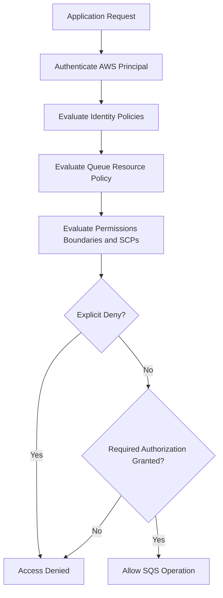
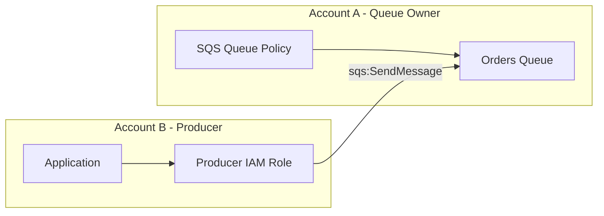
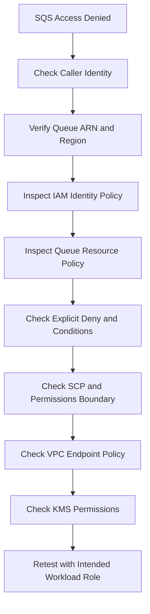

# 02- IAM Policies and Access Control

## Overview

AWS Identity and Access Management (IAM) controls which identities can access Amazon Simple Queue Service (SQS), which operations they can perform, and which queue resources they can access.

SQS access control uses two primary policy mechanisms:

- **IAM identity-based policies:** Attached to users, groups, or roles to grant permissions to AWS identities.
- **SQS resource-based policies:** Attached directly to queues to control which principals can access them.

These policies work together to enforce least-privilege access across producers, consumers, deployment pipelines, administrators, and external AWS services.

A production SQS architecture should avoid giving every application unrestricted access to every queue. Instead, permissions should reflect the responsibilities of each workload.

For example:

| Workload | Required access |
|---|---|
| Order API | Send messages to the orders queue |
| Order worker | Receive and delete messages from the orders queue |
| Notification worker | Receive messages from the notifications queue |
| Deployment pipeline | Create and configure approved queues |
| Operations team | Inspect queue attributes and operational configuration |
| Security team | Review policies and audit access |

The objective is to limit the impact of compromised credentials, application vulnerabilities, and configuration mistakes.

## SQS Authorization Model

### Identity-Based Policies

Identity-based policies define what an IAM principal can do.

They can be attached to:

- IAM users.
- IAM groups.
- IAM roles.

For production workloads, IAM roles are generally preferred because applications can obtain temporary credentials through AWS workload identity mechanisms.

Example:

An application running on ECS assumes a task role with permission to send messages to one specific SQS queue.

### Resource-Based Policies

SQS queue policies are resource-based policies attached directly to queues.

They define which principals can access the queue and under what conditions.

They are particularly useful for:

- Cross-account access.
- AWS service integrations.
- Restricting access through VPC endpoints.
- Enforcing secure transport.
- Applying explicit deny rules.

### How IAM and Queue Policies Work Together

A simplified authorization model is:



The actual AWS policy evaluation process depends on the principal type, account relationship, organization controls, and applicable policy types.

Important authorization rules:

- An explicit `Deny` overrides an applicable `Allow`.
- Identity policies do not automatically grant access to every queue.
- Resource policies can grant access to principals that are not in the queue-owning account.
- Cross-account access generally requires authorization from both the caller's account and the resource-owning account.
- Permissions boundaries and service control policies (SCPs) can restrict permissions otherwise granted by IAM policies.
- VPC endpoint policies can impose additional restrictions on requests passing through an endpoint.

Do not assume that adding an `Allow` statement to one policy guarantees access. Evaluate all applicable policy layers.

## SQS Actions and Permission Requirements

SQS exposes API operations through IAM actions.

The permissions required by an application depend on the operations it performs.

### Common SQS IAM Actions

| IAM action | Purpose | Typical workload |
|---|---|---|
| `sqs:SendMessage` | Send a message | Producer |
| `sqs:SendMessageBatch` | Send multiple messages | Producer |
| `sqs:ReceiveMessage` | Retrieve messages | Consumer |
| `sqs:DeleteMessage` | Delete processed messages | Consumer |
| `sqs:DeleteMessageBatch` | Delete multiple processed messages | Consumer |
| `sqs:ChangeMessageVisibility` | Change message visibility timeout | Consumer |
| `sqs:ChangeMessageVisibilityBatch` | Change visibility for multiple messages | Consumer |
| `sqs:GetQueueAttributes` | Read queue attributes | Application or operations |
| `sqs:GetQueueUrl` | Retrieve queue URL | Application |
| `sqs:ListQueues` | List queues | Operations or deployment |
| `sqs:CreateQueue` | Create a queue | Deployment |
| `sqs:DeleteQueue` | Delete a queue | Administrator |
| `sqs:SetQueueAttributes` | Modify queue configuration | Administrator |
| `sqs:PurgeQueue` | Remove all messages from a queue | Restricted administrator |
| `sqs:TagQueue` | Add or update queue tags | Deployment |
| `sqs:UntagQueue` | Remove queue tags | Deployment |
| `sqs:ListQueueTags` | Read queue tags | Operations |

Grant only the actions required by the application.

For example, a producer should not receive `sqs:ReceiveMessage` or `sqs:DeleteMessage` simply because it publishes messages to the queue.

### API Operation and IAM Action Mapping

An AWS SDK method generally maps to a corresponding IAM action.

| Boto3 method | IAM action |
|---|---|
| `send_message()` | `sqs:SendMessage` |
| `send_message_batch()` | `sqs:SendMessageBatch` |
| `receive_message()` | `sqs:ReceiveMessage` |
| `delete_message()` | `sqs:DeleteMessage` |
| `delete_message_batch()` | `sqs:DeleteMessageBatch` |
| `change_message_visibility()` | `sqs:ChangeMessageVisibility` |
| `get_queue_attributes()` | `sqs:GetQueueAttributes` |
| `get_queue_url()` | `sqs:GetQueueUrl` |
| `set_queue_attributes()` | `sqs:SetQueueAttributes` |
| `purge_queue()` | `sqs:PurgeQueue` |

Some operations have additional permission requirements depending on the queue configuration and integration.

For example, sending messages to an SSE-KMS encrypted queue may require additional KMS permissions.

## Least-Privilege IAM Policies

### Why Least Privilege Matters

Least privilege means granting an identity only the permissions necessary to perform its assigned responsibility.

Without least privilege, a compromised application can potentially:

- Read messages intended for another service.
- Delete messages without processing them.
- Modify queue attributes.
- Change access policies.
- Purge the queue.
- Disrupt other applications using the same infrastructure.

Use separate IAM roles for producers, consumers, deployment automation, and administrators.

### Producer Policy

A producer that only sends messages should receive `sqs:SendMessage` on the target queue.

```json
{
  "Version": "2012-10-17",
  "Statement": [
    {
      "Sid": "SendMessagesToOrdersQueue",
      "Effect": "Allow",
      "Action": [
        "sqs:SendMessage"
      ],
      "Resource": "arn:aws:sqs:ap-south-1:123456789012:orders-queue"
    }
  ]
}
```

If the application uses batch publishing, grant `sqs:SendMessageBatch` as well.

```json
{
  "Version": "2012-10-17",
  "Statement": [
    {
      "Sid": "PublishOrders",
      "Effect": "Allow",
      "Action": [
        "sqs:SendMessage",
        "sqs:SendMessageBatch"
      ],
      "Resource": "arn:aws:sqs:ap-south-1:123456789012:orders-queue"
    }
  ]
}
```

Avoid granting queue-management permissions to producer workloads.

### Consumer Policy

A consumer typically requires permissions to receive messages, delete successfully processed messages, and manage visibility timeouts.

```json
{
  "Version": "2012-10-17",
  "Statement": [
    {
      "Sid": "ConsumeOrdersQueue",
      "Effect": "Allow",
      "Action": [
        "sqs:ReceiveMessage",
        "sqs:DeleteMessage",
        "sqs:ChangeMessageVisibility",
        "sqs:GetQueueAttributes"
      ],
      "Resource": "arn:aws:sqs:ap-south-1:123456789012:orders-queue"
    }
  ]
}
```

Add `sqs:DeleteMessageBatch` and `sqs:ChangeMessageVisibilityBatch` if the application uses those operations.

Grant `sqs:GetQueueUrl` only when the application needs to resolve the queue URL dynamically.

### Separate Administrative Permissions

Queue administration should be handled by a separate role.

Example:

```json
{
  "Version": "2012-10-17",
  "Statement": [
    {
      "Sid": "ManageOrdersQueue",
      "Effect": "Allow",
      "Action": [
        "sqs:GetQueueAttributes",
        "sqs:SetQueueAttributes",
        "sqs:ListQueueTags",
        "sqs:TagQueue",
        "sqs:UntagQueue"
      ],
      "Resource": "arn:aws:sqs:ap-south-1:123456789012:orders-queue"
    }
  ]
}
```

Do not include `sqs:PurgeQueue` or `sqs:DeleteQueue` unless the operational role explicitly requires them.

These actions can cause significant data loss or service disruption.

## Resource-Level Permissions

### Restrict Policies to Specific Queue ARNs

An IAM policy should reference the exact queue ARN whenever possible.

Example:

```json
{
  "Version": "2012-10-17",
  "Statement": [
    {
      "Sid": "AccessOrdersQueueOnly",
      "Effect": "Allow",
      "Action": [
        "sqs:SendMessage"
      ],
      "Resource": "arn:aws:sqs:ap-south-1:123456789012:orders-queue"
    }
  ]
}
```

Avoid:

```json
{
  "Effect": "Allow",
  "Action": "sqs:*",
  "Resource": "*"
}
```

The wildcard policy grants broad SQS permissions across resources where those actions support resource-level authorization.

Some SQS operations, such as `sqs:ListQueues`, do not support resource-level restrictions and require `"Resource": "*"`.

Keep these permissions in separate statements so resource-scoped permissions remain narrow.

### Restrict Access to a Queue Naming Pattern

IAM supports wildcard matching in resource ARNs.

For example:

```json
{
  "Version": "2012-10-17",
  "Statement": [
    {
      "Sid": "AccessApplicationQueues",
      "Effect": "Allow",
      "Action": [
        "sqs:SendMessage"
      ],
      "Resource": "arn:aws:sqs:ap-south-1:123456789012:application-*"
    }
  ]
}
```

This allows publishing to queues whose names begin with `application-`.

Use naming patterns only when workloads genuinely require access to multiple queues. A broad prefix can unintentionally include queues with different data classifications or ownership.

### Restrict Queue Access by Tags

IAM supports the `aws:ResourceTag` condition key for applicable SQS resource-level operations.

Example:

```json
{
  "Version": "2012-10-17",
  "Statement": [
    {
      "Sid": "PublishToProductionQueues",
      "Effect": "Allow",
      "Action": [
        "sqs:SendMessage"
      ],
      "Resource": "arn:aws:sqs:ap-south-1:123456789012:*",
      "Condition": {
        "StringEquals": {
          "aws:ResourceTag/Environment": "production"
        }
      }
    }
  ]
}
```

This policy allows publishing to matching queues tagged with `Environment=production`, subject to the applicable action and resource-tag authorization support.

Tag-based authorization requires reliable tag governance. If an untrusted principal can change resource tags, it may be able to influence access decisions.

Restrict `sqs:TagQueue` and `sqs:UntagQueue` accordingly.

## IAM Policy Conditions

Conditions allow policies to restrict access based on request context.

They are useful for enforcing network boundaries, account restrictions, and other contextual controls.

### Restrict Requests to a VPC Endpoint

The `aws:SourceVpce` condition can restrict queue access to a specific VPC endpoint.

```json
{
  "Version": "2012-10-17",
  "Statement": [
    {
      "Sid": "AllowAccessThroughApprovedEndpoint",
      "Effect": "Allow",
      "Action": [
        "sqs:SendMessage",
        "sqs:ReceiveMessage",
        "sqs:DeleteMessage"
      ],
      "Resource": "arn:aws:sqs:ap-south-1:123456789012:orders-queue",
      "Condition": {
        "StringEquals": {
          "aws:SourceVpce": "vpce-0123456789abcdef0"
        }
      }
    }
  ]
}
```

This is useful when a workload should access SQS only through a designated interface VPC endpoint.

Before enforcing this condition, verify that all legitimate callers use the specified endpoint. Requests from other network paths will not satisfy the condition.

### Restrict Access to a Specific AWS Account

The `aws:PrincipalAccount` condition can restrict access to principals belonging to a specified account.

```json
{
  "Version": "2012-10-17",
  "Statement": [
    {
      "Sid": "AllowAccount123456789012",
      "Effect": "Allow",
      "Action": [
        "sqs:SendMessage"
      ],
      "Resource": "arn:aws:sqs:ap-south-1:123456789012:orders-queue",
      "Condition": {
        "StringEquals": {
          "aws:PrincipalAccount": "123456789012"
        }
      }
    }
  ]
}
```

For cross-account access, use an explicit trusted role or account design. Do not rely on account conditions as a replacement for identifying the intended external workload.

### Enforce Secure Transport

Use `aws:SecureTransport` to deny non-TLS requests.

This is commonly implemented in the queue resource policy:

```json
{
  "Version": "2012-10-17",
  "Statement": [
    {
      "Sid": "DenyInsecureTransport",
      "Effect": "Deny",
      "Principal": "*",
      "Action": "sqs:*",
      "Resource": "arn:aws:sqs:ap-south-1:123456789012:orders-queue",
      "Condition": {
        "Bool": {
          "aws:SecureTransport": "false"
        }
      }
    }
  ]
}
```

The explicit deny prevents requests that do not use secure transport, even if another applicable policy grants access.

### Use Source ARN and Source Account for AWS Services

When an AWS service sends messages to SQS, restrict the service principal to the expected source resource.

Example allowing one SNS topic to send messages:

```json
{
  "Version": "2012-10-17",
  "Statement": [
    {
      "Sid": "AllowSpecificSNSTopic",
      "Effect": "Allow",
      "Principal": {
        "Service": "sns.amazonaws.com"
      },
      "Action": "sqs:SendMessage",
      "Resource": "arn:aws:sqs:ap-south-1:123456789012:orders-queue",
      "Condition": {
        "ArnEquals": {
          "aws:SourceArn": "arn:aws:sns:ap-south-1:123456789012:order-events"
        },
        "StringEquals": {
          "aws:SourceAccount": "123456789012"
        }
      }
    }
  ]
}
```

This prevents unrelated SNS topics from using the same service-principal permission.

The source ARN and account must match the actual integration configuration.

## SQS Queue Policies

### Example Queue Policy

A production queue policy may contain multiple statements for different access requirements.

```json
{
  "Version": "2012-10-17",
  "Statement": [
    {
      "Sid": "AllowOrderProducer",
      "Effect": "Allow",
      "Principal": {
        "AWS": "arn:aws:iam::123456789012:role/order-producer"
      },
      "Action": [
        "sqs:SendMessage"
      ],
      "Resource": "arn:aws:sqs:ap-south-1:123456789012:orders-queue"
    },
    {
      "Sid": "AllowOrderWorker",
      "Effect": "Allow",
      "Principal": {
        "AWS": "arn:aws:iam::123456789012:role/order-worker"
      },
      "Action": [
        "sqs:ReceiveMessage",
        "sqs:DeleteMessage",
        "sqs:ChangeMessageVisibility"
      ],
      "Resource": "arn:aws:sqs:ap-south-1:123456789012:orders-queue"
    },
    {
      "Sid": "DenyInsecureTransport",
      "Effect": "Deny",
      "Principal": "*",
      "Action": "sqs:*",
      "Resource": "arn:aws:sqs:ap-south-1:123456789012:orders-queue",
      "Condition": {
        "Bool": {
          "aws:SecureTransport": "false"
        }
      }
    }
  ]
}
```

This policy separates producer and consumer permissions and enforces secure transport.

Identity policies and other applicable authorization controls must also be reviewed.

### Apply a Queue Policy Using AWS CLI

First, create a policy file named `queue-policy.json`.

Then apply it:

```bash
aws sqs set-queue-attributes \
  --queue-url https://sqs.ap-south-1.amazonaws.com/123456789012/orders-queue \
  --attributes file://queue-attributes.json
```

The attributes file must use the `Policy` attribute and contain the policy as a JSON string.

For example, generate the attributes file using Python:

```python
import json

with open("queue-policy.json", encoding="utf-8") as file:
    policy = json.load(file)

attributes = {
    "Policy": json.dumps(policy)
}

with open("queue-attributes.json", "w", encoding="utf-8") as file:
    json.dump(attributes, file, indent=2)
```

Apply the generated file:

```bash
aws sqs set-queue-attributes \
  --queue-url https://sqs.ap-south-1.amazonaws.com/123456789012/orders-queue \
  --attributes file://queue-attributes.json
```

Retrieve the current policy:

```bash
aws sqs get-queue-attributes \
  --queue-url https://sqs.ap-south-1.amazonaws.com/123456789012/orders-queue \
  --attribute-names Policy
```

`SetQueueAttributes` replaces the specified queue attribute value. Treat policy updates as configuration changes that require review and validation.

## Cross-Account SQS Access

### Architecture

Cross-account access is common when application services are distributed across AWS accounts.

Example:

- Account A owns the SQS queue.
- Account B runs the producer application.
- Account B's producer role needs to send messages to Account A's queue.



### Producer Account IAM Policy

The producer role in Account B needs permission to send messages to the queue in Account A.

```json
{
  "Version": "2012-10-17",
  "Statement": [
    {
      "Sid": "SendToExternalOrdersQueue",
      "Effect": "Allow",
      "Action": [
        "sqs:SendMessage"
      ],
      "Resource": "arn:aws:sqs:ap-south-1:111111111111:orders-queue"
    }
  ]
}
```

### Queue Owner Resource Policy

The queue in Account A must trust the producer role in Account B.

```json
{
  "Version": "2012-10-17",
  "Statement": [
    {
      "Sid": "AllowExternalProducer",
      "Effect": "Allow",
      "Principal": {
        "AWS": "arn:aws:iam::222222222222:role/external-order-producer"
      },
      "Action": [
        "sqs:SendMessage"
      ],
      "Resource": "arn:aws:sqs:ap-south-1:111111111111:orders-queue"
    }
  ]
}
```

The account IDs and role names are illustrative. Replace them with the actual AWS identities and queue ARN.

### Cross-Account Authorization Requirements

| Requirement | Account | Purpose |
|---|---|---|
| Producer IAM policy | Account B | Authorize the producer role to send messages |
| Queue resource policy | Account A | Trust the external producer role |
| KMS key policy | Queue-owning account, if SSE-KMS is used | Authorize required encryption operations |
| CloudTrail | Both accounts as appropriate | Audit producer and resource-side activity |

For SSE-KMS queues, verify the KMS key policy and caller permissions separately. SQS authorization does not automatically grant KMS access.

Avoid using the root principal of an external account when a dedicated role is sufficient.

## AWS Service Integration Permissions

SQS commonly receives messages from SNS, S3, EventBridge, and other AWS services.

These integrations typically require a queue resource policy that trusts the relevant service principal.

### SNS to SQS

For SNS-to-SQS delivery, the queue policy should allow `sns.amazonaws.com` to perform `sqs:SendMessage`, restricted to the intended SNS topic.

Use `aws:SourceArn` to prevent unrelated topics from publishing to the queue.

### S3 to SQS

For S3 event notifications, allow `s3.amazonaws.com` to send messages and restrict the policy to the expected bucket ARN and source account.

Example:

```json
{
  "Version": "2012-10-17",
  "Statement": [
    {
      "Sid": "AllowSpecificS3Bucket",
      "Effect": "Allow",
      "Principal": {
        "Service": "s3.amazonaws.com"
      },
      "Action": "sqs:SendMessage",
      "Resource": "arn:aws:sqs:ap-south-1:123456789012:storage-events",
      "Condition": {
        "ArnEquals": {
          "aws:SourceArn": "arn:aws:s3:::company-document-bucket"
        },
        "StringEquals": {
          "aws:SourceAccount": "123456789012"
        }
      }
    }
  ]
}
```

For every service integration:

- Confirm the exact service principal.
- Restrict the source ARN.
- Include the source account condition where supported and appropriate.
- Verify the required permissions for the selected integration.
- Test delivery after applying the policy.

## KMS Permissions for SSE-KMS Queues

SQS authorization and KMS authorization are separate.

A workload may have permission to send or receive messages but still fail because it lacks the required KMS permissions.

### Producer Permissions

For SSE-KMS encrypted queues, producers commonly require:

- `kms:GenerateDataKey`
- `kms:Decrypt`

### Consumer Permissions

Consumers commonly require:

- `kms:Decrypt`

The exact requirements depend on the SQS encryption configuration and operation.

Example producer KMS policy statement:

```json
{
  "Sid": "AllowProducerKmsUsage",
  "Effect": "Allow",
  "Action": [
    "kms:GenerateDataKey",
    "kms:Decrypt"
  ],
  "Resource": "arn:aws:kms:ap-south-1:123456789012:key/11111111-2222-3333-4444-555555555555"
}
```

Example consumer KMS policy statement:

```json
{
  "Sid": "AllowConsumerKmsUsage",
  "Effect": "Allow",
  "Action": [
    "kms:Decrypt"
  ],
  "Resource": "arn:aws:kms:ap-south-1:123456789012:key/11111111-2222-3333-4444-555555555555"
}
```

These identity-policy statements do not replace the KMS key policy. The key policy must also permit the relevant principals or delegate authorization appropriately.

For service integrations, ensure the KMS key policy supports the service and delivery workflow.

### Restrict KMS Access

Use a dedicated customer-managed key where independent key governance is required.

Recommended controls:

- Separate key administration from application usage.
- Restrict key usage to required roles.
- Avoid granting `kms:*` to application identities.
- Monitor key policy modifications.
- Enable rotation where appropriate.
- Protect against accidental key disablement or deletion.
- Document key recovery and replacement procedures.

## VPC Endpoint and Network-Based Access Control

### SQS Interface VPC Endpoint

Applications in private subnets can access SQS through an interface VPC endpoint.

This provides a private network path to the SQS API and can be combined with endpoint policies and IAM restrictions.

### Endpoint Policy

Example endpoint policy:

```json
{
  "Version": "2012-10-17",
  "Statement": [
    {
      "Sid": "AllowOrdersQueueOperations",
      "Effect": "Allow",
      "Principal": "*",
      "Action": [
        "sqs:SendMessage",
        "sqs:ReceiveMessage",
        "sqs:DeleteMessage"
      ],
      "Resource": [
        "arn:aws:sqs:ap-south-1:123456789012:orders-queue"
      ]
    }
  ]
}
```

This policy limits which SQS resources and actions can be accessed through the endpoint. It does not independently grant those permissions to callers.

Use endpoint policies together with:

- IAM identity policies.
- Queue resource policies.
- VPC security groups.
- DNS and routing controls.

A restrictive endpoint policy can block an otherwise authorized application. Test all intended workloads before enforcing it.

## IAM Roles for Backend Applications

### Prefer Temporary Credentials

Backend applications should use IAM roles rather than permanent access keys.

Examples:

| Runtime | Identity mechanism |
|---|---|
| EC2 | Instance profile |
| ECS | Task role |
| EKS | EKS Pod Identity or IAM Roles for Service Accounts |
| Lambda | Execution role |
| External workload | IAM federation or another supported temporary-credential mechanism |

Temporary credentials reduce the risk associated with leaked long-lived keys and allow AWS to manage credential rotation.

### Boto3 with an IAM Role

Boto3 automatically uses the AWS credential provider chain.

Example:

```python
import boto3
from botocore.config import Config

sqs = boto3.client(
    "sqs",
    region_name="ap-south-1",
    config=Config(
        retries={
            "mode": "standard",
            "max_attempts": 5
        },
        connect_timeout=5,
        read_timeout=20
    )
)

queue_url = (
    "https://sqs.ap-south-1.amazonaws.com/"
    "123456789012/orders-queue"
)

response = sqs.send_message(
    QueueUrl=queue_url,
    MessageBody='{"event_type":"order.created","order_id":"ord_123"}'
)

print(response["MessageId"])
```

In an AWS-hosted runtime, the SDK obtains credentials from the configured workload identity.

Do not hardcode access keys:

```python
# Avoid this pattern in production.
sqs = boto3.client(
    "sqs",
    aws_access_key_id="AKIA...",
    aws_secret_access_key="..."
)
```

For local development, use an approved AWS profile or a supported federated authentication workflow.

## Policy Management with Terraform

Infrastructure as code makes IAM policies and queue policies reviewable, repeatable, and version-controlled.

### Producer IAM Policy

```hcl
data "aws_iam_policy_document" "orders_producer" {
  statement {
    sid    = "SendOrdersMessages"
    effect = "Allow"

    actions = [
      "sqs:SendMessage"
    ]

    resources = [
      aws_sqs_queue.orders.arn
    ]
  }
}

resource "aws_iam_policy" "orders_producer" {
  name   = "orders-producer-policy"
  policy = data.aws_iam_policy_document.orders_producer.json
}

resource "aws_iam_role_policy_attachment" "orders_producer" {
  role       = aws_iam_role.orders_producer.name
  policy_arn = aws_iam_policy.orders_producer.arn
}
```

### Consumer IAM Policy

```hcl
data "aws_iam_policy_document" "orders_consumer" {
  statement {
    sid    = "ConsumeOrdersMessages"
    effect = "Allow"

    actions = [
      "sqs:ReceiveMessage",
      "sqs:DeleteMessage",
      "sqs:ChangeMessageVisibility",
      "sqs:GetQueueAttributes"
    ]

    resources = [
      aws_sqs_queue.orders.arn
    ]
  }
}

resource "aws_iam_policy" "orders_consumer" {
  name   = "orders-consumer-policy"
  policy = data.aws_iam_policy_document.orders_consumer.json
}

resource "aws_iam_role_policy_attachment" "orders_consumer" {
  role       = aws_iam_role.orders_worker.name
  policy_arn = aws_iam_policy.orders_consumer.arn
}
```

### Queue Resource Policy

```hcl
data "aws_iam_policy_document" "orders_queue" {
  statement {
    sid    = "AllowOrdersProducer"
    effect = "Allow"

    principals {
      type        = "AWS"
      identifiers = [aws_iam_role.orders_producer.arn]
    }

    actions = [
      "sqs:SendMessage"
    ]

    resources = [
      aws_sqs_queue.orders.arn
    ]
  }

  statement {
    sid    = "DenyInsecureTransport"
    effect = "Deny"

    principals {
      type        = "*"
      identifiers = ["*"]
    }

    actions = [
      "sqs:*"
    ]

    resources = [
      aws_sqs_queue.orders.arn
    ]

    condition {
      test     = "Bool"
      variable = "aws:SecureTransport"
      values   = ["false"]
    }
  }
}

resource "aws_sqs_queue_policy" "orders" {
  queue_url = aws_sqs_queue.orders.id
  policy    = data.aws_iam_policy_document.orders_queue.json
}
```

The Terraform examples assume the queue and IAM roles are defined elsewhere.

### Infrastructure Security Review

Before applying IAM and queue policy changes:

- Review all principals.
- Check for wildcard resources and actions.
- Validate cross-account permissions.
- Verify KMS key access.
- Check VPC endpoint restrictions.
- Review explicit deny statements.
- Test the expected producer and consumer workflows.
- Confirm that administrative operations remain restricted.

Use policy validation and infrastructure security scanning in CI/CD.

## Troubleshooting Access Denied Errors

SQS access failures commonly result from missing IAM actions, incorrect queue ARNs, resource policy restrictions, or KMS authorization failures.

### Common Causes

| Error or symptom | Possible cause | Investigation |
|---|---|---|
| `AccessDenied` on `SendMessage` | Missing `sqs:SendMessage` | Inspect producer IAM policy and queue policy |
| `AccessDenied` on `ReceiveMessage` | Missing consumer permissions | Check `sqs:ReceiveMessage` |
| `AccessDenied` on `DeleteMessage` | Missing delete permission | Check `sqs:DeleteMessage` |
| KMS access denied | Missing KMS permissions or key policy authorization | Inspect KMS IAM and key policies |
| Cross-account access denied | Missing caller or queue-owner authorization | Inspect policies in both accounts |
| Requests blocked through VPC endpoint | Endpoint policy or network configuration | Inspect endpoint policy, DNS, and security groups |
| Access denied after policy update | Explicit deny or malformed policy logic | Review the effective policy statements |
| Queue URL or ARN mismatch | Wrong Region, account, or queue name | Verify queue identity |

### Inspect Queue Attributes and Policy

Retrieve queue attributes:

```bash
aws sqs get-queue-attributes \
  --queue-url https://sqs.ap-south-1.amazonaws.com/123456789012/orders-queue \
  --attribute-names All
```

Inspect the queue policy:

```bash
aws sqs get-queue-attributes \
  --queue-url https://sqs.ap-south-1.amazonaws.com/123456789012/orders-queue \
  --attribute-names Policy
```

Inspect the current caller identity:

```bash
aws sts get-caller-identity
```

This confirms the AWS account and principal associated with the CLI or application credentials.

### Use IAM Policy Simulation

The IAM policy simulator can help evaluate identity-based policies.

Example:

```bash
aws iam simulate-principal-policy \
  --policy-source-arn arn:aws:iam::123456789012:role/orders-producer \
  --action-names sqs:SendMessage \
  --resource-arns arn:aws:sqs:ap-south-1:123456789012:orders-queue
```

The simulator is useful for diagnosing identity-policy behavior, but it does not reproduce every authorization context. In particular, do not treat a successful simulation as proof that queue resource policies, VPC endpoint policies, SCPs, KMS policies, and all runtime conditions permit the request.

### Troubleshooting Workflow



Use the actual application role during testing. Testing with an administrator profile can hide missing permissions in the production workload.

## Common IAM and Access Control Mistakes

| Mistake | Risk | Recommended approach |
|---|---|---|
| Granting `sqs:*` to applications | Excessive privileges | Grant only required actions |
| Using `"Resource": "*"` unnecessarily | Access to unrelated queues | Scope policies to queue ARNs |
| Sharing producer and consumer roles | Unnecessary privilege escalation | Separate workload identities |
| Granting administrative actions to workers | Queue modification or deletion | Keep administration separate |
| Using broad external account trust | Unintended cross-account access | Trust specific roles |
| Omitting `aws:SourceArn` for service integrations | Unauthorized service-originated messages | Restrict the source resource |
| Ignoring explicit deny statements | Unexpected authorization failures | Evaluate all applicable policies |
| Ignoring KMS authorization | Encrypted queue operations fail | Review KMS key policies and permissions |
| Allowing unrestricted tag modification | Tag-based authorization bypass | Restrict tag administration |
| Applying endpoint restrictions without testing | Legitimate workloads lose access | Validate all network paths |
| Testing only with administrator credentials | Production role failures remain undetected | Test using the actual workload identity |
| Replacing queue policies without review | Existing integrations lose access | Review and validate the complete policy |

## Production Access Control Checklist

### Identity and Permissions

- [ ] Producer and consumer roles are separate.
- [ ] Each role has only the required SQS actions.
- [ ] Policies reference specific queue ARNs.
- [ ] Administrative operations are restricted.
- [ ] Workloads use temporary credentials.
- [ ] Cross-account access uses explicit trusted roles.
- [ ] Wildcard actions and resources are reviewed.
- [ ] Permissions boundaries and organization policies are considered.

### Resource Policies

- [ ] Queue policies identify trusted principals.
- [ ] AWS service integrations restrict source ARNs.
- [ ] Source account conditions are applied where appropriate.
- [ ] Secure transport is enforced.
- [ ] Explicit deny statements are reviewed.
- [ ] Policy changes are version-controlled and audited.

### Encryption and Network

- [ ] SSE configuration matches data classification requirements.
- [ ] KMS key policies authorize required producers and consumers.
- [ ] Key administration is separated from application access.
- [ ] VPC endpoint policies restrict approved resources.
- [ ] Network restrictions do not block legitimate workloads.

### Operations and Auditing

- [ ] Access is tested using actual application roles.
- [ ] IAM policy changes are reviewed through CI/CD.
- [ ] CloudTrail records relevant SQS access and configuration activity.
- [ ] Access-denied events are investigated.
- [ ] Queue policy changes are monitored.
- [ ] Emergency administrative permissions are controlled and audited.

## Key Takeaways

- SQS access control combines IAM identity policies and queue resource policies; evaluate both when diagnosing authorization.
- Use separate least-privilege roles for producers, consumers, deployment pipelines, and administrators.
- Restrict queue access with specific ARNs, trusted principals, and supported policy conditions such as source ARN and VPC endpoint.
- Cross-account SQS access requires authorization in the caller's account and the queue-owning account; SSE-KMS adds a separate KMS authorization boundary.
- Manage IAM and queue policies through reviewed infrastructure as code, and test permissions using the actual production workload identity.