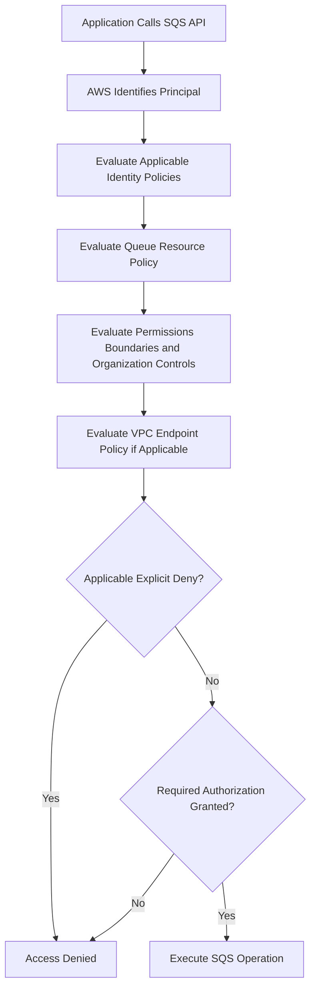
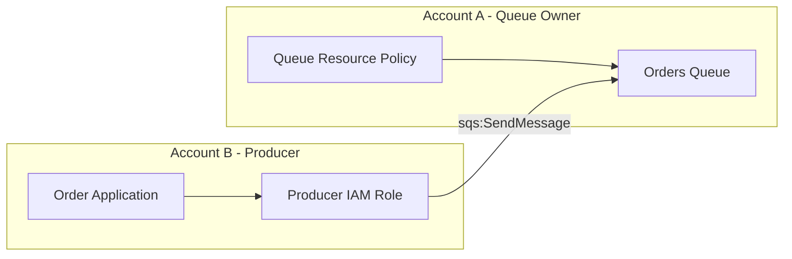

# 03- Queue Resource Policies

## Overview

Amazon SQS queue resource policies are JSON-based policies attached directly to SQS queues. They define which AWS principals can access a queue, which actions they can perform, and under what conditions access is permitted.

Unlike IAM identity-based policies, which are attached to users, groups, or roles, queue policies are attached to the SQS resource itself.

Queue resource policies are particularly important for:

- Cross-account message publishing and consumption.
- Allowing AWS services such as SNS and S3 to send messages.
- Restricting access to trusted IAM roles.
- Enforcing secure transport.
- Restricting requests to approved VPC endpoints.
- Preventing unauthorized queue administration.

A queue policy should be designed around the queue's ownership, workload responsibilities, and trust boundaries. It should not be treated as a substitute for IAM identity policies.

## Queue Resource Policy Fundamentals

### What Is a Queue Resource Policy?

A queue resource policy is a resource-based IAM policy associated with an SQS queue.

It contains statements describing:

- Who can access the queue.
- Which SQS actions are permitted or denied.
- Which queue resource the statement applies to.
- Which conditions must be satisfied.

A policy typically contains the following elements:

| Element | Purpose |
|---|---|
| `Version` | Specifies the IAM policy language version |
| `Statement` | Contains one or more permission statements |
| `Sid` | Optional statement identifier |
| `Effect` | Specifies `Allow` or `Deny` |
| `Principal` | Identifies the AWS identity or service |
| `Action` | Defines permitted or denied operations |
| `Resource` | Identifies the target queue ARN |
| `Condition` | Applies additional authorization requirements |

Example:

```json
{
  "Version": "2012-10-17",
  "Statement": [
    {
      "Sid": "AllowOrderProducer",
      "Effect": "Allow",
      "Principal": {
        "AWS": "arn:aws:iam::123456789012:role/order-producer"
      },
      "Action": "sqs:SendMessage",
      "Resource": "arn:aws:sqs:ap-south-1:123456789012:orders-queue"
    }
  ]
}
```

This policy allows the specified IAM role to send messages to the queue.

It does not grant the role permission to receive messages, delete messages, or modify queue configuration.

### Identity-Based Policy vs Resource-Based Policy

Both policy types participate in SQS authorization, but they serve different purposes.

| Characteristic | IAM identity policy | SQS resource policy |
|---|---|---|
| Attached to | IAM user, group, or role | SQS queue |
| Defines | What an identity can do | Who can access a queue |
| Cross-account access | Caller-side authorization | Resource-owner trust |
| AWS service integration | May be insufficient by itself | Commonly required |
| Explicit deny | Supported | Supported |
| Conditions | Supported | Supported |
| Typical use | Application permissions | Queue-level access control |

Example:

An application role in Account A needs to publish to a queue in Account B.

- Account A's IAM policy authorizes the role to call `sqs:SendMessage`.
- Account B's queue policy trusts that external role.

For cross-account access, both sides must authorize the operation.

## Queue Policy Authorization Flow

A typical SQS authorization request follows this logical flow:



The actual policy evaluation depends on the principal type, account relationship, and applicable AWS authorization controls.

Important rules:

- An explicit `Deny` overrides an applicable `Allow`.
- Cross-account requests generally require authorization from both the caller's account and the resource-owning account.
- A queue policy does not automatically override an explicit deny in another applicable policy.
- VPC endpoint policies can further restrict requests passing through an endpoint.
- KMS authorization is evaluated separately when the queue uses SSE-KMS.

Do not troubleshoot an access-denied error by inspecting only the queue policy. Review every applicable authorization layer.

## Queue Policy Principal Types

The `Principal` element identifies who is allowed or denied access.

### AWS Account Principal

An AWS account can be identified by its account ID or root ARN.

Example:

```json
{
  "Sid": "AllowAccountAccess",
  "Effect": "Allow",
  "Principal": {
    "AWS": "arn:aws:iam::222222222222:root"
  },
  "Action": "sqs:SendMessage",
  "Resource": "arn:aws:sqs:ap-south-1:111111111111:orders-queue"
}
```

This delegates access to the specified account. It does not mean that only the root user can access the queue. The external account's identity policies determine which identities can use the delegated permission.

Prefer trusting a specific IAM role when the integration has a clearly defined workload identity.

### IAM Role Principal

For application-to-application access, specify the exact IAM role ARN.

```json
{
  "Sid": "AllowOrderService",
  "Effect": "Allow",
  "Principal": {
    "AWS": "arn:aws:iam::123456789012:role/order-service"
  },
  "Action": "sqs:SendMessage",
  "Resource": "arn:aws:sqs:ap-south-1:123456789012:orders-queue"
}
```

This is preferable to granting access to every principal in the account when only one workload requires access.

When a role is deleted and recreated, its underlying principal identity can change. Review resource policies after replacing IAM roles to avoid unexpected authorization behavior.

### AWS Service Principal

AWS services use service principals when accessing resources on behalf of configured integrations.

Examples include:

| AWS service | Service principal |
|---|---|
| Amazon SNS | `sns.amazonaws.com` |
| Amazon S3 | `s3.amazonaws.com` |
| Amazon EventBridge | `events.amazonaws.com` |

Example allowing SNS to send messages:

```json
{
  "Sid": "AllowSNSDelivery",
  "Effect": "Allow",
  "Principal": {
    "Service": "sns.amazonaws.com"
  },
  "Action": "sqs:SendMessage",
  "Resource": "arn:aws:sqs:ap-south-1:123456789012:orders-queue",
  "Condition": {
    "ArnEquals": {
      "aws:SourceArn": "arn:aws:sns:ap-south-1:123456789012:order-events"
    },
    "StringEquals": {
      "aws:SourceAccount": "123456789012"
    }
  }
}
```

Restrict service principals using source conditions wherever supported. Otherwise, an unrelated resource using the same service principal may be able to access the queue.

### Wildcard Principal

A wildcard principal represents all principals.

Example:

```json
{
  "Sid": "AllowAnyoneToSend",
  "Effect": "Allow",
  "Principal": "*",
  "Action": "sqs:SendMessage",
  "Resource": "arn:aws:sqs:ap-south-1:123456789012:orders-queue"
}
```

This is generally unsuitable for production queues unless public access is an explicit requirement and additional restrictions are carefully designed.

Avoid wildcard principals for ordinary application messaging.

## Restrict Queue Actions

A queue policy should grant only the actions required by each principal.

### Producer Permissions

A producer normally requires:

- `sqs:SendMessage`
- `sqs:SendMessageBatch`, if batch publishing is used.

Example:

```json
{
  "Sid": "AllowOrderProducer",
  "Effect": "Allow",
  "Principal": {
    "AWS": "arn:aws:iam::123456789012:role/order-producer"
  },
  "Action": [
    "sqs:SendMessage",
    "sqs:SendMessageBatch"
  ],
  "Resource": "arn:aws:sqs:ap-south-1:123456789012:orders-queue"
}
```

A producer should not receive consumer or administrative permissions unless its responsibilities explicitly require them.

### Consumer Permissions

A consumer commonly requires:

- `sqs:ReceiveMessage`
- `sqs:DeleteMessage`
- `sqs:ChangeMessageVisibility`

Example:

```json
{
  "Sid": "AllowOrderConsumer",
  "Effect": "Allow",
  "Principal": {
    "AWS": "arn:aws:iam::123456789012:role/order-worker"
  },
  "Action": [
    "sqs:ReceiveMessage",
    "sqs:DeleteMessage",
    "sqs:ChangeMessageVisibility"
  ],
  "Resource": "arn:aws:sqs:ap-south-1:123456789012:orders-queue"
}
```

Keep producer and consumer permissions separate. A service that only publishes messages should not automatically be able to inspect or delete messages.

### Administrative Permissions

Queue administration should be restricted to platform or deployment roles.

Administrative actions include:

- `sqs:SetQueueAttributes`
- `sqs:DeleteQueue`
- `sqs:PurgeQueue`
- `sqs:AddPermission`
- `sqs:RemovePermission`

`PurgeQueue` is particularly sensitive because it removes all messages from a queue. It should not be granted to ordinary application workloads.

## Restrict Access with Policy Conditions

Conditions add context-based restrictions to queue policies.

They are useful for enforcing network boundaries, limiting service integrations, and reducing unintended access.

### Restrict AWS Service Access with Source ARN

The `aws:SourceArn` condition identifies the AWS resource that initiated a service-to-service request.

For example, allow one SNS topic to publish to an SQS queue:

```json
{
  "Sid": "AllowSpecificSNSTopic",
  "Effect": "Allow",
  "Principal": {
    "Service": "sns.amazonaws.com"
  },
  "Action": "sqs:SendMessage",
  "Resource": "arn:aws:sqs:ap-south-1:123456789012:orders-queue",
  "Condition": {
    "ArnEquals": {
      "aws:SourceArn": "arn:aws:sns:ap-south-1:123456789012:order-events"
    }
  }
}
```

This prevents other SNS topics from using the same service-principal permission.

Use the exact source ARN expected by the integration.

### Restrict by Source Account

The `aws:SourceAccount` condition restricts the source account for supported AWS service-to-service requests.

```json
{
  "Sid": "AllowExpectedSourceAccount",
  "Effect": "Allow",
  "Principal": {
    "Service": "sns.amazonaws.com"
  },
  "Action": "sqs:SendMessage",
  "Resource": "arn:aws:sqs:ap-south-1:123456789012:orders-queue",
  "Condition": {
    "StringEquals": {
      "aws:SourceAccount": "123456789012"
    }
  }
}
```

For service integrations, use source ARN and source account together when appropriate.

A source-account condition should not be confused with the account of the IAM principal making an ordinary direct API request.

### Enforce HTTPS with Secure Transport

The `aws:SecureTransport` condition indicates whether a request uses secure transport.

A common production control is to explicitly deny non-TLS requests.

```json
{
  "Sid": "DenyInsecureTransport",
  "Effect": "Deny",
  "Principal": "*",
  "Action": "sqs:*",
  "Resource": "arn:aws:sqs:ap-south-1:123456789012:orders-queue",
  "Condition": {
    "Bool": {
      "aws:SecureTransport": "false"
    }
  }
}
```

This denies requests that do not use secure transport, even when another policy statement grants access.

Review existing policies before introducing explicit denies because they can affect service integrations and legacy clients.

### Restrict Access Through a VPC Endpoint

The `aws:SourceVpce` condition can restrict access to requests made through a specific VPC endpoint.

```json
{
  "Sid": "AllowApprovedVPCEndpoint",
  "Effect": "Allow",
  "Principal": {
    "AWS": "arn:aws:iam::123456789012:role/order-worker"
  },
  "Action": [
    "sqs:ReceiveMessage",
    "sqs:DeleteMessage"
  ],
  "Resource": "arn:aws:sqs:ap-south-1:123456789012:orders-queue",
  "Condition": {
    "StringEquals": {
      "aws:SourceVpce": "vpce-0123456789abcdef0"
    }
  }
}
```

This is useful when a consumer should access SQS only through an approved private network path.

Ensure that every legitimate consumer uses the expected endpoint. Requests from other paths will not satisfy the condition.

### Restrict Access Using Principal ARN

The `aws:PrincipalArn` condition can be used to restrict access to an expected principal ARN.

Example:

```json
{
  "Sid": "AllowOnlyOrderWorkerRole",
  "Effect": "Allow",
  "Principal": "*",
  "Action": [
    "sqs:ReceiveMessage",
    "sqs:DeleteMessage"
  ],
  "Resource": "arn:aws:sqs:ap-south-1:123456789012:orders-queue",
  "Condition": {
    "ArnEquals": {
      "aws:PrincipalArn": "arn:aws:iam::123456789012:role/order-worker"
    }
  }
}
```

For most application integrations, specifying the exact role in `Principal` is clearer. Use principal ARN conditions when they solve a specific policy-design requirement.

### Restrict Access Using Organization Membership

The `aws:PrincipalOrgID` condition can restrict access to principals belonging to a specified AWS Organization.

Example:

```json
{
  "Sid": "AllowOrganizationPrincipals",
  "Effect": "Allow",
  "Principal": "*",
  "Action": "sqs:SendMessage",
  "Resource": "arn:aws:sqs:ap-south-1:123456789012:shared-events",
  "Condition": {
    "StringEquals": {
      "aws:PrincipalOrgID": "o-exampleorgid"
    }
  }
}
```

This is useful for shared messaging infrastructure across multiple AWS accounts.

Organization membership is not a substitute for workload-level authorization. Restrict actions and resources carefully, and consider whether every account in the organization should be trusted.

## Cross-Account Queue Access

### Cross-Account Architecture

Cross-account queue access allows a principal in one AWS account to interact with an SQS queue owned by another account.

Example:

- Account A owns the SQS queue.
- Account B runs an order producer.
- The producer role in Account B needs permission to send messages to Account A's queue.



### Producer Account Policy

Account B must authorize its producer role to send messages to the external queue.

```json
{
  "Version": "2012-10-17",
  "Statement": [
    {
      "Sid": "SendToExternalOrdersQueue",
      "Effect": "Allow",
      "Action": [
        "sqs:SendMessage"
      ],
      "Resource": "arn:aws:sqs:ap-south-1:111111111111:orders-queue"
    }
  ]
}
```

### Queue Owner Policy

Account A must allow the external producer role.

```json
{
  "Version": "2012-10-17",
  "Statement": [
    {
      "Sid": "AllowExternalProducer",
      "Effect": "Allow",
      "Principal": {
        "AWS": "arn:aws:iam::222222222222:role/external-order-producer"
      },
      "Action": [
        "sqs:SendMessage"
      ],
      "Resource": "arn:aws:sqs:ap-south-1:111111111111:orders-queue"
    }
  ]
}
```

### Cross-Account Security Requirements

| Requirement | Account | Purpose |
|---|---|---|
| Producer identity policy | Account B | Authorize the producer role |
| Queue resource policy | Account A | Trust the external producer |
| KMS key policy, if applicable | Queue-owning account | Authorize required encryption operations |
| CloudTrail monitoring | Both accounts as appropriate | Audit activity and configuration changes |

For SSE-KMS queues, the KMS key policy and caller permissions must also be configured. SQS queue authorization does not automatically grant KMS access.

Avoid granting an entire external account access when a dedicated role is sufficient.

## AWS Service Integrations

AWS services can send messages to SQS as part of event-driven architectures.

The queue resource policy must authorize the service principal and restrict the expected source resource.

### SNS to SQS

SNS commonly delivers topic notifications to SQS queues.

The queue policy should allow:

- Principal: `sns.amazonaws.com`
- Action: `sqs:SendMessage`
- Resource: The target queue ARN
- Condition: The expected SNS topic ARN

Example:

```json
{
  "Version": "2012-10-17",
  "Statement": [
    {
      "Sid": "AllowOrderEventsTopic",
      "Effect": "Allow",
      "Principal": {
        "Service": "sns.amazonaws.com"
      },
      "Action": "sqs:SendMessage",
      "Resource": "arn:aws:sqs:ap-south-1:123456789012:orders-queue",
      "Condition": {
        "ArnEquals": {
          "aws:SourceArn": "arn:aws:sns:ap-south-1:123456789012:order-events"
        },
        "StringEquals": {
          "aws:SourceAccount": "123456789012"
        }
      }
    }
  ]
}
```

### S3 to SQS

S3 event notifications can send object events to SQS.

Example queue policy:

```json
{
  "Version": "2012-10-17",
  "Statement": [
    {
      "Sid": "AllowCompanyDocumentBucket",
      "Effect": "Allow",
      "Principal": {
        "Service": "s3.amazonaws.com"
      },
      "Action": "sqs:SendMessage",
      "Resource": "arn:aws:sqs:ap-south-1:123456789012:storage-events",
      "Condition": {
        "ArnEquals": {
          "aws:SourceArn": "arn:aws:s3:::company-document-bucket"
        },
        "StringEquals": {
          "aws:SourceAccount": "123456789012"
        }
      }
    }
  ]
}
```

The queue must also satisfy the S3 event notification destination requirements, including compatible Region and queue configuration.

### EventBridge to SQS

EventBridge rules can target SQS queues.

The queue policy should authorize the EventBridge service principal and restrict the source rule ARN.

Example:

```json
{
  "Version": "2012-10-17",
  "Statement": [
    {
      "Sid": "AllowSpecificEventBridgeRule",
      "Effect": "Allow",
      "Principal": {
        "Service": "events.amazonaws.com"
      },
      "Action": "sqs:SendMessage",
      "Resource": "arn:aws:sqs:ap-south-1:123456789012:application-events",
      "Condition": {
        "ArnEquals": {
          "aws:SourceArn": "arn:aws:events:ap-south-1:123456789012:rule/application-events-rule"
        },
        "StringEquals": {
          "aws:SourceAccount": "123456789012"
        }
      }
    }
  ]
}
```

Use the actual rule ARN and account associated with the integration.

### Integration Policy Comparison

| Integration | Service principal | Typical permission | Important restriction |
|---|---|---|---|
| SNS to SQS | `sns.amazonaws.com` | `sqs:SendMessage` | SNS topic ARN |
| S3 to SQS | `s3.amazonaws.com` | `sqs:SendMessage` | Bucket ARN and source account |
| EventBridge to SQS | `events.amazonaws.com` | `sqs:SendMessage` | EventBridge rule ARN |

Do not reuse a broad service-principal policy across unrelated integrations.

## KMS and Queue Resource Policies

SQS queue policies and KMS key policies protect different resources.

A queue policy controls access to SQS operations. A KMS key policy controls access to cryptographic operations on the key.

For an SSE-KMS encrypted queue, both authorization layers must be configured correctly.

### Example Producer KMS Permissions

A producer commonly needs the following permissions for an SSE-KMS queue:

```json
{
  "Version": "2012-10-17",
  "Statement": [
    {
      "Sid": "AllowProducerKmsOperations",
      "Effect": "Allow",
      "Action": [
        "kms:GenerateDataKey",
        "kms:Decrypt"
      ],
      "Resource": "arn:aws:kms:ap-south-1:123456789012:key/11111111-2222-3333-4444-555555555555"
    }
  ]
}
```

Consumers commonly require `kms:Decrypt`.

The exact permissions depend on the queue encryption configuration and workflow. The KMS key policy must also authorize the relevant principals or delegate authorization appropriately.

### KMS Security Considerations

- Do not grant `kms:*` to application roles.
- Separate key administration from application usage.
- Restrict key access to required workloads.
- Monitor key policy changes.
- Enable key rotation where appropriate.
- Avoid disabling or deleting keys while queues depend on them.
- Document key recovery and replacement procedures.

A valid queue policy does not compensate for missing KMS permissions.

## Managing Queue Policies with AWS CLI

### Retrieve the Queue Policy

Queue policies are stored in the queue's `Policy` attribute.

```bash
aws sqs get-queue-attributes \
  --queue-url https://sqs.ap-south-1.amazonaws.com/123456789012/orders-queue \
  --attribute-names Policy
```

Retrieve all queue attributes:

```bash
aws sqs get-queue-attributes \
  --queue-url https://sqs.ap-south-1.amazonaws.com/123456789012/orders-queue \
  --attribute-names All
```

### Create a Policy File

Create `queue-policy.json`:

```json
{
  "Version": "2012-10-17",
  "Statement": [
    {
      "Sid": "AllowOrderProducer",
      "Effect": "Allow",
      "Principal": {
        "AWS": "arn:aws:iam::123456789012:role/order-producer"
      },
      "Action": "sqs:SendMessage",
      "Resource": "arn:aws:sqs:ap-south-1:123456789012:orders-queue"
    }
  ]
}
```

### Apply the Policy

The SQS `SetQueueAttributes` API expects the `Policy` attribute value to contain the policy document as a JSON string.

Generate the required attributes file:

```python
import json
from pathlib import Path

policy_path = Path("queue-policy.json")
attributes_path = Path("queue-attributes.json")

policy = json.loads(policy_path.read_text(encoding="utf-8"))

attributes = {
    "Policy": json.dumps(policy)
}

attributes_path.write_text(
    json.dumps(attributes, indent=2),
    encoding="utf-8",
)
```

Apply it:

```bash
aws sqs set-queue-attributes \
  --queue-url https://sqs.ap-south-1.amazonaws.com/123456789012/orders-queue \
  --attributes file://queue-attributes.json
```

Verify the updated policy:

```bash
aws sqs get-queue-attributes \
  --queue-url https://sqs.ap-south-1.amazonaws.com/123456789012/orders-queue \
  --attribute-names Policy
```

### Important Policy Update Behavior

`SetQueueAttributes` replaces the value of the specified attribute.

When updating a queue policy, submit the complete intended policy rather than assuming the API will merge new statements into the existing policy.

Before applying a change:

1. Retrieve the existing policy.
2. Review all existing statements.
3. Merge the intended changes.
4. Validate the resulting JSON.
5. Apply the complete policy.
6. Verify the resulting queue attribute.
7. Test authorized and unauthorized access.

This prevents accidental removal of existing service integrations or cross-account permissions.

## Managing Queue Policies with Terraform

Terraform provides a repeatable way to define and review SQS queue resource policies.

### Define a Queue

```hcl
resource "aws_sqs_queue" "orders" {
  name                       = "orders-queue"
  visibility_timeout_seconds = 180
  message_retention_seconds  = 345600
  receive_wait_time_seconds  = 20

  sqs_managed_sse_enabled = true

  tags = {
    Environment = "production"
    ManagedBy   = "terraform"
    DataClass   = "confidential"
  }
}
```

### Define the Queue Policy

```hcl
data "aws_iam_policy_document" "orders_queue" {
  statement {
    sid    = "AllowOrderProducer"
    effect = "Allow"

    principals {
      type        = "AWS"
      identifiers = [aws_iam_role.order_producer.arn]
    }

    actions = [
      "sqs:SendMessage"
    ]

    resources = [
      aws_sqs_queue.orders.arn
    ]
  }

  statement {
    sid    = "AllowOrderWorker"
    effect = "Allow"

    principals {
      type        = "AWS"
      identifiers = [aws_iam_role.order_worker.arn]
    }

    actions = [
      "sqs:ReceiveMessage",
      "sqs:DeleteMessage",
      "sqs:ChangeMessageVisibility"
    ]

    resources = [
      aws_sqs_queue.orders.arn
    ]
  }

  statement {
    sid    = "DenyInsecureTransport"
    effect = "Deny"

    principals {
      type        = "*"
      identifiers = ["*"]
    }

    actions = [
      "sqs:*"
    ]

    resources = [
      aws_sqs_queue.orders.arn
    ]

    condition {
      test     = "Bool"
      variable = "aws:SecureTransport"
      values   = ["false"]
    }
  }
}

resource "aws_sqs_queue_policy" "orders" {
  queue_url = aws_sqs_queue.orders.id
  policy    = data.aws_iam_policy_document.orders_queue.json
}
```

The example assumes that the IAM roles are defined elsewhere.

### Terraform Deployment Practices

Use the following practices:

- Keep queue policies in version control.
- Separate application permissions from administrative permissions.
- Avoid embedding credentials in Terraform configuration.
- Review policy changes in pull requests.
- Run `terraform plan` before applying.
- Validate policy JSON and resource references.
- Avoid multiple Terraform resources managing the same queue policy.
- Review policy drift between deployed infrastructure and source configuration.

Example validation commands:

```bash
terraform fmt -check
terraform validate
terraform plan
```

Terraform validation checks configuration structure and provider schemas. It does not prove that the policy grants exactly the intended runtime permissions.

## Policy Validation and Testing

A queue policy should be tested against both permitted and prohibited operations.

### Validate Policy Structure

Use IAM Access Analyzer policy validation to identify policy errors and security findings.

Policy validation can help detect:

- Invalid policy syntax.
- Unsupported elements.
- Overly broad permissions.
- Potentially unintended access.
- Security-related policy findings.

Validation does not guarantee that every runtime authorization scenario will behave as intended.

### Test Expected Access

Use the actual producer role to test publishing:

```bash
aws sqs send-message \
  --queue-url https://sqs.ap-south-1.amazonaws.com/123456789012/orders-queue \
  --message-body '{"event_type":"order.created","order_id":"ord_123"}'
```

Use the actual consumer role to test receiving:

```bash
aws sqs receive-message \
  --queue-url https://sqs.ap-south-1.amazonaws.com/123456789012/orders-queue \
  --max-number-of-messages 1
```

Use a non-production queue for destructive tests. Receiving a message changes its visibility, and deleting a message permanently removes it from the queue.

### Test Unauthorized Access

Verify that:

- An untrusted role cannot publish.
- An untrusted role cannot receive messages.
- A producer cannot delete messages.
- A consumer cannot modify queue policies.
- An unrelated SNS topic cannot publish through a service-principal permission.
- Requests through unapproved VPC endpoints are rejected when endpoint restrictions are enforced.
- Non-TLS requests are denied.

Testing only successful access is insufficient. Security validation must also demonstrate that prohibited operations fail.

## Monitoring and Auditing Queue Policy Changes

Queue policy modifications can expand access or interrupt production messaging.

Use CloudTrail to audit supported SQS management API activity.

Pay particular attention to:

- `SetQueueAttributes`
- `AddPermission`
- `RemovePermission`
- `CreateQueue`
- `DeleteQueue`

Monitor for:

- New wildcard principals.
- Unexpected external account access.
- New service-principal permissions.
- Removal of required service integrations.
- Changes to secure transport restrictions.
- Unexpected queue policy updates.

CloudTrail management events provide visibility into configuration changes. Configure appropriate organization-level auditing and protect the resulting logs.

Also review CloudTrail data-event capabilities when auditing message-level API activity is required.

Do not treat queue policies as static configuration. Reassess them when application roles, AWS accounts, service integrations, or network architecture change.

## Common Queue Policy Mistakes

| Mistake | Risk | Recommended approach |
|---|---|---|
| Using `Principal: "*"` without restrictive conditions | Broad queue exposure | Specify trusted roles or service principals |
| Granting `sqs:*` to producers | Excessive permissions | Grant only publishing actions |
| Omitting `aws:SourceArn` for service integrations | Unintended service-originated access | Restrict the expected source resource |
| Trusting an entire external account unnecessarily | Excessive cross-account access | Trust a specific IAM role |
| Assuming a queue policy replaces IAM | Authorization failures or unintended access | Review all applicable policy layers |
| Forgetting KMS authorization | Encrypted queue operations fail | Configure KMS permissions separately |
| Applying a policy without retrieving the current version | Existing permissions disappear | Merge and submit the complete intended policy |
| Using an incorrect queue ARN | Policy does not apply as intended | Verify account, Region, and queue name |
| Adding restrictive endpoint conditions without testing | Legitimate workloads lose access | Validate every consumer network path |
| Allowing unrestricted queue administration | Queue deletion or message loss | Restrict administrative actions |
| Ignoring policy drift | Deployed permissions differ from reviewed code | Manage policies through infrastructure as code |
| Testing only with administrator credentials | Workload authorization problems remain hidden | Test using actual application roles |

## Production Queue Policy Checklist

### Principal and Action Restrictions

- [ ] Every allowed principal has a defined business or operational purpose.
- [ ] Producer and consumer permissions are separated.
- [ ] Administrative actions are restricted.
- [ ] Wildcard principals are avoided unless explicitly justified.
- [ ] Actions are limited to those required by each workload.
- [ ] Queue ARNs are exact and verified.

### Conditional Access

- [ ] AWS service principals use appropriate source ARN restrictions.
- [ ] Source account restrictions are applied where appropriate.
- [ ] Secure transport is enforced.
- [ ] VPC endpoint restrictions are tested.
- [ ] Organization membership conditions do not replace workload-level authorization.
- [ ] Explicit deny statements are reviewed for unintended effects.

### Cross-Account and Encryption

- [ ] Cross-account caller and resource-owner policies are configured.
- [ ] External access is granted to specific roles where possible.
- [ ] KMS key policies are reviewed for SSE-KMS queues.
- [ ] KMS administration is separated from application usage.
- [ ] Service integrations are tested after policy changes.

### Operations and Governance

- [ ] Queue policies are version-controlled.
- [ ] Policy changes are reviewed through CI/CD.
- [ ] IAM Access Analyzer validation is included where appropriate.
- [ ] Existing policies are retrieved before updates.
- [ ] CloudTrail monitors policy modifications.
- [ ] Authorized and unauthorized access tests are performed.
- [ ] Policy drift is periodically reviewed.

## Key Takeaways

- SQS queue resource policies define which principals can access a queue and which operations they can perform; they complement IAM identity policies.
- Use specific IAM roles, minimal SQS actions, and exact queue ARNs instead of broad wildcard permissions.
- Restrict AWS service integrations with source ARN and source account conditions, and enforce secure transport.
- Cross-account access requires authorization from the caller's account and the queue-owning account; SSE-KMS introduces a separate KMS authorization boundary.
- Manage complete queue policies through reviewed infrastructure as code, validate both allowed and denied access, and audit policy changes with CloudTrail.