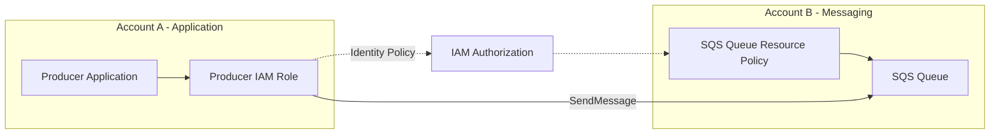
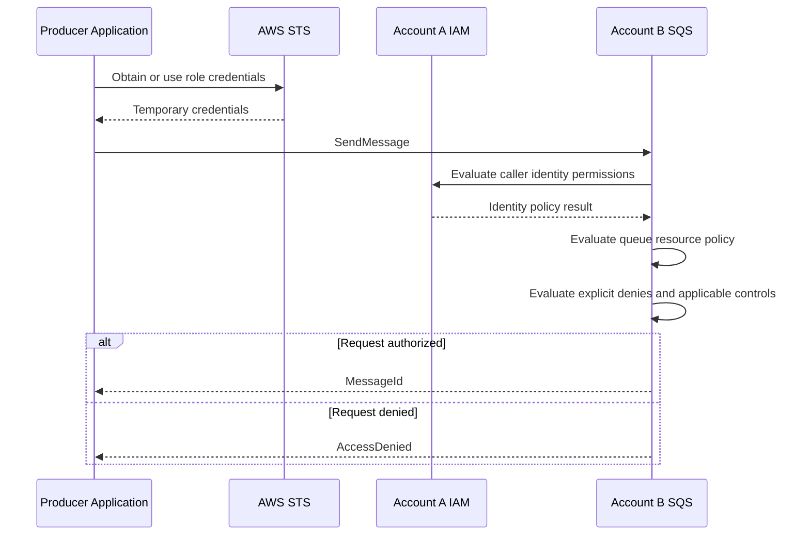
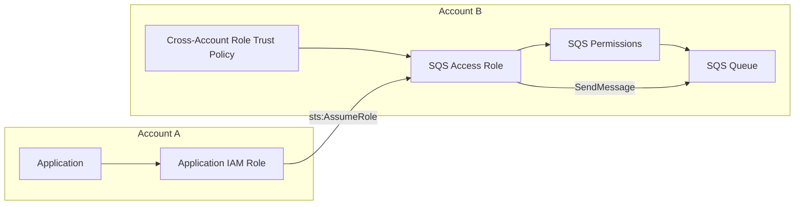
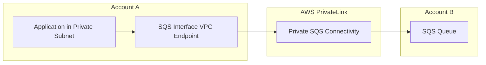

# 04- Cross-Account Queue Access

## Overview

Amazon SQS supports cross-account access, allowing an IAM principal in one AWS account to interact with a queue owned by another account. This enables independently managed applications, shared services, centralized messaging platforms, and event-driven architectures to exchange messages without moving workloads into the same AWS account.

Cross-account access is primarily controlled through two authorization layers:

- **Identity-based IAM policy:** Grants the calling principal permission to perform specific SQS operations.
- **Queue resource policy:** Grants an external AWS account or principal permission to access the target queue.

For SSE-KMS encrypted queues, AWS KMS introduces an additional authorization boundary. The calling principal must also have the required KMS permissions, and the KMS key policy must permit the cross-account operation.

A secure implementation should restrict access to specific IAM roles, queue actions, resources, and trusted accounts rather than granting broad access to an entire account or using wildcard principals.

## Cross-Account Access Architecture

Consider two AWS accounts:

| Account | Responsibility |
|---|---|
| Account A | Application account containing the producer |
| Account B | Messaging account owning the SQS queue |

The producer in Account A sends messages to a queue in Account B. Account B controls the queue and decides which external principals can access it.



The request is authorized only when the applicable IAM and resource policies permit the operation.

For cross-account access, the typical authorization requirements are:

1. The caller's identity policy permits the requested SQS action on the target queue.
2. The queue's resource policy permits the external principal or account.
3. No applicable explicit deny blocks the request.
4. If SSE-KMS is enabled, the KMS key policy and caller permissions permit the required cryptographic operations.

## How Cross-Account Authorization Works

### Identity-Based Policy

The account containing the calling IAM role must grant that role permission to access the external queue.

For example, Account A contains an application role named `orders-producer-role`. Its identity policy grants permission to send messages to a queue in Account B.

```json
{
  "Version": "2012-10-17",
  "Statement": [
    {
      "Sid": "AllowSendMessagesToExternalQueue",
      "Effect": "Allow",
      "Action": [
        "sqs:SendMessage"
      ],
      "Resource": "arn:aws:sqs:ap-south-1:222222222222:orders-queue"
    }
  ]
}
```

Attach this policy to the producer role in Account A.

The policy grants permission to request `SendMessage`, but it does not independently authorize access to the external queue. Account B must also allow the principal through its queue resource policy.

### Queue Resource Policy

The queue owner defines a resource-based policy on the queue.

For example, Account B allows the producer role from Account A to send messages.

```json
{
  "Version": "2012-10-17",
  "Statement": [
    {
      "Sid": "AllowExternalProducer",
      "Effect": "Allow",
      "Principal": {
        "AWS": "arn:aws:iam::111111111111:role/orders-producer-role"
      },
      "Action": [
        "sqs:SendMessage"
      ],
      "Resource": "arn:aws:sqs:ap-south-1:222222222222:orders-queue"
    }
  ]
}
```

The `Principal` identifies the external IAM role. The `Action` limits the permission to sending messages, while `Resource` identifies the queue being protected.

Using a specific IAM role is generally safer than granting access to every principal in the external account.

### Authorization Flow



The diagram represents the authorization decision conceptually. AWS evaluates the applicable policy layers and organizational controls as part of request authorization.

## Granting Cross-Account Producer Access

A producer requires permission to send messages without receiving unnecessary administrative or consumer permissions.

### Account Configuration

| Configuration | Account A | Account B |
|---|---|---|
| AWS account ID | `111111111111` | `222222222222` |
| IAM role | `orders-producer-role` | Not required for this example |
| SQS queue | None | `orders-queue` |
| Identity policy | Allow `sqs:SendMessage` | Not applicable |
| Queue resource policy | Not applicable | Allow Account A role |

### Configure the Producer IAM Role

Attach the following policy to `orders-producer-role` in Account A.

```json
{
  "Version": "2012-10-17",
  "Statement": [
    {
      "Sid": "SendOrdersToMessagingAccount",
      "Effect": "Allow",
      "Action": [
        "sqs:SendMessage"
      ],
      "Resource": "arn:aws:sqs:ap-south-1:222222222222:orders-queue"
    }
  ]
}
```

Avoid granting `sqs:*` when the application only produces messages.

### Configure the Queue Resource Policy

In Account B, apply the following policy to `orders-queue`.

```json
{
  "Version": "2012-10-17",
  "Statement": [
    {
      "Sid": "AllowOrdersProducerFromAccountA",
      "Effect": "Allow",
      "Principal": {
        "AWS": "arn:aws:iam::111111111111:role/orders-producer-role"
      },
      "Action": [
        "sqs:SendMessage"
      ],
      "Resource": "arn:aws:sqs:ap-south-1:222222222222:orders-queue"
    }
  ]
}
```

### Apply the Queue Policy Using AWS CLI

Run this command using credentials authorized to modify the queue in Account B.

```bash
aws sqs set-queue-attributes \
  --queue-url https://sqs.ap-south-1.amazonaws.com/222222222222/orders-queue \
  --attributes file://queue-attributes.json \
  --region ap-south-1
```

The `queue-attributes.json` file contains the policy as a JSON string:

```json
{
  "Policy": "{\"Version\":\"2012-10-17\",\"Statement\":[{\"Sid\":\"AllowOrdersProducerFromAccountA\",\"Effect\":\"Allow\",\"Principal\":{\"AWS\":\"arn:aws:iam::111111111111:role/orders-producer-role\"},\"Action\":\"sqs:SendMessage\",\"Resource\":\"arn:aws:sqs:ap-south-1:222222222222:orders-queue\"}]}"
}
```

`SetQueueAttributes` replaces the specified policy attribute. Always submit the complete intended queue policy, including existing statements that must remain.

### Verify the Queue Policy

```bash
aws sqs get-queue-attributes \
  --queue-url https://sqs.ap-south-1.amazonaws.com/222222222222/orders-queue \
  --attribute-names Policy \
  --region ap-south-1
```

Verify that the expected principal, action, and queue ARN are present.

## Granting Cross-Account Consumer Access

A consumer requires permission to retrieve and delete messages from the external queue.

The typical consumer workflow uses:

- `sqs:ReceiveMessage`
- `sqs:DeleteMessage`
- `sqs:GetQueueAttributes`

If the application needs to inspect queue configuration or use long polling, the relevant permissions must also be considered.

### Consumer Identity Policy

Attach this policy to the consumer role in Account A.

```json
{
  "Version": "2012-10-17",
  "Statement": [
    {
      "Sid": "ConsumeOrdersFromExternalQueue",
      "Effect": "Allow",
      "Action": [
        "sqs:ReceiveMessage",
        "sqs:DeleteMessage",
        "sqs:GetQueueAttributes"
      ],
      "Resource": "arn:aws:sqs:ap-south-1:222222222222:orders-queue"
    }
  ]
}
```

### Consumer Queue Resource Policy

Account B must also allow the consumer role.

```json
{
  "Version": "2012-10-17",
  "Statement": [
    {
      "Sid": "AllowExternalConsumer",
      "Effect": "Allow",
      "Principal": {
        "AWS": "arn:aws:iam::111111111111:role/orders-consumer-role"
      },
      "Action": [
        "sqs:ReceiveMessage",
        "sqs:DeleteMessage",
        "sqs:GetQueueAttributes"
      ],
      "Resource": "arn:aws:sqs:ap-south-1:222222222222:orders-queue"
    }
  ]
}
```

Producer and consumer permissions should remain separate when they belong to different applications or operational responsibilities.

### Consumer Processing Considerations

Cross-account access does not change SQS message delivery semantics.

A consumer should:

1. Receive a message.
2. Validate and process the payload.
3. Persist the business result durably.
4. Delete the message only after successful processing.

Standard SQS queues provide at-least-once delivery. A message can be delivered more than once, so consumers must implement idempotent processing.

For example, a FastAPI or Django consumer can use a PostgreSQL inbox table with a unique message identifier or business event identifier to prevent duplicate side effects.

## Cross-Account Access Using an IAM Role

Directly trusting an external IAM role in a queue policy is a common approach. Another pattern is to let the external application assume a dedicated role in the queue-owning account.

This is useful when the queue owner wants to manage access through a centrally controlled role, or when the external account should receive only a narrowly scoped set of permissions.

### Architecture



### Configure the Trust Policy

In Account B, create an IAM role named `cross-account-orders-producer`.

Its trust policy allows the producer role in Account A to assume it.

```json
{
  "Version": "2012-10-17",
  "Statement": [
    {
      "Sid": "TrustOrdersProducerRole",
      "Effect": "Allow",
      "Principal": {
        "AWS": "arn:aws:iam::111111111111:role/orders-producer-role"
      },
      "Action": "sts:AssumeRole"
    }
  ]
}
```

For production systems, consider an appropriate external ID when the role is assumed by a third-party or multi-tenant service. An external ID is a confused-deputy protection mechanism, not a replacement for trusted-principal restrictions.

### Configure the SQS Permission Policy

Attach this identity policy to `cross-account-orders-producer` in Account B.

```json
{
  "Version": "2012-10-17",
  "Statement": [
    {
      "Sid": "AllowSendingOrders",
      "Effect": "Allow",
      "Action": [
        "sqs:SendMessage"
      ],
      "Resource": "arn:aws:sqs:ap-south-1:222222222222:orders-queue"
    }
  ]
}
```

The queue resource policy does not need to grant the original Account A role direct access to the queue when the assumed role operates within Account B and the identity policy authorizes the operation, provided no other policy restriction blocks it.

### Allow AssumeRole in Account A

The producer role in Account A also needs permission to assume the role in Account B.

```json
{
  "Version": "2012-10-17",
  "Statement": [
    {
      "Sid": "AssumeMessagingAccountRole",
      "Effect": "Allow",
      "Action": "sts:AssumeRole",
      "Resource": "arn:aws:iam::222222222222:role/cross-account-orders-producer"
    }
  ]
}
```

### Assume the Role Using AWS CLI

```bash
aws sts assume-role \
  --role-arn arn:aws:iam::222222222222:role/cross-account-orders-producer \
  --role-session-name orders-producer-session \
  --region ap-south-1
```

The response contains temporary credentials:

- `AccessKeyId`
- `SecretAccessKey`
- `SessionToken`
- `Expiration`

Use these credentials to create an SQS client. Do not persist temporary credentials in source code, container images, or application configuration files.

### Assume the Role Using Python Boto3

```python
import boto3
from botocore.config import Config


ROLE_ARN = (
    "arn:aws:iam::222222222222:"
    "role/cross-account-orders-producer"
)

REGION = "ap-south-1"


def create_cross_account_sqs_client():
    sts = boto3.client("sts", region_name=REGION)

    response = sts.assume_role(
        RoleArn=ROLE_ARN,
        RoleSessionName="orders-producer-session",
    )

    credentials = response["Credentials"]

    return boto3.client(
        "sqs",
        region_name=REGION,
        aws_access_key_id=credentials["AccessKeyId"],
        aws_secret_access_key=credentials["SecretAccessKey"],
        aws_session_token=credentials["SessionToken"],
        config=Config(
            retries={
                "mode": "standard",
                "max_attempts": 5,
            }
        ),
    )
```

This example creates a client using one set of temporary credentials. A long-running production service should use a credential-refreshing mechanism rather than assuming a role once and allowing the credentials to expire.

Use an SDK credential provider or a refreshable assumed-role session, and rely on the workload's normal AWS identity mechanism for the initial credentials.

### Choosing Between Direct Access and AssumeRole

| Consideration | Direct queue resource policy | AssumeRole into queue account |
|---|---|---|
| Authorization model | External role is trusted by queue policy | External role assumes an internal role |
| Configuration | Identity policy and queue policy | AssumeRole permission, trust policy, and role permissions |
| Credential management | Uses caller's existing credentials | Uses temporary credentials for the assumed role |
| Centralized permissions | Managed through queue policy | Managed through IAM role |
| Operational complexity | Lower | Higher |
| Suitable use cases | Simple account-to-account messaging | Centralized access management and shared services |

Use direct resource-policy access when the external principal needs a narrowly scoped queue permission. Use AssumeRole when the queue-owning account needs a dedicated permission boundary or a centralized role-based access model.

## Cross-Account Access for SSE-KMS Encrypted Queues

When an SQS queue uses a customer managed AWS KMS key, cross-account access requires additional configuration.

SQS permissions alone are insufficient. The producer or consumer must also be authorized to use the KMS key for the required cryptographic operations.

### Authorization Requirements

For a cross-account producer using SSE-KMS:

- The producer's identity policy must allow the required KMS operations.
- The KMS key policy in Account B must permit the external principal or role.
- The SQS queue policy must permit the producer's SQS action.

For a consumer, the required KMS permissions can include `kms:Decrypt`. The exact permissions depend on the queue configuration and operation.

### KMS Key Policy

In Account B, the customer managed KMS key policy can include a statement allowing the external producer role to use the key.

```json
{
  "Sid": "AllowExternalProducerToUseQueueKey",
  "Effect": "Allow",
  "Principal": {
    "AWS": "arn:aws:iam::111111111111:role/orders-producer-role"
  },
  "Action": [
    "kms:GenerateDataKey",
    "kms:Decrypt"
  ],
  "Resource": "*"
}
```

The `Resource` element in a KMS key policy statement is conventionally `"*"`, because the policy is attached to a specific key.

The example grants permissions that may be needed by SQS encryption workflows. Review the actual producer and consumer operations and grant only the required permissions.

### Producer Identity Policy for KMS

The producer role in Account A may require the following permissions:

```json
{
  "Version": "2012-10-17",
  "Statement": [
    {
      "Sid": "UseExternalQueueKmsKey",
      "Effect": "Allow",
      "Action": [
        "kms:GenerateDataKey",
        "kms:Decrypt"
      ],
      "Resource": "arn:aws:kms:ap-south-1:222222222222:key/11111111-2222-3333-4444-555555555555"
    }
  ]
}
```

Do not assume every SQS producer and consumer needs the same KMS permissions. Validate the required actions against the actual encryption configuration and AWS service integration.

### KMS Security Considerations

- Prefer customer managed keys when cross-account key governance is required.
- Restrict key usage to trusted roles and intended AWS services.
- Avoid granting `kms:*` to application roles.
- Review key rotation, deletion, and recovery policies.
- Monitor key usage through CloudTrail.
- Remember that an SQS queue policy does not grant KMS permissions.

Cross-account KMS access must be configured independently of SQS access.

## Restricting Cross-Account Access with Conditions

Queue resource policies can use IAM condition keys to constrain external access.

Conditions are useful when access should be limited to a trusted account, organization, network endpoint, or AWS service integration.

### Restrict Access to a Specific VPC Endpoint

The following policy allows the external producer role to send messages only when the request uses a specified VPC endpoint.

```json
{
  "Version": "2012-10-17",
  "Statement": [
    {
      "Sid": "AllowProducerThroughApprovedEndpoint",
      "Effect": "Allow",
      "Principal": {
        "AWS": "arn:aws:iam::111111111111:role/orders-producer-role"
      },
      "Action": [
        "sqs:SendMessage"
      ],
      "Resource": "arn:aws:sqs:ap-south-1:222222222222:orders-queue",
      "Condition": {
        "StringEquals": {
          "aws:SourceVpce": "vpce-0123456789abcdef0"
        }
      }
    }
  ]
}
```

This is useful for private workloads communicating with SQS through an interface VPC endpoint.

Before enforcing this condition, verify that every legitimate producer uses the approved endpoint. Requests from other network paths will not satisfy the condition.

### Require Secure Transport

SQS API requests should use HTTPS. A queue policy can explicitly deny requests that do not use secure transport.

```json
{
  "Sid": "DenyInsecureTransport",
  "Effect": "Deny",
  "Principal": "*",
  "Action": "sqs:*",
  "Resource": "arn:aws:sqs:ap-south-1:222222222222:orders-queue",
  "Condition": {
    "Bool": {
      "aws:SecureTransport": "false"
    }
  }
}
```

An explicit deny overrides an otherwise applicable allow.

### Restrict AWS Service Integrations

When granting an AWS service principal access to a queue, use source conditions where supported.

For example, an S3 event notification can be restricted to a specific bucket and source account.

```json
{
  "Sid": "AllowSpecificS3Bucket",
  "Effect": "Allow",
  "Principal": {
    "Service": "s3.amazonaws.com"
  },
  "Action": [
    "sqs:SendMessage"
  ],
  "Resource": "arn:aws:sqs:ap-south-1:222222222222:orders-queue",
  "Condition": {
    "ArnEquals": {
      "aws:SourceArn": "arn:aws:s3:::company-orders-bucket"
    },
    "StringEquals": {
      "aws:SourceAccount": "111111111111"
    }
  }
}
```

Use the actual source ARN and account associated with the integration. Source conditions are intended for supported service-to-service requests and should not be treated as general conditions for ordinary direct IAM role requests.

## Cross-Account Access Using Terraform

Terraform can manage the IAM policies and SQS queue resource policy as infrastructure as code.

### Account B: SQS Queue

```hcl
resource "aws_sqs_queue" "orders" {
  name = "orders-queue"

  visibility_timeout_seconds = 60
  message_retention_seconds  = 345600
  receive_wait_time_seconds = 20

  sqs_managed_sse_enabled = true

  tags = {
    Environment = "production"
    Service     = "orders"
  }
}
```

This example uses SQS-managed encryption. If customer managed KMS encryption is required, configure the queue's KMS key separately and establish the appropriate cross-account key permissions.

### Account B: Queue Resource Policy

```hcl
data "aws_iam_policy_document" "orders_queue_policy" {
  statement {
    sid    = "AllowExternalOrdersProducer"
    effect = "Allow"

    principals {
      type = "AWS"

      identifiers = [
        "arn:aws:iam::111111111111:role/orders-producer-role"
      ]
    }

    actions = [
      "sqs:SendMessage"
    ]

    resources = [
      aws_sqs_queue.orders.arn
    ]
  }

  statement {
    sid    = "DenyInsecureTransport"
    effect = "Deny"

    principals {
      type        = "*"
      identifiers = ["*"]
    }

    actions = [
      "sqs:*"
    ]

    resources = [
      aws_sqs_queue.orders.arn
    ]

    condition {
      test     = "Bool"
      variable = "aws:SecureTransport"
      values   = ["false"]
    }
  }
}

resource "aws_sqs_queue_policy" "orders" {
  queue_url = aws_sqs_queue.orders.id
  policy    = data.aws_iam_policy_document.orders_queue_policy.json
}
```

### Account A: Producer IAM Policy

```hcl
data "aws_iam_policy_document" "orders_producer" {
  statement {
    sid    = "SendMessagesToExternalQueue"
    effect = "Allow"

    actions = [
      "sqs:SendMessage"
    ]

    resources = [
      "arn:aws:sqs:ap-south-1:222222222222:orders-queue"
    ]
  }
}

resource "aws_iam_policy" "orders_producer" {
  name   = "orders-cross-account-producer"
  policy = data.aws_iam_policy_document.orders_producer.json
}

resource "aws_iam_role_policy_attachment" "orders_producer" {
  role       = "orders-producer-role"
  policy_arn = aws_iam_policy.orders_producer.arn
}
```

The role must already exist in Account A. The queue policy and IAM policy should be deployed using credentials for their respective accounts.

For multi-account deployments, use separate provider configurations or separate Terraform states with explicit account ownership.

### Multi-Account Provider Configuration

A single Terraform configuration can use multiple AWS provider aliases.

```hcl
provider "aws" {
  alias  = "application"
  region = "ap-south-1"

  assume_role {
    role_arn = "arn:aws:iam::111111111111:role/terraform-deployment-role"
  }
}

provider "aws" {
  alias  = "messaging"
  region = "ap-south-1"

  assume_role {
    role_arn = "arn:aws:iam::222222222222:role/terraform-deployment-role"
  }
}
```

Assign resources and data sources to the correct provider:

```hcl
resource "aws_sqs_queue" "orders" {
  provider = aws.messaging

  name = "orders-queue"

  sqs_managed_sse_enabled = true
}

resource "aws_sqs_queue_policy" "orders" {
  provider = aws.messaging

  queue_url = aws_sqs_queue.orders.id
  policy    = data.aws_iam_policy_document.orders_queue_policy.json
}
```

For production deployments, keep account-specific configuration explicit and validate the active AWS account before applying changes.

## Python Application Integration

A producer in Account A can send messages directly to the queue in Account B when its execution role and the queue policy authorize access.

### Configure the SQS Client

Use the AWS SDK's default credential provider chain. On EC2, ECS, EKS, and other supported AWS environments, use workload roles instead of static credentials.

```python
import boto3
from botocore.config import Config


REGION = "ap-south-1"

QUEUE_URL = (
    "https://sqs.ap-south-1.amazonaws.com/"
    "222222222222/orders-queue"
)

sqs = boto3.client(
    "sqs",
    region_name=REGION,
    config=Config(
        retries={
            "mode": "standard",
            "max_attempts": 5,
        },
        connect_timeout=3,
        read_timeout=10,
    ),
)
```

### Send a Message

```python
import json
from uuid import uuid4


def publish_order(order_id: str, customer_id: str) -> str:
    message = {
        "event_id": str(uuid4()),
        "event_type": "order.created",
        "order_id": order_id,
        "customer_id": customer_id,
    }

    response = sqs.send_message(
        QueueUrl=QUEUE_URL,
        MessageBody=json.dumps(message),
    )

    return response["MessageId"]
```

The producer should handle transient failures, record failed publishing attempts, and avoid logging sensitive message contents.

For FIFO queues, provide the required message group and deduplication identifiers. FIFO queue behavior and deduplication requirements are separate from cross-account authorization.

### Production Integration Considerations

For a Django, FastAPI, or Celery-based producer:

- Keep AWS account IDs, queue URLs, and Region values in deployment configuration.
- Use IAM roles rather than static AWS credentials.
- Apply bounded retries with exponential backoff and jitter where appropriate.
- Use an outbox pattern when database transactions and message publishing must remain consistent.
- Track failed publishing attempts and provide a controlled recovery mechanism.
- Avoid treating a successful API response as proof that downstream business processing completed.

A transactional outbox is especially useful when a backend service commits an order to PostgreSQL and must reliably publish an event to an external SQS queue.

## Cross-Account Access with SQS VPC Endpoints

SQS supports interface VPC endpoints through AWS PrivateLink.

A workload in Account A can communicate with an SQS queue in Account B through a VPC endpoint without requiring public internet routing for the SQS API traffic.



### Important Configuration

- Create an SQS interface endpoint in the producer's VPC.
- Enable private DNS when appropriate.
- Configure security groups to permit HTTPS traffic from the workload.
- Apply an endpoint policy that allows only intended queue actions and resources.
- Configure the queue resource policy if access is also restricted by `aws:SourceVpce`.
- Ensure DNS resolution and routing are correct.

A VPC endpoint policy is an additional access control layer. It does not grant permissions that are missing from the caller's identity policy or the queue resource policy.

## Monitoring and Auditing

Cross-account queue access should be monitored from both the application and queue-owner perspectives.

### CloudTrail

CloudTrail can record SQS API activity, including supported management and data events.

For sensitive messaging environments, configure the appropriate data event logging for SQS and verify the event selectors cover the required queues.

Monitor operations such as:

- `SendMessage`
- `ReceiveMessage`
- `DeleteMessage`
- `SetQueueAttributes`
- `AddPermission`
- `RemovePermission`

The exact event coverage depends on CloudTrail event type and configuration. Do not assume every SQS data-plane operation is captured by default management-event logging.

### CloudWatch Metrics

Monitor the queue for operational symptoms that may indicate cross-account integration problems.

| Metric | Operational significance |
|---|---|
| `NumberOfMessagesSent` | Indicates producer activity |
| `NumberOfMessagesReceived` | Indicates consumer retrieval activity |
| `NumberOfMessagesDeleted` | Indicates successful message deletion activity |
| `ApproximateNumberOfMessagesVisible` | Messages available for retrieval |
| `ApproximateNumberOfMessagesNotVisible` | Messages currently being processed |
| `ApproximateAgeOfOldestMessage` | Indicates message-processing delays |
| `NumberOfMessagesSent` and application error counts | Help identify publishing failures when correlated with producer telemetry |

SQS CloudWatch metrics are approximate and can be delayed. Use application logs and distributed tracing to complement queue-level metrics.

### Application-Level Observability

Record the following information without exposing sensitive payloads:

- Source AWS account and workload identity.
- Queue ARN or logical queue name.
- Message ID.
- Business correlation ID.
- Publishing and processing timestamps.
- Retry count.
- Error category and AWS request ID.

For cross-account integrations, make the source service and destination queue identifiable in logs and traces.

## Troubleshooting Cross-Account Access

`AccessDenied` is usually caused by a missing permission, incorrect principal, resource ARN mismatch, or an explicit deny.

### Common Failure Scenarios

| Error or symptom | Likely cause | Resolution |
|---|---|---|
| `AccessDenied` on `SendMessage` | Missing producer identity policy | Grant `sqs:SendMessage` on the exact queue ARN |
| `AccessDenied` despite identity policy | Queue resource policy does not trust the role | Add the external IAM role to the queue policy |
| Access denied after role recreation | Queue policy references an outdated role principal | Review and update the trusted principal |
| `AccessDenied` on `ReceiveMessage` | Consumer actions are not permitted | Grant receive, delete, and required read permissions |
| KMS access denied | Missing KMS permissions or key-policy authorization | Review both caller policy and key policy |
| VPC endpoint requests fail | Endpoint policy, security group, DNS, or queue condition mismatch | Verify the complete private connectivity path |
| `InvalidAddress` or queue-not-found error | Incorrect queue URL or Region | Verify the queue URL and AWS Region |
| Terraform policy unexpectedly changes | Queue policy attribute was replaced | Submit the complete intended policy |

### Verify the Active AWS Identity

Run this command from the producer environment:

```bash
aws sts get-caller-identity
```

Confirm that the returned account ID and ARN match the expected producer role.

### Verify Queue Ownership and Region

```bash
aws sqs get-queue-attributes \
  --queue-url https://sqs.ap-south-1.amazonaws.com/222222222222/orders-queue \
  --attribute-names QueueArn \
  --region ap-south-1
```

Confirm that the queue ARN matches the resource specified in the policies.

### Test Message Publishing

```bash
aws sqs send-message \
  --queue-url https://sqs.ap-south-1.amazonaws.com/222222222222/orders-queue \
  --message-body '{"event_type":"order.created","order_id":"ORD-1001"}' \
  --region ap-south-1
```

Run the command using the intended producer role credentials.

### Review Policy Evaluation

Use IAM Access Analyzer and the IAM policy simulator where applicable to identify policy issues.

However, simulation does not reproduce every real authorization condition. Validate the actual request path, including:

- Identity policies.
- Queue resource policies.
- Service control policies.
- Permissions boundaries.
- Session policies.
- VPC endpoint policies.
- KMS key policies.
- Explicit denies and request context.

## Common Mistakes and Production Pitfalls

### Granting Access to an Entire External Account

A policy that trusts an account root ARN delegates access to principals in that account according to the account's authorization controls. It does not mean only the account's root user can access the queue.

Prefer a specific IAM role when the integration has a known workload identity.

### Configuring Only One Policy Layer

Adding an identity policy in Account A without updating the queue policy in Account B is a common cause of `AccessDenied`.

For direct cross-account access, configure both authorization layers.

### Using Wildcard Actions

Granting `sqs:*` to a producer exposes queue operations beyond message publishing.

Separate producer, consumer, and administrative roles. Grant only the actions required by each workload.

### Forgetting KMS Permissions

An encrypted queue may reject requests even when SQS authorization is correct.

Review the KMS key policy and the caller's KMS permissions independently.

### Hardcoding Temporary Credentials

Assumed-role credentials expire. Hardcoding them into application settings creates outages and credential exposure risks.

Use refreshable SDK sessions and workload identity mechanisms.

### Ignoring Duplicate Message Delivery

Cross-account messaging does not provide exactly-once business processing.

Use idempotency keys, durable inbox records, and transaction-safe processing.

### Applying Incomplete Queue Policies

The SQS queue policy attribute is replaced when updated. A deployment that submits only one new statement can remove existing access controls.

Manage the complete policy as code and review changes before applying them.

### Overlooking Organization and Network Restrictions

SCPs, permissions boundaries, endpoint policies, and explicit denies can block access even when the identity and queue policies appear correct.

Troubleshoot the complete authorization path rather than repeatedly broadening permissions.

## Production Security Checklist

- [ ] Use dedicated IAM roles for external producers and consumers.
- [ ] Grant only required SQS actions on exact queue ARNs.
- [ ] Configure both identity and queue resource policies for direct cross-account access.
- [ ] Restrict queue principals to trusted roles or accounts.
- [ ] Use source conditions for supported AWS service integrations.
- [ ] Require secure transport.
- [ ] Configure KMS key policies and IAM permissions when using SSE-KMS.
- [ ] Use refreshable temporary credentials for assumed roles.
- [ ] Review VPC endpoint policies and network controls.
- [ ] Enable appropriate CloudTrail auditing, including required SQS data events.
- [ ] Monitor queue metrics and application-level publishing failures.
- [ ] Implement idempotent consumers and controlled retry behavior.
- [ ] Manage queue policies and IAM permissions through Terraform or another reviewed deployment process.
- [ ] Test both permitted and denied access paths before production deployment.

## Key Takeaways

- Cross-account SQS access typically requires both an identity-based policy in the caller's account and a queue resource policy in the queue owner's account.
- Use dedicated IAM roles and narrowly scoped SQS actions instead of broad account-level or wildcard permissions.
- SSE-KMS introduces a separate authorization boundary requiring appropriate KMS identity permissions and key-policy authorization.
- AssumeRole is useful when the queue-owning account needs centralized control over external workload permissions.
- Production integrations require refreshable credentials, idempotent processing, complete policy management, and cross-account auditing.