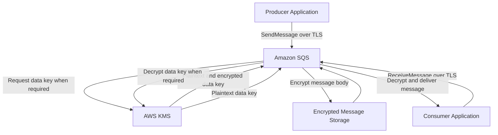

# 05- Server-Side Encryption and AWS KMS

## Overview

Amazon SQS supports server-side encryption (SSE) to protect message bodies at rest. SQS encrypts messages before storing them and decrypts them when delivering them to authorized consumers.

SSE reduces the risk of exposing message contents through unauthorized access to underlying storage. It complements, rather than replaces, IAM authorization, queue policies, TLS, application-level security, and operational controls.

SQS supports two server-side encryption options:

- **SSE-SQS:** Uses an SQS-owned encryption key managed entirely by AWS.
- **SSE-KMS:** Uses AWS Key Management Service (KMS), allowing customers to select and manage the encryption key and its access policies.

The choice affects key ownership, authorization, cross-account access, operational complexity, and cost.

## Server-Side Encryption Architecture

SQS uses envelope encryption. Instead of asking KMS to encrypt every message directly, the service obtains data keys from KMS and uses them to encrypt message data.

With SSE-KMS, the high-level flow is:

1. A producer sends a message to an encrypted SQS queue over TLS.
2. SQS obtains a data key from KMS when required.
3. SQS uses the data key to encrypt the message body.
4. SQS stores the encrypted message and the encrypted data key.
5. When a consumer receives the message, SQS obtains access to the required plaintext data key.
6. SQS decrypts the message body and returns it to the consumer over TLS.



The producer and consumer do not receive the KMS data key from SQS. Encryption and decryption are performed by the SQS service.

## Encryption Options

### SSE-SQS

SSE-SQS uses an encryption key owned and managed by Amazon SQS.

AWS handles:

- Key creation and management.
- Key rotation and lifecycle.
- Encryption and decryption operations.
- Access to the underlying encryption key.

Applications do not need to configure a KMS key or grant application roles KMS permissions for queue encryption.

**When to use SSE-SQS**

Use SSE-SQS when:

- Standard server-side encryption is sufficient.
- You do not need customer-managed key policies.
- You want minimal encryption configuration and operational overhead.
- KMS key-level auditing and access controls are not required.

Advantages:

- No customer-managed KMS key to provision or maintain.
- No separate customer-managed KMS key permissions.
- No customer-managed KMS key management cost.
- Lower operational complexity.

Limitations:

- No direct control over the underlying encryption key.
- No customer-managed key policy for queue-specific access governance.
- Does not provide the same key-level control and auditing capabilities as SSE-KMS.

### SSE-KMS

SSE-KMS uses a KMS key to encrypt SQS message bodies.

You can use:

- An AWS-managed KMS key for SQS.
- A customer-managed KMS key.

An AWS-managed key is maintained by AWS for the service. A customer-managed key provides control over key policies, grants, rotation configuration, and key lifecycle.

**When to use SSE-KMS**

Use SSE-KMS when:

- Regulatory requirements require customer-managed encryption keys.
- Different workloads need distinct encryption boundaries.
- Key usage must be auditable through AWS KMS.
- Cross-account queue access requires a customer-managed key.
- Security teams need explicit control over key permissions and lifecycle.

Advantages:

- Customer-managed access policies.
- KMS audit events for key usage.
- Configurable key rotation for eligible key types.
- Ability to disable or schedule deletion of a customer-managed key.
- Support for cross-account encryption when configured correctly.

Limitations:

- Additional KMS authorization requirements.
- KMS API request costs.
- Potential KMS throttling and dependency considerations.
- Key lifecycle management becomes a production responsibility.

### SSE-SQS vs SSE-KMS

| Feature | SSE-SQS | SSE-KMS |
|---|---|---|
| Key ownership | SQS-owned | AWS-managed or customer-managed KMS key |
| Key configuration | Managed by AWS | Configured through queue attributes |
| Customer key policy | No | Available with customer-managed keys |
| Application KMS permissions | Not required | Required for relevant KMS operations |
| KMS usage auditing | No customer KMS key events | Available through KMS and CloudTrail |
| Cross-account key access | No customer key policy | Supported with a customer-managed key |
| Key lifecycle control | AWS-managed | Customer controls customer-managed key lifecycle |
| Operational complexity | Low | Higher |
| Cost | No customer-managed KMS key charges | KMS charges may apply |

## Envelope Encryption

Envelope encryption separates data encryption from key encryption.

SQS uses a data key to encrypt message contents. KMS protects the data key using the configured KMS key.

This avoids requiring a KMS encryption operation for every message.

### Encryption lifecycle

For SSE-KMS:

1. SQS requests a data key from KMS.
2. KMS returns a plaintext data key and an encrypted copy.
3. SQS uses the plaintext data key to encrypt message bodies.
4. SQS retains the encrypted data key with the encrypted message data.
5. The plaintext data key is not returned to the producer.
6. SQS uses KMS to obtain access to the plaintext data key when decryption is required.

The encrypted data key cannot be used directly to decrypt a message. It must first be decrypted using the appropriate KMS key.

### Data key reuse period

SQS caches data keys to reduce KMS API calls.

The data key reuse period determines how long SQS can reuse a data key before requesting another one from KMS.

| Setting | Value |
|---|---|
| Minimum reuse period | 60 seconds |
| Maximum reuse period | 24 hours |
| Default reuse period | 300 seconds |

A shorter reuse period increases KMS activity. A longer period reduces KMS calls but increases the duration for which a cached data key may be reused.

**Production considerations**

- Use the default reuse period unless workload characteristics or security requirements justify changing it.
- Monitor KMS request volume and throttling.
- Consider the trade-off between KMS request frequency and key reuse.
- Do not treat the reuse period as a message retention or key rotation interval.
- Validate the impact of configuration changes under production-like traffic.

## Configuring SSE-SQS

SSE-SQS can be configured using the SQS queue encryption attributes.

### AWS CLI

Create a queue with SSE-SQS:

```bash
aws sqs create-queue \
  --queue-name orders-queue \
  --attributes SqsManagedSseEnabled=true
```

Inspect the queue attributes:

```bash
aws sqs get-queue-attributes \
  --queue-url "$QUEUE_URL" \
  --attribute-names All
```

The response includes the `SqsManagedSseEnabled` attribute when SSE-SQS is configured.

### Terraform

```hcl
resource "aws_sqs_queue" "orders" {
  name = "orders-queue"

  sqs_managed_sse_enabled = true

  visibility_timeout_seconds = 60
  message_retention_seconds  = 345600
}
```

Use this configuration when SQS-managed encryption meets the application's security requirements.

## Configuring SSE-KMS

SSE-KMS requires a KMS key and a queue configuration that references the key.

The queue can use a customer-managed key or an AWS-managed key supported by SQS.

### Create a customer-managed KMS key

```bash
aws kms create-key \
  --description "Customer-managed key for SQS orders queue" \
  --key-usage ENCRYPT_DECRYPT \
  --origin AWS_KMS
```

Retrieve the key ARN:

```bash
aws kms describe-key \
  --key-id "$KMS_KEY_ID" \
  --query 'KeyMetadata.Arn' \
  --output text
```

For production, manage key creation and policies through infrastructure as code rather than creating resources manually.

### Create an encrypted SQS queue

```bash
aws sqs create-queue \
  --queue-name orders-queue \
  --attributes '{
    "KmsMasterKeyId": "arn:aws:kms:ap-south-1:111122223333:key/EXAMPLE-KEY-ID",
    "KmsDataKeyReusePeriodSeconds": "300"
  }'
```

The `KmsMasterKeyId` attribute identifies the KMS key. The reuse period controls how long SQS can reuse a data key before obtaining another one.

### Update an existing queue

```bash
aws sqs set-queue-attributes \
  --queue-url "$QUEUE_URL" \
  --attributes '{
    "KmsMasterKeyId": "arn:aws:kms:ap-south-1:111122223333:key/EXAMPLE-KEY-ID",
    "KmsDataKeyReusePeriodSeconds": "300"
  }'
```

Inspect the result:

```bash
aws sqs get-queue-attributes \
  --queue-url "$QUEUE_URL" \
  --attribute-names KmsMasterKeyId KmsDataKeyReusePeriodSeconds
```

When updating queue attributes, preserve existing configuration. Do not accidentally replace unrelated queue settings or resource policies.

## KMS Authorization Model

SSE-KMS introduces an additional authorization boundary.

A successful SQS operation may depend on both SQS permissions and KMS permissions.

For example, a producer sending a message to an SSE-KMS queue needs permission to send messages to the queue and the required KMS permissions for the encryption workflow.

A consumer receiving messages needs permission to receive messages and the required KMS decrypt permission.

### Required KMS permissions

| Principal | Typical KMS permission | Purpose |
|---|---|---|
| Producer | `kms:GenerateDataKey` | Obtain a data key for encryption |
| Producer | `kms:Decrypt` | Support SQS data-key reuse and encryption workflows |
| Consumer | `kms:Decrypt` | Allow SQS to decrypt data keys for message delivery |
| Key administrator | Key administration actions | Manage key configuration and lifecycle |

The producer permissions are important: granting only `kms:GenerateDataKey` can result in failed send operations because SQS may also need `kms:Decrypt`.

The application does not directly call KMS for each message. These permissions authorize the SQS service's use of the configured key on behalf of the workload.

### Producer IAM policy

The producer requires SQS send permission and KMS permissions for the configured key.

```json
{
  "Version": "2012-10-17",
  "Statement": [
    {
      "Sid": "SendMessages",
      "Effect": "Allow",
      "Action": [
        "sqs:SendMessage"
      ],
      "Resource": "arn:aws:sqs:ap-south-1:111122223333:orders-queue"
    },
    {
      "Sid": "UseQueueEncryptionKey",
      "Effect": "Allow",
      "Action": [
        "kms:GenerateDataKey",
        "kms:Decrypt"
      ],
      "Resource": "arn:aws:kms:ap-south-1:111122223333:key/EXAMPLE-KEY-ID"
    }
  ]
}
```

### Consumer IAM policy

The consumer requires SQS receive/delete permissions and KMS decrypt permission.

```json
{
  "Version": "2012-10-17",
  "Statement": [
    {
      "Sid": "ConsumeMessages",
      "Effect": "Allow",
      "Action": [
        "sqs:ReceiveMessage",
        "sqs:DeleteMessage",
        "sqs:ChangeMessageVisibility",
        "sqs:GetQueueAttributes"
      ],
      "Resource": "arn:aws:sqs:ap-south-1:111122223333:orders-queue"
    },
    {
      "Sid": "DecryptQueueMessages",
      "Effect": "Allow",
      "Action": [
        "kms:Decrypt"
      ],
      "Resource": "arn:aws:kms:ap-south-1:111122223333:key/EXAMPLE-KEY-ID"
    }
  ]
}
```

Keep producer and consumer permissions separate. A producer should not receive message deletion permissions, and a consumer should not receive message publishing permissions unless the workload genuinely requires both roles.

## KMS Key Policies

IAM policies alone do not automatically grant access to a KMS key.

KMS key policies determine who can use or manage the key. An IAM policy granting `kms:Decrypt` is effective only when the key policy permits the account to delegate permissions through IAM or otherwise authorizes the principal.

A customer-managed key policy should:

- Allow appropriate key administrators to manage the key.
- Allow the intended account to delegate usage permissions through IAM.
- Permit the SQS service to use the key for the intended queue.
- Restrict service usage with the SQS queue encryption context.
- Avoid broad wildcard access.

### Example key policy

The following is an illustrative policy for a queue and workload in the same account. Replace the account, Region, key, and queue details before deployment.

```json
{
  "Version": "2012-10-17",
  "Statement": [
    {
      "Sid": "EnableAccountIAMDelegation",
      "Effect": "Allow",
      "Principal": {
        "AWS": "arn:aws:iam::111122223333:root"
      },
      "Action": "kms:*",
      "Resource": "*"
    },
    {
      "Sid": "AllowSQSUseForOrdersQueue",
      "Effect": "Allow",
      "Principal": {
        "Service": "sqs.amazonaws.com"
      },
      "Action": [
        "kms:Decrypt",
        "kms:GenerateDataKey"
      ],
      "Resource": "*",
      "Condition": {
        "StringEquals": {
          "kms:EncryptionContext:aws:sqs:arn": "arn:aws:sqs:ap-south-1:111122223333:orders-queue"
        }
      }
    }
  ]
}
```

The account-root principal statement enables IAM policies in the account to delegate key permissions. It does not mean every identity automatically receives key usage permissions.

The SQS service statement restricts use of the key to the specified queue through the encryption context.

The final effective authorization must also account for IAM policies, key policies, grants, explicit denies, permissions boundaries, and organization-level controls.

### Encryption context

KMS encryption context is additional authenticated metadata associated with a cryptographic operation.

For SQS, the encryption context includes the queue ARN under:

```text
aws:sqs:arn
```

This provides a way to restrict key usage to a particular queue.

Encryption context is not secret. It is not a substitute for IAM authorization or a place to store sensitive application data.

## Infrastructure as Code with Terraform

Terraform provides resources for managing KMS keys, key policies, and SQS queues.

Keeping encryption configuration in version-controlled infrastructure code improves consistency and makes security changes reviewable.

### KMS key

```hcl
resource "aws_kms_key" "sqs" {
  description             = "Customer-managed key for orders SQS queue"
  enable_key_rotation     = true
  deletion_window_in_days = 30

  tags = {
    Environment = "production"
    Service     = "orders"
    ManagedBy   = "terraform"
  }
}
```

For supported symmetric customer-managed KMS keys, automatic rotation can be enabled.

### SQS queue

```hcl
resource "aws_sqs_queue" "orders" {
  name = "orders-queue"

  kms_master_key_id                 = aws_kms_key.sqs.arn
  kms_data_key_reuse_period_seconds = 300

  visibility_timeout_seconds = 60
  message_retention_seconds  = 345600

  tags = {
    Environment = "production"
    Service     = "orders"
  }
}
```

### Queue policy

```hcl
data "aws_iam_policy_document" "orders_queue" {
  statement {
    sid    = "AllowProducerToSend"
    effect = "Allow"

    principals {
      type        = "AWS"
      identifiers = ["arn:aws:iam::111122223333:role/orders-producer"]
    }

    actions = [
      "sqs:SendMessage"
    ]

    resources = [
      aws_sqs_queue.orders.arn
    ]
  }

  statement {
    sid    = "AllowConsumerToReceive"
    effect = "Allow"

    principals {
      type        = "AWS"
      identifiers = ["arn:aws:iam::111122223333:role/orders-consumer"]
    }

    actions = [
      "sqs:ReceiveMessage",
      "sqs:DeleteMessage",
      "sqs:ChangeMessageVisibility",
      "sqs:GetQueueAttributes"
    ]

    resources = [
      aws_sqs_queue.orders.arn
    ]
  }
}

resource "aws_sqs_queue_policy" "orders" {
  queue_url = aws_sqs_queue.orders.id
  policy    = data.aws_iam_policy_document.orders_queue.json
}
```

The queue policy controls SQS access. It does not replace the KMS key policy or the IAM policies attached to producer and consumer roles.

### Terraform deployment considerations

- Ensure the KMS key policy permits the required SQS usage.
- Ensure workload roles receive only their required KMS actions.
- Avoid multiple Terraform resources managing the same queue policy.
- Protect KMS keys from accidental deletion.
- Review key policy changes as security-sensitive infrastructure changes.
- Test both allowed and denied operations in a non-production environment.

## Cross-Account SSE-KMS

Cross-account SQS access requires additional KMS authorization when the queue uses SSE-KMS.

For a producer or consumer in another AWS account, access must be permitted by the relevant IAM policy and the customer-managed KMS key policy.

An AWS-managed KMS key for SQS cannot be used to grant cross-account key access in the same way as a customer-managed key. Use a customer-managed key when cross-account workloads need access to encrypted queue messages.

### Cross-account authorization requirements

| Layer | Requirement |
|---|---|
| Producer or consumer IAM policy | Allow the required SQS operations |
| Queue resource policy | Allow the external account or role to access the queue |
| External principal IAM policy | Allow required KMS operations |
| KMS key policy | Permit the external account or principal to use the key |
| Organization controls | Ensure SCPs and other guardrails do not deny access |

For a cross-account producer, the KMS key policy and external IAM policy must support the required `kms:GenerateDataKey` and `kms:Decrypt` permissions.

For a cross-account consumer, they must support `kms:Decrypt`.

Restrict external access to specific roles and the intended queue. Avoid granting an entire external account unrestricted KMS usage.

## Integrating SQS SSE-KMS with Python

Applications using Boto3 interact with SQS through the normal SQS API. They do not need to encrypt message bodies manually when server-side encryption is enabled.

### Producer example

```python
import json
import os
import uuid

import boto3
from botocore.exceptions import BotoCoreError, ClientError


sqs = boto3.client("sqs", region_name=os.environ["AWS_REGION"])
QUEUE_URL = os.environ["SQS_QUEUE_URL"]


def publish_order(order_id: str, customer_id: str) -> str:
    event = {
        "event_id": str(uuid.uuid4()),
        "event_type": "order.created",
        "order_id": order_id,
        "customer_id": customer_id,
    }

    try:
        response = sqs.send_message(
            QueueUrl=QUEUE_URL,
            MessageBody=json.dumps(event),
        )
    except (BotoCoreError, ClientError):
        # Log the failure without exposing sensitive message contents.
        raise

    return response["MessageId"]
```

The application sends a normal message. SQS performs server-side encryption according to the queue configuration.

### Consumer example

```python
import json
import os

import boto3
from botocore.exceptions import BotoCoreError, ClientError


sqs = boto3.client("sqs", region_name=os.environ["AWS_REGION"])
QUEUE_URL = os.environ["SQS_QUEUE_URL"]


def consume_messages() -> None:
    try:
        response = sqs.receive_message(
            QueueUrl=QUEUE_URL,
            MaxNumberOfMessages=10,
            WaitTimeSeconds=20,
            VisibilityTimeout=60,
        )
    except (BotoCoreError, ClientError):
        raise

    for message in response.get("Messages", []):
        try:
            event = json.loads(message["Body"])

            # Perform durable, idempotent business processing here.
            process_order_event(event)

            sqs.delete_message(
                QueueUrl=QUEUE_URL,
                ReceiptHandle=message["ReceiptHandle"],
            )
        except Exception:
            # Do not delete a message when processing has failed.
            # The message becomes visible again after its visibility timeout.
            raise


def process_order_event(event: dict) -> None:
    # Replace with a transactionally safe application operation.
    print(f"Processing event: {event['event_id']}")
```

The example assumes `process_order_event` is implemented with durable, idempotent business logic. Production consumers should distinguish retryable failures from permanent failures and use a dead-letter queue where appropriate.

The consumer does not call KMS directly. SQS decrypts the message before returning its body.

## Encryption Scope and Limitations

SQS server-side encryption protects message bodies at rest, but it does not encrypt every part of the message or every related data path.

### What SSE protects

- Message body contents stored by SQS.
- Message data through the service's envelope-encryption mechanism.

### What SSE does not protect

- Message attributes.
- Queue metadata and message metadata.
- Message contents after delivery to a consumer.
- Application logs containing message contents.
- Data copied into databases, caches, object storage, or external services.
- Data exposed through an application vulnerability or compromised workload.

SQS message attributes and other metadata should not contain secrets or sensitive values unless the application has separately assessed and protected them.

### End-to-end encryption

SQS server-side encryption is not end-to-end encryption.

SQS decrypts messages before delivering them to consumers. The service therefore handles plaintext during message processing.

If the threat model requires that AWS services and intermediaries cannot access plaintext, use application-level envelope encryption:

1. Generate or obtain an application data key.
2. Encrypt sensitive payload fields before publishing.
3. Store only ciphertext in the SQS message body.
4. Allow only authorized consumers to decrypt the payload.
5. Manage application key permissions and rotation independently of SQS SSE.

Application-level encryption introduces additional key distribution, rotation, compatibility, and recovery responsibilities. Use it when the security requirement justifies the complexity.

## KMS Rotation and Key Lifecycle

Customer-managed KMS keys have a lifecycle that must be managed independently of the SQS queue.

### Automatic key rotation

For supported customer-managed symmetric encryption keys, automatic rotation can be enabled.

Rotation changes the backing key material while preserving the logical KMS key identity. Existing ciphertext remains decryptable through KMS.

Automatic rotation does not require applications to change the KMS key ARN configured on the queue.

### Replacing the configured KMS key

Changing the queue's KMS key affects encryption of new messages. Existing messages may still depend on the previous key.

Before retiring an old key:

- Identify every queue and workload that used it.
- Confirm that no retained messages still require it.
- Confirm that no other applications depend on the key.
- Keep the old key enabled and usable until the dependency is eliminated.
- Test message processing and recovery before scheduling key deletion.

Disabling or deleting a key prematurely can make messages encrypted under that key unreadable.

### Key deletion protection

KMS key deletion is scheduled rather than instantaneous. The waiting period provides an opportunity to cancel deletion.

For production queues:

- Restrict `kms:ScheduleKeyDeletion` and `kms:DisableKey` to tightly controlled administrative roles.
- Enable key rotation where appropriate.
- Monitor key state and policy changes.
- Maintain a documented key recovery and replacement procedure.
- Use infrastructure controls to prevent accidental key deletion.

## Performance and Cost Considerations

SSE-KMS introduces KMS API activity into the queue's encryption and decryption workflow.

The data key reuse period helps reduce this activity, but it does not eliminate all KMS dependencies.

### Performance factors

| Factor | Impact |
|---|---|
| Data key reuse period | Shorter periods increase KMS requests |
| Message throughput | Higher throughput can increase key usage and KMS activity |
| Consumer concurrency | More concurrent workloads can increase decryption demand |
| KMS throttling | Can affect SQS operations that require KMS |
| KMS regional availability | Key and queue Region design affects service dependencies |

SQS uses data key reuse to reduce KMS calls. Do not assume one KMS request occurs for every message.

### Cost factors

SSE-KMS can introduce:

- KMS API request charges.
- Customer-managed key charges.
- Additional CloudTrail event volume associated with key usage.

The exact cost depends on Region, key type, request volume, and current AWS pricing.

Estimate KMS usage under realistic producer and consumer traffic. Include peak load, retries, and data key reuse behavior rather than calculating cost from message count alone.

## Monitoring and Auditing

Encryption must be monitored as part of the queue's operational and security posture.

### CloudTrail

CloudTrail can record KMS API activity, including operations such as:

- `GenerateDataKey`
- `Decrypt`
- `CreateKey`
- `PutKeyPolicy`
- `EnableKeyRotation`
- `DisableKey`
- `ScheduleKeyDeletion`

Use CloudTrail to investigate key usage, policy changes, and administrative activity.

Do not assume CloudTrail records every SQS message operation as a data event or contains message payloads.

### CloudWatch

Monitor SQS metrics to understand queue behavior and detect processing problems.

| Metric | Operational purpose |
|---|---|
| `NumberOfMessagesSent` | Tracks producer activity |
| `NumberOfMessagesReceived` | Tracks consumer receive activity |
| `NumberOfMessagesDeleted` | Tracks successful message deletion |
| `ApproximateNumberOfMessagesVisible` | Identifies visible backlog |
| `ApproximateNumberOfMessagesNotVisible` | Identifies in-flight messages |
| `ApproximateAgeOfOldestMessage` | Identifies processing delays |

Use KMS CloudTrail events, service error logs, and application telemetry to investigate encryption failures and KMS authorization problems.

SQS queue metrics do not directly provide a complete view of KMS throttling or key authorization failures.

### Operational alerts

Create alerts for:

- Sudden increases in queue backlog.
- Increasing age of the oldest message.
- Consumer processing failures.
- KMS throttling or access-denied errors.
- Unexpected KMS key state changes.
- Unauthorized key policy modifications.
- Key deletion scheduling.

Avoid logging plaintext message bodies or sensitive application data when diagnosing encryption failures.

## Reliability and Disaster Recovery

SSE-KMS introduces a dependency on the configured KMS key remaining available and authorized.

A queue can be operationally healthy while consumers fail to process messages because the configured key is disabled, inaccessible, or incorrectly configured.

### Failure scenarios

| Failure | Impact | Recommended response |
|---|---|---|
| KMS key disabled | Required encryption or decryption operations fail | Restore the key state after authorization and security review |
| Key policy changed incorrectly | SQS cannot use the key | Restore the approved policy |
| IAM permissions removed | Producer or consumer operations may fail | Restore least-privilege permissions |
| KMS throttling | Operations requiring KMS may fail or be delayed | Review request patterns, reuse period, and quotas |
| Key scheduled for deletion | Future key unavailability can make messages unreadable | Cancel deletion if the key is still required |
| Regional outage | Queue and regional key may be unavailable | Use an independently designed recovery Region |

### Disaster recovery design

SQS queues and KMS keys are regional resources. SSE-KMS does not replicate messages or encryption keys automatically across Regions.

A multi-Region recovery design should include:

- A separately provisioned recovery queue.
- A suitable customer-managed KMS key in the recovery Region.
- Recovery producer and consumer permissions.
- Queue policies and KMS key policies deployed through infrastructure as code.
- Message replication or application-level event recovery.
- Tested procedures for replaying or reconstructing messages.
- Verification that recovery workloads can decrypt messages.

Multi-Region KMS keys can support specific cross-Region key-management use cases, but they do not replicate SQS messages or provide automatic queue failover.

## Common Mistakes and Production Pitfalls

### Granting only `kms:GenerateDataKey` to producers

SQS may require both `kms:GenerateDataKey` and `kms:Decrypt` for producer workflows.

Granting only one permission can cause message publishing failures.

**Avoidance:** Grant the documented minimum permissions for the producer role and validate them with actual send operations.

### Updating IAM without updating the key policy

An IAM policy allowing `kms:Decrypt` is not sufficient if the KMS key policy does not permit the account to delegate access.

**Avoidance:** Review IAM and key policy authorization together.

### Using an AWS-managed key for cross-account access

AWS-managed keys do not provide the customer-controlled key policy required for the same cross-account authorization model as customer-managed keys.

**Avoidance:** Use a customer-managed key for cross-account encrypted queue access.

### Disabling or deleting an old key too early

Messages encrypted under a previous key may still require that key for decryption.

**Avoidance:** Maintain old keys until all dependent messages and workloads have been retired or migrated safely.

### Assuming SSE encrypts message attributes

SQS server-side encryption protects message bodies, not all message metadata or attributes.

**Avoidance:** Keep sensitive values out of attributes and metadata. Use application-level encryption when necessary.

### Treating SSE as end-to-end encryption

SQS decrypts messages before delivering them to consumers.

**Avoidance:** Use application-level encryption when plaintext must remain inaccessible to the messaging service.

### Setting an unnecessarily short data key reuse period

A short reuse period can increase KMS request volume and cost.

**Avoidance:** Start with the default period and tune only after evaluating security requirements, throughput, and KMS usage.

### Ignoring KMS throttling

A high-throughput queue can experience failures when KMS request limits or service dependencies become bottlenecks.

**Avoidance:** Monitor KMS errors, understand request patterns, and test peak workloads.

### Assuming queue encryption protects downstream systems

Once a message is delivered, its plaintext can be exposed through application logs, databases, caches, or external APIs.

**Avoidance:** Apply encryption, access control, and data-retention policies throughout the complete data lifecycle.

## Security Best Practices

### Key management

- Prefer SSE-SQS when customer-managed key control is unnecessary.
- Use customer-managed KMS keys when key-level governance or cross-account access is required.
- Enable automatic rotation for supported keys.
- Restrict key administration to dedicated security or platform roles.
- Prevent unauthorized key disabling and deletion.
- Maintain old keys until all dependent messages have been processed or expired.

### Authorization

- Separate producer, consumer, and administrator roles.
- Grant producers `kms:GenerateDataKey` and `kms:Decrypt` where required.
- Grant consumers `kms:Decrypt`.
- Scope KMS permissions to the specific customer-managed key.
- Restrict key usage through encryption-context conditions where appropriate.
- Review key policies, IAM policies, permissions boundaries, and SCPs together.

### Application security

- Use TLS for SQS API communication.
- Avoid sensitive values in message attributes and logs.
- Implement idempotent message processing.
- Do not delete messages before durable business processing.
- Use application-level encryption for stronger confidentiality requirements.
- Avoid placing credentials or long-lived secrets in queue payloads.

### Infrastructure and operations

- Manage queues and KMS keys through Terraform or another controlled IaC workflow.
- Review key policy changes before deployment.
- Monitor KMS access failures and throttling.
- Test key rotation and key replacement procedures.
- Maintain a documented recovery process for disabled or inaccessible keys.
- Validate both successful and denied access paths.

## Production Validation Checklist

- [ ] Every production queue has an explicitly selected encryption strategy.
- [ ] SSE-SQS or SSE-KMS configuration is verified after deployment.
- [ ] Customer-managed keys have approved key policies.
- [ ] Producer roles have the required SQS and KMS permissions.
- [ ] Consumer roles have the required SQS and KMS permissions.
- [ ] Cross-account access uses customer-managed keys where required.
- [ ] Encryption-context restrictions are applied where appropriate.
- [ ] Key rotation and deletion procedures are documented.
- [ ] Old keys remain available while dependent messages exist.
- [ ] KMS throttling and authorization failures are monitored.
- [ ] Message attributes and application logs do not expose sensitive data.
- [ ] Application-level encryption is used when end-to-end confidentiality is required.
- [ ] Disaster recovery queues and regional keys are provisioned and tested.
- [ ] Positive and negative authorization tests run before production deployment.

## Key Takeaways

- SQS supports SSE-SQS for AWS-managed encryption and SSE-KMS for configurable KMS-backed encryption.
- SSE-KMS uses envelope encryption and data key reuse to reduce direct KMS operations.
- Producers typically require `kms:GenerateDataKey` and `kms:Decrypt`, while consumers require `kms:Decrypt`.
- Customer-managed KMS keys provide key-policy control and support cross-account key authorization when configured correctly.
- SQS SSE encrypts message bodies at rest, not all metadata or downstream copies; use application-level encryption when end-to-end confidentiality is required.