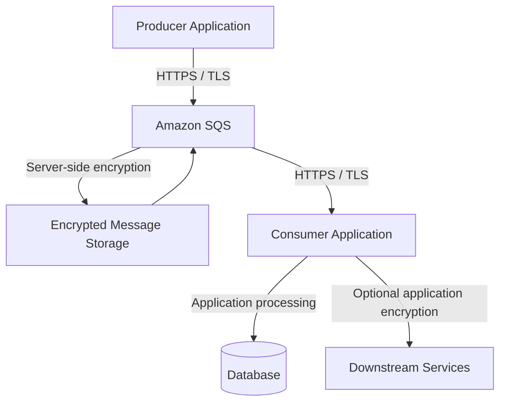
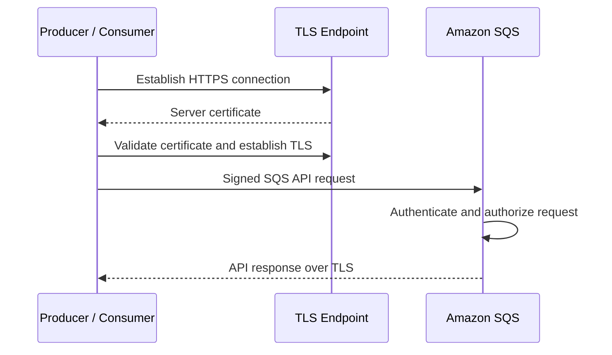
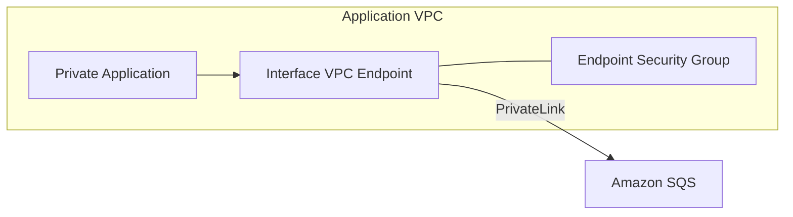
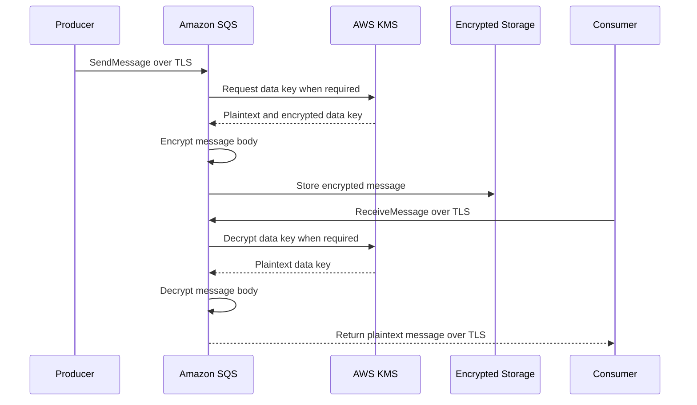
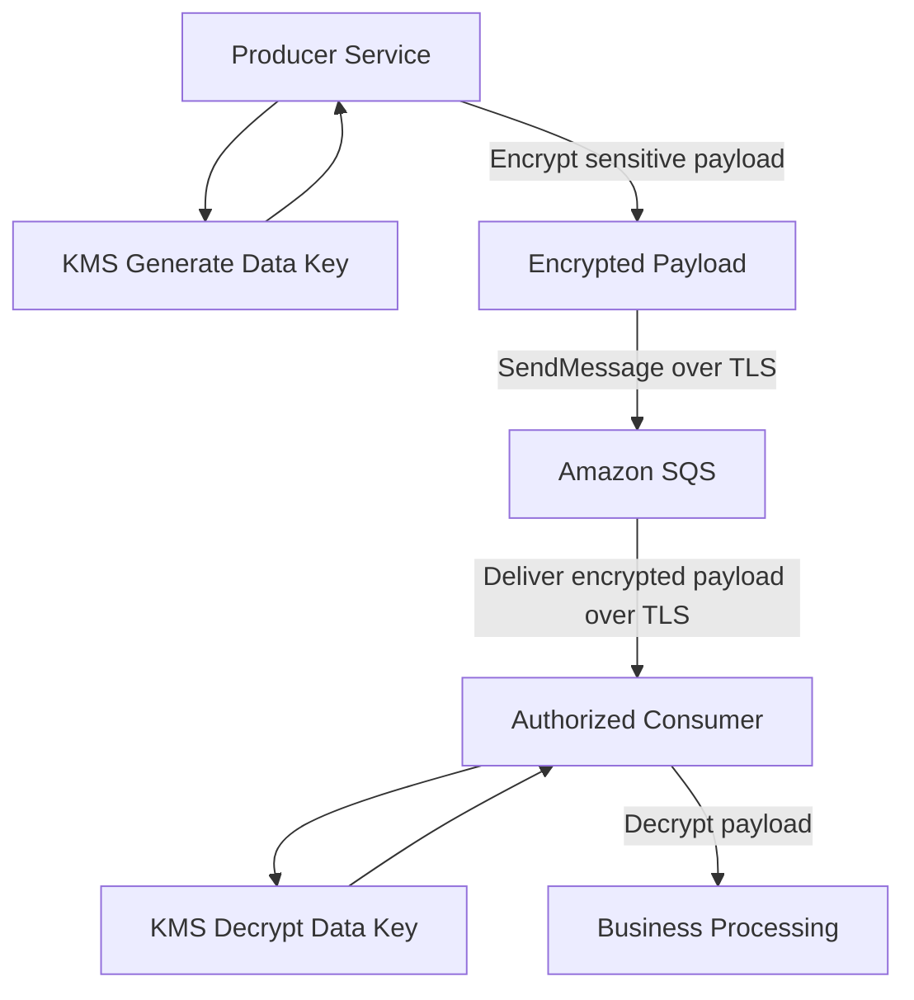

# 06- Encryption in Transit and at Rest

## Overview

Amazon SQS protects message data through encryption in transit and encryption at rest. These controls protect different stages of the message lifecycle and should be implemented together.

- **Encryption in transit** protects communication between producers, consumers, and the SQS service.
- **Encryption at rest** protects message bodies stored by SQS.
- **Application-level encryption** provides additional confidentiality when sensitive payloads must remain encrypted beyond the SQS storage boundary.

SQS supports HTTPS endpoints for API communication and server-side encryption through SSE-SQS or SSE-KMS.

Encryption does not replace IAM authorization, queue resource policies, application security, or secure handling of message data after delivery.

## Encryption Architecture

A production SQS architecture should protect data throughout its lifecycle.



The protection boundaries are:

| Layer | Protection | Responsibility |
|---|---|---|
| Producer to SQS | TLS | HTTPS communication |
| SQS storage | SSE-SQS or SSE-KMS | SQS-managed encryption |
| SQS to consumer | TLS | HTTPS communication |
| Consumer processing | Application security | Access control and secure memory/log handling |
| Downstream storage | Service-specific encryption | Database, cache, object storage encryption |
| Sensitive payload fields | Application-level encryption | Application-managed cryptographic controls |

## Encryption in Transit

### TLS for SQS API Communication

Amazon SQS API requests should use HTTPS endpoints.

TLS protects communication between an application and SQS by providing:

- Confidentiality through encryption.
- Integrity protection against modification during transit.
- Server authentication through certificate validation.

SQS API requests are authenticated using AWS Signature Version 4. SigV4 signs requests using AWS credentials and protects request authentication and integrity. It does not replace TLS.

### Request lifecycle

A typical producer request follows this sequence:

1. The application resolves the regional SQS endpoint.
2. The client establishes a TLS connection.
3. The server presents its certificate.
4. The client validates the certificate and establishes the encrypted session.
5. The application sends the signed SQS API request.
6. SQS authenticates and authorizes the request.
7. SQS processes the message operation.

The consumer follows the same HTTPS communication model when receiving and deleting messages.



### TLS versions and certificate validation

Use current TLS versions supported by AWS service endpoints and your application runtime.

Production clients should:

- Use HTTPS endpoints.
- Validate server certificates.
- Keep operating systems and TLS libraries patched.
- Avoid disabling certificate verification.
- Avoid custom trust configurations unless required by a managed corporate environment.
- Use supported TLS configurations rather than hardcoding obsolete protocol versions.

Do not assume that signing a request with SigV4 makes an HTTP connection secure. SigV4 authentication and TLS transport encryption serve different purposes.

## Enforcing HTTPS for SQS

SQS queue resource policies can deny requests that do not use secure transport.

The global condition key `aws:SecureTransport` identifies whether a request uses a secure transport connection.

A queue policy can explicitly deny access when this condition is false.

### Example queue policy

```json
{
  "Version": "2012-10-17",
  "Statement": [
    {
      "Sid": "DenyInsecureTransport",
      "Effect": "Deny",
      "Principal": "*",
      "Action": "sqs:*",
      "Resource": "arn:aws:sqs:ap-south-1:111122223333:orders-queue",
      "Condition": {
        "Bool": {
          "aws:SecureTransport": "false"
        }
      }
    }
  ]
}
```

This policy denies insecure transport requests even if another policy grants the principal SQS permissions.

When maintaining an existing queue policy, preserve all required statements. Do not replace the entire policy accidentally when adding the transport restriction.

### Terraform implementation

```hcl
data "aws_iam_policy_document" "orders_queue" {
  statement {
    sid    = "DenyInsecureTransport"
    effect = "Deny"

    principals {
      type        = "*"
      identifiers = ["*"]
    }

    actions = [
      "sqs:*"
    ]

    resources = [
      aws_sqs_queue.orders.arn
    ]

    condition {
      test     = "Bool"
      variable = "aws:SecureTransport"
      values   = ["false"]
    }
  }
}

resource "aws_sqs_queue_policy" "orders" {
  queue_url = aws_sqs_queue.orders.id
  policy    = data.aws_iam_policy_document.orders_queue.json
}
```

In a production deployment, combine this statement with the queue's required producer, consumer, and service-integration permissions in one authoritative queue policy.

## Using VPC Endpoints for Private SQS Access

Applications running in private subnets can access SQS through an interface VPC endpoint powered by AWS PrivateLink.

This avoids requiring a public internet route for SQS API traffic.

### Architecture



### Why use an interface endpoint?

Use an interface endpoint when:

- Workloads run in private subnets.
- Internet egress should be minimized.
- Network traffic must remain on private AWS connectivity.
- Network-level access controls are required.
- Compliance requirements restrict public internet paths.

An interface endpoint creates endpoint network interfaces in selected subnets. Applications resolve the regional SQS endpoint to the endpoint when private DNS is enabled.

### Create an SQS VPC endpoint

```bash
aws ec2 create-vpc-endpoint \
  --vpc-id vpc-0123456789abcdef0 \
  --vpc-endpoint-type Interface \
  --service-name com.amazonaws.ap-south-1.sqs \
  --subnet-ids subnet-11111111 subnet-22222222 \
  --security-group-ids sg-0123456789abcdef0 \
  --private-dns-enabled
```

The endpoint security group should permit inbound TCP port 443 from the application security group.

The application security group must allow outbound HTTPS traffic to the endpoint.

### Endpoint policy

A VPC endpoint policy controls which principals and SQS resources can be accessed through that endpoint.

It does not independently grant access to queues. IAM policies and queue resource policies still apply.

Example endpoint policy:

```json
{
  "Version": "2012-10-17",
  "Statement": [
    {
      "Sid": "AllowOrdersQueueAccess",
      "Effect": "Allow",
      "Principal": "*",
      "Action": [
        "sqs:SendMessage",
        "sqs:ReceiveMessage",
        "sqs:DeleteMessage",
        "sqs:GetQueueAttributes"
      ],
      "Resource": "arn:aws:sqs:ap-south-1:111122223333:orders-queue"
    }
  ]
}
```

Use endpoint policies to restrict network-path access to approved queues and actions.

### Restricting queue access through a VPC endpoint

A queue policy can require requests to originate through a particular VPC endpoint.

```json
{
  "Version": "2012-10-17",
  "Statement": [
    {
      "Sid": "DenyRequestsOutsideApprovedEndpoint",
      "Effect": "Deny",
      "Principal": "*",
      "Action": "sqs:*",
      "Resource": "arn:aws:sqs:ap-south-1:111122223333:orders-queue",
      "Condition": {
        "StringNotEquals": {
          "aws:SourceVpce": "vpce-0123456789abcdef0"
        }
      }
    }
  ]
}
```

This restriction can block legitimate access from other paths, including workloads that use public service endpoints or other approved network routes.

Before deploying it, identify every producer, consumer, AWS service integration, administrative workflow, and recovery process that needs queue access.

## Encryption at Rest

### Server-Side Encryption

SQS server-side encryption protects message bodies stored by the service.

SQS supports:

- SSE-SQS using an SQS-owned encryption key.
- SSE-KMS using an AWS-managed or customer-managed KMS key.

SQS uses envelope encryption to protect message data. Applications do not need to encrypt message bodies manually when server-side encryption is enabled.

### Encryption lifecycle



The data key is managed by SQS. Producers and consumers do not receive it directly.

### SSE-SQS

SSE-SQS uses encryption keys owned and managed by SQS.

Advantages:

- Minimal configuration.
- No customer-managed KMS key lifecycle.
- No separate customer-managed KMS permissions.
- No customer-managed KMS key charges.

Use SSE-SQS when standard encryption at rest satisfies the security requirements.

### SSE-KMS

SSE-KMS uses AWS KMS to protect message data keys.

It provides:

- Customer-managed key policies when using customer-managed keys.
- KMS key usage auditing.
- Configurable key rotation for supported key types.
- Explicit key lifecycle management.
- Support for cross-account key authorization with customer-managed keys.

It also introduces KMS authorization, operational dependencies, and additional cost.

### Comparison

| Capability | SSE-SQS | SSE-KMS |
|---|---|---|
| Encryption at rest | Yes | Yes |
| Key ownership | SQS | AWS-managed or customer-managed KMS |
| Customer key policy | No | Available with customer-managed keys |
| KMS permissions | Not required | Required for relevant operations |
| Key usage auditing through KMS | No | Yes |
| Cross-account customer key authorization | No | Supported with customer-managed keys |
| Operational complexity | Low | Higher |

## Configuring Encryption at Rest

### Enable SSE-SQS

```bash
aws sqs create-queue \
  --queue-name orders-queue \
  --attributes SqsManagedSseEnabled=true
```

### Enable SSE-KMS

```bash
aws sqs create-queue \
  --queue-name orders-queue \
  --attributes '{
    "KmsMasterKeyId": "arn:aws:kms:ap-south-1:111122223333:key/EXAMPLE-KEY-ID",
    "KmsDataKeyReusePeriodSeconds": "300"
  }'
```

### Verify encryption settings

```bash
aws sqs get-queue-attributes \
  --queue-url "$QUEUE_URL" \
  --attribute-names All
```

Review the returned attributes:

- `SqsManagedSseEnabled`
- `KmsMasterKeyId`
- `KmsDataKeyReusePeriodSeconds`

Ensure that the deployed queue configuration matches the intended encryption standard.

## IAM and KMS Authorization

Encryption at rest does not eliminate the need for authorization.

With SSE-KMS, the effective permissions depend on SQS permissions, IAM policies, and KMS key authorization.

### Producer permissions

A producer generally requires:

- `sqs:SendMessage`
- `kms:GenerateDataKey`
- `kms:Decrypt`

The KMS permissions must be scoped to the configured customer-managed key.

### Consumer permissions

A consumer generally requires:

- `sqs:ReceiveMessage`
- `sqs:DeleteMessage`
- `sqs:ChangeMessageVisibility`, when required
- `sqs:GetQueueAttributes`, when required
- `kms:Decrypt`

### Example producer policy

```json
{
  "Version": "2012-10-17",
  "Statement": [
    {
      "Sid": "SendOrders",
      "Effect": "Allow",
      "Action": "sqs:SendMessage",
      "Resource": "arn:aws:sqs:ap-south-1:111122223333:orders-queue"
    },
    {
      "Sid": "UseEncryptionKey",
      "Effect": "Allow",
      "Action": [
        "kms:GenerateDataKey",
        "kms:Decrypt"
      ],
      "Resource": "arn:aws:kms:ap-south-1:111122223333:key/EXAMPLE-KEY-ID"
    }
  ]
}
```

### Example consumer policy

```json
{
  "Version": "2012-10-17",
  "Statement": [
    {
      "Sid": "ConsumeOrders",
      "Effect": "Allow",
      "Action": [
        "sqs:ReceiveMessage",
        "sqs:DeleteMessage",
        "sqs:ChangeMessageVisibility",
        "sqs:GetQueueAttributes"
      ],
      "Resource": "arn:aws:sqs:ap-south-1:111122223333:orders-queue"
    },
    {
      "Sid": "DecryptOrders",
      "Effect": "Allow",
      "Action": "kms:Decrypt",
      "Resource": "arn:aws:kms:ap-south-1:111122223333:key/EXAMPLE-KEY-ID"
    }
  ]
}
```

The KMS key policy must also permit the relevant account or principal to use the key. An IAM policy alone does not guarantee access to a customer-managed KMS key.

## Application-Level Encryption

SQS server-side encryption protects message bodies at rest, but SQS decrypts messages before delivering them to consumers.

This means SSE is not end-to-end encryption.

For sensitive payloads, application-level encryption can provide an additional confidentiality boundary.

### When to use application-level encryption

Consider application-level encryption when:

- Payloads contain highly sensitive financial or personal information.
- Only selected consumers should be able to decrypt the payload.
- Data must remain encrypted while passing through messaging infrastructure.
- Security requirements demand separation between storage-service access and plaintext access.

### Architecture



The producer encrypts sensitive data before publishing. SQS stores and transports the ciphertext. The authorized consumer obtains permission to decrypt the application data key.

### Important considerations

- Use authenticated encryption, such as AES-256-GCM.
- Generate cryptographically secure data keys.
- Protect encrypted data keys using KMS.
- Store the nonce, authentication tag, ciphertext, and encrypted data key in a well-defined message envelope.
- Do not reuse AES-GCM nonces with the same key.
- Define key rotation and ciphertext migration procedures.
- Restrict decryption permissions to authorized consumers.
- Avoid exposing plaintext through logs, traces, metrics, or exception messages.

Application-level encryption increases implementation complexity. Use a well-reviewed cryptographic library or an established envelope-encryption implementation rather than creating custom cryptographic primitives.

## Python and Boto3 Integration

### Standard SQS communication

When SSE is configured on the queue, normal Boto3 operations automatically use the configured server-side encryption.

```python
import json
import os
import uuid

import boto3
from botocore.exceptions import BotoCoreError, ClientError


sqs = boto3.client(
    "sqs",
    region_name=os.environ["AWS_REGION"],
)

QUEUE_URL = os.environ["SQS_QUEUE_URL"]


def publish_order(order_id: str, customer_id: str) -> str:
    message = {
        "event_id": str(uuid.uuid4()),
        "event_type": "order.created",
        "order_id": order_id,
        "customer_id": customer_id,
    }

    try:
        response = sqs.send_message(
            QueueUrl=QUEUE_URL,
            MessageBody=json.dumps(message),
        )
    except (BotoCoreError, ClientError):
        # Log safe diagnostic metadata without exposing the payload.
        raise

    return response["MessageId"]
```

No manual KMS call is necessary for ordinary SQS server-side encryption.

### Consumer communication

```python
import json
import os

import boto3


sqs = boto3.client(
    "sqs",
    region_name=os.environ["AWS_REGION"],
)

QUEUE_URL = os.environ["SQS_QUEUE_URL"]


def consume_orders() -> None:
    response = sqs.receive_message(
        QueueUrl=QUEUE_URL,
        MaxNumberOfMessages=10,
        WaitTimeSeconds=20,
        VisibilityTimeout=60,
    )

    for message in response.get("Messages", []):
        event = json.loads(message["Body"])

        # Must complete durable, idempotent processing before deletion.
        process_order(event)

        sqs.delete_message(
            QueueUrl=QUEUE_URL,
            ReceiptHandle=message["ReceiptHandle"],
        )


def process_order(event: dict) -> None:
    # Replace with transactionally safe application logic.
    print(f"Processing event {event['event_id']}")
```

The consumer receives plaintext from SQS after service-side decryption. It should still protect the message during application processing and downstream communication.

## Integrating Encryption with Backend Services

### Django and FastAPI

Django and FastAPI services commonly publish messages through Boto3.

Recommended practices:

- Use IAM roles or workload identity instead of static AWS credentials.
- Configure regional SQS clients.
- Use HTTPS endpoints.
- Keep queue URLs and non-secret configuration in environment-specific settings.
- Use Secrets Manager or an equivalent secret-management service for application secrets.
- Avoid logging complete message bodies.
- Keep producer and consumer IAM roles separate.

### Docker and Kubernetes

For containerized workloads:

- Use workload roles such as ECS task roles or EKS IAM Roles for Service Accounts (IRSA), where applicable.
- Do not bake AWS credentials into Docker images.
- Restrict container network egress to approved service endpoints.
- Use VPC endpoints for private SQS access where required.
- Keep TLS libraries and base images updated.
- Rotate application secrets independently of SQS encryption keys.

### Database and cache integration

SQS encryption protects messages only while they are stored in SQS.

If a consumer writes message data to PostgreSQL, Redis, or another service, that destination needs its own security controls.

For example:

- Enable database encryption at rest.
- Use TLS for database connections.
- Restrict database roles.
- Avoid caching sensitive plaintext unnecessarily.
- Apply data retention and deletion policies.
- Encrypt sensitive fields at application level when required.

## Monitoring and Auditing

Encryption controls should be observable and continuously validated.

### CloudTrail

Use CloudTrail to audit relevant administrative and cryptographic operations.

Examples include:

- KMS `GenerateDataKey`.
- KMS `Decrypt`.
- KMS `PutKeyPolicy`.
- KMS `DisableKey`.
- KMS `EnableKeyRotation`.
- KMS `ScheduleKeyDeletion`.

CloudTrail provides visibility into KMS API activity and administrative changes. Do not assume it records every SQS message operation or stores message payloads.

### CloudWatch

Monitor queue-level behavior:

| Metric | Purpose |
|---|---|
| `NumberOfMessagesSent` | Producer activity |
| `NumberOfMessagesReceived` | Consumer receive activity |
| `NumberOfMessagesDeleted` | Successful message deletion |
| `ApproximateNumberOfMessagesVisible` | Visible backlog |
| `ApproximateNumberOfMessagesNotVisible` | In-flight messages |
| `ApproximateAgeOfOldestMessage` | Processing delay |

Also monitor application errors involving:

- TLS connection failures.
- Certificate validation failures.
- SQS authorization errors.
- KMS access-denied errors.
- KMS throttling.
- VPC endpoint connectivity.

### Security alerts

Create alerts for:

- Unexpected KMS key policy changes.
- Key disabling or deletion scheduling.
- Repeated encryption-related authorization failures.
- KMS throttling.
- Unexpected queue policy modifications.
- Access attempts through unapproved network paths.

Do not include sensitive message contents in security alerts.

## Performance and Cost Considerations

### TLS overhead

TLS adds connection establishment and cryptographic processing overhead.

For high-throughput producers and consumers:

- Reuse Boto3 clients rather than creating a client for every message.
- Use connection pooling.
- Use batch APIs where appropriate.
- Use long polling for consumers.
- Avoid unnecessary connection creation.
- Monitor connection failures and request latency.

### KMS overhead

SSE-KMS introduces KMS API dependencies.

SQS uses data key reuse to reduce KMS operations. The configured reuse period affects the frequency of KMS requests.

A shorter period can increase KMS request volume and cost. A longer period reduces requests but allows data keys to be reused for longer.

The default reuse period is 300 seconds. The supported configuration range is 60 seconds to 24 hours.

### Cost factors

| Component | Cost consideration |
|---|---|
| SQS | Request volume and queue usage |
| SSE-SQS | No customer-managed KMS key charges |
| SSE-KMS | KMS key and API request charges may apply |
| VPC interface endpoint | Endpoint-hour and data-processing charges |
| CloudTrail | Event delivery and storage configuration |
| Application encryption | Additional compute and key-management operations |

Evaluate encryption costs using actual message throughput, consumer concurrency, KMS request behavior, and network architecture.

## Reliability and Disaster Recovery

Encryption configuration must be included in deployment and recovery planning.

### Key availability

For SSE-KMS, a disabled or inaccessible key can prevent required encryption or decryption operations.

Production procedures should cover:

- Key policy recovery.
- IAM permission restoration.
- Key disabling and deletion incidents.
- Key rotation.
- Queue migration to a replacement key.
- Recovery of messages encrypted under an older key.

Do not schedule deletion of an old key until all dependent messages and workloads have been retired or migrated.

### Regional recovery

SQS queues and KMS keys are regional resources.

A disaster recovery design should provision:

- A recovery queue in the target Region.
- A suitable encryption key in that Region.
- IAM and queue resource policies.
- KMS key policies.
- VPC endpoints and networking.
- Producer and consumer configuration.
- Message replay or replication mechanisms.

SSE does not replicate messages or keys across Regions automatically. Multi-Region KMS keys do not provide SQS message replication.

### Recovery validation

Test that:

- Recovery workloads can connect to the target queue over TLS.
- The target queue has the intended encryption configuration.
- Producer roles can publish messages.
- Consumer roles can receive and decrypt messages.
- Key policies and IAM permissions work in the recovery account.
- Message replay does not create duplicate business operations.

## Common Mistakes and Production Pitfalls

### Assuming SigV4 replaces TLS

SigV4 signs AWS API requests but does not encrypt the network connection.

**Avoidance:** Use HTTPS and enforce secure transport through queue resource policies.

### Disabling certificate verification

Disabling TLS certificate verification exposes applications to server impersonation and interception risks.

**Avoidance:** Keep certificate verification enabled and maintain trusted certificate stores.

### Assuming VPC endpoints automatically grant access

An interface endpoint provides private connectivity, not authorization.

**Avoidance:** Configure endpoint policies, IAM policies, queue policies, and security groups together.

### Restricting access to one VPC endpoint without reviewing integrations

A strict `aws:SourceVpce` condition can block legitimate AWS service integrations and administrative workflows that do not use the selected endpoint.

**Avoidance:** Map every access path before applying endpoint restrictions.

### Assuming SSE encrypts message attributes

SQS server-side encryption protects message bodies, not all metadata and attributes.

**Avoidance:** Keep sensitive information out of attributes or protect it with application-level encryption.

### Assuming SSE-KMS provides end-to-end encryption

SQS decrypts messages before delivering them to consumers.

**Avoidance:** Use application-level encryption when the service itself must not have access to plaintext.

### Ignoring downstream encryption

A message may be encrypted in SQS but exposed after being written to an unencrypted database, cache, or log.

**Avoidance:** Apply encryption and access controls across the entire data lifecycle.

### Using static credentials in containers

Static AWS credentials in Docker images or Kubernetes manifests create unnecessary credential exposure risks.

**Avoidance:** Use workload roles and short-lived credentials.

### Deleting an encryption key before message retention expires

Messages may still depend on an old KMS key.

**Avoidance:** Retain old keys until all dependent messages and workloads have been safely retired.

## Production Security Checklist

- [ ] All SQS API communication uses HTTPS.
- [ ] TLS certificate verification is enabled in application clients.
- [ ] Queue policies deny insecure transport.
- [ ] Private workloads use approved VPC endpoints where required.
- [ ] Endpoint security groups and endpoint policies are restrictive.
- [ ] Queue policies account for all legitimate access paths.
- [ ] Every production queue uses an approved at-rest encryption configuration.
- [ ] SSE-KMS key policies and IAM permissions are reviewed together.
- [ ] Customer-managed keys have rotation and deletion controls.
- [ ] Sensitive message attributes and metadata are avoided.
- [ ] Application logs and traces do not expose plaintext payloads.
- [ ] Downstream databases, caches, and storage systems have appropriate encryption.
- [ ] Application-level encryption is used where stronger confidentiality is required.
- [ ] KMS and queue authorization failures are monitored.
- [ ] Disaster recovery queues, keys, and network paths are tested.
- [ ] Encryption configuration is validated through infrastructure-as-code pipelines.

## Key Takeaways

- TLS protects SQS API communication in transit, while SSE-SQS and SSE-KMS protect message bodies at rest.
- SigV4 authenticates and signs AWS requests but does not replace HTTPS encryption.
- VPC interface endpoints provide private connectivity; IAM, queue policies, endpoint policies, and security groups still control access.
- SQS server-side encryption is not end-to-end encryption and does not protect every message attribute or downstream copy.
- Production encryption requires coordinated key management, workload authorization, monitoring, and disaster recovery procedures.