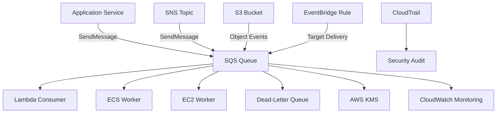
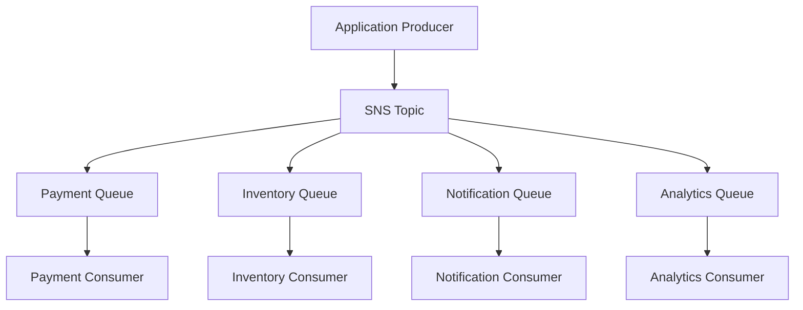
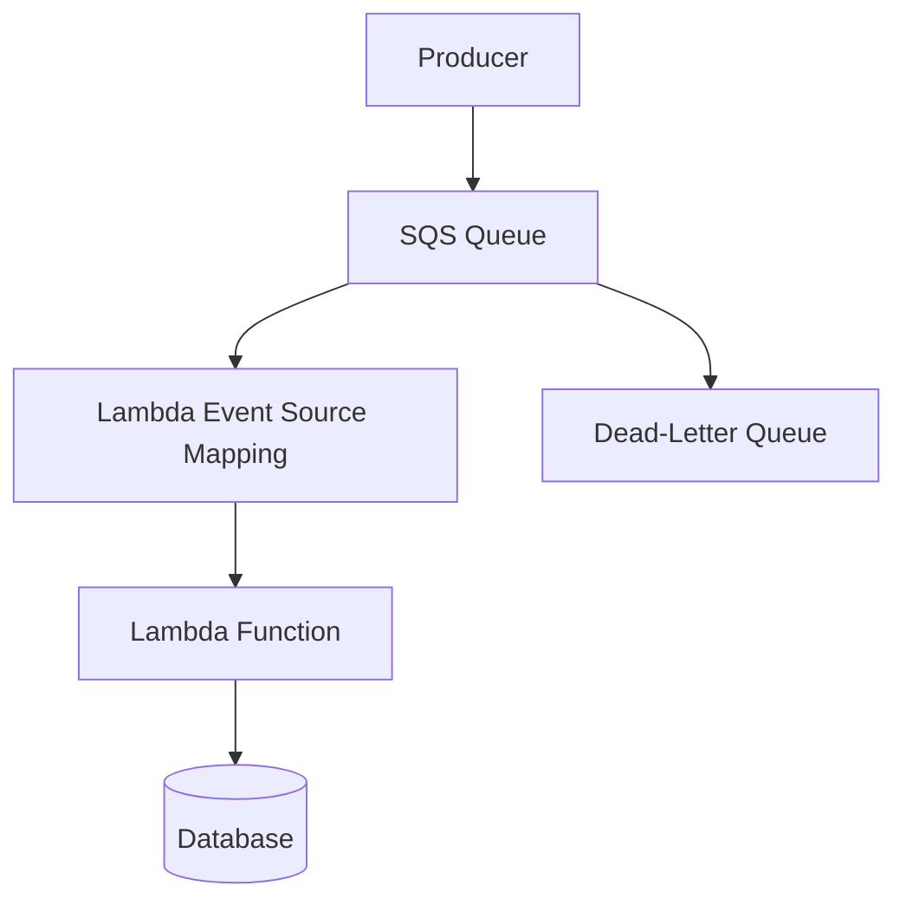
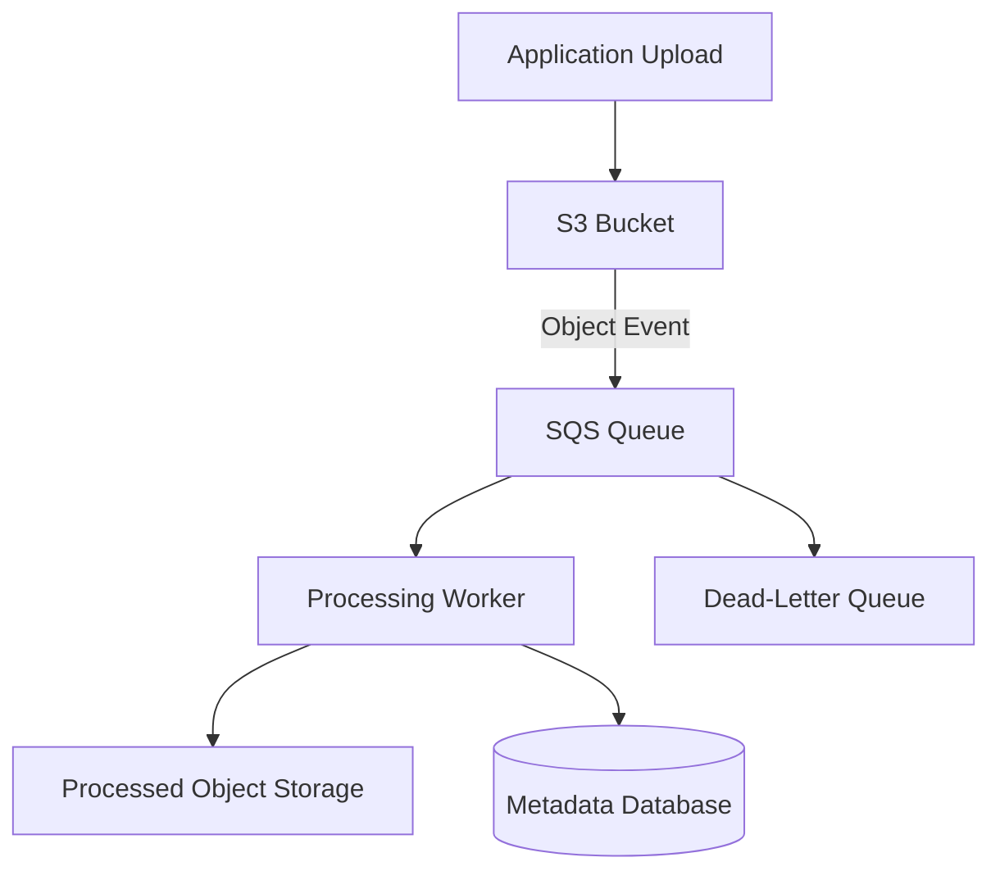
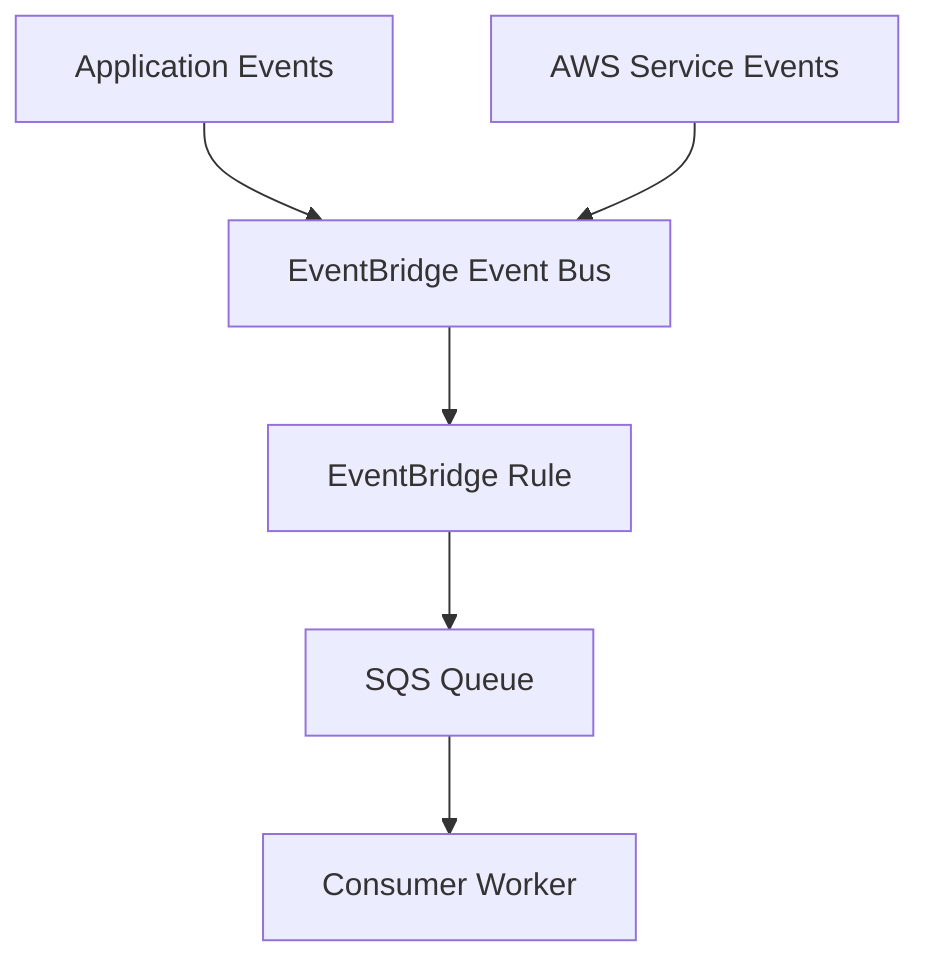
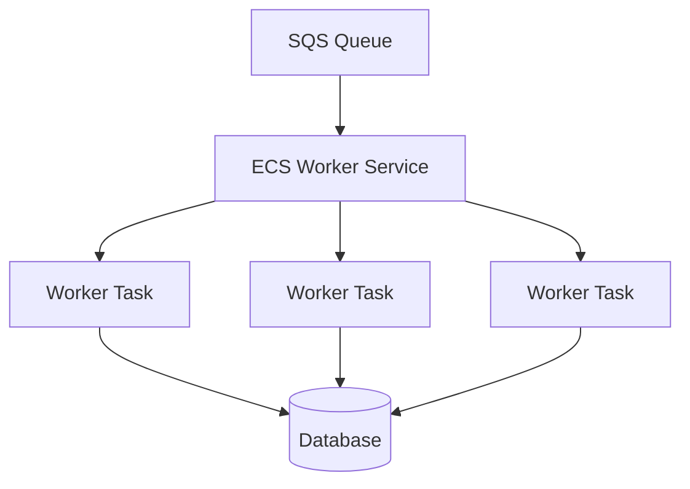
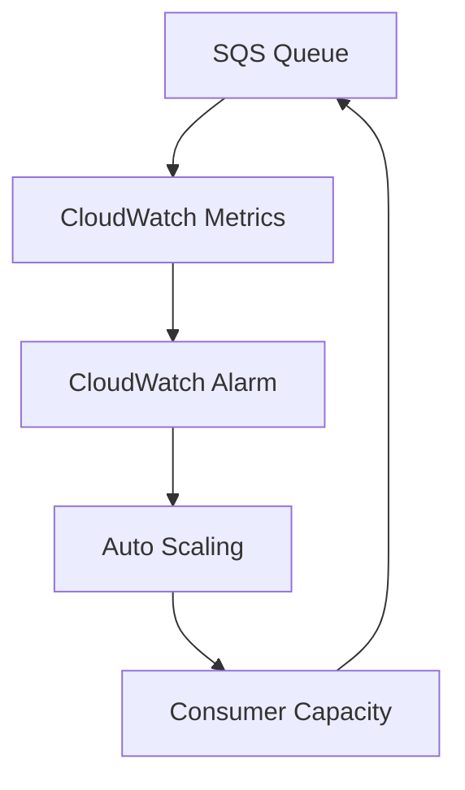
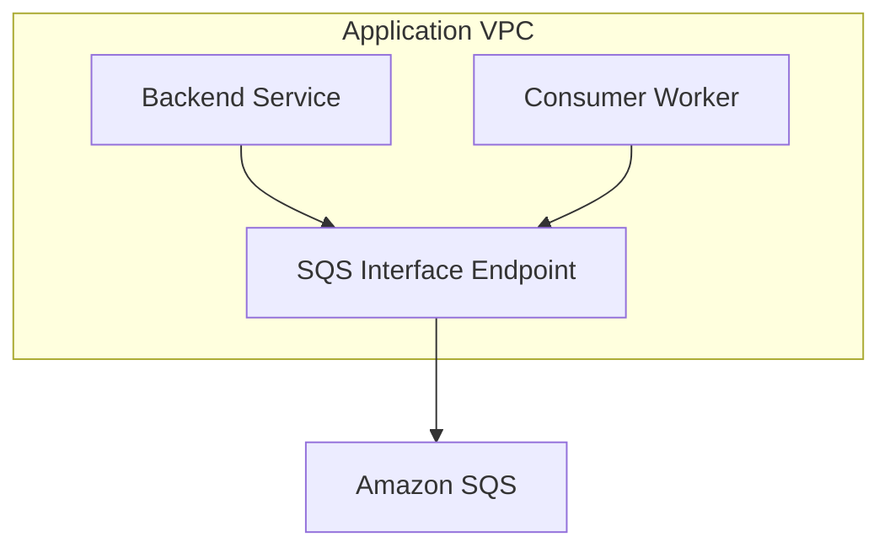

# 07- Secure AWS Service Integrations

## Overview

Amazon SQS integrates with several AWS services to support event-driven architectures, asynchronous processing, serverless workloads, and distributed application communication.

Common integrations include:

- Amazon SNS for message fan-out.
- AWS Lambda for serverless message processing.
- Amazon S3 for object event processing.
- Amazon EventBridge for event routing.
- Amazon CloudWatch for monitoring and alerting.
- AWS KMS for encryption.
- AWS IAM for authorization.
- AWS CloudTrail for auditing.
- Amazon ECS and EC2 for containerized and instance-based consumers.

Each integration introduces additional security boundaries. A secure SQS architecture must control which services can publish messages, which workloads can consume them, how messages are encrypted, and how failures are handled.

This document focuses on securing AWS service integrations with SQS through IAM, queue resource policies, service principals, condition keys, encryption, network controls, and operational monitoring.

## SQS Integration Security Architecture

A typical production architecture uses multiple AWS services to publish and process events.



The main security boundaries are:

| Boundary | Security mechanism |
|---|---|
| Producer identity | IAM identity-based policies |
| Service-to-queue access | Queue resource policies |
| Consumer identity | IAM execution roles |
| Message encryption | SSE-SQS or SSE-KMS |
| Network communication | TLS and VPC endpoints |
| Failure handling | DLQ policies and controlled redrive |
| Administrative operations | IAM permissions and CloudTrail |
| Operational visibility | CloudWatch and security alerts |

## IAM and Resource Policy Model

SQS integrations commonly require both identity-based and resource-based authorization.

### Identity-based policies

Identity-based policies are attached to IAM users, groups, or roles.

They control which SQS operations an application or AWS workload can perform.

Examples:

- `sqs:SendMessage` for producers.
- `sqs:ReceiveMessage` for consumers.
- `sqs:DeleteMessage` for consumers.
- `sqs:ChangeMessageVisibility` for consumers that extend processing time.
- `sqs:GetQueueAttributes` for operational inspection.

### Queue resource policies

A queue resource policy is attached directly to an SQS queue.

It controls which principals can access the queue.

Resource policies are especially important when AWS services such as SNS need permission to publish messages to SQS.

### Authorization evaluation

For an integration to work, all applicable authorization controls must permit the operation.

Consider:

- IAM identity policies.
- SQS queue resource policies.
- KMS key policies.
- VPC endpoint policies.
- Service-specific authorization requirements.
- Permissions boundaries and SCPs.
- Explicit denies.

An explicit deny overrides an allow.

## Secure Amazon SNS Integration

Amazon SNS commonly publishes messages to SQS queues to implement fan-out messaging.

A single SNS topic can distribute events to multiple queues, allowing independent consumers to process the same event.

### Architecture



Each queue should have an independent resource policy and consumer role.

### Queue policy for SNS

The queue must allow the SNS service principal to publish messages.

Restrict access to the expected topic ARN using `aws:SourceArn`.

```json
{
  "Version": "2012-10-17",
  "Statement": [
    {
      "Sid": "AllowOrdersTopic",
      "Effect": "Allow",
      "Principal": {
        "Service": "sns.amazonaws.com"
      },
      "Action": "sqs:SendMessage",
      "Resource": "arn:aws:sqs:ap-south-1:111122223333:orders-queue",
      "Condition": {
        "ArnEquals": {
          "aws:SourceArn": "arn:aws:sns:ap-south-1:111122223333:orders-topic"
        }
      }
    }
  ]
}
```

The source ARN condition prevents unrelated SNS topics from publishing to the queue.

For cross-account integrations, also consider restricting the source account using `aws:SourceAccount` where applicable.

### Terraform configuration

```hcl
resource "aws_sqs_queue" "orders" {
  name = "orders-queue"

  sqs_managed_sse_enabled = true
}

resource "aws_sns_topic" "orders" {
  name = "orders-topic"
}

data "aws_iam_policy_document" "orders_queue" {
  statement {
    sid    = "AllowOrdersTopic"
    effect = "Allow"

    principals {
      type        = "Service"
      identifiers = ["sns.amazonaws.com"]
    }

    actions = [
      "sqs:SendMessage"
    ]

    resources = [
      aws_sqs_queue.orders.arn
    ]

    condition {
      test     = "ArnEquals"
      variable = "aws:SourceArn"
      values   = [aws_sns_topic.orders.arn]
    }
  }
}

resource "aws_sqs_queue_policy" "orders" {
  queue_url = aws_sqs_queue.orders.id
  policy    = data.aws_iam_policy_document.orders_queue.json
}

resource "aws_sns_topic_subscription" "orders_queue" {
  topic_arn = aws_sns_topic.orders.arn
  protocol  = "sqs"
  endpoint  = aws_sqs_queue.orders.arn

  depends_on = [
    aws_sqs_queue_policy.orders
  ]
}
```

The queue policy must be in place before relying on SNS delivery.

### SNS integration security considerations

- Restrict the SNS service principal using the exact topic ARN.
- Avoid granting `sqs:SendMessage` to every principal.
- Use separate queues for independent consumers.
- Apply filtering policies carefully.
- Protect SNS topics with appropriate IAM and topic resource policies.
- Configure encryption independently for the SNS topic and SQS queue.
- Use separate DLQs for failed SNS subscription delivery and failed SQS message processing when both failure domains require isolation.

### KMS considerations

When an SSE-KMS queue receives messages from SNS, the KMS key policy must support the required SQS service usage.

The SNS topic's encryption configuration is a separate concern. If the topic itself uses SSE-KMS, its publishing and service-delivery authorization must also be configured correctly.

Do not assume that encrypting the SQS queue automatically encrypts the SNS topic.

## Secure AWS Lambda Integration

Lambda can consume SQS messages through an event source mapping.

Lambda polls the queue, retrieves messages in batches, invokes the function, and deletes successfully processed messages according to the event source mapping behavior.

### Architecture



### Execution role

The Lambda execution role requires permissions to consume messages.

Typical permissions include:

```json
{
  "Version": "2012-10-17",
  "Statement": [
    {
      "Sid": "ConsumeOrders",
      "Effect": "Allow",
      "Action": [
        "sqs:ReceiveMessage",
        "sqs:DeleteMessage",
        "sqs:GetQueueAttributes"
      ],
      "Resource": "arn:aws:sqs:ap-south-1:111122223333:orders-queue"
    }
  ]
}
```

When the queue uses SSE-KMS with a customer-managed key, the consumer execution role also needs the required KMS permissions, typically `kms:Decrypt`, and the KMS key policy must permit its use.

For encrypted queues, verify the complete KMS authorization path rather than assuming the SQS permissions are sufficient.

### Event source mapping

```hcl
resource "aws_lambda_event_source_mapping" "orders" {
  event_source_arn = aws_sqs_queue.orders.arn
  function_name    = aws_lambda_function.orders_processor.arn

  batch_size                         = 10
  maximum_batching_window_in_seconds = 5
  function_response_types             = ["ReportBatchItemFailures"]

  scaling_config {
    maximum_concurrency = 20
  }
}
```

The Lambda function's execution role must have the required SQS and KMS permissions.

### Partial batch failure handling

Without partial batch response handling, a failed record can cause an entire batch to be retried.

Enable `ReportBatchItemFailures` and return failed message identifiers when only some records fail.

Example Python handler:

```python
import logging

logger = logging.getLogger(__name__)


def lambda_handler(event, context):
    failures = []

    for record in event["Records"]:
        try:
            process_message(record["body"])
        except Exception:
            logger.exception(
                "Message processing failed",
                extra={"message_id": record["messageId"]},
            )

            failures.append({
                "itemIdentifier": record["messageId"]
            })

    return {
        "batchItemFailures": failures
    }


def process_message(body: str) -> None:
    # Implement durable and idempotent business processing.
    pass
```

Do not log complete message bodies if they may contain sensitive information.

### Lambda security considerations

- Use a dedicated execution role.
- Restrict SQS permissions to the required queue.
- Grant KMS decrypt access only when required.
- Use partial batch failure handling.
- Implement idempotent message processing.
- Configure a DLQ or redrive policy.
- Limit event source mapping concurrency to protect downstream systems.
- Use reserved concurrency when required to enforce workload boundaries.
- Keep function environment variables free of long-lived credentials.

### Visibility timeout

The queue visibility timeout must accommodate Lambda processing.

For Lambda SQS event source mappings, AWS recommends configuring the queue visibility timeout to at least six times the function timeout, plus the maximum batching window.

An insufficient visibility timeout can cause messages to become visible and be processed again while the original invocation is still running.

## Secure Amazon S3 Integration

S3 event notifications can publish object events to SQS.

This pattern is useful for document ingestion, image processing, data pipelines, and asynchronous file processing.

### Architecture



### S3 queue policy

S3 requires permission to send notifications to the target queue.

The queue policy should allow the S3 service principal and restrict the source bucket.

```json
{
  "Version": "2012-10-17",
  "Statement": [
    {
      "Sid": "AllowS3Notifications",
      "Effect": "Allow",
      "Principal": {
        "Service": "s3.amazonaws.com"
      },
      "Action": "sqs:SendMessage",
      "Resource": "arn:aws:sqs:ap-south-1:111122223333:document-events",
      "Condition": {
        "ArnEquals": {
          "aws:SourceArn": "arn:aws:s3:::company-documents"
        },
        "StringEquals": {
          "aws:SourceAccount": "111122223333"
        }
      }
    }
  ]
}
```

Use the exact source bucket ARN and account ID.

### S3 integration security considerations

- Restrict queue access to the expected bucket.
- Avoid wildcard source bucket permissions.
- Use versioning when processing specific object versions is important.
- Validate object keys and event structure.
- Use least-privilege `s3:GetObject` permissions for consumers.
- Restrict access to destination buckets and metadata databases.
- Prevent recursive notifications by separating source and destination prefixes or buckets.
- Use idempotent processing because S3 event notifications can be delivered more than once.

### S3 object access permissions

A worker that downloads objects requires permissions such as:

```json
{
  "Version": "2012-10-17",
  "Statement": [
    {
      "Sid": "ReadSourceDocuments",
      "Effect": "Allow",
      "Action": [
        "s3:GetObject"
      ],
      "Resource": "arn:aws:s3:::company-documents/incoming/*"
    }
  ]
}
```

If objects use SSE-KMS with a customer-managed key, the worker may also require `kms:Decrypt`, and the KMS key policy must permit that access.

SQS encryption and S3 object encryption are separate controls.

## Secure Amazon EventBridge Integration

EventBridge routes events to SQS based on configured rules and targets.

It is useful when multiple event sources need centralized routing and filtering.

### Architecture



### Queue permissions

EventBridge requires permission to send messages to the target queue.

A queue policy can authorize the EventBridge service principal and restrict the source rule.

```json
{
  "Version": "2012-10-17",
  "Statement": [
    {
      "Sid": "AllowEventBridgeRule",
      "Effect": "Allow",
      "Principal": {
        "Service": "events.amazonaws.com"
      },
      "Action": "sqs:SendMessage",
      "Resource": "arn:aws:sqs:ap-south-1:111122223333:application-events",
      "Condition": {
        "ArnEquals": {
          "aws:SourceArn": "arn:aws:events:ap-south-1:111122223333:rule/orders-event-rule"
        }
      }
    }
  ]
}
```

### EventBridge security considerations

- Restrict target access to specific rule ARNs.
- Protect event buses with resource policies.
- Restrict who can create, modify, or delete rules.
- Validate event schemas in consumers.
- Avoid placing secrets or unnecessary personal information in event payloads.
- Configure retry policies and target DLQs.
- Monitor failed target delivery.
- Use separate queues for independent processing responsibilities.

### EventBridge DLQ versus SQS processing DLQ

These are different failure boundaries.

| Failure | Appropriate mechanism |
|---|---|
| EventBridge cannot deliver to SQS | EventBridge target DLQ |
| SQS consumer repeatedly fails | SQS redrive policy and DLQ |
| Consumer business transaction fails temporarily | Application retry strategy |
| Downstream service is unavailable | Controlled retry and backoff |

A target DLQ does not replace the SQS queue's own dead-letter queue.

## Secure Amazon ECS and EC2 Integration

SQS consumers can run as ECS tasks or EC2-hosted workers.

This architecture is useful for long-running processing, custom dependencies, and workloads requiring control over execution environments.

### ECS architecture



### ECS task role

Use the ECS task role for application-level SQS operations.

Do not confuse it with the ECS task execution role.

| Role | Responsibility |
|---|---|
| Task execution role | Pull container images, publish logs, retrieve supported startup secrets |
| Task role | Application access to SQS, KMS, S3, and other AWS services |

Example task role policy:

```json
{
  "Version": "2012-10-17",
  "Statement": [
    {
      "Sid": "ConsumeOrders",
      "Effect": "Allow",
      "Action": [
        "sqs:ReceiveMessage",
        "sqs:DeleteMessage",
        "sqs:ChangeMessageVisibility",
        "sqs:GetQueueAttributes"
      ],
      "Resource": "arn:aws:sqs:ap-south-1:111122223333:orders-queue"
    }
  ]
}
```

Add `kms:Decrypt` when the queue uses a customer-managed KMS key and the task needs to consume encrypted messages.

### EC2 instance roles

EC2 workers should use instance profiles with narrowly scoped IAM roles.

Avoid:

- Static AWS credentials inside application configuration.
- Credentials baked into AMIs.
- Shared IAM users across multiple worker groups.
- Broad `sqs:*` permissions.
- Unrestricted instance metadata access from untrusted containers.

Use IMDSv2 and restrict metadata access where appropriate.

### Network security

For ECS and EC2 workloads:

- Run workers in private subnets where appropriate.
- Use SQS interface VPC endpoints when private connectivity is required.
- Restrict endpoint security groups.
- Apply restrictive egress rules.
- Use TLS for service communication.
- Keep container images and host operating systems patched.

## Secure AWS Step Functions Integration

Step Functions can orchestrate workflows that include SQS operations.

For example, a workflow can validate an order, publish an event to SQS, and continue with other processing steps.

### Security model

Step Functions uses an execution role to access AWS resources.

The role should have only the permissions required by the workflow.

Example policy:

```json
{
  "Version": "2012-10-17",
  "Statement": [
    {
      "Sid": "PublishWorkflowEvent",
      "Effect": "Allow",
      "Action": "sqs:SendMessage",
      "Resource": "arn:aws:sqs:ap-south-1:111122223333:workflow-events"
    }
  ]
}
```

When using Step Functions service integrations, verify the required IAM permissions for the exact integration pattern and API operation.

### Security considerations

- Use dedicated execution roles.
- Restrict queue access to specific queue ARNs.
- Avoid embedding secrets in workflow definitions or execution input.
- Protect state machine update permissions.
- Encrypt sensitive execution data where supported and required.
- Apply retention controls to execution history.
- Monitor failed executions and message delivery.

## Secure AWS Auto Scaling Integration

SQS metrics can drive scaling decisions for ECS services and EC2 worker fleets.

A common pattern scales consumer capacity based on queue backlog.

### Architecture



### Security considerations

- Restrict permissions to the required CloudWatch metrics and scaling resources.
- Protect Auto Scaling policies from unauthorized modification.
- Use dedicated workload roles for workers.
- Limit maximum capacity to protect downstream databases and APIs.
- Monitor scaling actions and queue age.
- Avoid granting workers permission to modify scaling policies unless required.

Scaling based only on queue depth can be misleading. Consider backlog per running worker and message age to make more reliable scaling decisions.

## Secure Dead-Letter Queue Integrations

A dead-letter queue isolates messages that repeatedly fail processing.

It is a security-sensitive resource because it may contain the same sensitive payloads as the source queue.

### Security requirements

- Encrypt the DLQ using an approved encryption strategy.
- Restrict DLQ access to authorized investigation and recovery roles.
- Use a restrictive redrive allow policy.
- Monitor DLQ message counts.
- Apply retention appropriate to investigation and recovery requirements.
- Prevent unauthorized message retrieval.
- Audit redrive operations.

### Redrive allow policy

A DLQ can restrict which source queues are allowed to use it.

Example:

```json
{
  "redrivePermission": "byQueue",
  "sourceQueueArns": [
    "arn:aws:sqs:ap-south-1:111122223333:orders-queue"
  ]
}
```

This configuration is applied through the queue's `RedriveAllowPolicy` attribute.

A DLQ should not become an unrestricted repository of failed production data.

## Secure KMS Integration Across Services

When SQS uses SSE-KMS, other integrated services may introduce additional encryption requirements.

Each service's encryption configuration and authorization model must be reviewed independently.

| Integration | Encryption consideration |
|---|---|
| SNS to SQS | Queue KMS policy must support SQS encryption operations; encrypted SNS topics have separate KMS requirements |
| Lambda to SQS | Lambda execution role may require `kms:Decrypt` |
| S3 to SQS | SQS queue encryption and S3 object encryption are separate |
| EventBridge to SQS | Queue policy authorizes EventBridge delivery; validate KMS requirements for the selected configuration |
| ECS to SQS | ECS task role may require KMS permissions |
| EC2 to SQS | Instance role may require KMS permissions |
| Step Functions to SQS | Workflow role needs SQS authorization; evaluate queue KMS requirements |

### Key policy principles

- Use customer-managed keys when explicit key-level governance is required.
- Restrict key usage to approved principals and services.
- Use encryption-context conditions where appropriate.
- Separate key administrators from key users.
- Monitor key policy changes.
- Avoid broad wildcard permissions.
- Do not disable or delete keys while messages still depend on them.

## Secure Network Architecture

Network controls complement IAM and resource policies.

### Private subnet architecture



### Recommended controls

- Use private subnets for internal workloads where appropriate.
- Use interface endpoints for private SQS connectivity.
- Enable private DNS when appropriate.
- Restrict endpoint security groups to approved workloads.
- Use endpoint policies to limit queue access.
- Apply `aws:SourceVpce` conditions only after validating all legitimate access paths.
- Enforce TLS through queue resource policies.
- Avoid unnecessary public network exposure.

Network restrictions should not be treated as a replacement for identity-based authorization.

## Monitoring and Security Auditing

Integrations should be monitored for both operational failures and unauthorized activity.

### CloudWatch metrics

Important SQS metrics include:

| Metric | Security and operational relevance |
|---|---|
| `ApproximateNumberOfMessagesVisible` | Detects growing backlog |
| `ApproximateNumberOfMessagesNotVisible` | Identifies in-flight messages |
| `ApproximateAgeOfOldestMessage` | Detects processing delays |
| `NumberOfMessagesSent` | Tracks producer activity |
| `NumberOfMessagesReceived` | Tracks consumer activity |
| `NumberOfMessagesDeleted` | Tracks successful processing completion |
| `NumberOfMessagesReceived` on DLQ | Helps identify repeated processing failures |

### CloudTrail auditing

CloudTrail can help investigate administrative and configuration changes.

Monitor operations such as:

- `CreateQueue`
- `DeleteQueue`
- `SetQueueAttributes`
- `AddPermission`
- `RemovePermission`
- KMS key policy changes
- KMS key disabling and deletion scheduling
- IAM role and policy changes

Do not assume that all SQS message operations or message bodies are recorded as CloudTrail management events.

### Security alerts

Create alerts for:

- Unexpected queue policy changes.
- Unexpected queue creation or deletion.
- KMS key policy modifications.
- Unauthorized access errors.
- DLQ message accumulation.
- Sudden backlog increases.
- Unexpected consumer concurrency changes.
- Failed EventBridge target deliveries.
- SNS subscription delivery failures.

Use structured application logs with message IDs and correlation IDs. Avoid logging sensitive payload contents.

## Reliability and Disaster Recovery

Secure integrations must remain recoverable during service failures and regional outages.

### Integration failure boundaries

| Failure | Recovery mechanism |
|---|---|
| SNS delivery failure | Subscription delivery retry and subscription DLQ |
| EventBridge target failure | Target retry policy and target DLQ |
| SQS consumer failure | SQS redrive policy |
| Lambda processing failure | Partial batch response and SQS redrive |
| ECS or EC2 worker failure | Visibility timeout expiration and worker recovery |
| KMS authorization failure | Restore approved IAM and key policy permissions |
| Regional outage | Regional recovery queue and independently configured service integrations |

### Disaster recovery requirements

- Provision recovery queues through infrastructure as code.
- Recreate queue resource policies.
- Recreate KMS keys and key policies.
- Reconfigure SNS subscriptions and EventBridge targets.
- Provision consumer roles and execution permissions.
- Configure VPC endpoints and networking.
- Validate DLQ and redrive permissions.
- Test replay and idempotency behavior.

SQS does not automatically replicate messages to another Region. Cross-Region recovery requires an explicit message replication, replay, or reconstruction strategy.

## Common Mistakes and Production Pitfalls

### Granting wildcard service access

Allowing `sqs:SendMessage` to every principal or service creates an unnecessarily broad publishing boundary.

**Avoidance:** Use the exact service principal and restrict access with `aws:SourceArn` and, where applicable, `aws:SourceAccount`.

### Confusing identity policies with queue policies

A producer role may have `sqs:SendMessage` permission but still be denied by the queue resource policy.

**Avoidance:** Evaluate both identity-based and resource-based authorization.

### Ignoring KMS authorization

An encrypted queue can reject otherwise authorized SQS operations when KMS permissions or key policies are incomplete.

**Avoidance:** Validate SQS permissions and KMS permissions independently.

### Sharing one IAM role across unrelated services

Shared roles make it difficult to isolate access and investigate security incidents.

**Avoidance:** Use dedicated producer, consumer, Lambda, ECS, EC2, and workflow roles.

### Treating a DLQ as unrestricted storage

DLQs can contain sensitive payloads and should have controlled access and retention.

**Avoidance:** Apply encryption, least-privilege permissions, retention controls, and auditing.

### Assuming successful delivery means successful processing

SNS or EventBridge successfully delivering a message to SQS does not mean the consumer completed the business operation.

**Avoidance:** Monitor consumer processing, deletion rates, backlog age, and DLQ activity.

### Ignoring duplicate delivery

Standard SQS queues and upstream event sources can produce duplicate deliveries.

**Avoidance:** Use stable event identifiers and idempotent business operations.

### Applying VPC endpoint restrictions without integration analysis

Strict `aws:SourceVpce` conditions can block service integrations or administrative workflows.

**Avoidance:** Identify and test all required access paths before enforcing network restrictions.

### Assuming regional encryption provides disaster recovery

Encryption protects data but does not replicate queues, messages, subscriptions, or policies across Regions.

**Avoidance:** Build and test an explicit regional recovery architecture.

## Production Security Checklist

### Identity and authorization

- [ ] Every producer has a dedicated least-privilege role.
- [ ] Every consumer has a dedicated least-privilege role.
- [ ] AWS service integrations use specific service principals.
- [ ] Queue policies restrict service access to approved source ARNs.
- [ ] Cross-account access is explicitly authorized.
- [ ] Explicit deny statements are reviewed for unintended effects.

### Encryption and network security

- [ ] All SQS API communication uses HTTPS.
- [ ] Queue encryption is enabled.
- [ ] SSE-KMS key policies support the intended integration.
- [ ] Sensitive message attributes are avoided or separately protected.
- [ ] VPC endpoints are used where private connectivity is required.
- [ ] Endpoint policies and security groups are restrictive.
- [ ] Queue policies enforce secure transport.

### Reliability and operations

- [ ] Every integration has an appropriate retry strategy.
- [ ] DLQs are configured and access-controlled.
- [ ] Consumers implement idempotent processing.
- [ ] Lambda partial batch failure handling is configured where appropriate.
- [ ] Visibility timeouts match processing requirements.
- [ ] CloudWatch backlog and failure metrics are monitored.
- [ ] CloudTrail administrative and security events are audited.
- [ ] Disaster recovery configurations are tested.

## Key Takeaways

- Secure SQS integrations require coordinated IAM permissions, queue resource policies, service principals, and condition keys.
- Restrict AWS service publishing with exact source ARNs and account conditions where applicable.
- SSE-KMS introduces an independent authorization boundary that must be configured for integrated workloads.
- Use dedicated workload roles, private networking, DLQs, and idempotent consumers to reduce security and operational risks.
- Monitor integration delivery failures, queue behavior, KMS activity, and administrative changes, and test recovery procedures regularly.