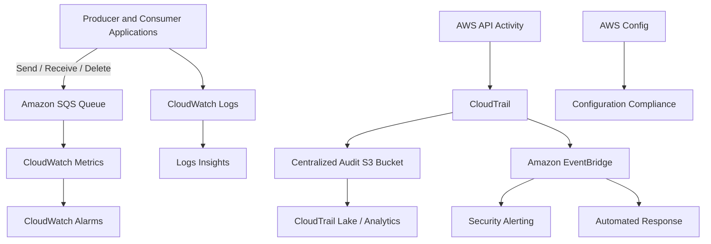
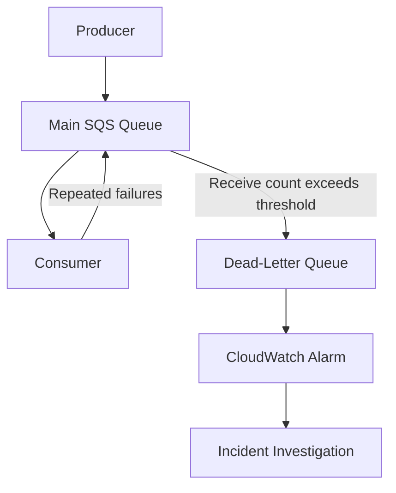
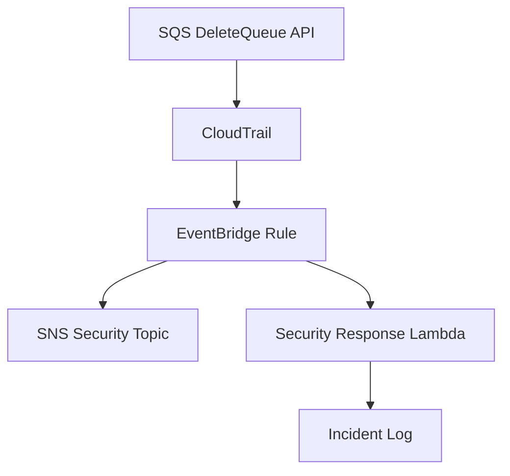
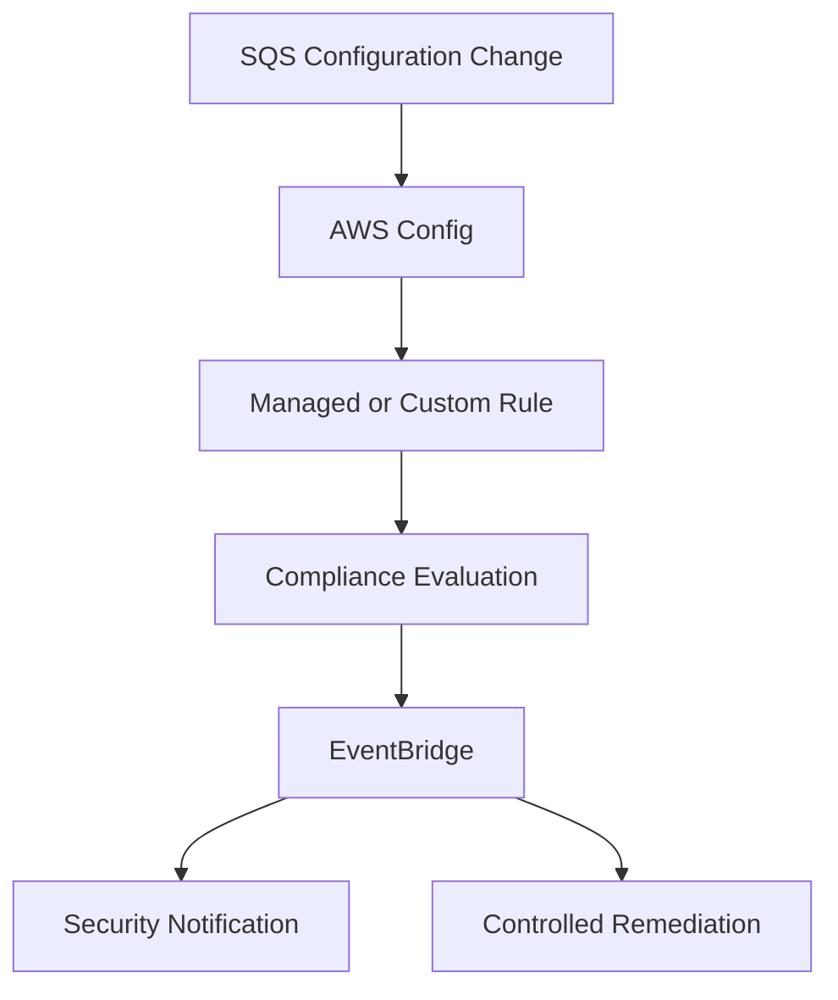
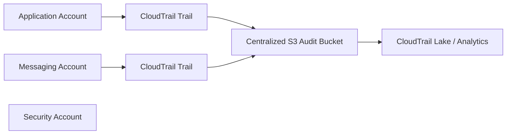

# 08- Security Monitoring and Auditing

## Overview

Amazon Simple Queue Service (SQS) is a managed messaging service used to decouple distributed applications and process workloads asynchronously. In production systems, securing an SQS queue requires more than configuring IAM policies and encryption. Teams must continuously monitor access, detect suspicious activity, audit configuration changes, and investigate operational failures.

Security monitoring and auditing provide visibility into:

- Who accessed an SQS queue and which API operations were performed.
- Which identities modified queue policies, encryption settings, or access permissions.
- Whether messages are being published, consumed, or retained unexpectedly.
- Whether unauthorized requests or configuration changes are occurring.
- Whether encryption keys and related security controls are being used as intended.

AWS provides several complementary services for SQS security monitoring:

| Service | Primary responsibility |
|---|---|
| AWS CloudTrail | Records supported AWS API activity and configuration changes |
| Amazon CloudWatch | Collects queue metrics and application telemetry |
| CloudWatch Logs | Stores application logs and selected AWS service logs |
| Amazon EventBridge | Routes supported AWS events for automated responses |
| AWS Config | Tracks resource configuration and evaluates compliance |
| AWS CloudTrail Lake | Queries and analyzes CloudTrail event data |
| AWS IAM Access Analyzer | Identifies unintended external access to supported resources |
| AWS Security Hub | Aggregates security findings across AWS services |

These services solve different problems. CloudTrail provides an audit trail, CloudWatch provides operational visibility, EventBridge enables event-driven responses, and AWS Config helps identify configuration drift.

A production monitoring architecture should combine these capabilities rather than relying on a single monitoring mechanism.

## Security Monitoring Architecture

A typical SQS monitoring architecture collects audit events, queue metrics, configuration changes, and application-level telemetry.



The architecture separates three monitoring dimensions:

- **Audit monitoring:** Records API activity and administrative changes.
- **Operational monitoring:** Detects message backlogs, processing failures, and unusual queue behavior.
- **Configuration monitoring:** Identifies insecure or unexpected changes to queue settings and resource policies.

## AWS CloudTrail for SQS Auditing

### What CloudTrail Does

AWS CloudTrail records activity performed through AWS management interfaces, SDKs, CLI commands, and supported service integrations.

For SQS, CloudTrail helps answer questions such as:

- Which IAM role modified a queue policy?
- Who changed the queue's encryption configuration?
- Which principal deleted or modified a queue?
- When was a queue attribute changed?
- Which identity attempted an unauthorized operation?

CloudTrail records API activity as events containing information such as:

- Event name.
- Event source.
- Event time.
- AWS Region.
- User identity.
- Source IP address, when available.
- Request parameters.
- Response elements, when recorded.
- Error code and error message, when applicable.

CloudTrail is particularly important for security investigations because it provides an audit record independent of application logging.

### Management Events and Data Events

CloudTrail distinguishes between management events and data events.

| Event category | Purpose | SQS examples |
|---|---|---|
| Management events | Record control-plane operations | `CreateQueue`, `DeleteQueue`, `SetQueueAttributes`, `AddPermission` |
| Data events | Record supported data-plane operations | `SendMessage`, `ReceiveMessage`, `DeleteMessage` |

Management events are generally enabled through a trail's event configuration. SQS data events require explicit configuration and can incur additional CloudTrail charges.

Do not assume that enabling a trail automatically records every message-level operation.

### Important SQS API Events

| API operation | Security relevance |
|---|---|
| `CreateQueue` | Detects unexpected queue creation |
| `DeleteQueue` | Detects queue deletion |
| `SetQueueAttributes` | Detects changes to queue configuration and policy |
| `AddPermission` | Detects permission grants |
| `RemovePermission` | Detects permission removal |
| `TagQueue` | Detects queue tagging changes |
| `UntagQueue` | Detects removal of queue tags |
| `SendMessage` | Audits message publishing when data events are enabled |
| `ReceiveMessage` | Audits message retrieval when data events are enabled |
| `DeleteMessage` | Audits message deletion when data events are enabled |
| `PurgeQueue` | Detects queue purging |

The exact event coverage should be verified against the current CloudTrail SQS event reference and the event selectors configured for the trail.

### Enable CloudTrail

A trail can be created through the AWS CLI.

```bash
aws cloudtrail create-trail \
  --name sqs-security-audit \
  --s3-bucket-name company-security-audit-logs \
  --is-multi-region-trail \
  --enable-log-file-validation
```

Start logging:

```bash
aws cloudtrail start-logging \
  --name sqs-security-audit
```

Inspect the trail:

```bash
aws cloudtrail describe-trails \
  --trail-name-list sqs-security-audit
```

A production audit trail should generally:

- Cover all required AWS Regions.
- Use a dedicated, access-controlled S3 bucket.
- Enable log file validation.
- Use appropriate encryption.
- Apply restrictive bucket policies.
- Retain audit records according to organizational requirements.
- Protect audit storage against unauthorized deletion or modification.

For stronger separation of duties, store audit records in a dedicated security account rather than the same account that owns the application queues.

### Configure SQS Data Event Logging

Message-level auditing can be enabled through advanced event selectors.

For example, a trail can record data events for a specific SQS queue.

```bash
aws cloudtrail put-event-selectors \
  --trail-name sqs-security-audit \
  --advanced-event-selectors '[
    {
      "Name": "Audit production SQS queue activity",
      "FieldSelectors": [
        {
          "Field": "eventCategory",
          "Equals": ["Data"]
        },
        {
          "Field": "resources.type",
          "Equals": ["AWS::SQS::Queue"]
        },
        {
          "Field": "resources.ARN",
          "Equals": [
            "arn:aws:sqs:ap-south-1:222222222222:orders-queue"
          ]
        }
      ]
    }
  ]'
```

Advanced event selectors provide more precise control over which data events are recorded.

When changing event selectors, review the complete intended selector configuration. Do not accidentally remove existing event coverage.

### Inspect CloudTrail Events

CloudTrail Event History provides a searchable history of management events.

Use the CLI to search for queue policy modifications:

```bash
aws cloudtrail lookup-events \
  --lookup-attributes \
  AttributeKey=EventName,AttributeValue=SetQueueAttributes \
  --max-results 50 \
  --region ap-south-1
```

Search for queue deletion:

```bash
aws cloudtrail lookup-events \
  --lookup-attributes \
  AttributeKey=EventName,AttributeValue=DeleteQueue \
  --max-results 50 \
  --region ap-south-1
```

For message-level data events and long-term investigations, use the configured trail destination or CloudTrail Lake. Event History should not be treated as a complete archive of all SQS data-plane activity.

## Auditing Queue Configuration Changes

Queue configuration changes can introduce security vulnerabilities without changing application code.

Important settings to audit include:

| Configuration | Security concern |
|---|---|
| Queue resource policy | External principals may gain unintended access |
| Encryption settings | Messages may no longer meet encryption requirements |
| KMS key configuration | Unauthorized or unexpected key usage |
| Queue visibility timeout | Processing behavior may change |
| Message retention period | Messages may be retained longer or shorter than intended |
| Dead-letter queue configuration | Failed messages may no longer be isolated |
| Redrive policy | Messages may be routed to an unintended destination |
| VPC endpoint restrictions | Network access boundaries may be weakened |
| Queue tags | Security ownership and compliance classification may change |

### Monitor Queue Policy Changes

The `SetQueueAttributes` API can update the queue's resource policy and other queue attributes.

A change to the queue policy can:

- Grant access to an external AWS account.
- Allow additional IAM roles.
- Expose message publishing or consumption operations.
- Introduce wildcard principals.
- Remove existing security restrictions.

Treat queue policy modifications as security-sensitive deployment operations.

A useful audit workflow is:

1. Capture the CloudTrail event.
2. Identify the principal that performed the change.
3. Extract the queue ARN and modified attributes.
4. Compare the resulting configuration with the approved baseline.
5. Alert when an unexpected policy or security setting changes.
6. Investigate and revert unauthorized changes through a controlled process.

### Inspect Queue Attributes

```bash
aws sqs get-queue-attributes \
  --queue-url https://sqs.ap-south-1.amazonaws.com/222222222222/orders-queue \
  --attribute-names All \
  --region ap-south-1
```

This command retrieves the queue's available attributes, including policy and encryption-related configuration where applicable.

Use configuration snapshots or infrastructure-as-code state to compare the current configuration against the approved deployment baseline.

## CloudWatch Monitoring for SQS

CloudTrail explains who performed an operation. CloudWatch helps identify what is happening to the queue.

SQS publishes metrics to CloudWatch automatically.

### Important SQS Metrics

| Metric | Description | Security or operational relevance |
|---|---|---|
| `ApproximateNumberOfMessagesVisible` | Messages available for retrieval | Detects unexpected backlog growth |
| `ApproximateNumberOfMessagesNotVisible` | Messages currently in flight | Detects processing pressure or stuck consumers |
| `ApproximateAgeOfOldestMessage` | Approximate age of the oldest available message | Detects delayed processing |
| `NumberOfMessagesSent` | Messages successfully sent | Helps identify unusual publishing activity |
| `NumberOfMessagesReceived` | Messages received by consumers | Helps identify unusual consumption patterns |
| `NumberOfMessagesDeleted` | Messages deleted after processing | Helps evaluate consumer completion activity |
| `NumberOfEmptyReceives` | Receive requests returning no messages | Can indicate inefficient polling or unusual consumer behavior |

SQS metrics are approximate and may not be available immediately. Some metrics are reported only when the queue is active.

Do not use a single metric as definitive proof of unauthorized access. Correlate metrics with CloudTrail events and application telemetry.

### Detect Unusual Message Publishing

An unexpected increase in `NumberOfMessagesSent` may indicate:

- A producer retry loop.
- An application deployment defect.
- A compromised producer role.
- An unintended integration.
- A traffic spike.

Establish a baseline for normal publishing behavior before configuring anomaly alerts.

### Detect Unusual Message Consumption

An unexpected increase in `NumberOfMessagesReceived` or `NumberOfMessagesDeleted` may indicate:

- A newly deployed consumer.
- A misconfigured polling loop.
- An unauthorized consumer.
- A queue-processing incident.

Message retrieval does not necessarily mean successful business processing. SQS can redeliver messages, and consumers can receive a message without deleting it.

### Create a CloudWatch Alarm

Example: alert when the visible message backlog exceeds a threshold.

```bash
aws cloudwatch put-metric-alarm \
  --alarm-name orders-queue-visible-backlog \
  --namespace AWS/SQS \
  --metric-name ApproximateNumberOfMessagesVisible \
  --dimensions Name=QueueName,Value=orders-queue \
  --statistic Average \
  --period 300 \
  --evaluation-periods 3 \
  --threshold 1000 \
  --comparison-operator GreaterThanThreshold \
  --treat-missing-data notBreaching
```

This alarm evaluates the average visible-message count over three five-minute periods.

The threshold should reflect expected workload volume and processing capacity. A fixed threshold is not universally appropriate.

### Monitor Message Age

Message age is often a more useful indicator of customer impact than queue depth alone.

A queue can contain thousands of messages while still processing within its service-level objective. Conversely, a relatively small backlog may represent a serious incident if messages remain unprocessed for too long.

Create an alarm for `ApproximateAgeOfOldestMessage` based on the maximum acceptable processing delay.

## Monitoring Dead-Letter Queues

A dead-letter queue (DLQ) receives messages that exceed the configured maximum receive count.

DLQs are important for security and reliability because they isolate repeatedly failing messages rather than allowing them to consume consumer capacity indefinitely.

### Security and Operational Risks

A DLQ can contain:

- Malformed or unexpected payloads.
- Messages that trigger application exceptions.
- Events from incompatible producer versions.
- Poison messages.
- Potentially sensitive business data.

Monitor the DLQ for unexpected growth and investigate the source of repeated failures.

### DLQ Monitoring Architecture



### Create a DLQ Alarm

```bash
aws cloudwatch put-metric-alarm \
  --alarm-name orders-dlq-messages \
  --namespace AWS/SQS \
  --metric-name ApproximateNumberOfMessagesVisible \
  --dimensions Name=QueueName,Value=orders-dlq \
  --statistic Maximum \
  --period 300 \
  --evaluation-periods 1 \
  --threshold 0 \
  --comparison-operator GreaterThanThreshold \
  --treat-missing-data notBreaching
```

Any visible message in the DLQ triggers the alarm.

For production systems, define an explicit DLQ investigation and replay process. Do not automatically replay every failed message without validating its cause and payload.

## EventBridge for Security Event Detection

Amazon EventBridge can route supported CloudTrail events to security automation workflows.

This is useful when security teams need near-real-time notifications about administrative changes.

For example, an event rule can detect SQS queue deletion.

### Event Pattern

```json
{
  "source": [
    "aws.sqs"
  ],
  "detail-type": [
    "AWS API Call via CloudTrail"
  ],
  "detail": {
    "eventSource": [
      "sqs.amazonaws.com"
    ],
    "eventName": [
      "DeleteQueue"
    ]
  }
}
```

The rule matches supported CloudTrail events delivered to EventBridge.

### Example Security Workflow



Possible automated actions include:

- Sending an alert to a security operations channel.
- Creating an incident record.
- Enriching the event with IAM and resource metadata.
- Triggering an investigation workflow.
- Initiating an approved remediation process.

Automated remediation should be carefully controlled. Automatically recreating a deleted queue or changing permissions without understanding the deployment state can cause data loss or configuration drift.

### Example EventBridge Rule

```bash
aws events put-rule \
  --name detect-sqs-queue-deletion \
  --event-pattern file://sqs-delete-event-pattern.json \
  --state ENABLED \
  --description "Detect SQS queue deletion through CloudTrail"
```

Configure an appropriate target and target permissions separately.

## AWS Config for Configuration Compliance

AWS Config continuously records supported resource configuration changes and can evaluate resources against compliance rules.

For SQS, it can help identify queues that do not satisfy organizational security requirements.

Examples of configuration checks include:

- Queue encryption requirements.
- Queue policy restrictions.
- Required resource tags.
- Approved queue configuration.
- Expected dead-letter queue settings.

AWS Config rule availability and supported resource evaluations should be verified before designing a compliance control. For organization-specific requirements, use custom rules where managed rules do not cover the required configuration.

### Configuration Compliance Workflow



### Why AWS Config Matters

CloudTrail records the API operation that changed a queue. AWS Config helps evaluate the resulting resource configuration against a desired compliance state.

For example:

- CloudTrail identifies who changed the queue.
- AWS Config evaluates whether the resulting encryption configuration is compliant.
- EventBridge routes the compliance finding to the security team.

This separation makes security investigations and compliance reporting easier.

## CloudTrail Log Storage and Protection

Audit records are security-sensitive data. If an attacker can modify or delete audit logs, incident investigation becomes significantly harder.

### Centralized Audit Storage

A recommended architecture stores CloudTrail logs in a dedicated security account.



Centralized logging provides:

- Separation of duties.
- Consistent audit retention.
- Reduced risk of application-account log tampering.
- Centralized investigation.
- Easier compliance reporting.

### S3 Bucket Protection

Use a restrictive bucket policy that permits only the required CloudTrail delivery operations and authorized security administration.

Important controls include:

- S3 Block Public Access.
- Bucket versioning where appropriate.
- SSE-S3 or SSE-KMS encryption.
- Restricted bucket and object permissions.
- CloudTrail log file validation.
- S3 lifecycle policies.
- S3 Object Lock when immutable retention is required.

Object Lock should be configured according to the organization's retention and governance requirements. Retention modes and legal holds must be considered before enabling immutable storage.

### Log File Validation

CloudTrail log file validation helps detect whether delivered log files have been modified or deleted after delivery.

Enable validation when creating a trail:

```bash
aws cloudtrail create-trail \
  --name centralized-security-trail \
  --s3-bucket-name company-security-audit-logs \
  --is-multi-region-trail \
  --enable-log-file-validation
```

Validation is useful for audit integrity, but it does not prevent an authorized administrator from deleting resources or changing logging configuration. Protect the trail, bucket, and relevant administrative permissions separately.

## Security Alerting and Incident Response

Monitoring becomes useful when events lead to actionable responses.

A security alerting workflow should define:

- What constitutes a security incident.
- Which events require immediate notification.
- Who owns the affected queue.
- How the event is investigated.
- Which remediation actions are authorized.
- How the incident is documented.

### Recommended Security Alerts

| Event or condition | Suggested severity | Response |
|---|---|---|
| Unexpected `DeleteQueue` | High | Verify deployment or investigate deletion |
| Unauthorized queue policy modification | High | Review principal and restore approved policy |
| Unexpected external principal added | High | Validate access and remove unauthorized permission |
| Unexpected KMS key configuration change | High | Investigate key usage and authorization |
| DLQ backlog above zero | Medium or High | Investigate failed messages |
| Unusual message publishing volume | Medium or High | Correlate producer activity and application logs |
| Unusual message retrieval activity | Medium or High | Verify consumer identity and workload behavior |
| Queue encryption configuration becomes noncompliant | High | Restore approved encryption configuration |

Severity should be based on business impact, exposure, and the sensitivity of the queue rather than the API event name alone.

### Incident Investigation Procedure

When an unexpected SQS security event occurs:

1. Identify the affected queue ARN and AWS account.
2. Locate the corresponding CloudTrail event.
3. Identify the IAM principal and session context.
4. Determine the source of the request.
5. Review the request parameters and response.
6. Compare the current queue configuration with the approved baseline.
7. Inspect related KMS, IAM, and VPC endpoint activity.
8. Review message-level activity if data events were enabled.
9. Contain unauthorized access using approved IAM and queue-policy changes.
10. Preserve evidence and document the incident.

Do not immediately delete a suspicious queue or purge its messages. Preserve evidence and coordinate remediation with the service owner.

## Application-Level Security Logging

AWS audit logs do not replace application-level observability.

A backend service should record the business context associated with message publishing and consumption.

For example, a Django or FastAPI service may publish an order event to SQS. CloudTrail can record the AWS API activity, while application logs explain why the message was published.

### Recommended Structured Log Fields

```json
{
  "timestamp": "2026-11-22T10:15:30Z",
  "level": "INFO",
  "service": "orders-api",
  "environment": "production",
  "event_type": "sqs.message.published",
  "queue": "orders-queue",
  "message_id": "example-message-id",
  "correlation_id": "order-1001",
  "aws_region": "ap-south-1",
  "operation": "SendMessage",
  "status": "success"
}
```

Use structured logging rather than unstructured text wherever possible.

Avoid recording:

- AWS access keys or session tokens.
- Authentication headers.
- Complete sensitive message payloads.
- Customer secrets or personal information unless explicitly required and protected.
- KMS plaintext data keys.

### Correlating Application Logs with CloudTrail

A useful investigation combines:

| Source | Information |
|---|---|
| Application logs | Business operation and correlation ID |
| CloudTrail | AWS principal, API operation, and request context |
| CloudWatch metrics | Queue-level activity and processing behavior |
| AWS Config | Resource configuration at relevant points in time |
| KMS CloudTrail events | Key usage and authorization activity |

CloudTrail and application logs may not contain the same correlation identifier. If correlation is required, include a business identifier in application telemetry and use timestamps, principal identity, and request metadata to connect related events.

## Infrastructure as Code for Monitoring

Monitoring resources should be managed through Terraform or another infrastructure-as-code workflow.

The following example creates a CloudWatch alarm for a production queue.

```hcl
resource "aws_cloudwatch_metric_alarm" "orders_queue_backlog" {
  alarm_name          = "orders-queue-visible-backlog"
  alarm_description   = "Detect sustained backlog in the orders queue"
  namespace           = "AWS/SQS"
  metric_name         = "ApproximateNumberOfMessagesVisible"

  statistic           = "Average"
  period              = 300
  evaluation_periods  = 3
  threshold           = 1000
  comparison_operator = "GreaterThanThreshold"

  treat_missing_data = "notBreaching"

  dimensions = {
    QueueName = "orders-queue"
  }

  tags = {
    Environment = "production"
    Service     = "orders"
  }
}
```

For a complete monitoring deployment, manage the following resources together:

- CloudTrail trail and event selectors.
- Audit S3 bucket and bucket policy.
- CloudWatch alarms.
- SNS notification topics.
- EventBridge rules and targets.
- AWS Config rules.
- IAM permissions for monitoring and security automation.

### Deployment Considerations

- Deploy security monitoring before application workloads where possible.
- Validate cross-account log delivery permissions.
- Keep audit infrastructure separate from application deployment permissions.
- Review CloudTrail event selectors to avoid unnecessary data collection costs.
- Test notification delivery and incident workflows.
- Use CI/CD policy checks to prevent insecure monitoring configurations.
- Detect configuration drift between Terraform state and deployed AWS resources.

## Cost and Retention Considerations

Security monitoring introduces ongoing storage, ingestion, and analysis costs.

| Component | Cost considerations | Optimization |
|---|---|---|
| CloudTrail management events | Depends on trail and event configuration | Avoid unnecessary duplicate trails |
| CloudTrail data events | Additional charges apply | Select only required SQS queues and operations |
| CloudTrail Lake | Event ingestion and retention costs | Use targeted event stores and retention periods |
| CloudWatch metrics | Standard SQS metrics are available without a separate custom metric charge; alarms and additional features may incur charges | Create alarms for meaningful operational thresholds |
| CloudWatch Logs | Ingestion, storage, and queries | Apply retention policies and avoid excessive logging |
| S3 audit storage | Storage, requests, and retrieval | Use lifecycle transitions and appropriate retention |
| EventBridge | Event ingestion and target-related costs | Filter events before routing |
| AWS Config | Configuration recording and rule evaluation costs | Scope recording and rules appropriately |

For production systems, define retention based on regulatory, contractual, security, and operational requirements.

Do not reduce audit coverage solely to minimize cost without evaluating the resulting investigation and compliance impact.

## Common Mistakes and Pitfalls

### Assuming CloudTrail Records Every SQS Operation by Default

CloudTrail management event logging does not automatically provide complete message-level auditing.

**Avoidance:** Configure SQS data event selectors for queues that require message-level audit visibility.

### Treating CloudWatch Metrics as an Audit Trail

CloudWatch metrics provide aggregate operational information, not a complete record of individual API requests or identities.

**Avoidance:** Use CloudTrail for API auditing and CloudWatch for operational monitoring.

### Ignoring Queue Policy Changes

A queue policy can expose sensitive messages to external principals without changing the application.

**Avoidance:** Alert on `SetQueueAttributes`, `AddPermission`, and other relevant permission-management operations. Compare the resulting policy with an approved baseline.

### Storing Audit Logs in the Application Account Without Protection

An attacker with sufficient application-account permissions may be able to alter or delete local audit storage.

**Avoidance:** Use a centralized security account with restrictive access controls and appropriate retention protections.

### Logging Sensitive Message Payloads

Application logging can unintentionally expose customer data, credentials, or confidential business information.

**Avoidance:** Log message identifiers and correlation metadata instead of complete payloads.

### Alerting on Every Queue Metric Change

Excessive alerts create noise and make real incidents harder to identify.

**Avoidance:** Establish workload baselines, use sustained thresholds, and route alerts according to business impact.

### Automatically Remediating Every Configuration Change

A configuration change may be part of an approved deployment or incident response.

**Avoidance:** Validate the event and deployment context before taking destructive or disruptive automated actions.

### Ignoring DLQ Activity

A growing DLQ can indicate a broken consumer, malformed messages, or an integration problem.

**Avoidance:** Monitor DLQ depth and oldest-message age, define ownership, and establish a controlled replay procedure.

## Production Security Monitoring Checklist

- [ ] Enable a multi-Region CloudTrail trail where required.
- [ ] Configure SQS data events for queues requiring message-level auditing.
- [ ] Enable CloudTrail log file validation.
- [ ] Store audit logs in a protected, centralized S3 bucket.
- [ ] Restrict access to audit records and trail configuration.
- [ ] Monitor queue policy and attribute modifications.
- [ ] Monitor queue creation, deletion, permission changes, and purging.
- [ ] Create CloudWatch alarms for queue backlog and message age.
- [ ] Monitor dead-letter queues.
- [ ] Route security-sensitive CloudTrail events through EventBridge.
- [ ] Configure AWS Config compliance checks where supported.
- [ ] Correlate application logs with CloudTrail and CloudWatch telemetry.
- [ ] Define incident ownership and investigation procedures.
- [ ] Establish audit retention and cost-management policies.
- [ ] Test alert delivery and response automation regularly.

## Key Takeaways

- CloudTrail provides the audit trail for supported SQS API activity; enable data events explicitly when message-level auditing is required.
- CloudWatch metrics identify queue health, processing delays, and unusual activity but do not replace identity-level audit records.
- EventBridge and AWS Config complement CloudTrail by enabling event-driven alerting and configuration compliance monitoring.
- Centralized, protected audit storage is essential for preserving evidence and supporting security investigations.
- Production monitoring must combine AWS audit events, queue metrics, application logs, and a documented incident response process.