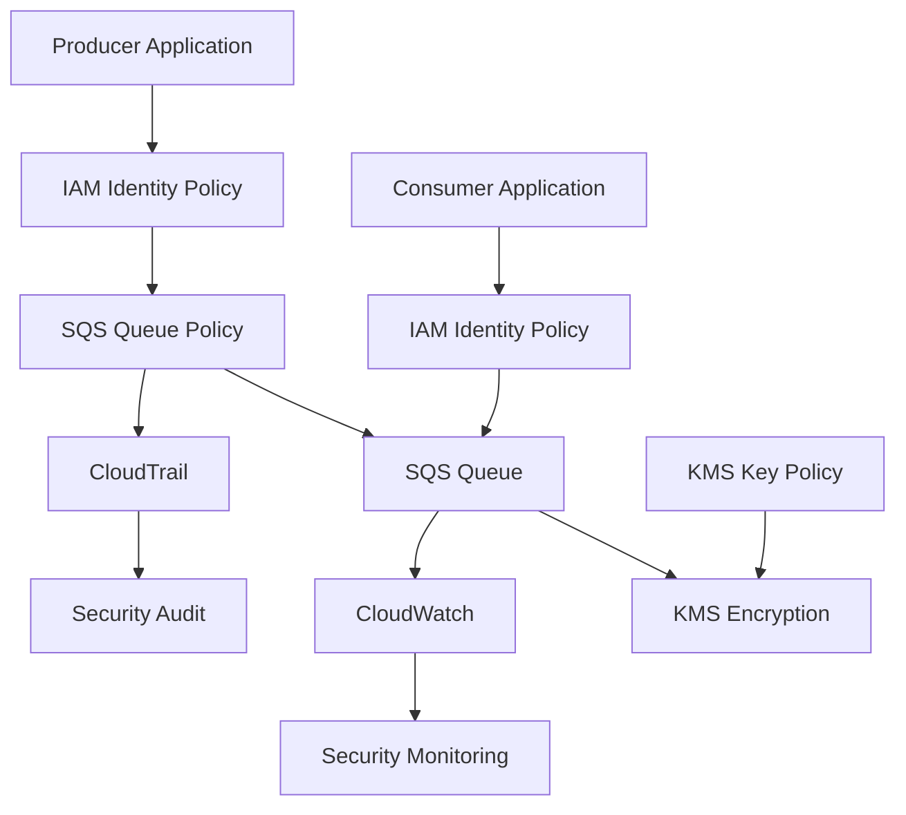
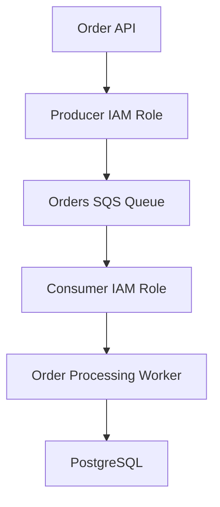
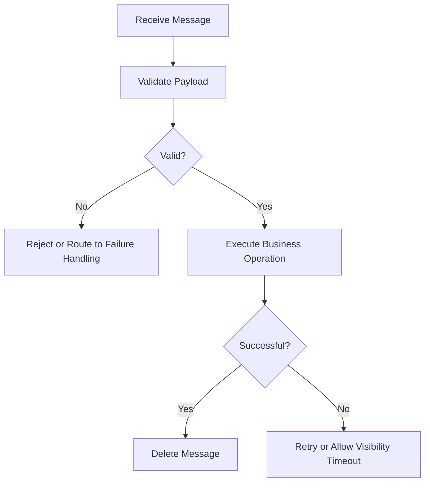

# 09- Security Best Practices

## Overview

Amazon Simple Queue Service (SQS) is a fully managed message queuing service used to decouple distributed application components. Since queues often carry business events, customer information, workflow metadata, and operational data, securing SQS is essential to protecting application boundaries and preventing unauthorized message access or manipulation.

SQS security must cover more than queue permissions. A production implementation should protect the complete message lifecycle:

- Who can create, configure, send, receive, and delete messages.
- Which AWS services and accounts can access a queue.
- How messages are encrypted at rest and in transit.
- How consumers authenticate and authorize downstream operations.
- How sensitive data is handled in message bodies and logs.
- How access, configuration changes, and suspicious activity are monitored.
- How queues, dead-letter queues, and encryption keys are protected during recovery.

A secure SQS architecture combines IAM policies, queue resource policies, KMS encryption, network controls, application-level validation, and operational monitoring.

## SQS Security Architecture

SQS uses multiple independent security layers. IAM controls identity permissions, queue policies control resource access, and KMS controls access to encryption keys.



The security model should be designed around explicit trust boundaries rather than assuming that access to an AWS account automatically grants appropriate access to every queue.

## IAM Least-Privilege Access

IAM policies determine which actions an AWS identity can perform against SQS resources.

A producer and consumer generally require different permissions. Granting both workloads unrestricted queue access increases the impact of compromised credentials or application vulnerabilities.

### Producer Permissions

A producer typically needs:

- `sqs:SendMessage`
- `sqs:SendMessageBatch`, if batch publishing is used.
- `sqs:GetQueueUrl` or `sqs:GetQueueAttributes` only when required by its implementation.

Example producer policy:

```json
{
  "Version": "2012-10-17",
  "Statement": [
    {
      "Sid": "AllowSendToOrdersQueue",
      "Effect": "Allow",
      "Action": [
        "sqs:SendMessage",
        "sqs:SendMessageBatch"
      ],
      "Resource": "arn:aws:sqs:ap-south-1:123456789012:orders-queue"
    }
  ]
}
```

### Consumer Permissions

A consumer generally requires:

- `sqs:ReceiveMessage`
- `sqs:DeleteMessage`
- `sqs:ChangeMessageVisibility`
- `sqs:GetQueueAttributes`

Example consumer policy:

```json
{
  "Version": "2012-10-17",
  "Statement": [
    {
      "Sid": "AllowConsumeOrdersQueue",
      "Effect": "Allow",
      "Action": [
        "sqs:ReceiveMessage",
        "sqs:DeleteMessage",
        "sqs:ChangeMessageVisibility",
        "sqs:GetQueueAttributes"
      ],
      "Resource": "arn:aws:sqs:ap-south-1:123456789012:orders-queue"
    }
  ]
}
```

### Separate Producer and Consumer Roles

For microservices, use separate IAM roles for independently deployed producers and consumers.



This separation prevents a producer from automatically gaining permission to consume or delete messages.

For example:

- An API service can publish order events but cannot receive or delete them.
- A worker can consume order events but cannot modify queue configuration.
- An administrative deployment role can manage queue configuration without being used by application workloads.

### Avoid Wildcard Permissions

Avoid policies such as:

```json
{
  "Effect": "Allow",
  "Action": "sqs:*",
  "Resource": "*"
}
```

This grants broad access across SQS resources and can expose unrelated queues.

Prefer explicit actions and queue ARNs.

### IAM Conditions

IAM conditions can further restrict access based on supported request context keys.

For example, a policy can restrict access to requests originating from a particular VPC endpoint where the integration supports that condition.

Always validate condition-key support for the specific SQS action. An unsupported or incorrectly applied condition can unintentionally block legitimate application traffic.

## SQS Queue Resource Policies

An SQS queue policy is a resource-based policy attached directly to a queue.

It controls which AWS principals or services can access the queue, including principals from other AWS accounts.

Queue policies are particularly important for service integrations such as:

- Amazon SNS publishing to SQS.
- Cross-account producers.
- Other supported AWS service integrations.

### Restrict SNS Access Using Source ARN

When SNS publishes messages to an SQS queue, the queue policy should allow the SNS service principal while restricting access to the expected topic.

Example:

```json
{
  "Version": "2012-10-17",
  "Statement": [
    {
      "Sid": "AllowSpecificSNSTopic",
      "Effect": "Allow",
      "Principal": {
        "Service": "sns.amazonaws.com"
      },
      "Action": "sqs:SendMessage",
      "Resource": "arn:aws:sqs:ap-south-1:123456789012:orders-queue",
      "Condition": {
        "ArnEquals": {
          "aws:SourceArn": "arn:aws:sns:ap-south-1:123456789012:orders-topic"
        },
        "StringEquals": {
          "aws:SourceAccount": "123456789012"
        }
      }
    }
  ]
}
```

This prevents unrelated SNS topics from publishing to the queue.

### Cross-Account Access

For cross-account access, configure both sides of the authorization relationship:

1. The queue resource policy must allow the intended external principal.
2. The external principal's identity policy must permit the required SQS actions.

Example queue policy statement:

```json
{
  "Sid": "AllowExternalProducer",
  "Effect": "Allow",
  "Principal": {
    "AWS": "arn:aws:iam::210987654321:role/order-producer-role"
  },
  "Action": "sqs:SendMessage",
  "Resource": "arn:aws:sqs:ap-south-1:123456789012:orders-queue"
}
```

Use specific account and role ARNs instead of allowing an entire external account unless that broader trust is intentional.

### Explicit Deny

Explicit deny statements override applicable allows.

They can be useful for enforcing security boundaries, but broad deny conditions can unintentionally block legitimate AWS service integrations.

Before deploying a deny statement, evaluate its effect on:

- Application roles.
- AWS service principals.
- Cross-account access.
- VPC endpoint requests.
- Administrative and recovery operations.

## Encryption at Rest

SQS supports server-side encryption to protect message contents at rest.

Encryption helps protect message data if underlying storage media or infrastructure is accessed outside the authorized service boundary.

SQS supports two principal server-side encryption approaches:

| Encryption option | Key management | Operational considerations |
|---|---|---|
| SSE-SQS | AWS-managed SQS encryption keys | Minimal key-management overhead |
| SSE-KMS | AWS KMS keys | Customer-controlled key policies, permissions, and auditability |

### SSE-SQS

SSE-SQS provides server-side encryption using SQS-managed encryption keys.

It is suitable when standard server-side encryption is sufficient and customer-managed key control is not required.

Advantages:

- Minimal configuration.
- No customer-managed KMS key lifecycle.
- No application-side encryption implementation.

Limitations:

- Less control over key policies and customer-managed key lifecycle.
- Does not provide the same customer-managed key administration capabilities as SSE-KMS.

### SSE-KMS

SSE-KMS uses AWS KMS keys to encrypt SQS messages.

It is useful when requirements include customer-managed key policies, key rotation, or centralized encryption governance.

Example Terraform configuration:

```hcl
resource "aws_sqs_queue" "orders" {
  name = "orders-queue"

  kms_master_key_id                 = aws_kms_key.sqs.arn
  kms_data_key_reuse_period_seconds = 300

  message_retention_seconds = 345600
  visibility_timeout_seconds = 60
}
```

The KMS key must have an appropriate key policy and the required IAM permissions.

### KMS Permissions

SSE-KMS introduces a separate authorization boundary.

Depending on the producer, consumer, and integration configuration, relevant KMS permissions can include:

| Principal | Typical KMS permissions |
|---|---|
| Producer | `kms:GenerateDataKey`, `kms:Decrypt` |
| Consumer | `kms:Decrypt` |
| AWS service integration | Permissions and key-policy configuration required by that integration |

The exact permissions depend on the encryption configuration and AWS service integration.

For example, an SNS-to-SQS integration using a customer-managed KMS key requires the key policy to permit the required SNS service access, in addition to the queue policy allowing message delivery.

Do not assume that granting `sqs:SendMessage` automatically grants KMS access.

### Key Policy Example

A customer-managed key policy can grant an application role access to the key.

```json
{
  "Version": "2012-10-17",
  "Statement": [
    {
      "Sid": "EnableAccountAdministration",
      "Effect": "Allow",
      "Principal": {
        "AWS": "arn:aws:iam::123456789012:root"
      },
      "Action": "kms:*",
      "Resource": "*"
    },
    {
      "Sid": "AllowOrdersApplication",
      "Effect": "Allow",
      "Principal": {
        "AWS": "arn:aws:iam::123456789012:role/orders-application-role"
      },
      "Action": [
        "kms:GenerateDataKey",
        "kms:Decrypt"
      ],
      "Resource": "*"
    }
  ]
}
```

The account-root statement enables the account to delegate key permissions through IAM, subject to the key policy and applicable IAM policies. It does not mean that every identity automatically receives unrestricted key access.

### KMS Key Rotation and Recovery

For customer-managed keys:

- Enable automatic rotation where appropriate.
- Restrict key administration permissions.
- Monitor key policy changes.
- Avoid deleting keys while queues or retained messages depend on them.
- Document key recovery and replacement procedures.
- Understand that disabling or scheduling deletion of a key can make encrypted messages inaccessible.

KMS key availability is part of queue availability when SSE-KMS is configured.

## Encryption in Transit

SQS API communication should use HTTPS.

AWS SDKs and CLI clients use TLS for communication with SQS endpoints.

For application workloads:

- Use current AWS SDK versions.
- Avoid disabling TLS certificate verification.
- Do not configure custom HTTP clients with insecure TLS settings.
- Keep operating-system and container CA certificates updated.
- Restrict outbound network access to required AWS endpoints where practical.

For private connectivity, use an SQS interface VPC endpoint powered by AWS PrivateLink.

### VPC Endpoint Security

A VPC endpoint allows private access to SQS without requiring traffic to traverse the public internet.

A VPC endpoint policy can restrict which SQS resources and actions are accessible through that endpoint.

Example endpoint policy:

```json
{
  "Version": "2012-10-17",
  "Statement": [
    {
      "Sid": "AllowOrdersQueueAccess",
      "Effect": "Allow",
      "Principal": "*",
      "Action": [
        "sqs:SendMessage",
        "sqs:ReceiveMessage",
        "sqs:DeleteMessage",
        "sqs:GetQueueAttributes"
      ],
      "Resource": "arn:aws:sqs:ap-south-1:123456789012:orders-queue"
    }
  ]
}
```

This policy limits access through the endpoint. It does not independently grant IAM permissions or replace the queue resource policy.

### Restrict Access Through a VPC Endpoint

For queues that should only be accessed through a specific VPC endpoint, a queue policy can use the `aws:sourceVpce` condition key.

Example:

```json
{
  "Version": "2012-10-17",
  "Statement": [
    {
      "Sid": "DenyRequestsOutsideApprovedEndpoint",
      "Effect": "Deny",
      "Principal": "*",
      "Action": "sqs:*",
      "Resource": "arn:aws:sqs:ap-south-1:123456789012:orders-queue",
      "Condition": {
        "StringNotEquals": {
          "aws:sourceVpce": "vpce-0123456789abcdef0"
        }
      }
    }
  ]
}
```

Use this pattern only when all legitimate access paths are expected to use the specified endpoint. It can block console operations, administrative workflows, or AWS service integrations that do not use that endpoint.

Test the policy with every required access path before enforcing it.

## Protect Sensitive Message Data

SQS messages can contain customer information, authentication metadata, payment references, personal data, or internal business details.

Encryption alone does not prevent an authorized consumer from exposing sensitive information.

### Avoid Publishing Secrets

Do not place the following directly into queue messages unless there is a documented and justified requirement:

- Passwords.
- Access keys.
- Session tokens.
- Database credentials.
- Private API keys.
- Unnecessary personal information.
- Full payment-card data.

Prefer references to securely stored records.

For example:

```json
{
  "event_id": "evt-2026-000123",
  "event_type": "OrderCreated",
  "order_id": "order-12345",
  "customer_reference": "customer-98765"
}
```

The consumer can retrieve authorized business data from the relevant service when necessary.

### Data Minimization

Publish only the fields required by downstream consumers.

Advantages include:

- Reduced exposure if a message is accessed by an unauthorized principal.
- Lower message-processing overhead.
- Reduced risk of sensitive data appearing in logs.
- Easier schema evolution.
- Lower operational and compliance complexity.

### Message Retention

SQS retains messages for a configurable period, up to 14 days.

Security and compliance policies should account for:

- Queue retention periods.
- Dead-letter queue retention.
- Backup and archival systems.
- Application logs.
- Message replay mechanisms.
- Data deletion requirements.

Deleting a message from the source queue does not automatically delete copies or derived data stored elsewhere.

## Application-Level Message Validation

AWS authorization determines whether a principal can access a queue. It does not determine whether an individual message is valid for a particular business operation.

Consumers must validate message contents independently.

Recommended validation includes:

- Required fields.
- Event type and schema version.
- Identifier formats.
- Allowed values.
- Payload size and structure.
- Business authorization.
- Duplicate event detection.
- Timestamp and expiry requirements where applicable.

Example using Pydantic:

```python
from datetime import datetime
from typing import Literal

from pydantic import BaseModel, ConfigDict, Field


class OrderCreatedEvent(BaseModel):
    model_config = ConfigDict(extra="forbid")

    event_id: str = Field(min_length=1, max_length=128)
    event_type: Literal["OrderCreated"]
    schema_version: int = Field(ge=1)
    order_id: str = Field(min_length=1, max_length=128)
    customer_id: str = Field(min_length=1, max_length=128)
    occurred_at: datetime
```

A consumer should validate the message before executing business operations.

Validation failures should be classified carefully:

- Permanent schema or business validation failures should not be retried indefinitely.
- Transient database or network failures may be retried.
- Unexpected processing failures should be logged and handled according to the retry and DLQ strategy.

Do not log complete message bodies when they may contain sensitive information.

## Secure Consumer Design

Consumers have access to potentially sensitive messages and may trigger privileged downstream operations.

A compromised consumer can therefore affect databases, external APIs, and other AWS services.

### Least-Privilege Consumer Roles

Grant each consumer only the permissions it needs.

For example, an order worker might require:

- `sqs:ReceiveMessage`
- `sqs:DeleteMessage`
- `sqs:ChangeMessageVisibility`
- `sqs:GetQueueAttributes`
- Specific database credentials or access to a secrets-management service.
- Limited permissions for its required downstream AWS resources.

It should not automatically receive permission to delete queues, modify queue policies, or administer KMS keys.

### Delete Messages Only After Successful Processing

A consumer should delete a message only after the required business operation has completed successfully.



Deleting messages before committing the business operation can cause permanent message loss if the application subsequently fails.

### Idempotency

SQS standard queues provide at-least-once delivery. A message can be delivered more than once.

Use stable event identifiers and enforce idempotency at the business-data boundary.

For PostgreSQL, a unique constraint can prevent duplicate event processing:

```sql
CREATE TABLE processed_events (
    event_id VARCHAR(128) PRIMARY KEY,
    processed_at TIMESTAMPTZ NOT NULL DEFAULT NOW()
);
```

Insert the event identifier and apply the business operation within the same database transaction.

A separate idempotency check without transactional coordination can still introduce race conditions.

## Dead-Letter Queue Security

A dead-letter queue (DLQ) stores messages that could not be successfully processed after the configured receive-count threshold.

DLQs frequently contain malformed, sensitive, or operationally important messages. They require the same security controls as source queues.

Recommended practices:

- Apply least-privilege IAM policies to DLQ access.
- Encrypt DLQs at rest.
- Restrict access to redrive operations.
- Configure appropriate retention periods.
- Monitor DLQ message counts.
- Protect message contents in diagnostic tools and logs.
- Audit manual message inspection and redrive activities.

### Redrive Permissions

Redriving messages can reintroduce failed events into production workflows.

Restrict permissions such as:

- `sqs:StartMessageMoveTask`
- `sqs:CancelMessageMoveTask`
- `sqs:ReceiveMessage`
- `sqs:DeleteMessage`

Grant these permissions only to authorized operational roles.

Before redriving messages, verify that the underlying failure has been corrected. Otherwise, the same messages may repeatedly fail and return to the DLQ.

### DLQ Retention

For standard queues, the original enqueue timestamp is retained when a message moves to a DLQ. The expiration period continues to be based on that original timestamp.

For FIFO queues, the enqueue timestamp resets when a message moves to a DLQ.

Configure retention based on the queue type and required investigation window.

## Secure SNS-to-SQS Integration

SNS-to-SQS integrations require both queue-level authorization and encryption authorization.

The queue policy should restrict publishing to the intended SNS topic.

When SSE-KMS uses a customer-managed key, the key policy must also permit the required SNS service access.

Security requirements include:

- Restricting the SNS service principal with `aws:SourceArn`.
- Using `aws:SourceAccount` where applicable.
- Allowing only `sqs:SendMessage` for the SNS publishing integration.
- Configuring appropriate KMS key permissions.
- Restricting consumers to their required queue operations.
- Monitoring delivery failures and unauthorized access attempts.

Do not grant SNS consumer permissions such as `sqs:ReceiveMessage` unless a separate integration explicitly requires them.

## Secure Queue Configuration

Queue configuration affects security, reliability, and operational exposure.

Important settings include:

| Configuration | Security relevance | Recommendation |
|---|---|---|
| `message_retention_seconds` | Controls how long messages remain available | Align with business and compliance requirements |
| `visibility_timeout_seconds` | Controls temporary message invisibility | Set according to processing duration |
| `kms_master_key_id` | Selects the customer-managed encryption key | Use SSE-KMS when customer key control is required |
| `kms_data_key_reuse_period_seconds` | Controls data-key reuse interval | Balance KMS request volume and security requirements |
| `receive_wait_time_seconds` | Enables long polling | Use appropriate long-polling settings |
| `redrive_policy` | Configures movement to a DLQ | Configure bounded retries and monitored recovery |
| `policy` | Controls resource-based access | Restrict principals, actions, and resources |

Avoid allowing application workloads to modify security-sensitive queue attributes unless required.

Separate infrastructure-management permissions from runtime permissions.

## Infrastructure as Code Security

Use Terraform or another infrastructure-as-code tool to define queues, policies, encryption, and dead-letter queue relationships.

This provides reviewable and repeatable security configuration.

Example:

```hcl
resource "aws_sqs_queue" "orders_dlq" {
  name = "orders-dlq"

  message_retention_seconds = 1209600

  kms_master_key_id = aws_kms_key.sqs.arn
}

resource "aws_sqs_queue" "orders" {
  name = "orders-queue"

  message_retention_seconds = 345600
  visibility_timeout_seconds = 60

  kms_master_key_id                 = aws_kms_key.sqs.arn
  kms_data_key_reuse_period_seconds = 300

  redrive_policy = jsonencode({
    deadLetterTargetArn = aws_sqs_queue.orders_dlq.arn
    maxReceiveCount     = 5
  })
}

resource "aws_sqs_queue_policy" "orders" {
  queue_url = aws_sqs_queue.orders.id

  policy = jsonencode({
    Version = "2012-10-17"

    Statement = [
      {
        Sid    = "AllowSpecificProducer"
        Effect = "Allow"

        Principal = {
          AWS = "arn:aws:iam::123456789012:role/orders-producer-role"
        }

        Action = [
          "sqs:SendMessage"
        ]

        Resource = aws_sqs_queue.orders.arn
      }
    ]
  })
}
```

The example assumes that `aws_kms_key.sqs` is defined separately with an appropriate key policy.

For production deployments:

- Keep IAM policies and queue policies under version control.
- Review policy changes through pull requests.
- Validate policies before deployment.
- Avoid embedding credentials in Terraform configuration.
- Use remote state with encryption and restricted access.
- Protect state files because they can contain sensitive infrastructure information.
- Prevent accidental queue replacement or deletion.
- Review KMS key deletion and queue replacement plans carefully.

## Monitoring and Security Auditing

Security monitoring should detect unauthorized access, unexpected configuration changes, and abnormal message activity.

### CloudTrail

AWS CloudTrail records supported SQS API activity, including management and data events depending on the event configuration.

Management events are useful for tracking changes to queue configuration and access policies.

SQS data events can provide visibility into message-level operations when configured and supported for the required event types.

Monitor relevant activities such as:

- Queue creation and deletion.
- Queue policy changes.
- Attribute modifications.
- Message sending and receiving.
- Message deletion.
- Access-denied errors.
- Redrive operations.

Enable the appropriate event logging configuration for the required audit scope. Data events can introduce additional CloudTrail charges.

### CloudWatch

Monitor queue metrics for unexpected operational behavior.

| Metric | Security or operational signal |
|---|---|
| `NumberOfMessagesSent` | Unexpected publishing activity |
| `NumberOfMessagesReceived` | Unusual consumer activity |
| `NumberOfMessagesDeleted` | Unexpected message deletion patterns |
| `ApproximateNumberOfMessagesVisible` | Backlog growth or stalled consumers |
| `ApproximateNumberOfMessagesNotVisible` | Excessive in-flight messages |
| `ApproximateNumberOfMessagesDelayed` | Unexpected delayed-message volume |

These metrics are approximate and should not be treated as exact audit records.

Combine CloudWatch metrics with CloudTrail events, application logs, and security findings.

### Security Alerting

Consider alerts for:

- Unexpected queue policy modifications.
- KMS key disabling or deletion scheduling.
- Sudden increases in message publication.
- Unexpected message deletion activity.
- DLQ backlog growth.
- Repeated access-denied errors.
- Unusual queue creation or deletion.
- Unexpected cross-account access.

CloudWatch alarms, EventBridge rules, and centralized security monitoring can be used to route alerts to operational teams.

## Secure Operational Procedures

Administrative operations can expose or permanently remove message data.

Restrict these actions to authorized operational roles:

| Operation | Risk |
|---|---|
| `PurgeQueue` | Permanently removes messages from the queue |
| `DeleteQueue` | Deletes the queue and its messages |
| `SetQueueAttributes` | Can modify policies, encryption, retention, and redrive configuration |
| `AddPermission` | Adds resource-based access permissions |
| `RemovePermission` | Removes resource-based access permissions |
| `StartMessageMoveTask` | Reintroduces messages into a destination queue |

Use change approval for destructive or security-sensitive operations.

Before changing queue policies or encryption configuration:

1. Review current configuration.
2. Identify all legitimate producers and consumers.
3. Verify required KMS permissions.
4. Test the proposed change in a non-production environment.
5. Deploy through the approved infrastructure pipeline.
6. Verify application access and message processing.
7. Monitor for authorization failures.

Avoid using production message inspection as a routine debugging technique. Receiving messages changes their visibility state and can interfere with active consumers.

## Security Validation Checklist

Use this checklist during architecture reviews, infrastructure deployments, and periodic security assessments.

### Identity and Access

- [ ] Producer and consumer roles are separate.
- [ ] IAM policies use specific queue ARNs.
- [ ] Runtime roles do not have unnecessary administrative permissions.
- [ ] Cross-account access is explicitly restricted.
- [ ] Queue policies use specific principals and actions.
- [ ] SNS integrations restrict access using source conditions where applicable.

### Encryption and Networking

- [ ] Server-side encryption is enabled.
- [ ] SSE-KMS key policies grant only required access.
- [ ] KMS key rotation and recovery procedures are documented.
- [ ] Applications communicate with SQS over HTTPS.
- [ ] VPC endpoints are used where private connectivity is required.
- [ ] Endpoint policies and queue policies are tested together.

### Application Security

- [ ] Sensitive information is minimized in message payloads.
- [ ] Consumers validate message schemas.
- [ ] Consumers implement idempotent processing.
- [ ] Messages are deleted only after successful processing.
- [ ] Logs do not expose secrets or unnecessary personal information.
- [ ] Retry and failure handling are explicitly configured.

### Operations and Governance

- [ ] DLQs have appropriate access controls and encryption.
- [ ] Redrive operations are restricted.
- [ ] CloudTrail logging covers required management and data events.
- [ ] CloudWatch monitoring and alarms are configured.
- [ ] Queue retention aligns with business and compliance requirements.
- [ ] Destructive operations require controlled approval.
- [ ] Terraform policies and queue configurations are reviewed before deployment.

## Common Security Mistakes

| Mistake | Risk | Prevention |
|---|---|---|
| Granting `sqs:*` to application roles | Unnecessary queue administration and data access | Use action-specific IAM policies |
| Allowing all SNS topics to publish | Unauthorized message injection | Restrict the queue policy using `aws:SourceArn` |
| Enabling SSE-KMS without configuring key permissions | Producers or consumers may fail to access messages | Validate IAM and KMS key policies together |
| Treating encryption as authorization | Authorized consumers can still access sensitive payloads | Apply least privilege and data minimization |
| Logging complete message bodies | Sensitive data exposure | Use structured, redacted logs |
| Sharing one IAM role across all services | Expands the impact of compromised credentials | Use workload-specific roles |
| Giving workers queue administration permissions | A compromised worker can alter or delete infrastructure | Separate runtime and deployment roles |
| Ignoring DLQ security | Failed messages may expose sensitive data | Protect DLQs like source queues |
| Using broad VPC endpoint restrictions without testing | Legitimate service or administrative access can be blocked | Validate every required access path |
| Allowing unrestricted redrive operations | Failed or malicious messages can be reintroduced into production | Restrict and audit redrive permissions |
| Assuming CloudWatch metrics provide a complete audit trail | Message-level activity may not be fully represented | Configure CloudTrail data events where required |
| Deleting a KMS key still used by a queue | Encrypted messages may become inaccessible | Establish key lifecycle and recovery controls |

## Key Takeaways

- Secure SQS with least-privilege IAM policies, restrictive queue resource policies, and workload-specific roles.
- Use SSE-SQS or SSE-KMS according to encryption governance requirements, and treat KMS authorization as a separate security boundary.
- Protect message contents through data minimization, schema validation, idempotent consumers, and secure logging.
- Apply the same access, encryption, monitoring, and retention controls to dead-letter queues as to source queues.
- Combine CloudTrail auditing, CloudWatch monitoring, infrastructure-as-code reviews, and controlled operational procedures to maintain SQS security.