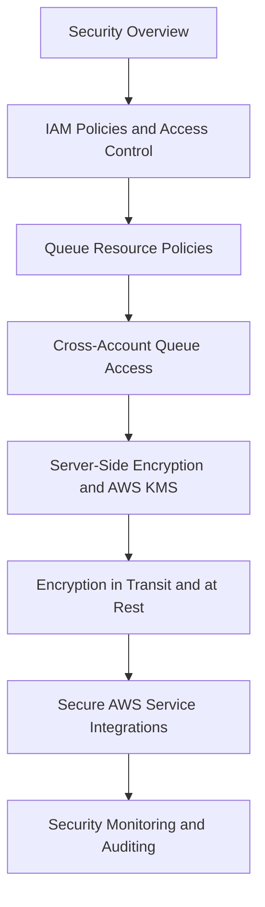

# Amazon SQS — Security

## Overview

This section documents the security architecture, configuration, and operational practices required to secure Amazon Simple Queue Service (Amazon SQS) in production environments.

It covers identity and access management, queue resource policies, cross-account authorization, server-side encryption, encryption in transit, secure service integrations, and security monitoring and auditing.

The objective is to establish a consistent security baseline for SQS-based messaging workloads while maintaining least privilege, operational reliability, and auditability.

## Documentation Structure

| File | Topic | Description |
|---|---|---|
| [01- SQS Security Overview.md](./01-%20SQS%20Security%20Overview.md) | Security Overview | Introduces the SQS security model, trust boundaries, core security controls, and production security architecture. |
| [02- IAM Policies and Access Control.md](./02-%20IAM%20Policies%20and%20Access%20Control.md) | IAM Access Control | Covers IAM policies controlling which identities and AWS services can access SQS queues and perform send, receive, and delete operations. |
| [03- Queue Resource Policies.md](./03-%20Queue%20Resource%20Policies.md) | Queue Resource Policies | Explains resource-based JSON policies attached to SQS queues, defining which principals can access a queue and under what conditions. |
| [04- Cross-Account Queue Access.md](./04-%20Cross-Account%20Queue%20Access.md) | Cross-Account Security | Covers cross-account queue access through resource policies and IAM role assumption, including organization-level controls. |
| [05- Server-Side Encryption and AWS KMS.md](./05-%20Server-Side%20Encryption%20and%20AWS%20KMS.md) | Encryption at Rest | Explains SQS server-side encryption, KMS key policies, managed vs. customer-managed keys, permissions, and encryption lifecycle. |
| [06- Encryption in Transit and at Rest.md](./06-%20Encryption%20in%20Transit%20and%20at%20Rest.md) | Encryption in Transit | Covers TLS enforcement, HTTPS-only queue access, in-transit protection across the message lifecycle, and combined encryption controls. |
| [07- Secure AWS Service Integrations.md](./07-%20Secure%20AWS%20Service%20Integrations.md) | Secure Integrations | Explains how to secure SQS integrations with SNS, Lambda, S3, EventBridge, and other AWS services using least-privilege policies. |
| [08- Security Monitoring and Auditing.md](./08-%20Security%20Monitoring%20and%20Auditing.md) | Monitoring and Auditing | Covers CloudTrail auditing, CloudWatch monitoring, anomaly detection, DLQ alerting, and investigation procedures for SQS workloads. |

## Recommended Reading Order

Follow the sequence below to build a complete understanding of SQS security.

The sequence moves from foundational access control to data protection, secure service integrations, and operational security monitoring.

## Core Security Areas

### Identity and Access Management

Understand how SQS authenticates AWS workloads and evaluates permissions.

Key areas:

- IAM identity-based policies for producers, consumers, and administrators.
- SQS queue resource policies for cross-account and service-level access.
- Least-privilege permission design.
- Separation between send, receive, delete, and administrative roles.
- AWS Organizations and Service Control Policies.

### Encryption and Data Protection

Protect queue message data during storage and transmission.

Key areas:

- SQS server-side encryption using SSE-SQS or SSE-KMS.
- Customer-managed KMS keys and key policies.
- TLS and HTTPS enforcement for all queue access.
- Sensitive data minimization in message payloads.
- S3 payload offloading security considerations.

### Secure Service Integrations

Control how SQS interacts with other AWS services.

Key areas:

- SNS-to-SQS delivery permissions via queue resource policies.
- Lambda event source mapping security.
- S3 event notification permissions.
- EventBridge rule target authorization.
- Least-privilege queue policies scoped to expected source ARNs.

### Auditing and Monitoring

Establish visibility into access patterns and operational behavior.

Key areas:

- CloudTrail management events for SQS.
- Centralized audit log storage and integrity protection.
- CloudWatch alarms for queue depth, oldest-message age, and DLQ growth.
- Anomaly detection for unexpected send or receive activity.
- Investigation procedures for access or processing failures.

## Production Security Checklist

### Identity and Authorization

- [ ] Dedicated IAM roles for producers, consumers, and administrators.
- [ ] Least-privilege IAM policies scoped to specific queue ARNs.
- [ ] No hardcoded AWS credentials in application code.
- [ ] Queue resource policies restricted to expected principals and source ARNs.
- [ ] Cross-account access validated and scoped explicitly.
- [ ] Separate send, receive, and administrative permissions.

### Encryption and Networking

- [ ] Server-side encryption enabled on all queues containing sensitive data.
- [ ] KMS key policies reviewed and restricted to authorized services and consumers.
- [ ] HTTPS enforced for all queue API calls.
- [ ] Sensitive payload data minimized or excluded from messages.
- [ ] S3-based payload storage secured with appropriate bucket policies.

### Service Integration Security

- [ ] SNS topic ARN restricted in queue resource policy to prevent unauthorized delivery.
- [ ] Lambda execution role scoped to required SQS actions only.
- [ ] S3 event notification permissions reviewed and scoped to expected buckets.
- [ ] Dead-letter queue access controlled separately from source queue access.
- [ ] KMS permissions verified for all integrated services.

### Auditing and Operations

- [ ] CloudTrail management events enabled.
- [ ] Audit logs stored centrally with write protection.
- [ ] CloudWatch alarms configured for DLQ depth and oldest-message age.
- [ ] Security alerts configured for unexpected access patterns.
- [ ] Security-sensitive infrastructure managed through Infrastructure as Code.

## Key Takeaways

- SQS security requires coordinated identity, encryption, service integration, and monitoring controls.
- Queue resource policies and IAM identity policies work together and must both be scoped to least privilege.
- Server-side encryption protects message data at rest; TLS protects data in transit between producers, SQS, and consumers.
- SNS-to-SQS integrations must include explicit queue resource policy entries scoped to the expected topic ARN.
- CloudTrail and CloudWatch provide audit evidence and operational visibility for SQS workloads.
- Production SQS security controls should be managed through infrastructure as code and tested continuously.
