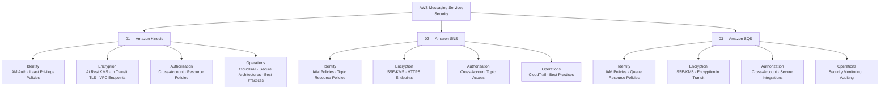
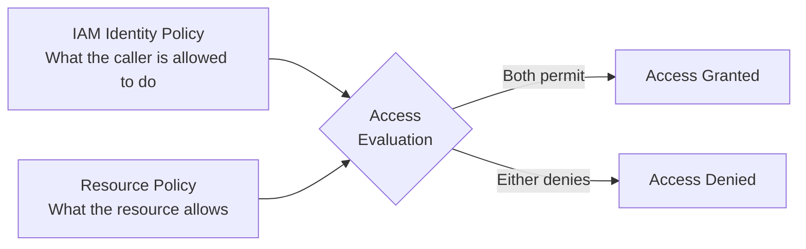

# AWS Messaging Services — Security

## Overview

This section covers the security architecture, configuration, and operational practices required to secure the three core AWS messaging services in production environments: Amazon Kinesis, Amazon SNS, and Amazon SQS.

The documents address **identity and access management, encryption, network controls, cross-account authorization, secure application design, auditing, and monitoring** across all three services.

---

## Contents

| # | Section | Documents | Focus |
|---|---|---|---|
| 01 | [Amazon Kinesis](./01-%20Amazon%20Kinesis/README.md) | 9 | IAM, encryption at rest and in transit, VPC endpoints, cross-account access, CloudTrail, secure producer/consumer design |
| 02 | [Amazon SNS](./02-%20Amazon%20SNS/README.md) | 8 | IAM, topic resource policies, cross-account access, SSE-KMS, HTTPS endpoints, CloudTrail, security best practices |
| 03 | [Amazon SQS](./03-%20Amazon%20SQS/README.md) | 8 | IAM, queue resource policies, cross-account access, SSE-KMS, encryption in transit, secure integrations, monitoring |

**Total: 25 security documents**

---

## Security Domain Map

---

## Section Summaries

### [01 — Amazon Kinesis](./01-%20Amazon%20Kinesis/README.md)

Security controls for streaming workloads built on Amazon Kinesis Data Streams, covering the full security lifecycle from identity and network isolation to secure producer-consumer architecture and operational auditing.

| # | Document | Description |
|---|---|---|
| 01 | [Kinesis Security Overview](./01-%20Amazon%20Kinesis/01-%20Kinesis%20Security%20Overview.md) | Kinesis security model, trust boundaries, core security controls, and production security architecture. |
| 02 | [IAM Authentication and Access Control](./01-%20Amazon%20Kinesis/02-%20IAM%20Authentication%20and%20Access%20Control.md) | IAM authentication, SigV4 request signing, workload identities, authorization, and access-control mechanisms. |
| 03 | [IAM Policies and Least Privilege](./01-%20Amazon%20Kinesis/03-%20IAM%20Policies%20and%20Least%20Privilege.md) | Producer, consumer, and administrative policies, resource scoping, policy conditions, and least-privilege design. |
| 04 | [Encryption at Rest and AWS KMS](./01-%20Amazon%20Kinesis/04-%20Encryption%20at%20Rest%20and%20AWS%20KMS.md) | Server-side encryption, KMS key policies, key rotation, permissions, and encryption lifecycle management. |
| 05 | [Encryption in Transit and VPC Endpoints](./01-%20Amazon%20Kinesis/05-%20Encryption%20in%20Transit%20and%20VPC%20Endpoints.md) | TLS, HTTPS, PrivateLink, VPC interface endpoints, endpoint policies, and private connectivity. |
| 06 | [Cross-Account Access and Resource Security](./01-%20Amazon%20Kinesis/06-%20Cross-Account%20Access%20and%20Resource%20Security.md) | Resource policies, cross-account IAM role assumption, external principals, KMS permissions, and organization-level controls. |
| 07 | [CloudTrail Auditing](./01-%20Amazon%20Kinesis/07-%20CloudTrail%20Auditing.md) | Management and data events, trail configuration, centralized logging, Athena queries, integrity validation, and incident investigation. |
| 08 | [Secure Producer and Consumer Architectures](./01-%20Amazon%20Kinesis/08-%20Secure%20Producer%20and%20Consumer%20Architectures.md) | Secure producer and consumer designs, workload isolation, credential management, event validation, idempotency, and failure handling. |
| 09 | [Security Best Practices](./01-%20Amazon%20Kinesis/09-%20Security%20Best%20Practices.md) | Production security recommendations, operational controls, common mistakes, and deployment checklists. |

---

### [02 — Amazon SNS](./02-%20Amazon%20SNS/README.md)

Security controls for publish-subscribe messaging systems built on Amazon SNS, covering topic access policies, encryption, secure endpoint delivery, cross-account distribution, and operational auditing.

| # | Document | Description |
|---|---|---|
| 01 | [SNS Security Overview](./02-%20Amazon%20SNS/01-%20SNS%20Security%20Overview.md) | SNS security model, trust boundaries, core security controls, and production security architecture. |
| 02 | [IAM Policies and Access Control](./02-%20Amazon%20SNS/02-%20IAM%20Policies%20and%20Access%20Control.md) | IAM policies controlling which identities and AWS services can publish to topics, manage subscriptions, and administer SNS. |
| 03 | [Topic Resource Policies](./02-%20Amazon%20SNS/03-%20Topic%20Resource%20Policies.md) | Resource-based policies attached to SNS topics, defining which principals can access a topic and which operations they can perform. |
| 04 | [Cross-Account Topic Access](./02-%20Amazon%20SNS/04-%20Cross-Account%20Topic%20Access.md) | Cross-account topic access through resource policies and IAM, permission boundaries, and organization-level controls. |
| 05 | [Server-Side Encryption and AWS KMS](./02-%20Amazon%20SNS/05-%20Server-Side%20Encryption%20and%20AWS%20KMS.md) | SNS server-side encryption, KMS key policies, key rotation, permissions, and encryption lifecycle management. |
| 06 | [HTTPS and Secure Subscription Endpoints](./02-%20Amazon%20SNS/06-%20HTTPS%20and%20Secure%20Subscription%20Endpoints.md) | HTTPS subscriptions, endpoint validation, SNS message signature verification, and secure delivery configuration. |
| 07 | [CloudTrail Auditing and Monitoring](./02-%20Amazon%20SNS/07-%20CloudTrail%20Auditing%20and%20Monitoring.md) | Management events, trail configuration, centralized logging, monitoring, and security investigation for SNS activity. |
| 08 | [Security Best Practices](./02-%20Amazon%20SNS/08-%20Security%20Best%20Practices.md) | Production security recommendations, operational controls, common mistakes, and deployment checklists for SNS. |

---

### [03 — Amazon SQS](./03-%20Amazon%20SQS/README.md)

Security controls for queue-based messaging systems built on Amazon SQS, covering queue access policies, encryption, secure service integrations, and continuous security monitoring.

| # | Document | Description |
|---|---|---|
| 01 | [SQS Security Overview](./03-%20Amazon%20SQS/01-%20SQS%20Security%20Overview.md) | SQS security model, trust boundaries, core security controls, and production security architecture. |
| 02 | [IAM Policies and Access Control](./03-%20Amazon%20SQS/02-%20IAM%20Policies%20and%20Access%20Control.md) | IAM policies controlling which identities and AWS services can send, receive, delete, and administer SQS queues. |
| 03 | [Queue Resource Policies](./03-%20Amazon%20SQS/03-%20Queue%20Resource%20Policies.md) | Resource-based JSON policies attached to SQS queues, defining which principals can access a queue and under what conditions. |
| 04 | [Cross-Account Queue Access](./03-%20Amazon%20SQS/04-%20Cross-Account%20Queue%20Access.md) | Cross-account queue access through resource policies and IAM role assumption, including organization-level controls. |
| 05 | [Server-Side Encryption and AWS KMS](./03-%20Amazon%20SQS/05-%20Server-Side%20Encryption%20and%20AWS%20KMS.md) | SQS server-side encryption, KMS key policies, managed vs. customer-managed keys, permissions, and encryption lifecycle. |
| 06 | [Encryption in Transit and at Rest](./03-%20Amazon%20SQS/06-%20Encryption%20in%20Transit%20and%20at%20Rest.md) | TLS enforcement, HTTPS-only queue access, in-transit protection across the message lifecycle, and combined encryption controls. |
| 07 | [Secure AWS Service Integrations](./03-%20Amazon%20SQS/07-%20Secure%20AWS%20Service%20Integrations.md) | Securing SQS integrations with SNS, Lambda, S3, EventBridge, and other AWS services using least-privilege policies. |
| 08 | [Security Monitoring and Auditing](./03-%20Amazon%20SQS/08-%20Security%20Monitoring%20and%20Auditing.md) | CloudTrail auditing, CloudWatch monitoring, anomaly detection, DLQ alerting, and investigation procedures for SQS. |

---

## Security Controls Comparison

| Control Area | Amazon Kinesis | Amazon SNS | Amazon SQS |
|---|---|---|---|
| **Authentication** | IAM + SigV4 | IAM + SigV4 | IAM + SigV4 |
| **Identity-based access** | IAM policies per workload | IAM policies per publisher/subscriber | IAM policies per producer/consumer |
| **Resource-based access** | Resource policies (cross-account) | Topic resource policies | Queue resource policies |
| **Encryption at rest** | SSE via AWS KMS | SSE via AWS KMS | SSE-SQS or SSE-KMS |
| **Encryption in transit** | TLS / HTTPS | TLS / HTTPS | TLS / HTTPS |
| **Private connectivity** | VPC interface endpoints (PrivateLink) | VPC interface endpoints (PrivateLink) | VPC interface endpoints (PrivateLink) |
| **Cross-account access** | Resource policies + IAM role assumption | Topic resource policies + IAM | Queue resource policies + IAM |
| **Audit logging** | CloudTrail management + data events | CloudTrail management events | CloudTrail management events |
| **Operational monitoring** | CloudWatch metrics + alarms | CloudWatch delivery metrics + DLQ | CloudWatch queue metrics + DLQ |

---

## Universal Security Principles

The following principles apply across all three services.

### Least Privilege

- Grant each workload only the permissions required for its specific responsibilities.
- Separate producer, consumer, and administrative IAM roles.
- Scope policies to specific resource ARNs — never use `*` resources in production policies.
- Restrict cross-account access to known, explicitly declared principals.

### Defence in Depth

Both **IAM identity-based policies** and **resource-based policies** (topic/queue policies) must be correctly configured. Access is evaluated against both; restricting one layer is not sufficient for cross-account scenarios.

### Encryption Everywhere

| Stage | Control |
|---|---|
| Data at rest | SSE-KMS enabled on all resources containing sensitive data |
| Data in transit | TLS / HTTPS enforced for all API calls and deliveries |
| Private connectivity | VPC endpoints used to avoid public internet routing where required |
| Application payloads | Sensitive fields minimized or excluded from messages |

### Audit and Monitor Continuously

- Enable CloudTrail in every account; store logs centrally with write protection.
- Configure CloudWatch alarms for security-sensitive signals (DLQ growth, unexpected access patterns, encryption failures).
- Treat audit log storage and monitoring configuration as security-critical infrastructure.
- Review IAM access patterns regularly using AWS IAM Access Analyzer and CloudTrail Lake.

### Infrastructure as Code

- Manage all IAM policies, KMS key policies, topic/queue resource policies, and VPC endpoint configurations through version-controlled IaC (Terraform, AWS CDK).
- Run policy validation and negative authorization tests in CI/CD pipelines.
- Include security configuration in disaster recovery exercises.

---

## Production Security Checklist

### Identity and Authorization (All Services)

- [ ] Dedicated IAM roles for each workload (producers, consumers, administrators).
- [ ] All policies scoped to specific resource ARNs — no wildcard resources.
- [ ] No hardcoded AWS credentials anywhere in application code or configuration.
- [ ] Resource-based policies reviewed and restricted to expected principals.
- [ ] Cross-account access explicitly declared and limited.
- [ ] AWS IAM Access Analyzer enabled to detect unintended public or cross-account access.

### Encryption (All Services)

- [ ] Server-side encryption enabled on all queues, topics, and streams containing sensitive data.
- [ ] Customer-managed KMS keys used where key policy control is required.
- [ ] KMS key policies reviewed and restricted to authorized services and identities.
- [ ] TLS enforced for all API calls and message deliveries.
- [ ] Sensitive data excluded from message payloads wherever possible.

### Kinesis-Specific

- [ ] VPC interface endpoints configured for workloads requiring private connectivity.
- [ ] Data events enabled in CloudTrail for sensitive streams.
- [ ] Secure producer and consumer architectures with workload isolation implemented.
- [ ] Consumer checkpoints stored with appropriate access controls.

### SNS-Specific

- [ ] HTTPS subscription endpoints validated and confirmed.
- [ ] SNS message signatures verified by all HTTP/S subscribers.
- [ ] Subscription DLQs configured for critical subscriptions.
- [ ] Topic resource policies scoped to expected publisher ARNs.

### SQS-Specific

- [ ] Queue resource policies include explicit SNS topic ARN conditions for SNS-to-SQS delivery.
- [ ] Lambda execution role permissions scoped to required SQS actions only.
- [ ] DLQ monitoring and alerting configured.
- [ ] Long polling enabled to reduce unnecessary receive activity.

### Auditing and Operations (All Services)

- [ ] CloudTrail enabled with centralized, write-protected log storage.
- [ ] CloudWatch alarms configured for DLQ depth, oldest-message age, and access anomalies.
- [ ] Security configuration managed through Infrastructure as Code.
- [ ] Recovery procedures documented and tested.

---

## Key Takeaways

- All three services share the same foundational security model: **IAM + resource policies + KMS encryption + TLS in transit + CloudTrail auditing**.
- **Both IAM identity-based policies and resource-based policies must be correctly configured** — especially for cross-account access, where both must allow the operation.
- **Least privilege is not optional** — overly permissive policies are the most common source of messaging security incidents.
- **Encryption at rest and in transit should be enabled by default** on all queues, topics, and streams that carry sensitive or business-critical data.
- **CloudTrail and CloudWatch monitoring** are the primary tools for detecting unauthorized access, configuration changes, and delivery failures.
- Security controls for messaging infrastructure must be **managed as code, tested in CI/CD, and included in disaster recovery exercises**.
