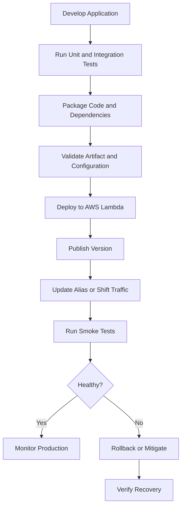

# 01- Lambda Deployment Fundamentals

## Overview

AWS Lambda deployment is the process of packaging application code and dependencies, configuring the execution environment, granting permissions, and releasing a function into an AWS environment.

A successful deployment must do more than upload code. It must ensure that the artifact is reproducible, dependencies are compatible with the selected runtime, configuration is environment-specific, permissions are least-privileged, and the release can be verified and rolled back safely.

For Python-based backend applications, Lambda supports two primary deployment package formats:

- **ZIP deployment packages:** Application code and dependencies are uploaded as a ZIP archive.
- **Container images:** Application code and runtime dependencies are packaged into a container image stored in Amazon Elastic Container Registry (ECR).

Both approaches execute on Lambda's managed infrastructure. They differ in packaging, image management, deployment workflows, and operational trade-offs.

## Lambda Deployment Lifecycle

A production deployment typically follows this sequence:



The deployment process should separate artifact creation from release promotion. Ideally, the same immutable artifact is tested and promoted through development, staging, and production, with environment-specific configuration supplied independently.

## Deployment Package Options

| Consideration | ZIP package | Container image |
|---|---|---|
| Artifact format | ZIP archive | OCI-compatible container image |
| Dependency management | Bundled dependencies and optional Lambda layers | Dependencies installed in image layers |
| Runtime | AWS-provided runtime or compatible custom runtime | Lambda-compatible runtime or custom runtime |
| Build tooling | Python packaging tools, ZIP utilities, CI/CD | Docker or compatible image builder |
| Artifact storage | Direct upload or Amazon S3 for supported deployment workflows | Amazon ECR |
| Image-specific capabilities | Not applicable | Image layers, tags, digests, and registry lifecycle |
| Best suited for | Most conventional Python handlers and smaller deployment workflows | Large dependency stacks, image-based build pipelines, and container-oriented packaging |
| Operational trade-off | Requires careful archive structure and dependency compatibility | Requires image builds, registry management, and Lambda-compatible image configuration |

A container image does not turn Lambda into a general-purpose container orchestrator. Lambda still manages invocation, execution environments, scaling, and lifecycle behavior.

## ZIP Deployment Packages

A ZIP package contains the handler code and the dependencies required at runtime.

For a Python function, the handler file must be located where the configured handler string expects it. Dependencies must be packaged in a directory layout that Python can import.

### Example project structure

```text
order_processor/
    app.py
    requirements.txt
    tests/
        test_app.py
```

Example handler:

```python
import json


def lambda_handler(event, context):
    order_id = event.get("order_id")

    if not order_id:
        return {
            "statusCode": 400,
            "body": json.dumps({"error": "order_id is required"}),
        }

    return {
        "statusCode": 200,
        "body": json.dumps({
            "message": "Order accepted",
            "order_id": order_id,
        }),
    }
```

For this structure, the Lambda handler setting is `app.lambda_handler`.

The example illustrates packaging and handler configuration. A production order-processing system would also require authentication or trusted invocation boundaries, input validation, durable persistence, idempotency, and appropriate error handling.

### Package dependencies

Install production dependencies into the package directory:

```bash
mkdir -p build

python -m pip install \
  --requirement requirements.txt \
  --target build/
```

Copy the application code into the same directory:

```bash
cp app.py build/
```

Create the archive from inside the build directory:

```bash
cd build
zip -r ../function.zip .
cd ..
```

Inspect the archive:

```bash
unzip -l function.zip
```

The archive should contain `app.py` at its root for the configured `app.lambda_handler` handler.

Avoid packaging the entire local development environment. Exclude tests, caches, local virtual environments, credentials, and unrelated files unless they are explicitly required at runtime.

### Build dependencies in a compatible environment

Python packages containing native extensions may depend on operating-system libraries, CPU architecture, and Python ABI compatibility.

Build dependencies in an environment compatible with the target Lambda runtime and architecture. For native dependencies, a compatible Linux build environment or appropriate Lambda build image is generally safer than building on an unrelated operating system.

For example, a package containing native code may fail if built on Windows and deployed to a Linux Lambda runtime without compatible binaries.

### ZIP deployment size and upload method

Lambda imposes deployment package and uncompressed-content limits. The applicable limits depend on the package format and upload method. Check the current [AWS Lambda quotas documentation](https://docs.aws.amazon.com/lambda/latest/dg/gettingstarted-limits.html) before selecting a packaging strategy.

For larger ZIP packages, use an Amazon S3-backed deployment workflow when supported. Layers can also separate shared dependencies, but they add versioning and compatibility responsibilities.

## Container Image Deployments

Container images are useful when the application has substantial dependencies, needs a controlled filesystem layout, or already uses container-based build and security workflows.

Lambda container images must comply with Lambda's image requirements. Use an appropriate Lambda base image or implement the required runtime interface for a compatible custom image.

### Example Dockerfile

```dockerfile
FROM public.ecr.aws/lambda/python:3.12

COPY requirements.txt ${LAMBDA_TASK_ROOT}/
RUN pip install \
    --no-cache-dir \
    -r ${LAMBDA_TASK_ROOT}/requirements.txt

COPY app.py ${LAMBDA_TASK_ROOT}/

CMD ["app.lambda_handler"]
```

This example assumes the selected base image and Python runtime are supported for the target deployment. Confirm runtime lifecycle and regional availability before adopting a runtime version.

Build the image:

```bash
docker build -t order-processor:latest .
```

Run a local smoke test using the Lambda base image's local runtime interface:

```bash
docker run --rm \
  -p 9000:8080 \
  order-processor:latest
```

Invoke the local handler:

```bash
curl -X POST \
  http://localhost:9000/2015-03-31/functions/function/invocations \
  -H "Content-Type: application/json" \
  -d '{"order_id":"order-123"}'
```

The local runtime interface supports development and basic verification. It does not reproduce every AWS networking, IAM, scaling, or event-source behavior.

### Image deployment considerations

- Use immutable image digests for release traceability.
- Scan dependencies and images for vulnerabilities.
- Keep base images and application dependencies updated.
- Use ECR lifecycle policies to manage obsolete images.
- Ensure the image architecture matches the Lambda function architecture.
- Avoid embedding credentials, environment-specific secrets, or sensitive configuration in image layers.
- Verify the function's deployed image and configuration after updating it.

For deployment requirements, see the [AWS Lambda container image documentation](https://docs.aws.amazon.com/lambda/latest/dg/images-create.html).

## Function Configuration

Application code is only one part of a Lambda deployment. The function's runtime settings, execution role, network configuration, and environment variables also determine whether the release works.

Important configuration includes:

| Setting | Purpose | Deployment consideration |
|---|---|---|
| Runtime | Defines the managed language runtime | Verify supported lifecycle and compatibility |
| Handler | Identifies the function entry point | Must match the packaged module and callable |
| Architecture | Selects the supported instruction set | Native dependencies must match |
| Memory | Allocates memory and influences available CPU | Benchmark using representative workloads |
| Timeout | Sets the maximum execution duration | Must align with upstream deadlines and dependency timeouts |
| Execution role | Grants runtime permissions | Use least privilege and separate deployment permissions |
| Environment variables | Supply non-secret configuration and secret references | Keep values environment-specific |
| VPC configuration | Connects the function to configured VPC subnets and security groups | Verify routing, DNS, and dependency access |
| Ephemeral storage | Provides temporary filesystem capacity | Size according to actual temporary-storage needs |
| Logging configuration | Controls log destination and related settings where supported | Ensure appropriate permissions and retention |

### Update configuration

The following example changes the timeout and memory settings.

**State-changing command:**

```bash
aws lambda update-function-configuration \
  --function-name order-processor \
  --timeout 30 \
  --memory-size 1024 \
  --region ap-south-1
```

Wait for the update to finish:

```bash
aws lambda wait function-updated \
  --function-name order-processor \
  --region ap-south-1
```

Verify the configuration:

```bash
aws lambda get-function-configuration \
  --function-name order-processor \
  --region ap-south-1 \
  --query '{
    Runtime:Runtime,
    Handler:Handler,
    MemorySize:MemorySize,
    Timeout:Timeout,
    State:State,
    LastUpdateStatus:LastUpdateStatus
  }'
```

Choose configuration values based on measured workload requirements. Increasing memory may improve CPU-bound or network-intensive execution performance, but it can also change cost.

## Environment-Specific Configuration

Development, staging, and production should not rely on hard-coded environment assumptions.

Separate configuration from application logic. Examples include:

- Database endpoint or resource identifier.
- External API endpoint.
- Feature flags.
- Logging level.
- Secret identifiers.
- Queue names or other resource identifiers.

### Example Python configuration access

```python
import os


def get_required_setting(name: str) -> str:
    value = os.environ.get(name)

    if not value:
        raise RuntimeError(f"Required configuration is missing: {name}")

    return value


def lambda_handler(event, context):
    table_name = get_required_setting("ORDERS_TABLE")

    # Application logic uses the configured resource.
    return {
        "statusCode": 200,
        "table": table_name,
    }
```

For production workloads, environment variables should normally contain non-secret configuration or references to secrets. Retrieve sensitive values from services such as AWS Secrets Manager or Systems Manager Parameter Store when appropriate.

Do not print secrets in logs or expose them through diagnostic responses.

## IAM Roles and Deployment Permissions

Lambda deployment involves two distinct permission boundaries.

**Deployment identity:** The CI/CD role or engineer identity that creates or updates the function, publishes versions, and modifies aliases.

**Execution role:** The role assumed by Lambda while executing application code.

The deployment identity needs permissions to perform release operations. The execution role needs permissions to access runtime dependencies such as DynamoDB, SQS, or CloudWatch Logs.

These permissions should not be combined into one broad role merely for convenience.

### Execution role trust policy

The execution role must allow the Lambda service to assume it. A typical trust relationship uses the `lambda.amazonaws.com` service principal.

The exact permission policies depend on the workload. For example, a function that reads and writes a particular DynamoDB table should receive the necessary actions scoped to that table where possible.

Avoid granting unrestricted administrator permissions to runtime functions.

## Publish Versions and Use Aliases

A Lambda `$LATEST` version is mutable. Published versions provide immutable snapshots of function code and configuration, subject to Lambda's versioning model.

Aliases provide stable names for published versions and can support controlled traffic shifting.

A production deployment can therefore separate artifact creation from traffic promotion.

### Publish a version

**State-changing command:**

```bash
aws lambda publish-version \
  --function-name order-processor \
  --description "Release 2026-10-11" \
  --region ap-south-1
```

Record the returned version number.

### Create or update a production alias

**State-changing command — use the appropriate operation for the alias's current state:**

```bash
aws lambda update-alias \
  --function-name order-processor \
  --name production \
  --function-version "$VERSION" \
  --region ap-south-1
```

`VERSION` must contain the intended published version. `update-alias` requires the alias to exist; use `create-alias` for a new alias.

Verify the alias:

```bash
aws lambda get-alias \
  --function-name order-processor \
  --name production \
  --region ap-south-1
```

If the function is invoked through an alias, ensure upstream integrations and event-source mappings reference the intended qualifier where applicable.

## Deployment Verification

A successful upload does not prove that the deployed function is operational.

A production release should verify:

- The function's update status is successful.
- The intended runtime, handler, architecture, and configuration are active.
- The expected code or image is deployed.
- The execution role can access required dependencies.
- The function can process a representative test event.
- Logs and metrics are emitted as expected.
- The intended version or alias receives traffic.
- Latency, errors, throttles, and downstream health remain within acceptable bounds.

### Invoke a test event

For a direct synchronous invocation:

```bash
aws lambda invoke \
  --function-name order-processor \
  --payload '{"order_id":"order-123"}' \
  --cli-binary-format raw-in-base64-out \
  response.json \
  --region ap-south-1
```

Inspect the response:

```bash
cat response.json
```

The invocation command's HTTP-level success does not necessarily mean the handler completed successfully. Inspect the response payload and relevant function error indicators, and correlate the request with CloudWatch logs.

For a production alias, target the alias explicitly:

```bash
aws lambda invoke \
  --function-name order-processor:production \
  --payload '{"order_id":"order-123"}' \
  --cli-binary-format raw-in-base64-out \
  response.json \
  --region ap-south-1
```

Use a non-destructive test event and ensure the invocation cannot trigger unintended business operations.

## Deployment Strategies

| Strategy | Description | Best suited for | Main risk |
|---|---|---|---|
| Direct update | Update the mutable function code or configuration | Development and controlled low-risk workflows | No automatic traffic isolation |
| Version and alias | Publish a version and promote an alias | Production release management | Alias and integration configuration must be correct |
| Canary deployment | Shift a small portion of traffic to a new version | Risk-sensitive production releases | Requires useful health signals and rollback criteria |
| Linear deployment | Increase traffic gradually | Workloads requiring staged exposure | Longer rollout and monitoring period |
| Blue/green-style release | Maintain separate release targets and switch traffic | Larger systems needing stronger isolation | Additional resources and coordination |

The rollout mechanism should match the application's risk profile and the capabilities of its deployment tooling. Use infrastructure as code or a deployment service to make releases repeatable.

## Rollback Fundamentals

Rollback should restore a known-good application version or route traffic away from a faulty release.

A safe rollback procedure should:

1. Identify the affected version and the last known-good version.
2. Inspect the current alias and routing configuration.
3. Confirm that the previous version remains compatible with the current environment and data schema.
4. Restore the intended alias or traffic configuration.
5. Run smoke tests and inspect production metrics.
6. Confirm that queues, asynchronous events, and downstream dependencies recover.
7. Document the release failure and corrective action.

A code rollback does not reverse database migrations, external API calls, messages already published, or other side effects. Use backward-compatible schema changes and explicit data-recovery procedures.

## Common Deployment Mistakes

| Mistake | Consequence | Prevention |
|---|---|---|
| Packaging dependencies from an incompatible platform | Import failures or native-library errors | Build in a compatible environment and test the artifact |
| Placing the handler in the wrong archive directory | Lambda cannot locate the handler | Inspect ZIP contents and verify the handler setting |
| Using mutable image tags without recording the digest | Release artifacts become difficult to reproduce | Record immutable image digests |
| Embedding secrets in code or image layers | Sensitive data may leak through artifacts or logs | Use managed secret services and appropriate IAM permissions |
| Using one role for deployment and execution | Excessive runtime privileges | Separate CI/CD permissions from the execution role |
| Deploying directly to production without verification | Faulty releases affect live traffic | Use staged releases, smoke tests, and monitored promotion |
| Changing configuration without waiting for completion | Tests may run against an intermediate update state | Wait for the update and inspect the resulting configuration |
| Rolling back code without checking data compatibility | The previous version may fail against a newer schema | Use backward-compatible migrations and tested recovery procedures |

## Key Takeaways

- Treat Lambda deployment as a controlled release process covering artifacts, configuration, permissions, traffic routing, verification, and rollback.
- Choose ZIP packages or container images based on dependency requirements, build tooling, and operational trade-offs.
- Keep deployment permissions separate from runtime permissions and manage secrets outside application artifacts.
- Use published versions and aliases to support traceable releases and controlled traffic promotion.
- Verify the deployed function with safe smoke tests, logs, metrics, and downstream health checks before considering the release complete.