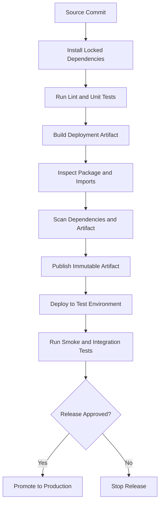

# 02- Deployment Packages and Dependencies

## Overview

AWS Lambda deployment packages contain the application code and runtime dependencies required to execute a function. Packaging is a critical part of deployment because the Lambda execution environment must be able to locate the handler, import dependencies, load native libraries, and execute the application within the configured runtime and architecture.

For Python backend applications, deployment packaging typically involves:

- Organizing application modules and dependencies.
- Selecting ZIP packaging or a container image.
- Building dependencies compatible with the target Lambda runtime.
- Managing shared dependencies with Lambda layers when appropriate.
- Validating artifact structure, size, and integrity.
- Reproducing builds through CI/CD.
- Preventing secrets and development-only files from entering artifacts.

A package that works locally is not necessarily compatible with Lambda. Local development may use a different operating system, Python version, CPU architecture, filesystem layout, or installed dependency set.

## Lambda Deployment Package Formats

Lambda supports two primary deployment package formats: ZIP archives and container images.

| Consideration | ZIP package | Container image |
|---|---|---|
| Artifact | ZIP archive containing code and dependencies | OCI-compatible container image |
| Dependency installation | Usually installed into the package directory or supplied through layers | Installed into image layers during the build |
| Runtime | AWS-managed runtime or compatible custom runtime | Lambda-compatible base image or custom runtime implementation |
| Deployment source | Direct upload or Amazon S3-backed upload | Amazon ECR |
| Local validation | Inspect archive and run tests in a compatible environment | Build and run the image locally |
| Dependency sharing | Lambda layers | Shared image layers and reusable build components |
| Typical fit | Conventional Python functions and relatively simple packaging | Complex native dependencies or container-oriented build pipelines |
| Main operational concern | Archive structure and dependency compatibility | Image compatibility, scanning, registry management, and immutable releases |

Choose the format based on actual dependency and operational requirements rather than assuming that container images are inherently more production-ready.

## ZIP Deployment Packages

A ZIP deployment package contains the handler module and any dependencies that must be available at runtime.

For Python functions, Lambda needs to find the handler module at the expected archive location. Dependencies must be installed into a directory that Python includes in its import path.

### Package structure

Consider a function with this source structure:

```text
order_processor/
    app.py
    requirements.txt
    src/
        __init__.py
        validation.py
    tests/
        test_app.py
```

The handler configuration might be `app.lambda_handler` if `app.py` is placed at the root of the deployment package.

If the handler module is located inside a package, the handler setting must reflect that module path. The archive layout and handler configuration must agree.

### Create a deployment package

Assume `requirements.txt` contains the production dependencies and `app.py` contains the handler.

Create a clean build directory:

```bash
rm -rf build function.zip
mkdir -p build
```

Install dependencies into the build directory:

```bash
python -m pip install \
  --requirement requirements.txt \
  --target build/
```

Copy the application code:

```bash
cp app.py build/
```

If the application uses additional modules, copy the required package directories as well:

```bash
cp -r src build/
```

Create the ZIP archive from inside the build directory:

```bash
cd build
zip -r ../function.zip .
cd ..
```

Inspect the archive:

```bash
unzip -l function.zip
```

The archive should contain `app.py` at its root rather than an unnecessary parent directory such as `build/app.py`.

### Why archive structure matters

A common packaging mistake is archiving the project directory instead of its contents.

Incorrect structure:

```text
function.zip
    build/
        app.py
        dependency_package/
```

Expected structure for the `app.lambda_handler` handler:

```text
function.zip
    app.py
    dependency_package/
```

If the handler cannot be imported, inspect the archive before changing the handler configuration. Incorrect directory structure is a frequent cause of deployment failures.

## Python Dependency Management

Python dependencies should be explicitly declared, versioned, and installed reproducibly.

A production `requirements.txt` might contain:

```text
boto3==1.40.0
requests==2.32.4
```

These versions are illustrative pins, not a recommendation to use these exact releases. Select supported versions, review security advisories, and validate compatibility before deployment.

For reproducible builds:

- Pin application dependencies and manage transitive dependencies deliberately.
- Use a lockfile or dependency-management workflow when appropriate.
- Separate runtime dependencies from development-only tools.
- Review dependency changes for security and compatibility.
- Test the final deployment artifact, not just the source checkout.

### Install only runtime dependencies

Do not automatically package every dependency used during development.

Development tools such as test runners, formatters, and linters usually belong in a separate development dependency group. Keeping them out of the runtime artifact can reduce package size and simplify dependency maintenance.

The deployment process should still include testing and static analysis before packaging.

## Native Dependencies and Runtime Compatibility

Some Python packages include native extensions written in C, C++, or Rust. These packages may depend on:

- Operating-system libraries.
- CPU architecture.
- Python version and ABI.
- Binary wheel availability.
- Shared-library versions.

A dependency installed on Windows may not run on Lambda's Linux environment. Likewise, a package built for one CPU architecture may not work when the Lambda function uses another.

### Build in a compatible environment

For dependencies that require native libraries, build in an environment compatible with the target Lambda runtime and architecture. AWS-provided Lambda base images and supported build images are useful options.

For example, a package using native numerical or database libraries should be tested against the intended Python runtime and architecture before deployment.

A successful `pip install` is not sufficient evidence of compatibility. The function must also import the installed modules successfully in a compatible runtime environment.

### Diagnose import failures

Typical symptoms include:

- `Unable to import module`
- `ModuleNotFoundError`
- `ImportError`
- Errors involving missing shared libraries
- Errors indicating an incompatible binary or architecture

Use the following diagnostic sequence:

1. Confirm the configured runtime and architecture.
2. Inspect the ZIP archive or container image.
3. Confirm that the dependency is included.
4. Verify that its module name matches the import statement.
5. Check native-library and Python ABI compatibility.
6. Reproduce the import in a compatible build or test environment.
7. Redeploy and inspect the resulting CloudWatch logs.

Avoid treating every import failure as an IAM problem. Many packaging failures are caused by incorrect dependency installation or artifact layout.

## Lambda Layers

A Lambda layer is a separately managed archive containing libraries, custom runtimes, or other supported shared content. A function can reference compatible layer versions alongside its own deployment package.

Layers can reduce duplication when multiple functions share substantial dependencies.

### Appropriate use cases

- Several functions share the same internal library.
- A standard dependency bundle is maintained centrally.
- Runtime dependencies are managed separately from frequently changing application code.
- An organization needs a controlled, versioned shared component.

### Limitations and trade-offs

Layers introduce another versioned dependency that must be managed across functions. A layer update does not automatically update the functions already configured to use an earlier version.

Layers also do not eliminate Lambda's deployment package and uncompressed-content constraints. Evaluate the combined deployment footprint and the applicable service limits.

For tightly coupled application dependencies, including them directly in the deployment package may be simpler.

### Package a Python layer

A Python layer archive must follow the expected directory convention. For example:

```text
python/
    requests/
    urllib3/
    certifi/
    ...
```

Create a layer directory and install dependencies into it:

```bash
mkdir -p layer/python

python -m pip install \
  --requirement requirements.txt \
  --target layer/python
```

Create the layer archive:

```bash
cd layer
zip -r ../dependencies-layer.zip python
cd ..
```

Publish the layer using a compatible runtime and architecture configuration:

```bash
aws lambda publish-layer-version \
  --layer-name shared-python-dependencies \
  --zip-file fileb://dependencies-layer.zip \
  --compatible-runtimes python3.12 \
  --compatible-architectures x86_64 arm64 \
  --region ap-south-1
```

The runtime and architecture declarations must match the actual contents of the layer. Do not declare compatibility merely to make the layer appear reusable.

Publishing a layer creates a new version. Record the returned version ARN and use it when configuring functions.

## Container Image Dependencies

Container images provide a controlled environment for installing Python dependencies and operating-system packages.

This approach can be useful when the application requires native libraries, complex system packages, or a container-based build and scanning process.

### Example Dockerfile

```dockerfile
FROM public.ecr.aws/lambda/python:3.12

COPY requirements.txt ${LAMBDA_TASK_ROOT}/

RUN pip install \
    --no-cache-dir \
    -r ${LAMBDA_TASK_ROOT}/requirements.txt

COPY app.py ${LAMBDA_TASK_ROOT}/

CMD ["app.lambda_handler"]
```

This example uses a Lambda base image. Verify that the chosen runtime is supported for the target deployment and that the image matches the intended architecture.

Build the image:

```bash
docker build -t order-processor:latest .
```

Run it locally:

```bash
docker run --rm \
  -p 9000:8080 \
  order-processor:latest
```

Invoke the function through the local runtime interface:

```bash
curl -X POST \
  http://localhost:9000/2015-03-31/functions/function/invocations \
  -H "Content-Type: application/json" \
  -d '{"order_id":"order-123"}'
```

Local testing can validate basic handler behavior and dependency imports. It does not reproduce every AWS IAM, networking, event-source, scaling, or managed-runtime behavior.

### Image dependency best practices

- Use maintained base images.
- Pin application dependencies and review transitive dependency changes.
- Scan images for vulnerabilities.
- Avoid copying source-control metadata, local caches, credentials, and unrelated files into the image.
- Record the image digest used for each release.
- Confirm that the image architecture matches the Lambda function configuration.
- Establish an ECR lifecycle policy for obsolete images.
- Rebuild images when base-image security updates are required.

For image requirements and deployment constraints, refer to the [AWS Lambda container image documentation](https://docs.aws.amazon.com/lambda/latest/dg/images-create.html).

## Deployment Package Size and Limits

Package size affects deployment speed, cold-start behavior in some workloads, and dependency-management complexity.

Large packages may contain unnecessary files, duplicate libraries, oversized binaries, or development tooling. Reduce package size where it provides a meaningful operational benefit, but do not remove dependencies without verifying runtime behavior.

Check the current [AWS Lambda quotas documentation](https://docs.aws.amazon.com/lambda/latest/dg/gettingstarted-limits.html) for package-size limits and upload constraints. Applicable limits depend on the deployment format and upload method.

### Package optimization techniques

- Exclude tests, documentation, caches, and local virtual environments from the runtime artifact.
- Install only production dependencies.
- Avoid packaging large optional dependency trees when they are not needed.
- Use layers when shared dependencies justify their additional lifecycle management.
- Use container images when their packaging and dependency-management advantages outweigh the operational overhead.
- Measure initialization time before attributing cold starts to package size alone.

A smaller package is not automatically a faster function. Runtime initialization, imports, network access, memory allocation, and application design can all affect startup performance.

## Dependency Security and Integrity

Deployment artifacts are part of the software supply chain. An insecure dependency or compromised build can affect every function that consumes the artifact.

### Security controls

**Dependency review:** Monitor direct and transitive dependencies for known vulnerabilities and unsupported versions.

**Build isolation:** Build artifacts in controlled CI environments rather than on developer machines with unknown state.

**Secret exclusion:** Never include AWS credentials, API tokens, private keys, or production secrets in ZIP archives or container images.

**Artifact integrity:** Record artifact hashes or immutable image digests so that the deployed artifact can be traced to the build that produced it.

**Least privilege:** Limit CI/CD permissions to the resources and actions required for the release.

**Runtime compatibility:** Keep the runtime and native dependencies updated together where compatibility requires it.

### Verify a ZIP artifact

Generate a SHA-256 checksum:

```bash
sha256sum function.zip
```

Store the checksum with the build metadata or release record. Recalculate it before deployment when artifact transfer or storage integrity needs to be verified.

A checksum proves that two files match; it does not establish that the artifact is trustworthy. Trust also depends on the integrity of the source, build environment, dependency sources, and release process.

## Automating Packaging in CI/CD

Manual packaging is useful during development but should not be the primary production release process.

A CI/CD pipeline should produce an artifact deterministically, test the artifact, and deploy that artifact without rebuilding it differently for each environment.

A typical pipeline is:



A pipeline should fail before deployment when tests fail, required dependencies are missing, or artifact validation detects an invalid structure.

For ZIP deployments, build the archive once and pass that archive through the release stages. For container deployments, promote the same immutable image digest rather than rebuilding an image with the same mutable tag.

Keep build-time credentials separate from runtime credentials. Use an appropriate short-lived AWS identity mechanism for CI/CD, such as an OIDC trust relationship with GitHub Actions, where applicable.

## Troubleshooting Deployment Packages

| Symptom | Likely cause | Diagnostic action |
|---|---|---|
| `Unable to import module` | Incorrect handler path or missing module | Inspect archive layout and handler configuration |
| `No module named ...` | Dependency missing or installed into the wrong directory | Inspect package contents and Python import paths |
| Native library load failure | Incompatible binary or missing shared library | Rebuild in a compatible environment |
| Function works locally but fails in Lambda | Runtime, architecture, filesystem, environment, or permission differences | Reproduce with a compatible runtime and inspect logs |
| Layer import failure | Incorrect layer directory layout or incompatible layer version | Inspect the layer archive and function configuration |
| Container image cannot be deployed | Image configuration, architecture, registry, or compatibility issue | Validate the image and review deployment errors |
| Artifact unexpectedly large | Development files or unnecessary dependencies included | Inspect archive contents and dependency trees |
| Function fails after a dependency update | Transitive dependency or runtime incompatibility | Compare lockfiles, rebuild, and test the final artifact |

A reliable diagnostic process follows:

**Symptom → Artifact inspection → Runtime compatibility check → Reproduction → Corrective action → Regression test.**

Do not repeatedly rebuild or redeploy without identifying which property of the artifact or runtime is incorrect.

## Key Takeaways

- Build Lambda artifacts with a directory structure and dependencies compatible with the configured handler, runtime, and architecture.
- Use ZIP packages for straightforward deployments and container images when their dependency and build advantages justify the added operational responsibility.
- Treat Lambda layers as versioned shared dependencies, not as a way to bypass package limits or dependency compatibility requirements.
- Validate the final artifact in CI/CD, scan dependencies, exclude secrets, and preserve immutable release metadata.
- Diagnose packaging failures by inspecting the artifact and reproducing runtime behavior before changing unrelated configuration.