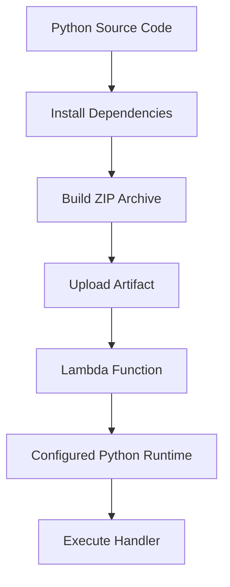
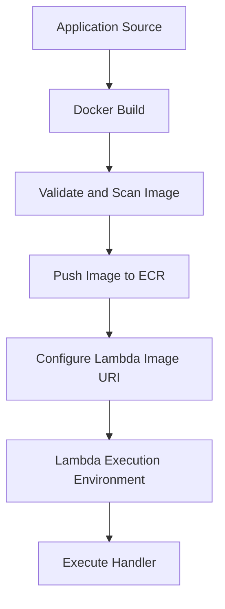
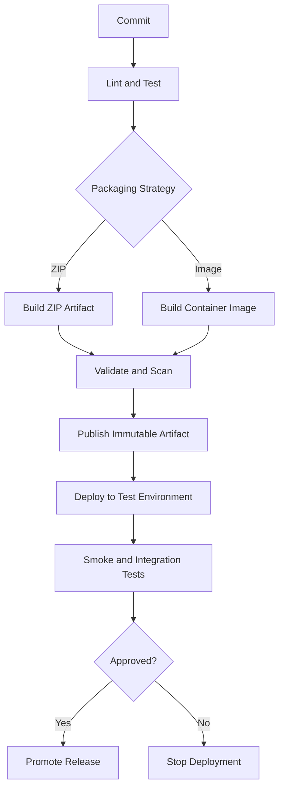

# 03- ZIP Packages vs Container Images

## Overview

AWS Lambda supports two deployment package formats: ZIP archives and container images. Both deliver application code and dependencies to Lambda, but they differ in packaging, dependency management, build workflows, artifact storage, and operational responsibilities.

Choosing the appropriate format affects deployment speed, dependency compatibility, security scanning, release reproducibility, and the effort required to maintain production workloads.

For Python backend applications, the decision usually comes down to whether a conventional ZIP package provides sufficient control or whether the application benefits from a container-based build environment.

The central principle is to choose the simplest packaging approach that satisfies the application's technical and operational requirements.

## How the Two Deployment Models Work

### ZIP deployment

A ZIP deployment package contains the handler code, application modules, and required dependencies. Lambda extracts and executes the package using the configured runtime.



ZIP packages work well for conventional Python applications where the required dependencies can be packaged in a compatible directory structure.

### Container image deployment

A container image packages the application, its dependencies, and the required runtime environment into an image. The image is stored in Amazon Elastic Container Registry (ECR), and Lambda uses it to run the function.



Lambda container images must follow Lambda's image requirements. A general-purpose Docker image is not automatically compatible with Lambda.

Container images provide control over the packaged filesystem and dependencies, but Lambda still manages the execution environments, invocations, scaling, and function lifecycle.

## Feature Comparison

| Dimension | ZIP packages | Container images |
|---|---|---|
| Artifact format | ZIP archive | OCI-compatible container image |
| Code and dependencies | Packaged into the archive or supplied through layers | Included in the image |
| Runtime selection | AWS-provided runtime or compatible custom runtime | Lambda-compatible base image or custom runtime implementation |
| Build tools | Python packaging tools and ZIP utilities | Docker or compatible image builder |
| Artifact storage | Direct upload or Amazon S3-backed deployment | Amazon ECR |
| Operating-system dependencies | Must be packaged in a compatible manner | Can be installed into the image, subject to Lambda compatibility |
| Dependency sharing | Lambda layers | Shared image layers and reusable build components |
| Local validation | Inspect archive and test imports in a compatible environment | Build and run the image locally |
| Artifact management | ZIP versioning and release metadata | Image tags, immutable digests, and ECR lifecycle policies |
| Typical complexity | Lower for conventional applications | Higher build and registry management overhead |
| Best suited for | Standard handlers and relatively straightforward dependencies | Complex dependencies, custom filesystem requirements, and container-oriented workflows |

Neither format eliminates the need to test the deployed application in AWS. Local testing cannot fully reproduce Lambda IAM permissions, VPC networking, event-source behavior, or managed scaling.

## When to Choose ZIP Packages

ZIP packages are usually the preferred starting point for Python Lambda functions.

Choose ZIP packaging when:

- The application has conventional Python dependencies.
- The function uses an AWS-provided runtime.
- The deployment process is straightforward.
- The artifact can be built reliably in a compatible environment.
- Shared dependencies can be managed without excessive layer complexity.
- The team wants to minimize build and release infrastructure.

### Example ZIP structure

```text
order_processor/
    app.py
    requirements.txt
    src/
        __init__.py
        validation.py
    tests/
        test_app.py
```

The deployment archive should contain the runtime files at the expected paths, not the entire development directory.

For example, if the configured handler is `app.lambda_handler`, `app.py` must be importable as the `app` module from the deployment package.

### Build a ZIP package

Install dependencies into a clean directory:

```bash
mkdir -p build

python -m pip install \
  --requirement requirements.txt \
  --target build/
```

Copy the handler and application modules:

```bash
cp app.py build/
cp -r src build/
```

Create the archive:

```bash
cd build
zip -r ../function.zip .
cd ..
```

Inspect its contents:

```bash
unzip -l function.zip
```

Exclude local virtual environments, test fixtures, development-only tools, caches, credentials, and unrelated files from the deployment artifact.

For packages with native extensions, build in an environment compatible with the target Lambda runtime and architecture.

## When to Choose Container Images

Container images are appropriate when their additional build and operational capabilities solve a real problem.

Choose container images when:

- The application requires several operating-system libraries.
- Native dependencies are easier to build and validate within a controlled image.
- The application already has a mature container build pipeline.
- The team needs explicit control over the packaged filesystem.
- Security scanning and artifact promotion are integrated into image-based workflows.
- The deployment artifact benefits from shared image layers or a standardized base image.

### Example Dockerfile

```dockerfile
FROM public.ecr.aws/lambda/python:3.12

COPY requirements.txt ${LAMBDA_TASK_ROOT}/

RUN pip install \
    --no-cache-dir \
    -r ${LAMBDA_TASK_ROOT}/requirements.txt

COPY app.py ${LAMBDA_TASK_ROOT}/

CMD ["app.lambda_handler"]
```

This example assumes the selected base image and Python runtime are supported for the target deployment. Verify runtime lifecycle, architecture, and regional requirements before release.

Build the image:

```bash
docker build -t order-processor:latest .
```

Run a local test:

```bash
docker run --rm \
  -p 9000:8080 \
  order-processor:latest
```

Invoke the local Lambda runtime interface:

```bash
curl -X POST \
  http://localhost:9000/2015-03-31/functions/function/invocations \
  -H "Content-Type: application/json" \
  -d '{"order_id":"order-123"}'
```

This validates basic handler execution and dependency availability. It does not prove that the function has correct IAM permissions or can reach its production dependencies.

## Dependency and Runtime Compatibility

Dependency compatibility is a concern for both deployment formats.

Python packages can contain native binaries tied to a specific Python ABI, operating system, system library, or CPU architecture. A dependency that imports successfully on a developer's Windows machine may fail in Lambda's Linux environment.

| Concern | ZIP package | Container image |
|---|---|---|
| Python package compatibility | Install compatible wheels or build in a compatible environment | Install and validate dependencies during image construction |
| Native libraries | Bundle compatible libraries when required and supported | Install compatible system libraries in the image |
| CPU architecture | Package binaries for the configured architecture | Build and deploy an image for the configured architecture |
| Runtime compatibility | Match the Lambda runtime and Python ABI | Use a compatible Lambda base image or custom runtime |
| Debugging | Inspect archive contents and reproduce imports | Inspect image contents and reproduce execution locally |

For either format:

- Pin and review application dependencies.
- Separate development dependencies from runtime dependencies.
- Test the final artifact rather than relying exclusively on source-level tests.
- Check native-library compatibility.
- Update dependencies and base images through a controlled process.

Container images provide a more explicit build environment, but they do not guarantee compatibility automatically.

## Deployment Size and Performance

Artifact size can influence deployment time, storage requirements, and initialization behavior. Its effect on cold-start latency depends on factors such as initialization work, imported modules, runtime behavior, and the execution environment.

Avoid assuming that a container image is inherently slower than a ZIP package, or that a smaller ZIP package automatically produces better latency.

### ZIP-specific considerations

- Remove unnecessary dependencies and development files.
- Use layers only when shared dependency management justifies the additional complexity.
- Validate archive size and the applicable upload and uncompressed-content limits.
- Build the package once and preserve it across release stages.

### Container-specific considerations

- Minimize unnecessary image layers and large dependencies.
- Use maintained base images.
- Avoid copying build tools and unrelated files into the final image when they are not needed at runtime.
- Keep image digests and release metadata for reproducibility.
- Review image pull and initialization behavior through actual performance measurements.

Consult the current [AWS Lambda quotas documentation](https://docs.aws.amazon.com/lambda/latest/dg/gettingstarted-limits.html) for deployment package limits and upload constraints. The applicable limits depend on the deployment format and upload method.

## Security and Supply Chain Considerations

The deployment artifact is part of the software supply chain. A vulnerable dependency or compromised build can affect every function deployed from that artifact.

| Security area | ZIP packages | Container images |
|---|---|---|
| Dependency vulnerabilities | Scan application and transitive dependencies | Scan application dependencies and image contents |
| Build integrity | Control the build environment and preserve artifact checksums | Control the build environment and record image digests |
| Secrets | Exclude credentials from the archive | Exclude credentials from image layers and build context |
| Artifact storage | Restrict access to deployment artifacts and S3 locations | Restrict ECR access and manage image retention |
| Updates | Rebuild and redeploy the package | Rebuild and redeploy when dependencies or base images change |
| Least privilege | Restrict deployment permissions and Lambda execution permissions | Apply the same IAM separation and artifact access controls |

Never embed production secrets in source code, ZIP archives, Dockerfiles, or image layers. Use AWS Secrets Manager or Systems Manager Parameter Store where appropriate, with permissions scoped to the resources the function requires.

For container images, immutable image digests provide stronger release traceability than mutable tags such as `latest`.

For ZIP packages, record a checksum and associate it with the build and release metadata. A checksum establishes artifact identity, not the trustworthiness of the source or build process.

## CI/CD and Release Management

Both formats should be integrated into a reproducible CI/CD pipeline.



### Recommended pipeline controls

- Run linting, unit tests, and dependency checks before packaging.
- Validate archive structure or container image configuration.
- Scan dependencies and artifacts for known vulnerabilities.
- Use controlled CI environments and short-lived AWS credentials where possible.
- Separate deployment permissions from runtime execution permissions.
- Deploy the same artifact that passed testing rather than rebuilding it independently for production.
- Verify the deployed function's configuration, handler, runtime, architecture, and behavior.
- Monitor errors, latency, throttling, and downstream health after release.
- Keep a known-good release available for rollback.

For container deployments, promote the same image digest through environments. For ZIP deployments, retain the exact tested archive and its checksum.

## Operational Trade-offs

| Operational requirement | ZIP package advantage | Container image advantage |
|---|---|---|
| Simple Python deployment | Minimal build infrastructure | Usually unnecessary additional machinery |
| Complex system dependencies | Possible, but packaging can require extra build steps | Dependencies can be installed during image construction |
| Shared dependencies | Lambda layers support independently versioned libraries | Reusable image layers support build-time reuse |
| Artifact traceability | Checksums and release records | Immutable image digests and registry metadata |
| Existing container CI/CD | May require a separate packaging workflow | Can reuse much of the existing build workflow |
| Runtime customization | Depends on the managed runtime or compatible custom runtime | Provides more control over the packaged filesystem and runtime components |
| Operational simplicity | Often simpler for standard functions | Requires image lifecycle, registry access, and base-image maintenance |

The correct choice depends on the entire lifecycle, not just the initial build. Include dependency updates, vulnerability remediation, deployment frequency, rollback, artifact retention, and team ownership in the decision.

## Common Mistakes

| Mistake | Why it causes problems | Prevention |
|---|---|---|
| Choosing containers because they appear more production-ready | Adds complexity without necessarily solving a real requirement | Start with ZIP unless image-specific benefits justify the overhead |
| Building ZIP dependencies on an incompatible operating system | Native modules may fail at runtime | Build and test in a compatible environment |
| Treating any Docker image as Lambda-compatible | Lambda requires a compatible image configuration and runtime interface | Use an appropriate Lambda base image or implement the required custom runtime behavior |
| Using mutable image tags as release identity | The tag may point to a different artifact later | Record and deploy immutable image digests |
| Packaging development dependencies | Increases artifact size and maintenance overhead | Separate runtime and development dependency sets |
| Assuming local tests prove AWS compatibility | Local tests do not reproduce all AWS permissions, networking, and event behavior | Add deployment smoke tests and integration tests |
| Embedding secrets in artifacts | Secrets may persist in archives, image layers, and build records | Retrieve secrets at runtime through authorized AWS services |
| Rebuilding an artifact independently for production | The production artifact may differ from the tested artifact | Promote the exact artifact that passed validation |

## Decision Framework

Use the following decision sequence when selecting a deployment format.

1. **Can the function use a supported AWS-managed runtime with ordinary packaged dependencies?** Prefer ZIP unless another requirement changes the decision.
2. **Does the application require complex operating-system dependencies or a controlled image filesystem?** Evaluate container images.
3. **Are dependencies compatible with the selected runtime and architecture?** Validate this before choosing either format.
4. **Does the organization already have reliable container build, scanning, and registry workflows?** Existing capabilities may reduce the operational cost of image deployments.
5. **Can the team reproduce, test, trace, and roll back the artifact?** If not, improve the release process before increasing packaging complexity.

Use Lambda layers when dependency reuse provides a clear benefit, but do not introduce layers merely to avoid organizing a package properly.

## Key Takeaways

- ZIP packages are generally the simplest choice for conventional Python Lambda functions; container images are useful when their build and filesystem control solve specific requirements.
- Both formats require compatibility with the Lambda runtime, Python version, native dependencies, and CPU architecture.
- Container images introduce additional responsibilities for base-image updates, ECR access, image scanning, and immutable artifact management.
- Build and test artifacts in CI/CD, exclude secrets, and promote the exact artifact that passed validation.
- Choose packaging based on operational requirements, dependency complexity, security, reproducibility, and lifecycle cost rather than assuming one format is universally superior.