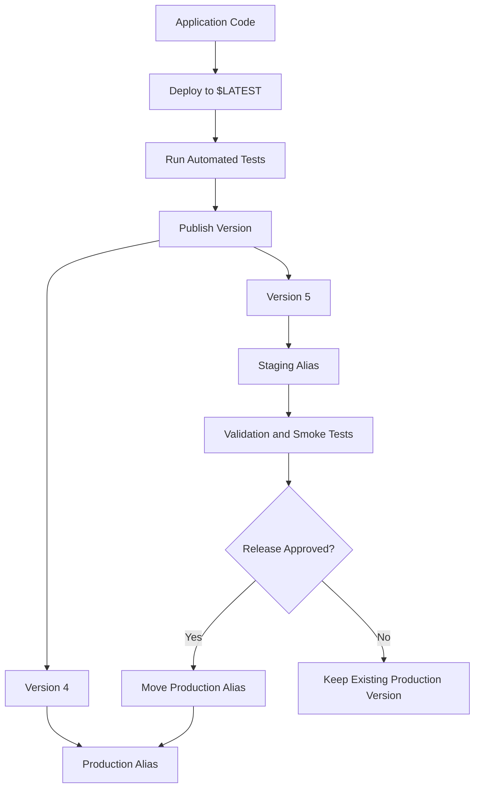
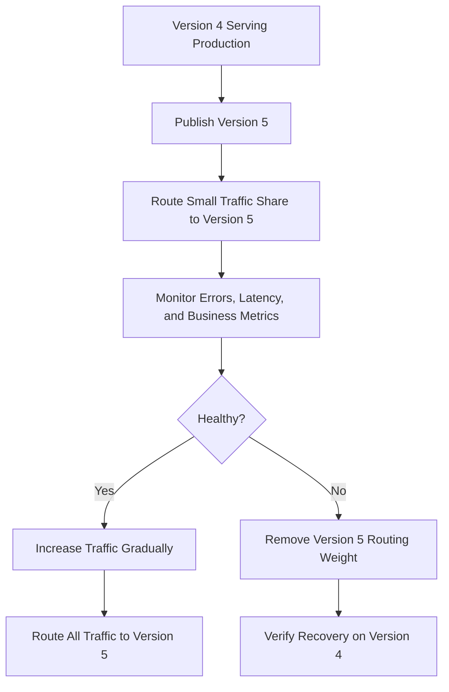

# 04- Versions and Aliases for Deployments

## Overview

AWS Lambda versions and aliases provide a controlled way to release application changes without making every deployment immediately affect production traffic.

When a Lambda function is updated, its `$LATEST` version changes. Invocations that target `$LATEST` use the mutable function configuration and code. Published versions provide immutable snapshots of function code and versioned configuration, while aliases provide stable names that point to published versions.

For production backend systems, this separation enables:

- Repeatable releases and traceable deployments.
- Promotion of tested versions to production.
- Controlled traffic shifting between releases.
- Fast application-level rollback.
- Stable integration references for API Gateway and other invocation sources.
- Integration with automated CI/CD workflows.

Versions and aliases do not automatically make a deployment safe. They provide release primitives that must be combined with testing, monitoring, compatible data changes, and a rollback strategy.

## Lambda Versions

A Lambda version is a numbered snapshot of a function's code and versioned configuration.

For example, publishing a function may produce versions `1`, `2`, and `3`. Each published version identifies a particular release and cannot be modified after publication.

### `$LATEST` versus published versions

| Property | `$LATEST` | Published version |
|---|---|---|
| Mutable | Yes | No |
| Code updates | Updated by code deployments | Fixed for that version |
| Versioned configuration | Changes as the function is updated | Captured when published |
| Suitable for development | Yes | Can be used for testing |
| Suitable for production references | Possible, but less controlled | Recommended for controlled release management |
| Rollback reference | Requires restoring previous code and configuration | Existing versions can be targeted again |

Published versions capture code and versioned configuration, including settings such as the runtime, handler, memory, timeout, environment variables, and execution role. Some operational settings and external dependencies remain mutable or outside the version snapshot.

For example, publishing a version does not freeze the contents of an external database, the permissions attached to an IAM role, or the behavior of a downstream API.

### Publish a version

Assume a function named `order-processor` has been deployed and tested.

**State-changing command:**

```bash
aws lambda publish-version \
  --function-name order-processor \
  --description "Order processor release 1" \
  --region ap-south-1
```

The response includes a version number and version ARN.

Inspect the published version:

```bash
aws lambda get-function-configuration \
  --function-name order-processor \
  --qualifier 1 \
  --region ap-south-1 \
  --query '{
    FunctionName:FunctionName,
    Version:Version,
    Runtime:Runtime,
    Handler:Handler,
    MemorySize:MemorySize,
    Timeout:Timeout,
    LastModified:LastModified
  }'
```

Replace `1` with the actual published version number.

### When to publish a version

Publish a version when a release candidate has passed the required validation checks.

A typical release process is:

1. Deploy code to `$LATEST` in a controlled environment.
2. Run unit, integration, and smoke tests.
3. Verify the effective configuration and permissions.
4. Publish a numbered version.
5. Test the published version or a test alias pointing to it.
6. Promote the intended version through the production alias.

Avoid publishing versions for every intermediate code change unless the release process requires them. Unnecessary versions increase operational clutter and can complicate release tracking.

## Lambda Aliases

An alias is a named pointer to a published Lambda version. Instead of having clients invoke a version number directly, they can invoke a stable alias such as `staging` or `production`.

For example:

```text
order-processor
    $LATEST
    Version 1
    Version 2
    Version 3

Aliases
    staging    -> Version 3
    production -> Version 2
```

The production alias can remain on version `2` while version `3` is tested. Once approved, the alias can be updated without changing the application code or the integration's function reference.

Aliases are regional resources associated with a Lambda function. Their names are not global identifiers across all functions or Regions.

### Create an alias

If the alias does not exist, create it:

**State-changing command:**

```bash
aws lambda create-alias \
  --function-name order-processor \
  --name production \
  --function-version 2 \
  --description "Production release" \
  --region ap-south-1
```

### Update an existing alias

To move the alias to version `3`:

**State-changing command:**

```bash
aws lambda update-alias \
  --function-name order-processor \
  --name production \
  --function-version 3 \
  --region ap-south-1
```

The update operation requires the alias to exist. Use `create-alias` when creating a new alias.

### Verify the alias

```bash
aws lambda get-alias \
  --function-name order-processor \
  --name production \
  --region ap-south-1
```

Inspect the target version and any configured additional version weights before promoting a release.

## Qualified and Unqualified Invocations

A Lambda invocation can target a function without a qualifier or use a qualifier to identify a version or alias.

| Invocation target | Meaning |
|---|---|
| `order-processor` | Invokes the unqualified function, which resolves to `$LATEST` |
| `order-processor:3` | Invokes published version `3` |
| `order-processor:production` | Invokes the version or weighted versions configured for the `production` alias |

For production integrations, aliases provide a stable reference while the target version changes.

### Invoke a published version

```bash
aws lambda invoke \
  --function-name order-processor:3 \
  --payload '{"order_id":"order-123"}' \
  --cli-binary-format raw-in-base64-out \
  response.json \
  --region ap-south-1
```

### Invoke through an alias

```bash
aws lambda invoke \
  --function-name order-processor:production \
  --payload '{"order_id":"order-123"}' \
  --cli-binary-format raw-in-base64-out \
  response.json \
  --region ap-south-1
```

Inspect `response.json` and the CLI response. A successful invocation request does not guarantee successful business processing; inspect function errors and application logs as well.

For an API Gateway integration, configure the integration to reference the intended alias when controlled production releases are required. Updating the alias can then promote a release without changing the integration's target reference.

## Alias-Based Deployment Architecture

A version-and-alias release process separates the mutable development target from the production traffic target.



The diagram represents a release workflow rather than a requirement to use these specific version numbers or aliases.

A typical production setup might use:

- `staging` for validating a release candidate.
- `production` for the live release target.
- Numbered published versions for traceability and rollback.

Keep environment configuration, permissions, and infrastructure changes under controlled management. An alias is a routing mechanism, not a substitute for environment isolation.

## Weighted Aliases and Canary Deployments

A Lambda alias can distribute invocations between a primary published version and one additional published version using weighted routing.

For example, production can route most traffic to version `4` while exposing a smaller percentage to version `5`.

Weighted aliases support controlled exposure, but they do not guarantee that a specific request will reach a particular version. The configured weight is a routing proportion, not an exact per-request guarantee.

### Configure weighted routing

**State-changing command:**

```bash
aws lambda update-alias \
  --function-name order-processor \
  --name production \
  --function-version 4 \
  --routing-config '{"AdditionalVersionWeights":{"5":0.10}}' \
  --region ap-south-1
```

This configures version `4` as the primary target and assigns a 10% additional routing weight to version `5`.

Before using weighted routing, verify the current alias state and ensure that both published versions are suitable for production invocation.

Inspect the routing configuration:

```bash
aws lambda get-alias \
  --function-name order-processor \
  --name production \
  --region ap-south-1 \
  --query '{
    PrimaryVersion:FunctionVersion,
    RoutingConfig:RoutingConfig
  }'
```

### Canary release workflow

A canary deployment exposes a new version to a limited portion of traffic, evaluates its behavior, and then increases exposure if the release remains healthy.



Use CloudWatch metrics, application logs, alarms, and relevant business indicators to evaluate a release. A low error count alone may not be sufficient if the canary receives too little traffic to exercise important paths.

For managed canary or linear deployments, AWS CodeDeploy can automate traffic shifting and rollback when the deployment configuration and integration support those capabilities.

### Important limitations

- Weighted routing is limited to compatible published versions of the same function.
- Traffic weights are statistical routing proportions, not exact request counts.
- Version-specific configuration may differ, so both versions must be safe to run concurrently.
- A rollback does not reverse external side effects or incompatible database migrations.
- Alias traffic shifting does not automatically validate downstream systems or business outcomes.

## Safe Rollback

One of the main benefits of published versions is the ability to redirect an alias to a previously tested version.

Suppose version `5` introduces elevated error rates while version `4` remains healthy.

The rollback procedure is:

1. Confirm the affected release and identify the last known-good version.
2. Inspect the production alias and any weighted routing configuration.
3. Remove the faulty version from traffic or redirect the alias to the known-good version.
4. Verify that the alias points to the intended version.
5. Run smoke tests against the production alias.
6. Monitor errors, latency, throttling, and downstream dependencies.
7. Check whether failed asynchronous work or queued events require separate recovery.

For example, moving the alias back to version `4` can be performed with:

```bash
aws lambda update-alias \
  --function-name order-processor \
  --name production \
  --function-version 4 \
  --region ap-south-1
```

This command changes the alias target. It does not undo database writes, messages already published, external API calls, or other side effects performed by version `5`.

### Rollback prerequisites

A safe rollback depends on more than retaining the old code.

- Keep previously deployed versions available.
- Use backward-compatible database and event-schema changes.
- Avoid removing resources still required by the previous version.
- Preserve compatible IAM permissions and secret references.
- Confirm that the previous version can operate with the current environment.
- Define clear monitoring thresholds and rollback ownership.

Use expand-and-contract database migrations when application versions may coexist during a rollout.

## Alias Permissions and Integrations

Lambda supports resource-based policies and IAM permissions that can apply to a function or a qualified version or alias.

When a caller invokes an alias, verify that the required invocation permissions and integration configuration support the qualified target. Permissions attached to an unqualified function and permissions scoped to a qualified target should not be assumed to be interchangeable in every configuration.

Common integration considerations include:

- **API Gateway:** Configure the integration URI to reference the intended alias where appropriate.
- **Event source mappings:** Verify the configured function target and qualifier. Event source mappings have their own configuration and operational lifecycle.
- **Direct invocation:** Ensure the caller uses the intended alias or published version.
- **Cross-account invocation:** Verify both the caller's identity permissions and the target's resource-based permissions where required.

Use least-privilege permissions and inspect the relevant policies when an integration cannot invoke a qualified target.

## CI/CD Integration

Versions and aliases are most useful when integrated into a repeatable release pipeline.

A deployment pipeline should:

1. Build the artifact once.
2. Run linting, unit tests, and integration tests.
3. Deploy the artifact to the intended function.
4. Wait for the update to complete.
5. Run smoke tests.
6. Publish a version.
7. Validate the published version or staging alias.
8. Promote the production alias.
9. Monitor post-deployment health.
10. Roll back or stop promotion when health checks fail.

Use a controlled AWS identity for CI/CD, preferably short-lived credentials through a supported identity federation mechanism where applicable. Keep deployment permissions separate from the function's runtime execution role.

### Wait for deployment completion

After changing function code or configuration, wait for the update to finish before publishing or testing the release:

```bash
aws lambda wait function-updated \
  --function-name order-processor \
  --region ap-south-1
```

Then verify the function's configuration and update status before publishing the version.

A robust pipeline should record the published version number, artifact identity, source commit, deployment timestamp, and resulting alias target.

## Common Mistakes

| Mistake | Consequence | Prevention |
|---|---|---|
| Invoking `$LATEST` directly in production | Code changes can immediately affect production behavior | Use a production alias for controlled promotion |
| Treating an alias as an immutable snapshot | Alias targets can change independently of published versions | Track alias changes and version history |
| Publishing before tests complete | An unverified version may be promoted | Publish only after validation gates pass |
| Assuming rollback reverses business side effects | Database writes and external actions remain | Use idempotency, compensating actions, and compatible schema changes |
| Using weighted routing without monitoring | A faulty release may continue receiving traffic | Define alarms and explicit promotion criteria |
| Forgetting version-specific permissions | A qualified invocation may fail despite working unqualified | Verify IAM and resource-based policies for the target |
| Changing an alias without checking routing weights | Unexpected traffic may continue reaching an older version | Inspect the full alias configuration before and after promotion |
| Rebuilding separately for production | The deployed artifact may differ from the tested artifact | Promote the same validated artifact |

## Key Takeaways

- `$LATEST` is mutable, while published Lambda versions provide immutable snapshots of code and versioned configuration.
- Aliases provide stable invocation targets that can be moved between published versions without changing every integration.
- Weighted aliases support controlled traffic exposure, but require monitoring, compatible releases, and explicit promotion criteria.
- Rollback redirects traffic to a known-good version; it does not undo database changes, external side effects, or incompatible schema migrations.
- Integrate version publication, alias promotion, smoke tests, least-privilege permissions, and rollback verification into CI/CD.