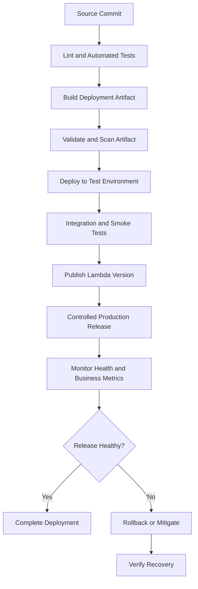
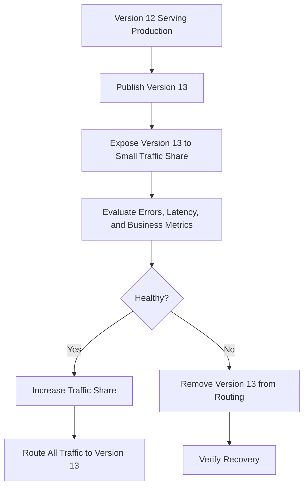

# 05- Deployment Strategies

## Overview

AWS Lambda deployment strategies define how application changes are packaged, released, validated, and promoted into production. A deployment strategy should minimize user impact, preserve a known-good release, and provide a reliable way to detect and recover from failures.

For backend systems, deployment is not limited to uploading code. A release may also change environment variables, IAM permissions, runtime configuration, dependency versions, database schemas, event formats, or downstream integration behavior.

A production-ready Lambda deployment process should provide:

- Reproducible builds and traceable artifacts.
- Automated testing and deployment verification.
- Controlled production traffic exposure.
- Compatibility between old and new application versions.
- Clear rollback criteria and recovery procedures.
- Least-privilege deployment permissions.
- Monitoring and alerting throughout the release lifecycle.

The appropriate strategy depends on the application's risk, traffic profile, integration type, state-management requirements, and operational maturity.

## Lambda Deployment Lifecycle

A reliable deployment pipeline separates building, testing, publishing, and production promotion.



Each stage should have an explicit success condition. A successful upload or configuration update does not prove that the application works correctly under production traffic.

## Core Deployment Strategies

### Direct deployment

A direct deployment updates `$LATEST` with new code or configuration. It is straightforward and useful for development, testing, and controlled environments.

**Advantages**

- Simple implementation.
- Minimal release-management overhead.
- Suitable for early development and low-risk workloads.

**Limitations**

- Changes to `$LATEST` affect invocations targeting the unqualified function.
- There is no inherent gradual traffic rollout.
- Rollback requires restoring a known-good artifact and configuration unless an existing published version is used through a separate release mechanism.

For production, direct deployment should be paired with automated verification and a deliberate traffic-management strategy.

### Version and alias deployment

Lambda versions and aliases separate release artifacts from stable invocation targets.

- `$LATEST` is mutable.
- A published version is an immutable snapshot of code and versioned configuration.
- An alias is a named pointer to a published version and can also support weighted routing between compatible versions.

Example:

```text
order-processor
    $LATEST
    Version 12
    Version 13

Aliases
    staging    -> Version 13
    production -> Version 12
```

The new version can be validated before the production alias is moved.

This approach is suitable for production applications requiring traceability, repeatable releases, and fast application-version rollback.

### Canary deployment

A canary deployment exposes a new version to a limited portion of production traffic before increasing its share.

For example, version `12` may remain the primary version while version `13` receives a small percentage of traffic.



Canary deployment is useful when failures are expensive or difficult to detect through pre-production tests alone.

The canary must receive enough representative traffic to reveal relevant failure modes. A small traffic percentage may not exercise rare code paths, specific tenants, or infrequent event types.

### Linear deployment

A linear deployment increases traffic to the new version in successive increments.

For example, a deployment might increase exposure by a fixed percentage at each interval, with monitoring between increments.

Linear deployment is useful when teams want gradual exposure without immediately switching all traffic. It requires sufficient monitoring and a clear decision process at each stage.

### Blue/green-style deployment

A blue/green release maintains separate release targets and switches traffic from the current target to a new target after validation.

For Lambda, this can be implemented using separate functions, aliases, or other routing infrastructure, depending on the architecture.

**Advantages**

- Allows extensive testing of the new target before traffic switches.
- Supports a controlled cutover.
- Can isolate some configuration differences between release targets.

**Limitations**

- Requires additional resources or release configuration.
- Can increase operational and infrastructure cost.
- Does not automatically protect against shared database changes, external side effects, or incompatible event schemas.

Blue/green deployment is particularly useful when release isolation is important, but it requires deliberate management of shared state and dependencies.

## Strategy Comparison

| Strategy | Traffic control | Rollback approach | Operational complexity | Typical use |
|---|---|---|---|---|
| Direct deployment | Limited | Restore a known-good artifact and configuration | Low | Development and controlled low-risk releases |
| Version and alias | Switch between published versions | Move alias to a known-good version | Low to moderate | Standard production release management |
| Canary | Gradual exposure | Remove the new version from traffic | Moderate | High-risk changes requiring progressive validation |
| Linear | Gradual exposure in increments | Restore previous routing | Moderate | Releases requiring staged traffic increases |
| Blue/green-style | Switch between release targets | Route traffic to the previous target | Moderate to high | Stronger release isolation and controlled cutover |

The simplest strategy that satisfies the application's reliability requirements is generally preferable. Additional rollout machinery is useful only when it improves risk control enough to justify its operational cost.

## Use Lambda Versions and Aliases

Published versions provide stable release snapshots, while aliases provide stable references for integrations.

### Publish a release version

After deploying and validating the intended code and configuration:

```bash
aws lambda publish-version \
  --function-name order-processor \
  --description "Release 2026-10-11" \
  --region ap-south-1
```

The command returns the published version number. Record it with the source commit and artifact metadata.

### Create a production alias

If the alias does not exist:

```bash
aws lambda create-alias \
  --function-name order-processor \
  --name production \
  --function-version 12 \
  --description "Production release" \
  --region ap-south-1
```

### Promote an existing alias

To move an existing alias to version `13`:

```bash
aws lambda update-alias \
  --function-name order-processor \
  --name production \
  --function-version 13 \
  --region ap-south-1
```

Replace the example version numbers with actual published versions. `update-alias` requires an existing alias.

Verify the result:

```bash
aws lambda get-alias \
  --function-name order-processor \
  --name production \
  --region ap-south-1
```

For production integrations, configure the invocation target to use the intended alias where supported. An alias update can then promote a release without changing every client or integration.

## Automated Traffic Shifting

AWS CodeDeploy can automate supported Lambda deployment patterns, including canary and linear traffic shifting through aliases.

A typical managed deployment involves:

1. Publishing a new Lambda version.
2. Configuring a deployment group and traffic-shifting policy.
3. Defining CloudWatch alarms and deployment hooks where appropriate.
4. Starting the deployment.
5. Observing the deployment's progress.
6. Completing the release or initiating rollback according to the configured behavior.

The exact setup depends on the deployment tooling, application configuration, and supported integration.

### Choosing a traffic-shifting policy

A canary policy exposes the new version to a smaller traffic share first, then increases exposure after an interval. A linear policy increases traffic in increments over time.

Choose the interval and increment size based on:

- Request volume and traffic distribution.
- How quickly failures become visible.
- The application's latency and error-rate objectives.
- The time needed to detect business-level regressions.
- The cost of running multiple versions concurrently.

Do not assume that traffic shifting alone guarantees automatic rollback. Configure supported alarms and rollback behavior explicitly, then test the recovery process.

## Deployment Automation with GitHub Actions

GitHub Actions can automate testing, packaging, publishing, and deployment.

A production pipeline should separate artifact creation from environment promotion. Build the artifact once, test it, and promote that same artifact through the release process.

### Example workflow

The following example demonstrates a basic ZIP deployment. It assumes the repository contains `app.py`, `requirements.txt`, and a compatible Python test suite. It also assumes the AWS role has already been configured through GitHub Actions OIDC and has narrowly scoped deployment permissions.

```yaml
name: Deploy Lambda

on:
  push:
    branches:
      - main

permissions:
  contents: read
  id-token: write

jobs:
  deploy:
    runs-on: ubuntu-latest

    env:
      AWS_REGION: ap-south-1
      FUNCTION_NAME: order-processor

    steps:
      - name: Checkout source
        uses: actions/checkout@v4

      - name: Set up Python
        uses: actions/setup-python@v5
        with:
          python-version: "3.12"

      - name: Install dependencies and test tools
        run: |
          python -m pip install --upgrade pip
          python -m pip install -r requirements.txt
          python -m pip install pytest

      - name: Run tests
        run: pytest

      - name: Build deployment package
        run: |
          rm -rf build function.zip
          mkdir -p build

          python -m pip install \
            --requirement requirements.txt \
            --target build/

          cp app.py build/

          cd build
          zip -r ../function.zip .
          cd ..

      - name: Configure AWS credentials
        uses: aws-actions/configure-aws-credentials@v4
        with:
          role-to-assume: ${{ secrets.AWS_DEPLOY_ROLE_ARN }}
          aws-region: ${{ env.AWS_REGION }}

      - name: Update Lambda code
        run: |
          aws lambda update-function-code \
            --function-name "$FUNCTION_NAME" \
            --zip-file fileb://function.zip

      - name: Wait for deployment update
        run: |
          aws lambda wait function-updated \
            --function-name "$FUNCTION_NAME"

      - name: Publish version
        id: publish
        run: |
          VERSION=$(aws lambda publish-version \
            --function-name "$FUNCTION_NAME" \
            --query 'Version' \
            --output text)

          echo "version=$VERSION" >> "$GITHUB_OUTPUT"

      - name: Report published version
        run: |
          echo "Published Lambda version: ${{ steps.publish.outputs.version }}"
```

This workflow illustrates the build and publication stages, not a complete production promotion process. It assumes the target function already exists and that its handler, execution role, runtime, and other required configuration have been provisioned.

A complete production pipeline should also:

- Build dependencies in an environment compatible with the target Lambda runtime and architecture.
- Validate the actual deployment artifact.
- Use pinned and reviewed action versions in accordance with organizational policy.
- Run integration and deployment smoke tests.
- Promote the production alias only after validation succeeds.
- Monitor post-deployment health.
- Define a tested rollback procedure.
- Use deployment permissions scoped to the specific functions and release operations.

Do not use the Lambda execution role as the GitHub Actions deployment role. The CI/CD identity and runtime identity have different responsibilities.

## Testing Before Production Promotion

Tests should cover application correctness, integration behavior, and deployment configuration.

| Test type | Purpose |
|---|---|
| Unit tests | Validate application logic independently of AWS |
| Contract tests | Verify expected event formats and downstream API contracts |
| Integration tests | Validate interactions with required AWS services or controlled substitutes |
| Artifact tests | Verify handler imports, dependency availability, and package structure |
| Smoke tests | Confirm the deployed release can process a safe representative request |
| Failure-path tests | Validate timeouts, retries, permissions, and expected error behavior |
| Performance tests | Measure latency, concurrency behavior, and downstream capacity |
| Security checks | Inspect dependencies, permissions, and secret handling |

For event-driven workloads, test representative events and failure cases. An API smoke test does not establish that SQS batch processing, S3 event handling, or DynamoDB Streams checkpointing behaves correctly.

## Database and Event Compatibility

Application rollback is safe only when the previous version can continue operating with the current data and event contracts.

Consider a release that renames a database column. If the new code requires the renamed column immediately, rolling back to the old version may fail.

Use an expand-and-contract migration approach:

1. Add the new schema element while retaining compatibility with the old code.
2. Deploy application code that can work with both representations where necessary.
3. Migrate existing data.
4. Verify that old code paths are no longer required.
5. Remove obsolete schema elements in a later release.

Apply similar principles to event schemas, queue messages, shared libraries, and downstream APIs.

During a gradual rollout, old and new Lambda versions may process requests concurrently. Both versions must be compatible with shared state and external contracts.

## Rollback and Recovery

Rollback should restore service behavior, not merely change a deployment pointer.

A reliable rollback process includes:

1. Identify the failing release and its affected integrations.
2. Inspect the production alias and current routing configuration.
3. Redirect traffic to a known-good version or deployment target.
4. Run smoke tests against the production path.
5. Verify errors, latency, throttling, and downstream health.
6. Check queues, retries, and failed asynchronous invocations.
7. Assess whether data repair or compensating actions are necessary.
8. Preserve diagnostic information for the incident review.

For alias-based releases, moving the alias back to the previous published version is often a straightforward application-code rollback. However, the old version may still fail if permissions, secrets, external services, or shared schemas have changed.

A deployment pipeline should distinguish between:

- **Code rollback:** Restoring a previous application version.
- **Configuration rollback:** Restoring a compatible configuration.
- **Data recovery:** Repairing or restoring corrupted or incompatible data.
- **Operational mitigation:** Disabling a faulty integration, reducing concurrency, or stopping event intake.

These actions solve different failure classes and may need to be coordinated.

## Monitoring During a Deployment

Monitor both technical and business signals while releasing a new version.

Useful signals include:

- Invocation count.
- Function errors and duration.
- Throttles and concurrency utilization.
- API Gateway integration failures where applicable.
- Queue depth and message age for asynchronous workloads.
- Downstream database and API errors.
- Business-level success rates.
- Cost or invocation anomalies.

Compare the canary or new release with the established version where the telemetry supports meaningful comparison.

Set explicit promotion criteria before starting the rollout. For example, a release may be paused if the error rate exceeds an agreed threshold or if a critical business operation fails.

A deployment should not be declared healthy solely because the Lambda update operation succeeded.

## Security and Operational Controls

Deployment workflows have permission to change production behavior and should be treated as privileged systems.

Recommended controls include:

- Use short-lived credentials through OIDC or another approved identity federation mechanism where supported.
- Scope deployment permissions to the required Lambda functions, aliases, and release operations.
- Separate deployment identities from Lambda execution roles.
- Protect production deployment approvals and branch protections.
- Review dependency and artifact security before release.
- Keep secrets out of deployment packages, image layers, logs, and workflow output.
- Record the source commit, artifact identity, published version, and production alias target.
- Audit deployment activity and retain release history.
- Test rollback and incident procedures regularly.

For container-image deployments, preserve the tested image digest and promote that same image through environments. For ZIP deployments, retain the exact tested archive and its checksum.

## Common Deployment Mistakes

| Mistake | Consequence | Prevention |
|---|---|---|
| Deploying directly to production without verification | Defects reach live traffic immediately | Add automated tests, smoke tests, and monitored promotion |
| Publishing a version before testing | An unverified release becomes available for promotion | Gate version publication on validation |
| Using an alias without monitoring | A faulty release can continue serving traffic | Define alarms, rollout criteria, and rollback procedures |
| Assuming rollback reverses database changes | Previous code may be incompatible with the current schema | Use backward-compatible migrations and explicit data recovery |
| Promoting a different artifact from the tested artifact | Production may behave differently from the tested release | Promote immutable artifacts |
| Sharing broad AWS credentials with CI/CD | A pipeline compromise can affect unrelated resources | Use short-lived credentials and least privilege |
| Ignoring asynchronous failure handling | Failed events may remain unprocessed after a code rollback | Monitor queues, retries, dead-letter queues, and failure destinations |
| Treating a successful deployment command as proof of health | Runtime and business failures remain undetected | Verify behavior through logs, metrics, and representative tests |

## Production Deployment Checklist

Before releasing a Lambda change, verify the following:

- [ ] The application and dependencies are tested.
- [ ] The deployment artifact is reproducible and validated.
- [ ] Runtime and architecture compatibility are confirmed.
- [ ] IAM permissions follow least privilege.
- [ ] Configuration and secrets are managed separately from application code.
- [ ] Database and event-schema changes remain compatible with the previous release.
- [ ] A published version or equivalent release artifact is retained.
- [ ] The production alias or traffic-routing configuration is understood.
- [ ] Smoke tests and relevant health alarms are configured.
- [ ] Rollback steps and operational ownership are documented.
- [ ] Asynchronous retries and failure destinations are monitored.
- [ ] Post-deployment verification and cost monitoring are included.

## Key Takeaways

- Choose a deployment strategy based on application risk, traffic behavior, integration requirements, and rollback needs.
- Use published Lambda versions and aliases for traceable releases and stable production targets.
- Canary, linear, and blue/green-style deployments reduce exposure to faulty releases but require meaningful health checks and explicit recovery criteria.
- Build once, test the exact artifact, promote it through controlled environments, and keep deployment permissions separate from runtime permissions.
- A safe rollback must account for shared data, external side effects, asynchronous work, and configuration changes in addition to application code.